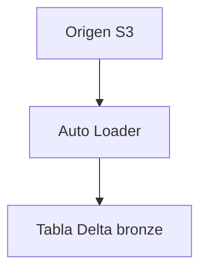

# Lesson template — ES (skeleton)

<!--
Copy this skeleton when starting a new es translation. It shows the ONLY
two English literals that must survive (dual-heading pattern) and a correct
frontmatter. Every fence, id and JSON key below is invariant — only the
string values are yours to translate.
-->

---
title: "Título Traducido de la Lección — Igual al H1"
description: "Descripción técnica traducida, 1–3 frases, misma información que en."
order: 1
difficulty: "intermediate"
duration: "75 minutes"
---
# Título Traducido de la Lección — Igual al H1

Párrafo de apertura que enuncia el modo de fallo que la lección corrige…

> [!NOTE]
> Cuerpo del callout traducido. Las etiquetas de callout NO cambian: NOTE,
> INFO, WARNING, DANGER, ERROR, SUCCESS, TIP, IMPORTANT.

## 1. Sección numerada traducida

### 1.1 Subsección

Texto con `código inline` y **énfasis**. Ejemplo resuelto con SQL intacto:

```sql
-- comments inside code stay in English (byte-identical to source)
SELECT * FROM gov.crm.customer_360 WHERE region = 'BR';
```



> 📚 **¿Sabías que…?** Caja de curiosidad traducida.

> ⚠️ **ADVERTENCIA:** warning afilado, nunca suavizado a NOTE.

> **Veredicto comparativo:** caja final con el veredicto traducido.

## Estudios de Caso Reales (Real-World Case Studies)

> **Empresa (nombre sin alterar)** — desafío traducido. Métricas con URL y
> fecha preservadas: `https://docs.databricks.com/...` (consultado en octubre de 2026).

### 2026 Updates (as of October 2026)

> - El literal del título de la caja `2026 Updates (as of October 2026)` puede
>   traducirse como `Actualizaciones de 2026 (a octubre de 2026)`; el verifier
>   no exige ese literal, solo la estructura. Bullets con fechas y fuentes.

> [!SUCCESS]
> **Conclusiones Clave (Key Takeaways):**
> 1. Primer takeaway numerado.
> 2. Segundo takeaway.

## Preguntas de Práctica (Practice Questions)

```question
{
  "id": "aaa-01-q1",
  "type": "multiple-choice",
  "question": "¿Pregunta traducida en estilo escenario?",
  "options": ["Opción A", "Opción B", "Opción C", "Opción D"],
  "correct": 1,
  "explanation": "Por qué B es correcta y A B C D trampas."
}
```

```matching
{
  "id": "aaa-01-q2",
  "type": "matching",
  "question": "Relacione cada servicio con su papel:",
  "pairs": [
    {"left": "S3", "right": "Almacenamiento de objetos — papel traducido"},
    {"left": "Glue", "right": "Catálogo de metadatos — papel traducido"}
  ],
  "explanation": "Explicación traducida."
}
```

```fillblank
{
  "id": "aaa-01-q3",
  "type": "fillblank",
  "question": "Complete la frase:",
  "template": "La transacción Delta queda registrada en el {{1}} como pares JSON, y el snapshot resuelto usa {{2}}.",
  "answers": { "1": "registro de transacciones", "2": "checkpoint" },
  "distractors": ["data lake", "bucket S3"],
  "explanation": "Explicación traducida — distractors planos, array de strings."
}
```

```dragdrop
{
  "id": "aaa-01-q4",
  "type": "dragdrop",
  "question": "Ordene las capas del flujo:",
  "items": ["Recepción bronze", "Curación silver", "Consumo gold"],
  "correctOrder": ["Recepción bronze", "Curación silver", "Consumo gold"],
  "explanation": "correctOrder traducido CON los items, mismo orden lógico."
}
```

```plot
{
  "id": "aaa-01-q5",
  "type": "plot",
  "question": "Latencia antes y después de la compactación:",
  "title": "Latencia de consulta (s)",
  "xLabel": "Escenario",
  "yLabel": "Segundos",
  "data": [
    { "x": "Antes", "y": 42.0 },
    { "x": "Después", "y": 3.1 }
  ],
  "dataKeys": ["y"],
  "explanation": "Solo title/xLabel/yLabel se traducen; data y dataKeys byte-idénticos."
}
```
