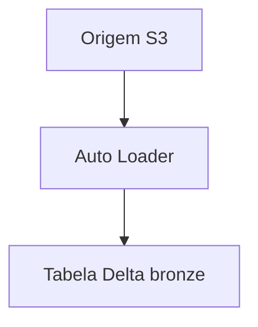

# Lesson template — PT-BR (skeleton)

<!--
Copy this skeleton when starting a new pt translation. It shows the ONLY
two English literals that must survive (dual-heading pattern) and a correct
frontmatter. Every fence, id and JSON key below is invariant — only the
string values are yours to translate.
-->

---
title: "Título Traduzido da Lição — Igual ao H1"
description: "Descrição técnica traduzida, 1–3 frases, mesma informação da en."
order: 1
difficulty: "intermediate"
duration: "75 min"
---
# Título Traduzido da Lição — Igual ao H1

Parágrafo de abertura que enuncia o modo de falha que a lição corrige…

> [!NOTE]
> Corpo do callout traduzido. Tags de callout NÃO mudam: NOTE, INFO,
> WARNING, DANGER, ERROR, SUCCESS, TIP, IMPORTANT.

## 1. Seção numerada traduzida

### 1.1 Subseção

Texto com `código inline` e **ênfase**. Exemplo resolvido com SQL intacto:

```sql
-- comments inside code stay in English (byte-identical to source)
SELECT * FROM gov.crm.customer_360 WHERE region = 'BR';
```



> 📚 Você sabia? Caixa de curiosidade traduzida. (fórmula travada: `📚 Você sabia?`)

> ⚠️ **AVISO:** warning afiado, nunca suavizado para NOTE.

> **Veredito Comparativo — …** caixa final. (fórmula travada: `> **Veredito Comparativo — `, com C maiúsculo)

## Casos Reais

> **Empresa (nome inalterado)** — desafio traduzido. Métricas com URL e data
> preservadas: `https://docs.databricks.com/...` (acedido em outubro de 2026).

### Atualizações de 2026 (em outubro de 2026)

> - Balaio de atualizações: título é fórmula travada
>   `### Atualizações de 2026 (em outubro de 2026)` — nenhum outro variant.
>   Bullets com datas e fontes preservadas.

> [!SUCCESS]
> **Pontos Principais (Key Takeaways):**
> 1. Primeiro takeaway numerado.
> 2. Segundo takeaway.

## Perguntas de Prática (Practice Questions)

```question
{
  "id": "aaa-01-q1",
  "type": "multiple-choice",
  "question": "Pergunta traduzida no estilo cenário?",
  "options": ["Opção A", "Opção B", "Opção C", "Opção D"],
  "correct": 1,
  "explanation": "Por que B está correta e A B C D armadilham."
}
```

```matching
{
  "id": "aaa-01-q2",
  "type": "matching",
  "question": "Correlacione cada serviço com seu papel:",
  "pairs": [
    {"left": "S3", "right": "Armazenamento de objetos — papel traduzido"},
    {"left": "Glue", "right": "Catálogo de metadados — papel traduzido"}
  ],
  "explanation": "Explicação traduzida."
}
```

```fillblank
{
  "id": "aaa-01-q3",
  "type": "fillblank",
  "question": "Complete a frase:",
  "template": "A transação Delta fica registrada no {{1}} como pares JSON, e o snapshot resolvido usa {{2}}.",
  "answers": { "1": "log de transações", "2": "checkpoint" },
  "distractors": ["data lake", "bucket S3"],
  "explanation": "Explicação traduzida — distractors planos, array de strings."
}
```

```dragdrop
{
  "id": "aaa-01-q4",
  "type": "dragdrop",
  "question": "Ordene as camadas do fluxo:",
  "items": ["Recepção bronze", "Curadoria prata", "Consumo ouro"],
  "correctOrder": ["Recepção bronze", "Curadoria prata", "Consumo ouro"],
  "explanation": "correctOrder traduzido COM os items, mesma ordem lógica."
}
```

```plot
{
  "id": "aaa-01-q5",
  "type": "plot",
  "question": "Latência antes e depois da compactação:",
  "title": "Latência de consulta (s)",
  "xLabel": "Cenário",
  "yLabel": "Segundos",
  "data": [
    { "x": "Antes", "y": 42.0 },
    { "x": "Depois", "y": 3.1 }
  ],
  "dataKeys": ["y"],
  "explanation": "Só title/xLabel/yLabel traduzem; data e dataKeys byte-idênticos."
}
```
