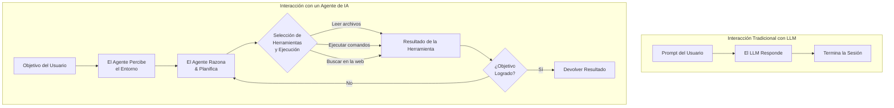
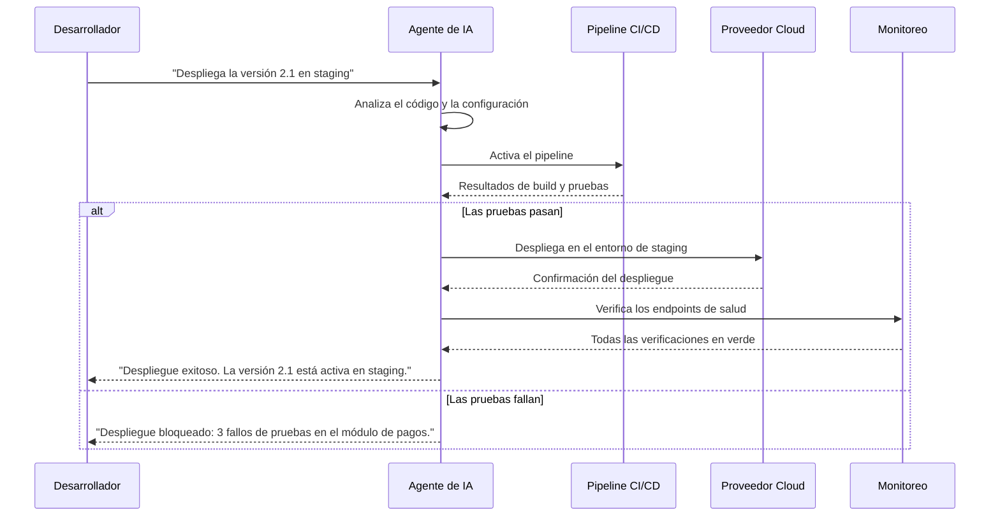
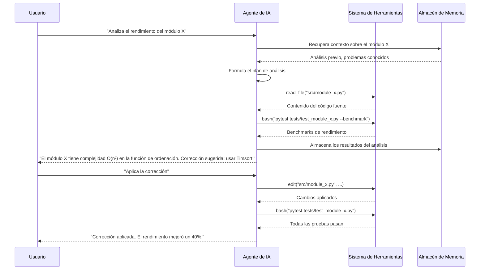

# Introducción a los Agentes de IA

## ¿Qué Son los Agentes de IA?

Los agentes de IA son sistemas de software autónomos que usan grandes modelos de lenguaje para percibir su entorno, razonar sobre objetivos y tomar acciones para completar tareas. A diferencia de los chatbots simples que responden prompts individuales, los agentes mantienen el contexto, usan herramientas, planifican flujos de trabajo de múltiples pasos y aprenden de la retroalimentación.



> [!NOTE]
> Un agente de IA no es solo un LLM con un prompt de sistema. Es un ciclo: percibir → razonar → actuar → observar → volver a razonar. Este ciclo es lo que distingue a los agentes de las simples completaciones de chat.

---

## Capacidades Fundamentales de los Agentes de IA

Los agentes de IA poseen varias capacidades distintas que los separan de las interacciones tradicionales con modelos de lenguaje:

### 1. Uso de Herramientas

Los agentes pueden invocar herramientas y APIs externas para interactuar con el mundo. Esto incluye operaciones de archivos, búsquedas web, ejecución de código, consultas a bases de datos y más.

```python
import json

# Example: Agent tool registry
class ToolRegistry:
    def __init__(self):
        self.tools = {}

    def register(self, name, handler, description, parameters):
        self.tools[name] = {
            "handler": handler,
            "description": description,
            "parameters": parameters
        }

    def call(self, name, **kwargs):
        if name not in self.tools:
            raise ValueError(f"Tool '{name}' not found")
        return self.tools[name]["handler"](**kwargs)

registry = ToolRegistry()
registry.register(
    name="read_file",
    handler=lambda path: open(path).read(),
    description="Read contents of a file",
    parameters={"path": {"type": "string", "description": "File path"}}
)
registry.register(
    name="web_search",
    handler=lambda query: f"Results for: {query}",
    description="Search the web for information",
    parameters={"query": {"type": "string", "description": "Search query"}}
)

# Agent invokes tools dynamically
result = registry.call("read_file", path="config.json")
print(f"File contents: {result}")
```

### 2. Razonamiento Multi-Paso

Los agentes descomponen objetivos complejos en subtareas más pequeñas, las ejecutan secuencialmente y adaptan sus planes según los resultados intermedios.

```json
{
  "agent_plan": {
    "goal": "Deploy the application to production",
    "steps": [
      {
        "step": 1,
        "action": "Run tests",
        "tool": "bash",
        "command": "pytest tests/",
        "expected": "All tests pass"
      },
      {
        "step": 2,
        "action": "Build artifacts",
        "tool": "bash",
        "command": "npm run build",
        "expected": "Build succeeds"
      },
      {
        "step": 3,
        "action": "Deploy to server",
        "tool": "bash",
        "command": "rsync -avz dist/ user@server:/var/www/",
        "conditional": "Only if steps 1 and 2 succeed"
      }
    ]
  }
}
```

### 3. Memoria y Gestión de Contexto

Los agentes mantienen memoria conversacional, almacenan hechos, recuperan el contexto relevante y resumen historiales largos para mantenerse dentro de las ventanas de contexto.

```python
class AgentMemory:
    def __init__(self, max_tokens=8192):
        self.short_term = []
        self.long_term = {}
        self.max_tokens = max_tokens

    def add_interaction(self, role, content):
        self.short_term.append({"role": role, "content": content})
        if self._estimate_tokens() > self.max_tokens:
            self._summarize()

    def _estimate_tokens(self):
        return sum(len(m["content"].split()) for m in self.short_term)

    def _summarize(self):
        # Summarize oldest half of interactions
        mid = len(self.short_term) // 2
        old_content = " ".join(
            m["content"] for m in self.short_term[:mid]
        )
        summary = f"[Summary of earlier context: {old_content[:200]}...]"
        self.short_term = self.short_term[mid:]
        self.short_term.insert(0, {"role": "system", "content": summary})

    def recall(self, key):
        return self.long_term.get(key)

    def remember(self, key, value):
        self.long_term[key] = value

memory = AgentMemory()
memory.add_interaction("user", "My project is called 'Nova'. It's a web app.")
memory.add_interaction("assistant", "I'll help you build Nova.")
print(memory.recall("project_name"))  # None - not stored in long-term

# Store important facts long-term
memory.remember("project_name", "Nova")
memory.remember("tech_stack", ["Python", "React", "PostgreSQL"])
print(f"Project: {memory.recall('project_name')}")
```

> [!TIP]
> Usa la memoria a largo plazo para los hechos que persisten entre sesiones (preferencias del usuario, constantes del proyecto) y la memoria a corto plazo para el contexto conversacional dentro de una sola sesión.

---

## Niveles de Autonomía de los Agentes

Los agentes operan en diferentes niveles de autonomía según el caso de uso y los requisitos de confianza:

| Nivel | Nombre | Descripción | Ejemplo |
|-------|--------|-------------|---------|
| 0 | Sin autonomía | El LLM solo genera texto, sin herramientas | Completación de chat |
| 1 | Asistido por herramientas | El LLM puede sugerir herramientas pero el usuario aprueba | Sugerencias de Copilot |
| 2 | Semiautónomo | El agente ejecuta herramientas pero pide confirmación para acciones críticas | Revisión de código con aprobación humana |
| 3 | Autónomo condicional | El agente ejecuta libremente dentro de salvaguardas definidas | Automatización de pipelines CI/CD |
| 4 | Totalmente autónomo | El agente opera de forma independiente con objetivos autodefinidos | Agentes de investigación de larga duración |

```yaml
# Agent autonomy configuration
agent_config:
  name: "semi-autonomous-coder"
  autonomy_level: 2
  guardrails:
    - action: "write"
      requires_approval: true
      paths: ["src/**"]
    - action: "bash"
      requires_approval: true
      patterns: ["rm *", "sudo *", "> /dev/*"]
    - action: "read"
      requires_approval: false
    - action: "grep"
      requires_approval: false
  fallback:
    on_uncertainty: "ask_user"
    on_error: "stop_and_report"
```

> [!WARNING]
> Los niveles más altos de autonomía introducen riesgo. Empieza siempre en el nivel 2 (semiautónomo) cuando despliegues nuevos agentes en entornos de producción. Aumenta la autonomía gradualmente a medida que validas el comportamiento del agente mediante pruebas rigurosas.

---

## Casos Reales

Los agentes de IA destacan en escenarios que requieren razonamiento multi-paso, interacción con herramientas y planificación adaptable:

### Generación y Refactorización de Código

Los agentes pueden generar código repetitivo (boilerplate), refactorizar bases de código existentes y mantener la consistencia entre archivos.

```python
# Agent-driven code refactoring workflow
def refactor_function(source_code: str, target_style: str) -> str:
    """Agent analyzes code, plans refactoring, executes changes."""
    analysis = {
        "issues": [
            {"line": 15, "type": "long_function", "suggestion": "Split into helpers"},
            {"line": 42, "type": "magic_number", "suggestion": "Use constant"},
            {"line": 78, "type": "duplicate_code", "suggestion": "Extract method"}
        ],
        "complexity": "moderate",
        "estimated_effort": "15 minutes"
    }
    # Agent would iteratively apply changes
    refactored = source_code  # Transformation happens here
    return refactored
```

### Pruebas Automatizadas

Los agentes crean suites de pruebas, generan casos extremos (edge cases) y validan el comportamiento.

```yaml
# Agent test generation plan
test_plan:
  source_file: "src/payment/processor.py"
  generated_tests:
    - file: "tests/test_payment_processor.py"
      test_cases:
        - name: "test_successful_payment"
          input: {"amount": 100, "currency": "USD"}
          expected: {"status": "success", "transaction_id": str}
        - name: "test_insufficient_funds"
          input: {"amount": 99999, "currency": "USD"}
          expected: {"status": "failed", "reason": "insufficient_funds"}
        - name: "test_invalid_currency"
          input: {"amount": 50, "currency": "XYZ"}
          expected: {"status": "error", "message": "Unsupported currency"}
      coverage_target: 85
```

### Documentación y Gestión del Conocimiento

Los agentes mantienen documentación, responden preguntas sobre bases de código y generan referencias de APIs.

### DevOps e Infraestructura

Los agentes gestionan despliegues, monitorean sistemas y responden a incidentes.



---

## Agente vs. LLM Tradicional: Comparación

| Aspecto | LLM Tradicional | Agente de IA |
|--------|----------------|----------|
| **Modelo de interacción** | Solicitud-respuesta | Ciclo orientado a objetivos |
| **Estado** | Sin estado (por prompt) | Con estado (entre pasos) |
| **Uso de herramientas** | Ninguno (solo texto) | Invocación dinámica de herramientas |
| **Planificación** | Ninguna | Descomposición en múltiples pasos |
| **Memoria** | Limitada a la ventana de contexto | Sistemas de memoria estructurados |
| **Recuperación de errores** | Ninguna | Reintentos, fallback y adaptación |
| **Autonomía** | Ninguna | Niveles de autonomía configurables |
| **Observabilidad** | Registros de prompt/respuesta | Trazas completas de acciones |

> [!SUCCESS]
> Los agentes de IA representan un cambio de paradigma: de la generación pasiva de texto a la ejecución activa de tareas. Al combinar el razonamiento de los LLM con el uso de herramientas, la memoria y la planificación, los agentes pueden completar de forma autónoma flujos de trabajo complejos de ingeniería de software que antes requerían intervención humana.

---

## Patrones de Comunicación entre Agentes

Los agentes se comunican con usuarios, herramientas y otros agentes mediante patrones estructurados:



> [!TIP]
| Diseña a los agentes para que comuniquen su proceso de razonamiento, no solo los resultados. Esta transparencia genera confianza y facilita la depuración cuando los agentes cometen errores.

---

## Ejercicios de Práctica

```question
{
  "id": "aa-01-q1",
  "type": "multiple-choice",
  "question": "¿Cuál es la diferencia clave entre una interacción tradicional con un LLM y un agente de IA?",
  "options": [
    "Los agentes de IA usan modelos más grandes que los LLM tradicionales",
    "Los agentes de IA operan en un ciclo de percibir-razonar-actuar en lugar de una simple solicitud-respuesta",
    "Los agentes de IA solo pueden usarse para tareas de programación",
    "Los LLM tradicionales no pueden generar texto"
  ],
  "correct": 1,
  "explanation": "Los agentes de IA operan en un ciclo autónomo: perciben su entorno, razonan sobre los objetivos, actúan usando herramientas, observan los resultados y vuelven a razonar. Los LLM tradicionales solo generan respuestas de texto a prompts individuales, sin interacción con herramientas ni planificación multi-paso."
}
```

```question
{
  "id": "aa-01-q2",
  "type": "multiple-choice",
  "question": "¿En qué nivel de autonomía un agente ejecuta herramientas libremente dentro de salvaguardas definidas, sin requerir aprobación humana para acciones rutinarias?",
  "options": [
    "Nivel 1: Asistido por herramientas",
    "Nivel 2: Semiautónomo",
    "Nivel 3: Autónomo condicional",
    "Nivel 4: Totalmente autónomo"
  ],
  "correct": 2,
  "explanation": "El nivel 3 (Autónomo condicional) permite al agente ejecutar libremente dentro de salvaguardas definidas. El nivel 2 requiere aprobación humana para acciones críticas, mientras que el nivel 4 otorga al agente independencia completa, incluidos objetivos autodefinidos."
}
```

```question
{
  "id": "aa-01-q3",
  "type": "multiple-choice",
  "question": "Un equipo de desarrollo quiere un agente que pueda leer archivos, buscar en el código y sugerir cambios, pero que requiera aprobación humana antes de escribir cualquier archivo. ¿Qué nivel de autonomía deberían configurar?",
  "options": [
    "Nivel 0: Sin autonomía",
    "Nivel 1: Asistido por herramientas",
    "Nivel 2: Semiautónomo",
    "Nivel 3: Autónomo condicional"
  ],
  "correct": 2,
  "explanation": "El nivel 2 (Semiautónomo) permite al agente usar herramientas como read y grep libremente, pero requiere aprobación humana explícita para las operaciones de escritura. Esto coincide con el requisito del equipo: autonomía de lectura/búsqueda con salvaguardas de escritura."
}
```

```question
{
  "id": "aa-01-q4",
  "type": "multiple-choice",
  "question": "En el contexto de la memoria de un agente, ¿cuál es el propósito principal del mecanismo de resumen?",
  "options": [
    "Cifrar los datos sensibles de la conversación",
    "Comprimir el contexto más antiguo y mantenerse dentro de los límites de tokens",
    "Traducir conversaciones entre idiomas",
    "Borrar todo el historial de la conversación periódicamente"
  ],
  "correct": 1,
  "explanation": "El resumen comprime las porciones más antiguas de la conversación en un resumen conciso, lo que permite al agente conservar el contexto esencial mientras se mantiene dentro del límite de tokens del modelo. Esto es crucial porque los modelos tienen ventanas de contexto finitas."
}
```

```question
{
  "id": "aa-01-q5",
  "type": "multiple-choice",
  "question": "¿Qué capacidad permite a un agente de IA interactuar con sistemas externos como bases de datos, sistemas de archivos y APIs web?",
  "options": [
    "Razonamiento multi-paso",
    "Memoria y gestión de contexto",
    "Uso de herramientas",
    "Comprensión del lenguaje natural"
  ],
  "correct": 2,
  "explanation": "El uso de herramientas es la capacidad que permite a los agentes invocar funciones y APIs externas. Mediante un registro de herramientas, los agentes pueden llamar operaciones como leer archivos, ejecutar comandos, buscar en la web y consultar bases de datos."
}
```

```question
{
  "id": "aa-01-q6",
  "type": "multiple-choice",
  "question": "Cuando un agente encuentra un error inesperado durante un plan multi-paso, ¿qué debería hacer según las mejores prácticas?",
  "options": [
    "Ignorar el error y continuar con el siguiente paso",
    "Detenerse por completo y borrar todo el trabajo realizado hasta ahora",
    "Analizar el error, intentar la recuperación o un reintento, y adaptar el plan si es necesario",
    "Pedir al usuario que complete manualmente los pasos restantes"
  ],
  "correct": 2,
  "explanation": "Los agentes robustos deben analizar los errores, intentar estrategias de recuperación (reintento con diferentes parámetros, uso de enfoques alternativos) y adaptar sus planes en consecuencia. Esta resiliencia es una característica clave que distingue a los agentes de los scripts simples."
}
```

```question
{
  "id": "aa-01-q7",
  "type": "multiple-choice",
  "question": "¿Qué información debería almacenar un agente en la memoria a largo plazo frente a la de corto plazo?",
  "options": [
    "Todo va a la memoria a largo plazo",
    "El flujo de la conversación va a largo plazo y los hechos del proyecto a corto plazo",
    "Los hechos del proyecto y las preferencias del usuario van a largo plazo; el contexto conversacional va a corto plazo",
    "No hay diferencia entre la memoria a largo y a corto plazo"
  ],
  "correct": 2,
  "explanation": "La memoria a largo plazo es para hechos persistentes como nombres de proyecto, preferencias del usuario y decisiones técnicas que deben sobrevivir entre sesiones. La memoria a corto plazo contiene el contexto conversacional dentro de una sola sesión y está sujeta a resumen cuando se acercan los límites de tokens."
}
```

```question
{
  "id": "aa-01-q8",
  "type": "multiple-choice",
  "question": "Un usuario le pide a un agente 'mejorar el rendimiento del pipeline de procesamiento de datos'. El agente lee el código, identifica un algoritmo lento, lo reemplaza, lo prueba e informa de la mejora. ¿Este es un ejemplo de qué característica de un agente?",
  "options": [
    "Generación de respuestas de un solo turno",
    "Razonamiento multi-paso con uso de herramientas y planificación adaptable",
    "Capacidad de consultas a bases de datos",
    "Fine-tuning del modelo"
  ],
  "correct": 1,
  "explanation": "Este escenario demuestra razonamiento multi-paso: el agente descompuso el objetivo (leer código → analizar → corregir → probar → informar), usó herramientas (read, edit, bash) y adaptó sus acciones según los resultados intermedios. Esta es la marca distintiva de un agente de IA frente a un LLM simple."
}
```

---

[!SUCCESS] **Conclusiones Clave (Key Takeaways):**

- Los agentes de IA son sistemas autónomos que perciben, razonan, actúan y aprenden en un ciclo continuo
- Las capacidades fundamentales de un agente incluyen el uso de herramientas, el razonamiento multi-paso y la gestión estructurada de la memoria
- Los niveles de autonomía van del 0 (sin autonomía) al 4 (totalmente autónomo), y la mayoría de los agentes en producción operan en el nivel 2 o 3
- Los registros de herramientas permiten a los agentes interactuar de forma dinámica con archivos, comandos, APIs y bases de datos
- Los sistemas de memoria combinan el contexto a corto plazo con un almacenamiento persistente a largo plazo
- Los agentes destacan en flujos de trabajo complejos: generación de código, pruebas, documentación y DevOps
- El ciclo de percibir-razonar-actuar distingue fundamentalmente a los agentes de los LLM tradicionales basados en chat
- Empieza con niveles de autonomía bajos y aumenta gradualmente a medida que se valida el comportamiento del agente
