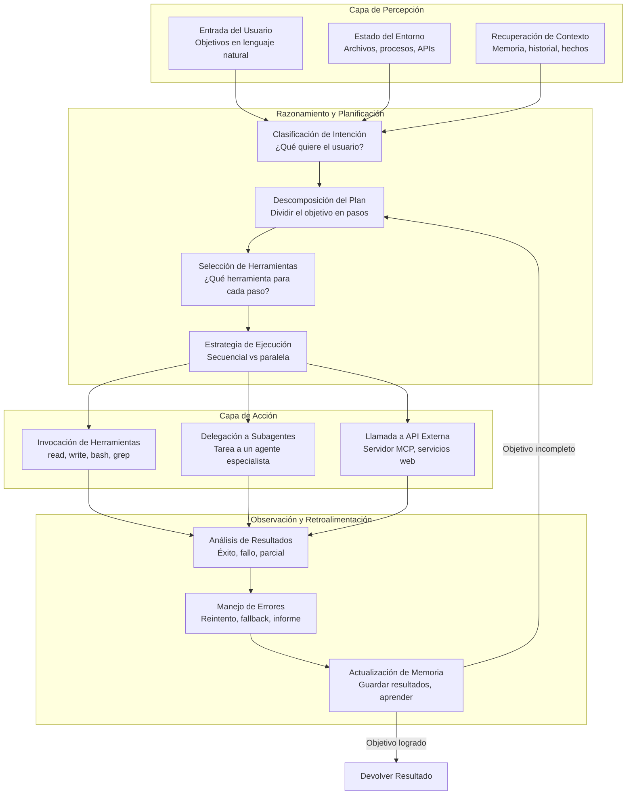
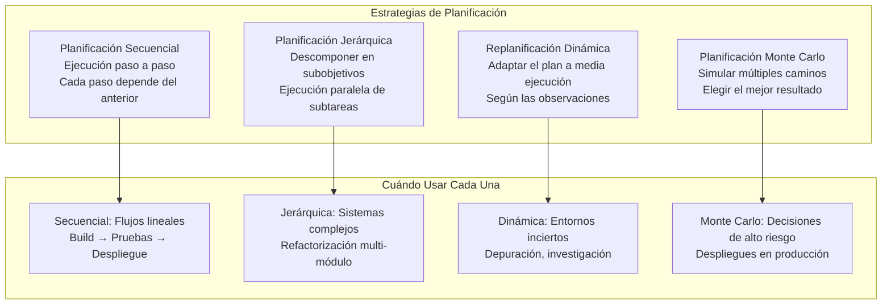
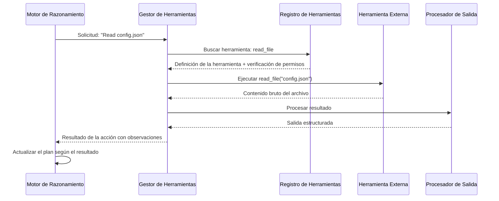

# Arquitectura de Agentes

## El Ciclo del Agente

Todo agente de IA sigue un ciclo fundamental: percibir el entorno, razonar sobre el estado actual, planificar acciones, ejecutarlas, observar los resultados y repetir. Esta arquitectura es lo que permite a los agentes completar de forma autónoma tareas complejas.



> [!NOTE]
> El ciclo del agente no es necesariamente lineal. Los agentes modernos usan replanificación dinámica: si un paso falla, el agente no reinicia — vuelve a evaluar el plan desde el estado actual y se adapta.

---

## Capa de Percepción

La capa de percepción es como el agente recibe información sobre su entorno. Procesa múltiples canales de entrada simultáneamente.

```python
class PerceptionLayer:
    def __init__(self):
        self.channels = {}

    def register_channel(self, name, parser):
        self.channels[name] = parser

    def perceive(self, inputs):
        perception = {}
        for channel, data in inputs.items():
            if channel in self.channels:
                perception[channel] = self.channels[channel](data)
        return perception

    def parse_user_input(self, text):
        return {
            "raw": text,
            "intent": self._classify_intent(text),
            "entities": self._extract_entities(text),
            "urgency": self._detect_urgency(text)
        }

    def _classify_intent(self, text):
        intents = {
            "generate": ["create", "write", "implement", "build"],
            "analyze": ["analyze", "review", "check", "audit"],
            "modify": ["change", "update", "refactor", "fix"],
            "query": ["what", "how", "why", "where", "when"]
        }
        for intent, keywords in intents.items():
            if any(kw in text.lower() for kw in keywords):
                return intent
        return "unknown"

    def _extract_entities(self, text):
        # Extract file paths, function names, etc.
        import re
        files = re.findall(r'[\w./-]+\.\w+', text)
        return {"files": files}

    def _detect_urgency(self, text):
        urgent_markers = ["urgent", "asap", "critical", "immediately", "now"]
        return any(m in text.lower() for m in urgent_markers)

perceiver = PerceptionLayer()
result = perceiver.parse_user_input(
    "Urgent: refactor the auth module in src/auth.py to use JWT tokens"
)
print(f"Intent: {result['intent']}")
print(f"Files: {result['entities']['files']}")
print(f"Urgent: {result['urgency']}")
```

### Canales de Percepción

| Canal | Fuente | Tipo de Dato | Ejemplo |
|---------|--------|-----------|---------|
| Entrada del usuario | Mensaje en lenguaje natural | Texto con intención/entidades | "Encuentra el bug en process.py" |
| Sistema de archivos | Archivos del proyecto | Contenido de archivos, metadatos | Código fuente, configuraciones |
| Entorno | SO, procesos | Estado del sistema, variables de entorno | Servicios en ejecución, puertos |
| Memoria | Almacenamiento del agente | Interacciones pasadas, hechos | Decisiones anteriores |
| Salida de herramientas | Resultados de comandos | stdout, stderr, códigos de salida | Resultados de pruebas, logs de build |
| APIs externas | Servicios web | JSON, XML, binario | Issues de GitHub, Slack |

> [!TIP]
> Diseña tu capa de percepción para que sea extensible. A medida que tu agente crezca, querrás añadir nuevos canales de entrada (Slack, correo electrónico, alertas de monitoreo) sin reescribir la arquitectura central.

---

## Motor de Razonamiento

El motor de razonamiento es el cerebro del agente. Interpreta las percepciones, toma decisiones y formula planes.

```python
class ReasoningEngine:
    def __init__(self, llm_client):
        self.llm = llm_client
        self.plan = []

    def analyze_state(self, perception, memory):
        prompt = f"""
        Current state: {perception}
        Available context: {memory.get_relevant(perception)}
        
        Analyze the situation and determine:
        1. What is the primary goal?
        2. What constraints exist?
        3. What tools are needed?
        4. What could go wrong?
        """
        return self.llm.complete(prompt)

    def decompose_goal(self, goal, available_tools):
        prompt = f"""
        Goal: {goal}
        Available tools: {list(available_tools.keys())}
        
        Break this goal into sequential steps.
        Each step must specify:
        - Action description
        - Tool to use
        - Expected outcome
        - Error recovery strategy
        """
        response = self.llm.complete(prompt)
        steps = self._parse_steps(response)
        self.plan = steps
        return steps

    def _parse_steps(self, llm_response):
        # Parse LLM response into structured steps
        steps = []
        for line in llm_response.split("\n"):
            if line.strip().startswith("- Step"):
                steps.append({"raw": line.strip()})
        return steps

    def select_tool(self, step, tool_registry):
        scores = {}
        for name, tool in tool_registry.items():
            relevance = self._compute_relevance(step, tool["description"])
            scores[name] = relevance
        return max(scores, key=scores.get)

    def _compute_relevance(self, step, description):
        # Simplified relevance scoring
        keywords = set(step.lower().split())
        desc_keywords = set(description.lower().split())
        overlap = keywords & desc_keywords
        return len(overlap) / max(len(keywords), 1)

engine = ReasoningEngine(llm_client=None)  # Would use real LLM
tools = {
    "read_file": {"description": "Read file contents from disk"},
    "bash": {"description": "Execute shell commands"},
    "web_search": {"description": "Search the internet"},
}
print(engine.select_tool("read the configuration file", tools))
```

---

## Estrategias de Planificación

Los agentes usan diferentes estrategias de planificación según la complejidad y los requisitos de la tarea:



```yaml
# Sequential planning configuration
planning:
  strategy: sequential
  max_retries: 3
  stop_on_failure: true
  plan:
    - id: 1
      action: "lint"
      tool: "bash"
      command: "ruff check src/"
    - id: 2
      action: "type_check"
      tool: "bash"
      command: "mypy src/"
      depends_on: [1]
    - id: 3
      action: "test"
      tool: "bash"
      command: "pytest tests/"
      depends_on: [2]
    - id: 4
      action: "build"
      tool: "bash"
      command: "python -m build"
      depends_on: [3]
```

> [!WARNING]
> La planificación secuencial es simple pero frágil. Un fallo en el paso 1 detiene todo el pipeline. Incluye siempre estrategias de recuperación de errores y considera la ejecución paralela para pasos independientes.

### Replanificación Dinámica en Acción

```python
class DynamicPlanner:
    def __init__(self, llm):
        self.llm = llm
        self.execution_history = []

    def execute_plan(self, initial_goal, tools):
        current_goal = initial_goal
        current_plan = self._create_plan(current_goal)

        while not self._goal_achieved(current_goal):
            for step in current_plan:
                result = self._execute_step(step, tools)
                self.execution_history.append({
                    "step": step,
                    "result": result,
                    "success": result["status"] == "ok"
                })

                if result["status"] == "error":
                    # Dynamic re-planning
                    recovery = self._plan_recovery(step, result)
                    if recovery["strategy"] == "retry":
                        current_plan = self._adjust_plan(
                            current_plan, step, recovery
                        )
                    elif recovery["strategy"] == "alternative":
                        alternative = recovery["alternative_action"]
                        current_plan = self._replace_step(
                            current_plan, step, alternative
                        )
                    elif recovery["strategy"] == "abort":
                        return {"status": "failed", "at": step}

        return {"status": "success", "history": self.execution_history}

    def _create_plan(self, goal):
        return [{"id": 1, "action": f"Process: {goal}"}]

    def _execute_step(self, step, tools):
        # Simulated execution
        return {"status": "ok", "output": f"Executed {step['action']}"}

    def _goal_achieved(self, goal):
        return False

    def _plan_recovery(self, failed_step, error):
        return {"strategy": "retry", "max_attempts": 3}

    def _adjust_plan(self, plan, failed_step, recovery):
        return plan

    def _replace_step(self, plan, old_step, new_action):
        return plan

planner = DynamicPlanner(llm=None)
result = planner.execute_plan("Deploy application", {})
print(f"Execution status: {result['status']}")
```

---

## Gestión de Estado

Los agentes deben rastrear el estado a lo largo del ciclo de ejecución. El estado incluye el objetivo actual, los pasos completados, los resultados de las herramientas y el contexto acumulado.

```json
{
  "agent_state": {
    "session_id": "sess_abc123",
    "status": "executing",
    "current_goal": "Refactor payment module",
    "plan": {
      "strategy": "hierarchical",
      "sub_goals": [
        {
          "id": "sg_1",
          "description": "Analyze current payment code",
          "status": "completed",
          "result": "Found 3 areas for improvement"
        },
        {
          "id": "sg_2",
          "description": "Implement error handling improvements",
          "status": "in_progress",
          "current_step": {
            "action": "edit",
            "file": "src/payment/processor.py",
            "target": "validate_amount function"
          }
        },
        {
          "id": "sg_3",
          "description": "Add test coverage for new error paths",
          "status": "pending",
          "dependencies": ["sg_2"]
        }
      ]
    },
    "memory": {
      "short_term": [
        {"role": "user", "content": "Refactor the payment module..."},
        {"role": "assistant", "content": "I'll analyze the current code first."}
      ],
      "working": {
        "current_file": "src/payment/processor.py",
        "last_function": "validate_amount",
        "changes_made": 2
      }
    },
    "tool_history": [
      {"tool": "grep", "pattern": "def validate", "result": "Found at line 142"},
      {"tool": "read", "file": "src/payment/processor.py", "lines": "140-180"}
    ]
  }
}
```

### Máquina de Estados para el Ciclo de Vida del Agente

```python
from enum import Enum

class AgentState(Enum):
    IDLE = "idle"
    PERCEIVING = "perceiving"
    REASONING = "reasoning"
    PLANNING = "planning"
    EXECUTING = "executing"
    OBSERVING = "observing"
    ERROR = "error"
    COMPLETED = "completed"

class StateMachine:
    def __init__(self):
        self.state = AgentState.IDLE
        self.transitions = {
            AgentState.IDLE: [AgentState.PERCEIVING],
            AgentState.PERCEIVING: [AgentState.REASONING, AgentState.ERROR],
            AgentState.REASONING: [AgentState.PLANNING, AgentState.ERROR],
            AgentState.PLANNING: [AgentState.EXECUTING, AgentState.ERROR],
            AgentState.EXECUTING: [AgentState.OBSERVING, AgentState.ERROR],
            AgentState.OBSERVING: [AgentState.REASONING, AgentState.COMPLETED, AgentState.ERROR],
            AgentState.ERROR: [AgentState.IDLE, AgentState.REASONING],
            AgentState.COMPLETED: [AgentState.IDLE]
        }

    def transition_to(self, new_state):
        if new_state in self.transitions[self.state]:
            old = self.state
            self.state = new_state
            print(f"State: {old.value} → {new_state.value}")
            return True
        raise ValueError(f"Cannot transition from {self.state} to {new_state}")

    def reset(self):
        self.state = AgentState.IDLE

sm = StateMachine()
sm.transition_to(AgentState.PERCEIVING)
sm.transition_to(AgentState.REASONING)
sm.transition_to(AgentState.PLANNING)
sm.transition_to(AgentState.EXECUTING)
sm.transition_to(AgentState.OBSERVING)
sm.transition_to(AgentState.COMPLETED)
```

> [!TIP]
> Usa una máquina de estados para hacer el comportamiento del agente predecible y depurable. Cada transición de estado puede registrarse, monitorearse y probarse de forma independiente.

---

## Arquitectura de Integración de Herramientas

La capa de integración de herramientas conecta el razonamiento del agente con las acciones externas. Gestiona el descubrimiento, la invocación y el procesamiento de resultados.



```python
class ToolManager:
    def __init__(self, registry, permission_system):
        self.registry = registry
        self.permissions = permission_system
        self.execution_log = []

    async def execute(self, tool_name, params):
        # Check permissions first
        if not self.permissions.is_allowed(tool_name, params):
            return {
                "status": "denied",
                "tool": tool_name,
                "reason": "Permission denied"
            }

        # Validate parameters against schema
        tool_def = self.registry.get(tool_name)
        errors = self._validate_params(tool_def, params)
        if errors:
            return {"status": "error", "errors": errors}

        # Execute with timeout
        try:
            result = await self.registry.call(tool_name, **params)
            processed = self._process_output(result)
            self.execution_log.append({
                "tool": tool_name,
                "params": params,
                "result": processed,
                "timestamp": __import__('time').time()
            })
            return {"status": "success", "data": processed}
        except Exception as e:
            return {"status": "error", "error": str(e)}

    def _validate_params(self, tool_def, params):
        errors = []
        schema = tool_def.get("parameters", {})
        for key, spec in schema.items():
            if spec.get("required") and key not in params:
                errors.append(f"Missing required parameter: {key}")
        return errors

    def _process_output(self, output):
        if isinstance(output, str) and len(output) > 1000:
            return {
                "content": output[:1000] + "...[truncated]",
                "full_length": len(output)
            }
        return {"content": output}
```

---

## Comparación de Arquitecturas: Frameworks de Agentes

| Aspecto | Loop Simple | Jerárquico | Dirigido por Eventos | Reactivo |
|--------|-------------|--------------|--------------|----------|
| **Estructura** | Lineal percibir→razonar→actuar | Sub-agentes con managers | Bus de eventos pub/sub | Estímulo-respuesta |
| **Estado** | Pila única | Distribuido | Almacén de eventos compartido | Mínimo |
| **Escalabilidad** | Limitada | Alta | Muy alta | Moderada |
| **Aislamiento de errores** | Pobre | Bueno | Excelente | Aceptable |
| **Caso de uso** | Automatización simple | Flujos de trabajo complejos | Sistemas en tiempo real | IA para videojuegos |
| **Ejemplo** | Asistente personal | Codificación multi-agente | Agente de monitoreo | Chatbot |

> [!SUCCESS]
> El ciclo del agente (percibir → razonar → planificar → actuar → observar) es el patrón universal que subyace a todas las arquitecturas de agentes. Domina este ciclo y podrás implementar cualquier framework de agentes.

---

## Ejercicios de Práctica

```question
{
  "id": "aa-02-q1",
  "type": "multiple-choice",
  "question": "En el ciclo del agente, después de ejecutar una acción y observar el resultado, ¿qué sucede si el objetivo aún no se ha logrado?",
  "options": [
    "El agente termina inmediatamente",
    "El agente vuelve a la fase de razonamiento/planificación",
    "El agente repite la misma acción indefinidamente",
    "El agente espera la entrada del usuario"
  ],
  "correct": 1,
  "explanation": "Si el objetivo no se logra tras la observación, el agente vuelve a la fase de razonamiento/planificación para reevaluar la situación y ajustar su plan. Este es el ciclo de retroalimentación que permite un comportamiento adaptable."
}
```

```question
{
  "id": "aa-02-q2",
  "type": "multiple-choice",
  "question": "¿Qué estrategia de planificación es la más adecuada para un flujo de trabajo lineal como build → pruebas → despliegue?",
  "options": [
    "Planificación Monte Carlo",
    "Planificación jerárquica",
    "Planificación secuencial",
    "Planificación reactiva"
  ],
  "correct": 2,
  "explanation": "La planificación secuencial es ideal para flujos de trabajo lineales donde cada paso depende del anterior. El build debe tener éxito antes de las pruebas, y las pruebas deben pasar antes del despliegue."
}
```

```question
{
  "id": "aa-02-q3",
  "type": "multiple-choice",
  "question": "¿Cuál es el propósito de la capa de percepción en una arquitectura de agentes?",
  "options": [
    "Ejecutar comandos de shell",
    "Almacenar memorias a largo plazo",
    "Recibir y analizar entradas de múltiples canales",
    "Generar las respuestas finales al usuario"
  ],
  "correct": 2,
  "explanation": "La capa de percepción es responsable de recibir entradas de varios canales (mensajes del usuario, sistema de archivos, entorno, APIs) y analizarlas en datos estructurados que el motor de razonamiento puede procesar."
}
```

```question
{
  "id": "aa-02-q4",
  "type": "multiple-choice",
  "question": "Cuando un paso falla durante la ejecución secuencial, ¿cuál es el enfoque de recuperación recomendado para un agente robusto?",
  "options": [
    "Reiniciar todo el plan desde el principio",
    "Ignorar el fallo y continuar con el siguiente paso",
    "Analizar el error, reintentar o buscar un enfoque alternativo y luego adaptar el plan",
    "Informar al usuario y detener toda ejecución posterior"
  ],
  "correct": 2,
  "explanation": "Un agente robusto usa replanificación dinámica: analiza el error, intenta la recuperación (reintento con modificaciones o enfoque alternativo) y adapta el plan restante en consecuencia. Esta resiliencia es esencial para los agentes en producción."
}
```

```question
{
  "id": "aa-02-q5",
  "type": "multiple-choice",
  "question": "En el patrón de Gestor de Herramientas (Tool Manager), ¿qué verificación ocurre antes de ejecutar una herramienta?",
  "options": [
    "La herramienta se compila desde el código fuente",
    "Se verifican los permisos según las reglas de permitir/denegar",
    "La herramienta se descarga de un registro remoto",
    "El modelo LLM se ajusta (fine-tuning) para la herramienta específica"
  ],
  "correct": 1,
  "explanation": "El Gestor de Herramientas verifica los permisos antes de ejecutar cualquier herramienta. Si el sistema de permisos deniega la acción según las reglas configuradas de permitir/denegar, la herramienta no se ejecuta y se devuelve una respuesta de denegación."
}
```

```question
{
  "id": "aa-02-q6",
  "type": "multiple-choice",
  "question": "Un agente está depurando un problema complejo y encuentra resultados inesperados que invalidan su plan inicial. ¿Qué estrategia de planificación es la más adecuada para este escenario?",
  "options": [
    "Planificación secuencial sin desviaciones",
    "Replanificación dinámica para adaptarse a nuevas observaciones",
    "Simulación Monte Carlo de todos los planes posibles",
    "Sin planificación: ejecutar todas las acciones simultáneamente"
  ],
  "correct": 1,
  "explanation": "La replanificación dinámica permite al agente adaptar su plan según la nueva información descubierta durante la ejecución. Esto es esencial para tareas de depuración e investigación donde el camino hacia el objetivo es incierto."
}
```

```question
{
  "id": "aa-02-q7",
  "type": "multiple-choice",
  "question": "¿Cuál es el beneficio de usar una máquina de estados para gestionar el ciclo de vida del agente?",
  "options": [
    "Hace que el agente se ejecute más rápido",
    "Elimina la necesidad de manejo de errores",
    "Hace el comportamiento predecible, registrado y testeable",
    "Permite al agente usar múltiples LLMs simultáneamente"
  ],
  "correct": 2,
  "explanation": "Una máquina de estados hace que el comportamiento del agente sea predecible y depurable. Cada transición de estado puede registrarse, monitorearse y probarse de forma independiente, lo que facilita entender y corregir problemas en el comportamiento del agente."
}
```

```question
{
  "id": "aa-02-q8",
  "type": "multiple-choice",
  "question": "En una arquitectura de planificación jerárquica, ¿qué sucede cuando un subobjetivo falla?",
  "options": [
    "Se abandona el objetivo de nivel superior completo",
    "Solo se ve afectada la rama del subobjetivo fallido; las demás ramas continúan",
    "Todos los subobjetivos se reinician desde cero",
    "El sistema cambia automáticamente a un modelo LLM diferente"
  ],
  "correct": 1,
  "explanation": "En la planificación jerárquica, los subobjetivos son bastante independientes. Si un subobjetivo falla, el sistema puede aislar el fallo a esa rama mientras otros subobjetivos paralelos continúan su ejecución. El planificador padre puede entonces decidir reintentar, omitir o compensar el subobjetivo fallido."
}
```

---

[!SUCCESS] **Conclusiones Clave (Key Takeaways):**

- El ciclo del agente (percibir → razonar → planificar → actuar → observar) es el patrón universal de todas las arquitecturas de agentes
- La capa de percepción procesa entradas de múltiples canales: mensajes del usuario, archivos, entorno, APIs
- El motor de razonamiento interpreta el estado y toma decisiones, delegando a menudo en los LLM para el análisis complejo
- Las estrategias de planificación incluyen secuencial, jerárquica, replanificación dinámica y enfoques Monte Carlo
- La replanificación dinámica permite a los agentes recuperarse de fallos y adaptarse a observaciones inesperadas
- Las máquinas de estados hacen el comportamiento del agente predecible, registrado y testeable
- Los gestores de herramientas manejan la verificación de permisos, la validación de parámetros, la ejecución y el procesamiento de salidas
- Diferentes arquitecturas (loop simple, jerárquica, dirigida por eventos) se adaptan a diferentes casos de uso
