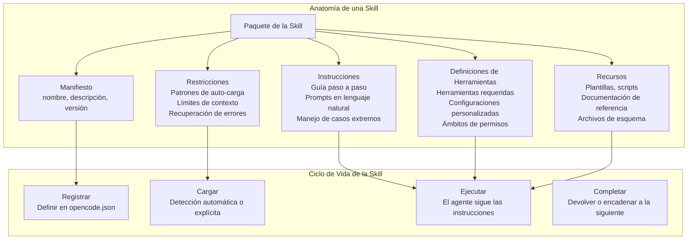
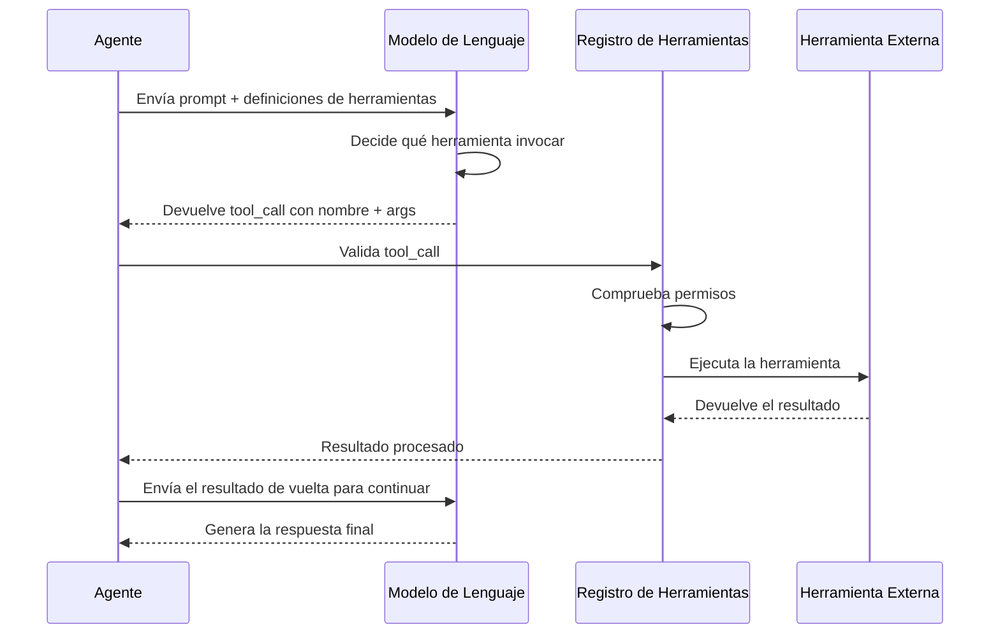

# Skills y Capacidades

## ¿Qué Son las Skills de los Agentes?

Las skills son unidades de capacidad reutilizables y componibles que enseñan a un agente de IA a realizar tareas específicas. A diferencia de los prompts monolíticos de los agentes, las skills son modulares, testeables y pueden compartirse entre diferentes agentes. Una skill encapsula las instrucciones, configuraciones de herramientas, recursos y restricciones necesarios para completar una tarea bien definida.



> [!NOTE]
> Una skill no es lo mismo que un plugin. Las skills son paquetes de instrucciones que guían el comportamiento del agente; los plugins (servidores MCP) son procesos externos que proporcionan herramientas. Las skills le dicen al agente *cómo* usar las herramientas; los plugins proporcionan las herramientas en sí.

---

## Definición del Manifiesto de la Skill

Toda skill comienza con un archivo de manifiesto que declara su identidad, capacidades y comportamiento de carga.

```yaml
# skills/code-reviewer/skill.yaml
name: code-reviewer
version: "1.2.0"
description: |
  Performs comprehensive code reviews focusing on security,
  performance, maintainability, and best practices.

author: "NUniversity"
license: "MIT"

instructions:
  - path: instructions/review-process.md
  - path: instructions/security-checklist.md
  - path: instructions/performance-guidelines.md

tools:
  required:
    - read
    - grep
    - glob
  optional:
    - bash
    - websearch

resources:
  - path: resources/owasp-top10.yaml
    description: OWASP Top 10 vulnerability reference
  - path: resources/style-guide.md
    description: Project-specific style guide

autoload:
  enabled: true
  matchPattern: "review|audit|inspect|check code"

constraints:
  maxTokens: 4096
  temperature: 0.3
  allowedTools:
    - read
    - grep
    - glob
  deniedTools:
    - write
    - edit

errorRecovery:
  onFailure: "report_and_stop"
  maxRetries: 2
```

> [!TIP]
> Usa `matchPattern` para la auto-carga y haz que las skills se sientan mágicas. Cuando un usuario dice "revisa el módulo de autenticación", la skill se activa automáticamente sin que el usuario tenga que saber nada sobre la gestión de skills.

---

## Instrucciones de la Skill

Las instrucciones son el núcleo de una skill. Proporcionan una guía paso a paso que el agente sigue para completar la tarea.

```markdown
<!-- skills/code-reviewer/instructions/review-process.md -->
# Proceso de Revisión de Código

## Paso 1: Comprender el Código
- Lee el/los archivo(s) objetivo usando la herramienta `read`
- Identifica todas las funciones, clases y sus relaciones
- Ten en cuenta el lenguaje de programación y el framework

## Paso 2: Análisis de Seguridad
- Busca vulnerabilidades del OWASP Top 10
  - SQL injection: busca consultas SQL sin parametrizar
  - XSS: comprueba la entrada del usuario sin escapar en las plantillas
  - CSRF: verifica la implementación del token
- Revisa la lógica de autenticación y autorización

## Paso 3: Evaluación de Rendimiento
- Identifica algoritmos O(n²) y sugiere optimizaciones
- Busca operaciones de E/S innecesarias
- Revisa los patrones de consultas a la base de datos en busca de problemas N+1

## Paso 4: Calidad del Código
- Evalúa las convenciones de nombres y la organización del código
- Comprueba la cobertura del manejo de errores
- Verifica la cobertura y la calidad de las pruebas

## Paso 5: Generación del Informe
- Resume los hallazgos por severidad (crítica, mayor, menor)
- Proporciona referencias específicas de línea para cada problema
- Sugiere correcciones concretas con ejemplos de código
```

```python
# Skill instructions can also be programmatic
class CodeReviewSkill:
    def __init__(self, agent):
        self.agent = agent
        self.findings = []

    async def execute(self, target_path):
        # Step 1: Read and understand
        code = await self.agent.read(target_path)

        # Step 2: Analyze
        security_issues = self._check_security(code)
        perf_issues = self._check_performance(code)
        quality_issues = self._check_quality(code)

        # Step 3: Generate report
        report = self._generate_report(
            target_path,
            security_issues + perf_issues + quality_issues
        )
        return report

    def _check_security(self, code):
        issues = []
        if "execute(" in code or "eval(" in code:
            issues.append({
                "severity": "critical",
                "type": "code_injection",
                "description": "Use of dangerous functions"
            })
        if "SELECT" in code and "WHERE" not in code:
            issues.append({
                "severity": "critical",
                "type": "sql_injection",
                "description": "Unparameterized SQL query"
            })
        return issues

    def _check_performance(self, code):
        issues = []
        lines = code.split("\n")
        for i, line in enumerate(lines, 1):
            if "for" in line and "for" in lines[i:]:
                issues.append({
                    "severity": "major",
                    "type": "nested_loop",
                    "line": i,
                    "description": f"Nested loop detected at line {i}"
                })
        return issues

    def _check_quality(self, code):
        issues = []
        if len(code.split("\n")) > 500:
            issues.append({
                "severity": "minor",
                "type": "file_length",
                "description": "File exceeds 500 lines"
            })
        return issues

    def _generate_report(self, path, all_issues):
        return {
            "file": path,
            "total_issues": len(all_issues),
            "by_severity": {
                "critical": len([i for i in all_issues if i["severity"] == "critical"]),
                "major": len([i for i in all_issues if i["severity"] == "major"]),
                "minor": len([i for i in all_issues if i["severity"] == "minor"])
            },
            "issues": all_issues
        }
```

---

## Patrones de Uso de Herramientas

Las skills definen qué herramientas necesitan y cómo usarlas. Hay varios patrones de uso de herramientas:

### 1. Invocación Directa de Herramientas

El agente invoca una herramienta directamente con parámetros.

```json
{
  "tool_call": {
    "name": "read",
    "arguments": {
      "filePath": "src/config.py"
    }
  }
}
```

### 2. Llamadas Encadenadas de Herramientas

La salida de una herramienta se alimenta a la siguiente.

```python
async def chained_analysis(agent, target_dir):
    # Chain: glob → read → grep → analyze
    files = await agent.glob(f"{target_dir}/**/*.py")
    results = []
    for file in files[:5]:  # Limit to 5 files
        content = await agent.read(file)
        matches = await agent.grep("TODO|FIXME|HACK", path=file)
        results.append({
            "file": file,
            "lines": len(content.split("\n")),
            "todos": len(matches)
        })
    return results
```

### 3. Ejecución Condicional de Herramientas

Las herramientas se seleccionan según el contexto.

```yaml
conditional_execution:
  - condition: "file_extension == '.py'"
    then:
      - tool: "bash"
        command: "ruff check {file}"
  - condition: "file_extension == '.js'"
    then:
      - tool: "bash"
        command: "eslint {file}"
  - condition: "file_extension == '.rs'"
    then:
      - tool: "bash"
        command: "cargo check"
```

### 4. Ejecución Paralela de Herramientas

Las herramientas independientes se ejecutan simultáneamente para mayor eficiencia.

```python
import asyncio

async def parallel_code_analysis(agent, file_path):
    # Independent analyses run in parallel
    tasks = [
        agent.grep("security|vulnerability", path=file_path),
        agent.grep("TODO|FIXME", path=file_path),
        agent.bash(f"wc -l {file_path}"),
        agent.bash(f"ruff check {file_path}")
    ]
    results = await asyncio.gather(*tasks)
    return {
        "security_mentions": results[0],
        "todos": results[1],
        "line_count": results[2].strip(),
        "lint_errors": results[3]
    }
```

---

## Protocolo de Function Calling

Los agentes exponen sus capacidades mediante un protocolo de function calling que define cómo se describen e invocan las herramientas y cómo se devuelven los resultados.



```yaml
# Function calling schema definition
functions:
  read_file:
    description: "Read the contents of a file"
    parameters:
      type: object
      properties:
        path:
          type: string
          description: "Absolute path to the file"
        offset:
          type: integer
          description: "Line number to start from (0-indexed)"
        limit:
          type: integer
          description: "Maximum number of lines to return"
      required:
        - path
  search_code:
    description: "Search for a pattern in the codebase"
    parameters:
      type: object
      properties:
        pattern:
          type: string
          description: "Regex pattern to search for"
        include:
          type: string
          description: "File glob pattern (e.g., *.py)"
      required:
        - pattern
  execute_command:
    description: "Execute a shell command"
    parameters:
      type: object
      properties:
        command:
          type: string
          description: "Shell command to execute"
      required:
        - command
```

---

## Registro de Capacidades

Los agentes registran sus capacidades para que tanto el sistema de agentes como otros agentes sepan qué pueden hacer.

```python
class CapabilityRegistry:
    def __init__(self):
        self.capabilities = {}

    def register(self, agent_id, capability):
        if agent_id not in self.capabilities:
            self.capabilities[agent_id] = []
        self.capabilities[agent_id].append(capability)

    def find_agents_with_capability(self, required_capability):
        matching = []
        for agent_id, caps in self.capabilities.items():
            for cap in caps:
                if cap.matches(required_capability):
                    matching.append((agent_id, cap))
        return matching

    def get_capability_schema(self, agent_id):
        return [c.to_dict() for c in self.capabilities.get(agent_id, [])]


class Capability:
    def __init__(self, name, description, input_schema, output_schema):
        self.name = name
        self.description = description
        self.input_schema = input_schema
        self.output_schema = output_schema

    def matches(self, query):
        keywords = query.lower().split()
        desc_words = self.description.lower().split()
        name_words = self.name.lower().split()
        all_words = set(desc_words + name_words)
        return any(k in all_words for k in keywords)

    def to_dict(self):
        return {
            "name": self.name,
            "description": self.description,
            "input_schema": self.input_schema,
            "output_schema": self.output_schema
        }


# Register capabilities for different agents
registry = CapabilityRegistry()

registry.register("code-agent", Capability(
    name="code_review",
    description="Review source code for bugs and vulnerabilities",
    input_schema={"file_path": "string"},
    output_schema={"issues": "array", "score": "number"}
))

registry.register("code-agent", Capability(
    name="code_generation",
    description="Generate new source code from specifications",
    input_schema={"spec": "string", "language": "string"},
    output_schema={"code": "string", "language": "string"}
))

registry.register("devops-agent", Capability(
    name="deployment",
    description="Deploy applications to environments",
    input_schema={"environment": "string", "version": "string"},
    output_schema={"status": "string", "url": "string"}
))

# Find agents that can review code
matches = registry.find_agents_with_capability("review code")
print(f"Agents that can review: {[m[0] for m in matches]}")
```

---

## Patrones de Composición de Skills

Las skills pueden componerse entre sí para manejar flujos de trabajo complejos:

| Patrón | Descripción | Caso de Uso |
|---------|-------------|----------|
| **Secuencial** | Skill A → Skill B → Skill C | Pipeline de build, pruebas y despliegue |
| **Paralela** | Skill A ├── Skill B ├── Skill C | Linting, verificación de tipos y pruebas simultáneos |
| **Condicional** | Si X, entonces Skill A; si no, Skill B | Despliegue en producción vs staging |
| **Jerárquica** | Una meta-skill orquesta sub-skills | Configuración completa de un proyecto |
| **Competitiva** | Ejecuta A y B, elige el mejor resultado | Estrategias de optimización de código |

```yaml
# Sequential skill pipeline
workflow:
  name: "full-code-review"
  skills:
    - name: "lint-check"
      autoRun: true
    - name: "security-scan"
      dependsOn: ["lint-check"]
      condition: "lint-check.exit_code == 0"
    - name: "performance-review"
      dependsOn: ["lint-check"]
      parallel: true
    - name: "generate-report"
      dependsOn: ["security-scan", "performance-review"]
      combineStrategy: "merge"
```

> [!WARNING]
> Al componer skills, ten cuidado con el orden de las dependencias. Un escaneo de seguridad que depende de un chequeo de lint no debería ejecutarse en paralelo. Define siempre dependencias explícitas y usa la ejecución paralela solo para skills verdaderamente independientes.

---

## Configuración de Skills en OpenCode

En OpenCode, las skills se configuran en `opencode.json` y pueden referenciar manifiestos YAML.

```json
{
  "skills": {
    "code-reviewer": {
      "manifest": "skills/code-reviewer/skill.yaml",
      "autoLoad": true,
      "matchPattern": "review|audit|inspect"
    },
    "react-component": {
      "manifest": "skills/react-component/skill.yaml",
      "autoLoad": true,
      "matchPattern": "react component|jsx|component"
    },
    "database-migration": {
      "manifest": "skills/database-migration/skill.yaml",
      "autoLoad": false
    }
  },
  "agents": {
    "default": {
      "model": "gpt-4o",
      "description": "Primary coding assistant with all skills",
      "skills": ["code-reviewer", "react-component"]
    },
    "security-specialist": {
      "model": "claude-sonnet-4-20250514",
      "description": "Security-focused agent",
      "skills": ["code-reviewer"],
      "constraints": {
        "allowedTools": ["read", "grep", "glob"],
        "deniedTools": ["write", "edit", "bash"]
      }
    }
  }
}
```

> [!TIP]
> Carga las skills explícitamente cuando quieras que un agente se especialice, y usa la auto-carga con patrones de coincidencia para los agentes de propósito general. Esto mantiene tu configuración limpia y a tus agentes enfocados.

---

## Prueba de Skills

Las skills deben probarse para asegurar que producen resultados correctos y seguros.

```python
import pytest
from unittest.mock import AsyncMock

@pytest.mark.asyncio
async def test_code_review_skill():
    # Setup mock agent
    agent = AsyncMock()
    agent.read.return_value = """
def process(data):
    result = execute(data)  # Dangerous function
    return result
"""
    agent.grep.return_value = []

    # Execute skill
    skill = CodeReviewSkill(agent)
    report = await skill.execute("test.py")

    # Assertions
    assert report["total_issues"] > 0
    assert any(
        i["type"] == "code_injection"
        for i in report["issues"]
    )
    assert report["by_severity"]["critical"] >= 1


@pytest.mark.asyncio
async def test_skill_with_clean_code():
    agent = AsyncMock()
    agent.read.return_value = """
def process(data):
    result = safe_transform(data)
    return result
"""
    agent.grep.return_value = []

    skill = CodeReviewSkill(agent)
    report = await skill.execute("clean.py")
    assert report["total_issues"] == 0
```

---

## Versionado y Distribución de Skills

Las skills siguen el versionado semántico (semantic versioning) y pueden distribuirse como paquetes.

```yaml
# skill-package.yaml
name: "@nuniversity/code-reviewer"
version: "1.2.0"
description: "AI-powered code review skill"
author: "NUniversity"

dependencies:
  skills:
    - name: "lint-base"
      version: ">=1.0.0"
  tools:
    - name: "read"
    - name: "grep"
    - name: "glob"

changelog:
  "1.2.0":
    - "Added performance analysis module"
    - "Improved error recovery strategies"
    - "Updated OWASP reference to 2024"
  "1.1.0":
    - "Added TypeScript support"
    - "Fixed false positive in SQL injection detection"
```

> [!SUCCESS]
> Las skills son los bloques de construcción fundamentales de las capacidades de los agentes. Las skills bien diseñadas son modulares, testeables, versionadas y componibles — convierten a un agente de asistente de propósito general en un experto especializado.

---

## Ejercicios de Práctica

```question
{
  "id": "aa-03-q1",
  "type": "multiple-choice",
  "question": "¿Cuáles son los cuatro componentes centrales de un paquete de skills?",
  "options": [
    "Nombre, versión, autor, licencia",
    "Manifiesto, instrucciones, definiciones de herramientas, recursos",
    "Código, pruebas, documentación, ejemplos",
    "Modelo, prompt, temperature, max_tokens"
  ],
  "correct": 1,
  "explanation": "Un paquete de skill consta de: manifiesto (nombre, descripción, versión), instrucciones (guía paso a paso), definiciones de herramientas (herramientas requeridas/opcionales con configuraciones) y recursos (plantillas, scripts, documentación de referencia)."
}
```

```question
{
  "id": "aa-03-q2",
  "type": "multiple-choice",
  "question": "¿Cómo funciona la función de auto-carga (auto-load) de una skill en OpenCode?",
  "options": [
    "Carga todas las skills al inicio independientemente del contexto",
    "Compara las peticiones del usuario con el matchPattern de la skill y la activa automáticamente",
    "Requiere que el usuario escriba el nombre de la skill explícitamente",
    "Carga skills según la hora del día actual"
  ],
  "correct": 1,
  "explanation": "La auto-carga usa un regex `matchPattern` que se compara con las peticiones del usuario. Cuando se encuentra una coincidencia, la skill se activa automáticamente. Por ejemplo, si un usuario dice 'revisa este código' y el patrón de la skill es 'review|audit', la skill se carga automáticamente."
}
```

```question
{
  "id": "aa-03-q3",
  "type": "multiple-choice",
  "question": "¿Cuál es la diferencia entre una skill y un plugin (servidor MCP)?",
  "options": [
    "Las skills son más rápidas que los plugins",
    "Las skills son paquetes de instrucciones que guían el comportamiento del agente; los plugins proporcionan herramientas externas mediante procesos",
    "Los plugins son solo para proyectos de JavaScript",
    "No hay diferencia"
  ],
  "correct": 1,
  "explanation": "Las skills son paquetes de instrucciones que guían a un agente sobre cómo realizar tareas. Los plugins (servidores MCP) son procesos externos que proporcionan implementaciones de herramientas. Las skills le dicen al agente *cómo* usar las herramientas; los plugins proporcionan las herramientas en sí."
}
```

```question
{
  "id": "aa-03-q4",
  "type": "multiple-choice",
  "question": "En la ejecución paralela de herramientas, ¿qué precondición debe cumplirse para que las herramientas se ejecuten simultáneamente?",
  "options": [
    "Deben usar el mismo lenguaje de programación",
    "Deben ser independientes, sin dependencias de datos entre ellas",
    "Deben ser todas operaciones de solo lectura",
    "Deben estar registradas en el mismo servidor MCP"
  ],
  "correct": 1,
  "explanation": "La ejecución paralela requiere que las herramientas sean verdaderamente independientes, sin dependencias de datos entre ellas. Si la Herramienta B necesita la salida de la Herramienta A, deben ejecutarse secuencialmente. Analiza siempre las dependencias antes de paralelizar."
}
```

```question
{
  "id": "aa-03-q5",
  "type": "multiple-choice",
  "question": "¿Cuál es el propósito del patrón de Registro de Capacidades (Capability Registry)?",
  "options": [
    "Almacenar las preferencias del usuario",
    "Registrar y descubrir qué habilidades tienen los diferentes agentes",
    "Cachear los resultados de la ejecución de herramientas",
    "Gestionar claves de API y secretos"
  ],
  "correct": 1,
  "explanation": "El Registro de Capacidades permite a los agentes registrar sus habilidades y a otros agentes o al orquestador descubrir qué agente puede manejar una tarea específica. Esto permite el enrutamiento dinámico de tareas en sistemas multi-agente."
}
```

```question
{
  "id": "aa-03-q6",
  "type": "multiple-choice",
  "question": "¿Qué patrón de uso de herramientas demuestra la siguiente secuencia: leer un archivo → buscar patrones → analizar resultados?",
  "options": [
    "Invocación directa de herramientas",
    "Llamadas encadenadas de herramientas",
    "Ejecución paralela de herramientas",
    "Ejecución condicional de herramientas"
  ],
  "correct": 1,
  "explanation": "Esto son llamadas encadenadas de herramientas: la salida de `read` alimenta a la operación `grep`, y los resultados de grep alimentan al paso de análisis. Cada paso depende de la salida del anterior."
}
```

```question
{
  "id": "aa-03-q7",
  "type": "multiple-choice",
  "question": "Un manifiesto de skill lista `allowedTools: [read, grep, glob]` y `deniedTools: [write, edit]`. ¿Qué ocurre cuando el agente intenta usar la herramienta `bash`?",
  "options": [
    "bash está permitida porque no está explícitamente denegada",
    "bash está denegada porque allowedTools es una lista blanca que deniega implícitamente todas las demás herramientas",
    "bash está permitida porque está en el registro de herramientas",
    "El comportamiento no está definido"
  ],
  "correct": 1,
  "explanation": "Cuando se especifica `allowedTools`, actúa como una lista blanca. Todas las herramientas que no estén en la lista se deniegan implícitamente. El campo `deniedTools` es redundante en este caso, pero confirma la intención. El agente solo puede usar `read`, `grep` y `glob`."
}
```

```question
{
  "id": "aa-03-q8",
  "type": "multiple-choice",
  "question": "¿Por qué las skills deberían seguir el versionado semántico?",
  "options": [
    "Para hacer el paquete de la skill más grande",
    "Para permitir la gestión de dependencias y comunicar cambios incompatibles",
    "Para rastrear cuántas veces se ha usado la skill",
    "El versionado semántico solo se aplica a bibliotecas de software, no a skills"
  ],
  "correct": 1,
  "explanation": "El versionado semántico (MAJOR.MINOR.PATCH) permite una gestión de dependencias adecuada. Un incremento de versión mayor indica cambios incompatibles, el menor añade funciones y el parche corrige errores. Esto es esencial cuando las skills dependen de otras skills o cuando múltiples agentes comparten paquetes de skills."
}
```

---

[!SUCCESS] **Conclusiones Clave (Key Takeaways):**

- Las skills son paquetes de instrucciones modulares con manifiestos, instrucciones, herramientas y recursos
- La auto-carga con patrones de coincidencia permite la activación de skills consciente del contexto
- Los patrones de uso de herramientas incluyen invocación directa, llamadas encadenadas, condicionales y ejecución paralela
- El protocolo de function calling estandariza cómo los agentes descubren e invocan herramientas
- Los registros de capacidades permiten el descubrimiento dinámico de agentes y el enrutamiento de tareas
- Los patrones de composición de skills (secuencial, paralelo, condicional, jerárquico) manejan flujos de trabajo complejos
- Las skills deben probarse de forma independiente con agentes simulados (mock)
- El versionado semántico permite una gestión de dependencias adecuada y la comunicación de cambios
- Las skills y los plugins sirven para propósitos diferentes: instrucciones vs implementaciones de herramientas
