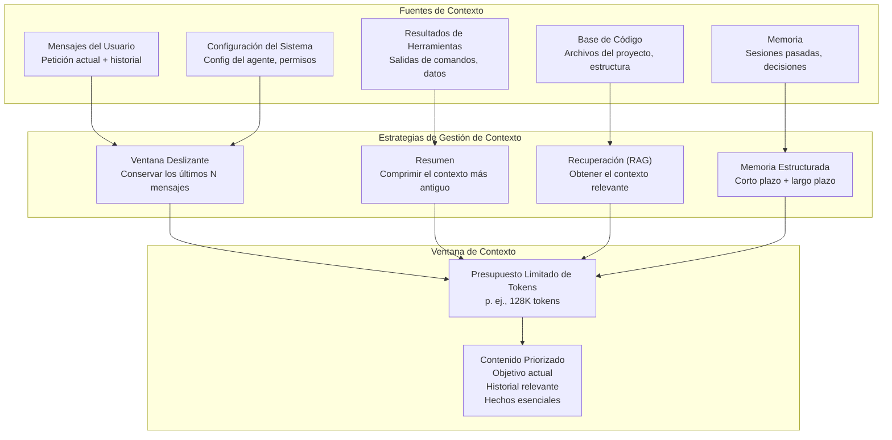
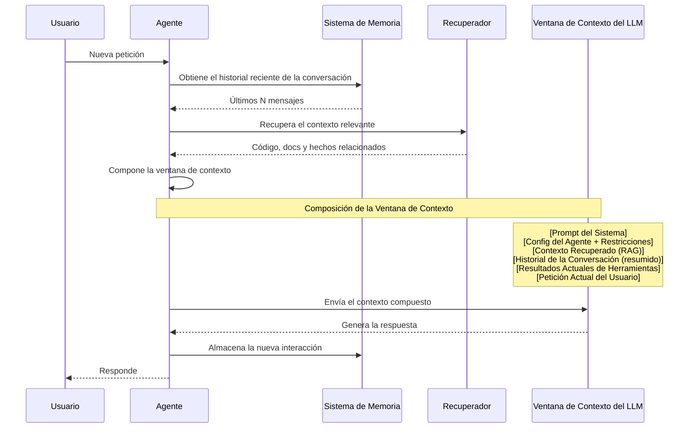

# Gestión de Contexto

## El Desafío del Contexto

Los agentes de IA enfrentan una restricción fundamental: ventanas de contexto limitadas. Incluso los modelos más grandes (200K+ tokens) no pueden contener a la vez toda una base de código, el historial de la conversación y las instrucciones de la tarea. Una gestión de contexto eficaz marca la diferencia entre un agente capaz y uno que pierde repetidamente el hilo de la información importante.



> [!NOTE]
> La gestión de contexto no consiste solo en hacer caber cosas en un presupuesto de tokens. Consiste en tomar decisiones inteligentes sobre *qué* conservar, *qué* comprimir, *qué* recuperar bajo demanda y *qué* olvidar.

---

## Arquitectura de la Ventana de Contexto

Comprender cómo interactúan los diferentes tipos de contexto dentro de la ventana es crucial para un diseño eficiente de agentes.



---

## Sistemas de Memoria

Los agentes eficaces usan una arquitectura de memoria jerarquizada (en niveles) para gestionar el contexto de forma eficiente:

```python
class TieredMemory:
    def __init__(self):
        # Ephemeral: current conversation turn
        self.working_memory = {}
        # Short-term: recent conversation (sliding window)
        self.short_term = []
        # Long-term: persistent facts across sessions
        self.long_term = {}
        # Semantic: indexed knowledge for retrieval
        self.semantic_store = []

    def add_to_working(self, key, value):
        self.working_memory[key] = value

    def get_working(self, key):
        return self.working_memory.get(key)

    def add_to_short_term(self, message, max_size=20):
        self.short_term.append(message)
        if len(self.short_term) > max_size:
            # Evict oldest messages
            self.short_term = self.short_term[-max_size:]

    def remember(self, key, value, importance=1.0):
        # High importance facts persist longer
        self.long_term[key] = {
            "value": value,
            "importance": importance,
            "timestamp": __import__('time').time()
        }

    def recall(self, key):
        entry = self.long_term.get(key)
        if entry:
            return entry["value"]
        return None

    def recall_by_relevance(self, query, top_k=3):
        # Simple keyword matching for semantic recall
        scores = []
        for key, entry in self.long_term.items():
            if query.lower() in key.lower():
                scores.append((entry["importance"], key, entry["value"]))
        scores.sort(reverse=True)
        return [(k, v) for _, k, v in scores[:top_k]]

    def store_semantic(self, text, metadata=None):
        self.semantic_store.append({
            "text": text,
            "metadata": metadata or {},
            "timestamp": __import__('time').time()
        })

    def summarize_and_archive(self):
        """Compress short-term memory into a summary for long-term storage."""
        if len(self.short_term) > 10:
            texts = [m["content"] for m in self.short_term[:5]]
            summary = " | ".join(texts)
            self.long_term["conversation_summary"] = {
                "value": summary[:500],
                "importance": 0.5,
                "timestamp": __import__('time').time()
            }
            # Keep only recent messages
            self.short_term = self.short_term[-5:]


memory = TieredMemory()

# Store project facts long-term
memory.remember("project_name", "Nova Platform", importance=1.0)
memory.remember("tech_stack", ["Python", "FastAPI", "React", "PostgreSQL"], importance=0.9)
memory.remember("deployment_env", "production", importance=0.8)

# Add conversation to short-term
memory.add_to_short_term({"role": "user", "content": "Fix the login bug"})
memory.add_to_short_term({"role": "assistant", "content": "Found the issue in auth.py"})

# Retrieve relevant facts
relevant = memory.recall_by_relevance("deploy")
print(f"Deployment context: {relevant}")

# Summarize when needed
memory.summarize_and_archive()
```

---

## Generación Aumentada por Recuperación (RAG)

RAG permite a los agentes acceder a grandes bases de conocimiento obteniendo solo la información más relevante en el momento de la consulta.

```python
class RAGSystem:
    def __init__(self):
        self.documents = []
        self.index = {}

    def add_document(self, doc_id, content, metadata=None):
        self.documents.append({
            "id": doc_id,
            "content": content,
            "metadata": metadata or {}
        })
        # Simple keyword indexing
        for word in content.lower().split():
            if word not in self.index:
                self.index[word] = []
            self.index[word].append(len(self.documents) - 1)

    def search(self, query, top_k=3):
        query_words = query.lower().split()
        scores = {}

        for q_word in query_words:
            for doc_idx in self.index.get(q_word, []):
                if doc_idx not in scores:
                    scores[doc_idx] = 0
                scores[doc_idx] += 1

        # Sort by relevance score
        ranked = sorted(scores.items(), key=lambda x: x[1], reverse=True)
        results = []
        for doc_idx, score in ranked[:top_k]:
            doc = self.documents[doc_idx]
            results.append({
                "id": doc["id"],
                "content": doc["content"][:500],  # Truncate for context
                "relevance": score / len(query_words),
                "metadata": doc["metadata"]
            })
        return results

    def build_context_prompt(self, query, max_tokens=2000):
        results = self.search(query)
        context_parts = []
        token_count = 0

        for r in results:
            snippet = f"[Source: {r['id']}]\n{r['content']}\n"
            snippet_tokens = len(snippet.split())
            if token_count + snippet_tokens > max_tokens:
                break
            context_parts.append(snippet)
            token_count += snippet_tokens

        return "\n---\n".join(context_parts)


# Build a RAG system for an agent
rag = RAGSystem()
rag.add_document(
    "auth-flow.md",
    "The authentication flow uses JWT tokens with 1-hour expiry. "
    "Refresh tokens are stored in HTTP-only cookies and have 7-day expiry. "
    "OAuth2 is supported for Google and GitHub providers.",
    {"type": "documentation", "module": "auth"}
)
rag.add_document(
    "api-endpoints.md",
    "POST /api/auth/login - Authenticate user\n"
    "POST /api/auth/refresh - Refresh access token\n"
    "POST /api/auth/logout - Invalidate session\n"
    "GET /api/auth/profile - Get user profile",
    {"type": "api", "module": "auth"}
)
rag.add_document(
    "db-schema.sql",
    "CREATE TABLE users (id UUID PRIMARY KEY, email VARCHAR UNIQUE, "
    "password_hash VARCHAR, created_at TIMESTAMP);\n"
    "CREATE TABLE sessions (id UUID PRIMARY KEY, user_id UUID REFERENCES users(id), "
    "token VARCHAR, expires_at TIMESTAMP);",
    {"type": "schema", "module": "database"}
)

context = rag.build_context_prompt("How does authentication work?")
print(context)
```

> [!WARNING]
> RAG no es magia. La calidad de la recuperación depende de la calidad de tu estrategia de indexación. La búsqueda por palabras clave simple funciona para bases de código pequeñas, pero los sistemas de producción necesitan búsqueda semántica basada en embeddings. Valida siempre que el recuperador encuentre los documentos *correctos* para las consultas comunes.

---

## Estrategias de Resumen

Cuando las ventanas de contexto se llenan, el resumen comprime la información mientras preserva los detalles clave.

```python
class SummarizationEngine:
    def __init__(self, llm_client):
        self.llm = llm_client

    def summarize_conversation(self, messages):
        """Summarize a conversation history into key points."""
        if len(messages) < 3:
            return messages  # Too short to summarize

        text = "\n".join(
            f"{m['role']}: {m['content']}" for m in messages
        )

        prompt = f"""
        Summarize the following conversation, preserving:
        1. All decisions made
        2. Key facts discovered
        3. Action items or next steps
        4. Technical details (file paths, function names, versions)

        Conversation:
        {text}

        Summary:
        """
        return self.llm.complete(prompt)

    def hierarchical_summary(self, sessions, max_levels=3):
        """Create a hierarchical summary of multiple sessions."""
        summaries = []

        for session in sessions:
            summary = self.summarize_conversation(session)
            summaries.append(summary)

        # If we have too many session summaries, summarize those too
        level = 1
        while len(summaries) > 5 and level < max_levels:
            batch_size = 3
            new_summaries = []
            for i in range(0, len(summaries), batch_size):
                batch = summaries[i:i + batch_size]
                combined = "\n".join(batch)
                meta_summary = self.llm.complete(
                    f"Summarize these session summaries:\n{combined}"
                )
                new_summaries.append(meta_summary)
            summaries = new_summaries
            level += 1

        return summaries

    def token_aware_truncation(self, text, max_tokens=4000):
        """Truncate text intelligently at token boundaries."""
        tokens = text.split()
        if len(tokens) <= max_tokens:
            return text

        # Keep beginning and end, summarize middle
        keep_start = max_tokens // 3
        keep_end = max_tokens // 3
        middle_start = text[:keep_start * 10]  # Approximate char→token
        middle_end = text[-keep_end * 10:]

        return f"{middle_start}\n\n...[{len(tokens) - keep_start - keep_end} tokens omitted]...\n\n{middle_end}"
```

```yaml
# Summarization configuration for an agent
summarization:
  strategy: hierarchical
  thresholds:
    short_term: 10  # Summarize when >10 messages
    session: 50      # Summarize when >50 messages per session
    total: 200       # Create meta-summary across sessions
  include_in_summary:
    - decisions_made
    - code_changes
    - error_patterns
    - user_preferences
  preserve_fields:
    - file_paths
    - function_names
    - version_numbers
    - api_endpoints
```

> [!TIP]
> Usa el resumen jerárquico para sesiones largas del agente. Resume en tres niveles: (1) turnos individuales de la conversación, (2) resúmenes a nivel de sesión, (3) meta-resúmenes entre sesiones. Esto preserva la información crítica mientras se mantiene un contexto compacto.

---

## Priorización del Contexto

No todo el contexto es igual de importante. Los agentes deben priorizar qué entra en la ventana de contexto limitada.

```python
class ContextPrioritizer:
    def __init__(self, max_tokens=128000):
        self.max_tokens = max_tokens
        self.priority_levels = {
            "critical": 5,
            "high": 4,
            "medium": 3,
            "low": 2,
            "background": 1
        }

    def prioritize(self, context_items):
        """Sort and filter context items by priority, fit within token budget."""
        # Assign priority scores
        scored = []
        for item in context_items:
            score = self._calculate_priority(item)
            tokens = len(item["content"].split())
            scored.append((score, tokens, item))

        # Sort by priority (descending)
        scored.sort(key=lambda x: x[0], reverse=True)

        # Fit within budget
        result = []
        used_tokens = 0

        # Always include system prompt and current request
        for item in context_items:
            if item["type"] in ("system_prompt", "current_request"):
                result.append(item)
                used_tokens += len(item["content"].split())

        # Add high priority items
        remaining = self.max_tokens - used_tokens
        for score, tokens, item in scored:
            if item["type"] in ("system_prompt", "current_request"):
                continue  # Already included
            if used_tokens + tokens <= self.max_tokens:
                result.append(item)
                used_tokens += tokens

        return result

    def _calculate_priority(self, item):
        base = self.priority_levels.get(item.get("priority", "medium"), 3)

        # Boost relevance to current task
        if item.get("relevance_to_current", 0) > 0.8:
            base += 1
        # Boost recent items
        if item.get("recency", 0) > 0.9:
            base += 1
        # Penalize very large items
        tokens = len(item["content"].split())
        if tokens > 10000:
            base -= 1

        return max(1, base)


prioritizer = ContextPrioritizer(max_tokens=8000)
context = [
    {"type": "system_prompt", "content": "You are a coding agent...", "priority": "critical"},
    {"type": "current_request", "content": "Fix the payment bug", "priority": "critical"},
    {"type": "file_content", "content": "def process(): ...", "priority": "high", "relevance_to_current": 0.9},
    {"type": "conversation_history", "content": "User: The payment fails...", "priority": "medium", "recency": 1.0},
    {"type": "project_readme", "content": "# Project...", "priority": "low"},
]
prioritized = prioritizer.prioritize(context)
print(f"Included {len(prioritized)} items in context window")
```

---

## Límites de la Ventana de Contexto por Modelo

| Proveedor del Modelo | Modelo | Ventana de Contexto | Presupuesto Efectivo |
|----------------|-------|---------------|-----------------|
| OpenAI | GPT-4o | 128K tokens | ~96K (tras la sobrecarga) |
| OpenAI | GPT-4o-mini | 128K tokens | ~96K |
| Anthropic | Claude Sonnet 4 | 200K tokens | ~170K |
| Anthropic | Claude Opus 4 | 200K tokens | ~170K |
| Google | Gemini 1.5 Pro | 1M tokens | ~800K |
| Meta | Llama 3.1 70B | 128K tokens | ~100K |
| Mistral | Mixtral 8x22B | 64K tokens | ~48K |

> [!NOTE]
> El "Presupuesto Efectivo" tiene en cuenta los tokens consumidos por el procesamiento interno del modelo (prompts de sistema, sobrecarga de tokenización, generación de respuestas). Una ventana de 128K normalmente tiene unos 96K tokens disponibles para tu contenido.

---

## Gestión Práctica del Contexto en OpenCode

OpenCode proporciona gestión de contexto integrada mediante su sistema de configuración de agentes:

```json
{
  "agents": {
    "default": {
      "model": "gpt-4o",
      "description": "General coding agent",
      "context": {
        "maxTokens": 128000,
        "summarizationThreshold": 80000,
        "memoryStrategy": "tiered",
        "shortTermLimit": 20,
        "longTermEnabled": true,
        "ragEnabled": true,
        "ragMaxDocs": 5,
        "prioritizeByRelevance": true
      }
    },
    "code-reviewer": {
      "model": "claude-sonnet-4-20250514",
      "description": "Code review specialist",
      "context": {
        "maxTokens": 200000,
        "summarizationThreshold": 150000,
        "focusOnCurrentChanges": true,
        "includeGitDiff": true
      }
    }
  }
}
```

```yaml
# context-management-strategy.yaml
strategy:
  name: "tiered-context"
  layers:
    working:
      label: "Working Memory"
      size: "2-3 turns"
      content: "Current task, immediate tool results"
      eviction: "FIFO"
    short_term:
      label: "Short-Term Memory"
      size: "15-20 turns"
      content: "Recent conversation, recent file reads"
      eviction: "Summarize and archive"
    long_term:
      label: "Long-Term Memory"
      size: "Unlimited (external)"
      content: "Project facts, decisions, user preferences"
      access: "On-demand retrieval"
    episodic:
      label: "Episodic Memory"
      size: "Compressed"
      content: "Key events, errors encountered, solutions found"
      access: "Similarity search"
```

---

## Trampas Comunes en la Gestión de Contexto

| Trampa | Síntoma | Solución |
|---------|---------|----------|
| Desbordamiento de contexto | El agente pierde el hilo de las instrucciones iniciales | Implementa ventana deslizante + resumen |
| Contexto obsoleto | El agente referencia información desactualizada | Añade puntuación de recencia en la priorización |
| Contexto faltante | El agente pide información que ya tiene | Mejora el recuerdo de la memoria a largo plazo |
| Desperdicio de tokens | El agente incluye contenidos de archivos irrelevantes | Usa RAG con consultas precisas |
| Explosión de memoria | El contexto crece sin límites | Establece límites duros con disparadores de resumen |
| Deriva de hechos | El agente se contradice entre sesiones | Usa un almacén de memoria a largo plazo persistente |

> [!WARNING]
> El error más costoso es perder información crítica por una mala gestión del contexto. Un agente que olvida el stack tecnológico de tu proyecto o una decisión clave producirá resultados inconsistentes. Valida siempre que tu sistema de memoria preserva los hechos esenciales.

---

## Ejercicios de Práctica

```question
{
  "id": "aa-04-q1",
  "type": "multiple-choice",
  "question": "¿Cuál es el propósito principal de una ventana deslizante (sliding window) en la gestión de contexto?",
  "options": [
    "Cifrar los datos de la conversación",
    "Conservar solo los últimos N mensajes dentro del presupuesto de tokens",
    "Mostrar los mensajes en un idioma diferente",
    "Aumentar el tamaño de la ventana de contexto del modelo"
  ],
  "correct": 1,
  "explanation": "Una ventana deslizante conserva los últimos N mensajes y descarta los más antiguos. Esto asegura que el agente siempre tenga el contexto más reciente disponible mientras se mantiene dentro del presupuesto de tokens. Combinada con el resumen, equilibra la recencia con la completitud."
}
```

```question
{
  "id": "aa-04-q2",
  "type": "multiple-choice",
  "question": "En un sistema de memoria jerarquizado, ¿qué tipo de información debería almacenarse en la memoria a largo plazo?",
  "options": [
    "El mensaje del usuario que se está escribiendo actualmente",
    "Cada salida de herramienta de la sesión actual",
    "Hechos persistentes como el nombre del proyecto, el stack tecnológico y las decisiones clave",
    "La salida en bruto de cada comando bash ejecutado"
  ],
  "correct": 2,
  "explanation": "La memoria a largo plazo almacena hechos persistentes que deben sobrevivir entre sesiones: nombres de proyecto, elecciones de tecnología, decisiones de arquitectura, preferencias del usuario. Los datos transitorios como las salidas individuales de herramientas pertenecen a la memoria de trabajo o a corto plazo."
}
```

```question
{
  "id": "aa-04-q3",
  "type": "multiple-choice",
  "question": "¿Qué sucede cuando la ventana de contexto de un agente supera el límite de tokens del modelo?",
  "options": [
    "El modelo aumenta automáticamente su ventana de contexto",
    "El contenido más antiguo se descarta o trunca de forma silenciosa",
    "El agente se cae y necesita reiniciarse",
    "El modelo cobra el doble por los tokens extra"
  ],
  "correct": 1,
  "explanation": "Cuando el contexto supera el límite, el contenido más antiguo o de menor prioridad normalmente se descarta o trunca. Por eso las estrategias explícitas de gestión de contexto (ventanas deslizantes, resumen, priorización) son esenciales: controlan *qué* se descarta en lugar de dejarlo al azar."
}
```

```question
{
  "id": "aa-04-q4",
  "type": "multiple-choice",
  "question": "¿Para qué se usa RAG (Generación Aumentada por Recuperación) en la gestión de contexto de un agente?",
  "options": [
    "Seleccionar contexto al azar de cualquier fuente",
    "Revertir automáticamente las decisiones del agente",
    "Obtener solo los documentos más relevantes para la consulta actual",
    "Ejecutar recolección de basura (garbage collection) en la memoria"
  ],
  "correct": 2,
  "explanation": "RAG obtiene solo la información más relevante de una base de conocimiento mayor según la consulta actual. En lugar de cargar todos los documentos en el contexto, busca y recupera solo lo que se necesita, haciendo un uso eficiente de la ventana de contexto limitada."
}
```

```question
{
  "id": "aa-04-q5",
  "type": "multiple-choice",
  "question": "Un agente tiene un límite de 128K tokens y está usando unos 100K tokens para el historial de la conversación. ¿Qué estrategia debería usar cuando el usuario envía una petición nueva y compleja?",
  "options": [
    "Rechazar la petición y pedir al usuario que inicie una nueva sesión",
    "Resumir el historial de conversación más antiguo para liberar tokens",
    "Cancelar todo el trabajo anterior y empezar de cero",
    "Aumentar la ventana de contexto del modelo"
  ],
  "correct": 1,
  "explanation": "El agente debería resumir la porción más antigua del historial de conversación para liberar tokens para la nueva petición compleja. El resumen comprime la información mientras preserva los hechos, decisiones y contexto clave que siguen siendo relevantes."
}
```

```question
{
  "id": "aa-04-q6",
  "type": "multiple-choice",
  "question": "¿Cuál es el 'presupuesto efectivo' de una ventana de contexto de 128K tokens?",
  "options": [
    "Exactamente 128.000 tokens sin sobrecarga",
    "Aproximadamente 96.000 tokens tras tener en cuenta la sobrecarga del sistema",
    "Unos 50.000 tokens",
    "256.000 tokens (el doble del límite indicado)"
  ],
  "correct": 1,
  "explanation": "El presupuesto efectivo es de aproximadamente 96K tokens de un total de 128K. Los tokens restantes los consumen los prompts de sistema, la sobrecarga de tokenización y la generación de respuestas del modelo. Ten siempre en cuenta esta sobrecarga al diseñar estrategias de gestión de contexto."
}
```

```question
{
  "id": "aa-04-q7",
  "type": "multiple-choice",
  "question": "¿Cuál es el riesgo principal de usar solo una ventana deslizante sin resumen?",
  "options": [
    "La ventana contiene demasiados tokens",
    "La información importante de antes de la conversación se pierde permanentemente",
    "El modelo se ejecuta más lento",
    "La ejecución de herramientas se vuelve secuencial"
  ],
  "correct": 1,
  "explanation": "Sin resumen, una ventana deslizante pura descarta permanentemente los mensajes antiguos. Si una decisión o hecho importante se mencionó antes y salió de la ventana, el agente pierde el acceso a él. El resumen preserva la esencia del contexto antiguo antes de que sea evacuado."
}
```

```question
{
  "id": "aa-04-q8",
  "type": "multiple-choice",
  "question": "En la priorización de contexto, ¿qué elementos deberían incluirse siempre en la ventana de contexto independientemente del presupuesto de tokens?",
  "options": [
    "El historial de conversación de otras sesiones",
    "El prompt del sistema y la petición actual del usuario",
    "El archivo README completo del proyecto",
    "La salida de cada llamada de herramienta anterior"
  ],
  "correct": 1,
  "explanation": "El prompt del sistema (instrucciones del agente, restricciones) y la petición actual del usuario son críticos para que el agente entienda su rol y la tarea actual. Estos deberían tener siempre la máxima prioridad e incluirse independientemente de las restricciones de tokens."
}
```

---

[!SUCCESS] **Conclusiones Clave (Key Takeaways):**

- La gestión de contexto consiste en decisiones inteligentes sobre qué conservar, comprimir, recuperar y olvidar
- La memoria jerarquizada (de trabajo, a corto plazo, a largo plazo y semántica) proporciona una arquitectura escalable
- RAG permite acceder a grandes bases de conocimiento sin llenar la ventana de contexto
- Las estrategias de resumen (lineal, jerárquica y consciente de tokens) comprimen la información de forma eficaz
- La priorización del contexto asegura que los elementos críticos siempre quepan en el presupuesto de tokens
- Diferentes modelos tienen diferentes límites de contexto; diseña para el presupuesto efectivo
- OpenCode proporciona configuración de contexto integrada para los agentes
- Sin gestión explícita, el desbordamiento de contexto degrada silenciosamente el rendimiento del agente
- Las trampas comunes incluyen el desbordamiento de contexto, el contexto obsoleto, el contexto faltante y la explosión de memoria
