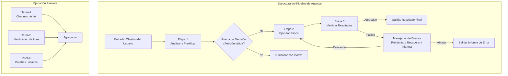
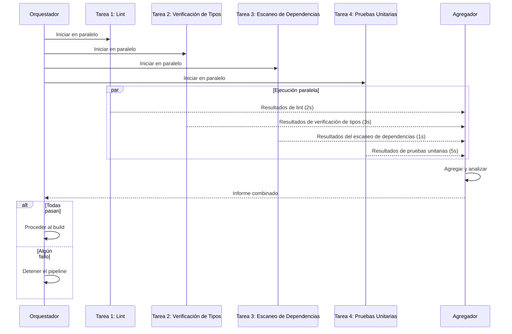

# Pipelines de Agentes

## ¿Qué Son los Pipelines de Agentes?

Los pipelines de agentes son flujos de trabajo estructurados que encadenan múltiples operaciones, llamadas a herramientas, ejecuciones de skills, delegaciones a subagentes, en secuencias coordinadas. Los pipelines transforman a un agente de asistente de un solo paso en un motor de automatización multi-paso capaz de flujos de trabajo complejos de ingeniería de software.



> [!NOTE]
> Un pipeline es más que una secuencia de pasos. Incluye puertas de decisión, manejadores de errores, ramas paralelas, agregadores y gestión de estado. Piénsalo como un grafo acíclico dirigido (DAG) de operaciones con enrutamiento inteligente.

---

## Diseño de las Etapas de un Pipeline

Cada etapa de un pipeline tiene un propósito, una entrada, una salida y un comportamiento de error claros.

```python
from enum import Enum
from dataclasses import dataclass
from typing import Any, Callable, Optional

class StageStatus(Enum):
    PENDING = "pending"
    RUNNING = "running"
    SUCCESS = "success"
    FAILED = "failed"
    SKIPPED = "skipped"

@dataclass
class Stage:
    name: str
    action: Callable
    retry_count: int = 0
    max_retries: int = 3
    timeout: int = 60
    depends_on: list[str] = None

    def __post_init__(self):
        self.depends_on = self.depends_on or []


class Pipeline:
    def __init__(self, name: str):
        self.name = name
        self.stages: dict[str, Stage] = {}
        self.results: dict[str, Any] = {}
        self.statuses: dict[str, StageStatus] = {}
        self.context: dict[str, Any] = {}

    def add_stage(self, stage: Stage):
        self.stages[stage.name] = stage
        self.statuses[stage.name] = StageStatus.PENDING

    async def execute(self, initial_input: dict = None):
        if initial_input:
            self.context.update(initial_input)

        print(f"Pipeline '{self.name}' starting...")

        # Topological sort based on dependencies
        ordered_stages = self._topological_sort()

        for stage_name in ordered_stages:
            stage = self.stages[stage_name]

            # Check dependencies
            deps_met = all(
                self.statuses.get(dep) == StageStatus.SUCCESS
                for dep in stage.depends_on
            )
            if not deps_met:
                self.statuses[stage_name] = StageStatus.SKIPPED
                continue

            # Execute with retries
            self.statuses[stage_name] = StageStatus.RUNNING
            for attempt in range(stage.max_retries):
                try:
                    result = await self._execute_stage(stage, attempt)
                    self.results[stage_name] = result
                    self.statuses[stage_name] = StageStatus.SUCCESS
                    break
                except Exception as e:
                    if attempt < stage.max_retries - 1:
                        print(f"Stage '{stage_name}' failed (attempt {attempt+1}): {e}")
                    else:
                        self.results[stage_name] = {"error": str(e)}
                        self.statuses[stage_name] = StageStatus.FAILED

        return self._summarize()

    async def _execute_stage(self, stage: Stage, attempt: int):
        args = {dep: self.results.get(dep) for dep in stage.depends_on}
        args["context"] = self.context
        return await stage.action(**args)

    def _topological_sort(self) -> list[str]:
        visited = set()
        ordered = []

        def dfs(node):
            if node in visited:
                return
            visited.add(node)
            stage = self.stages.get(node)
            if stage:
                for dep in stage.depends_on:
                    if dep in self.stages:
                        dfs(dep)
                ordered.append(node)

        for name in self.stages:
            dfs(name)
        return ordered

    def _summarize(self) -> dict:
        return {
            "pipeline": self.name,
            "stages": {
                name: {
                    "status": self.statuses[name].value,
                    "result": self.results.get(name)
                }
                for name in self.stages
            }
        }
```

---

## Ejemplo de Pipeline Secuencial

Un pipeline típico tipo CI para chequeos de calidad de código:

```python
async def lint_action(**kwargs):
    import asyncio
    await asyncio.sleep(0.1)
    return {"issues": 0, "output": "All clean"}

async def type_check_action(**kwargs):
    return {"errors": 0, "output": "Types correct"}

async def test_action(**kwargs):
    return {"passed": 42, "failed": 0, "coverage": 0.92}

async def build_action(**kwargs):
    return {"success": True, "artifact": "dist/app.zip"}

# Build pipeline
ci_pipeline = Pipeline("CI Pipeline")
ci_pipeline.add_stage(Stage("lint", lint_action))
ci_pipeline.add_stage(Stage("type_check", type_check_action, depends_on=["lint"]))
ci_pipeline.add_stage(Stage("test", test_action, depends_on=["type_check"]))
ci_pipeline.add_stage(Stage("build", build_action, depends_on=["test"]))

# Execute
import asyncio
result = asyncio.run(ci_pipeline.execute())
print(f"Pipeline status: {result}")
```

---

## Ejecución Paralela

Las etapas independientes pueden ejecutarse en paralelo para reducir el tiempo total de ejecución.



```python
import asyncio

class ParallelPipeline:
    def __init__(self):
        self.parallel_groups = []
        self.results = {}

    def add_group(self, name, tasks):
        self.parallel_groups.append({"name": name, "tasks": tasks})

    async def execute_all(self):
        for group in self.parallel_groups:
            print(f"Executing parallel group: {group['name']}")
            tasks = [self._run_task(name, fn) for name, fn in group["tasks"]]
            group_results = await asyncio.gather(*tasks, return_exceptions=True)

            for (name, _), result in zip(group["tasks"], group_results):
                self.results[name] = result
                if isinstance(result, Exception):
                    print(f"Task '{name}' failed: {result}")

        return self.results

    async def _run_task(self, name, fn):
        print(f"  Starting: {name}")
        result = await fn()
        print(f"  Completed: {name}")
        return result


async def lint():
    await asyncio.sleep(2)
    return {"status": "pass", "issues": 0}

async def type_check():
    await asyncio.sleep(3)
    return {"status": "pass", "errors": 0}

async def security_scan():
    await asyncio.sleep(1)
    return {"status": "pass", "vulnerabilities": 0}

async def unit_tests():
    await asyncio.sleep(5)
    return {"status": "pass", "passed": 50, "failed": 0}

# Build parallel pipeline
pipeline = ParallelPipeline()
pipeline.add_group("static_analysis", [
    ("lint", lint),
    ("type_check", type_check),
    ("security_scan", security_scan),
])
pipeline.add_group("testing", [
    ("unit_tests", unit_tests),
])

results = asyncio.run(pipeline.execute_all())
print(f"\nAll results: {results}")
```

> [!TIP]
> La ejecución paralela puede reducir drásticamente el tiempo del pipeline, pero solo para etapas *independientes*. Si la etapa B depende de la salida de la etapa A, deben ejecutarse secuencialmente. Usa el análisis de dependencias para identificar el trabajo verdaderamente paralelizable.

---

## Estrategias de Manejo de Errores

Los pipelines robustos anticipan los fallos y los manejan con elegancia.

```python
class ErrorHandler:
    def __init__(self, pipeline):
        self.pipeline = pipeline
        self.strategies = {
            "retry": self._retry,
            "skip": self._skip,
            "fallback": self._fallback,
            "abort": self._abort,
            "compensate": self._compensate
        }

    def handle(self, stage_name, error, strategy="retry"):
        handler = self.strategies.get(strategy, self._retry)
        return handler(stage_name, error)

    async def _retry(self, stage_name, error, max_retries=3):
        stage = self.pipeline.stages[stage_name]
        for attempt in range(max_retries):
            try:
                print(f"Retrying '{stage_name}' (attempt {attempt + 2})...")
                result = await self.pipeline._execute_stage(stage, attempt + 1)
                return {"status": "recovered", "result": result, "attempts": attempt + 2}
            except Exception as e:
                if attempt == max_retries - 1:
                    return {"status": "failed", "error": str(e)}
        return {"status": "failed", "error": str(error)}

    async def _skip(self, stage_name, error):
        print(f"Skipping '{stage_name}' due to: {error}")
        self.pipeline.statuses[stage_name] = StageStatus.SKIPPED
        return {"status": "skipped", "reason": str(error)}

    async def _fallback(self, stage_name, error, fallback_fn=None):
        print(f"Using fallback for '{stage_name}'")
        if fallback_fn:
            try:
                result = await fallback_fn()
                return {"status": "recovered", "result": result, "method": "fallback"}
            except Exception as e:
                return {"status": "failed", "error": str(e)}
        return {"status": "failed", "error": "No fallback available"}

    async def _abort(self, stage_name, error):
        print(f"Aborting pipeline at '{stage_name}': {error}")
        # Cancel all pending stages
        for name in self.pipeline.stages:
            if self.pipeline.statuses[name] == StageStatus.PENDING:
                self.pipeline.statuses[name] = StageStatus.SKIPPED
        return {"status": "aborted", "at": stage_name, "reason": str(error)}

    async def _compensate(self, stage_name, error, compensate_fn=None):
        print(f"Applying compensation for failed stage '{stage_name}'")
        if compensate_fn:
            await compensate_fn()
        return {"status": "compensated", "for": stage_name}
```

```yaml
# Pipeline error handling configuration
pipeline:
  name: "deploy-pipeline"
  error_strategy: "retry_then_abort"
  stages:
    - name: "run_tests"
      max_retries: 2
      on_failure: "retry"
    - name: "build"
      max_retries: 1
      on_failure: "retry"
    - name: "deploy_staging"
      on_failure: "abort"
      depends_on: ["run_tests", "build"]
    - name: "smoke_tests"
      max_retries: 3
      on_failure: "retry"
      depends_on: ["deploy_staging"]
    - name: "deploy_production"
      on_failure: "compensate"
      compensate_action: "rollback_staging"
      requires_approval: true
```

---

## Estado y Observabilidad del Pipeline

Todo pipeline debería exponer su estado para el monitoreo y la depuración.

```json
{
  "pipeline_state": {
    "id": "pipe_1749382018",
    "name": "full-ci",
    "status": "running",
    "started_at": "2026-06-06T10:00:00Z",
    "estimated_completion": "2026-06-06T10:05:30Z",
    "stages": [
      {
        "name": "lint",
        "status": "success",
        "duration_ms": 2340,
        "output": {"issues": 0}
      },
      {
        "name": "type_check",
        "status": "success",
        "duration_ms": 3120,
        "output": {"errors": 0}
      },
      {
        "name": "test",
        "status": "running",
        "duration_ms": 4500,
        "progress": {
          "total": 50,
          "passed": 42,
          "failed": 0,
          "remaining": 8
        }
      },
      {
        "name": "build",
        "status": "pending",
        "depends_on": ["test"]
      }
    ],
    "context": {
      "branch": "feature/payment-fix",
      "commit": "a1b2c3d4",
      "trigger": "push"
    }
  }
}
```

```python
class PipelineObserver:
    def __init__(self):
        self.events = []

    def on_stage_start(self, stage_name):
        event = {
            "type": "stage_start",
            "stage": stage_name,
            "timestamp": __import__('time').time()
        }
        self.events.append(event)
        print(f"[{event['timestamp']:.2f}] Stage started: {stage_name}")

    def on_stage_end(self, stage_name, status, duration_ms):
        event = {
            "type": "stage_end",
            "stage": stage_name,
            "status": status,
            "duration_ms": duration_ms,
            "timestamp": __import__('time').time()
        }
        self.events.append(event)
        print(f"[{event['timestamp']:.2f}] Stage {stage_name}: {status} ({duration_ms}ms)")

    def on_error(self, stage_name, error, strategy):
        event = {
            "type": "error",
            "stage": stage_name,
            "error": str(error),
            "strategy": strategy,
            "timestamp": __import__('time').time()
        }
        self.events.append(event)
        print(f"[{event['timestamp']:.2f}] Error at {stage_name}: {error} → {strategy}")

    def get_report(self):
        return {
            "total_events": len(self.events),
            "errors": [e for e in self.events if e["type"] == "error"],
            "duration_ms": (
                self.events[-1]["timestamp"] - self.events[0]["timestamp"]
            ) * 1000 if len(self.events) > 1 else 0
        }
```

---

## Patrones de Composición de Pipelines

| Patrón | Descripción | Ejemplo |
|---------|-------------|---------|
| Lineal | Etapas secuenciales, una tras otra | Lint → Pruebas → Build → Despliegue |
| Fan-out | Una etapa dispara múltiples etapas en paralelo | Cambio de código → [Lint, Pruebas, Seguridad] |
| Fan-in | Múltiples etapas paralelas se fusionan en una | [Lint, Pruebas] → Generación de informe |
| Condicional | Enrutamiento según la salida de la etapa | Pruebas pasan → Despliegue, Fallan → Notificar |
| Loop | Repetir etapas hasta cumplir una condición | Corregir errores de lint → Volver a lintear → Repetir |
| Sub-pipeline | Pipeline anidado como etapa | El pipeline de despliegue contiene un sub-pipeline "health-check" |

```yaml
# Complex pipeline composition
workflow:
  name: "release-workflow"
  version: "2.0"

  triggers:
    - event: "push"
      branches: ["main", "release/*"]
    - event: "pull_request"
      types: ["opened", "synchronize"]

  stages:
    - id: "validate"
      parallel:
        - id: "lint"
          tool: "bash"
          command: "ruff check src/"
        - id: "typecheck"
          tool: "bash"
          command: "mypy src/"
        - id: "security"
          tool: "bash"
          command: "bandit -r src/"

    - id: "test"
      depends_on: ["validate"]
      strategy: "matrix"
      matrix:
        python-version: ["3.11", "3.12"]
        os: ["ubuntu-latest", "windows-latest"]
      steps:
        - tool: "bash"
          command: "pytest tests/ --cov=src/"

    - id: "build"
      depends_on: ["test"]
      stages:
        - tool: "bash"
          command: "python -m build"
        - tool: "bash"
          command: "docker build -t app:latest ."

    - id: "deploy_staging"
      depends_on: ["build"]
      condition: "github.ref == 'refs/heads/main'"
      requires_approval: false
      stages:
        - tool: "bash"
          command: "kubectl apply -f k8s/staging/"

    - id: "deploy_production"
      depends_on: ["deploy_staging"]
      condition: "github.ref == 'refs/heads/release/*'"
      requires_approval: true
      stages:
        - tool: "bash"
          command: "kubectl apply -f k8s/production/"
```

> [!WARNING]
> Las etapas condicionales con `requires_approval` deberían usarse siempre para despliegues en producción. Un pipeline de agentes con autonomía total para desplegar en producción es un riesgo de seguridad y confiabilidad. Añade siempre una puerta de supervisión humana (human-in-the-loop) para operaciones destructivas o de alto riesgo.

---

## Configuración de Pipelines en OpenCode

OpenCode admite flujos de trabajo tipo pipeline mediante encadenamiento de skills y enrutamiento de agentes.

```json
{
  "pipelines": {
    "code-review-pipeline": {
      "description": "Full code review pipeline",
      "stages": [
        {
          "name": "lint-check",
          "tool": "bash",
          "command": "ruff check {file}",
          "on_failure": "report"
        },
        {
          "name": "security-scan",
          "tool": "bash",
          "command": "bandit -r {dir}",
          "on_failure": "block"
        },
        {
          "name": "generate-report",
          "skill": "report-generator",
          "inputs": ["lint-check", "security-scan"]
        }
      ]
    },
    "deploy-pipeline": {
      "description": "Production deployment pipeline",
      "stages": [
        {
          "name": "test",
          "tool": "bash",
          "command": "pytest tests/"
        },
        {
          "name": "build",
          "tool": "bash",
          "command": "npm run build",
          "depends_on": ["test"]
        },
        {
          "name": "deploy",
          "agent": "deploy-agent",
          "depends_on": ["build"],
          "requires_approval": true
        }
      ]
    }
  }
}
```

> [!TIP]
> En OpenCode, puedes implementar pipelines usando skills con declaraciones `depends_on` o creando una meta-skill que orqueste sub-skills. Este último enfoque es más flexible para flujos de trabajo complejos.

---

## Ejercicios de Práctica

```question
{
  "id": "aa-05-q1",
  "type": "multiple-choice",
  "question": "¿Cuál es el beneficio principal de usar ejecución paralela en un pipeline de agentes?",
  "options": [
    "Reduce el número de etapas necesarias",
    "Reduce el tiempo total de ejecución al ejecutar tareas independientes simultáneamente",
    "Elimina la necesidad de manejo de errores",
    "Aumenta la calidad de los resultados"
  ],
  "correct": 1,
  "explanation": "La ejecución paralela reduce el tiempo total de reloj ejecutando tareas independientes de forma concurrente. En lugar de esperar a la Tarea A → Tarea B → Tarea C secuencialmente, las tareas independientes A, B y C se ejecutan al mismo tiempo."
}
```

```question
{
  "id": "aa-05-q2",
  "type": "multiple-choice",
  "question": "En la clase Pipeline, ¿qué determina el orden de ejecución de las etapas?",
  "options": [
    "El orden en que se añadieron al pipeline",
    "El orden alfabético de los nombres de las etapas",
    "La ordenación topológica basada en las declaraciones de dependencias",
    "Un orden aleatorio para el balanceo de carga"
  ],
  "correct": 2,
  "explanation": "La ordenación topológica ordena las etapas de modo que las dependencias se ejecuten antes que sus dependientes. La etapa B que depende de la etapa A siempre se ejecutará después de A. Las etapas independientes sin dependencias cruzadas pueden paralelizarse."
}
```

```question
{
  "id": "aa-05-q3",
  "type": "multiple-choice",
  "question": "¿Qué estrategia de manejo de errores debería usarse para una etapa de despliegue a producción que falla?",
  "options": [
    "retry: seguir intentando hasta que tenga éxito",
    "skip: pasar a la siguiente etapa",
    "abort: detener el pipeline inmediatamente",
    "ignore: fingir que no pasó"
  ],
  "correct": 2,
  "explanation": "Un despliegue a producción fallido debería abortar el pipeline para prevenir un estado inconsistente. Reintentar indefinidamente podría empeorar las cosas. El pipeline debería detenerse, informar del error y potencialmente activar una compensación de rollback."
}
```

```question
{
  "id": "aa-05-q4",
  "type": "multiple-choice",
  "question": "¿Cuál es el propósito del patrón 'fan-in' en la composición de pipelines?",
  "options": [
    "Dividir una tarea en muchas tareas paralelas",
    "Fusionar los resultados de múltiples tareas paralelas en una sola etapa de agregación",
    "Repetir etapas hasta que se cumpla una condición",
    "Omitir etapas condicionalmente según la entrada"
  ],
  "correct": 1,
  "explanation": "Fan-in fusiona los resultados de múltiples ramas paralelas en una sola etapa agregadora. Por ejemplo, los resultados de lint, pruebas y escaneo de seguridad alimentan todos a un generador de informes que los combina."
}
```

```question
{
  "id": "aa-05-q5",
  "type": "multiple-choice",
  "question": "En el JSON de estado del pipeline, ¿cuál es el propósito del campo 'context'?",
  "options": [
    "Almacenar el contenido completo de cada archivo leído",
    "Rastrear la información de rama, commit y evento de activación para la trazabilidad",
    "Almacenar contraseñas de usuario y claves de API",
    "Cachear los resultados de herramientas para una re-ejecución más rápida"
  ],
  "correct": 1,
  "explanation": "El campo context almacena metadatos sobre el entorno de ejecución del pipeline: nombre de la rama, hash del commit, evento de activación. Esto proporciona trazabilidad y ayuda a depurar problemas mostrando exactamente en qué estado estaba operando el pipeline."
}
```

```question
{
  "id": "aa-05-q6",
  "type": "multiple-choice",
  "question": "¿Qué sucede con las etapas dependientes cuando una etapa falla y la estrategia de error es 'skip'?",
  "options": [
    "Todas las etapas continúan normalmente",
    "Las etapas dependientes también se omiten automáticamente",
    "Solo se omite la etapa fallida; las dependientes se ejecutan con resultados parciales",
    "El pipeline se reinicia desde el principio"
  ],
  "correct": 1,
  "explanation": "Cuando una etapa se omite por un fallo, sus dependientes no pueden ejecutarse porque sus entradas faltan. La resolución de dependencias marca todas las etapas dependientes como omitidas también. Esto evita que las etapas posteriores se ejecuten con entradas incompletas o incorrectas."
}
```

```question
{
  "id": "aa-05-q7",
  "type": "multiple-choice",
  "question": "¿Qué patrón de pipeline debería usarse cuando el mismo conjunto de pruebas necesita ejecutarse en múltiples sistemas operativos?",
  "options": [
    "Ejecución secuencial lineal",
    "Estrategia matrix (múltiples configuraciones en paralelo)",
    "Ejecución de una sola etapa",
    "Patrón de loop"
  ],
  "correct": 1,
  "explanation": "Una estrategia matrix ejecuta la misma etapa en múltiples configuraciones en paralelo. Por ejemplo, ejecutar 'pytest' en Ubuntu, Windows y macOS simultáneamente. Cada combinación (Python 3.11 + Ubuntu, Python 3.12 + Windows) es una ejecución paralela independiente."
}
```

```question
{
  "id": "aa-05-q8",
  "type": "multiple-choice",
  "question": "¿Cuál es el rol del patrón de Observador de Pipeline (Pipeline Observer)?",
  "options": [
    "Ejecutar las etapas del pipeline",
    "Proporcionar observabilidad registrando los inicios, fines y errores de las etapas",
    "Modificar las etapas del pipeline en tiempo de ejecución",
    "Compilar las definiciones del pipeline en código ejecutable"
  ],
  "correct": 1,
  "explanation": "El Observador de Pipeline proporciona observabilidad emitiendo eventos para los inicios, completados y errores de las etapas. Esto permite el monitoreo, la depuración y el análisis de rendimiento de la ejecución del pipeline. No afecta a la ejecución en sí."
}
```

---

[!SUCCESS] **Conclusiones Clave (Key Takeaways):**

- Los pipelines de agentes transforman a los agentes de un solo paso en motores de automatización multi-paso
- Los pipelines consisten en etapas con resolución de dependencias mediante ordenación topológica
- La ejecución paralela reduce el tiempo de las tareas independientes usando asyncio.gather
- Las estrategias de manejo de errores incluyen retry, skip, fallback, abort y compensate
- El estado del pipeline y los observadores proporcionan observabilidad crítica para la depuración
- Los patrones de composición (lineal, fan-out, fan-in, condicional, loop, sub-pipeline) manejan flujos de trabajo complejos
- Las etapas condicionales con puertas de aprobación humana protegen las operaciones de alto riesgo
- OpenCode admite flujos de trabajo tipo pipeline mediante encadenamiento de skills y enrutamiento de agentes
- Las estrategias matrix permiten la ejecución paralela en múltiples configuraciones
