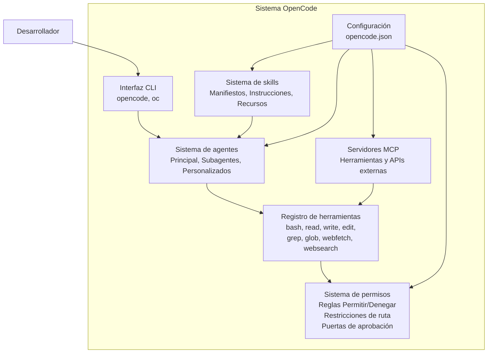
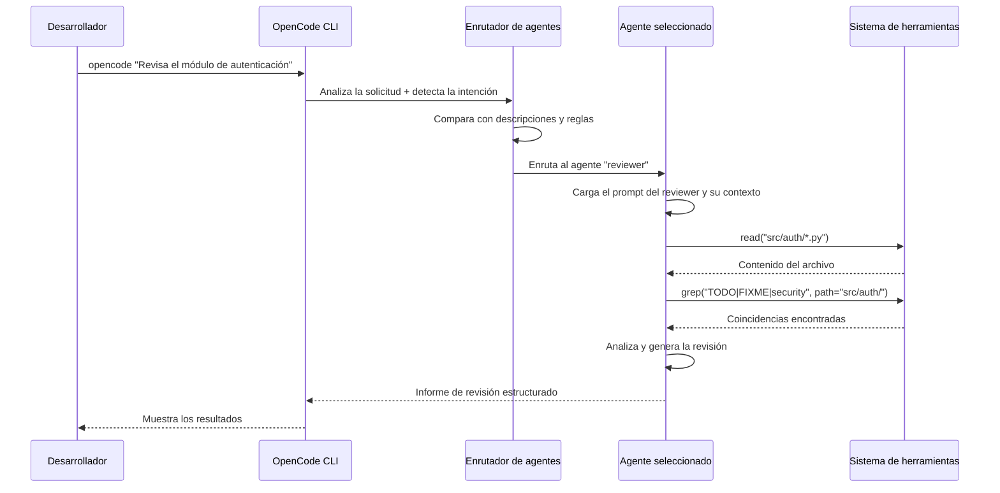

# OpenCode como herramienta de desarrollo

## ¿Qué es OpenCode?

OpenCode es un framework CLI de código abierto para la ingeniería de software asistida por IA. Proporciona un entorno estructurado donde los agentes de IA interactúan con tu código a través de un sistema de herramientas controlado por permisos, skills reutilizables y el Model Context Protocol (MCP) para integraciones externas.



> [!NOTE]
> OpenCode se puede instalar globalmente mediante npm o pip y configurar por proyecto usando `opencode.json` en la raíz del proyecto o `.opencode/config.json`. El comando de la CLI es `opencode` (o `oc` para abreviar).

---

## Instalación y configuración

```bash
npm install -g opencode-cli
pip install opencode-cli
opencode --version
opencode init
opencode
```

```json
{
  "name": "my-ai-powered-project",
  "version": "1.0.0",
  "scripts": {
    "dev": "opencode --agent developer",
    "review": "opencode --agent reviewer --task 'Review all new changes'",
    "deploy": "opencode --agent devops --task 'Deploy to staging'"
  },
  "opencode": {
    "configPath": ".opencode/config.json"
  }
}
```

> [!TIP]
> Usa `opencode init` para generar un `opencode.json` inicial con valores predeterminados razonables. Te solicita el proveedor de modelos que prefieras y crea la estructura básica de agentes.

---

## Configuración principal

```json
{
  "opencode": "1.0",
  "agents": {
    "default": {
      "model": "gpt-4o",
      "description": "General-purpose coding assistant",
      "prompt": "You are an expert software engineer. Always write clean, well-tested code."
    },
    "reviewer": {
      "model": "claude-sonnet-4-20250514",
      "description": "Code review and security audit specialist",
      "prompt": "You are a senior code reviewer. Focus on security, performance, and maintainability.",
      "constraints": {
        "allowedTools": ["read", "grep", "glob"],
        "deniedTools": ["write", "edit", "bash"]
      }
    },
    "architect": {
      "model": "gpt-4o",
      "description": "Software architecture and design specialist",
      "prompt": "You are a software architect. Focus on system design, patterns, and scalability.",
      "constraints": { "temperature": 0.4 }
    }
  },
  "permissions": [
    {
      "tool": "bash",
      "allow": ["npm *", "git *", "pip *", "python *", "pytest *"],
      "deny": ["rm -rf /", "sudo *", "chmod *"]
    },
    {
      "tool": "write",
      "allow": ["src/**", "tests/**", "docs/**"],
      "deny": [".env", "secrets/**", "node_modules/**"]
    },
    {
      "tool": "edit",
      "allow": ["src/**", "tests/**"],
      "deny": ["*.lock", "package-lock.json"]
    }
  ],
  "skills": {
    "code-reviewer": {
      "manifest": "skills/code-reviewer/skill.yaml",
      "autoLoad": true,
      "matchPattern": "review|audit|inspect|check"
    },
    "test-generator": {
      "manifest": "skills/test-generator/skill.yaml",
      "autoLoad": true,
      "matchPattern": "test|spec|coverage"
    }
  },
  "mcpServers": {
    "github": {
      "command": "node",
      "args": ["mcp-github-server.js"],
      "env": { "GITHUB_TOKEN": "${GITHUB_TOKEN}" }
    },
    "filesystem": {
      "command": "node",
      "args": ["mcp-server-fs.js", "/home/user/projects"]
    }
  },
  "agentRouting": {
    "mode": "auto",
    "defaultAgent": "default",
    "rules": [
      { "pattern": "security|vulnerability|CVE|OWASP", "agent": "reviewer" },
      { "pattern": "architecture|design|pattern|scalability", "agent": "architect" }
    ]
  }
}
```

---

## Flujo de enrutamiento de agentes



> [!NOTE]
> El enrutamiento ocurre al inicio de cada solicitud. Omite el enrutamiento con `--agent <name>` para forzar un agente específico, o `--skill <name>` para cargar una skill específica.

---

## Trabajo con skills

```yaml
# skills/react-component/skill.yaml
name: react-component
description: Generate React components with TypeScript, tests, and stories
version: "1.0.0"
instructions: |
  When asked to create a React component:
  1. Determine the component name and props interface
  2. Create src/components/{Name}/{Name}.tsx
  3. Create src/components/{Name}/{Name}.test.tsx
  4. Create src/components/{Name}/{Name}.stories.tsx
  5. Export from src/components/index.ts

  Follow these rules:
  - Use TypeScript with strict types
  - Include loading, empty, error, and edge case states
  - Follow existing component patterns
  - Add JSDoc comments for public APIs
tools:
  required:
    - read
    - write
    - glob
  optional:
    - bash
resources:
  - path: templates/component.tsx.hbs
  - path: templates/test.tsx.hbs
  - path: templates/story.tsx.hbs
autoload:
  enabled: true
  matchPattern: "create component|new component|react component"
```

```bash
opencode --skill react-component "Create a Button component with variants"
opencode --list-skills
opencode --skill-info react-component
```

> [!WARNING]
> Las skills se cargan automáticamente según los patrones de coincidencia. Si un patrón es demasiado amplio, la skill puede activarse en contextos no deseados. Mantén los patrones de coincidencia específicos.

---

## Sistema de permisos en la práctica

```json
{
  "permissions": [
    {
      "tool": "bash",
      "description": "Shell command execution",
      "allow": ["npm *", "git *", "pip *", "python *", "pytest *"],
      "deny": ["rm -rf /", "sudo *", "chmod 777 *"]
    },
    {
      "tool": "write",
      "allow": ["src/**/*.ts", "src/**/*.py", "tests/**/*.py", "docs/**/*.md"],
      "deny": [".env", "secrets/**", "node_modules/**", "*.key", "*.pem"]
    }
  ],
  "approvalGates": [
    {
      "description": "Production deployment gate",
      "condition": "command matches 'kubectl apply -f k8s/production/*'",
      "requireApprovalFrom": "user"
    }
  ]
}
```

> [!TIP]
> Empieza con restricciones y amplíalas gradualmente. Comienza denegando todas las operaciones de escritura y edición, y añade capacidades de escritura para patrones de archivos específicos a medida que validas el comportamiento del agente.

---

## Integración de servidores MCP

```javascript
// mcp-github-server.js
import { Server } from "@modelcontextprotocol/sdk/server/index.js";
import { StdioServerTransport } from "@modelcontextprotocol/sdk/server/stdio.js";
import { Octokit } from "@octokit/rest";

const server = new Server({
  name: "github-mcp-server",
  version: "1.0.0",
}, { capabilities: { tools: {} } });

const octokit = new Octokit({ auth: process.env.GITHUB_TOKEN });

server.setRequestHandler("tools/list", async () => ({
  tools: [
    {
      name: "create_issue",
      description: "Create a GitHub issue",
      inputSchema: {
        type: "object",
        properties: {
          title: { type: "string" },
          body: { type: "string" },
          labels: { type: "array", items: { type: "string" } }
        },
        required: ["title"]
      }
    },
    {
      name: "search_code",
      description: "Search code in repository",
      inputSchema: {
        type: "object",
        properties: {
          query: { type: "string" },
          repo: { type: "string" }
        },
        required: ["query"]
      }
    }
  ]
}));

server.setRequestHandler("tools/call", async (request) => {
  const { name, arguments: args } = request.params;
  switch (name) {
    case "create_issue": {
      const { data: issue } = await octokit.issues.create({
        owner: "my-org", repo: args.repo || "default",
        title: args.title, body: args.body, labels: args.labels
      });
      return { content: [{ type: "text", text: JSON.stringify(issue) }] };
    }
    case "search_code": {
      const { data: search } = await octokit.search.code({ q: args.query });
      return { content: [{ type: "text", text: JSON.stringify(search.items.slice(0, 5)) }] };
    }
    default:
      throw new Error("Unknown tool: " + name);
  }
});

const transport = new StdioServerTransport();
await server.connect(transport);
```

```json
{
  "mcpServers": {
    "github": {
      "command": "node",
      "args": ["mcp-github-server.js"],
      "env": { "GITHUB_TOKEN": "${GITHUB_TOKEN}" }
    },
    "postgres": {
      "command": "python",
      "args": ["mcp-postgres-server.py"],
      "env": { "DATABASE_URL": "${DATABASE_URL}" }
    }
  }
}
```

---

## Patrones de uso de la CLI

```bash
# Interactive mode
opencode

# Single command mode
opencode "Refactor the payment module to use async/await"

# Pipe input
cat requirements.txt | opencode "Generate a setup.py from this"

# File as context
opencode --file src/main.py "Review this file for bugs"

# Multi-file context
opencode --files src/*.py "Find unused imports"

# Agent selection
opencode --agent architect "Design database schema for multi-tenant app"

# Skill execution
opencode --skill code-reviewer "Review latest git diff"

# Debug mode
opencode --debug "Why is the build failing?"

# Output formats
opencode --format json "List all TODO comments" > todos.json
opencode --format markdown "Generate API documentation" > api-docs.md
```

> [!SUCCESS]
> OpenCode transforma tu flujo de trabajo de desarrollo al proporcionar una plataforma estructurada, segura y extensible para la ingeniería de software asistida por IA.

---

## Mejores prácticas para OpenCode

```yaml
best_practices:
  configuration:
    - Use .opencode/ directory instead of root opencode.json
    - Version control config but use env vars for secrets
    - Define specific agents for specific tasks
    - Use matchPattern on skills for auto-activation
    - Start restrictive and expand gradually

  agent_design:
    - Give agents clear, specific descriptions for accurate routing
    - Use temperature 0.2-0.4 for deterministic code tasks
    - Use temperature 0.7-0.9 for creative tasks
    - Define constraints properly
    - Use subagents for specialized subtasks

  skill_development:
    - Keep skills focused on single responsibilities
    - Include edge cases and error handling in instructions
    - Version skills with semantic versioning
    - Test skills independently with mock agents
    - Bundle templates and reference files as resources

  security:
    - Never store secrets in opencode.json
    - Use approval gates for destructive operations
    - Deny write access to configuration and lock files
    - Audit permission rules regularly
```

---

## Ejercicios de práctica

```question
{
  "id": "aa-06-q1",
  "type": "multiple-choice",
  "question": "¿Cuáles son las dos ubicaciones equivalentes para la configuración de OpenCode?",
  "options": [
    "opencode.yaml y opencode.toml",
    "opencode.json (raíz del proyecto) y .opencode/config.json",
    "config/opencode.json y .config/opencode.json",
    "package.json y .env"
  ],
  "correct": 1,
  "explanation": "La configuración de OpenCode puede estar en opencode.json en la raíz del proyecto o en .opencode/config.json. Ambas son equivalentes."
}
```

```question
{
  "id": "aa-06-q2",
  "type": "multiple-choice",
  "question": "¿Qué bandera de la CLI fuerza a que un agente específico maneje una solicitud?",
  "options": [
    "--force-agent",
    "--agent <name>",
    "--use <name>",
    "--target <name>"
  ],
  "correct": 1,
  "explanation": "La bandera --agent <name> omite el sistema de enrutamiento y fuerza a que la solicitud la maneje el agente especificado."
}
```

```question
{
  "id": "aa-06-q3",
  "type": "multiple-choice",
  "question": "¿Cuál es el propósito de approvalGates en los permisos de OpenCode?",
  "options": [
    "Registrar todas las acciones de los agentes",
    "Exigir aprobación humana antes de ejecutar operaciones específicas de alto riesgo",
    "Limitar la cantidad de llamadas a la API que puede hacer un agente",
    "Aprobar automáticamente todas las solicitudes de los agentes"
  ],
  "correct": 1,
  "explanation": "Las puertas de aprobación exigen aprobación humana explícita antes de que se ejecuten operaciones específicas de alto riesgo, como despliegues a producción o migraciones de base de datos."
}
```

```question
{
  "id": "aa-06-q4",
  "type": "multiple-choice",
  "question": "¿Cómo funciona la carga automática de skills en OpenCode?",
  "options": [
    "Las skills se cargan al inicio sin importar el contexto",
    "Las skills se cargan cuando la solicitud del usuario coincide con el matchPattern de la skill",
    "Las skills deben cargarse explícitamente cada vez",
    "Las skills se cargan automáticamente según el nombre del directorio actual"
  ],
  "correct": 1,
  "explanation": "La carga automática compara la solicitud del usuario con la expresión regular matchPattern de cada skill. Cuando encuentra una coincidencia, la skill se activa automáticamente."
}
```

```question
{
  "id": "aa-06-q5",
  "type": "multiple-choice",
  "question": "¿Qué sucede cuando se especifican allowedTools y deniedTools para un agente?",
  "options": [
    "Se aplican ambas, con prioridad para deniedTools",
    "Se ignora allowedTools",
    "Se ignora deniedTools",
    "El comportamiento es indefinido; no deben usarse juntas"
  ],
  "correct": 3,
  "explanation": "allowedTools y deniedTools son patrones mutuamente excluyentes. Usar ambos produce un comportamiento indefinido. Usa uno u otro."
}
```

```question
{
  "id": "aa-06-q6",
  "type": "multiple-choice",
  "question": "¿Qué comando inicializa OpenCode en un proyecto nuevo?",
  "options": [
    "opencode start",
    "opencode init",
    "opencode setup",
    "opencode new"
  ],
  "correct": 1,
  "explanation": "opencode init genera un archivo opencode.json inicial con valores predeterminados razonables."
}
```

```question
{
  "id": "aa-06-q7",
  "type": "multiple-choice",
  "question": "¿Cuál es el enfoque recomendado para manejar secretos en la configuración de OpenCode?",
  "options": [
    "Guardarlos directamente en opencode.json por comodidad",
    "Usar referencias a variables de entorno como ${GITHUB_TOKEN}",
    "Crear un archivo secrets.yaml separado",
    "Escribirlos de forma literal en los prompts de los agentes"
  ],
  "correct": 1,
  "explanation": "Usa referencias a variables de entorno como ${GITHUB_TOKEN} en opencode.json. Los valores reales se resuelven desde las variables de entorno en tiempo de ejecución, manteniendo los secretos fuera del control de versiones."
}
```

```question
{
  "id": "aa-06-q8",
  "type": "multiple-choice",
  "question": "¿Qué protocolo usan los servidores MCP para comunicarse con OpenCode?",
  "options": [
    "REST sobre HTTP",
    "gRPC",
    "JSON-RPC 2.0 sobre stdio u HTTP",
    "WebSocket"
  ],
  "correct": 2,
  "explanation": "Los servidores MCP se comunican mediante el protocolo JSON-RPC 2.0 sobre stdin/stdout (transporte stdio) o HTTP. Este protocolo estandarizado permite el descubrimiento y la invocación de herramientas."
}
```

---

[!SUCCESS] **Conclusiones Clave (Key Takeaways):**

- OpenCode se configura mediante opencode.json en la raíz del proyecto o .opencode/config.json
- El enrutamiento de agentes usa comparación de descripciones y patrones de reglas para despachar tareas
- Las skills se cargan automáticamente cuando las solicitudes del usuario coinciden con su matchPattern
- Los permisos permiten o deniegan operaciones específicas de herramientas con patrones de ruta
- Las puertas de aprobación incorporan a un humano en el ciclo para operaciones de alto riesgo
- Los servidores MCP amplían las capacidades mediante el protocolo JSON-RPC
- Usa --agent para forzar el enrutamiento y --skill para la carga explícita de skills
- Las variables de entorno mantienen los secretos fuera de la configuración con control de versiones
- Empieza con permisos restrictivos y amplíalos gradualmente
- OpenCode transforma el desarrollo asistido por IA con flujos de trabajo de agentes estructurados y seguros
