# Creación de skills de agentes personalizados

## Ciclo de vida del desarrollo de skills

Construir una skill personalizada sigue un ciclo de vida estructurado desde el concepto hasta el despliegue. Cada fase garantiza que la skill sea fiable, comprobable y mantenible.

```mermaid
flowchart LR
    subgraph Design["Fase de diseño"]
        D1["Identificar la tarea<br/>¿Qué debe hacer la skill?"]
        D2["Definir la interfaz<br/>Entradas, salidas, herramientas"]
        D3["Planificar los recursos<br/>Plantillas, referencias, scripts"]
    end
    subgraph Implement["Fase de implementación"]
        I1["Escribir el manifiesto<br/>skill.yaml"]
        I2["Escribir las instrucciones<br/>Guía paso a paso"]
        I3["Crear los recursos<br/>Archivos de plantilla, scripts"]
    end
    subgraph Test["Fase de pruebas"]
        T1["Prueba unitaria<br/>Llamadas con agente simulado"]
        T2["Prueba de integración<br/>Con herramientas reales"]
        T3["Casos límite<br/>Errores, estados vacíos"]
    end
    subgraph Deploy["Fase de despliegue"]
        DP1["Registrar en la configuración<br/>opencode.json"]
        DP2["Versionar y publicar<br/>Versionado semántico"]
        DP3["Monitorear el uso<br/>Rastrear activaciones"]
    end
    D1 --> D2 --> D3
    D3 --> I1 --> I2 --> I3
    I3 --> T1 --> T2 --> T3
    T3 --> DP1 --> DP2 --> DP3
    DP3 -->|"Retroalimentación"| D1
```



> [!NOTE]
> El ciclo de vida del desarrollo de skills es iterativo. Cada despliegue aporta retroalimentación que informa la siguiente iteración de diseño. Las skills mejoran con el tiempo a medida que se descubren y se gestionan los casos límite.

---

## Estructura del manifiesto de una skill

Toda skill comienza con un archivo de manifiesto YAML que declara su identidad, requisitos y comportamiento.

```yaml
# skills/api-client-generator/skill.yaml
name: api-client-generator
version: "1.0.0"
description: |
  Generates type-safe API client libraries from OpenAPI/Swagger
  specifications. Supports Python, TypeScript, and Go targets.

author: "NUniversity"
license: "MIT"

instructions:
  - path: instructions/generate-client.md
  - path: instructions/validate-spec.md
  - path: instructions/handle-errors.md

tools:
  required:
    - read
    - write
    - glob
  optional:
    - bash
    - websearch

resources:
  - path: templates/python-client.py.hbs
    description: Python client template
  - path: templates/typescript-client.ts.hbs
    description: TypeScript client template
  - path: schemas/openapi-v3.json
    description: OpenAPI 3.0 schema reference
  - path: configs/lint-rules.yaml
    description: Generated client linting rules

autoload:
  enabled: true
  matchPattern: "generate client|api client|openapi|swagger"

constraints:
  maxTokens: 8192
  temperature: 0.3

errorRecovery:
  onFailure: "report_and_stop"
  maxRetries: 2
```

> [!TIP]
> Declara los requisitos de herramientas con precisión. Marca las herramientas como `required` solo si la skill no puede funcionar sin ellas. Usa `optional` para las herramientas que mejoran los resultados pero tienen un comportamiento de respaldo. Esto evita que la skill falle cuando las herramientas opcionales no están disponibles.

---

## Redacción de instrucciones efectivas

Las instrucciones son el núcleo de una skill. Deben ser claras, completas y gestionar los casos límite.

```markdown
<!-- skills/api-client-generator/instructions/generate-client.md -->
# Generar cliente de API

## Paso 1: Leer la especificación de OpenAPI
- Usa la herramienta `read` para cargar el archivo OpenAPI/Swagger
- Valida la estructura de la especificación:
  - Debe tener el campo de versión `openapi` o `swagger`
  - Debe tener `info.title` y `info.version`
  - Debe tener al menos una entrada en `paths`
- Si la validación falla, reporta los problemas específicos del esquema

## Paso 2: Extraer los metadatos de la API
- Analiza la sección `info` para el nombre y la versión de la API
- Identifica la URL base desde el campo `servers` o `host`
- Extrae los esquemas de seguridad de `components.securitySchemes`

## Paso 3: Generar el código del cliente
Para cada ruta y método de la especificación:
  1. Genera la firma de la función con parámetros tipados
  2. Añade la lógica de construcción de la solicitud (URL, cabeceras, cuerpo)
  3. Añade el análisis de la respuesta con gestión de errores
  4. Genera docstrings completos

## Paso 4: Generar los tipos auxiliares
- Genera las interfaces de solicitud/respuesta
- Genera los tipos enum para enumeraciones de cadenas
- Genera los tipos de error para las respuestas de error

## Paso 5: Generar pruebas
- Crea pruebas unitarias para cada método del cliente
- Simula la capa HTTP
- Prueba el manejo de respuestas correctas y de error
- Prueba los casos límite (respuestas vacías, errores de red)

## Paso 6: Verificar
- Ejecuta el linter sobre el código generado
- Verifica la compilación de TypeScript (o la importación en Python)
- Reporta cualquier problema de generación
```

```python
# Programmatic skill implementation
import json
import os
from typing import Optional

class ApiClientGeneratorSkill:
    def __init__(self, agent):
        self.agent = agent
        self.language_handlers = {
            "python": self._generate_python,
            "typescript": self._generate_typescript,
            "go": self._generate_go,
        }

    async def execute(self, spec_path, language="python", output_dir="generated"):
        spec_content = await self.agent.read(spec_path)
        spec = json.loads(spec_content)

        errors = self._validate_spec(spec)
        if errors:
            return {"status": "error", "validation_errors": errors}

        os.makedirs(output_dir, exist_ok=True)
        handler = self.language_handlers.get(language)
        if not handler:
            return {"status": "error", "message": f"Unsupported language: {language}"}

        client_code = handler(spec, spec_path)
        client_path = os.path.join(output_dir, self._client_filename(language))
        await self.agent.write(client_path, client_code)

        test_code = self._generate_tests(spec, language)
        test_path = os.path.join(output_dir, self._test_filename(language))
        await self.agent.write(test_path, test_code)

        return {
            "status": "success",
            "client_file": client_path,
            "test_file": test_path,
            "endpoints_generated": len(spec.get("paths", {}))
        }

    def _validate_spec(self, spec):
        errors = []
        if "openapi" not in spec and "swagger" not in spec:
            errors.append("Missing version field (openapi or swagger)")
        if "info" not in spec:
            errors.append("Missing info section")
        elif "title" not in spec.get("info", {}):
            errors.append("Missing info.title")
        if "paths" not in spec or not spec["paths"]:
            errors.append("No paths defined")
        return errors

    def _generate_python(self, spec, spec_path):
        name = spec.get("info", {}).get("title", "ApiClient")
        lines = [
            f'"""Auto-generated client for {name}"""',
            "import requests",
            "from typing import Optional, Any, Dict",
            "",
            f"class {name.replace(' ', '')}Client:",
            f'    """Client for the {name} API."""',
            "    def __init__(self, base_url, api_key=None):",
            "        self.base_url = base_url.rstrip('/')",
            "        self.session = requests.Session()",
            "        if api_key:",
            '            self.session.headers["Authorization"] = f"Bearer {api_key}"',
            "",
        ]
        for path, methods in spec.get("paths", {}).items():
            for method in methods:
                func_name = self._path_to_function(method, path)
                lines.append(f"    def {func_name}(self):")
                lines.append(f'        """Call {method.upper()} {path}."""')
                lines.append(f'        url = f"{{self.base_url}}{path}"')
                lines.append(f"        response = self.session.{method}(url)")
                lines.append("        response.raise_for_status()")
                lines.append("        return response.json()")
                lines.append("")
        return "\n".join(lines)

    def _generate_typescript(self, spec, spec_path):
        name = spec.get("info", {}).get("title", "ApiClient")
        lines = [
            f"// Auto-generated client for {name}",
            "import axios, { AxiosInstance } from 'axios';",
            "",
            f"export class {name.replace(' ', '')}Client {{",
            "  private client: AxiosInstance;",
            "  constructor(baseURL: string, apiKey?: string) {",
            "    this.client = axios.create({ baseURL });",
            "    if (apiKey) {",
            "      this.client.defaults.headers.common['Authorization'] = `Bearer ${apiKey}`;",
            "    }",
            "  }",
            "",
        ]
        for path, methods in spec.get("paths", {}).items():
            for method in methods:
                func_name = self._path_to_function(method, path)
                lines.append(f"  async {func_name}(): Promise<any> {{")
                lines.append(f"    const response = await this.client.{method}('{path}');")
                lines.append("    return response.data;")
                lines.append("  }")
                lines.append("")
        lines.append("}")
        return "\n".join(lines)

    def _generate_go(self, spec, spec_path):
        name = spec.get("info", {}).get("title", "ApiClient")
        safe_name = name.replace(" ", "")
        lines = [
            f"// Package client provides auto-generated client for {name}",
            "package client",
            "",
            'import (',
            '    "net/http"',
            '    "encoding/json"',
            ")",
            "",
            f"type {safe_name}Client struct {{",
            "    baseURL string",
            "    httpClient *http.Client",
            "    apiKey string",
            "}",
            "",
            f"func New{safe_name}Client(baseURL string, apiKey string) *{safe_name}Client {{",
            f"    return &{safe_name}Client{{",
            "        baseURL: baseURL,",
            "        httpClient: &http.Client{},",
            "        apiKey: apiKey,",
            "    }",
            "}",
            "",
        ]
        for path, methods in spec.get("paths", {}).items():
            for method in methods:
                func_name = self._path_to_function(method, path)
                lines.append(f"func (c *{safe_name}Client) {func_name}() (map[string]interface{{}}, error) {{")
                lines.append(f'    url := c.baseURL + "{path}"')
                lines.append(f'    req, _ := http.NewRequest("{method.upper()}", url, nil)')
                lines.append('    req.Header.Set("Authorization", "Bearer " + c.apiKey)')
                lines.append("    resp, err := c.httpClient.Do(req)")
                lines.append("    if err != nil { return nil, err }")
                lines.append("    defer resp.Body.Close()")
                lines.append("    var result map[string]interface{}")
                lines.append("    json.NewDecoder(resp.Body).Decode(&result)")
                lines.append("    return result, nil")
                lines.append("}")
                lines.append("")
        return "\n".join(lines)

    def _generate_tests(self, spec, language):
        if language == "python":
            name = spec.get("info", {}).get("title", "ApiClient")
            safe = name.replace(" ", "")
            lines = [
                '"""Tests for auto-generated API client."""',
                "import pytest",
                f"from client import {safe}Client",
                "",
                "@pytest.fixture",
                "def client():",
                f'    return {safe}Client("https://api.example.com")',
                "",
            ]
            for path, methods in spec.get("paths", {}).items():
                for method in methods:
                    func_name = self._path_to_function(method, path)
                    lines.append(f"def test_{func_name}(client, requests_mock):")
                    url = f"https://api.example.com{path}"
                    lines.append(f'    requests_mock.{method}("{url}", json={{"status": "ok"}})')
                    lines.append(f"    result = client.{func_name}()")
                    lines.append('    assert result["status"] == "ok"')
                    lines.append("")
            return "\n".join(lines)
        return "# Tests not yet implemented for this language"

    def _path_to_function(self, method, path):
        parts = path.strip("/").replace("/", "_").replace("-", "_").replace("{", "").replace("}", "")
        return f"{method}_{parts}"

    def _client_filename(self, language):
        return {"python": "client.py", "typescript": "client.ts", "go": "client.go"}[language]

    def _test_filename(self, language):
        return {"python": "test_client.py", "typescript": "client.test.ts", "go": "client_test.go"}[language]
```

---

## Gestión de recursos de skills

Las skills pueden empaquetar recursos como plantillas, archivos de referencia y configuración.

```yaml
# skills/api-client-generator/resources/templates/python-client.py.hbs
\"\"\"
Auto-generated client for {{info.title}} v{{info.version}}
\"\"\"
import requests
from typing import Optional, Any, Dict, List

class {{info.title | replace(' ', '')}}Client:
    \"\"\"Client for the {{info.title}} API.\"\"\"

    def __init__(self, base_url, api_key=None):
        self.base_url = base_url.rstrip('/')
        self.session = requests.Session()
        self.session.headers.update({
            "Content-Type": "application/json",
            "Accept": "application/json",
        })
        if api_key:
            self.session.headers["Authorization"] = f"Bearer {api_key}"

    
    
    def {{method}}_{{path | to_snake}}(self, ...):
        \"\"\"{{methods[method].summary}}\"\"\"
        url = f"{self.base_url}{{path}}"
        response = self.session.{{method}}(url)
        response.raise_for_status()
        return response.json()
    
    
```

> [!TIP]
> Usa plantillas al estilo Handlebars (`.hbs`) para el código generado. Permiten separar limpiamente la lógica de la plantilla del código Python de la skill y hacen que las plantillas sean más fáciles de mantener y personalizar.

---

## Pruebas de skills

Las skills deben probarse a fondo antes del despliegue.

```python
import pytest
import json
from unittest.mock import AsyncMock

@pytest.fixture
def mock_agent():
    agent = AsyncMock()
    agent.read.return_value = json.dumps({
        "openapi": "3.0.0",
        "info": {"title": "Test API", "version": "1.0.0"},
        "paths": {
            "/users": {"get": {"summary": "List users"}},
            "/users/{id}": {"get": {"summary": "Get user"}}
        }
    })
    return agent

@pytest.mark.asyncio
async def test_api_client_generator_python(mock_agent):
    skill = ApiClientGeneratorSkill(mock_agent)
    result = await skill.execute("spec.yaml", language="python")
    assert result["status"] == "success"
    assert result["endpoints_generated"] == 2

@pytest.mark.asyncio
async def test_invalid_spec_returns_errors(mock_agent):
    mock_agent.read.return_value = json.dumps({
        "openapi": "3.0.0"
    })
    skill = ApiClientGeneratorSkill(mock_agent)
    result = await skill.execute("invalid.yaml")
    assert result["status"] == "error"
    assert len(result["validation_errors"]) > 0

@pytest.mark.asyncio
async def test_unsupported_language(mock_agent):
    skill = ApiClientGeneratorSkill(mock_agent)
    result = await skill.execute("spec.yaml", language="rust")
    assert result["status"] == "error"
    assert "rust" in result["message"].lower()

@pytest.mark.asyncio
async def test_generated_code_structure(mock_agent):
    skill = ApiClientGeneratorSkill(mock_agent)
    result = await skill.execute("petstore.yaml", language="python")
    write_args = mock_agent.write.call_args_list[0][0]
    content = write_args[1]
    assert "class TestAPIClient:" in content
    assert "def get_users(self):" in content
```

---

## Registro de skills en OpenCode

```json
{
  "skills": {
    "api-client-generator": {
      "manifest": "skills/api-client-generator/skill.yaml",
      "autoLoad": true,
      "matchPattern": "api client|openapi|swagger|generate client"
    },
    "code-reviewer": {
      "manifest": "skills/code-reviewer/skill.yaml",
      "autoLoad": true,
      "matchPattern": "review|audit|inspect"
    },
    "database-migration": {
      "manifest": "skills/database-migration/skill.yaml",
      "autoLoad": false
    }
  },
  "agents": {
    "default": {
      "model": "gpt-4o",
      "description": "Primary coding assistant",
      "skills": ["api-client-generator", "code-reviewer"]
    }
  }
}
```

---

## Patrones de diseño de skills

| Patrón | Descripción | Ideal para |
|---------|-------------|----------|
| Propósito único | Una skill = una tarea | Linting, pruebas, generación |
| Pipeline | Cadena de skills | Build -> Test -> Deploy |
| Basado en plantillas | Usa plantillas para la salida | Generación de código, andamiaje |
| Adaptativo | Ajusta el comportamiento según el contexto | Revisión de código, depuración |
| Interactivo | Requiere entrada del usuario en puntos clave | Despliegue, configuración |
| Sub-skill | Orquesta otras skills | Flujos de trabajo meta |

> [!WARNING]
> Evita crear una "God Skill" que intente hacerlo todo. Si las instrucciones de una skill superan las 200 líneas o se necesitan más de 5 herramientas, probablemente debas dividirla en skills más pequeñas y especializadas que puedan componerse entre sí.

---

## Estrategia de versionado de skills

```yaml
# versioning-policy.yaml
versioning:
  strategy: "semantic"
  rules:
    major:
      - "Breaking changes to skill interface"
      - "Removed required tools"
      - "Changed output format"
    minor:
      - "Added new instructions or resources"
      - "Added optional tool support"
      - "Enhanced error recovery"
    patch:
      - "Fixed instruction typos"
      - "Improved example code"
      - "Updated resource references"
  compatibility:
    - "Skills with same major version are compatible"
    - "Minor version upgrades are backward compatible"
    - "Patch versions require no changes from consumers"
```

---

## Ejercicios de práctica

```question
{
  "id": "aa-07-q1",
  "type": "multiple-choice",
  "question": "¿Cuáles son los tres componentes obligatorios de un manifiesto de skill?",
  "options": [
    "Nombre, versión y autor",
    "Instrucciones, herramientas y recursos",
    "Nombre, instrucciones y herramientas",
    "Manifiesto, código y pruebas"
  ],
  "correct": 2,
  "explanation": "Un manifiesto de skill requiere como mínimo: name (identificador único), instructions (guía paso a paso) y tools (declaraciones required/optional). Los resources son opcionales pero recomendados."
}
```

```question
{
  "id": "aa-07-q2",
  "type": "multiple-choice",
  "question": "¿Cuándo se debe marcar una herramienta como 'required' frente a 'optional' en un manifiesto de skill?",
  "options": [
    "Marcar siempre todas las herramientas como required",
    "Required si la skill no puede funcionar sin ella, optional si existe un respaldo",
    "Solo las herramientas de lectura pueden ser required",
    "Las herramientas que modifican archivos deben ser siempre optional"
  ],
  "correct": 1,
  "explanation": "Marca las herramientas como required solo si la skill no funciona sin ellas. Usa optional para las herramientas que mejoran los resultados pero tienen un comportamiento de respaldo si no están disponibles. Esto evita fallos de la skill cuando las herramientas opcionales no están permitidas."
}
```

```question
{
  "id": "aa-07-q3",
  "type": "multiple-choice",
  "question": "¿Cuál es el propósito de la sección 'autoload' en un manifiesto de skill?",
  "options": [
    "Precargar la skill en memoria al inicio",
    "Activar automáticamente la skill cuando las solicitudes del usuario coinciden con matchPattern",
    "Cargar los recursos de la skill en el contexto del agente",
    "Publicar automáticamente la skill en un registro"
  ],
  "correct": 1,
  "explanation": "La sección autoload permite la activación automática de la skill cuando la solicitud del usuario coincide con la expresión regular matchPattern. Esto hace que las skills se integren en el flujo de conversación natural del agente."
}
```

```question
{
  "id": "aa-07-q4",
  "type": "multiple-choice",
  "question": "¿Qué patrón de pruebas se recomienda para las skills personalizadas?",
  "options": [
    "Solo pruebas manuales en producción",
    "Pruebas unitarias con agentes simulados y pruebas de integración con herramientas reales",
    "No hace falta probarlas porque las skills son solo instrucciones",
    "Pruebas de carga con miles de usuarios concurrentes"
  ],
  "correct": 1,
  "explanation": "Las skills deben probarse con pruebas unitarias usando agentes simulados (para probar la lógica de forma aislada) y pruebas de integración con herramientas reales (para verificar el comportamiento de extremo a extremo)."
}
```

```question
{
  "id": "aa-07-q5",
  "type": "multiple-choice",
  "question": "¿Qué es el antipatrón 'God Skill'?",
  "options": [
    "Una skill que usa varios modelos de LLM",
    "Una skill que intenta asumir demasiadas responsabilidades",
    "Una skill sin gestión de errores",
    "Una skill que depende de otras skills"
  ],
  "correct": 1,
  "explanation": "Una God Skill intenta hacerlo todo, con cientos de líneas de instrucciones y muchos requisitos de herramientas. Son difíciles de mantener, probar y depurar. Las skills deben seguir el principio de responsabilidad única."
}
```

```question
{
  "id": "aa-07-q6",
  "type": "multiple-choice",
  "question": "En el ciclo de vida del desarrollo de skills, ¿qué sucede después de la fase de despliegue?",
  "options": [
    "La skill se considera terminada y nunca se modifica",
    "El monitoreo del uso aporta retroalimentación que informa la siguiente iteración de diseño",
    "La skill se elimina automáticamente a los 30 días",
    "El desarrollador debe reescribir la skill desde cero"
  ],
  "correct": 1,
  "explanation": "El ciclo de vida es iterativo. Después del despliegue, el monitoreo del uso y la recopilación de retroalimentación alimentan la siguiente iteración de diseño. Las skills mejoran con el tiempo a medida que se descubren casos límite."
}
```

```question
{
  "id": "aa-07-q7",
  "type": "multiple-choice",
  "question": "¿Qué formato de archivo se recomienda para las plantillas de generación de código incluidas con las skills?",
  "options": [
    "Archivos de texto plano",
    "Plantillas de Handlebars (.hbs)",
    "Plantillas JSON",
    "Documentos PDF"
  ],
  "correct": 1,
  "explanation": "Las plantillas de Handlebars (.hbs) separan limpiamente la lógica de la plantilla del código de la skill. Son legibles, mantenibles y ampliamente compatibles para tareas de generación de código."
}
```

```question
{
  "id": "aa-07-q8",
  "type": "multiple-choice",
  "question": "¿Qué sucede cuando el matchPattern de una skill es demasiado amplio?",
  "options": [
    "La skill nunca se activa",
    "La skill puede activarse en contextos no deseados, consumiendo tokens",
    "La skill estrecha automáticamente su patrón",
    "OpenCode lanza un error al inicio"
  ],
  "correct": 1,
  "explanation": "Un matchPattern amplio hace que la skill se active en conversaciones sin relación, consumiendo tokens de contexto y potencialmente interfiriendo con otras skills. Mantén los patrones de coincidencia específicos al dominio de la skill."
}
```

---

[!SUCCESS] **Conclusiones Clave (Key Takeaways):**

- Las skills siguen un ciclo de vida: Diseñar -> Implementar -> Probar -> Desplegar -> Monitorear -> Iterar
- Los manifiestos declaran identidad, herramientas, recursos, patrones de autoload y restricciones
- Las instrucciones son el núcleo de una skill; deben ser claras, completas y gestionar los casos límite
- Prueba las skills con agentes simulados en las pruebas unitarias y con herramientas reales en las de integración
- Evita las God Skills; sigue la responsabilidad única para skills componibles y mantenibles
- Usa plantillas de Handlebars para el código generado en las skills
- Registra las skills en opencode.json con autoload y matchPattern
- Usa el versionado semántico para comunicar cambios incompatibles en las skills
- Monitorea el uso de las skills para impulsar mejoras iterativas
