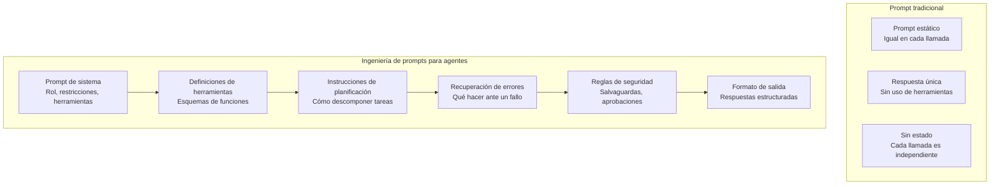
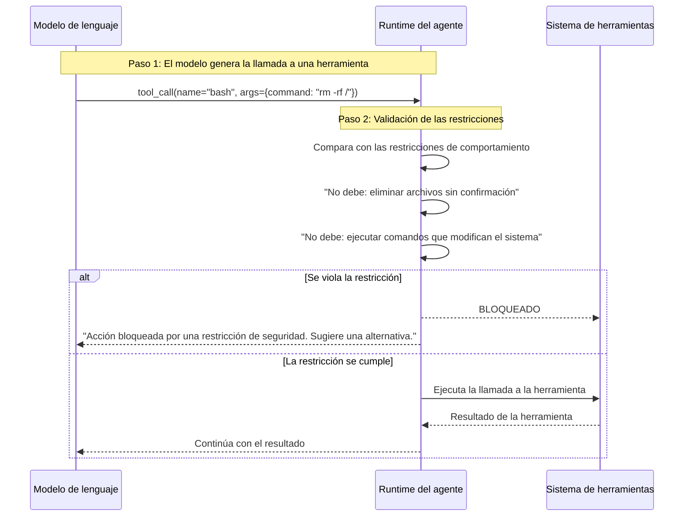

# Ingeniería de prompts para agentes

## Por qué los prompts de agentes son diferentes

La ingeniería de prompts para agentes difiere fundamentalmente del prompt tradicional de LLM. Los prompts de agentes no solo deben indicar al modelo el tono y el formato, sino también definir el uso de herramientas, el comportamiento de planificación, la recuperación de errores y las restricciones de seguridad dentro de un bucle de ejecución autónomo.



> [!NOTE]
> Un prompt de agente no es solo un mensaje de sistema. Es un documento por capas que incluye la definición del rol, los esquemas de las herramientas, las estrategias de planificación, los protocolos de gestión de errores y las especificaciones de salida. Cada capa es crítica para un comportamiento fiable del agente.

---

## Arquitectura del prompt de sistema

Un prompt de sistema bien estructurado tiene varias secciones distintas:

```yaml
# agent-system-prompt-structure.yaml
system_prompt:
  role_definition:
    content: "You are an expert software engineer assistant..."
    tone: "professional, precise"
    expertise: ["Python", "TypeScript", "system design"]

  constraints:
    - "Always ask for clarification if requirements are ambiguous"
    - "Never execute destructive commands without confirmation"
    - "Prefer built-in standard library over external dependencies"

  tool_usage_policy:
    discovery: "Use tools/list to discover available tools"
    invocation: "Call tools with precise, validated parameters"
    error_handling: "If a tool fails, try once more then report"

  planning_instructions:
    decomposition: "Break complex tasks into sequential steps"
    prioritization: "Address critical path items first"
    verification: "Verify each step before proceeding"

  output_format:
    code_blocks: "Use markdown code blocks with language tags"
    file_paths: "Always include full relative paths"
    explanations: "Explain why, not just what"
```

```python
class SystemPromptBuilder:
    def __init__(self):
        self.sections = {}

    def add_role(self, name, description, expertise=None):
        self.sections["role"] = {
            "name": name,
            "description": description,
            "expertise": expertise or []
        }
        return self

    def add_constraints(self, constraints):
        self.sections["constraints"] = constraints
        return self

    def add_tools(self, tool_definitions):
        self.sections["tools"] = tool_definitions
        return self

    def add_planning_guide(self, strategy, examples=None):
        self.sections["planning"] = {
            "strategy": strategy,
            "examples": examples or []
        }
        return self

    def add_output_format(self, format_spec):
        self.sections["output_format"] = format_spec
        return self

    def add_safety_rules(self, rules):
        self.sections["safety"] = rules
        return self

    def build(self):
        parts = [f"# Role: {self.sections.get('role', {}).get('name', 'Assistant')}"]
        role = self.sections.get("role", {})
        parts.append(role.get("description", ""))

        if "constraints" in self.sections:
            parts.append("\n## Constraints")
            for c in self.sections["constraints"]:
                parts.append(f"- {c}")

        if "tools" in self.sections:
            parts.append("\n## Available Tools")
            for tool in self.sections["tools"]:
                parts.append(f"- `{tool['name']}`: {tool['description']}")

        if "planning" in self.sections:
            parts.append(f"\n## Planning Strategy\n{self.sections['planning']['strategy']}")

        if "safety" in self.sections:
            parts.append("\n## Safety Rules")
            for rule in self.sections["safety"]:
                parts.append(f"- {rule}")

        if "output_format" in self.sections:
            parts.append(f"\n## Output Format\n{self.sections['output_format']}")

        return "\n".join(parts)


builder = SystemPromptBuilder()
prompt = (builder
    .add_role("Senior Software Engineer", "You are an expert software engineer.")
    .add_constraints([
        "Ask for clarification if ambiguous",
        "Never run destructive commands without approval",
        "Prefer standard library over external packages"
    ])
    .add_tools([
        {"name": "read", "description": "Read file contents"},
        {"name": "write", "description": "Write to files"},
        {"name": "bash", "description": "Execute shell commands"}
    ])
    .add_planning_guide("Break tasks into sequential steps. Verify each step.")
    .add_safety_rules([
        "Require approval before writing to production paths",
        "Never delete files without confirmation"
    ])
    .add_output_format("Use markdown with code blocks and file paths")
    .build()
)
print(prompt[:500])
```

---

## Prompting few-shot para agentes

Los ejemplos few-shot enseñan a los agentes a manejar escenarios específicos mediante demostración.

```yaml
# agent-few-shot-examples.yaml
few_shot_examples:
  - scenario: "Bug fixing"
    user: "The login endpoint returns 500 when username is empty"
    assistant:
      reasoning: |
        1. The issue is likely missing input validation
        2. Need to find the login endpoint handler
        3. Check if input validation exists
        4. Add validation if missing
      actions:
        - tool: "grep"
          params: { pattern: "def login|async def login", include: "*.py" }
        - tool: "read"
          params: { filePath: "src/auth/views.py" }
      result: |
        Found the login handler. Missing validation for empty username.
        Adding validation at line 42.

  - scenario: "Code review"
    user: "Review the database connection code"
    assistant:
      reasoning: |
        1. Check for connection pooling
        2. Verify error handling
        3. Check for SQL injection vulnerabilities
      actions:
        - tool: "glob"
          params: { pattern: "**/*db*" }
        - tool: "read"
          params: { filePath: "src/database/connection.py" }
      result: |
        Findings:
        - Missing connection pooling (critical)
        - No timeout configuration (major)
        - Proper parameterized queries (good)

  - scenario: "Error recovery"
    user: "Deploy to production"
    assistant:
      reasoning: |
        Deployment requires approval gate.
        First run tests, then build, then request deployment approval.
      actions:
        - tool: "bash"
          params: { command: "pytest tests/" }
      error_handling: |
        Tests failed. Blocking deployment.
        Reporting failures to user with details.
```

```python
class FewShotPromptBuilder:
    def __init__(self):
        self.examples = []

    def add_example(self, scenario, user_input, assistant_response):
        self.examples.append({
            "scenario": scenario,
            "user": user_input,
            "assistant": assistant_response
        })
        return self

    def build(self, query, max_examples=3):
        prompt_parts = ["## Examples\n"]
        for i, ex in enumerate(self.examples[:max_examples]):
            prompt_parts.extend([
                f"### Example {i+1}: {ex['scenario']}",
                f"User: {ex['user']}",
                f"Assistant: {ex['assistant']['reasoning']}",
                "Actions taken:",
            ])
            for action in ex['assistant'].get('actions', []):
                prompt_parts.append(
                    f"  - {action['tool']}({action['params']})"
                )
            prompt_parts.append(f"Result: {ex['assistant']['result']}\n")

        prompt_parts.append(f"## Current Task\nUser: {query}\nAssistant:")
        return "\n".join(prompt_parts)


builder = FewShotPromptBuilder()
builder.add_example(
    "Bug fixing",
    "Login returns 500 on empty username",
    {
        "reasoning": "Investigate input validation",
        "actions": [
            {"tool": "grep", "params": {"pattern": "def login"}},
            {"tool": "read", "params": {"filePath": "src/auth/views.py"}}
        ],
        "result": "Missing validation at line 42. Added check."
    }
)

prompt = builder.build("The payment module crashes on negative amounts")
print(prompt)
```

> [!TIP]
> Usa entre 3 y 5 ejemplos few-shot bien elaborados. Si hay muy pocos, el agente no aprende el patrón; si hay demasiados, desperdicias tokens de contexto. Centra los ejemplos en: (1) el flujo normal de éxito, (2) la recuperación de errores y (3) la gestión de casos límite.

---

## Ingeniería de restricciones

Las restricciones dan forma al comportamiento del agente al definir límites. Las restricciones bien diseñadas previenen errores antes de que ocurran.

```json
{
  "agentConstraints": {
    "behavioral": {
      "must_do": [
        "Read files before modifying them",
        "Run tests after making changes",
        "Report all errors to the user",
        "Use relative file paths"
      ],
      "must_not_do": [
        "Delete files without confirmation",
        "Modify package-lock.json or yarn.lock",
        "Run commands that modify system configuration",
        "Access files outside the project directory"
      ],
      "prefer": [
        "Standard library over external packages",
        "Explicit over implicit error handling",
        "Type hints over dynamic typing"
      ]
    },
    "communication": {
      "be_concise": true,
      "show_reasoning": true,
      "use_markdown": true,
      "include_file_paths": true
    },
    "tool_usage": {
      "validate_params": true,
      "timeout_ms": 30000,
      "max_parallel_tools": 5,
      "retry_on_failure": true,
      "max_retries": 2
    }
  }
}
```



> [!WARNING]
> Las restricciones solo son tan efectivas como su nivel de detalle. Una restricción como "sé seguro" no significa nada. "Nunca ejecutes comandos rm -rf, sudo o chmod" sí es aplicable. Escribe las restricciones como reglas concretas y comprobables.

---

## Inyección dinámica de prompts

Los agentes a menudo necesitan modificar sus prompts dinámicamente según el contexto:

```python
class DynamicPromptManager:
    def __init__(self, base_prompt):
        self.base_prompt = base_prompt
        self.context_variables = {}

    def set_context(self, key, value):
        self.context_variables[key] = value

    def inject_context(self, template):
        """Inject context variables into a prompt template."""
        result = template
        for key, value in self.context_variables.items():
            placeholder = "{{" + key + "}}"
            result = result.replace(placeholder, str(value))
        return result

    def build_full_prompt(self, current_task, tool_results=None):
        parts = [self.base_prompt]

        # Inject current context
        if self.context_variables:
            parts.append("\n## Current Context\n")
            for key, value in self.context_variables.items():
                parts.append(f"- {key}: {value}")

        # Add recent tool results
        if tool_results:
            parts.append("\n## Recent Tool Results\n")
            for tr in tool_results[-3:]:
                parts.append(f"Tool: {tr['tool']}")
                parts.append(f"Result: {tr['output'][:200]}...")

        # Add current task
        parts.append(f"\n## Current Task\n{current_task}")

        return "\n".join(parts)


manager = DynamicPromptManager("You are an expert coding assistant.")
manager.set_context("project", "Nova Platform")
manager.set_context("language", "Python")
manager.set_context("branch", "feature/payment-fix")

full_prompt = manager.build_full_prompt(
    "Fix the payment reconciliation bug in src/payments/reconcile.py",
    tool_results=[
        {"tool": "grep", "output": "Found 3 TODO comments in payment files"},
        {"tool": "read", "output": "def reconcile(): ..."}
    ]
)
print(full_prompt[:600])
```

---

## Pruebas y evaluación de prompts

Los prompts de agentes deben probarse de forma sistemática:

```python
class PromptEvaluator:
    def __init__(self, agent, test_cases):
        self.agent = agent
        self.test_cases = test_cases

    async def evaluate(self, prompt_template):
        results = []
        for case in self.test_cases:
            prompt = prompt_template.replace("{{task}}", case["input"])
            response = await self.agent.run(prompt)

            passed = all(
                criterion(response)
                for criterion in case["criteria"]
            )
            results.append({
                "test": case["name"],
                "passed": passed,
                "response_preview": response[:200],
                "issues": self._find_issues(response, case)
            })
        return results

    def _find_issues(self, response, case):
        issues = []
        if case.get("must_mention"):
            for term in case["must_mention"]:
                if term not in response:
                    issues.append(f"Missing mention of: {term}")
        if case.get("must_not_mention"):
            for term in case["must_not_mention"]:
                if term in response:
                    issues.append(f"Should not mention: {term}")
        if case.get("max_tokens") and len(response) > case["max_tokens"]:
            issues.append(f"Response too long: {len(response)} chars")
        return issues


test_cases = [
    {
        "name": "bug_fix_request",
        "input": "Fix the bug in process.py where it crashes on empty input",
        "criteria": [
            lambda r: "read" in r,
            lambda r: "process.py" in r,
            lambda r: len(r) > 50
        ],
        "must_mention": ["read", "analyze", "fix"],
        "max_tokens": 2000
    },
    {
        "name": "deployment_request",
        "input": "Deploy to production",
        "criteria": [
            lambda r: "approval" in r or "confirm" in r,
            lambda r: "test" in r
        ],
        "must_mention": ["approval", "test"],
        "must_not_mention": ["deploying now"]
    },
    {
        "name": "ambiguous_request",
        "input": "Make it better",
        "criteria": [
            lambda r: "clarify" in r or "specific" in r or "what" in r
        ],
        "must_mention": ["clarify", "specific"]
    }
]

# evaluator = PromptEvaluator(agent, test_cases)
# results = await evaluator.evaluate(system_prompt)
# print(f"Pass rate: {sum(r['passed'] for r in results)}/{len(results)}")
```

---

## Patrones de optimización de prompts

| Patrón | Descripción | Ejemplo |
|---------|-------------|---------|
| Anclaje de rol | Define una persona específica | "Eres un ingeniero de seguridad senior" |
| Cadena de pensamiento | Muestra el razonamiento paso a paso | "Primero analiza, luego planifica, luego ejecuta" |
| Prompting negativo | Especifica lo que NO debes hacer | "Nunca borres archivos sin preguntar" |
| Control de formato | Especifica la estructura de salida | "Usa markdown con encabezados ###" |
| Sesgo de recencia | Repite las instrucciones clave | Termina el prompt con las 3 reglas principales |
| Anclaje de herramientas | Describe el comportamiento de la herramienta | "read devuelve el contenido del archivo como texto" |

```yaml
# prompt-optimization-config.yaml
optimization:
  patterns:
    - name: "role_anchoring"
      template: "You are a {role}. {description}"
      variables:
        role: "senior software engineer"
        description: "Expert in Python, TypeScript, and system architecture"

    - name: "chain_of_thought"
      template: |
        Before taking any action:
        1. Analyze the current state
        2. Formulate a plan
        3. Execute step by step
        4. Verify each step
        5. Report results

    - name: "negative_prompting"
      rules:
        - "Never execute rm, sudo, or chmod"
        - "Never write to .env or secrets files"
        - "Never modify package-lock.json directly"

    - name: "format_control"
      template: |
        Format your responses as:
        ### Analysis
        ### Plan
        ### Execution
        ### Summary
```

> [!SUCCESS]
> La ingeniería de prompts para agentes es una disciplina que combina técnicas tradicionales de prompting con gobernanza de herramientas, estrategias de planificación y restricciones de seguridad. Domina estos patrones para crear un comportamiento de agente fiable y predecible.

---

## Ejercicios de práctica

```question
{
  "id": "aa-08-q1",
  "type": "multiple-choice",
  "question": "¿Qué diferencia a la ingeniería de prompts para agentes del prompt tradicional de LLM?",
  "options": [
    "Los prompts de agentes son más cortos que los prompts tradicionales",
    "Los prompts de agentes deben incluir definiciones de herramientas, estrategias de planificación y restricciones de seguridad",
    "Los prompts tradicionales usan un lenguaje más técnico",
    "No hay diferencia"
  ],
  "correct": 1,
  "explanation": "Los prompts de agentes deben definir el uso de herramientas, el comportamiento de planificación, la recuperación de errores y las restricciones de seguridad dentro de un bucle de ejecución autónomo. Los prompts tradicionales normalmente solo especifican el tono y el formato."
}
```

```question
{
  "id": "aa-08-q2",
  "type": "multiple-choice",
  "question": "¿Cuántos ejemplos few-shot se recomiendan para los prompts de agentes?",
  "options": [
    "1 o 2 ejemplos",
    "3 a 5 ejemplos bien elaborados que cubran casos normales, de error y límite",
    "10 a 15 ejemplos para una cobertura completa",
    "Ningún ejemplo; los agentes aprenden de la documentación de las herramientas"
  ],
  "correct": 1,
  "explanation": "Entre 3 y 5 ejemplos bien elaborados que cubran el flujo normal, la recuperación de errores y los casos límite proporcionan suficiente aprendizaje de patrones sin desperdiciar tokens de contexto."
}
```

```question
{
  "id": "aa-08-q3",
  "type": "multiple-choice",
  "question": "¿Cuál es la forma más eficaz de escribir restricciones de seguridad en los prompts de agentes?",
  "options": [
    "Usar declaraciones generales como 'sé seguro'",
    "Usar reglas concretas y comprobables como 'Nunca ejecutes comandos rm -rf'",
    "Escribir las restricciones solo al final del prompt",
    "Evitar las restricciones para dar al agente toda la flexibilidad"
  ],
  "correct": 1,
  "explanation": "Las restricciones deben ser concretas, específicas y comprobables. 'Sé seguro' es demasiado vago para aplicarse. 'Nunca ejecutes comandos rm -rf, sudo o chmod' establece límites claros que pueden verificarse de forma programática."
}
```

```question
{
  "id": "aa-08-q4",
  "type": "multiple-choice",
  "question": "¿Cuál es el propósito del patrón de optimización de prompts 'sesgo de recencia'?",
  "options": [
    "Hacer que el agente responda más rápido",
    "Repetir las instrucciones clave cerca del final del prompt para que no se olviden",
    "Sesgar al agente hacia los cambios de código recientes",
    "Reducir la cantidad de tokens usados"
  ],
  "correct": 1,
  "explanation": "El sesgo de recencia coloca las instrucciones más críticas cerca del final del prompt (justo antes de la solicitud del usuario). Esto aprovecha la tendencia del modelo a centrarse en el contenido más reciente y asegura que las reglas clave se sigan."
}
```

```question
{
  "id": "aa-08-q5",
  "type": "multiple-choice",
  "question": "En la arquitectura del prompt de sistema, ¿qué sección debe ir primero?",
  "options": [
    "Definiciones de herramientas",
    "Restricciones de seguridad",
    "Definición del rol",
    "Formato de salida"
  ],
  "correct": 2,
  "explanation": "La definición del rol debe ir primero para establecer la identidad y el propósito del agente. Las definiciones de herramientas, las restricciones, las estrategias de planificación y los formatos de salida siguen en orden lógico."
}
```

```question
{
  "id": "aa-08-q6",
  "type": "multiple-choice",
  "question": "¿Cuál es el propósito de la inyección dinámica de prompts?",
  "options": [
    "Acortar el prompt",
    "Inyectar variables de contexto como el nombre del proyecto, la rama y la tarea actual en tiempo de ejecución",
    "Cifrar el contenido del prompt",
    "Traducir el prompt a diferentes idiomas"
  ],
  "correct": 1,
  "explanation": "La inyección dinámica de prompts reemplaza los marcadores de posición en la plantilla del prompt por variables de contexto en tiempo de ejecución (nombre del proyecto, rama, archivo actual, etc.), haciendo que el prompt sea relevante sin fijar valores de forma literal."
}
```

```question
{
  "id": "aa-08-q7",
  "type": "multiple-choice",
  "question": "¿Qué debe incluir un caso de prueba de evaluación de prompts además de la entrada y los criterios esperados?",
  "options": [
    "Los datos de entrenamiento del modelo",
    "Términos que debe mencionar, términos que no debe mencionar y límites máximos de tokens",
    "La contraseña del usuario",
    "La configuración interna de temperatura del agente"
  ],
  "correct": 1,
  "explanation": "Los casos de prueba deben especificar los términos must_mention (conceptos requeridos), must_not_mention (conceptos prohibidos) y max_tokens (límites de longitud de respuesta). Estos proporcionan criterios concretos y comprobables para la evaluación."
}
```

```question
{
  "id": "aa-08-q8",
  "type": "multiple-choice",
  "question": "¿Qué patrón de optimización de prompts se usa cuando un prompt de agente empieza con 'Eres un ingeniero de seguridad senior especializado en OWASP Top 10'?",
  "options": [
    "Cadena de pensamiento",
    "Anclaje de rol",
    "Prompting negativo",
    "Control de formato"
  ],
  "correct": 1,
  "explanation": "Esto es el anclaje de rol: definir una persona específica con áreas de expertise para dar forma al comportamiento y al estilo de respuesta del agente. El agente adopta el conocimiento y la perspectiva del rol definido."
}
```

---

[!SUCCESS] **Conclusiones Clave (Key Takeaways):**

- Los prompts de agentes son documentos por capas con secciones de rol, herramientas, planificación, restricciones y salida
- El prompting few-shot con 3 a 5 ejemplos enseña eficazmente a los agentes los patrones de las tareas
- Las restricciones deben ser concretas y comprobables, no generalizaciones vagas
- La inyección dinámica de prompts permite prompts sensibles al contexto en tiempo de ejecución
- La evaluación de prompts con casos de prueba estructurados valida la eficacia del prompt
- Los patrones de optimización incluyen el anclaje de rol, la cadena de pensamiento, el prompting negativo y el sesgo de recencia
- Los prompts de sistema deben definir políticas de uso de herramientas, no solo la personalidad
- Las restricciones de seguridad solo son eficaces cuando son específicas y aplicables
