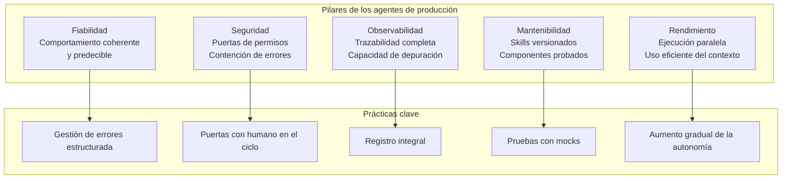
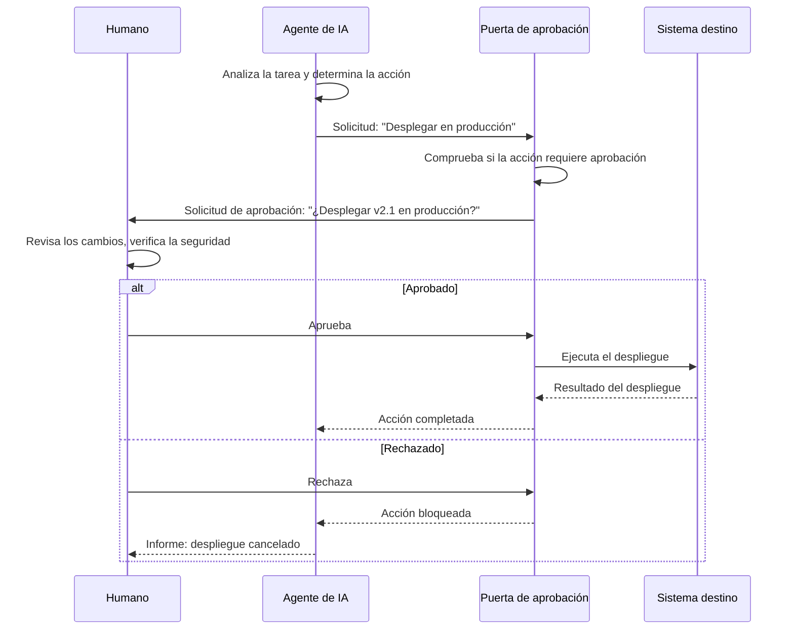

# Mejores prácticas y patrones

## Principios de diseño de agentes de producción

Construir agentes de producción fiables requiere un enfoque sistemático del diseño, las pruebas, la observabilidad y la seguridad. Estos principios forman la base de los sistemas de agentes listos para producción.



> [!NOTE]
> Los agentes de producción fallan de formas en que los agentes prototipo no. La diferencia entre una demo y un despliegue está en cómo maneja el sistema los casos límite, los errores y las entradas inesperadas a escala.

---

## Patrones de fiabilidad

### 1. Reintentos con retroceso exponencial

```python
import asyncio
import random

async def execute_with_retry(fn, max_retries=3, base_delay=1.0):
    """Execute a function with exponential backoff retry."""
    last_error = None
    for attempt in range(max_retries):
        try:
            return await fn()
        except Exception as e:
            last_error = e
            if attempt < max_retries - 1:
                delay = base_delay * (2 ** attempt) + random.uniform(0, 0.5)
                print(f"Attempt {attempt + 1} failed. Retrying in {delay:.1f}s...")
                await asyncio.sleep(delay)
    raise last_error
```

### 2. Cortacircuitos

```python
class CircuitBreaker:
    def __init__(self, failure_threshold=5, recovery_timeout=30):
        self.failure_threshold = failure_threshold
        self.recovery_timeout = recovery_timeout
        self.failure_count = 0
        self.last_failure_time = 0
        self.state = "closed"  # closed, open, half-open

    async def call(self, fn):
        if self.state == "open":
            if self._recovery_time_elapsed():
                self.state = "half-open"
            else:
                raise Exception("Circuit breaker is open")

        try:
            result = await fn()
            if self.state == "half-open":
                self.state = "closed"
                self.failure_count = 0
            return result
        except Exception as e:
            self.failure_count += 1
            self.last_failure_time = __import__('time').time()
            if self.failure_count >= self.failure_threshold:
                self.state = "open"
            raise e

    def _recovery_time_elapsed(self):
        return __import__('time').time() - self.last_failure_time > self.recovery_timeout
```

### 3. Envoltorio con límite de tiempo

```python
import asyncio

async def with_timeout(fn, timeout_seconds=30):
    """Execute with a hard timeout."""
    try:
        return await asyncio.wait_for(fn(), timeout=timeout_seconds)
    except asyncio.TimeoutError:
        raise TimeoutError(f"Operation timed out after {timeout_seconds}s")
```

### 4. Cadena de respaldo

```python
class FallbackChain:
    def __init__(self, strategies):
        self.strategies = strategies

    async def execute(self):
        errors = []
        for name, fn in self.strategies:
            try:
                print(f"Trying strategy: {name}")
                return await fn()
            except Exception as e:
                errors.append(f"{name}: {e}")
                continue
        raise Exception(f"All strategies failed: {errors}")

# Example usage
fallback = FallbackChain([
    ("primary_api", lambda: call_api("primary")),
    ("secondary_api", lambda: call_api("secondary")),
    ("cache", lambda: load_from_cache()),
])
```

---

## Observabilidad y monitoreo

Cada acción del agente debería ser trazable con fines de depuración y auditoría.

```python
import json
import time

class AgentLogger:
    def __init__(self):
        self.events = []

    def log(self, event_type, data):
        entry = {
            "timestamp": time.time(),
            "type": event_type,
            "data": data
        }
        self.events.append(entry)
        print(f"[{event_type}] {json.dumps(data, default=str)[:200]}")

    def log_perception(self, input_data):
        self.log("perception", {"input": input_data[:200]})

    def log_reasoning(self, plan):
        self.log("reasoning", {"plan": plan})

    def log_tool_call(self, tool, params, result):
        self.log("tool_call", {
            "tool": tool,
            "params": params,
            "result_status": "success" if result.get("status") == "success" else "error",
            "result_preview": str(result)[:200]
        })

    def log_error(self, stage, error):
        self.log("error", {"stage": stage, "error": str(error)})

    def get_session_summary(self):
        errors = [e for e in self.events if e["type"] == "error"]
        tool_calls = [e for e in self.events if e["type"] == "tool_call"]
        return {
            "total_events": len(self.events),
            "errors": len(errors),
            "tool_calls": len(tool_calls),
            "duration": self.events[-1]["timestamp"] - self.events[0]["timestamp"] if len(self.events) > 1 else 0
        }

    def export_json(self, path):
        with open(path, "w") as f:
            json.dump(self.events, f, indent=2)


logger = AgentLogger()
logger.log_perception("Fix the login bug in auth.py")
logger.log_reasoning({"steps": ["Read auth.py", "Find login function", "Analyze bug"]})
logger.log_tool_call("read", {"filePath": "src/auth.py"}, {"status": "success", "lines": 150})
logger.log_error("testing", "Test failed: expected 200 got 500")
summary = logger.get_session_summary()
print(f"Session: {summary}")
```

```json
{
  "observability_config": {
    "logging": {
      "level": "debug",
      "include_tool_inputs": true,
      "include_tool_outputs": true,
      "max_output_length": 1000,
      "format": "json"
    },
    "tracing": {
      "enabled": true,
      "provider": "otel",
      "export_endpoint": "http://localhost:4318",
      "service_name": "agentic-ai"
    },
    "metrics": {
      "enabled": true,
      "prometheus": {
        "port": 9090,
        "path": "/metrics"
      }
    },
    "audit": {
      "enabled": true,
      "retain_days": 90,
      "include_approvals": true
    }
  }
}
```

---

## Patrones con humano en el ciclo

HITL garantiza que los humanos mantengan el control sobre las decisiones críticas del agente.



```python
class ApprovalGate:
    def __init__(self, ask_user_fn):
        self.ask_user = ask_user_fn
        self.approval_history = []

    async def request_approval(self, action, details, context=None):
        request = {
            "action": action,
            "details": details,
            "context": context or {},
            "timestamp": __import__('time').time()
        }

        print(f"\n=== APPROVAL REQUIRED ===")
        print(f"Action: {action}")
        print(f"Details: {details}")
        print(f"========================\n")

        approved = await self.ask_user(action, details)

        self.approval_history.append({
            **request,
            "approved": approved,
            "response_time": __import__('time').time()
        })

        return approved

    def get_approval_summary(self):
        total = len(self.approval_history)
        approved = sum(1 for a in self.approval_history if a["approved"])
        return {
            "total_requests": total,
            "approved": approved,
            "rejected": total - approved,
            "approval_rate": approved / total if total > 0 else 0
        }


# Use cases that should require approval
APPROVAL_REQUIRED_ACTIONS = [
    "deploy_production",
    "delete_files",
    "modify_security_config",
    "database_migration",
    "modify_ci_cd",
    "add_ssh_keys",
    "modify_permissions"
]

class SafetyEnforcer:
    def __init__(self, approval_gate):
        self.gate = approval_gate

    async def check_action(self, action_type, action_details):
        if action_type in APPROVAL_REQUIRED_ACTIONS:
            return await self.gate.request_approval(action_type, action_details)
        return True  # Auto-approved

    async def execute_safe(self, action_type, action_fn, action_details=None):
        approved = await self.check_action(action_type, action_details)
        if not approved:
            return {"status": "blocked", "reason": "Approval denied"}

        try:
            result = await action_fn()
            return {"status": "success", "result": result}
        except Exception as e:
            return {"status": "error", "error": str(e)}
```

---

## Estrategias de pruebas para agentes

| Nivel de prueba | Qué verifica | Herramientas | Frecuencia |
|------------|---------------|-------|-----------|
| Unitario | La lógica individual de cada skill | pytest, agentes simulados | Por commit |
| Integración | La interacción con herramientas y permisos | Herramientas reales en un sandbox | Por PR |
| E2E | El flujo de trabajo completo del agente | Entorno de staging | Por lanzamiento |
| Estrés | El rendimiento bajo carga | Herramientas de pruebas de carga | Semanal |
| Casos límite | Entradas inusuales y errores | Fuzzing y pruebas de frontera | Por lanzamiento |
| Regresión | Que no haya degradación del comportamiento | Comparaciones de instantáneas | Por PR |

```python
import pytest
from unittest.mock import AsyncMock, patch

@pytest.mark.asyncio
async def test_agent_retry_on_failure():
    """Agent should retry failed tool calls."""
    mock_tool = AsyncMock(side_effect=[
        Exception("Network error"),
        Exception("Timeout"),
        {"status": "success", "data": "result"}
    ])

    with patch("agent.tool_registry.call", mock_tool):
        result = await execute_with_retry(
            lambda: agent.tool_registry.call("read", path="test.txt"),
            max_retries=3
        )
        assert result["status"] == "success"
        assert mock_tool.call_count == 3

@pytest.mark.asyncio
async def test_circuit_breaker_opens_after_threshold():
    """Circuit breaker should open after threshold failures."""
    breaker = CircuitBreaker(failure_threshold=3, recovery_timeout=60)
    failing_fn = AsyncMock(side_effect=Exception("Fail"))

    for i in range(3):
        with pytest.raises(Exception):
            await breaker.call(failing_fn)

    assert breaker.state == "open"

    with pytest.raises(Exception, match="Circuit breaker is open"):
        await breaker.call(failing_fn)

@pytest.mark.asyncio
async def test_approval_gate_blocks_unauthorized_actions():
    """Approval gate should block actions that require approval."""
    async def mock_ask(action, details):
        return False  # Always reject

    gate = ApprovalGate(mock_ask)
    enforcer = SafetyEnforcer(gate)

    result = await enforcer.execute_safe(
        "deploy_production",
        lambda: {"status": "deployed"},
        {"environment": "production", "version": "2.0"}
    )

    assert result["status"] == "blocked"

@pytest.mark.asyncio
async def test_fallback_chain_tries_all_strategies():
    """Fallback chain should try all strategies before failing."""
    strategies = [
        ("primary", AsyncMock(side_effect=Exception("Fail"))),
        ("secondary", AsyncMock(side_effect=Exception("Fail"))),
        ("cache", AsyncMock(return_value="cached_data")),
    ]
    chain = FallbackChain(strategies)
    result = await chain.execute()
    assert result == "cached_data"
```

---

## Lista de verificación de despliegue en producción

```yaml
# deployment-checklist.yaml
deployment_checklist:
  pre_deployment:
    - All skills have unit tests with >80% coverage
    - Integration tests pass for all tool interactions
    - Permission rules reviewed and tested
    - Approval gates configured for all destructive actions
    - Error recovery paths tested for each stage
    - Context management strategy validated

  monitoring:
    - Agent logging configured with appropriate level
    - Error alerts set up for critical failures
    - Performance metrics being collected
    - Approval gate audit trail active
    - Session traceability implemented

  safety:
    - No tools with unrestricted permissions
    - Circuit breakers configured for external calls
    - Timeout values set for all tool operations
    - Human approval required for production changes
    - Rollback strategy documented and tested

  post_deployment:
    - Gradual rollout: 10% -> 50% -> 100%
    - A/B comparison with previous behavior
    - Error rate monitoring for first 24 hours
    - User feedback collection mechanism
    - Performance baseline comparison
```

> [!WARNING]
> Nunca despliegues un agente en producción sin probar antes su comportamiento en un entorno de staging con las mismas reglas de permisos. Los agentes que se comportan perfectamente en desarrollo pueden fallar de forma catastrófica en producción por diferencias de escala, tiempos y volumen de datos.

---

## Ejercicios de práctica

```question
{
  "id": "aa-09-q1",
  "type": "multiple-choice",
  "question": "¿Cuál es el propósito del patrón cortacircuitos (circuit breaker) en los sistemas de agentes?",
  "options": [
    "Aumentar la velocidad de ejecución de las herramientas",
    "Evitar llamadas repetidas a un servicio con fallos, dándole tiempo para recuperarse",
    "Partir la respuesta del agente en partes más pequeñas",
    "Cifrar los parámetros de las llamadas a herramientas"
  ],
  "correct": 1,
  "explanation": "El cortacircuitos vigila los fallos y abre el circuito tras superar un umbral, evitando más llamadas al servicio con fallos. Después de un tiempo de recuperación, permite un tráfico limitado para comprobar si el servicio se ha recuperado."
}
```

```question
{
  "id": "aa-09-q2",
  "type": "multiple-choice",
  "question": "¿Cuándo se debe usar el retroceso exponencial en los sistemas de agentes?",
  "options": [
    "En todas las llamadas a herramientas sin importar el tipo de fallo",
    "En fallos transitorios como tiempos de espera de red y límites de tasa",
    "Solo en las operaciones de lectura de archivos",
    "El retroceso exponencial no se recomienda para agentes"
  ],
  "correct": 1,
  "explanation": "El retroceso exponencial es apropiado para fallos transitorios (problemas de red, límites de tasa, indisponibilidad temporal del servicio). No debe usarse para fallos permanentes (parámetros no válidos, permiso denegado)."
}
```

```question
{
  "id": "aa-09-q3",
  "type": "multiple-choice",
  "question": "¿Qué acciones deberían exigir normalmente aprobación humana en un sistema de agentes?",
  "options": [
    "Leer archivos del directorio src",
    "Despliegues a producción, borrado de archivos y cambios en la configuración de seguridad",
    "Ejecutar linters y formateadores",
    "Buscar comentarios TODO"
  ],
  "correct": 1,
  "explanation": "Las operaciones de alto riesgo como los despliegues a producción, el borrado de archivos, los cambios de configuración de seguridad y las migraciones de base de datos siempre deberían exigir aprobación humana. Las operaciones de solo lectura como buscar y leer normalmente no."
}
```

```question
{
  "id": "aa-09-q4",
  "type": "multiple-choice",
  "question": "¿Cuál es el propósito del patrón de cadena de respaldo?",
  "options": [
    "Ejecutar todas las estrategias a la vez y elegir la más rápida",
    "Probar estrategias alternativas en secuencia cuando falla la principal",
    "Registrar todos los intentos fallidos para analizarlos después",
    "Guardar en caché los resultados correctos para usarlos después"
  ],
  "correct": 1,
  "explanation": "La cadena de respaldo prueba las estrategias en orden: primero la principal y, si falla, prueba la secundaria, luego la terciera, y así sucesivamente. Esto aporta resiliencia al tener planes de respaldo cuando el enfoque principal falla."
}
```

```question
{
  "id": "aa-09-q5",
  "type": "multiple-choice",
  "question": "¿Qué debe capturar el registro del agente en cada llamada a una herramienta?",
  "options": [
    "Solo el nombre de la herramienta",
    "El nombre de la herramienta, los parámetros, el estado del resultado y una vista previa de la salida",
    "Solo los mensajes de error",
    "El contenido completo de cada archivo leído"
  ],
  "correct": 1,
  "explanation": "Un buen registro de agente captura el nombre de la herramienta, los parámetros, el estado del resultado (éxito o error) y una vista previa de la salida. La salida completa puede truncarse para controlar el tamaño del registro. Esto habilita la depuración y las auditorías."
}
```

```question
{
  "id": "aa-09-q6",
  "type": "multiple-choice",
  "question": "¿Cuál es la estrategia de despliegue recomendada para los sistemas de agentes?",
  "options": [
    "Desplegar a todos los usuarios al mismo tiempo",
    "Despliegue gradual: 10% -> 50% -> 100% con monitoreo",
    "Desplegar solo en herramientas internas, nunca en producción",
    "Desplegar a medianoche, cuando hay menos usuarios activos"
  ],
  "correct": 1,
  "explanation": "El despliegue gradual con monitoreo permite detectar problemas al principio, antes de que afecten a todos los usuarios. Empieza con un porcentaje pequeño, supervisa las tasas de error y el comportamiento, y aumenta gradualmente."
}
```

```question
{
  "id": "aa-09-q7",
  "type": "multiple-choice",
  "question": "¿Qué nivel de pruebas debería verificar que las reglas de permisos de un agente funcionan correctamente?",
  "options": [
    "Pruebas unitarias (nivel de mocks)",
    "Pruebas de integración con herramientas reales en un sandbox",
    "Pruebas de carga",
    "No hace falta probar los permisos"
  ],
  "correct": 1,
  "explanation": "Las pruebas de integración con herramientas reales en un entorno sandbox verifican que las reglas de permisos realmente bloqueen las acciones no autorizadas y permitan las autorizadas. Las pruebas con mocks no pueden verificar esto porque evitan el sistema de permisos."
}
```

```question
{
  "id": "aa-09-q8",
  "type": "multiple-choice",
  "question": "¿Cuál es el riesgo principal de desplegar un agente que solo funcionó en las pruebas de desarrollo?",
  "options": [
    "Será más lento en producción",
    "Las diferencias de escala, volumen de datos y tiempos pueden provocar fallos inesperados",
    "Usará más tokens de los esperados",
    "Habrá que ajustar de nuevo el modelo"
  ],
  "correct": 1,
  "explanation": "Los entornos de desarrollo difieren de producción en escala, volumen de datos, tiempos, condiciones de red y disponibilidad de herramientas. Un agente que funciona perfectamente en dev puede fallar de forma catastrófica en producción. Prueba siempre en un entorno de staging que replique la producción."
}
```

---

[!SUCCESS] **Conclusiones Clave (Key Takeaways):**

- Los agentes de producción requieren patrones de fiabilidad: reintentos con retroceso, cortacircuitos, límites de tiempo y cadenas de respaldo
- La observabilidad mediante un registro integral es esencial para la depuración y la auditoría
- Las puertas de aprobación con humano en el ciclo protegen las operaciones de alto riesgo
- Las pruebas abarcan los niveles unitario, integración, E2E, estrés, casos límite y regresión
- El despliegue gradual con monitoreo es la estrategia de despliegue segura
- La imposición de seguridad debe comprobar las acciones contra una lista predefinida de operaciones de alto riesgo
- Las pruebas de desarrollo no bastan; los entornos de staging deben replicar la producción
- El registro del agente debe capturar las llamadas a herramientas, el razonamiento, los errores y las decisiones de aprobación
