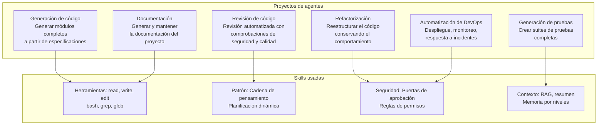
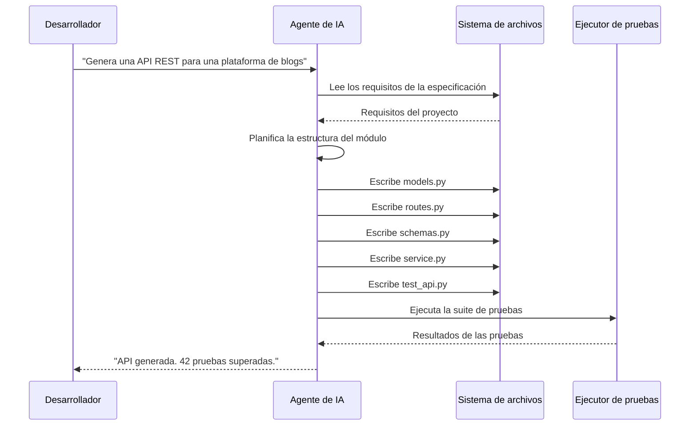

# Proyectos de agentes del mundo real

## Resumen

Esta lección final sintetiza todo lo que has aprendido en proyectos prácticos y del mundo real. Cada proyecto demuestra cómo se aplican las técnicas de IA agéntica a las tareas habituales de ingeniería de software.



> [!NOTE]
> Estos proyectos están diseñados para ejecutarse con OpenCode o cualquier framework de agentes. Cada proyecto incluye la configuración, las definiciones de skills y las salidas esperadas necesarias para una ejecución correcta.

---

## Proyecto 1: Generación automatizada de código

Genera un módulo de API REST completo a partir de una especificación usando un agente.



```yaml
# project-configs/blog-api/skill.yaml
name: blog-api-generator
description: Generate a complete blog REST API from specifications
version: "1.0.0"
instructions:
  - path: instructions/generate-models.md
  - path: instructions/generate-routes.md
  - path: instructions/generate-tests.md
tools:
  required:
    - read
    - write
    - glob
    - bash
resources:
  - path: templates/fastapi-base.py.hbs
  - path: templates/sqlalchemy-model.py.hbs
  - path: templates/pytest-fixtures.py.hbs
autoload:
  enabled: false
```

```python
# Example: Agent generating a FastAPI blog module
GENERATED_MODULE = """
# models.py
from sqlalchemy import Column, Integer, String, Text, DateTime, ForeignKey
from sqlalchemy.sql import func
from database import Base

class User(Base):
    __tablename__ = "users"

    id = Column(Integer, primary_key=True, index=True)
    username = Column(String(50), unique=True, nullable=False)
    email = Column(String(120), unique=True, nullable=False)
    created_at = Column(DateTime(timezone=True), server_default=func.now())

class Post(Base):
    __tablename__ = "posts"

    id = Column(Integer, primary_key=True, index=True)
    title = Column(String(200), nullable=False)
    content = Column(Text, nullable=False)
    author_id = Column(Integer, ForeignKey("users.id"), nullable=False)
    created_at = Column(DateTime(timezone=True), server_default=func.now())
    updated_at = Column(DateTime(timezone=True), onupdate=func.now())

# schemas.py
from pydantic import BaseModel, EmailStr
from datetime import datetime
from typing import Optional

class UserCreate(BaseModel):
    username: str
    email: EmailStr

class UserResponse(BaseModel):
    id: int
    username: str
    email: str
    created_at: datetime

class PostCreate(BaseModel):
    title: str
    content: str

class PostResponse(BaseModel):
    id: int
    title: str
    content: str
    author_id: int
    created_at: datetime
    updated_at: Optional[datetime] = None

# routes.py
from fastapi import APIRouter, Depends, HTTPException, status
from sqlalchemy.orm import Session
from . import models, schemas
from .database import get_db

router = APIRouter(prefix="/api/v1", tags=["blog"])

@router.post("/users/", response_model=schemas.UserResponse, status_code=201)
def create_user(user: schemas.UserCreate, db: Session = Depends(get_db)):
    db_user = models.User(**user.model_dump())
    db.add(db_user)
    db.commit()
    db.refresh(db_user)
    return db_user

@router.get("/posts/", response_model=list[schemas.PostResponse])
def list_posts(skip: int = 0, limit: int = 10, db: Session = Depends(get_db)):
    return db.query(models.Post).offset(skip).limit(limit).all()

@router.post("/posts/", response_model=schemas.PostResponse, status_code=201)
def create_post(post: schemas.PostCreate, db: Session = Depends(get_db)):
    db_post = models.Post(**post.model_dump())
    db.add(db_post)
    db.commit()
    db.refresh(db_post)
    return db_post

@router.get("/posts/{post_id}", response_model=schemas.PostResponse)
def get_post(post_id: int, db: Session = Depends(get_db)):
    post = db.query(models.Post).filter(models.Post.id == post_id).first()
    if not post:
        raise HTTPException(status_code=404, detail="Post not found")
    return post
"""
```

---

## Proyecto 2: Revisión inteligente de código

Un agente que revisa pull requests en busca de errores, problemas de seguridad y violaciones de estilo.

```json
{
  "skills": {
    "pr-reviewer": {
      "manifest": "skills/pr-reviewer/skill.yaml",
      "autoLoad": true,
      "matchPattern": "review pull request|review PR|#\\d+"
    }
  },
  "agents": {
    "reviewer": {
      "model": "claude-sonnet-4-20250514",
      "description": "Code review specialist",
      "prompt": "You are a senior code reviewer. Review code for: security vulnerabilities, performance issues, maintainability problems, and style violations.",
      "constraints": {
        "allowedTools": ["read", "grep", "glob", "bash"],
        "deniedTools": ["write", "edit"]
      }
    }
  }
}
```

```python
class CodeReviewAgent:
    def __init__(self, agent):
        self.agent = agent
        self.findings = []

    async def review_pr(self, pr_number, repo_path):
        # Get the diff
        diff = await self.agent.bash(f"cd {repo_path} && git diff main...HEAD")
        changed_files = await self.agent.bash(
            f"cd {repo_path} && git diff --name-only main...HEAD"
        )

        files = changed_files.strip().split("\n")
        for file in files[:10]:
            if file.endswith((".py", ".ts", ".js", ".tsx", ".jsx")):
                content = await self.agent.read(f"{repo_path}/{file}")
                file_review = await self._review_file(file, content)
                self.findings.extend(file_review)

        return self._generate_report()

    async def _review_file(self, file_path, content):
        findings = []
        lines = content.split("\n")

        for i, line in enumerate(lines, 1):
            # Security checks
            if "eval(" in line or "exec(" in line:
                findings.append({
                    "severity": "critical",
                    "file": file_path,
                    "line": i,
                    "type": "code_injection",
                    "description": f"Dangerous function usage at line {i}"
                })

            # Performance checks
            if "for " in line and any(
                nested_line.strip().startswith("for ")
                for nested_line in lines[i:i+5]
            ):
                findings.append({
                    "severity": "major",
                    "file": file_path,
                    "line": i,
                    "type": "nested_loop",
                    "description": "Potential O(n^2) nested loop detected"
                })

            # Hardcoded secrets
            if "password" in line.lower() and "=" in line:
                findings.append({
                    "severity": "critical",
                    "file": file_path,
                    "line": i,
                    "type": "hardcoded_secret",
                    "description": "Possible hardcoded credential"
                })

            # TODO/FIXME tracking
            if "TODO" in line or "FIXME" in line:
                findings.append({
                    "severity": "info",
                    "file": file_path,
                    "line": i,
                    "type": "todo",
                    "description": line.strip()
                })

        return findings

    def _generate_report(self):
        by_severity = {}
        for f in self.findings:
            sev = f["severity"]
            if sev not in by_severity:
                by_severity[sev] = []
            by_severity[sev].append(f)

        report = [
            "# Code Review Report",
            f"**Total Findings**: {len(self.findings)}",
            "",
            "## Summary by Severity",
        ]
        for sev in ["critical", "major", "minor", "info"]:
            count = len(by_severity.get(sev, []))
            report.append(f"- **{sev.capitalize()}**: {count}")
        report.append("")

        for sev in ["critical", "major", "minor", "info"]:
            items = by_severity.get(sev, [])
            if items:
                report.append(f"## {sev.capitalize()} Issues")
                for item in items[:5]:
                    report.append(
                        f"- [{item['type']}] {item['file']}:{item['line']}"
                    )
                    report.append(f"  {item['description']}")
                report.append("")

        return "\n".join(report)
```

---

## Proyecto 3: Refactorización automatizada

Un agente que reestructura el código de forma segura conservando el comportamiento.

```python
class RefactoringAgent:
    def __init__(self, agent):
        self.agent = agent
        self.changes = []

    async def refactor(self, file_path, strategy):
        content = await self.agent.read(file_path)

        if strategy == "extract_function":
            result = await self._extract_function(content, file_path)
        elif strategy == "rename_variable":
            result = await self._rename_variable(content, file_path)
        elif strategy == "add_type_hints":
            result = await self._add_type_hints(content, file_path)
        else:
            return {"status": "error", "message": f"Unknown strategy: {strategy}"}

        return result

    async def _extract_function(self, content, file_path):
        lines = content.split("\n")
        # Find long functions (simplified heuristic)
        changes = []
        i = 0
        while i < len(lines):
            if lines[i].startswith("def ") and i + 30 < len(lines):
                # Function is long, suggest extraction
                func_name = lines[i][4:].split("(")[0]
                changes.append({
                    "type": "extract_function",
                    "function": func_name,
                    "start_line": i + 1,
                    "length": "30+ lines",
                    "suggestion": f"Extract helper functions from {func_name}"
                })
                i += 30
            i += 1

        return {"status": "analyzed", "changes": changes}

    async def _rename_variable(self, content, file_path):
        # Find poorly named variables
        import re
        lines = content.split("\n")
        changes = []
        bad_names = re.findall(r'\b([a-z]{1,2})\s*=', content)
        for name in set(bad_names):
            if name not in ["id", "ok", "no"]:
                changes.append({
                    "type": "rename_variable",
                    "old_name": name,
                    "suggestion": f"Rename '{name}' to a more descriptive name"
                })
        return {"status": "analyzed", "changes": changes}

    async def _add_type_hints(self, content, file_path):
        lines = content.split("\n")
        changes = []
        for i, line in enumerate(lines, 1):
            if line.startswith("def ") and "->" not in line:
                func = line[4:].split("(")[0]
                changes.append({
                    "type": "add_return_type",
                    "function": func,
                    "line": i,
                    "suggestion": f"Add return type hint to {func}"
                })
        return {"status": "analyzed", "changes": changes}
```

> [!TIP]
> Al refactorizar con agentes, usa siempre un sistema de control de versiones. Crea una rama, aplica los cambios de forma incremental y ejecuta las pruebas después de cada cambio. Si una refactorización rompe las pruebas, el agente puede analizar el fallo y autocorregirse.

---

## Proyecto 4: Generación de pruebas

Un agente que crea suites de pruebas completas a partir del análisis del código fuente.

```yaml
# skills/test-generator/skill.yaml
name: test-generator
description: Generate comprehensive test suites from source code analysis
version: "2.0.0"
instructions:
  - path: instructions/analyze-source.md
  - path: instructions/generate-tests.md
  - path: instructions/validate-tests.md
tools:
  required:
    - read
    - write
    - bash
  optional:
    - grep
resources:
  - path: templates/pytest-test.py.hbs
  - path: templates/jest-test.ts.hbs
autoload:
  enabled: true
  matchPattern: "generate tests|create tests|add test coverage"
```

```python
class TestGenerator:
    def __init__(self, agent):
        self.agent = agent

    async def generate_tests(self, source_path):
        content = await self.agent.read(source_path)
        tree = self._parse_functions(content)
        test_file = self._build_test_file(source_path, tree)
        test_path = source_path.replace("src/", "tests/").replace(".py", "_test.py")
        await self.agent.write(test_path, test_file)
        return {"test_file": test_path, "test_count": len(tree)}

    def _parse_functions(self, content):
        import ast
        tree = ast.parse(content)
        functions = []
        for node in ast.walk(tree):
            if isinstance(node, ast.FunctionDef):
                functions.append({
                    "name": node.name,
                    "args": [a.arg for a in node.args.args],
                    "decorators": [
                        d.id for d in node.decorator_list
                        if isinstance(d, ast.Name)
                    ]
                })
        return functions

    def _build_test_file(self, source_path, functions):
        module_name = source_path.split("/")[-1].replace(".py", "")
        lines = [
            f'"""Tests for {module_name} module."""',
            "import pytest",
            f"from {module_name} import (",
        ]
        for func in functions:
            lines.append(f"    {func['name']},")
        lines.append(")")
        lines.append("")

        for func in functions:
            lines.extend(self._generate_test_case(func))

        return "\n".join(lines)

    def _generate_test_case(self, func):
        name = func["name"]
        params = func["args"]

        test_cases = [
            f"def test_{name}_basic():",
            f'    """Test basic {name} functionality."""',
            f"    # TODO: Implement test for {name}",
            f"    # result = {name}({', '.join(params)})",
            f"    # assert result is not None",
            f"    pass",
            "",
            f"def test_{name}_edge_cases():",
            f'    """Test {name} with edge case inputs."""',
            f"    # TODO: Add edge case tests",
            f"    pass",
            "",
        ]
        return test_cases
```

---

## Proyecto 5: Generación de documentación

```python
class DocGenerator:
    def __init__(self, agent):
        self.agent = agent

    async def generate_docs(self, project_root):
        files = await self.agent.glob(f"{project_root}/**/*.py")
        docs = []

        for file in files[:20]:
            content = await self.agent.read(file)
            module_doc = self._extract_module_doc(content)
            functions = self._parse_functions(content)

            doc_section = [
                f"## Module: {file}",
                "",
                module_doc or "No module documentation.",
                "",
                "### Functions",
                "",
            ]
            for func in functions:
                doc_section.extend([
                    f"#### `{func['name']}({', '.join(func['args'])})`",
                    "",
                    func["docstring"] or "No documentation.",
                    "",
                ])
            docs.append("\n".join(doc_section))

        return "# API Documentation\n\n" + "\n---\n".join(docs)

    def _extract_module_doc(self, content):
        import ast
        try:
            tree = ast.parse(content)
            return ast.get_docstring(tree)
        except SyntaxError:
            return None

    def _parse_functions(self, content):
        import ast
        try:
            tree = ast.parse(content)
            functions = []
            for node in ast.walk(tree):
                if isinstance(node, ast.FunctionDef) and not node.name.startswith("_"):
                    functions.append({
                        "name": node.name,
                        "args": [a.arg for a in node.args.args],
                        "docstring": ast.get_docstring(node)
                    })
            return functions
        except SyntaxError:
            return []
```

---

## Ejercicios de práctica

```question
{
  "id": "aa-10-q1",
  "type": "multiple-choice",
  "question": "¿Cuál es el enfoque recomendado cuando una refactorización de un agente rompe las pruebas existentes?",
  "options": [
    "Borrar las pruebas que fallan y continuar",
    "El agente debe analizar el fallo, autocorregirse y volver a ejecutarlas",
    "Ignorar los fallos de las pruebas y desplegar de todos modos",
    "Deshabilitar todas las pruebas antes de refactorizar"
  ],
  "correct": 1,
  "explanation": "Cuando las pruebas fallan, el agente debe analizar el mensaje de error, entender qué salió mal, corregir su enfoque y volver a ejecutar las pruebas. Esto es el equivalente en agentes de TDD: hacer que las pruebas vuelvan a pasar."
}
```

```question
{
  "id": "aa-10-q2",
  "type": "multiple-choice",
  "question": "En el proyecto de revisión de código, ¿qué problema de seguridad comprueba el agente?",
  "options": [
    "La consistencia del formato del código",
    "El uso de eval()/exec(), secretos escritos de forma literal y el seguimiento de TODO",
    "El porcentaje de cobertura de pruebas",
    "Los tiempos de respuesta de la API"
  ],
  "correct": 1,
  "explanation": "El agente de revisión de código comprueba funciones peligrosas (eval/exec), credenciales escritas de forma literal, bucles anidados (rendimiento) y hace seguimiento de los comentarios TODO/FIXME. Esto representa preocupaciones de seguridad, rendimiento y mantenibilidad."
}
```

```question
{
  "id": "aa-10-q3",
  "type": "multiple-choice",
  "question": "¿Qué herramienta usa el generador de pruebas para analizar el código fuente e identificar funciones?",
  "options": [
    "Expresiones regulares",
    "El módulo ast de Python (Abstract Syntax Tree)",
    "La división de cadenas",
    "La herramienta grep"
  ],
  "correct": 1,
  "explanation": "El generador de pruebas usa el módulo ast de Python para analizar el código fuente y convertirlo en un Abstract Syntax Tree, lo que permite identificar de forma fiable las funciones, sus parámetros y sus decoradores sin depender de análisis regex frágiles."
}
```

```question
{
  "id": "aa-10-q4",
  "type": "multiple-choice",
  "question": "¿Cuál es el propósito de usar una rama para la refactorización dirigida por un agente?",
  "options": [
    "Ralentizar el proceso de refactorización",
    "Proporcionar un punto de reversión seguro si la refactorización sale mal",
    "Hacer que la refactorización se ejecute más rápido",
    "Evitar activar los pipelines de CI/CD"
  ],
  "correct": 1,
  "explanation": "Una rama proporciona un punto de reversión seguro. Si la refactorización del agente introduce problemas, la rama puede descartarse sin afectar al código principal. Cada cambio de refactorización puede confirmarse de forma incremental."
}
```

```question
{
  "id": "aa-10-q5",
  "type": "multiple-choice",
  "question": "En el proyecto de generación de la API de blogs, ¿qué framework se usa para la API generada?",
  "options": [
    "Django REST Framework",
    "FastAPI",
    "Flask",
    "Express.js"
  ],
  "correct": 1,
  "explanation": "El código generado usa FastAPI con SQLAlchemy como ORM, Pydantic para los esquemas y pytest para las pruebas. Se eligió FastAPI por su documentación automática de OpenAPI y su seguridad de tipos."
}
```

```question
{
  "id": "aa-10-q6",
  "type": "multiple-choice",
  "question": "¿Qué convención de nombres de archivos usa el generador de pruebas al crear los archivos de prueba?",
  "options": [
    "test_<module>.py",
    "<module>_test.py",
    "<module>.spec.py",
    "test_<module>_unittest.py"
  ],
  "correct": 0,
  "explanation": "El generador de pruebas usa la convención de pytest: test_<module>.py. El archivo de origen src/module.py genera tests/test_module.py. Esto sigue las mejores prácticas de pruebas de Python."
}
```

```question
{
  "id": "aa-10-q7",
  "type": "multiple-choice",
  "question": "¿Qué información extrae el generador de documentación del código fuente?",
  "options": [
    "Solo los nombres de las funciones",
    "Los docstrings del módulo, las firmas de las funciones y los docstrings de las funciones",
    "Los comentarios del código y la documentación integrada",
    "El historial de commits de Git"
  ],
  "correct": 1,
  "explanation": "El generador de documentación extrae los docstrings del nivel de módulo, las firmas de las funciones (nombre y parámetros) y los docstrings de nivel de función usando el módulo ast de Python."
}
```

```question
{
  "id": "aa-10-q8",
  "type": "multiple-choice",
  "question": "¿Por qué el agente de revisión de código usa 'deniedTools: [write, edit]'?",
  "options": [
    "Para impedir que el revisor modifique el código, dejándolo de solo lectura",
    "Porque las operaciones de escritura no son necesarias para la revisión",
    "Ambas: el agente debe inspeccionar, no modificar",
    "Reducir el uso de tokens"
  ],
  "correct": 2,
  "explanation": "Un agente de revisión de código debe ser de solo lectura: inspecciona el código e informa de los hallazgos, pero nunca lo modifica. Denegar las herramientas write y edit garantiza que el revisor no cambie el código por accidente durante la revisión."
}
```

---

[!SUCCESS] **Conclusiones Clave (Key Takeaways):**

- Los proyectos de agentes del mundo real abarcan generación de código, revisión, refactorización, pruebas y documentación
- Los agentes de generación de código crean módulos completos a partir de especificaciones, con modelos, rutas y pruebas
- Los agentes de revisión de código deben ser de solo lectura e inspeccionar el código en busca de errores, problemas de seguridad y fallos de estilo
- Los agentes de refactorización deben usar ramas de control de versiones para cambios seguros y reversibles
- Los agentes de generación de pruebas crean suites completas analizando la estructura del código fuente
- Los agentes de documentación extraen automáticamente la documentación de módulos y funciones del código fuente
- Cada proyecto combina varias skills: uso de herramientas, planificación, gestión del contexto y patrones de seguridad
- Los agentes reales gestionan los errores, adaptan los planes y aprenden de los resultados intermedios
- La lección final demuestra todo el poder de la IA agéntica: ingeniería de software autónoma y multietapa
