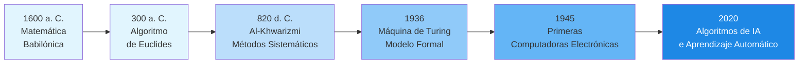
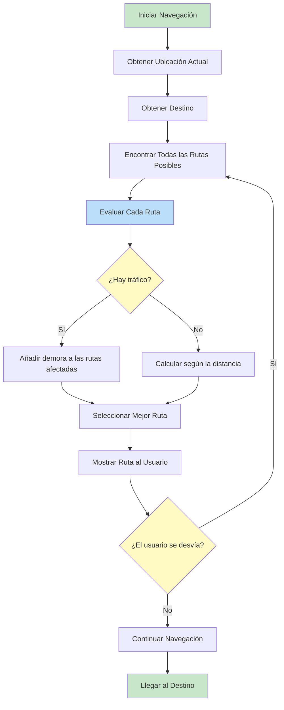
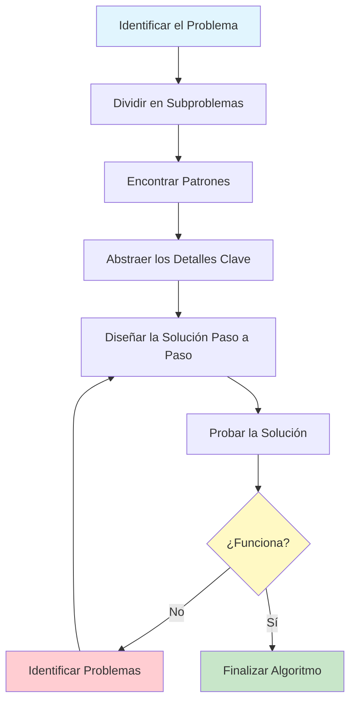

# ¿Qué Son los Algoritmos?

Los algoritmos están en todas partes. Desde el momento en que te despiertas y revisas tu teléfono hasta las rutas que calcula tu GPS, los algoritmos moldean silenciosamente nuestras experiencias diarias. En esta lección, exploraremos qué son realmente los algoritmos, de dónde proceden y cómo pensar de forma algorítmica.

## Definiendo los Algoritmos

Un **algoritmo** es una secuencia finita de instrucciones bien definidas, paso a paso, diseñada para resolver un problema específico o cumplir una tarea determinada. Piénsalo como una receta: te dice exactamente qué hacer, en qué orden, para alcanzar el resultado deseado.

### Características Clave de los Algoritmos

| Característica | Descripción | Ejemplo |
|---|---|---|
| **Finito** | Debe terminar eventualmente | Una receta tiene un número limitado de pasos |
| **Bien definido** | Cada paso es claro y sin ambigüedades | "Agrega 2 tazas de harina" y no "Agrega un poco de harina" |
| **Entrada** | Recibe cero o más entradas | Un algoritmo de ordenamiento recibe una lista de números |
| **Salida** | Produce al menos una salida | La lista de números ordenada |
| **Eficaz** | Cada paso puede realizarse en tiempo finito | Operaciones aritméticas básicas |

> [!NOTE]
> Un algoritmo NO es un programa. Un algoritmo es la idea o el plan conceptual; un programa es la implementación de ese algoritmo en un lenguaje de programación en concreto.

## Una Breve Historia de los Algoritmos

El concepto de algoritmos es anterior a las computadoras en miles de años.

### Orígenes Antiguos

La palabra "algoritmo" proviene del nombre del matemático persa **Muhammad ibn Musa al-Khwarizmi** (c. 780-850 d. C.). Su trabajo sobre la resolución de ecuaciones introdujo métodos sistemáticos que se conocieron como "algorismo" y, con el tiempo, "algoritmo".

Sin embargo, los algoritmos existían mucho antes que esto:

- **Matemática babilónica** (c. 1600 a. C.): Las tablillas de arcilla muestran procedimientos paso a paso para resolver ecuaciones cuadráticas
- **Algoritmo de Euclides** (c. 300 a. C.): Un método para encontrar el máximo común divisor de dos números, aún utilizado hoy
- **Matemática egipcia antigua**: El Papiro de Rhind contiene algoritmos para multiplicación y división

### La Era Moderna



> [!TIP]
> Comprender la historia de los algoritmos nos ayuda a valorar que el pensamiento algorítmico es una habilidad humana fundamental, no solo un concepto moderno de la informática.

## Algoritmos en la Vida Diaria

Interactúas con los algoritmos constantemente sin darte cuenta. Examinemos algunos ejemplos cotidianos.

### Algoritmo de la Rutina Matinal

Considera tu rutina matinal. Sigue un patrón algorítmico:

```
ALGORITMO: Rutina Matinal
ENTRADA: Estás dormido
SALIDA: Estás listo para el día

PASO 1: Despertar
PASO 2: SI la alarma está sonando ENTONCE
            Apagar la alarma
        FIN SI
PASO 3: Levantarte de la cama
PASO 4: Ir al baño
PASO 5: Cepillarte los dientes
PASO 6: Ducharte
PASO 7: Vestirte
PASO 8: Desayunar
PASO 9: SI el clima está frío ENTONCE
            Ponerte una chaqueta
        SINO
            Usar ropa ligera
        FIN SI
PASO 10: Salir para el trabajo/la escuela
FIN ALGORITMO
```

### Algoritmos de Navegación

Cuando usas la navegación GPS, un algoritmo sofisticado:

1. Identifica tu ubicación actual
2. Determina tu destino
3. Mapea todas las rutas posibles
4. Evalúa cada ruta según la distancia, el tráfico y el tiempo
5. Selecciona la ruta óptima
6. Recalcula si te desvías del camino



### Cocinar como un Algoritmo

¡Las recetas son algoritmos! Tienen:

- **Entrada**: Ingredientes
- **Pasos**: Instrucciones claras y ordenadas
- **Condicionales**: "Si la masa está muy pegajosa, agrega más harina"
- **Salida**: Un plato terminado
- **Terminación**: La receta termina cuando el plato está listo

> [!WARNING]
> No todos los procesos paso a paso son buenos algoritmos. Un mal algoritmo puede tener pasos ambiguos, bucles infinitos o condiciones faltantes. Asegúrate siempre de que tus algoritmos sean precisos y completos.

## Pensamiento Algorítmico

El **pensamiento algorítmico** es una forma de abordar los problemas que te permite definir soluciones claras y paso a paso. Implica varias habilidades clave:

### Descomposición

Dividir un problema complejo en partes más pequeñas y manejables.

**Ejemplo**: Planear una fiesta

```
PROBLEMA: Planear una fiesta de cumpleaños

DESCOMPUESTO EN:
  - Crear la lista de invitados
  - Elegir un lugar
  - Planear el menú
  - Pedir decoraciones
  - Organizar el entretenimiento
  - Enviar invitaciones
  - Preparar el lugar
  - Organizar la fiesta
```

### Reconocimiento de Patrones

Identificar similitudes o patrones dentro de los problemas.

```
PATRÓN: Preparar cualquier bebida caliente
  1. Hervir agua
  2. Preparar la base (bolsita de té, café molido, cacao en polvo)
  3. Combinar el agua y la base
  4. Agregar extras opcionales (leche, azúcar, miel)
  5. Revolver y servir
```

### Abstracción

Centrarte en la información importante mientras ignoras los detalles irrelevantes.

Al diseñar un algoritmo para ordenar libros en una biblioteca, te importan:
- Los títulos de los libros o los números de catálogo
- El orden en que deben estar

NO te importan:
- El color de las portadas de los libros
- El peso de cada libro
- La biografía del autor

### Razonamiento Lógico

Elaborar reglas paso a paso para resolver el problema.



## Ejemplo del Mundo Real: Encontrar un Libro en una Biblioteca

Comparemos dos formas de encontrar un libro:

### Enfoque 1: Búsqueda Aleatoria

```
ALGORITMO: Búsqueda Aleatoria de un Libro
ENTRADA: Biblioteca con N libros, título del libro objetivo
SALIDA: El libro objetivo (o no encontrado)

PASO 1: Tomar un libro al azar del estante
PASO 2: Comprobar si es el libro objetivo
PASO 3: SI es el libro objetivo ENTONCE
            Devolver el libro
        SINO
            Ir al PASO 1
        FIN SI
```

> [!WARNING]
> ¡Este algoritmo podría ejecutarse para siempre si el libro no existe! Tampoco hay forma de rastrear qué libros ya se han comprobado.

### Enfoque 2: Búsqueda Sistemática

```
ALGORITMO: Búsqueda Sistemática de un Libro
ENTRADA: Biblioteca con N libros organizados por categoría, título del libro objetivo
SALIDA: El libro objetivo (o confirmación de que no está disponible)

PASO 1: Identificar la categoría del libro objetivo
PASO 2: Ir a la sección de esa categoría
PASO 3: Empezar por el primer libro de esa sección
PASO 4: PARA cada libro de la sección HACER
            Comprobar si el libro coincide con el objetivo
            SI coincide ENTONCE
                Devolver el libro y PARAR
            FIN SI
        FIN PARA
PASO 5: Devolver "Libro no encontrado"
FIN ALGORITMO
```

| Aspecto | Búsqueda Aleatoria | Búsqueda Sistemática |
|---|---|---|
| **¿Garantía de encontrarlo?** | No | Sí (si el libro existe) |
| **¿Garantía de terminar?** | No | Sí |
| **Mejor caso** | 1 comprobación | 1 comprobación |
| **Peor caso** | Infinito | N comprobaciones |
| **Eficiencia** | Muy deficiente | Razonable |

## Ejercicios Prácticos

### Ejercicio 1: Identifica el Algoritmo

¿Cuáles de los siguientes son algoritmos? Explica por qué sí o por qué no.

1. Una receta de pastel de chocolate
2. Las instrucciones de un frasco de champú ("Espuma, enjuaga, repite")
3. Una lista de tus canciones favoritas
4. Indicaciones desde tu casa hasta el supermercado más cercano
5. Las reglas de un juego de mesa

### Ejercicio 2: Escribe un Algoritmo Diario

Escribe un algoritmo para una de las siguientes tareas usando pseudocódigo:

- Preparar una taza de té o café
- Cruzar una calle concurrida de forma segura
- Organizar tu mochila para la escuela

Incluye al menos una instrucción condicional (SI/SINO).

### Ejercicio 3: Práctica de Descomposición

Descompón el problema "Planear unas vacaciones de una semana" en al menos 6 subproblemas. Para cada subproblema, identifica cuáles serían las entradas y las salidas.

### Ejercicio 4: Encuentra el Defecto

Encuentra el (o los) problema(s) de este algoritmo:

```
ALGORITMO: Cruzar la Calle
PASO 1: Caminar hacia la calle
PASO 2: Cruzar al otro lado
PASO 3: Has cruzado la calle
FIN ALGORITMO
```

Reescríbelo para que sea seguro y completo.

### Ejercicio 5: Reconocimiento de Patrones

Identifica el patrón común en estas tareas:

- Doblado de la ropa
- Apilar platos en un armario
- Organizar archivos en un archivador

Escribe un algoritmo generalizado que capture este patrón.

## Resumen

En esta lección, has aprendido:

- **Qué son los algoritmos**: Secuencias finitas y bien definidas de pasos para resolver problemas
- **La historia**: Desde la matemática babilónica antigua hasta la IA moderna
- **Ejemplos de la vida diaria**: Rutinas matinas, navegación GPS, recetas de cocina
- **Pensamiento algorítmico**: Descomposición, reconocimiento de patrones, abstracción y razonamiento lógico
- **Algoritmos buenos vs. malos**: Los enfoques sistemáticos siempre vencen a los aleatorios

> [!SUCCESS]
> Ahora entiendes que los algoritmos no son solo para las computadoras. Son herramientas fundamentales para resolver problemas de forma organizada y eficiente. Esta mentalidad te servirá durante todo este curso y más allá.

## Términos Clave

| Término | Definición |
|---|---|
| **Algoritmo** | Una secuencia finita de instrucciones bien definidas para resolver un problema |
| **Pensamiento Algorítmico** | Un enfoque de resolución de problemas que usa procesos lógicos paso a paso |
| **Descomposición** | Dividir problemas complejos en partes más pequeñas |
| **Reconocimiento de Patrones** | Identificar similitudes dentro y entre problemas |
| **Abstracción** | Centrarse en los detalles esenciales e ignorar los irrelevantes |
| **Pseudocódigo** | Una descripción en lenguaje simple de los pasos de un algoritmo |
