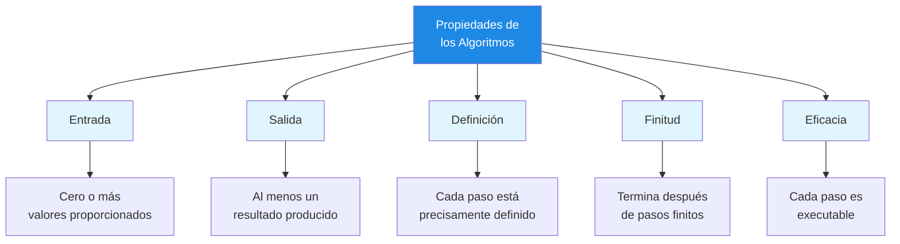
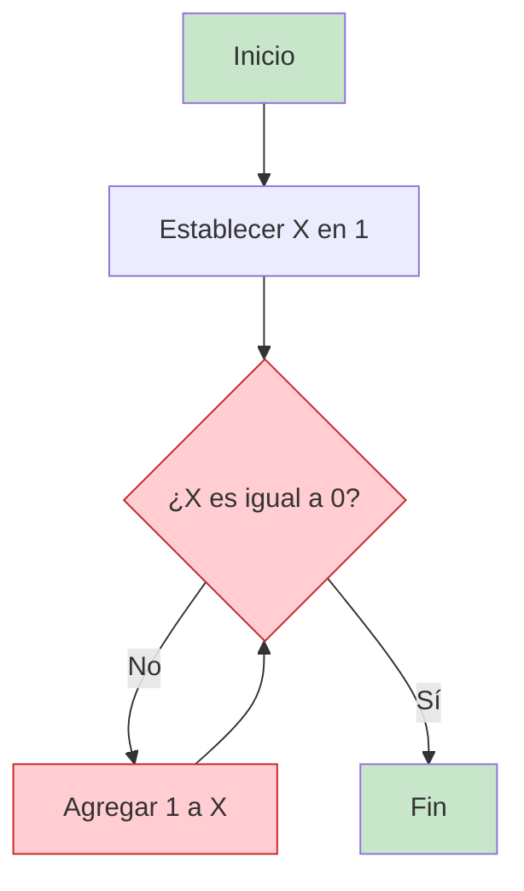
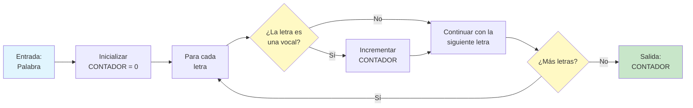

# Propiedades de los Algoritmos

No todo conjunto de instrucciones se cualifica como algoritmo. Para que un procedimiento se considere un algoritmo verdadero, debe satisfacer cinco propiedades esenciales. Comprender estas propiedades te ayuda a diseñar mejores algoritmos e identificar los defectuosos.

## Las Cinco Propiedades Esenciales

Todo algoritmo válido debe tener estas cinco características:

| Propiedad | Pregunta que Responde | Por Qué Importa |
|---|---|---|
| **Entrada** | ¿Con qué datos comienza el algoritmo? | Define el alcance y la aplicabilidad |
| **Salida** | ¿Qué resultado produce el algoritmo? | Define el propósito y los criterios de éxito |
| **Definición** | ¿Es cada paso claro y sin ambigüedades? | Garantiza una ejecución consistente |
| **Finitud** | ¿El algoritmo terminará eventualmente? | Previene los bucles infinitos |
| **Eficacia** | ¿Puede realmente realizarse cada paso? | Garantiza la viabilidad práctica |



## Propiedad 1: Entrada

Un algoritmo debe tener **cero o más entradas** -- valores o datos proporcionados al algoritmo antes de que comience su ejecución.

### Comprendiendo la Entrada

Las entradas son las materias primas con las que trabaja tu algoritmo. Pueden ser:

- Números (p. ej., una lista de temperaturas)
- Texto (p. ej., un párrafo para analizar)
- Objetos (p. ej., una baraja de cartas para barajar)
- Nada en absoluto (algunos algoritmos generan datos sin entrada)

### Ejemplos

```
ALGORITMO: Sumar Dos Números
ENTRADA: Dos números, A y B
SALIDA: La suma de A y B

PASO 1: Leer el número A
PASO 2: Leer el número B
PASO 3: Calcular SUMA = A + B
PASO 4: Devolver SUMA
FIN ALGORITMO
```

```
ALGORITMO: Generar los Primeros 10 Números Pares
ENTRADA: Ninguna
SALIDA: Lista de los primeros 10 números pares

PASO 1: Crear una lista vacía llamada NUMEROS_PARES
PASO 2: Establecer CONTADOR en 2
PASO 3: MIENTRAS la lista tenga menos de 10 números HACER
            Agregar CONTADOR a NUMEROS_PARES
            Establecer CONTADOR en CONTADOR + 2
        FIN MIENTRAS
PASO 4: Devolver NUMEROS_PARES
FIN ALGORITMO
```

> [!NOTE]
> Un algoritmo con cero entradas sigue siendo válido. Por ejemplo, un algoritmo que genera la secuencia de Fibonacci desde cero no necesita entradas externas.

## Propiedad 2: Salida

Un algoritmo debe producir **al menos una salida** -- un resultado que tenga una relación especificada con las entradas.

### Por Qué Importa la Salida

La salida es toda la razón de ser del algoritmo. Sin salida, el algoritmo no logra nada. La salida debe ser:

- **Predecible**: Dada la misma entrada, el algoritmo debe producir la misma salida
- **Útil**: La salida debe resolver el problema para el que fue diseñado el algoritmo
- **Bien definida**: Debes saber exactamente qué forma tendrá la salida

### Ejemplos

```
ALGORITMO: Encontrar el Máximo
ENTRADA: Una lista de números
SALIDA: El número más grande de la lista

PASO 1: Establecer MAX en el primer número de la lista
PASO 2: PARA cada número restante de la lista HACER
            SI el número actual es mayor que MAX ENTONCE
                Establecer MAX en el número actual
            FIN SI
        FIN PARA
PASO 3: Devolver MAX
FIN ALGORITMO
```

| Algoritmo | Entrada | Salida |
|---|---|---|
| Ordenar una lista | [3, 1, 4, 1, 5] | [1, 1, 3, 4, 5] |
| Contar palabras | "Hola mundo hoy" | 3 |
| Verificar primo | 7 | verdadero |
| Invertir texto | "hola" | "aloh" |

## Propiedad 3: Definición

Cada paso de un algoritmo debe estar **precisamente definido** -- no debe haber ambigüedad sobre qué hacer en ningún momento.

### El Problema de la Ambigüedad

Considera estas dos instrucciones:

| Ambiguo (Malo) | Definido (Bueno) |
|---|---|
| "Agrega un poco de sal" | "Agrega 1 cucharadita de sal" |
| "Camina hasta que te sientas cansado" | "Camina durante 30 minutos" |
| "Elige un número" | "Elige el primer número de la lista" |
| "Haz que se vea bien" | "Alinea todo el texto al margen izquierdo" |

### Ejemplo: Definido vs. Indefinido

```
ALGORITMO MALO: Preparar Café (Indefinido)
PASO 1: Toma un poco de café
PASO 2: Agrega agua
PASO 3: Caliéntalo
PASO 4: Sírvelo
PASO 5: Agrega leche si quieres
```

> [!WARNING]
> El algoritmo malo anterior falla en la definición porque: "un poco de café" es vago, "agua" no tiene cantidad, "caliéntalo" no tiene temperatura y "si quieres" hace que el comportamiento sea inconsistente.

```
ALGORITMO BUENO: Preparar Café (Definido)
ENTRADA: Café molido, agua, leche (opcional)
SALIDA: Una taza de café

PASO 1: Medir 2 cucharadas soperas de café molido
PASO 2: Colocar el café en el filtro
PASO 3: Medir 250 mililitros de agua
PASO 4: Calentar el agua a 95 grados Celsius
PASO 5: Verter el agua caliente sobre el café
PASO 6: Esperar 4 minutos para la infusión
PASO 7: SI se pidió leche ENTONCE
            Agregar 30 mililitros de leche
        FIN SI
PASO 8: Servir en una taza
FIN ALGORITMO
```

## Propiedad 4: Finitud

Un algoritmo debe **terminar después de un número finito de pasos** -- no puede ejecutarse para siempre.

### Bucles Infinitos

La violación más común de la finitud es el bucle infinito -- un bucle que nunca termina porque su condición de terminación nunca se cumple.



> [!WARNING]
> En el diagrama anterior, X comienza en 1 y sigue aumentando. ¡NUNCA será igual a 0, así que el algoritmo se ejecuta para siempre! Esto viola la propiedad de finitud.

### Garantizando la Finitud

Para garantizar la finitud, todo bucle debe tener:

1. Una **condición de terminación clara** que pueda evaluarse
2. Un **camino garantizado** para alcanzar esa condición
3. **Progreso** hacia la condición en cada iteración

```
BUENO: Bucle Finito
PASO 1: Establecer CONTADOR en 10
PASO 2: MIENTRAS CONTADOR sea mayor que 0 HACER
            Imprimir CONTADOR
            Establecer CONTADOR en CONTADOR - 1
        FIN MIENTRAS
PASO 3: Imprimir "¡Listo!"
```

```
MALO: Bucle Potencialmente Infinito
PASO 1: Establecer CONTADOR en 10
PASO 2: MIENTRAS CONTADOR no sea igual a 5 HACER
            SI CONTADOR es par ENTONCE
                Establecer CONTADOR en CONTADOR - 2
            SINO
                Establecer CONTADOR en CONTADOR + 2
            FIN SI
        FIN MIENTRAS
```

> [!TIP]
> Traza el ejemplo malo con lápiz y papel. Empezando en 10: 10 -> 8 -> 6 -> 4 -> 2 -> 0 -> -2... ¡Nunca llegará a 5!

## Propiedad 5: Eficacia

Cada paso de un algoritmo debe ser **suficientemente básico para poder realizarse** -- en principio, por una persona que usa solo lápiz y papel en una cantidad finita de tiempo.

### ¿Qué Hace que un Paso sea Eficaz?

Un paso eficaz es aquel que:

- Puede realizarse exactamente como se describe
- Se completa en una cantidad finita de tiempo
- No requiere operaciones imposibles o indefinidas

### Pasos Eficaces vs. Ineficaces

| Paso Eficaz | Paso Ineficaz | Por Qué Falla |
|---|---|---|
| "Agregar 5 a X" | "Sumar todos los números del universo" | Imposible de completar |
| "Dividir X entre 2" | "Dividir X entre 0" | Matemáticamente indefinido |
| "Encontrar el número más grande de esta lista de 100" | "Encontrar el número primo más grande" | No existe el primo más grande |
| "Lanzar una moneda" | "Prever los números de la lotería de mañana" | Imposible de determinar |

### Ejemplo

```
ALGORITMO: Calcular el Promedio
ENTRADA: Una lista de N números
SALIDA: El promedio (media) de los números

PASO 1: Establecer SUMA en 0
PASO 2: PARA cada número de la lista HACER
            Agregar el número a SUMA
        FIN PARA
PASO 3: SI N es mayor que 0 ENTONCE
            Establecer PROMEDIO en SUMA dividida entre N
            Devolver PROMEDIO
        SINO
            Devolver "No se puede calcular: lista vacía"
        FIN SI
FIN ALGORITMO
```

> [!NOTE]
> La comprobación del Paso 3 (SI N es mayor que 0) garantiza la eficacia al evitar la división por cero, que sería una operación indefinida.

## Ejemplo Completo: Verificando Todas las Propiedades

Analicemos un algoritmo completo según las cinco propiedades:

```
ALGORITMO: Contar Vocales en una Palabra
ENTRADA: Una palabra (cadena de letras)
SALIDA: El número de vocales de la palabra

PASO 1: Establecer CONTADOR en 0
PASO 2: Establecer VOCALES en la lista [a, e, i, o, u]
PASO 3: PARA cada letra de la palabra HACER
            PARA cada vocal de VOCALES HACER
                SI la letra es igual a la vocal ENTONCE
                    Agregar 1 a CONTADOR
                FIN SI
            FIN PARA
        FIN PARA
PASO 4: Devolver CONTADOR
FIN ALGORITMO
```

### Análisis de Propiedades

| Propiedad | ¿Cumple? | Explicación |
|---|---|---|
| **Entrada** | Sí | Toma una palabra como entrada |
| **Salida** | Sí | Devuelve un número (conteo de vocales) |
| **Definición** | Sí | Cada paso es claro y sin ambigüedades |
| **Finitud** | Sí | La palabra tiene letras finitas; los bucles terminarán |
| **Eficacia** | Sí | Cada paso es una operación básica y realizable |



## Ejercicios Prácticos

### Ejercicio 1: Identificación de Propiedades

Para cada instrucción siguiente, identifica qué propiedad (si alguna) viola:

1. "Piensa en un número entre 1 y 10 y luego sigue sumando 1 hasta llegar a tu número favorito"
2. "Calcula el resultado de dividir 10 entre 0"
3. "Toma una lista de números y devuelve el mayor"
4. "Mezcla los ingredientes hasta que se vea bien"
5. "Empieza con 5 y resta 1 repetidamente hasta llegar a 10"

### Ejercicio 2: Corrige el Algoritmo

El siguiente algoritmo viola una o más propiedades. Identifica cuáles y reescríbelo correctamente:

```
ALGORITMO: Encontrar la Temperatura Promedio
ENTRADA: Lista de temperaturas diarias de un mes
PASO 1: Sumar todas las temperaturas
PASO 2: Dividir entre el número de días
PASO 3: Devolver el resultado
```

### Ejercicio 3: Lista de Verificación de Propiedades

Escribe un algoritmo para "Encontrar la palabra más larga de una oración". Luego, crea una lista que verifique cada una de las cinco propiedades.

### Ejercicio 4: Verdadero o Falso

Determina si cada afirmación es verdadera o falsa:

1. Un algoritmo debe tener al menos una entrada.
2. Un algoritmo puede tener cero entradas.
3. Un algoritmo debe producir exactamente una salida.
4. Si un algoritmo tiene un bucle, siempre debe terminar.
5. "Adivina la respuesta" es un paso eficaz.

### Ejercicio 5: Desafío de Diseño

Diseña un algoritmo que satisfaga las cinco propiedades para la siguiente tarea:

**Tarea**: Dada una lista de calificaciones de estudiantes, determina si el promedio de la clase es aprobatorio (60 o más).

Incluye:
- Especificación clara de entrada y salida
- Al menos una condicional
- Al menos un bucle
- Todos los pasos deben ser definidos y eficaces

## Resumen

En esta lección, has aprendido:

- **Entrada**: Los algoritmos necesitan cero o más entradas con las que trabajar
- **Salida**: Los algoritmos deben producir al menos un resultado
- **Definición**: Cada paso debe ser claro y sin ambigüedades
- **Finitud**: Los algoritmos deben terminar después de un número finito de pasos
- **Eficacia**: Cada paso debe ser ejecutable en la práctica

> [!SUCCESS]
> Estas cinco propiedades forman la base para evaluar cualquier algoritmo. Cuando diseñes tus propios algoritmos, compruébalos siempre con esta lista para garantizar que sean válidos.

## Términos Clave

| Término | Definición |
|---|---|
| **Entrada** | Datos proporcionados a un algoritmo antes de que comience su ejecución |
| **Salida** | El resultado producido por un algoritmo después de su ejecución |
| **Definición** | Cada paso está precisamente definido sin ambigüedad |
| **Finitud** | El algoritmo termina después de un número finito de pasos |
| **Eficacia** | Cada paso puede realizarse en un tiempo finito |
| **Bucle Infinito** | Un bucle que nunca termina, violando la finitud |
