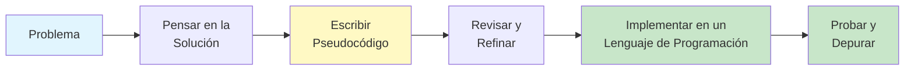
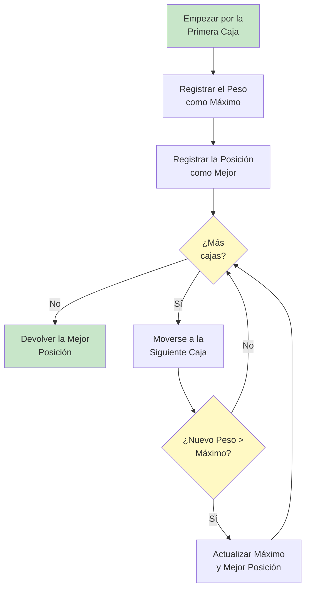
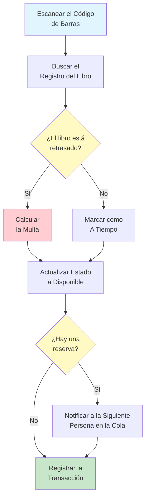

# Pseudocódigo y Lenguaje Natural

Antes de escribir algoritmos en cualquier lenguaje de programación, los expresamos en un formato legible para los humanos. Las descripciones en pseudocódigo y en lenguaje natural nos permiten centrarnos en la lógica de un algoritmo sin preocuparnos por las reglas de sintaxis de lenguajes de programación concretos.

## ¿Qué es el Pseudocódigo?

El **pseudocódigo** es una descripción en lenguaje simple de los pasos de un algoritmo. Utiliza las convenciones estructurales de los lenguajes de programación, pero está pensado para la lectura humana y no para la lectura de las máquinas.

### ¿Por Qué Usar Pseudocódigo?

| Beneficio | Explicación |
|---|---|
| **Independiente del lenguaje** | Cualquiera puede leerlo, con independencia de su experiencia en programación |
| **Foco en la lógica** | Te concentras en lo que hace el algoritmo, no en cómo escribirlo en código |
| **Fácil de modificar** | Los cambios son más sencillos que reescribir el código real |
| **Herramienta de comunicación** | Ayuda a los equipos a discutir algoritmos antes de la implementación |
| **Ayuda para planificar** | Te obliga a pensar en el algoritmo antes de programar |



> [!TIP]
> Piensa en el pseudocódigo como los planos de un edificio. Los arquitectos no empiezan colocando ladrillos: primero crean planos detallados. El pseudocódigo es el plano de tu algoritmo.

## Convenciones de Pseudocódigo

Aunque no existe un único estándar para el pseudocódigo, seguir convenciones consistentes hace que tus algoritmos sean más fáciles de leer y entender.

### Estructura Básica

```
ALGORITMO: NombreDelAlgoritmo
ENTRADA: Descripción de las entradas
SALIDA: Descripción de las salidas

PASO 1: Primera instrucción
PASO 2: Segunda instrucción
...
PASO N: Instrucción final

FIN ALGORITMO
```

### Variables y Asignación

Usa nombres de variables claros y descriptivos. La operación de asignación guarda un valor en una variable.

```
ASIGNAR total A 0
ASIGNAR nombre A "María"
ASIGNAR contador A contador + 1
ASIGNAR resultado A precio multiplicado por cantidad
```

### Palabras Clave Comunes

| Palabra Clave | Propósito | Ejemplo |
|---|---|---|
| **ASIGNAR** | Asignar un valor a una variable | `ASIGNAR x A 5` |
| **LEER** | Obtener la entrada del usuario | `LEER edad` |
| **IMPRIMIR** | Mostrar la salida | `IMPRIMIR total` |
| **SI...ENTONCE...SINO** | Ejecución condicional | `SI x > 0 ENTONCE IMPRIMIR "positivo"` |
| **PARA...HACER** | Repetir un número conocido de veces | `PARA i DE 1 HASTA 10 HACER` |
| **MIENTRAS...HACER** | Repetir mientras la condición sea verdadera | `MIENTRAS x > 0 HACER` |
| **REPITE...HASTA QUE** | Repetir hasta que la condición sea verdadera | `REPITE ... HASTA QUE x = 0` |

## Escribir Algoritmos en Lenguaje Natural

Las descripciones en lenguaje natural usan el lenguaje cotidiano para explicar los pasos del algoritmo. Esta es la forma más accesible de describir algoritmos.

### Ejemplo: Preparar un Sándwich

```
ALGORITMO: Preparar un Sándwich de Mantequilla de Maní y Jalea
ENTRADA: Rebanadas de pan, mantequilla de maní, jalea, cuchillo, plato
SALIDA: Un sándwich terminado

PASO 1: Colocar dos rebanadas de pan en el plato
PASO 2: Con el cuchillo, extender mantequilla de maní en una rebanada
PASO 3: Con el cuchillo (limpio), extender jalea en la otra rebanada
PASO 4: Unir las dos rebanadas con los rellenos hacia adentro
PASO 5: SI la persona quiere que se corte ENTONCE
            Cortar el sándwich por la mitad en diagonal
        FIN SI
PASO 6: Servir el sándwich
FIN ALGORITMO
```

### Ejemplo: Encontrar la Caja Más Pesada

```
ALGORITMO: Encontrar la Caja Más Pesada
ENTRADA: Una sala con N cajas, cada una con una etiqueta de peso
SALIDA: La posición de la caja más pesada

PASO 1: Empezar por la primera caja
PASO 2: Recordar su peso como el máximo actual
PASO 3: Recordar su posición como la mejor posición actual
PASO 4: Moverse a la siguiente caja
PASO 5: Comparar su peso con el máximo actual
PASO 6: SI esta caja es más pesada ENTONCE
            Actualizar el máximo actual con el peso de esta caja
            Actualizar la mejor posición con la posición de esta caja
        FIN SI
PASO 7: SI hay más cajas ENTONCE
            Ir al PASO 4
        FIN SI
PASO 8: Devolver la mejor posición
FIN ALGORITMO
```



## Ejemplos de Pseudocódigo con Estructuras de Control

### Ejecución Secuencial

Los pasos se ejecutan uno tras otro en orden:

```
ALGORITMO: Calcular el Área del Rectángulo
ENTRADA: Longitud y anchura de un rectángulo
SALIDA: El área del rectángulo

PASO 1: LEER longitud
PASO 2: LEER anchura
PASO 3: ASIGNAR área A longitud multiplicado por anchura
PASO 4: IMPRIMIR área
FIN ALGORITMO
```

### Ejecución Condicional

Diferentes caminos según las condiciones:

```
ALGORITMO: Clasificación de Notas
ENTRADA: La calificación numérica de un estudiante (0-100)
SALIDA: La calificación con letra

PASO 1: LEER nota
PASO 2: SI nota es mayor o igual que 90 ENTONCE
            ASIGNAR letra A "A"
        SINO SI nota es mayor o igual que 80 ENTONCE
            ASIGNAR letra A "B"
        SINO SI nota es mayor o igual que 70 ENTONCE
            ASIGNAR letra A "C"
        SINO SI nota es mayor o igual que 60 ENTONCE
            ASIGNAR letra A "D"
        SINO
            ASIGNAR letra A "F"
        FIN SI
PASO 3: IMPRIMIR letra
FIN ALGORITMO
```

> [!NOTE]
> Observa cómo las condiciones se comprueban en orden. Una vez que se cumple una condición, las restantes se omiten. Esto se llama "evaluación de cortocircuito".

### Ejecución en Bucle

Repetir acciones varias veces:

```
ALGORITMO: Suma de los Números de 1 a N
ENTRADA: Un entero positivo N
SALIDA: La suma de todos los enteros de 1 a N

PASO 1: LEER N
PASO 2: ASIGNAR total A 0
PASO 3: PARA cada número i DE 1 HASTA N HACER
            ASIGNAR total A total + i
        FIN PARA
PASO 4: IMPRIMIR total
FIN ALGORITMO
```

## Comparación de Enfoques: Lenguaje Natural vs. Pseudocódigo Estructurado

| Aspecto | Lenguaje Natural | Pseudocódigo Estructurado |
|---|---|---|
| **Legibilidad** | Muy alta para lectores no técnicos | Alta para cualquiera con lógica básica |
| **Precisión** | Puede ser ambiguo | Más preciso y estructurado |
| **Traducción a código** | Requiere interpretación | Más fácil de traducir |
| **Mejor para** | Explicar conceptos a principiantes | Planear la implementación real |
| **Ejemplo** | "Sigue hasta que lo encuentres" | `MIENTRAS no encontrado HACER` |

### Comparación Lado a Lado: Encontrar un Número

**Versión en Lenguaje Natural:**

```
ALGORITMO: Adivina Mi Número (Lenguaje Natural)
Estoy pensando en un número entre 1 y 100. Tienes que encontrarlo.
Empieza adivinando el número del medio. Si mi número es mayor, 
adivina el medio de la mitad superior. Si mi número es menor, 
adivina el medio de la mitad inferior. Sigue haciendo esto, reduciendo 
el rango cada vez, hasta que aciertes.
```

**Versión en Pseudocódigo Estructurado:**

```
ALGORITMO: Búsqueda Binaria (Pseudocódigo Estructurado)
ENTRADA: Una lista ordenada de números de 1 a 100, un número objetivo
SALIDA: La posición del número objetivo

PASO 1: ASIGNAR bajo A 1
PASO 2: ASIGNAR alto A 100
PASO 3: MIENTRAS bajo sea menor o igual que alto HACER
            ASIGNAR suposición A (bajo + alto) dividido entre 2, redondeado hacia abajo
            SI suposición es igual al objetivo ENTONCE
                IMPRIMIR "Encontrado en la posición " + suposición
                PARAR
            SINO SI suposición es menor que el objetivo ENTONCE
                ASIGNAR bajo A suposición + 1
            SINO
                ASIGNAR alto A suposición - 1
            FIN SI
        FIN MIENTRAS
PASO 4: IMPRIMIR "Número no encontrado"
FIN ALGORITMO
```

> [!TIP]
> La versión estructurada es mucho más precisa. Cada variable está definida, cada condición es explícita y la condición de terminación es clara.

## Ejemplo del Mundo Real: Sistema de Devolución de Libros de la Biblioteca

Diseñemos un algoritmo para el proceso de devolución de libros de una biblioteca:

```
ALGORITMO: Procesar la Devolución de un Libro
ENTRADA: Libro devuelto con código de barras, fecha actual
SALIDA: Estado actualizado del libro, multas calculadas

PASO 1: ESCANEAR el código de barras del libro
PASO 2: BUSCAR el registro del libro en el sistema
PASO 3: LEER la fecha de vencimiento del registro del libro
PASO 4: ASIGNAR hoy A la fecha actual
PASO 5: SI hoy es posterior a la fecha de vencimiento ENTONCE
            ASIGNAR dias_atraso A hoy menos fecha de vencimiento
            ASIGNAR multa A dias_atraso multiplicado por 0.50
            IMPRIMIR "El libro está " + dias_atraso + " días de retraso"
            IMPRIMIR "Multa: $" + multa
        SINO
            IMPRIMIR "Libro devuelto a tiempo"
            ASIGNAR multa A 0
        FIN SI
PASO 6: ACTUALIZAR el estado del libro a "disponible"
PASO 7: ELIMINAR cualquier reserva existente del libro
PASO 8: SI hay una reserva de este libro ENTONCE
            NOTIFICAR a la siguiente persona en la cola de reservas
            ACTUALIZAR el estado del libro a "reservado"
        FIN SI
PASO 9: REGISTRAR la transacción de devolución
FIN ALGORITMO
```



## Ejercicios Prácticos

### Ejercicio 1: Traduce a Pseudocódigo

Escribe pseudocódigo para la siguiente tarea:

**Tarea**: Una profesora quiere calcular la calificación promedio de una clase. Tiene una lista de calificaciones de exámenes. Si el promedio es 70 o más, imprime "La clase aprobó." De lo contrario, imprime "La clase necesita mejorar."

### Ejercicio 2: Identifica el Problema

Este pseudocódigo tiene problemas. Encuéntralos y corrígelos:

```
ALGORITMO: Cuenta Regresiva
PASO 1: ASIGNAR x A 10
PASO 2: MIENTRAS x no sea 0 HACER
            IMPRIMIR x
        FIN MIENTRAS
PASO 3: IMPRIMIR "¡Despegue!"
```

### Ejercicio 3: Escribe el Tuyo

Escribe pseudocódigo (usando convenciones estructuradas) para:

**Tarea**: Estás organizando libros en un estante. Tienes una lista de títulos de libros y sus alturas. Coloca los libros en el estante de menor a mayor.

Incluye:
- Entrada y salida claras
- Al menos un bucle
- Al menos una condicional

### Ejercicio 4: Descripción en Lenguaje Natural

Convierte el siguiente pseudocódigo en una descripción en lenguaje natural que una persona no técnica pueda entender:

```
ALGORITMO: Comprobación de Temperatura
ENTRADA: Lectura de la temperatura actual
PASO 1: SI la temperatura es inferior a 0 ENTONCE
            IMPRIMIR "Congelante"
        SINO SI la temperatura es inferior a 15 ENTONCE
            IMPRIMIR "Frío"
        SINO SI la temperatura es inferior a 25 ENTONCE
            IMPRIMIR "Templado"
        SINO
            IMPRIMIR "Caluroso"
        FIN SI
FIN ALGORITMO
```

### Ejercicio 5: Desafío de Diseño de Algoritmos

Diseña un algoritmo en pseudocódigo para un escenario del mundo real:

**Escenario**: Un estacionamiento tiene 50 plazas. Los autos entran y salen a lo largo del día. Diseña un algoritmo que:
- Lleve la cuenta de cuántas plazas están disponibles
- Cuando llegue un auto, asigne una plaza si está disponible
- Cuando salga un auto, libere esa plaza
- Informe el número de plazas disponibles cuando se le pida

## Resumen

En esta lección, has aprendido:

- **Qué es el pseudocódigo**: Una forma legible para los humanos de describir algoritmos
- **Por qué importa**: Ayuda a planear, comunicar y perfeccionar algoritmos antes de programar
- **Convenciones**: Palabras clave y estructuras estándar para mayor claridad
- **Lenguaje natural**: Describir algoritmos en el lenguaje cotidiano
- **Estructuras de control**: Patrones de ejecución secuencial, condicional y en bucle
- **Aplicación en el mundo real**: Cómo el pseudocódigo modela procesos de negocio reales

> [!SUCCESS]
> El pseudocódigo es tu puente entre pensar en un problema e implementar una solución. Domínalo y escribirás mejores algoritmos en cualquier lenguaje de programación.

## Términos Clave

| Término | Definición |
|---|---|
| **Pseudocódigo** | Una descripción en lenguaje simple de los pasos del algoritmo con una estructura similar a la de la programación |
| **Lenguaje Natural** | El lenguaje humano cotidiano utilizado para describir procesos |
| **Variable** | Una ubicación de almacenamiento con nombre para un valor |
| **Asignación** | El acto de guardar un valor en una variable |
| **Condicional** | Una estructura que ejecuta código diferente según una condición |
| **Bucle** | Una estructura que repite un conjunto de instrucciones |
| **Evaluación de Cortocircuito** | Detener las comprobaciones de condiciones cuando se encuentra una coincidencia |
