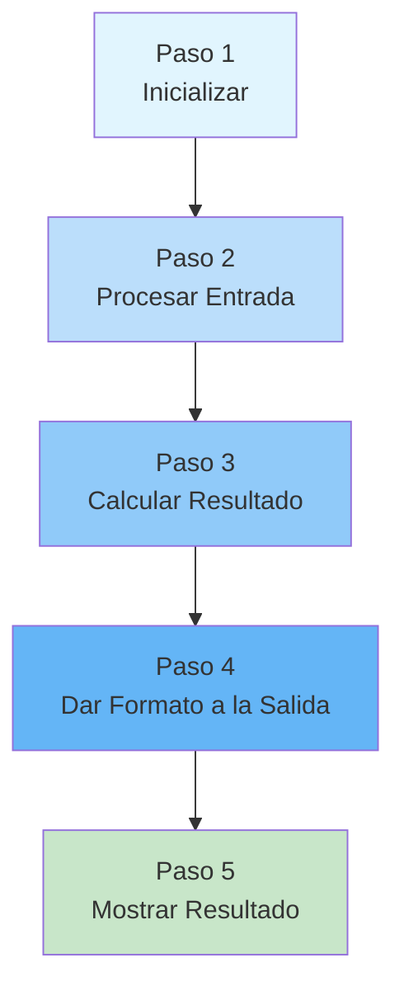
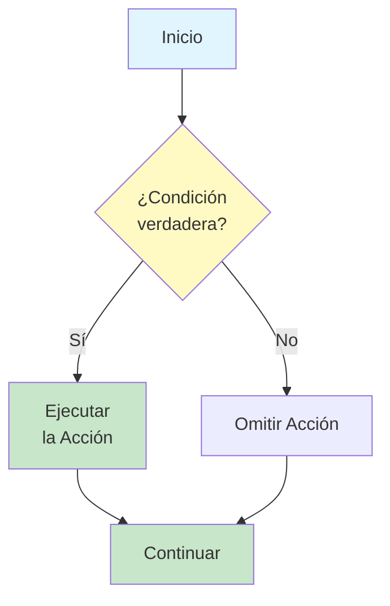
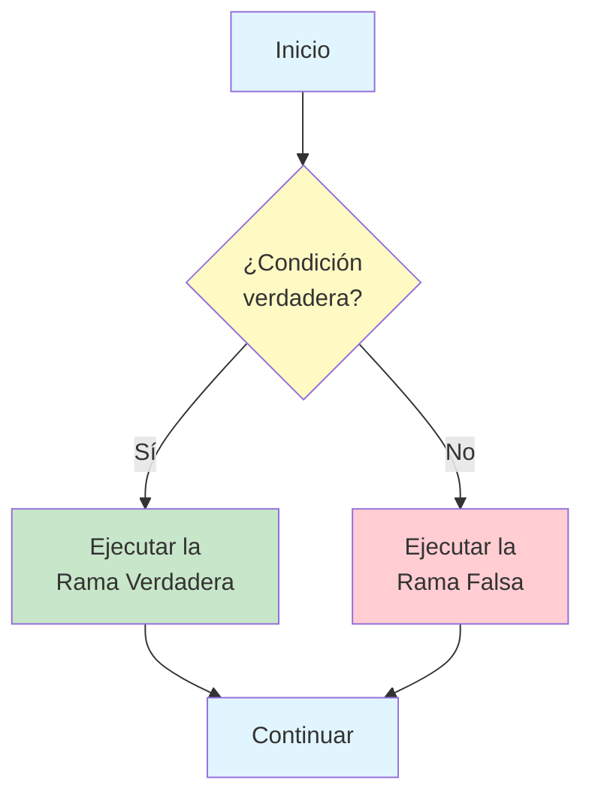
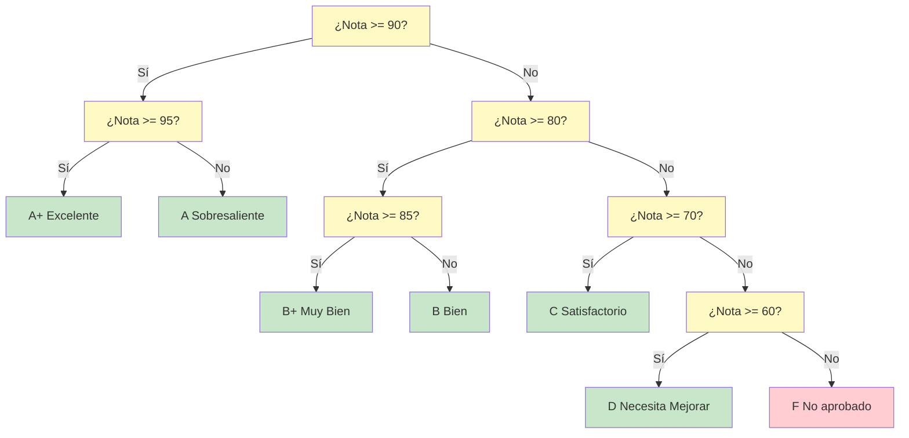
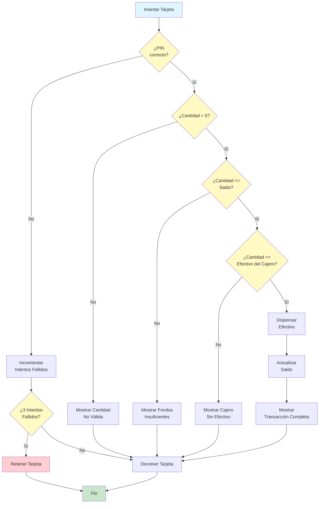
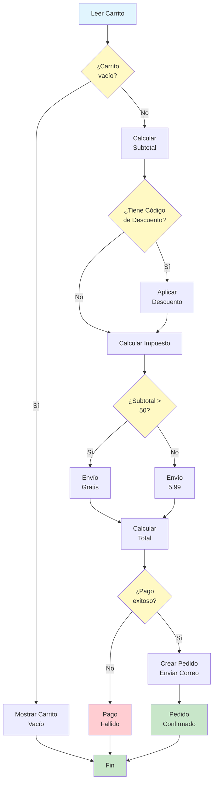

# Lógica Secuencial y Condicional

Los algoritmos se construyen sobre dos conceptos fundamentales: hacer las cosas en orden (lógica secuencial) y tomar decisiones (lógica condicional). Comprender estos conceptos es esencial para diseñar algoritmos que puedan manejar la complejidad del mundo real.

## Lógica Secuencial: Ejecución Paso a Paso

La **lógica secuencial** significa ejecutar las instrucciones una tras otra en el orden en que aparecen. Esta es la forma más sencilla de control algorítmico.

### Cómo Funciona la Ejecución Secuencial

En la ejecución secuencial:
1. El algoritmo comienza en el primer paso
2. Cada paso se ejecuta por completo antes de pasar al siguiente
3. El algoritmo avanza linealmente del inicio al final
4. No se salta ningún paso (salvo que una condicional indique lo contrario)



### Ejemplo: Convertir la Temperatura

```
ALGORITMO: Convertir Celsius a Fahrenheit
ENTRADA: Temperatura en Celsius
SALIDA: Temperatura en Fahrenheit

PASO 1: LEER temp_celsius
PASO 2: ASIGNAR temp_fahrenheit A (temp_celsius multiplicado por 9/5) + 32
PASO 3: IMPRIMIR "La temperatura es " + temp_fahrenheit + " grados Fahrenheit"
FIN ALGORITMO
```

Cada paso depende del anterior. No puedes calcular la temperatura en Fahrenheit (Paso 2) antes de leer la temperatura en Celsius (Paso 1).

### Ejemplo Secuencial del Mundo Real: Retiro en un Cajero Automático

```
ALGORITMO: Retiro de Efectivo en Cajero Automático
ENTRADA: Tarjeta, PIN, cantidad solicitada
SALIDA: Efectivo dispensado o mensaje de error

PASO 1: INSERTAR la tarjeta en el cajero automático
PASO 2: INTRODUCIR el PIN
PASO 3: VERIFICAR que el PIN corresponda a la tarjeta
PASO 4: SELECCIONAR la opción "Retirar Efectivo"
PASO 5: INTRODUCIR la cantidad solicitada
PASO 6: COMPROBAR si el saldo de la cuenta es suficiente
PASO 7: COMPROBAR si el cajero automático tiene suficiente efectivo
PASO 8: DISPENSAR la cantidad solicitada
PASO 9: ACTUALIZAR el saldo de la cuenta
PASO 10: IMPRIMIR el recibo
PASO 11: DEVOLVER la tarjeta
FIN ALGORITMO
```

> [!NOTE]
> Observa que este algoritmo es puramente secuencial. No maneja qué sucede si el PIN es incorrecto o si el saldo es insuficiente. Para eso necesitamos lógica condicional -- lo que veremos a continuación.

## Lógica Condicional: Tomar Decisiones

La **lógica condicional** permite que un algoritmo tome decisiones según las condiciones. Se siguen caminos distintos según que ciertas condiciones sean verdaderas o falsas.

### La Instrucción SI

La estructura condicional más básica:

```
SI la condición es verdadera ENTONCE
    Ejecutar estos pasos
FIN SI
```



### Ejemplo: Verificación de Edad

```
ALGORITMO: Verificación de Edad
ENTRADA: La edad de la persona
SALIDA: Acceso concedido o denegado

PASO 1: LEER edad
PASO 2: SI edad es mayor o igual que 18 ENTONCE
            IMPRIMIR "Acceso concedido"
        FIN SI
PASO 3: SI edad es menor que 18 ENTONCE
            IMPRIMIR "Acceso denegado"
        FIN SI
FIN ALGORITMO
```

### La Instrucción SI-SINO

Una forma más eficiente de manejar dos casos mutuamente excluyentes:

```
SI la condición es verdadera ENTONCE
    Ejecutar estos pasos (cuando sea verdadera)
SINO
    Ejecutar estos pasos (cuando sea falsa)
FIN SI
```



### Verificación de Edad Mejorada

```
ALGORITMO: Verificación de Edad (Mejorada)
ENTRADA: La edad de la persona
SALIDA: Decisión de acceso

PASO 1: LEER edad
PASO 2: SI edad es mayor o igual que 18 ENTONCE
            IMPRIMIR "Acceso concedido"
        SINO
            IMPRIMIR "Acceso denegado"
        FIN SI
FIN ALGORITMO
```

> [!TIP]
> La versión SI-SINO es mejor porque garantiza que se imprima exactamente un mensaje. La versión original tenía dos instrucciones SI separadas, que teóricamente podrían ejecutarse ambas si hubiera un error.

## Condicionales Anidadas: Decisiones Dentro de Otras Decisiones

A veces necesitas tomar una decisión dentro de otra decisión. Esto se llama **anidamiento**.

### Ejemplo: Sistema de Calificaciones con Distinciones

```
ALGORITMO: Clasificación Detallada de Calificaciones
ENTRADA: La calificación del estudiante (0-100)
SALIDA: Calificación con distinción

PASO 1: LEER nota
PASO 2: SI nota es mayor o igual que 90 ENTONCE
            SI nota es mayor o igual que 95 ENTONCE
                IMPRIMIR "A+ (Excelente)"
            SINO
                IMPRIMIR "A (Sobresaliente)"
            FIN SI
        SINO SI nota es mayor o igual que 80 ENTONCE
            SI nota es mayor o igual que 85 ENTONCE
                IMPRIMIR "B+ (Muy Bien)"
            SINO
                IMPRIMIR "B (Bien)"
            FIN SI
        SINO SI nota es mayor o igual que 70 ENTONCE
            IMPRIMIR "C (Satisfactorio)"
        SINO SI nota es mayor o igual que 60 ENTONCE
            IMPRIMIR "D (Necesita Mejorar)"
        SINO
            IMPRIMIR "F (No aprobado)"
        FIN SI
FIN ALGORITMO
```

### Árboles de Decisión

Un **árbol de decisión** es una representación visual de condicionales anidadas. Cada nodo representa una decisión y cada rama representa un resultado posible.



## Combinando la Lógica Secuencial y la Condicional

Los algoritmos reales combinan la lógica secuencial y la condicional. Construyamos un algoritmo de cajero automático más completo:

```
ALGORITMO: Retiro Completo en Cajero Automático
ENTRADA: Tarjeta, PIN, cantidad solicitada
SALIDA: Efectivo o el mensaje correspondiente

PASO 1: INSERTAR la tarjeta
PASO 2: LEER pin_introducido
PASO 3: SI pin_introducido corresponde a pin_tarjeta ENTONCE
            IMPRIMIR "PIN verificado"
            SELECCIONAR "Retirar Efectivo"
            LEER cantidad
            
            SI cantidad es menor o igual que 0 ENTONCE
                IMPRIMIR "Cantidad no válida"
            SINO SI cantidad es menor o igual que saldo_cuenta ENTONCE
                SI cantidad es menor o igual que efectivo_cajero ENTONCE
                    DISPENSAR cantidad
                    ASIGNAR saldo_cuenta A saldo_cuenta - cantidad
                    IMPRIMIR "Transacción completa"
                    IMPRIMIR "Nuevo saldo: " + saldo_cuenta
                SINO
                    IMPRIMIR "El cajero automático no tiene suficiente efectivo"
                FIN SI
            SINO
                IMPRIMIR "Fondos insuficientes"
                IMPRIMIR "Tu saldo: " + saldo_cuenta
            FIN SI
        SINO
            IMPRIMIR "PIN incorrecto"
            INCREMENTAR intentos_fallidos
            SI intentos_fallidos es igual a 3 ENTONCE
                RETENER la tarjeta
                IMPRIMIR "Tarjeta retenida. Contacta con tu banco."
            FIN SI
        FIN SI
PASO 4: DEVOLVER la tarjeta (si no fue retenida)
FIN ALGORITMO
```



> [!WARNING]
> Observa cómo el algoritmo maneja varios casos de fallo: PIN incorrecto, cantidad no válida, saldo insuficiente y cajero automático con poco efectivo. Los buenos algoritmos anticipan y manejan todos los escenarios posibles.

## Comparación: Secuencial vs. Condicional

| Aspecto | Lógica Secuencial | Lógica Condicional |
|---|---|---|
| **Ejecución** | Lineal, un paso tras otro | Se ramifica según las condiciones |
| **Flexibilidad** | Baja -- siempre hace lo mismo | Alta -- se adapta a diferentes situaciones |
| **Complejidad** | Sencilla de entender y rastrear | Más compleja, requiere una planificación cuidadosa |
| **Cuándo usarla** | Todas las situaciones son iguales | Diferentes situaciones requieren respuestas distintas |
| **Ejemplo** | Sumar dos números | Decidir si un número es positivo o negativo |

## Ejemplo del Mundo Real: Finalización de una Compra en Línea

Diseñemos un algoritmo para el proceso de pago de una compra en línea:

```
ALGORITMO: Pago de una Compra en Línea
ENTRADA: Artículos del carrito, cuenta de usuario, método de pago
SALIDA: Confirmación del pedido o error

PASO 1: LEER los artículos del carrito
PASO 2: SI el carrito está vacío ENTONCE
            IMPRIMIR "Tu carrito está vacío"
            PARAR
        FIN SI
PASO 3: CALCULAR el subtotal sumando todos los precios de los artículos
PASO 4: SI el usuario tiene un código de descuento ENTONCE
            APLICAR el descuento al subtotal
        FIN SI
PASO 5: CALCULAR el impuesto según la ubicación del usuario
PASO 6: CALCULAR el coste de envío
        SI el subtotal es mayor que 50 ENTONCE
            ASIGNAR envio A 0 (envío gratis)
        SINO
            ASIGNAR envio A 5.99
        FIN SI
PASO 7: CALCULAR total = subtotal + impuesto + envio
PASO 8: PROCESAR el pago
        SI el pago se realiza con éxito ENTONCE
            CREAR el pedido con el total
            ENVIAR el correo de confirmación
            ACTUALIZAR el inventario
            IMPRIMIR "¡Pedido confirmado! Total: " + total
        SINO
            IMPRIMIR "El pago ha fallado. Inténtalo de nuevo."
        FIN SI
FIN ALGORITMO
```



## Ejercicios Prácticos

### Ejercicio 1: Sigue la Ejecución

Dado el siguiente algoritmo, ¿cuál es la salida para cada entrada?

```
ALGORITMO: Misterio
ENTRADA: Un número x
PASO 1: SI x es mayor que 0 ENTONCE
            SI x es menor que 10 ENTONCE
                IMPRIMIR "Positivo pequeño"
            SINO
                IMPRIMIR "Positivo grande"
            FIN SI
        SINO SI x es igual a 0 ENTONCE
            IMPRIMIR "Cero"
        SINO
            IMPRIMIR "Negativo"
        FIN SI
FIN ALGORITMO
```

¿Qué se imprime para: x = 5, x = 15, x = 0, x = -3?

### Ejercicio 2: Diseña un Algoritmo Condicional

Escribe un algoritmo que determine el tipo de triángulo a partir de tres longitudes de lado:

- **Equilátero**: Los tres lados son iguales
- **Isósceles**: Exactamente dos lados son iguales
- **Escaleno**: Ningún lado es igual

Incluye una validación: si algún lado es cero o negativo, imprime "Triángulo no válido."

### Ejercicio 3: Dibuja un Árbol de Decisión

Dibuja un árbol de decisión (usando Mermaid o en papel) para este escenario:

Un algoritmo de recomendación de restaurantes que pregunta:
1. ¿Qué cocina? (italiana, mexicana, asiática)
2. ¿Qué presupuesto? (bajo, medio, alto)
3. ¿Qué ambiente? (informal, formal)

Muestra cómo diferentes combinaciones conducen a diferentes recomendaciones de restaurantes.

### Ejercicio 4: Corrige la Lógica

Este algoritmo tiene un error lógico. Encuéntralo y corrígelo:

```
ALGORITMO: Sistema de Inicio de Sesión
ENTRADA: Nombre de usuario, contraseña
PASO 1: SI el nombre de usuario existe ENTONCE
            IMPRIMIR "¡Bienvenido!"
        FIN SI
PASO 2: SI la contraseña es correcta ENTONCE
            CONCEDER acceso
        SINO
            IMPRIMIR "Contraseña incorrecta"
        FIN SI
FIN ALGORITMO
```

> [!WARNING]
> Pista: ¿Qué sucede si el nombre de usuario no existe pero la comprobación de la contraseña se ejecuta igualmente?

### Ejercicio 5: Construye un Algoritmo Completo

Diseña un algoritmo para una calculadora sencilla que:
1. Lea dos números y una operación (+, -, *, /)
2. Realice la operación
3. Maneje la división por cero
4. Imprima el resultado

Usa tanto la lógica secuencial como la condicional.

## Resumen

En esta lección, has aprendido:

- **Lógica secuencial**: Ejecutar los pasos en orden, uno tras otro
- **Lógica condicional**: Tomar decisiones usando SI, SINO y condiciones anidadas
- **Árboles de decisión**: Representaciones visuales de la lógica condicional
- **Combinar ambas**: Los algoritmos reales usan la lógica secuencial y la condicional juntas
- **Manejo de errores**: Los buenos algoritmos anticipan y manejan todos los escenarios posibles

> [!SUCCESS]
> La lógica secuencial y la condicional forman la columna vertebral de todos los algoritmos. Todo algoritmo complejo que encuentres está construido a partir de estos dos bloques fundamentales.

## Términos Clave

| Término | Definición |
|---|---|
| **Lógica Secuencial** | Ejecutar las instrucciones en el orden en que aparecen |
| **Lógica Condicional** | Tomar decisiones según que las condiciones sean verdaderas o falsas |
| **Instrucción SI** | Ejecuta un bloque de código solo si una condición es verdadera |
| **Instrucción SI-SINO** | Elige entre dos bloques de código según una condición |
| **Condicional Anidada** | Una instrucción condicional dentro de otra instrucción condicional |
| **Árbol de Decisión** | Un diagrama visual que muestra todos los caminos de decisión posibles |
| **Rama** | Un camino posible de ejecución en una condicional |
