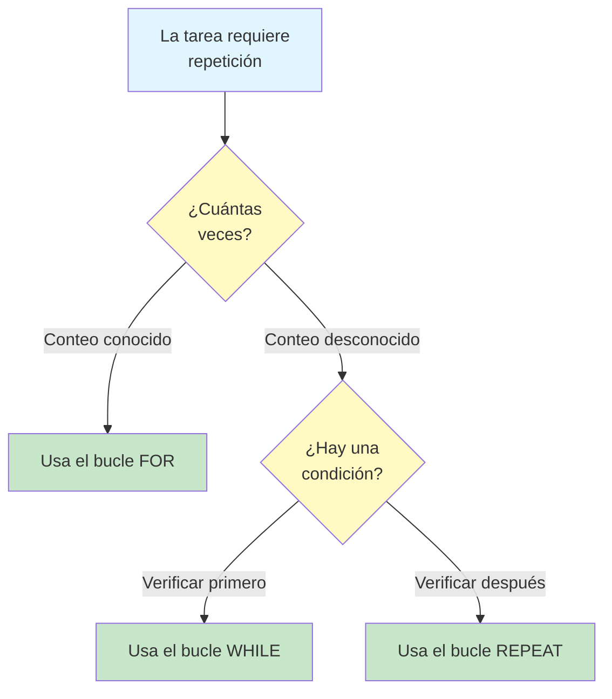
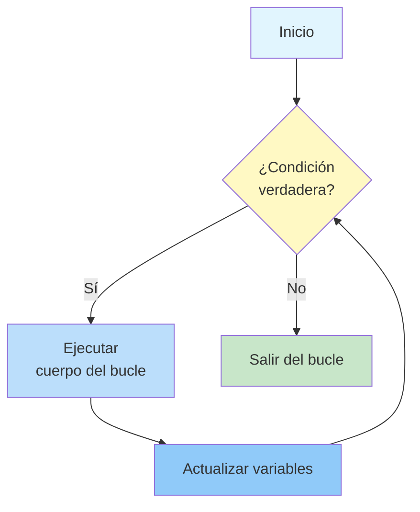
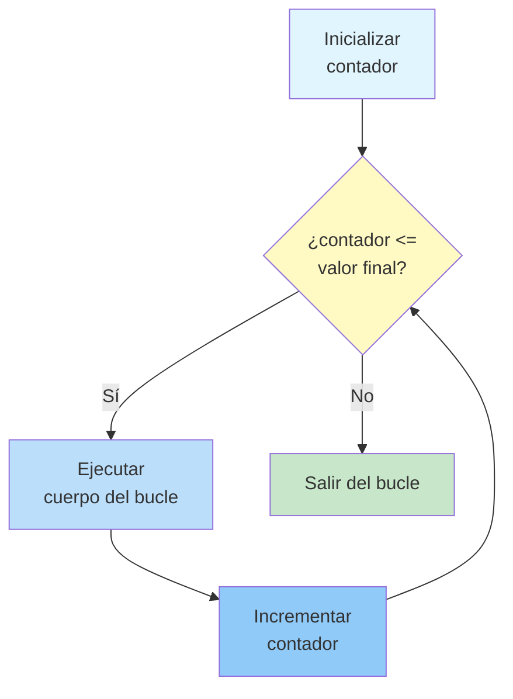
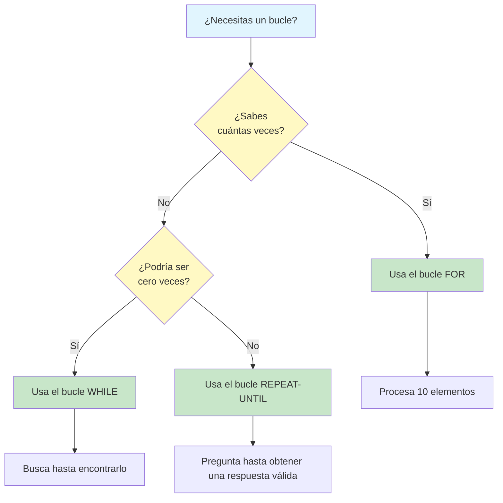
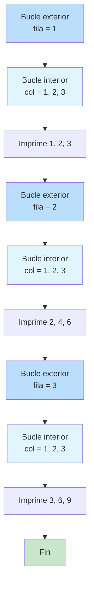
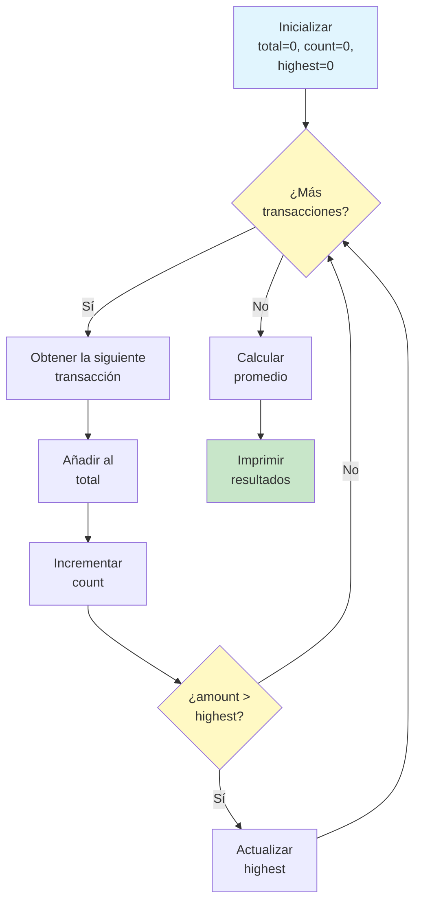

# Bucles y repetición

Muchas tareas exigen hacer la misma cosa varias veces. En lugar de escribir los mismos pasos una y otra vez, los algoritmos usan **bucles**: estructuras que repiten un conjunto de instrucciones hasta que se cumple una condición. Los bucles son una de las herramientas más poderosas del pensamiento algorítmico.

## Por qué importan los bucles

Considera esta tarea: imprime los números del 1 al 100.

**Sin bucle** (tedioso y propenso a errores):
```
PRINT 1
PRINT 2
PRINT 3
... (97 more lines)
PRINT 100
```

**Con bucle** (elegante y fácil de mantener):
```
SET counter TO 1
WHILE counter is less than or equal to 100 DO
    PRINT counter
    SET counter TO counter + 1
END WHILE
```

| Enfoque | Líneas de código | ¿Fácil de cambiar? | ¿Propenso a errores? |
|---|---|---|---|
| Sin bucle | 100 | No, hay que editar cada línea | Sí, es fácil saltar o duplicar |
| Con bucle | 4 | Sí, cambia el límite | No, la lógica está centralizada |



## El bucle WHILE

Un **bucle WHILE** repite un bloque de instrucciones mientras una condición siga siendo verdadera. La condición se comprueba **antes** de cada iteración.

### Estructura

```
WHILE condition is true DO
    Execute these steps
    (Make sure something changes to eventually end the loop)
END WHILE
```

### Cómo funciona



### Ejemplo: cuenta regresiva

```
ALGORITHM: Countdown
INPUT: Starting number
OUTPUT: Countdown sequence

STEP 1: READ start_number
STEP 2: SET current TO start_number
STEP 3: WHILE current is greater than 0 DO
            PRINT current
            SET current TO current - 1
        END WHILE
STEP 4: PRINT "Go!"
END ALGORITHM
```

**Traza con start_number = 3:**

| Iteración | current | Condición (current > 0) | Acción |
|---|---|---|---|
| Antes del bucle | 3 | -- | -- |
| 1 | 3 | verdadero | Imprime 3, current pasa a 2 |
| 2 | 2 | verdadero | Imprime 2, current pasa a 1 |
| 3 | 1 | verdadero | Imprime 1, current pasa a 0 |
| Después del bucle | 0 | falso | Sale del bucle, imprime "Go!" |

**Salida:** 3, 2, 1, Go!

### Ejemplo: buscar un número en una lista

```
ALGORITHM: Linear Search
INPUT: A list of numbers, a target number to find
OUTPUT: Position of target, or "not found"

STEP 1: SET index TO 0
STEP 2: SET found TO false
STEP 3: WHILE index is less than length of list AND found is false DO
            IF list[index] equals target THEN
                SET found TO true
            ELSE
                SET index TO index + 1
            END IF
        END WHILE
STEP 4: IF found is true THEN
            PRINT "Found at position " + index
        ELSE
            PRINT "Not found"
        END IF
END ALGORITHM
```

> [!NOTE]
> Observa la condición compuesta del paso 3: `index < length AND found = false`. El bucle se detiene si llegamos al final de la lista O si encontramos el objetivo. Esto evita búsquedas innecesarias.

## El bucle FOR

Un **bucle FOR** repite un bloque de instrucciones un **número conocido de veces**. Es ideal cuando sabes exactamente cuántas iteraciones necesitas.

### Estructura

```
FOR variable FROM start_value TO end_value DO
    Execute these steps
END FOR
```

### Cómo funciona



### Ejemplo: tabla de multiplicar

```
ALGORITHM: Multiplication Table
INPUT: A number
OUTPUT: Multiplication table for that number (1-10)

STEP 1: READ number
STEP 2: FOR multiplier FROM 1 TO 10 DO
            SET result TO number multiplied by multiplier
            PRINT number + " x " + multiplier + " = " + result
        END FOR
END ALGORITHM
```

**Salida para number = 5:**
```
5 x 1 = 5
5 x 2 = 10
5 x 3 = 15
...
5 x 10 = 50
```

### Ejemplo: sumar una lista

```
ALGORITHM: Sum of List
INPUT: A list of numbers
OUTPUT: The total sum

STEP 1: SET total TO 0
STEP 2: FOR each number in the list DO
            SET total TO total + number
        END FOR
STEP 3: PRINT total
END ALGORITHM
```

## Comparación entre los bucles WHILE y FOR

| Aspecto | Bucle WHILE | Bucle FOR |
|---|---|---|
| **Cuándo usarlo** | Número desconocido de iteraciones | Número conocido de iteraciones |
| **Condición** | Se comprueba antes de cada iteración | Implícita (el contador llega al final) |
| **Riesgo de bucle infinito** | Mayor (hay que garantizar que la condición cambia) | Menor (el contador siempre avanza) |
| **Flexibilidad** | Más flexible | Más estructurado |
| **Ejemplo** | "Sigue buscando hasta encontrarlo" | "Procesa cada elemento de la lista" |

### Cuándo elegir uno u otro



## El bucle REPEAT-UNTIL

Un **bucle REPEAT-UNTIL** ejecuta el cuerpo **al menos una vez** y después comprueba la condición **después** de cada iteración. Se repite hasta que la condición se vuelve verdadera.

### Estructura

```
REPEAT
    Execute these steps
UNTIL condition is true
```

### Diferencia clave con WHILE

| Bucle WHILE | Bucle REPEAT-UNTIL |
|---|---|
| Comprueba la condición ANTES de ejecutar | Comprueba la condición DESPUÉS de ejecutar |
| Puede ejecutarse cero veces | Siempre se ejecuta al menos una vez |
| Continúa MIENTRAS la condición sea verdadera | Continúa HASTA que la condición sea verdadera |

### Ejemplo: validación de entradas

```
ALGORITHM: Get Valid Age
INPUT: None (reads from user)
OUTPUT: A valid age (1-120)

STEP 1: REPEAT
            PRINT "Enter your age (1-120):"
            READ age
        UNTIL age is greater than or equal to 1 AND age is less than or equal to 120
STEP 2: PRINT "Valid age: " + age
END ALGORITHM
```

> [!TIP]
> REPEAT-UNTIL es perfecto para la validación de entradas porque siempre necesitas preguntar al menos una vez. Un bucle WHILE exigiría duplicar el mensaje de entrada antes y dentro del bucle.

## Bucles anidados: bucles dentro de bucles

Los bucles pueden colocarse dentro de otros bucles. Esto se llama **anidamiento**. Cada iteración del bucle exterior provoca una ejecución completa del bucle interior.

### Ejemplo: cuadrícula de multiplicación

```
ALGORITHM: Multiplication Grid
INPUT: Grid size N
OUTPUT: N x N multiplication grid

STEP 1: READ N
STEP 2: FOR row FROM 1 TO N DO
            FOR column FROM 1 TO N DO
                SET product TO row multiplied by column
                PRINT product with padding
            END FOR
            PRINT new line
        END FOR
END ALGORITHM
```

**Salida para N = 3:**
```
1  2  3
2  4  6
3  6  9
```

### Visualización de bucles anidados



### ¿Cuántas veces se ejecuta el bucle interior?

Si el bucle exterior se ejecuta M veces y el bucle interior N veces, el cuerpo interior se ejecuta **M x N** veces en total.

| Bucle exterior | Bucle interior | Ejecuciones totales |
|---|---|---|
| 3 veces | 3 veces | 9 veces |
| 10 veces | 5 veces | 50 veces |
| 100 veces | 100 veces | 10,000 veces |

> [!WARNING]
> Los bucles anidados multiplican el número de operaciones. Un bucle dentro de un bucle dentro de un bucle (anidamiento triple) con 100 iteraciones cada uno ¡se ejecutaría 1,000,000 de veces! Ten cuidado con los bucles anidados en profundidad.

## Terminación de bucles: garantizar que los bucles terminen

Todo bucle debe terminar algún día. Estas son las estrategias clave:

### Estrategia 1: terminación basada en un contador

```
SET counter TO 0
WHILE counter is less than 10 DO
    PRINT counter
    SET counter TO counter + 1
END WHILE
```

### Estrategia 2: valor centinela

```
READ number
WHILE number is not equal to -1 DO
    PRINT "You entered: " + number
    READ number
END WHILE
PRINT "Goodbye!"
```

> [!NOTE]
> El valor -1 se llama "centinela": un valor especial que señala el final de la entrada. El usuario debe saber que debe introducir -1 para detenerse.

### Estrategia 3: terminación basada en una bandera

```
SET found TO false
SET index TO 0
WHILE found is false AND index is less than list_length DO
    IF list[index] equals target THEN
        SET found TO true
    ELSE
        SET index TO index + 1
    END IF
END WHILE
```

### Errores comunes de terminación

| Error | Problema | Solución |
|---|---|---|
| Olvidar actualizar el contador | Bucle infinito | Añadir `counter = counter + 1` |
| Operador de comparación incorrecto | Error de diferencia de uno (off-by-one) | Usar `<=` en vez de `<` (o viceversa) |
| La condición nunca se vuelve falsa | Bucle infinito | Asegurarse de que el cuerpo del bucle cambia la condición |
| Usar `=` en vez de `==` | Error de lógica | Usar comparación, no asignación |

## Ejemplo del mundo real: procesar las ventas diarias

```
ALGORITHM: Process Daily Sales Report
INPUT: List of daily sales transactions
OUTPUT: Total sales, average sale, highest sale

STEP 1: SET total TO 0
STEP 2: SET count TO 0
STEP 3: SET highest TO 0
STEP 4: FOR each transaction in the sales list DO
            SET amount TO transaction amount
            SET total TO total + amount
            SET count TO count + 1
            IF amount is greater than highest THEN
                SET highest TO amount
            END IF
        END FOR
STEP 5: IF count is greater than 0 THEN
            SET average TO total divided by count
        ELSE
            SET average TO 0
        END IF
STEP 6: PRINT "Total Sales: " + total
STEP 7: PRINT "Number of Transactions: " + count
STEP 8: PRINT "Average Sale: " + average
STEP 9: PRINT "Highest Sale: " + highest
END ALGORITHM
```



## Ejercicios prácticos

### Ejercicio 1: traza el bucle

¿Cuál es la salida de este algoritmo?

```
ALGORITHM: Mystery Loop
STEP 1: SET x TO 1
STEP 2: WHILE x is less than 20 DO
            SET x TO x multiplied by 2
            PRINT x
        END WHILE
END ALGORITHM
```

### Ejercicio 2: escribe un bucle FOR

Escribe un algoritmo que use un bucle FOR y que:
- Lea un número N
- Imprima todos los números pares del 2 al N
- Cuente cuántos números pares se imprimieron

### Ejercicio 3: escribe un bucle WHILE

Escribe un algoritmo que use un bucle WHILE y que:
- Siga pidiendo números al usuario
- Se detenga cuando el usuario introduzca 0
- Imprima la suma de todos los números introducidos (excluyendo el 0)

### Ejercicio 4: corrige el bucle infinito

Este algoritmo tiene un bucle infinito. Corrígelo:

```
ALGORITHM: Count to 10
STEP 1: SET i TO 1
STEP 2: WHILE i is less than or equal to 10 DO
            PRINT i
        END WHILE
END ALGORITHM
```

### Ejercicio 5: desafío de bucles anidados

Escribe un algoritmo que imprima este patrón usando bucles anidados:
```
*
**
***
****
*****
```

El algoritmo debe funcionar para cualquier tamaño N (el ejemplo muestra N = 5).

### Ejercicio 6: diseño del mundo real

Diseña un algoritmo para una biblioteca que:
- Tenga una lista de libros vencidos
- Para cada libro vencido, calcule la multa (R$0.50 por día)
- Mantenga un total acumulado de todas las multas
- Imprima un informe con la multa de cada libro y el total

## Resumen

En esta lección, has aprendido:

- **Bucles WHILE**: Se repiten mientras una condición sea verdadera (comprobación antes de ejecutar)
- **Bucles FOR**: Se repiten un número conocido de veces (iteración estructurada)
- **Bucles REPEAT-UNTIL**: Se ejecutan al menos una vez y después comprueban la condición
- **Bucles anidados**: Bucles dentro de bucles para tareas multidimensionales
- **Estrategias de terminación**: Contadores, centinelas y banderas
- **Errores comunes**: Bucles infinitos, errores de diferencia de uno y actualizaciones faltantes

> [!SUCCESS]
> Los bucles son el motor de la eficiencia algorítmica. Te permiten manejar tareas de cualquier tamaño con muy poco código. Domina los bucles y podrás resolver problemas que sería imposible de escribir paso a paso.

## Términos clave

| Término | Definición |
|---|---|
| **Bucle** | Una estructura que repite un conjunto de instrucciones |
| **Bucle WHILE** | Se repite mientras una condición sea verdadera (comprobación previa) |
| **Bucle FOR** | Se repite un número conocido de veces |
| **Bucle REPEAT-UNTIL** | Se ejecuta al menos una vez y se repite hasta que la condición sea verdadera (comprobación posterior) |
| **Iteración** | Una ejecución completa del cuerpo del bucle |
| **Bucle anidado** | Un bucle colocado dentro de otro bucle |
| **Valor centinela** | Un valor especial que señala el final de la entrada |
| **Bucle infinito** | Un bucle que nunca termina |
| **Error de diferencia de uno (off-by-one)** | Un error común en el que el bucle se ejecuta una vez más o una vez menos |
