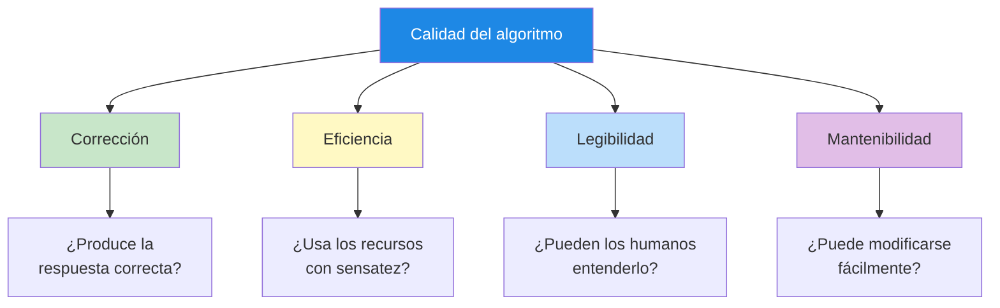
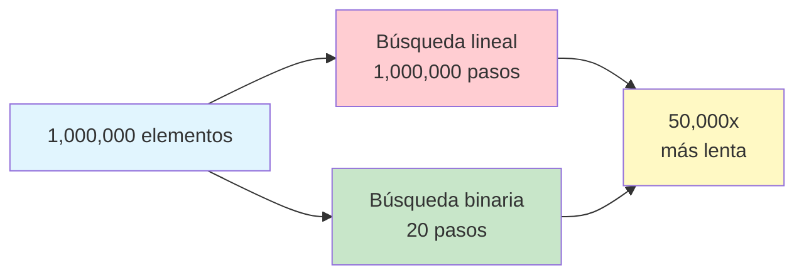
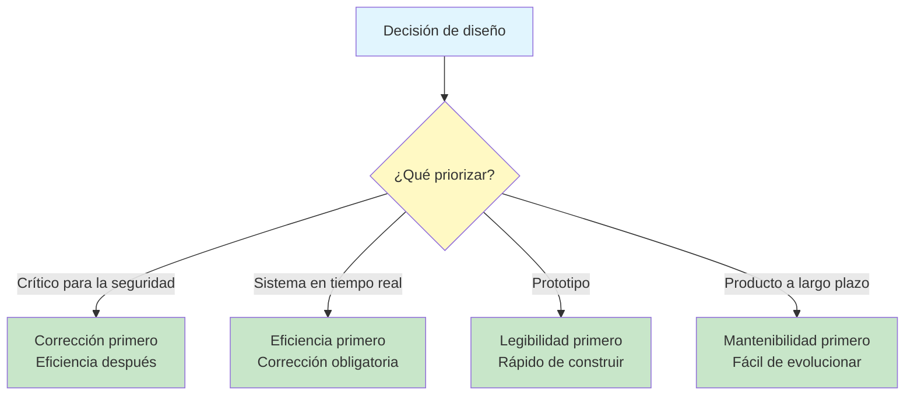
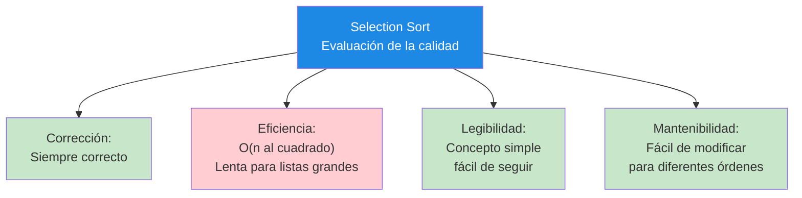

# Principios de calidad de los algoritmos

No todos los algoritmos son iguales. Dos algoritmos pueden resolver el mismo problema pero diferir drásticamente en lo bien que lo hacen. Comprender los principios de calidad te ayuda a diseñar algoritmos que no solo sean correctos, sino también eficientes, legibles y mantenibles.

## Los cuatro pilares de la calidad de los algoritmos



| Pilar | Pregunta | Por qué importa |
|---|---|---|
| **Corrección** | ¿Produce la respuesta correcta para todas las entradas válidas? | Un algoritmo incorrecto es inútil, por muy rápido que sea |
| **Eficiencia** | ¿Usa el tiempo y los recursos con sensatez? | Los algoritmos ineficientes se vuelven inutilizables con entradas grandes |
| **Legibilidad** | ¿Pueden entenderlo otras personas? | Los algoritmos ilegibles son difíciles de verificar y de confiar en ellos |
| **Mantenibilidad** | ¿Puede modificarse cuando cambian los requisitos? | Los algoritmos rígidos se quedan obsoletos rápidamente |

## Corrección: obtener la respuesta correcta

**Corrección** significa que el algoritmo produce la salida correcta para cada entrada válida. Esta es la cualidad más fundamental -- sin corrección, nada más importa.

### Cómo verificar la corrección

1. **Traza con ejemplos**: Ejecuta el algoritmo a mano con entradas conocidas y salidas esperadas
2. **Prueba casos límite**: Prueba entradas inusuales (listas vacías, un solo elemento, valores máximos)
3. **Razona sobre él**: Demuéstrate a ti mismo que el algoritmo debe funcionar siempre
4. **Compara con alternativas**: Si dos algoritmos dan respuestas diferentes, al menos uno está mal

### Ejemplo: encontrar el máximo

**Versión correcta:**
```
ALGORITHM: Find Maximum (Correct)
INPUT: A non-empty list of numbers
OUTPUT: The largest number

STEP 1: SET max TO the first element of the list
STEP 2: FOR each remaining element in the list DO
            IF element is greater than max THEN
                SET max TO element
            END IF
        END FOR
STEP 3: RETURN max
END ALGORITHM
```

**Versión incorrecta:**
```
ALGORITHM: Find Maximum (Incorrect)
INPUT: A list of numbers
OUTPUT: The largest number

STEP 1: SET max TO 0
STEP 2: FOR each element in the list DO
            IF element is greater than max THEN
                SET max TO element
            END IF
        END FOR
STEP 3: RETURN max
END ALGORITHM
```

> [!WARNING]
> ¡La versión incorrecta falla cuando todos los números son negativos! Si la lista es [-5, -3, -8], devolvería 0 en vez de -3. La versión correcta empieza por el primer elemento, lo que garantiza que la respuesta siempre provenga de la lista.

### Pruebas con casos límite

| Caso de prueba | Entrada | Salida esperada | Versión correcta | Versión incorrecta |
|---|---|---|---|---|
| Normal | [3, 1, 4, 1, 5] | 5 | 5 | 5 |
| Todos negativos | [-5, -3, -8] | -3 | -3 | 0 (INCORRECTO) |
| Un solo elemento | [42] | 42 | 42 | 42 |
| Todos iguales | [7, 7, 7] | 7 | 7 | 7 |
| Lista vacía | [] | Error | Error | 0 (INCORRECTO) |

## Eficiencia: usar los recursos con sensatez

**Eficiencia** mide qué tan bien un algoritmo utiliza los recursos, principalmente **tiempo** (cuántos pasos) y **espacio** (cuánta memoria).

### Eficiencia temporal: contar los pasos

Considera dos algoritmos para encontrar un nombre en una agenda telefónica:

**Algoritmo A: búsqueda lineal**
```
ALGORITHM: Linear Search
INPUT: A list of names, a target name
OUTPUT: Position of target or "not found"

STEP 1: FOR each name in the list DO
            IF name equals target THEN
                RETURN position
            END IF
        END FOR
STEP 2: RETURN "not found"
END ALGORITHM
```

**Algoritmo B: búsqueda binaria** (requiere una lista ordenada)
```
ALGORITHM: Binary Search
INPUT: A sorted list of names, a target name
OUTPUT: Position of target or "not found"

STEP 1: SET low TO 0
STEP 2: SET high TO length of list - 1
STEP 3: WHILE low is less than or equal to high DO
            SET middle TO (low + high) divided by 2
            IF list[middle] equals target THEN
                RETURN middle
            ELSE IF list[middle] is less than target THEN
                SET low TO middle + 1
            ELSE
                SET high TO middle - 1
            END IF
        END WHILE
STEP 4: RETURN "not found"
END ALGORITHM
```

### Comparación de eficiencia

| Tamaño de la lista | Búsqueda lineal (peor caso) | Búsqueda binaria (peor caso) |
|---|---|---|
| 10 elementos | 10 comprobaciones | 4 comprobaciones |
| 100 elementos | 100 comprobaciones | 7 comprobaciones |
| 1,000 elementos | 1,000 comprobaciones | 10 comprobaciones |
| 1,000,000 elementos | 1,000,000 comprobaciones | 20 comprobaciones |



> [!TIP]
> La búsqueda binaria es drásticamente más rápida con listas grandes porque elimina la mitad de las opciones restantes en cada paso. Ese es el poder de un diseño algorítmico eficiente.

### Eficiencia espacial: uso de la memoria

Algunos algoritmos necesitan memoria extra para funcionar:

```
ALGORITHM: Reverse List (Uses Extra Space)
INPUT: A list of items
OUTPUT: A new list with items in reverse order

STEP 1: CREATE an empty list called reversed
STEP 2: FOR each item in the original list DO
            INSERT item at the beginning of reversed
        END FOR
STEP 3: RETURN reversed
END ALGORITHM
```

```
ALGORITHM: Reverse List (In Place)
INPUT: A list of items (modified directly)
OUTPUT: The same list, reversed

STEP 1: SET left TO 0
STEP 2: SET right TO length of list - 1
STEP 3: WHILE left is less than right DO
            SWAP the items at positions left and right
            SET left TO left + 1
            SET right TO right - 1
        END WHILE
STEP 4: RETURN the list
END ALGORITHM
```

| Enfoque | Memoria extra necesaria | ¿Modifica el original? |
|---|---|---|
| Espacio extra | Sí (una copia completa) | No |
| In situ | No (solo dos variables) | Sí |

## Legibilidad: hacer los algoritmos comprensibles

**Legibilidad** mide qué tan fácilmente un humano puede entender un algoritmo. Un algoritmo legible es más fácil de verificar, depurar y enseñar a otros.

### Principios de los algoritmos legibles

| Principio | Ejemplo malo | Ejemplo bueno |
|---|---|---|
| **Nombres descriptivos** | `SET x TO 0` | `SET total_score TO 0` |
| **Estructura clara** | Sin indentación, pasos encadenados | Indentación correcta, agrupación lógica |
| **Comentarios** | Sin explicación del porqué | Comentarios breves para la lógica compleja |
| **Pasos simples** | `SET result TO (a*b)+(c/d)-e*f` | Dividirlo en pasos más pequeños y con nombre |
| **Estilo consistente** | Convenciones mezcladas | Uniforme en todo el algoritmo |

### Ejemplo: legible frente a ilegible

**Ilegible:**
```
ALGORITHM: Calc
STEP 1: SET a TO 0
STEP 2: SET b TO 1
STEP 3: WHILE b < 100 DO
STEP 4: SET c TO a
STEP 5: SET a TO b
STEP 6: SET b TO c + b
STEP 7: PRINT a
STEP 8: END WHILE
```

**Legible:**
```
ALGORITHM: Fibonacci Sequence
INPUT: None
OUTPUT: Fibonacci numbers less than 100

STEP 1: SET previous TO 0
STEP 2: SET current TO 1
STEP 3: WHILE current is less than 100 DO
            PRINT current
            SET next_value TO previous + current
            SET previous TO current
            SET current TO next_value
        END WHILE
END ALGORITHM
```

> [!NOTE]
> Ambos algoritmos producen la misma salida, pero la versión legible dice qué hace (la secuencia de Fibonacci), usa nombres de variables significativos y tiene una estructura clara.

## Mantenibilidad: adaptarse al cambio

**Mantenibilidad** mide qué tan fácilmente un algoritmo puede modificarse cuando cambian los requisitos. Un algoritmo mantenible es modular, bien organizado y flexible.

### Diseñar para la mantenibilidad

| Práctica | Descripción | Beneficio |
|---|---|---|
| **Modularidad** | Dividirlo en subalgoritmos más pequeños | Más fácil probar y modificar partes individuales |
| **Parametrización** | Usar variables en vez de valores fijos | Fácil cambiar el comportamiento sin reescribir |
| **Documentación** | Explicar el propósito y las suposiciones | Quienes lo mantengan en el futuro entienden la intención |
| **Separación de responsabilidades** | Cada parte hace una sola cosa | Los cambios en una parte no rompen las demás |

### Ejemplo: valores fijos frente a parametrización

**Valores fijos (poca mantenibilidad):**
```
ALGORITHM: Student Grade Check
INPUT: A student's score
OUTPUT: Pass or fail

STEP 1: IF score is greater than or equal to 60 THEN
            RETURN "Pass"
        ELSE
            RETURN "Fail"
        END IF
END ALGORITHM
```

> [!WARNING]
> ¿Y si la nota mínima de aprobación cambia a 70? Tendrías que buscar y actualizar cada lugar donde aparezca el 60. En un sistema grande podrían ser decenas de ubicaciones.

**Parametrizado (buena mantenibilidad):**
```
ALGORITHM: Student Grade Check
INPUT: A student's score, passing_threshold
OUTPUT: Pass or fail

STEP 1: IF score is greater than or equal to passing_threshold THEN
            RETURN "Pass"
        ELSE
            RETURN "Fail"
        END IF
END ALGORITHM
```

> [!TIP]
> Ahora la nota mínima de aprobación es un parámetro. Cámbiala una vez al llamar al algoritmo y todo funciona. Así es mucho más fácil de mantener.

## Equilibrar los cuatro pilares

En la práctica, a veces necesitas sacrificar una cualidad por otra:



| Escenario | Orden de prioridades | Motivo |
|---|---|---|
| Software de dispositivos médicos | Corrección > Eficiencia > Legibilidad > Mantenibilidad | Vidas dependen de resultados correctos |
| Renderizado de videojuegos | Eficiencia > Corrección > Legibilidad > Mantenibilidad | Debe ejecutarse a 60 fotogramas por segundo |
| Proyecto estudiantil | Legibilidad > Corrección > Mantenibilidad > Eficiencia | Aprender y calificar son lo más importante |
| Aplicación empresarial | Mantenibilidad > Legibilidad > Corrección > Eficiencia | Se modificará durante años |

## Ejemplo del mundo real: evaluar un algoritmo de ordenación

Evaluemos un algoritmo de ordenación según los cuatro pilares:

```
ALGORITHM: Selection Sort
INPUT: A list of numbers
OUTPUT: The same list, sorted in ascending order

STEP 1: FOR each position i FROM 0 TO length - 2 DO
            SET min_index TO i
            FOR each position j FROM i + 1 TO length - 1 DO
                IF list[j] is less than list[min_index] THEN
                    SET min_index TO j
                END IF
            END FOR
            SWAP list[i] and list[min_index]
        END FOR
STEP 2: RETURN the sorted list
END ALGORITHM
```

### Evaluación de la calidad

| Pilar | Calificación | Explicación |
|---|---|---|
| **Corrección** | Excelente | Siempre produce una lista ordenada correctamente |
| **Eficiencia** | Mala | Toma N x N pasos para una lista de N elementos |
| **Legibilidad** | Buena | Estructura clara, fácil de entender el enfoque |
| **Mantenibilidad** | Buena | Fácil de modificar (p. ej., ordenar en orden descendente) |



## Ejercicios prácticos

### Ejercicio 1: encuentra el error

Este algoritmo debe calcular el promedio de una lista de números. Encuentra el error de corrección:

```
ALGORITHM: Calculate Average
INPUT: A list of numbers
OUTPUT: The average

STEP 1: SET sum TO 0
STEP 2: FOR each number in the list DO
            SET sum TO sum + number
        END FOR
STEP 3: RETURN sum divided by 10
END ALGORITHM
```

### Ejercicio 2: mejora la legibilidad

Reescribe este algoritmo para que sea más legible:

```
ALGORITHM: X
STEP 1: SET a TO 0
STEP 2: SET b TO 0
STEP 3: FOR i FROM 0 TO 9 DO
STEP 4: IF list[i] > 50 THEN
STEP 5: SET a TO a + 1
STEP 6: ELSE
STEP 7: SET b TO b + 1
STEP 8: END IF
STEP 9: END FOR
STEP 10: PRINT a, b
```

### Ejercicio 3: comparación de eficiencia

Necesitas encontrar una palabra específica en un diccionario. Compara dos enfoques:

- **Enfoque A**: Empieza en la página 1 y comprueba cada palabra hasta encontrarla
- **Enfoque B**: Abre por el medio, comprueba si tu palabra está antes o después y repite con la mitad correspondiente

¿Cuál es más eficiente? ¿Cuántos pasos tomaría cada uno para un diccionario de 1,000 páginas?

### Ejercicio 4: diseña para la mantenibilidad

Reescribe este algoritmo para que sea más mantenible:

```
ALGORITHM: Calculate Shipping Cost
INPUT: Package weight, destination country
STEP 1: IF weight is less than 1 AND country is "US" THEN
            RETURN 5.99
        END IF
STEP 2: IF weight is less than 1 AND country is "CA" THEN
            RETURN 8.99
        END IF
STEP 3: IF weight is greater than or equal to 1 AND weight is less than 5 AND country is "US" THEN
            RETURN 12.99
        END IF
... (continues with many more hard-coded combinations)
```

### Ejercicio 5: evaluación de la calidad

Evalúa el siguiente algoritmo según los cuatro pilares de calidad. Asigna a cada pilar una calificación (Excelente, Buena, Regular, Mala) y explica por qué:

```
ALGORITHM: Find Duplicates
INPUT: A list of numbers
OUTPUT: A list of numbers that appear more than once

STEP 1: CREATE empty list called duplicates
STEP 2: FOR each item in the list DO
            SET count TO 0
            FOR each other_item in the list DO
                IF item equals other_item THEN
                    SET count TO count + 1
                END IF
            END FOR
            IF count is greater than 1 AND item is not in duplicates THEN
                ADD item to duplicates
            END IF
        END FOR
STEP 3: RETURN duplicates
END ALGORITHM
```

## Resumen

En esta lección, has aprendido:

- **Corrección**: El algoritmo debe producir la respuesta correcta para todas las entradas válidas
- **Eficiencia**: El algoritmo debe usar el tiempo y los recursos con sensatez
- **Legibilidad**: El algoritmo debe ser fácil de entender para los humanos
- **Mantenibilidad**: El algoritmo debe ser fácil de modificar cuando cambian los requisitos
- **Equilibrios**: Diferentes escenarios priorizan diferentes cualidades

> [!SUCCESS]
> El diseño de algoritmos de calidad se basa en el equilibrio. Los mejores algoritmos son correctos primero y después se optimizan para las cualidades que más importan en su contexto específico.

## Términos clave

| Término | Definición |
|---|---|
| **Corrección** | Producir la salida correcta para cada entrada válida |
| **Eficiencia** | Usar con sensatez los recursos de tiempo y memoria |
| **Legibilidad** | Qué tan fácilmente los humanos pueden entender el algoritmo |
| **Mantenibilidad** | Qué tan fácilmente puede modificarse el algoritmo |
| **Caso límite** | Una entrada inusual que pone a prueba los límites del algoritmo |
| **Búsqueda lineal** | Comprobar cada elemento uno por uno (tiempo O(n)) |
| **Búsqueda binaria** | Reducir repetidamente el espacio de búsqueda por la mitad (tiempo O(log n)) |
| **Parametrización** | Usar variables en vez de valores fijos |
| **Modularidad** | Dividir un algoritmo en partes más pequeñas e independientes |
