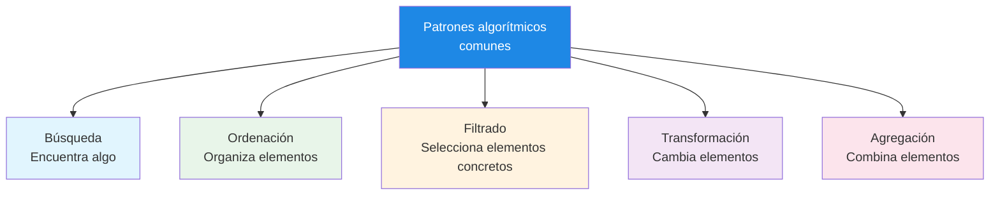
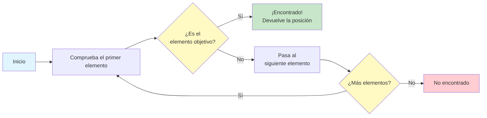
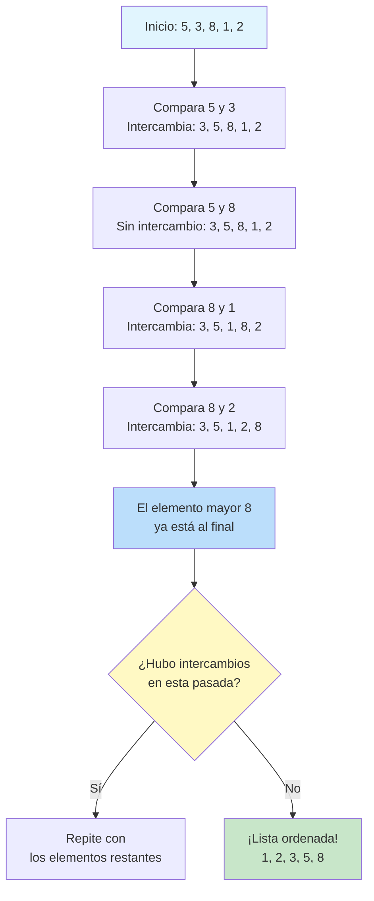
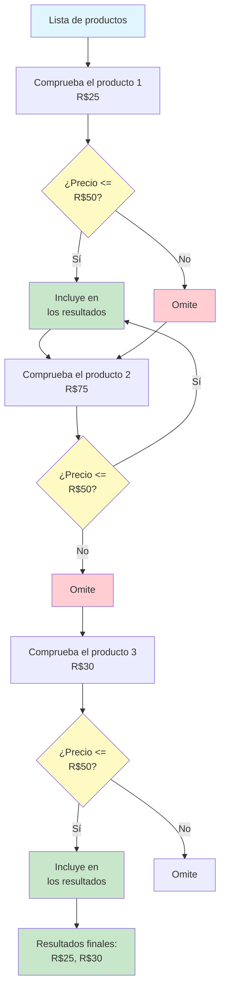
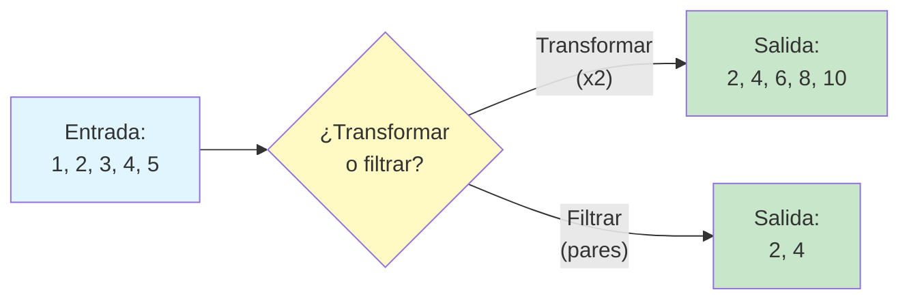
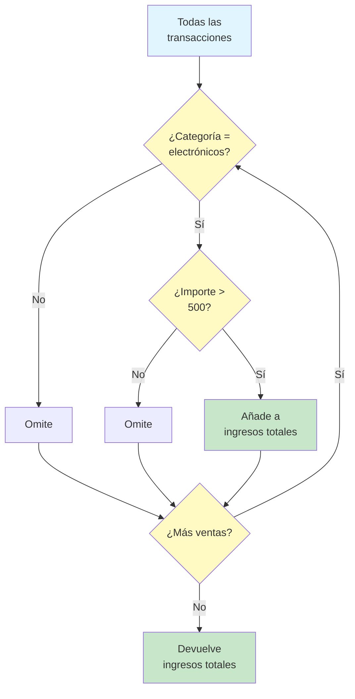
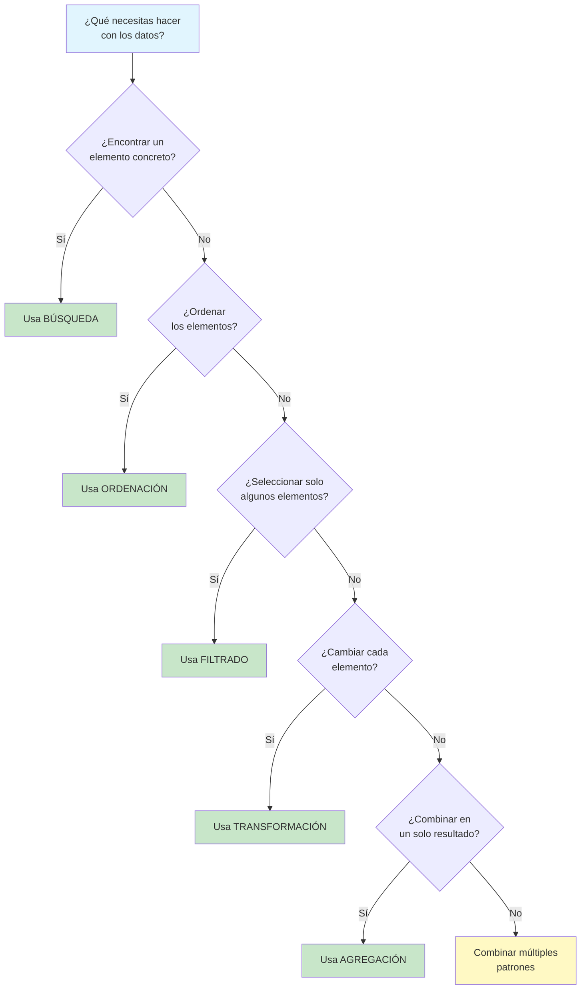

# Patrones algorítmicos comunes

Muchos problemas comparten estructuras similares. Al reconocer estos patrones, puedes aplicar soluciones algorítmicas probadas en lugar de reinventar la rueda. Esta lección cubre los cinco patrones de algoritmos más comunes que encontrarás.

## Los cinco patrones comunes



| Patrón | Qué hace | Ejemplo del mundo real |
|---|---|---|
| **Búsqueda** | Encuentra un elemento concreto en una colección | Buscar un contacto en tu teléfono |
| **Ordenación** | Ordena los elementos según un criterio | Ordenar libros alfabéticamente |
| **Filtrado** | Selecciona los elementos que cumplen una condición | Mostrar solo los correos no leídos |
| **Transformación** | Cambia cada elemento de alguna manera | Convertir temperaturas de Celsius a Fahrenheit |
| **Agregación** | Combina varios elementos en un resultado | Calcular el total de un carrito de compras |

## Patrón 1: búsqueda

Los algoritmos de búsqueda encuentran un elemento concreto (o determinan que no existe) dentro de una colección de datos.

### Búsqueda lineal

La búsqueda más simple: comprueba cada elemento hasta encontrar lo que buscas.

```
ALGORITHM: Linear Search
INPUT: A collection of items, a target item to find
OUTPUT: The position of the target, or "not found"

STEP 1: SET index TO 0
STEP 2: WHILE index is less than the size of the collection DO
            IF collection[index] equals target THEN
                RETURN index
            END IF
            SET index TO index + 1
        END WHILE
STEP 3: RETURN "not found"
END ALGORITHM
```



### Cuándo usar la búsqueda lineal

| Situación | ¿Adecuado? | Por qué |
|---|---|---|
| Colección pequeña (menos de 50 elementos) | Sí | Suficientemente rápido y sencillo de implementar |
| Datos sin ordenar | Sí | Única opción si no ordenas antes |
| Búsqueda única | Sí | No supone ninguna ventaja ordenar antes |
| Colección grande con muchas búsquedas | No | La búsqueda binaria sería mucho más rápida |

### Búsqueda binaria

En colecciones ordenadas, la búsqueda binaria es drásticamente más rápida. Funciona dividiendo repetidamente el espacio de búsqueda por la mitad.

```
ALGORITHM: Binary Search
INPUT: A sorted collection, a target item
OUTPUT: The position of the target, or "not found"

STEP 1: SET low TO 0
STEP 2: SET high TO size of collection - 1
STEP 3: WHILE low is less than or equal to high DO
            SET middle TO (low + high) divided by 2
            IF collection[middle] equals target THEN
                RETURN middle
            ELSE IF collection[middle] is less than target THEN
                SET low TO middle + 1
            ELSE
                SET high TO middle - 1
            END IF
        END WHILE
STEP 4: RETURN "not found"
END ALGORITHM
```

**Ejemplo de traza: buscar 7 en [1, 3, 5, 7, 9, 11, 13]**

| Paso | low | high | middle | collection[middle] | Acción |
|---|---|---|---|---|---|
| 1 | 0 | 6 | 3 | 7 | ¡Encontrado! Se devuelve 3 |

**Ejemplo de traza: buscar 4 en [1, 3, 5, 7, 9, 11, 13]**

| Paso | low | high | middle | collection[middle] | Acción |
|---|---|---|---|---|---|
| 1 | 0 | 6 | 3 | 7 | 4 < 7, busca en la mitad izquierda |
| 2 | 0 | 2 | 1 | 3 | 4 > 3, busca en la mitad derecha |
| 3 | 2 | 2 | 2 | 5 | 4 < 5, busca en la mitad izquierda |
| 4 | 2 | 1 | -- | -- | low > high, no encontrado |

## Patrón 2: ordenación

Los algoritmos de ordenación disponen los elementos en un orden concreto (ascendente, descendente, alfabético, etc.).

### Ordenación por burbuja

La ordenación por burbuja compara repetidamente elementos adyacentes y los intercambia si están en el orden incorrecto.

```
ALGORITHM: Bubble Sort
INPUT: A list of numbers
OUTPUT: The same list, sorted in ascending order

STEP 1: SET n TO length of list
STEP 2: REPEAT
            SET swapped TO false
            FOR i FROM 0 TO n - 2 DO
                IF list[i] is greater than list[i + 1] THEN
                    SWAP list[i] and list[i + 1]
                    SET swapped TO true
                END IF
            END FOR
            SET n TO n - 1
        UNTIL swapped is false
END ALGORITHM
```



### Cómo funciona la ordenación por burbuja (traza visual)

Lista inicial: [5, 3, 8, 1, 2]

**Pasada 1:**
- Compara 5 y 3: intercambia -> [3, 5, 8, 1, 2]
- Compara 5 y 8: sin intercambio -> [3, 5, 8, 1, 2]
- Compara 8 y 1: intercambia -> [3, 5, 1, 8, 2]
- Compara 8 y 2: intercambia -> [3, 5, 1, 2, **8**]
- El 8 "burbujea" hasta el final

**Pasada 2:**
- Compara 3 y 5: sin intercambio -> [3, 5, 1, 2, 8]
- Compara 5 y 1: intercambia -> [3, 1, 5, 2, 8]
- Compara 5 y 2: intercambia -> [3, 1, 2, **5**, 8]
- El 5 ya está en su posición

**Pasada 3:**
- Compara 3 y 1: intercambia -> [1, 3, 2, 5, 8]
- Compara 3 y 2: intercambia -> [1, 2, **3**, 5, 8]
- El 3 ya está en su posición

**Pasada 4:**
- Compara 1 y 2: sin intercambio -> [**1**, **2**, 3, 5, 8]
- No hizo falta ningún intercambio: ¡la lista está ordenada!

## Patrón 3: filtrado

Los algoritmos de filtrado seleccionan solo los elementos que cumplen una condición concreta, creando una colección más pequeña.

```
ALGORITHM: Filter
INPUT: A collection of items, a condition
OUTPUT: A new collection containing only items that meet the condition

STEP 1: CREATE an empty collection called result
STEP 2: FOR each item in the original collection DO
            IF item meets the condition THEN
                ADD item to result
            END IF
        END FOR
STEP 3: RETURN result
END ALGORITHM
```

### Ejemplo del mundo real: filtrar productos

```
ALGORITHM: Filter Products by Price
INPUT: A list of products with prices, maximum price
OUTPUT: List of products at or below the maximum price

STEP 1: CREATE an empty list called affordable_products
STEP 2: FOR each product in the product list DO
            IF product price is less than or equal to maximum price THEN
                ADD product to affordable_products
            END IF
        END FOR
STEP 3: RETURN affordable_products
END ALGORITHM
```



### Condiciones de filtrado comunes

| Tipo de filtro | Condición | Ejemplo |
|---|---|---|
| **Rango** | El valor está entre dos límites | Edad entre 18 y 65 |
| **Igualdad** | El valor coincide exactamente | Estado igual a "activo" |
| **Umbral** | El valor está por encima o por debajo de un punto | Precio por debajo de R$100 |
| **Patrón** | El valor coincide con un patrón | El nombre empieza por "A" |
| **Pertenencia** | El valor pertenece a un conjunto | El país está en [BR, US, CA] |

## Patrón 4: transformación

Los algoritmos de transformación aplican un cambio a cada elemento de una colección, produciendo una nueva colección con los elementos modificados.

```
ALGORITHM: Transform (Map)
INPUT: A collection of items, a transformation rule
OUTPUT: A new collection with transformed items

STEP 1: CREATE an empty collection called result
STEP 2: FOR each item in the original collection DO
            SET transformed_item TO apply transformation to item
            ADD transformed_item to result
        END FOR
STEP 3: RETURN result
END ALGORITHM
```

### Ejemplos del mundo real

**Ejemplo 1: convertir temperaturas**
```
ALGORITHM: Convert All Temperatures
INPUT: A list of temperatures in Celsius
OUTPUT: A list of temperatures in Fahrenheit

STEP 1: CREATE an empty list called fahrenheit_temps
STEP 2: FOR each temp_celsius in the input list DO
            SET temp_fahrenheit TO (temp_celsius * 9/5) + 32
            ADD temp_fahrenheit to fahrenheit_temps
        END FOR
STEP 3: RETURN fahrenheit_temps
END ALGORITHM
```

**Ejemplo 2: dar formato a los nombres**
```
ALGORITHM: Format Full Names
INPUT: A list of people with first_name and last_name
OUTPUT: A list of full names in "Last, First" format

STEP 1: CREATE an empty list called formatted_names
STEP 2: FOR each person in the input list DO
            SET full_name TO person.last_name + ", " + person.first_name
            ADD full_name to formatted_names
        END FOR
STEP 3: RETURN formatted_names
END ALGORITHM
```

### Transformación frente a filtrado

| Aspecto | Transformación | Filtrado |
|---|---|---|
| **Tamaño de la salida** | Igual que la entrada | Igual o menor que la entrada |
| **Qué cambia** | Los propios elementos | Qué elementos se incluyen |
| **¿Se procesa cada elemento?** | Sí | Sí (pero algunos se descartan) |
| **Ejemplo** | Duplica cada número | Conserva solo los números pares |



## Patrón 5: agregación

Los algoritmos de agregación combinan varios elementos en un único resultado. Las agregaciones comunes incluyen suma, recuento, promedio, máximo y mínimo.

```
ALGORITHM: Aggregate
INPUT: A collection of items, an aggregation operation
OUTPUT: A single combined result

STEP 1: SET accumulator TO initial value (depends on operation)
STEP 2: FOR each item in the collection DO
            UPDATE accumulator by combining it with item
        END FOR
STEP 3: RETURN accumulator
END ALGORITHM
```

### Operaciones de agregación comunes

| Operación | Valor inicial | Regla de actualización | Resultado de ejemplo |
|---|---|---|---|
| **Suma** | 0 | acumulador = acumulador + item | [1,2,3] -> 6 |
| **Producto** | 1 | acumulador = acumulador * item | [1,2,3] -> 6 |
| **Recuento** | 0 | acumulador = acumulador + 1 | [a,b,c] -> 3 |
| **Máximo** | Primer elemento | acumulador = max(acumulador, item) | [1,5,3] -> 5 |
| **Mínimo** | Primer elemento | acumulador = min(acumulador, item) | [1,5,3] -> 1 |

### Ejemplo del mundo real: total del carrito de compras

```
ALGORITHM: Calculate Cart Total
INPUT: A shopping cart with items and prices
OUTPUT: The total price

STEP 1: SET total TO 0
STEP 2: FOR each item in the cart DO
            SET item_total TO item price multiplied by item quantity
            SET total TO total + item_total
        END FOR
STEP 3: RETURN total
END ALGORITHM
```

### Combinación de patrones

Los algoritmos del mundo real suelen combinar varios patrones:

```
ALGORITHM: Generate Sales Report
INPUT: A list of all sales transactions
OUTPUT: Total revenue from electronics over R$500

STEP 1: SET total_revenue TO 0
STEP 2: FOR each sale in the sales list DO
            IF sale category equals "Electronics" THEN
                IF sale amount is greater than 500 THEN
                    SET total_revenue TO total_revenue + sale amount
                END IF
            END IF
        END FOR
STEP 3: RETURN total_revenue
END ALGORITHM
```

Este algoritmo combina:
- **Filtrado**: Solo electrónicos por encima de R$500
- **Agregación**: Suma de los importes filtrados



## Guía para elegir el patrón

Ante un problema nuevo, usa esta guía para identificar qué patrón aplica:



## Ejercicios prácticos

### Ejercicio 1: identifica el patrón

Para cada escenario, identifica qué patrón (o combinación) se aplica:

1. Encontrar el alumno más alto de una clase
2. Convertir todos los precios de dólares a euros
3. Encontrar todos los alumnos con nota superior a 90
4. Ordenar libros por fecha de publicación
5. Calcular la temperatura media del mes
6. Encontrar un libro concreto por su ISBN y después actualizar su estado

### Ejercicio 2: escribe un algoritmo de búsqueda

Escribe un algoritmo que busque a un alumno por su nombre en una lista de registros de alumnos. Cada registro tiene un nombre y una nota. Devuelve la nota del alumno si se encuentra, o "Alumno no encontrado" si no.

### Ejercicio 3: escribe un filtrado + transformación

Escribe un algoritmo que:
- Reciba una lista de números
- Filtre todos los números negativos
- Transforme los números restantes elevándolos al cuadrado
- Devuelva la nueva lista

### Ejercicio 4: escribe un algoritmo de agregación

Escribe un algoritmo que encuentre el valor máximo y el mínimo en una sola pasada por una lista de números.

### Ejercicio 5: combina todos los patrones

Diseña un algoritmo para un sistema de biblioteca que:
1. Busque libros de un autor concreto
2. Filtre para incluir solo los libros publicados después de 2020
3. Transforme cada registro del libro para mostrar solo el título y el año
4. Agregue para contar cuántos libros coincidentes existen

## Resumen

En esta lección, has aprendido:

- **Búsqueda**: Encontrar elementos concretos (lineal si no están ordenados, binaria si lo están)
- **Ordenación**: Ordenar elementos según un criterio (la ordenación por burbuja como ejemplo sencillo)
- **Filtrado**: Seleccionar elementos que cumplen condiciones
- **Transformación**: Cambiar cada elemento de una colección
- **Agregación**: Combinar varios elementos en un único resultado
- **Combinación de patrones**: Los algoritmos del mundo real suelen usar varios patrones a la vez

> [!SUCCESS]
> Estos cinco patrones son los componentes básicos de la mayoría de los algoritmos que encontrarás. Al reconocer qué patrón se aplica a un problema, puedes diseñar rápidamente una solución eficaz.

## Términos clave

| Término | Definición |
|---|---|
| **Búsqueda** | Encontrar un elemento concreto en una colección |
| **Búsqueda lineal** | Comprobar cada elemento uno por uno |
| **Búsqueda binaria** | Reducir repetidamente el espacio de búsqueda por la mitad en una colección ordenada |
| **Ordenación** | Disponer los elementos en un orden concreto |
| **Ordenación por burbuja** | Una ordenación sencilla que intercambia elementos adyacentes que están fuera de orden |
| **Filtrado** | Seleccionar los elementos que cumplen una condición |
| **Transformación** | Aplicar un cambio a cada elemento |
| **Agregación** | Combinar varios elementos en un único resultado |
| **Acumulador** | Una variable que construye un resultado durante la agregación |
