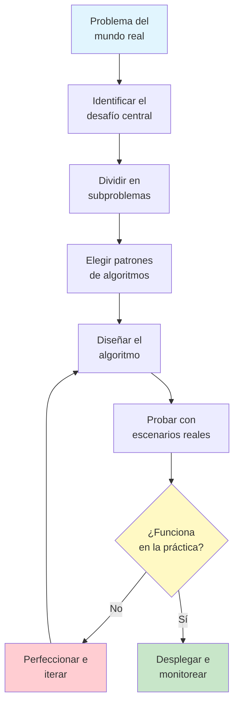
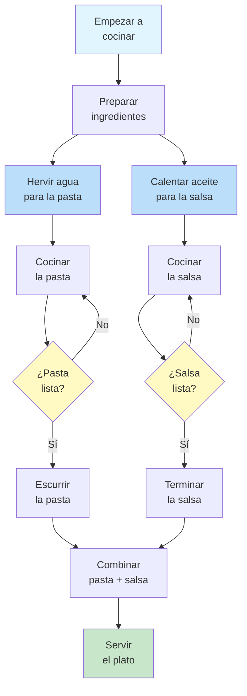
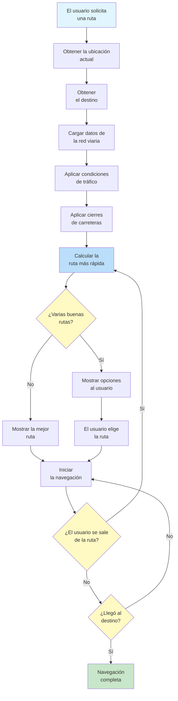
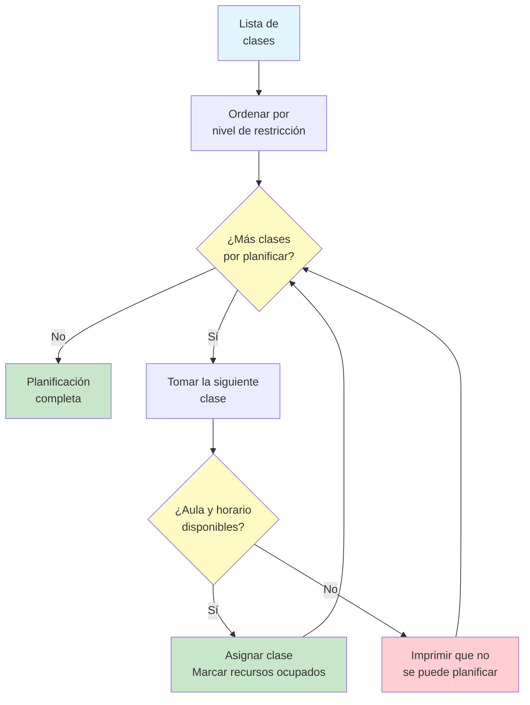
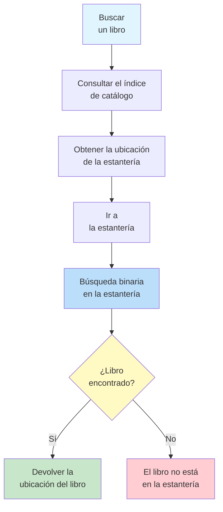
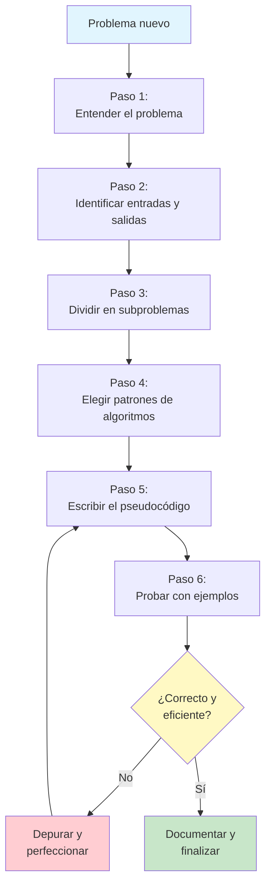

# Diseño de algoritmos del mundo real

Ahora que entiendes los fundamentos de los algoritmos, es momento de ver cómo se aplican a problemas del mundo real. Esta lección presenta casos de estudio detallados que demuestran el pensamiento algorítmico en situaciones cotidianas.

## Por qué importan los ejemplos del mundo real

Los conceptos abstractos de los algoritmos se vuelven claros cuando se aplican a situaciones familiares. Al estudiar algoritmos del mundo real, desarrollarás la capacidad de:

- **Reconocer patrones algorítmicos** en problemas cotidianos
- **Diseñar soluciones** para desafíos prácticos
- **Evaluar compensaciones** entre diferentes enfoques
- **Comunicar algoritmos** a personas no técnicas



## Casos Reales 1: La receta como un algoritmo

Cocinar es uno de los procesos algorítmicos con los que más se identifica la gente. Analicemos una receta con una mirada algorítmica.

### El algoritmo de la receta

```
ALGORITHM: Make Spaghetti Bolognese
INPUT: Ground beef, spaghetti, tomatoes, onion, garlic, olive oil, salt, pepper
OUTPUT: A plate of spaghetti bolognese

STEP 1: PREPARE the ingredients
            Chop 1 onion finely
            Mince 2 cloves of garlic
            Measure 500g ground beef
            Open 1 can of crushed tomatoes
STEP 2: BOIL water in a large pot
STEP 3: ADD salt to the water
STEP 4: WAIT until water reaches boiling point
STEP 5: ADD spaghetti to boiling water
STEP 6: SET timer TO 10 minutes
STEP 7: WHILE timer is greater than 0 DO
            STIR spaghetti occasionally
            IF timer equals 1 THEN
                TASTE a strand for doneness
            END IF
        END WHILE
STEP 8: DRAIN the spaghetti
STEP 9: HEAT olive oil in a pan
STEP 10: ADD onion and cook for 3 minutes
STEP 11: ADD garlic and cook for 1 minute
STEP 12: ADD ground beef
STEP 13: WHILE beef is not fully browned DO
            BREAK up meat with spoon
            STIR occasionally
        END WHILE
STEP 14: ADD crushed tomatoes
STEP 15: ADD salt and pepper to taste
STEP 16: SIMMER sauce for 15 minutes
STEP 17: COMBINE spaghetti and sauce on a plate
STEP 18: SERVE immediately
END ALGORITHM
```

### Análisis algorítmico de la receta

| Concepto de algoritmo | En la receta |
|---|---|
| **Entrada** | Los ingredientes crudos |
| **Salida** | El plato terminado |
| **Pasos secuenciales** | Los pasos se ejecutan en orden (preparar, hervir, cocinar la salsa, combinar) |
| **Condicional** | "IF timer equals 1 THEN taste for doneness" |
| **Bucle** | "WHILE beef is not fully browned DO stir" |
| **Ejecución paralela** | La pasta y la salsa pueden cocinarse al mismo tiempo |
| **Terminación** | La receta termina cuando se sirve el plato |



> [!NOTE]
> Observa que los pasos 5-8 (la pasta) y los pasos 9-16 (la salsa) pueden ocurrir en paralelo. Esto se llama **ejecución concurrente**: dos procesos que corren al mismo tiempo. Los buenos cocineros gestionan ambos simultáneamente para terminar a la vez.

### ¿Qué hace que una receta algorítmica sea buena?

| Cualidad | Buena receta | Mala receta |
|---|---|---|
| **Definición** | "Hornea a 180C durante 25 minutos" | "Hornea hasta que esté listo" |
| **Completitud** | Lista todos los ingredientes con sus cantidades | "Añade condimentos al gusto" |
| **Orden** | Los pasos están numerados y son secuenciales | Los pasos saltan aleatoriamente |
| **Manejo de errores** | "Si la masa está muy seca, añade 1 cucharada de agua" | Sin indicaciones para resolver problemas |
| **Terminación** | "Cocina durante 10 minutos y después retira" | "Cocina un rato" |

## Casos Reales 2: Algoritmo del sistema de navegación

La navegación GPS es un sistema algorítmico sofisticado que encuentra rutas óptimas entre ubicaciones.

### El problema de la navegación

```
PROBLEM: Find the best route from point A to point B

CONSTRAINTS:
  - Road network (which roads connect to which)
  - Distance of each road segment
  - Current traffic conditions
  - Speed limits
  - Road closures or construction

GOAL: Minimize travel time
```

### Algoritmo de navegación simplificado

```
ALGORITHM: Find Fastest Route
INPUT: Starting location, destination, road network with traffic data
OUTPUT: Ordered list of road segments forming the route

STEP 1: CREATE a list of places to explore
STEP 2: ADD the starting location to the exploration list
STEP 3: SET travel_time[starting_location] TO 0
STEP 4: SET previous_location[starting_location] TO none
STEP 5: WHILE the exploration list is not empty DO
            SELECT the location with the smallest travel_time from the list
            REMOVE that location from the list
            
            FOR each road connected to this location DO
                SET new_time TO travel_time[current] + road travel time
                IF new_time is less than travel_time[destination_of_road] THEN
                    SET travel_time[destination_of_road] TO new_time
                    SET previous_location[destination_of_road] TO current location
                    ADD destination_of_road to exploration list
                END IF
            END FOR
        END WHILE
STEP 6: RECONSTRUCT the route by following previous_location from destination back to start
STEP 7: RETURN the route
END ALGORITHM
```

> [!TIP]
> Esta es una versión simplificada del **algoritmo de Dijkstra**, uno de los algoritmos más famosos de la informática. Encuentra el camino más corto en una red explorando hacia afuera desde el punto de partida.

### Cómo gestiona la navegación la complejidad del mundo real



### Consideraciones del mundo real

| Factor | Cómo lo gestiona el algoritmo |
|---|---|
| **Atascos de tráfico** | Aumenta el tiempo de viaje de los tramos afectados |
| **Cierres de carreteras** | Elimina esos tramos de la red |
| **Preferencias del usuario** | Añade pesos (evitar peajes, preferir autopistas) |
| **Actualizaciones en tiempo real** | Recalcula cuando cambian las condiciones |
| **Múltiples destinos** | Encuentra el orden óptimo para visitar todos los puntos |

## Casos Reales 3: Algoritmo de planificación de horarios

La planificación es un problema algorítmico clásico: cómo asignar recursos limitados (tiempo, salas, personas) a las tareas que los necesitan.

### El problema de la planificación

```
PROBLEM: Schedule classes for a school

RESOURCES:
  - 5 classrooms
  - 8 teachers
  - 6 time slots per day

CONSTRAINTS:
  - Each teacher can only teach one class at a time
  - Each classroom can only hold one class at a time
  - Some classes require specific rooms (lab, gym)
  - Some teachers have unavailable time slots
  - Each class must be scheduled exactly once

GOAL: Schedule all classes without conflicts
```

### Algoritmo codicioso de planificación

Un **algoritmo codicioso** toma la mejor decisión en cada paso sin mirar hacia delante.

```
ALGORITHM: Greedy Class Scheduler
INPUT: List of classes to schedule, available rooms, available time slots, teacher schedules
OUTPUT: A complete schedule or "cannot schedule all classes"

STEP 1: SORT classes by difficulty to schedule (most constrained first)
            Classes with specific room needs come first
            Classes with teachers who have few available slots come first
STEP 2: CREATE an empty schedule
STEP 3: FOR each class in the sorted list DO
            SET scheduled TO false
            FOR each available time slot DO
                FOR each available room DO
                    IF room is free at this time slot AND
                       teacher is available at this time slot AND
                       room meets class requirements THEN
                        ASSIGN class to this room at this time slot
                        MARK room as occupied at this time slot
                        MARK teacher as busy at this time slot
                        ADD assignment to schedule
                        SET scheduled TO true
                        BREAK out of all inner loops
                    END IF
                END FOR
                IF scheduled is true THEN
                    BREAK
                END IF
            END FOR
            IF scheduled is false THEN
                PRINT "Cannot schedule: " + class name
            END IF
        END FOR
STEP 4: RETURN the schedule
END ALGORITHM
```



### Comparación de estrategias de planificación

| Estrategia | Cómo funciona | Ventajas | Desventajas |
|---|---|---|---|
| **Codiciosa** | Planifica primero las clases más fáciles | Rápida y sencilla | Puede fallar al planificar todas las clases |
| **Más restringida primero** | Planifica primero las clases más difíciles | Mejor tasa de éxito | Más compleja de implementar |
| **Backtracking** | Prueba una planificación y la deshace si se atasca | Encuentra una solución si existe | Muy lenta con problemas grandes |
| **Asignación aleatoria** | Asigna al azar y comprueba conflictos | Muy rápida | Muchos conflictos y poca calidad |

## Casos Reales 4: Organización de los libros de la biblioteca

¿Cómo organiza una biblioteca miles de libros para que cualquier libro pueda encontrarse rápidamente?

### El algoritmo de organización

```
ALGORITHM: Organize Library Books
INPUT: A collection of unsorted books with catalog numbers
OUTPUT: Books arranged on shelves in order

STEP 1: SORT all books by their catalog number
STEP 2: DIVIDE the sorted list into groups that fit on one shelf
STEP 3: FOR each shelf group DO
            LABEL the shelf with the range of catalog numbers
            PLACE books on the shelf in order
        END FOR
STEP 4: CREATE a catalog index mapping catalog numbers to shelf locations
END ALGORITHM
```

### El algoritmo de búsqueda (usando la organización)

```
ALGORITHM: Find Book in Organized Library
INPUT: A book's catalog number, the catalog index
OUTPUT: The book's physical location

STEP 1: LOOK UP the catalog number in the index
STEP 2: READ the shelf location from the index
STEP 3: GO to that shelf
STEP 4: USE binary search on the shelf to find the exact book
            SET left TO first book on shelf
            SET right TO last book on shelf
            WHILE left is less than or equal to right DO
                SET middle TO the book in the middle
                IF middle catalog number equals target THEN
                    RETURN middle book's position
                ELSE IF middle catalog number is less than target THEN
                    SET left TO the book after middle
                ELSE
                    SET right TO the book before middle
                END IF
            END WHILE
STEP 5: RETURN "Book not on shelf"
END ALGORITHM
```



> [!NOTE]
> El sistema de la biblioteca combina varios patrones de algoritmos: **ordenación** (organizar los libros), **búsqueda** (encontrar un libro concreto) y **agregación** (el índice de catálogo que resume las ubicaciones).

## Diseña tu propio algoritmo: un marco de trabajo

Ante un problema nuevo, sigue este marco de trabajo:



### Ejemplo paso a paso: planificar un horario de estudio

**Paso 1: Entiende el problema**
Tienes 5 materias por estudiar, 3 días hasta los exámenes y pocas horas disponibles cada día. Necesitas asignar el tiempo de estudio de forma eficaz.

**Paso 2: Identifica las entradas y las salidas**
- **Entrada**: Lista de materias, dificultad de cada una, horas disponibles al día, número de días
- **Salida**: Un horario de estudio día por día

**Paso 3: Divídelo en subproblemas**
- Prioriza las materias por dificultad
- Calcula las horas de estudio totales necesarias
- Distribuye las horas entre los días disponibles
- Asegúrate de que ningún día supere las horas disponibles

**Paso 4: Elige los patrones de algoritmos**
- **Ordenación**: Ordena las materias por dificultad (las más difíciles primero)
- **Agregación**: Horas totales necesarias
- **Filtrado**: Franjas horarias disponibles
- **Transformación**: Convierte las horas en bloques de tiempo

**Paso 5: Escribe el pseudocódigo**

```
ALGORITHM: Study Schedule Planner
INPUT: List of subjects with difficulty levels, hours available per day, number of days
OUTPUT: Day-by-day study schedule

STEP 1: SORT subjects by difficulty (hardest first)
STEP 2: FOR each subject DO
            SET hours_needed TO difficulty level multiplied by 2
        END FOR
STEP 3: SET total_hours_needed TO sum of all hours_needed
STEP 4: SET total_hours_available TO hours per day multiplied by number of days
STEP 5: IF total_hours_needed is greater than total_hours_available THEN
            PRINT "Warning: Not enough time to study all subjects thoroughly"
            PRINT "Focus on the hardest subjects first"
        END IF
STEP 6: CREATE an empty schedule
STEP 7: FOR each day FROM 1 TO number_of_days DO
            SET remaining_hours TO hours available per day
            FOR each subject in the sorted list DO
                IF remaining_hours is greater than 0 THEN
                    SET study_time TO minimum of 2 hours and remaining_hours
                    ADD subject to day's schedule with study_time hours
                    SET remaining_hours TO remaining_hours - study_time
                END IF
            END FOR
        END FOR
STEP 8: RETURN the schedule
END ALGORITHM
```

## Ejercicios prácticos

### Ejercicio 1: algoritmo de receta

Escribe un algoritmo para preparar tu bocadillo o plato favorito. Incluye:
- Entradas claras (ingredientes)
- Al menos una condicional (p. ej., "si está muy salgado, añade azúcar")
- Al menos un bucle (p. ej., "remueve hasta que quede homogéneo")
- Una salida clara

### Ejercicio 2: algoritmo de horario diario

Diseña un algoritmo que planifique tu horario diario ideal. Ten en cuenta:
- Compromisos fijos (trabajo, clases)
- Actividades flexibles (ejercicio, lectura, vida social)
- Restricciones (dormir 8 horas, comidas a horas regulares)
- Prioridades (qué es lo más importante encajar)

### Ejercicio 3: algoritmo de compras

Necesitas comprar víveres con un presupuesto de R$200. Diseña un algoritmo que:
- Reciba una lista de la compra con precios estimados
- Se mantenga dentro del presupuesto
- Priorice los artículos esenciales
- Sugiera qué quitar si se supera el presupuesto

### Ejercicio 4: analiza un algoritmo real

Piensa en una aplicación que uses con regularidad (redes sociales, streaming de música, entrega de comida). Identifica:
- ¿Qué patrones algorítmicos utiliza?
- ¿Qué entradas recibe?
- ¿Qué salidas produce?
- ¿Qué compensaciones hace?

### Ejercicio 5: desafío de diseño

Diseña un algoritmo para un sistema de triaje de urgencias hospitalarias:
- Los pacientes llegan con diferentes niveles de gravedad
- Hay médicos y camas limitados
- Los pacientes críticos deben atenderse de inmediato
- Los pacientes menos críticos pueden tener que esperar

Incluye el manejo de:
- La llegada de un nuevo paciente
- Que un médico se vuelva disponible
- El empeoramiento del estado del paciente mientras espera

## Resumen

En esta lección, has aprendido:

- **Algoritmos de recetas**: Cocinar sigue patrones algorítmicos con entradas, pasos, condicionales y bucles
- **Algoritmos de navegación**: El GPS usa la búsqueda de caminos basada en grafos para encontrar rutas óptimas
- **Algoritmos de planificación**: La asignación de recursos exige una gestión cuidadosa de las restricciones
- **Algoritmos de organización**: Las bibliotecas combinan ordenación y búsqueda para una recuperación eficiente
- **Marco de diseño**: Un enfoque sistemático para diseñar algoritmos para cualquier problema

> [!SUCCESS]
> Ya tienes las herramientas para reconocer y diseñar algoritmos para problemas del mundo real. Cada sistema complejo que encuentres, desde semáforos hasta feeds de redes sociales, se construye a partir de los principios algorítmicos que has aprendido en este curso.

## Términos clave

| Término | Definición |
|---|---|
| **Caso de estudio** | Un análisis detallado de un ejemplo del mundo real |
| **Ejecución concurrente** | Varios procesos ejecutándose al mismo tiempo |
| **Algoritmo de Dijkstra** | Un algoritmo famoso para encontrar caminos más cortos en una red |
| **Algoritmo codicioso** | Un algoritmo que toma la mejor decisión local en cada paso |
| **Backtracking** | Probar una solución y deshacerla si no funciona |
| **Restricción** | Una limitación o requisito que debe cumplirse |
| **Triaje** | Ordenar pacientes o tareas por urgencia |
| **Asignación de recursos** | Asignar recursos limitados a necesidades que compiten entre sí |
| **Marco de diseño** | Un enfoque estructurado para resolver problemas de forma sistemática |
