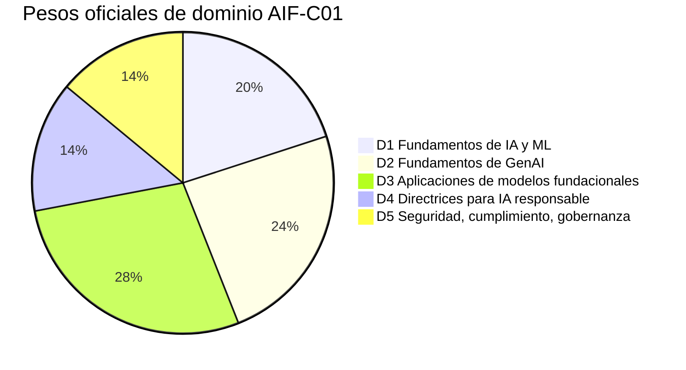
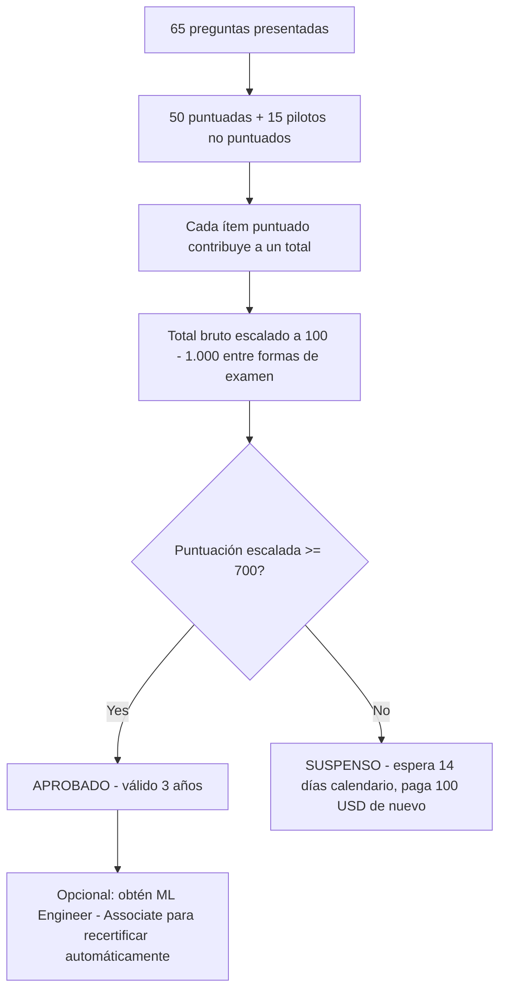
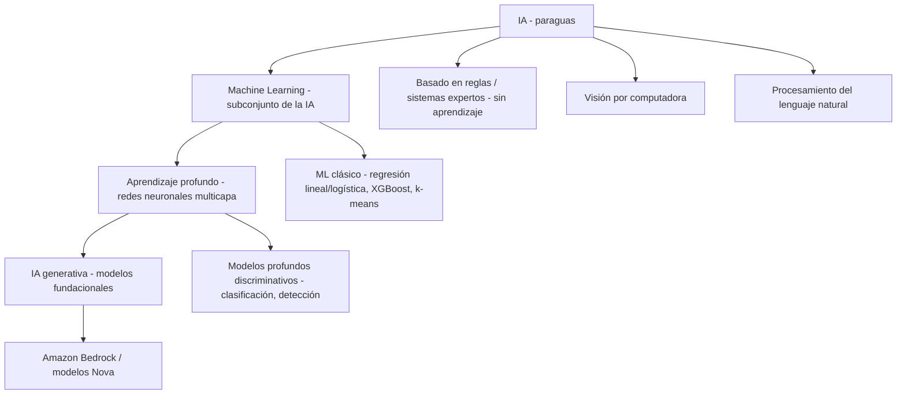
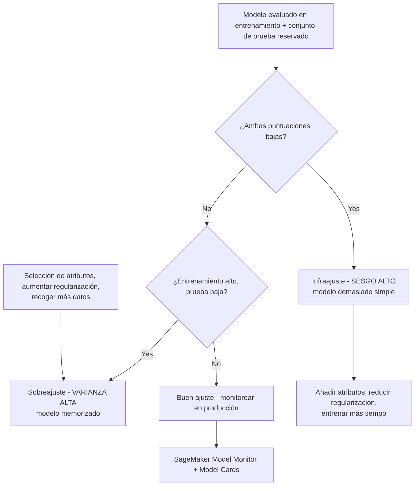
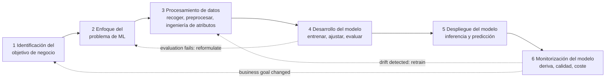

# Guía del examen AIF-C01 y fundamentos de IA/ML

Toda certificación de AWS comienza con un documento: la **guía oficial del examen**. Para AIF-C01 ese documento hace dos trabajos a la vez: te dice exactamente *cómo* está construido el examen (códigos, minutos, preguntas, nota de corte, pesos) y define el *vocabulario conceptual* que debes dominar en el Dominio 1 (Fundamentos de IA y ML, 20% de la puntuación). Los estudiantes que se saltan la guía y van directo a las tarjetas de memorización suelen suspender por las mismas tres razones: calculan mal el presupuesto de tiempo, confunden el sesgo estadístico con el sesgo de equidad y no saben cuándo la IA es la *respuesta equivocada* a un problema de negocio.

```text
=====================================================================
 AIF-C01 — AWS CERTIFIED AI PRACTITIONER (FOUNDATIONAL)
=====================================================================
  Código ............. AIF-C01          Nivel ..... Foundational
  Duración ........... 90 minutos       Preguntas . 65 presentadas
  Ítems puntuados .... 50               No pun. .... 15 (pilotos)
  Escala ............. 100 - 1.000      Corte ...... 700
  Puntuación ......... compensatoria (solo global, sin aprobación por dominio)
  Coste .............. 100 USD          Validez .... 3 años
  Aplicación ......... centro Pearson VUE o proctor en línea
  Idiomas ............ 12 (IT y DE se retiran después del 15 de oct de 2026)
---------------------------------------------------------------------
  DOMINIO                                      PESO   ÍTEMS (50 x w)
  1. Fundamentos de IA y ML                    20%          10
  2. Fundamentos de GenAI                      24%          12
  3. Aplicaciones de modelos fundacionales     28%          14
  4. Directrices para IA responsable           14%           7
  5. Seguridad, cumplimiento, gobernanza       14%           7
                                              ------         -----
                                              100%           50
---------------------------------------------------------------------
  TIPOS DE PREGUNTA: opción múltiple | respuesta múltiple | ordenación |
                     asociación (sin penalización por adivinar; en
                     blanco = incorrecta)
=====================================================================
```

> [!NOTE]
> **La guía es el contrato.** Cualquier cosa que no esté en la guía del examen, por popular que sea en entradas de blog, no tiene garantía de aparecer. AWS etiqueta explícitamente sus listas de servicios como **«no exhaustivas y sujetas a cambios»**, así que trata la guía como el suelo de lo que debes saber, no como el techo.

En esta lección vas a:

- leer la guía del examen como la leería quien redacta el examen: código, tiempos, coste, puntuación, idiomas;
- convertir los **pesos de dominio** en un presupuesto concreto de horas de estudio;
- dominar los **cuatro tipos de pregunta** y el modelo de puntuación compensatoria;
- separar **IA, machine learning, aprendizaje profundo e IA generativa** usando las propias definiciones de AWS;
- elegir entre aprendizaje **supervisado, no supervisado, por refuerzo y semisupervisado**;
- fijar el vocabulario: modelo, algoritmo, entrenamiento, inferencia, época, lote, atributo, etiqueta;
- diagnosticar **infraajuste y sobreajuste** a través de la lente de sesgo/varianza;
- calcular e interpretar **exactitud, precisión, recall y F1**;
- mapear el **ciclo de vida de ML de seis fases** a servicios reales de AWS;
- asimilar las **actualizaciones de la guía 2025 to 2026** (objetivos v1.1) y separar lo verificado de lo no verificado;
- aplicar los **esenciales de estrategia de examen**: ritmo, eliminación y las familias de trampas recurrentes;
- estudiar **casos reales de AWS**: servicios, cifras y fuentes;
- practicar con **12 preguntas tipo examen** más comprobaciones interactivas.

---

## 1. Qué mide realmente el AIF-C01

### 1.1 El candidato objetivo

La guía define al candidato objetivo en una sola frase, y esa frase es por sí misma material de examen: un candidato tiene **hasta 6 meses de exposición a tecnologías de IA/ML en AWS** y **usa pero no necesariamente construye soluciones de IA/ML**. Esta es una credencial de *practicante*, no de ingeniero. Se te examina de criterio, vocabulario, selección de servicios y gobernanza: no de escribir código de entrenamiento.

| Atributo del candidato | Lo que dice la guía | Qué significa para tu preparación |
|---|---|---|
| Ventana de experiencia | Hasta 6 meses de exposición a IA/ML en AWS | No se espera que hayas desplegado modelos |
| Énfasis en el rol | Usa, pero no necesariamente construye, soluciones de IA/ML | Dominan la selección de servicios y el razonamiento de compensaciones |
| Certificación previa | Ninguna | AIF-C01 puede ser tu primera certificación AWS |
| Codificar modelos de IA/ML | **Fuera del alcance** | Sin descenso por gradiente, sin PyTorch, sin ingeniería de atributos |
| Ajuste de hiperparámetros | **Fuera del alcance** | Saber *que* el ajuste existe, no *cómo* ajustar |
| Análisis matemático/estadístico | **Fuera del alcance** | La aritmética sobre métricas es válida; las derivaciones no |
| Desarrollo de marcos de gobernanza | **Fuera del alcance** | Debes *aplicar* directrices, no redactarlas |

### 1.2 Dentro del alcance y explícitamente fuera del alcance

La guía traza una línea dura en torno al alcance. La lista de exclusión no es decoración: sus elementos han aparecido como distractores en el conjunto oficial de preguntas de práctica, porque un distractor que suena a «trabajo real de ML» es la respuesta incorrecta más tentadora de todas.

**Explícitamente fuera del alcance (guía del examen):**

- codificar modelos de IA/ML;
- ingeniería de datos e ingeniería de atributos;
- ajuste de hiperparámetros;
- construir pipelines de ML;
- análisis matemático y estadístico;
- implementar protocolos de seguridad y cumplimiento;
- desarrollar marcos de gobernanza.

**Explícitamente dentro del alcance (conocimiento AWS recomendado):**

- servicios básicos en la nube: **Amazon EC2, Amazon S3, AWS Lambda**;
- servicios de IA: **Amazon Bedrock, Amazon SageMaker AI**;
- modelo de responsabilidad compartida y **AWS Identity and Access Management (IAM)**;
- fundamentos de precios y gestión de costes de AWS.

> [!WARNING]
> **La trampa clásica: «construir» frente a «usar».** Si una pregunta te pide *implementar* un algoritmo, *ajustar* un hiperparámetro o *construir* un pipeline de datos, casi con certeza está probando si reconoces una tarea fuera del alcance. La respuesta correcta en el examen es la que habla de **selección, evaluación, gobernanza y uso responsable**: nunca la que habla de escribir el modelo.

### 1.3 La superficie de servicios AWS que debes reconocer

La guía publica una lista de servicios no exhaustiva, agrupada por categoría. No se te exige conocer cada ruta de la consola; se te exige saber **para qué sirve cada servicio y cuándo elegirlo**.

| Categoría | Servicios listados en la guía |
|---|---|
| Machine learning e IA | Amazon Bedrock, Bedrock AgentCore, Comprehend, Lex, Nova, Personalize, Polly, Rekognition, SageMaker AI, JumpStart, Textract, Transcribe, Translate, AWS Transform |
| Analítica | Data Exchange, EMR, Glue, Glue DataBrew, Lake Formation, OpenSearch, QuickSight, Redshift |
| Cómputo | EC2, Lambda, ECS, EKS |
| Gestión y gobernanza | CloudTrail, CloudWatch, AWS Config, Trusted Advisor, AWS Well-Architected Tool |
| Seguridad | AWS Artifact, IAM, Inspector, KMS, Macie, Secrets Manager |
| Almacenamiento, red, coste | S3, S3 Glacier, CloudFront, VPC, AWS Budgets, Cost Explorer |

- **📚 ¿Sabías que…?** El examen AIF-C01 se **anunció en junio de 2024** y su **beta se abrió el 13 de agosto de 2024** con **85 preguntas, 170 minutos y una tarifa de 75 USD** en inglés y japonés. El examen estándar pasó a **disponibilidad general en octubre de 2024** a **100 USD** con 65 preguntas y 90 minutos: así que si encuentras una guía de estudio antigua que describe un examen de 170 minutos, estás leyendo material de la era beta.

---

## 2. Logística del examen: los números que cambian tu estrategia

### 2.1 La tabla de logística

Cada fila de abajo está verificada contra la página de certificación de AWS, la guía del examen o la tienda de Pearson VUE, con el año de verificación indicado.

| Atributo | Valor | Fuente | Año |
|---|---|---|---|
| Código / nivel | AIF-C01 / Foundational | Página de certificación | 2026 |
| Duración | 90 minutos | Página de certificación, Exam overview | 2026 |
| Preguntas presentadas | 65 | Página de certificación + guía del examen | 2026 |
| Puntuadas / no puntuadas | 50 / 15 | Guía del examen | 2026 |
| Nota de aprobación | 700 en una escala de 100 to 1.000 | Guía del examen §Resultados | 2026 |
| Modelo de puntuación | Compensatorio (solo global) | Guía del examen §Resultados | 2026 |
| Política de adivinanza | Sin penalización; sin responder = incorrecta | Guía del examen §Tipos de pregunta | 2026 |
| Tipos de pregunta | Opción múltiple, respuesta múltiple, ordenación, asociación | Guía del examen §Tipos de pregunta | 2026 |
| Coste | 100 USD | Página de certificación; tienda Pearson VUE | 2026 |
| Validez | 3 años | Página de certificación; política de recertificación | 2025 to 26 |
| Aplicación | centro de pruebas Pearson VUE o proctor en línea | Página de certificación | 2026 |
| Idiomas | 12 (italiano y alemán se retiran después del 15 de oct de 2026) | Página de certificación §Idiomas | 2026 |
| Beta (histórica) | 85 preguntas / 170 minutos / 75 USD, EN + JA, desde el 13 de ago de 2024 | Blog AWS Training & Certification | 2024 |
| Disponibilidad general estándar | Octubre de 2024, 100 USD, 5 idiomas al lanzamiento | Blog AWS Training & Certification | 2024 |

### 2.2 Ejemplo E1: el presupuesto de tiempo por pregunta

El número más útil de toda la guía es una aritmética que nadie publica:

$$
t = \frac{90 \times 60}{65} = \frac{5{,}400}{65} \approx 83 \text{ segundos por pregunta}
$$

Si reservas **10 minutos** para la revisión, el presupuesto real es $80 \times 60 / 65 \approx$ **73,8 segundos** por ítem. Compara esto con la beta de 2024: $170 \times 60 / 85 = 120$ segundos por ítem: el examen estándar es aproximadamente **31% más ajustado por pregunta**. Los ítems de ordenación y asociación consumen legítimamente más que la media; los ítems de opción múltiple deberían resolverse en menos de un minuto para que el excedente pague por ellos.

### 2.3 Ejemplo E5: coste del fallo

| Iteración del examen | Tarifa | Ítems | Coste por ítem | Notas |
|---|---|---|---|---|
| Beta (ago 2024) | 75 USD | 85 | **0,88 USD** | Solo inglés + japonés |
| Estándar (actual) | 100 USD | 65 | **1,54 USD** | 12 idiomas |

Un intento fallido cuesta **otros 100 USD** más una **espera obligatoria de 14 días calendario** antes de poder repetir. No hay límite de intentos y la tarifa completa se aplica cada vez; a la inversa, **no puedes repetir un examen que has aprobado durante 2 años**. Una promoción limitada de «Foundational Retake» terminó el **15 de febrero de 2025**, así que presupuesta un solo intento.

- **📚 ¿Sabías que…?** No necesitas «aprobar cada dominio». Como la puntuación es **compensatoria**, un Dominio 3 fuerte (28%) puede sostener un Dominio 4 débil (14%): AWS declara que necesitas una nota de aprobación **solo en el examen global**, y el informe de resultados aún puede mostrar comentarios por sección para guiar tu reintento.

---

## 3. Dominios, pesos y declaraciones de tareas

### 3.1 Pesos oficiales y el presupuesto de preguntas derivado

| Dominio | Peso oficial | Ítems puntuados derivados (50 × peso) |
|---|---|---|
| 1. Fundamentos de IA y ML | **20%** | 10 |
| 2. Fundamentos de GenAI | **24%** | 12 |
| 3. Aplicaciones de modelos fundacionales | **28%** | 14 |
| 4. Directrices para IA responsable | **14%** | 7 |
| 5. Seguridad, cumplimiento y gobernanza para soluciones de IA | **14%** | 7 |
| **Total** | **100%** | **50** |

> [!IMPORTANT]
> Los **pesos son oficiales** (guía del examen, 2026). Los **recuentos de ítems son aritmética**, 50 × peso, y **no los publica AWS**. El número de preguntas por dominio es desconocido y, como 15 de los 65 ítems son pilotos no puntuados, tu formulario real de examen no coincidirá exactamente con esta cuadrícula. Úsala para *asignar tiempo de estudio*, nunca para predecir un número fijo de preguntas.



### 3.2 Qué prueba realmente cada dominio

| Dominio | Declaraciones de tareas | Enfoque comprimido del examen |
|---|---|---|
| **1: Fundamentos de IA y ML (20%)** | 1.1 Conceptos y terminología básicos de IA · 1.2 Casos de uso prácticos de IA · 1.3 Ciclo de vida de desarrollo de IA/ML | IA/ML/DL/redes neuronales/CV/NLP; entrenamiento frente a inferencia; sesgo y equidad; datos etiquetados y no etiquetados, tabulares, series temporales, imagen, texto; supervisado/no supervisado/por refuerzo; cuándo la IA *no* es adecuada; inferencia por lotes, en tiempo real, asincrónica y serverless; servicios gestionados (SageMaker AI, Transcribe, Translate, Comprehend, Lex, Polly); etapas de pipeline y MLOps; exactitud/precisión/recall/F1 frente a métricas de negocio |
| **2: Fundamentos de GenAI (24%)** | 2.1 Conceptos básicos de GenAI · 2.2 Capacidades y limitaciones para el negocio · 2.3 Infraestructura y tecnologías AWS para GenAI | Tokens, chunking, embeddings, vectores, prompt engineering, LLM transformer, modelos fundacionales, modelos multimodales y de difusión; ciclo de vida de FM; **precios basados en tokens y su efecto en el coste/rendimiento de la inferencia**; ingeniería de contexto; IA agéntica (MCP, patrones multiagente, memoria, herramientas, orquestación); pros frente a contras (alucinaciones, interpretabilidad, imprecisión, no determinismo); selección de modelos por coste, latencia, cumplimiento, complejidad; Bedrock, SageMaker AI, JumpStart, Amazon Q, Kiro, Strands Agents, Bedrock AgentCore |
| **3: Aplicaciones de modelos fundacionales (28%)** | 3.1 Consideraciones de diseño para apps de FM · 3.2 Prompt engineering · 3.3 Entrenamiento y fine-tuning de FMs · 3.4 Evaluar el rendimiento de FM | Criterios de selección de FM; parámetros de inferencia como **temperature** y longitudes de salida; **RAG**; bases de datos vectoriales (OpenSearch, Aurora, Neptune, RDS for PostgreSQL); escalera de coste de personalización (preentrenamiento, fine-tuning, aprendizaje en contexto, RAG, destilación); agentes de IA; gestión de prompts; preparación de datos para fine-tuning (curaduría, gobernanza, tamaño, etiquetado, **RLHF**); evaluación con humanos en el bucle y con benchmarks; **Bedrock Model Evaluation**; ROUGE, BLEU, BERTScore, LLM-as-a-judge |
| **4: Directrices para IA responsable (14%)** | 4.1 Desarrollo de sistemas de IA responsable · 4.2 Modelos transparentes y explicables | Sesgo, equidad, inclusividad, robustez, seguridad, veracidad; **Bedrock Guardrails**; sostenibilidad; riesgos legales (reclamaciones de propiedad intelectual, salidas sesgadas, pérdida de confianza, alucinaciones); **efectos del sesgo y la varianza (sobreajuste, infraajuste)**; análisis de calidad de etiquetas, auditorías humanas, análisis de subgrupos; modelos transparentes frente a opacos; **SageMaker Model Cards**; compromisos entre seguridad y transparencia |
| **5: Seguridad, cumplimiento, gobernanza (14%)** | 5.1 Métodos para asegurar sistemas de IA · 5.2 Gobernanza y regulaciones de cumplimiento | IAM, cifrado, **Macie, PrivateLink, responsabilidad compartida, AgentCore Identity/Policy, Bedrock Guardrails**; linaje y catálogo de datos; tecnologías de mejora de privacidad; **AWS Config, Inspector, AWS Artifact, CloudTrail, Trusted Advisor**; ciclos de vida de datos, registro de eventos, residencia, retención; **Generative AI Security Scoping Matrix** |

### 3.3 Convertir pesos en un plan de estudio

Supón que tienes **40 horas** antes del día del examen. Los pesos se convierten directamente en horas:

```text
Dominio   peso    horas (40 h)   recursos clave a consumir
D1        20%        8,0 h       páginas what-is de AWS, ciclo de vida ML Lens
D2        24%        9,6 h       docs de Bedrock, conceptos GenAI, precios por token
D3        28%       11,2 h       prompting, RAG, fine-tuning, evaluación
D4        14%        5,6 h       principios de IA responsable, Guardrails, Model Cards
D5        14%        5,6 h       responsabilidad compartida, IAM, Artifact, Macie
                                              -------------------------
                                              40,0 h
```

Los dominios 2 + 3 suman **52% de la puntuación**: más de la mitad del examen es trabajo de IA generativa. Un candidato que dedica el 80% del tiempo de estudio a ML clásico ya ha mal asignado la mayor parte de su esfuerzo.

---

## 4. Tipos de pregunta y mecánica de puntuación

### 4.1 Los cuatro tipos de pregunta

| Tipo | Estructura | Regla de reconocimiento |
|---|---|---|
| **Opción múltiple** | 1 opción correcta + 3 distractores | Selecciona la única mejor respuesta |
| **Respuesta múltiple** | 2+ correctas entre 5+ opciones | Se requieren **todas** las respuestas correctas para el crédito |
| **Ordenación** | 3 to 5 respuestas colocadas en secuencia | La secuencia completa debe ser correcta |
| **Asociación** | Empareja elementos contra **3 to 7 enunciados** | **Todas** las parejas deben ser correctas |

No hay **tipo de caso de estudio** listado en la guía actual. Un PDF heredado de 2024 (v1.4, 31 de julio de 2024) contiene redacción de casos de estudio, y AWS no declara qué serie de numeración rige el día del examen: consulta las reservas de la sección 11.3.

### 4.2 Puntuación compensatoria

**Compensatoria** significa una sola cosa: solo el resultado **global** debe superar 700. **No** necesitas alcanzar 700 dentro de cada dominio individual. Un candidato que puntúa el equivalente a 650 en el Dominio 4 pero el equivalente a 800 en los Dominios 1 to 3 aún puede aprobar, y a la inversa: dominar el Dominio 3 no rescata una puntuación global por debajo del corte.



### 4.3 Ejemplo E2: escalada, no un porcentaje bruto

700 sobre 1.000 *parece* un 70%, y la conversión ingenua $0.70 \times 50 = 35$ respuestas correctas es aritméticamente limpia, y **falsa como hecho del examen**. AWS escala las puntuaciones *«en múltiples formas de examen que pueden tener niveles de dificultad ligeramente diferentes»*, así que el número bruto de respuestas correctas necesario para 700 **no está fijado en 35** y no se publica. La única regla determinística en la que puedes confiar es de comportamiento: **los ítems sin respuesta se puntúan como incorrectos**, así que debes responder las 65.

> [!WARNING]
> **Nunca dejes un ítem en blanco «por si acaso».** **No hay penalización por adivinar**: un intento fallido no te cuesta nada más allá del punto que habrías perdido al saltártelo, mientras que un blanco garantiza cero. Estrategia: elimina, comprométete, márcalo para revisión, sigue. Con ~83 segundos por ítem, una pregunta que te saltaste con la intención de volver a ella es el hábito más caro de este examen.

---
## 5. Inteligencia artificial, machine learning, aprendizaje profundo e IA generativa

### 5.1 El mapa de cuatro capas, con las propias palabras de AWS

| Dimensión | Inteligencia artificial | Machine learning | Aprendizaje profundo | IA generativa |
|---|---|---|---|---|
| Definición de AWS | Máquinas que realizan *«tareas de resolución de problemas similares a las humanas»* | *«La ciencia de desarrollar algoritmos y modelos estadísticos para correlacionar datos»* | Método de IA que procesa datos *«inspirado en el cerebro humano»* mediante redes neuronales multicapa | *«Sistemas de IA que crean contenido y artefactos nuevos, como imágenes, vídeos, texto y audio, a partir de indicaciones de texto sencillas»* |
| Alcance | Campo paraguas (ML, DL, NLP, CV) | **Subconjunto de la IA**: *«una de muchas otras ramas»* | Subconjunto del ML (*«lleva el machine learning un paso más allá»*) | Subconjunto/extensión del aprendizaje profundo |
| Salida | Decisiones, recomendaciones, planes | Predicciones: etiquetas, puntuaciones, clústeres, previsiones | Reconocimiento rico de patrones en datos no estructurados | **Nuevo** texto, imagen, audio, vídeo, código |
| Datos y cómputo | Reglas o datos | Datos históricos etiquetados o no etiquetados | Datos muy grandes + cómputo intensivo | Datos masivos + modelos fundacionales |
| Estilo de entrenamiento | Basado en reglas o aprendido | Supervisado / no supervisado / semisupervisado / por refuerzo | Entrenamiento de redes neuronales por capas | Preentrenamiento + fine-tuning o RAG |
| Ejemplo AWS | Enrutado de intenciones de Lex; moderación en Rekognition | Predicción de abandono con XGBoost en SageMaker | Clasificación en Rekognition; voz a texto en Transcribe | Generación con Bedrock; Amazon Q |
| Cita de AWS | *«No todas las actividades de IA son machine learning ni aprendizaje profundo»* | *«Una de muchas otras ramas de la inteligencia artificial»* | *«Lleva el machine learning un paso más allá»* | *«Una forma muy avanzada de aprendizaje profundo»* |



> [!NOTE]
> **Anidado, no adyacente.** Toda la IA generativa es aprendizaje profundo; no todo el aprendizaje profundo es generativo; todo el aprendizaje profundo es machine learning; no todo el machine learning es IA (los sistemas basados en reglas también son IA). Las preguntas del Dominio 1 prueban habitualmente este anidamiento pidiendo qué afirmación es *falsa*: vigila las opciones que lo invierten, como *«toda la IA usa machine learning»*.

### 5.2 Cuando IA/ML es la respuesta equivocada

El Dominio 1 prueba explícitamente el **análisis coste-beneficio** y **la decisión de no usar IA**. Las dos razones canónicas para rechazar un proyecto de IA:

1. **Necesitas un resultado específico y determinista**: si el requisito es «aplicar exactamente estas 12 reglas de negocio», un motor de reglas da la misma respuesta cada vez, es auditable línea a línea y no cuesta nada entrenarlo.
2. **El coste-beneficio no cuadra**: la recogida, el etiquetado, la evaluación y la monitorización de datos pueden superar el valor de la predicción, especialmente donde una hoja de cálculo o una revisión humana ya alcanzan la exactitud objetivo.

- **📚 ¿Sabías que…?** La propia página «qué es el sobreajuste» de AWS usa una definición que sorprende a la gente: *«Los modelos infraajustados presentan un sesgo alto: dan resultados inexactos tanto para los datos de entrenamiento como para el conjunto de prueba.»* **El sesgo en el Dominio 1 es un término estadístico** (sesgo alto = demasiado simple) *y* el Dominio 4 usa **el sesgo como término de equidad** (sesgo demográfico). El examen prueba ambos sentidos: normalmente en dominios distintos.

---

## 6. Paradigmas de aprendizaje: supervisado, no supervisado, por refuerzo, semisupervisado

### 6.1 La tabla de decisión

| Aspecto | Supervisado | No supervisado | Por refuerzo | Semisupervisado |
|---|---|---|---|---|
| Datos | Etiquetados (entrada + objetivo conocido) | Sin etiquetas | Entorno + señal de recompensa | Pocos etiquetados + muchos sin etiquetas |
| Objetivo | Aprender la correspondencia X → Y | Descubrir estructura y patrones | Maximizar la recompensa acumulada | Aprendizaje de arranque a partir de etiquetas parciales |
| Tipos de problema | Clasificación, regresión | Clustering, PCA, detección de anomalías | Decisiones secuenciales, control | Mixtos, tareas con etiquetado costoso |
| Técnicas (AWS) | Regresión lineal/logística, árbol de decisión, random forest, XGBoost | K-means, spectral clustering, Random Cut Forest, Apriori | Frameworks de RL de SageMaker; Amazon DeepRacer | Clasificación de documentos eficiente en etiquetas |
| Ejemplo AWS | Predecir fallos de máquina a partir de logs; diagnóstico médico binario | Agrupar artículos de noticias por tema; patrones de compra «pan y manteca» | Juegos, robótica; exploración frente a explotación | Corpus enormes donde solo algunas filas están etiquetadas |

AWS documenta los tres paradigmas con precisión: el aprendizaje **supervisado** usa *atributos más valores objetivo conocidos* (objetivo categórico → clasificación; objetivo continuo → regresión); el aprendizaje **no supervisado** *no tiene etiquetas* y descubre agrupaciones (PCA, clustering); el aprendizaje **por refuerzo** hace que un *agente aprenda por ensayo y error para maximizar la recompensa a largo plazo*, equilibrando exploración frente a explotación.

```matching
{
  "question": "Empareja cada paradigma de aprendizaje con su característica definitoria en el examen AIF-C01:",
  "pairs": [
    {"left": "Aprendizaje supervisado", "right": "Atributos más valores objetivo conocidos: un objetivo categórico significa clasificación, un objetivo continuo significa regresión"},
    {"left": "Aprendizaje no supervisado", "right": "Sin etiquetas en absoluto: el algoritmo descubre agrupaciones, clústeres o patrones como k-means y PCA"},
    {"left": "Aprendizaje por refuerzo", "right": "Un agente aprende por ensayo y error en un entorno para maximizar la recompensa a largo plazo"},
    {"left": "Aprendizaje semisupervisado", "right": "Un pequeño conjunto etiquetado combinado con un gran conjunto sin etiquetas para reducir el coste de etiquetado"},
    {"left": "Infraajuste (sesgo alto)", "right": "Inexacto en AMBOS, los datos de entrenamiento y el conjunto de prueba: el modelo es demasiado simple"},
    {"left": "Sobreajuste (varianza alta)", "right": "Exacto en los datos de entrenamiento pero inexacto en datos no vistos: el modelo memoriza"}
  ],
  "explanation": "Los paradigmas se distinguen por lo que contienen los datos (etiquetas, recompensas o nada). Los problemas de ajuste se distinguen por dónde aparece el error: ambos conjuntos significa infraajuste, solo el conjunto de prueba significa sobreajuste."
}
```

### 6.2 Elegir el paradigma a partir del enunciado

```text
"tenemos resultados históricos y queremos PREDECIR un valor conocido"  -> supervisado
   |-> el objetivo es una categoría (abandono: sí/no)      -> clasificación
   |-> el objetivo es un número (precio, demanda)          -> regresión
"tenemos datos pero SIN objetivo, queremos AGRUPAR o REDUCIR"          -> no supervisado
   |-> grupos de clientes / artículos                      -> clustering
   |-> menos columnas, descubrimiento de estructura        -> PCA / reducción de dimensionalidad
"un AGENTE actúa, recibe retroalimentación y mejora a LO LARGO DEL TIEMPO"  -> por refuerzo
"las etiquetas son caras pero EXISTEN ALGUNAS"                            -> semisupervisado
```

> [!WARNING]
> **«No supervisado» no significa «despliegue no supervisado».** Un distractor común describe un modelo que puntúa datos nuevos sin revisión humana y lo llama aprendizaje no supervisado. «No supervisado» se refiere a la **ausencia de etiquetas en los datos de entrenamiento**, no a la ausencia de humanos en el momento de la inferencia.

---

## 7. Terminología central: el vocabulario del Dominio 1

### 7.1 Términos con definiciones de origen AWS

| Término | Definición usada en el examen | Fuente AWS |
|---|---|---|
| **Modelo** | Artefacto producido al aprender patrones de datos; se usa para predecir sobre datos futuros | Amazon ML Developer Guide §Concepts |
| **Algoritmo** | Procedimiento de aprendizaje que consume datos de entrenamiento y *«generará un modelo que capture estas relaciones»* | Amazon ML Developer Guide |
| **Entrenamiento** | Ajuste del modelo: fuente de datos de entrada + atributo objetivo + transformaciones + parámetros de entrenamiento | Amazon ML Developer Guide §Training |
| **Inferencia** | Usar un modelo **entrenado** en datos nuevos; se prueba por modo: lotes, tiempo real, asincrónica, serverless | Docs de SageMaker; guía del examen T1.1 |
| **Época** | *«Cuántas veces recorre el modelo el conjunto completo de datos de entrenamiento»* | SageMaker Autopilot `epochCount` |
| **Lote / tamaño de lote** | *«El número de muestras de datos usadas en cada iteración de entrenamiento»*; los lotes mayores elevan el riesgo de falta de memoria | SageMaker Autopilot `batchSize` |
| **Atributo** | *«Los atributos o propiedades que los modelos usan durante el entrenamiento y la inferencia para hacer predicciones»* | SageMaker Feature Store |
| **Etiqueta** | Objetivo/respuesta añadida a los datos brutos durante el etiquetado por anotadores humanos o etiquetadores automatizados | SageMaker Ground Truth |
| **Datos de entrenamiento frente a evaluación** | Los datos de evaluación reservados detectan el sobreajuste; división heredada por defecto **70% / 30%** | Amazon ML Developer Guide |

### 7.2 Ejemplo E6: una época, un lote, 1.000 filas

Toma 1.000 filas con un **tamaño de lote de 100**: una época = 10 iteraciones de entrenamiento, cada una consumiendo 100 muestras. Diez épocas = 100 iteraciones en total, y el modelo ya ha visto cada fila diez veces. Más épocas no son automáticamente mejores: reducen el sesgo hasta cierto punto y luego empiezan a elevar la varianza (memorización). La guía de AWS sobre el tamaño de lote es inusualmente práctica: **empieza en 1** e incrementa hasta que aparezca un error de falta de memoria, porque los lotes mayores elevan el riesgo de OOM en la instancia de entrenamiento.

### 7.3 Modos de inferencia

| Modo | Cuándo usarlo | Forma de la carga de trabajo |
|---|---|---|
| **Tiempo real** | Peticiones interactivas de baja latencia | Endpoint síncrono, facturación por petición |
| **Lotes** | Volúmenes grandes, latencia aceptable (minutos a horas) | Jobs sobre archivos en S3, sin coste de endpoint ocioso |
| **Asincrónico** | Peticiones de larga duración que superan los límites del tiempo real | Enviar, consultar o recibir una callback |
| **Serverless** | Tráfico variable, evitar el aprovisionamiento | Escalado a cero, pago por invocación |

### 7.4 Tipos de datos que debes reconocer

- **Etiquetados** vs **no etiquetados**: determinan el paradigma antes que cualquier otra cosa;
- **Estructurados/tabulares**: filas y columnas; territorio del ML clásico (XGBoost en SageMaker);
- **Series temporales**: observaciones ordenadas; tareas de previsión;
- **Imágenes**: píxeles; visión por computadora (Rekognition);
- **Texto**: tokens no estructurados; NLP (Comprehend) e IA generativa;
- **Estructurados vs no estructurados**: el examen usa este par para decidir entre jobs tabulares de SageMaker y Bedrock/Comprehend/Rekognition.

```fillblank
{
  "question": "Completa las afirmaciones de vocabulario del Dominio 1 con los términos correctos de origen AWS:",
  "template": "El número de veces que un modelo recorre el conjunto completo de datos de entrenamiento se llama una {{1}}. El número de muestras usadas en cada iteración de entrenamiento es el {{2}}. Los atributos usados para hacer predicciones son {{3}}, mientras que la respuesta conocida añadida durante la anotación es la {{4}}. Usar un modelo entrenado en datos nuevos se llama {{5}}.",
  "answers": {
    "1": "época",
    "2": "tamaño de lote",
    "3": "atributos",
    "4": "etiqueta",
    "5": "inferencia"
  },
  "distractors": ["gradiente", "clúster", "centroide", "token", "embedding", "hiperparámetro"],
  "explanation": "Época y tamaño de lote provienen de la documentación de SageMaker Autopilot, los atributos de SageMaker Feature Store, las etiquetas de SageMaker Ground Truth, y la inferencia es el término de la guía del examen para aplicar un modelo entrenado: se distingue del entrenamiento en todo el Dominio 1."
}
```

---

## 8. Ajuste del modelo: infraajuste, sobreajuste, sesgo y varianza

### 8.1 La tabla de diagnóstico

| Señal | Infraajuste (sesgo alto) | Sobreajuste (varianza alta) |
|---|---|---|
| Rendimiento en entrenamiento | Deficiente | Excelente |
| Rendimiento en evaluación/prueba | Deficiente | Deficiente |
| Causa raíz | Modelo demasiado simple para capturar X → Y | Modelo memoriza los datos de entrenamiento, no generaliza |
| Redacción de AWS | *«Resultados inexactos tanto para los datos de entrenamiento como para el conjunto de prueba»* | *«Predicciones exactas para los datos de entrenamiento pero no para los datos nuevos»* |
| Corrección | Añadir atributos, **reducir** la regularización | **Selección de atributos**, **aumentar** la regularización |
| Efecto de más entrenamiento | Reduce el sesgo | Puede elevar aún más la varianza |

### 8.2 Ejemplo E3: una división de 1.000 filas

División heredada por defecto: **700 filas de entrenamiento / 300 de evaluación**.

| Escenario | Exactitud en entrenamiento | Exactitud en evaluación | Brecha | Diagnóstico | Corrección |
|---|---|---|---|---|---|
| A | 99% | 72% | **27 puntos** | **Sobreajuste** (varianza alta) | Selección de atributos, aumentar la regularización |
| B | 55% | 53% | 2 puntos, ambos bajos | **Infraajuste** (sesgo alto) | Añadir atributos, reducir la regularización |
| C | 88% | 87% | 1 punto, ambos sanos | Buen ajuste | Monitorear tras el despliegue |

La brecha te dice el diagnóstico; el **nivel absoluto** te dice en qué dirección moverte. El escenario B es el que los estudiantes pasan por alto: una brecha *pequeña* no es automáticamente buena noticia cuando ambos números son malos.



### 8.3 Sesgo y varianza en dos sentidos distintos

La Tarea 4.1 de la guía del examen lista *«efectos del sesgo y la varianza (p. ej., efectos sobre los grupos demográficos, imprecisión, sobreajuste, infraajuste)»*: uniendo deliberadamente los dos sentidos:

- **Sentido estadístico (Dominios 1 y 3):** sesgo alto = infraajuste, varianza alta = sobreajuste; más entrenamiento reduce el sesgo pero puede aumentar la varianza.
- **Sentido de equidad (Dominio 4):** el sesgo como desviación contra grupos demográficos, abordada mediante análisis de calidad de etiquetas, auditorías humanas y análisis de subgrupos, con **SageMaker Model Cards** documentando el uso previsto y las limitaciones del modelo.

> [!NOTE]
> **Lee el número del dominio para saber a qué «sesgo» se refiere.** En los Dominios 1 y 3, el sesgo está junto a la varianza y la regularización. En el Dominio 4, el sesgo está junto a la equidad, la inclusividad y los guardrails. La palabra es idéntica; los remedios son completamente distintos.

---

## 9. Métricas de evaluación: exactitud, precisión, recall y F1

### 9.1 El conjunto de métricas

| Métrica | Definición (redacción de AWS) | Debilidad que expone |
|---|---|---|
| **Exactitud** | % de etiquetas predichas con exactitud = correctas ÷ total de muestras de prueba | Engañosa con datos desequilibrados |
| **Precisión** | Devuelve *«resultados relevantes sustancialmente más abundantes que irrelevantes»* | Falsos positivos |
| **Recall** | Devuelve *«la mayor parte de los resultados relevantes»* (completitud) | Falsos negativos |
| **F1** | Media armónica de precisión y recall; *«la puntuación más alta es 1, la peor es 0»* | Premia el equilibrio, castiga el desequilibrio |
| **Macro-F1** | Media no ponderada de F1 entre clases | Trata cada clase por igual, sin importar su tamaño |

$$
F1 = 2 \cdot \frac{P \times R}{P + R}
$$

### 9.2 Ejemplo E4: por qué F1 es una media armónica

Con precisión $P = 0.80$ y recall $R = 0.50$:

$$
F1 = \frac{2 \times 0.80 \times 0.50}{0.80 + 0.50} = \frac{0.80}{1.30} \approx 0.615
$$

La media aritmética sería $(0.80 + 0.50)/2 = 0.650$. F1 cae **más abajo (0,615)** precisamente porque la media armónica se arrastra hacia la métrica más débil: ese es el punto de la métrica. Un modelo que solo encuentra la mitad de los ítems relevantes no debería calificarse como «mayormente bien».

| P | R | Media aritmética | F1 (armónica) | Lectura |
|---|---|---|---|---|
| 0,80 | 0,50 | 0,650 | **0,615** | Se pierde la mitad de los resultados relevantes |
| 0,90 | 0,90 | 0,900 | **0,900** | Equilibrado y fuerte |
| 0,95 | 0,30 | 0,625 | **0,456** | Precisión alta, el recall se desploma |
| 0,50 | 0,50 | 0,500 | **0,500** | Rendimiento de lanzar una moneda |

### 9.3 Métricas del modelo frente a métricas de negocio

El Dominio 1 exige que mantengas separados dos libros de cuentas:

| Métricas de modelo (ciencia de datos) | Métricas de negocio (responsables de decisión) |
|---|---|
| Exactitud, precisión, recall, F1, AUC | Coste por usuario, costes de desarrollo, ROI, aumento de ingresos |
| Respuesta: «¿es correcto el modelo?» | Respuesta: «¿merece la pena el proyecto?» |
| Optimizadas por científicos de datos | Optimizadas por producto y finanzas |
| Pueden ser altas mientras el proyecto pierde dinero | Pueden ser positivas con un modelo mediocre |

Un modelo de fraude con un 99% de exactitud que bloquea el 5% de los pagos legítimos puede destruir más valor del que ahorra: el examen espera que lo digas.

- **📚 ¿Sabías que…?** F1 es una media **armónica** y no aritmética por una razón que aparece en las opciones del examen: con P = 0,95 y R = 0,30 la media aritmética dice 0,625 (aprobable) mientras que F1 dice **0,456** (suspenso). La media armónica se niega a dejar que un número excelente oculte uno roto: AWS documenta el rango como **0 (lo peor) a 1 (lo más alto)**.

---
## 10. El ciclo de vida de desarrollo de IA/ML

### 10.1 Las seis fases (AWS Well-Architected ML Lens)

El ML Lens define seis fases, y advierte que **«no son necesariamente secuenciales»**, con bucles de retroalimentación que corren en ambas direcciones:



### 10.2 Mapa fase → servicio

| Fase | Qué ocurre | Servicios AWS |
|---|---|---|
| 1. Identificación del objetivo de negocio | Definir el resultado y la métrica de éxito | AWS Well-Architected Tool, Cost Explorer |
| 2. Enfoque del problema de ML | ¿Clasificación? ¿regresión? ¿clustering? ¿o nada de ML? | Taller de enfoque de problemas, conocimiento del dominio |
| 3. Procesamiento de datos | Recogida, preprocesamiento, ingeniería de atributos, etiquetado | S3, Glue, Glue DataBrew, Lake Formation, SageMaker Ground Truth |
| 4. Desarrollo del modelo | Entrenamiento, ajuste, evaluación | SageMaker AI, JumpStart, SageMaker Clarify |
| 5. Despliegue del modelo | Inferencia y predicción | Endpoints de SageMaker, batch transform, API de Bedrock |
| 6. Monitorización del modelo | Deriva, calidad, coste, documentación | CloudWatch, SageMaker Model Monitor, SageMaker Model Cards |

### 10.3 Ejemplo E7: del objetivo de negocio al endpoint monitorado

Un equipo de retail quiere reducir el gasto de soporte un 15%. Mapeando eso al ciclo de vida:

1. **Objetivo de negocio:** reducir el coste de soporte un 15%: medido en dólares, no en exactitud.
2. **Enfoque del problema:** predecir la auto-resolución de tickets (clasificación binaria), o decidir que un resumidor de Bedrock es más barato que un clasificador.
3. **Datos:** 2 años de tickets en S3, limpiados con Glue DataBrew, etiquetados por 3 anotadores en Ground Truth (objetivo: ≥90% de acuerdo entre anotadores).
4. **Desarrollo:** entrenar en SageMaker AI, evaluar F1 = 0,74 en una división reservada del 30%.
5. **Despliegue:** endpoint en tiempo real de SageMaker para la consola del agente; API de Bedrock para resúmenes.
6. **Monitorización:** alarmas de CloudWatch sobre latencia y alertas de Model Monitor sobre deriva de atributos; la Model Card registra el uso previsto y los límites conocidos.

```dragdrop
{
  "question": "Ordena las seis fases del ciclo de vida de ML del Well-Architected ML Lens:",
  "items": [
    "Identificación del objetivo de negocio",
    "Enfoque del problema de ML",
    "Procesamiento de datos",
    "Desarrollo del modelo",
    "Despliegue del modelo",
    "Monitorización del modelo"
  ],
  "correctOrder": [
    "Identificación del objetivo de negocio",
    "Enfoque del problema de ML",
    "Procesamiento de datos",
    "Desarrollo del modelo",
    "Despliegue del modelo",
    "Monitorización del modelo"
  ],
  "explanation": "El ML Lens empieza por el objetivo de negocio, luego enmarca el problema de ML, procesa los datos, desarrolla el modelo, lo despliega para la inferencia y finalmente lo monitoriza. AWS señala que las fases no son estrictamente secuenciales y contienen bucles de retroalimentación: pero ningún equipo debería empezar por el desarrollo del modelo antes de que exista el objetivo de negocio."
}
```

---

## 11. Hoja de ruta de preparación, recursos y reservas

### 11.1 Recursos oficiales de Skill Builder

| Recurso | Contenido | Acceso | Fuente / fecha |
|---|---|---|---|
| Exam Prep Plan AIF-C01 | **19 formaciones, 22 h 50 m**, >**175 preguntas tipo examen**, laboratorios, **65 tarjetas** | Parcialmente con suscripción | skillbuilder.aws, act. 23 jun 2025 |
| Official Practice Question Set | **20 preguntas**, 1 h 30 m, retroalimentación por respuesta, repetible | **Gratis** | skillbuilder.aws, act. 17 jul 2026 |
| Official Pretest | **65 preguntas, límite de 90 minutos** | Suscripción | skillbuilder.aws, 2026 |
| Official Practice Exam | **65 preguntas, límite de 90 minutos** | Suscripción | skillbuilder.aws, 2026 |
| AI Practitioner Learning Plan | **8 formaciones, 8 h 0 m** | Contenido de free tier | skillbuilder.aws, 2026 |
| Domain Review D1: D5 | ~1 h 30 m cada uno | Gratis | skillbuilder.aws, 2026 |
| Exam Prep (aula ILT) | **1 día**, intermedio | De pago | d1.awsstatic.com, 2025 |

### 11.2 El plan oficial de cuatro pasos

AWS publica un plan de preparación de cuatro pasos, y el orden importa: es diagnóstico antes que instructivo:

1. **Conoce el examen**: lee la guía del examen y esta lección; entiende tipos, pesos y puntuación.
2. **Refresca conocimientos y habilidades de AWS**: EC2, S3, Lambda, IAM, Bedrock, SageMaker AI, responsabilidad compartida, precios.
3. **Repasa y practica**: bancos de preguntas, vídeos de revisión por dominio, tarjetas.
4. **Evalúa tu preparación**: pretest oficial cronometrado o examen de práctica de 65 preguntas / 90 minutos.

| Hito | Objetivo | Justificación |
|---|---|---|
| Primer conjunto cronometrado | ≥60% global | Línea base antes de los estudios profundos por dominio |
| Conjunto de preparación intermedia | ≥75% global | El dominio más débil, no más de 10 puntos por debajo de la media |
| Conjunto de disponibilidad | ≥85% global, 2 sesiones | Deja margen para la puntuación escalada entre formas |
| Comprobación de tiempo | Terminar 65 ítems con ≥10 min restantes | Confirma que estás por debajo de la media de ~83 s |

### 11.3 Recertificación, repeticiones y afirmaciones no verificadas

- **Validez:** 3 años. Recertifica **volviendo a aprobar AIF-C01** o consiguiendo **AWS Certified Machine Learning Engineer: Associate**, que recertifica automáticamente.
- **Repetición:** fallo → espera de **14 días calendario**, intentos ilimitados, **100 USD** completos cada vez; un examen aprobado no se puede repetir durante **2 años**.
- **Siguientes certificaciones:** Solutions Architect: Associate (ruta de nube) o Data Engineer: Associate / ML Engineer: Associate (ruta de datos e IA).

> [!WARNING]
> **Lo que esta investigación NO pudo verificar: no lo trates como hechos de examen:**
> - **Los recuentos de preguntas por dominio no se publican**: la cuadrícula 10/12/14/7/7 es aritmética sobre 50 ítems puntuados;
> - **El número bruto exacto de respuestas correctas necesario para 700**: puntuación escalada entre formas; «≈70%» es solo una aproximación;
> - **Una tasa de aprobación oficial**: AWS no publica ninguna; las cifras de terceros del «80% de aprobación» carecen de fuente;
> - **Si los ítems de caso de estudio siguen apareciendo**: el PDF heredado de 2024 los menciona; la guía actual lista cuatro tipos;
> - **Qué versión de la guía rige el día del examen**: la serie actual v1.0 (26 mar 2026) y v1.1 (30 abr 2026) coexisten con un PDF heredado «v1.4, 31 jul 2024»;
> - **La denominación del Dominio 2**: «Fundamentals of GenAI» (actual) frente a «Fundamentals of Generative AI» (PDF de 2024); ninguna prevalece sobre la otra en el material de AWS;
> - **La aplicabilidad de la adaptación ESL de +30 minutos** al AIF-C01 en particular, y **precios/impuestos distintos del USD**: solo se verificó 100 USD;
> - **La distribución de tipos de pregunta**: ninguna fuente de AWS declara cuántos ítems de ordenación frente a asociación aparecen.

- **📚 ¿Sabías que…?** El historial de cambios de la guía del examen y la lista de idiomas de la página de certificación son objetivos móviles: la serie actual de la guía muestra **v1.0 el 26 de marzo de 2026** y **v1.1 el 30 de abril de 2026**, mientras que **el italiano y el alemán se retiran después del 15 de octubre de 2026**, dejando el examen en **12 idiomas**. Comprueba la fecha de versión de la guía en cualquier PDF que descargues: circulan ampliamente PDFs sin fecha o con fecha de 2024.

### 11.4 Actualizaciones de 2025 to 2026

La guía del examen es un documento vivo, y los últimos dos años la cambiaron dos veces en un solo mes: **v1.1 se publicó el 30 de abril de 2026** y **v1.0 el 26 de marzo de 2026**. AWS declara que las actualizaciones de la guía aparecen en el examen **aproximadamente un mes después de su publicación**, así que cada objetivo de v1.1 listado abajo ha sido elegible para el examen desde finales de mayo de 2026. Todo lo marcado en este subapartado como **verificado** se comprobó contra el historial de cambios de la guía del examen de AWS (docs v1.1) el 6 de octubre de 2026; lo que no está así marcado se etiqueta como no verificado.

**Los siete objetivos nuevos de v1.1 (verificados):**

| Objetivo nuevo | Dominio | Qué prueba ahora |
|---|---|---|
| 1.2.6 ML tradicional frente a modelos fundacionales | 1 | restricciones regulatorias, de explicabilidad y operativas como factores decisivos |
| 2.1.4 Precios basados en tokens | 2 | efecto de los precios por token en el **coste y el rendimiento** de la inferencia |
| 2.1.5 Ingeniería de contexto | 2 | qué se coloca en la ventana de contexto y cuánto cuesta |
| 2.1.6 IA agéntica | 2 | patrones multiagente, **MCP**, gestión de memoria, uso de herramientas, orquestación |
| 3.2.5 Versionado de prompts | 3 | **Bedrock Prompt Management** como flujo de prompts versionado |
| 3.4.5 Métricas de alineación con el negocio | 3 | métricas que vinculan la calidad del modelo con los resultados de negocio |
| 5.1.5 Detección de alucinaciones y grounding | 5 | grounding con RAG, validación de salidas, puntuación de confianza |

**Otros cambios verificados de v1.1:**

- **Lista de servicios:** se añadieron **Amazon Aurora, Bedrock AgentCore, Kiro, Strands Agents, Amazon Q, SageMaker JumpStart, AWS Transform**; **se eliminó Amazon MemoryDB**;
- **Ejemplos modificados:** 1.1.3 añade inferencia asincrónica y serverless; 1.1.1 dice «agentic AI»; 1.3.4 nombra **Bedrock, Amazon Quick, Kiro, SageMaker AI**; 1.3.6 mantiene exactitud/precisión/recall/F1 y **elimina AUC**; 3.1.5 añade **destilación**; 3.4.2 añade **LLM-as-a-judge**; 4.2.2 nombra **Clarify + Bedrock Model Evaluations**; 5.1.4 añade prevención de fugas de datos, validación de salidas, pistas de auditoría y toxicidad;
- **Sin cambios:** 65 preguntas (50 puntuadas + 15 no puntuadas), 90 minutos, 100 USD, nota de corte 700/1.000, validez de 3 años, nivel Foundational, los cuatro tipos de pregunta y los pesos **20 / 24 / 28 / 14 / 14**;
- **Estado de servicios que pueden aparecer como distractor:** **SageMaker Model Monitor y SageMaker Clarify cerraron a nuevos clientes el 30 de julio de 2026**: el estado es *mantenimiento*, **no** un apagado ni un cambio de marca, así que los clientes existentes los conservan sin nuevas funcionalidades; **Amazon Kendra** entró en mantenimiento el 30 de junio de 2026 y cerró a nuevos clientes el 30 de julio de 2026, con **Bedrock Managed Knowledge Base** como reemplazo indicado por AWS; el vocabulario de ciclo de vida es **Maintenance → Sunset → Full Shutdown**.

**No verificado, no lo memorices como hecho de examen:** **fechas de lanzamiento de la serie Claude 5** en circulación (catálogo de terceros, no una entrada de AWS); la **fecha de cierre de Q Business** (la documentación de AWS solo dice «ya no está abierto a nuevos clientes»); las fechas de lanzamiento de primera generación de **Nova Sonic** y **Bedrock Managed Knowledge Base**; **precios contradictorios de Claude Opus 4.6** ($5.00/$25.00 frente a $15.00/$75.00); la afirmación de que **los ahorros de batch y de prompt caching se multiplican** (la redacción de AWS dice que el caching *no* es compatible con batch); el día exacto de **fin de soporte de Mechanical Turk** (General Reference 30 sep 2026 frente a What's New 29 sep 2026); y cualquier sucesor **AIF-C02**, ninguno se ha anunciado.

- **📚 ¿Sabías que…?** Bedrock Guardrails incorpora ahora **seis políticas**, moderación de contenido, detección de ataques a prompts, temas denegados, filtros de PII/información sensible, contextual grounding y **Automated Reasoning checks** (vista previa el 3 de diciembre de 2024), y AWS publica **hasta un 88%** de bloqueo de contenido dañino más **hasta un 99%** de exactitud para Automated Reasoning, cuya función es *validar, corregir y explicar* respuestas con lógica formal en lugar de limitarse a bloquearlas.

### 11.5 Esenciales de estrategia de examen

La logística solo suma notas cuando se convierte en comportamiento. Estas son las tácticas de mayor rendimiento de la propia guía de preparación de AWS más las familias de trampas que se repiten en los cuatro tipos de pregunta.

**Plan de ritmo (90 minutos, 65 ítems):**

| Segmento | Ítems | Reloj | Regla |
|---|---|---|---|
| S1 Calentamiento | 1 to 10 | 0:00 → 0:12 | Lee completo, decide rápido; **marca** lo que tarde más de 90 s |
| S2 Núcleo | 11 to 30 | 0:12 → 0:37 | **60 s por ítem**; elimina dos opciones antes de elegir |
| S3 Trinchera | 31 to 50 | 0:37 → 1:02 | Aquí viven la asociación y la ordenación: hazlas **enteras** |
| S4 Cola larga | 51 to 65 | 1:02 → 1:17 | Enunciados más largos; marca en lugar de atascarte |
| S5 Repaso de marcados | solo marcados | 1:17 → 1:27 | Relee el enunciado, repite la eliminación una vez |
| S6 Búfer |: | 1:27 → 1:30 | Confirma **cero blancos**, envía |

**Familias de trampas y el hábito defensivo:**

| Familia de trampa | Cómo el distractor te tienta | Hábito defensivo |
|---|---|---|
| Selección de servicios | un servicio *plausible* (Rekognition para sentimiento, Textract para traducción) | pregúntate «¿cuál es el **trabajo principal** de este servicio?» y mapea verbo → servicio |
| Unidades de precio | mezcla por token, por hora, por GB, por 1.000 unidades de texto | escribe la **unidad** junto a cada opción de coste antes de comparar |
| Dirección de un parámetro | invierte un efecto («sube la temperature para la consistencia») | **temperature baja = determinista**; subirla añade varianza, nunca conocimiento |
| RAG frente a fine-tuning | fine-tuning ofrecido para hechos frescos y citados | hechos/citas/frescura → **RAG**; comportamiento/estilo/tarea → **fine-tune** |
| Palabras absolutas | «siempre», «nunca», «solo», «garantiza», «100%» | trátalas como bandera roja: salvo que la regla sea realmente absoluta («nunca dejes un blanco») |
| Cebo de complejidad | un pipeline a medida donde existe una función gestionada | prefiere **gestionado, menor sobrecarga operativa, sin sobreingeniería** |

Tres reglas más que vale la pena memorizar: **nunca arrastres dos opciones empatadas más allá de 90 segundos**, marca, repasa, comprométete; **la respuesta múltiple, la ordenación y la asociación son todo-o-nada**, así que una pareja mal anulada el ítem entero; y el examen quiere la **mejor** respuesta, no la respuesta tramposa, AWS recompensa la opción gestionada, práctica y consciente del coste. Con unos 83 segundos por ítem, tres minutos atascado en una pregunta son **dos preguntas perdidas**.

- **📚 ¿Sabías que…?** Detalles administrativos que merecen un hueco en tu calendario: tu informe de resultados se publica en la cuenta de AWS Certification **en un plazo de 5 días laborables**, puedes reprogramar **hasta 24 horas** antes de la cita con un máximo de **2 reprogramaciones**, y una ausencia o un cambio dentro de las 24 horas **hace perder la tarifa**: mientras que el proctor en inglés para la entrega en línea funciona **24×7**.

---

## 12. Casos Reales

Los Dominios 1 y 3 se enseñan con abstracciones, pero AWS publica cómo se ven esos mismos patrones en producción. Cada cifra de abajo es **afirmada por el cliente o por AWS y no auditada**, y se nombra la fuente para que puedas comprobarla: el punto examinable es el *patrón* (qué nivel de IA se eligió, qué servicio hizo el trabajo, qué cifra se movió), no el marketing.

### 12.1 Caso × servicios × resultado

| Cliente (sector, año) | Servicios AWS usados | Resultado principal | Fuente |
|---|---|---|---|
| **Anthem** (seguros de salud, 2021) | **Amazon Textract** | **80%** del flujo de trabajo de reclamaciones automatizado (objetivo 90%+), frente a **20 min por reclamación** | aws.amazon.com/solutions/case-studies/anthem |
| **Sun Finance** (fintech, 2026) | Textract, Rekognition, Bedrock (Claude Sonnet 4), Lambda, Step Functions, S3 Vectors | exactitud **79,73% → 90,80%**, coste por documento **−91%**, **20 h → <5 s** | AWS ML Blog, 30 abr 2026 |
| **Nippon India** (servicios financieros, 2025) | **Bedrock Knowledge Bases + Bedrock Guardrails** | exactitud **+>95%**, alucinación **−90 to 95%**, informes **2 días → ~10 min** | AWS ML Blog, 29 jul 2025 |
| **Chronomics** (health-tech, 2022) | **Rekognition Custom Labels** | **96,5% de exactitud / 97,9% de F1 en 3 to 4 semanas** tras 4 meses de CV casero fallidos | AWS ML Blog, 13 dic 2022 |
| **Forethought** (SaaS de soporte) | endpoints multimodelo de SageMaker, **Serverless Inference** | **−66%** (MME) y **hasta −80%** (serverless) en coste de inferencia tras dejar EKS autogestionado | aws.amazon.com/solutions/case-studies/forethought-technologies-case-study |
| **Bynder** (gestión de activos digitales, 2025) | Bedrock + **Amazon Titan Multimodal Embeddings** | tiempo de búsqueda **−75%**, ~**+50%** de resultados en **175 M de activos** | aws.amazon.com/solutions/case-studies/bynder-bedrock-case-study |
| **Epilot** (SaaS energético, 2026) | SQS → Lambda → Bedrock (Claude Sonnet), **Bedrock Evaluations** | tiempo de manejo de correo **−87%**, **55.000** resúmenes/mes, MVP en **2 meses** | aws.amazon.com/solutions/case-studies/epilot-genai-case-study |

### 12.2 Tres casos que vale la pena conocer en detalle

**Caso A: Sun Finance: el prototipo solo con LLM que fracasó.** Una entidad de préstamo en 9 países revisaba a mano el **60%** de las solicitudes de microcrédito, con **10 minutos a 20 horas** por expediente. El primer intento enviaba fotos de documentos de identidad **directamente a Claude Sonnet 4** para extraer JSON: en un conjunto de prueba de **585 imágenes** obtuvo **61,8% global y solo un 43% en el número de documento**, y AWS lo rechazó porque las protecciones de privacidad del modelo bloquean la extracción directa de PII. El pipeline funcional **separa el OCR del razonamiento**: **Textract** para el OCR, **Rekognition** como alternativa y para enmascarar rostros, el LLM solo para estructurar, y luego reglas de validación más **Titan Multimodal Embeddings** en **S3 Vectors** para similitud de fraude. Resultado: exactitud **79,73% → 90,80%** (número de documento **74,32% → 89,40%**), **−91%** de coste por documento, **20 h → <5 s**. *Lección de examen:* la extracción de documentos es un trabajo de **servicio preconstruido primero**; un LLM general es la capa de estructuración, no la capa de OCR.

**Caso B: Nippon India: ingeniería de recuperación, no un modelo más grande.** El RAG ingenuo se degradaba a medida que crecía el volumen de documentos y producía alucinaciones. La corrección añadió **análisis con FM como parser, reformulación de consultas, RAG multi-consulta, modelos reranker, GraphRAG y filtrado por metadatos** sobre **Bedrock Knowledge Bases**, más **Guardrails** y citas. Resultado: exactitud **+>95%**, alucinación **−90 to 95%**, generación de informes **2 días → ~10 minutos**. AWS señala esto como **funciones de producto generalmente disponibles**, no como código exclusivo del cliente. *Lección de examen:* cuando el problema es la calidad del RAG, ajusta la **recuperación** antes de cambiar el modelo.

**Caso C, Chronomics: el AutoML gestionado gana a cuatro meses de proyecto casero.** Un equipo de health-tech pasó **4 meses** construyendo un modelo de visión por computadora a medida para leer resultados de pruebas de COVID y nunca alcanzó el objetivo. **Rekognition Custom Labels** se entregó en **3 to 4 semanas** con **96,5% de exactitud / 97,9% de F1**. Subir el umbral de confianza a **0,99** elevó la exactitud al **99,6%** pero **descartó el 5% de las predicciones** (0,999 → 99,87% con **27% descartado**), así que el equipo tuvo que decidir qué ocurre con la cola descartada, la vía de revisión humana que AWS documenta justo para este caso. *Lección de examen:* elige el nivel deliberadamente y responde siempre «¿quién revisa la salida de baja confianza?» (Amazon A2I).

### 12.3 Qué tienen en común las cifras

| Patrón de valor | Casos que lo muestran | Evidencia |
|---|---|---|
| Colapso del tiempo hasta la respuesta | Sun Finance, Nippon India, Alnylam, Anthem | De 10× a ~1.000× más rápido (20 h → <5 s; 2 d → 10 min) |
| Reducción del coste unitario | Sun Finance, Forethought, HAYAT, Prime Focus | De −66% a −91% por documento/interacción |
| Subida de exactitud o calidad | Sun Finance, Nippon India, Adobe, Chronomics | De +11 a +>95 puntos |
| Mano de obra manual eliminada | Anthem, RareJob, Alnylam | Hasta el 80% del flujo de trabajo automatizado |
| Lo gestionado vence al proyecto casero | Chronomics, Forethought, RareJob | 4 meses → 3 to 4 semanas; −66% de coste de inferencia |

> [!WARNING]
> **Cómo leer las cifras de los casos de estudio el día del examen:** (1) los porcentajes son **afirmaciones del cliente y no auditadas**, y **«hasta»** es un **techo**, nunca una media; (2) AWS publica **una sola** tasa de resultado de proyectos, **el 65% de los proyectos del Generative AI Innovation Center llegaron a producción en 2025** de **más de 1.000** implementaciones, así que «los proyectos de IA siempre triunfan» lo contradice el propio texto de AWS; (3) un caso nunca autoriza una respuesta fuera del alcance, se te pide **seleccionar y evaluar** el enfoque (Textract frente a un modelo a medida, RAG frente a fine-tuning), nunca implementarlo.

- **📚 ¿Sabías que…?** Los casos de **fallo** documentados son la parte más examinable de esta investigación: el intento de OCR solo con LLM de **Sun Finance** (61,8%), la construcción de visión casera de **cuatro meses de Chronomics** (3 to 4 semanas con Rekognition Custom Labels en su lugar) y la inferencia en Kubernetes autogestionada de **Forethought** (trasladada a SageMaker por −66%). AWS también publica la regla de preproducción que hay detrás: **primero el valor, salvaguardas antes del lanzamiento**, aplicada a través del Well-Architected Framework y del AWS Cloud Adoption Framework para IA/ML/IA generativa.

---

## Preguntas de Práctica (Practice Questions)

```question
{
  "id": "aid-01-q1",
  "type": "multiple-choice",
  "question": "Un analista de negocio pregunta si el AIF-C01 mide la preparación para CONSTRUIR pipelines de machine learning en AWS. ¿Qué afirmación describe MEJOR al candidato objetivo?",
  "options": [
    "Dos o más años entrenando y ajustando modelos en Amazon SageMaker AI",
    "Hasta 6 meses de exposición a tecnologías de IA/ML en AWS; usa pero no necesariamente construye soluciones de IA/ML",
    "El candidato debe poseer ya AWS Certified Solutions Architect - Associate",
    "El candidato debe poder implementar ajuste de hiperparámetros y optimización de modelos"
  ],
  "correct": 1,
  "explanation": "La guía del examen define al candidato objetivo como alguien con hasta 6 meses de exposición a tecnologías de IA/ML en AWS, que usa pero no necesariamente construye soluciones. Construir pipelines, codificar modelos y ajustar hiperparámetros están explícitamente fuera del alcance, y no hay certificación previa."
}
```

```question
{
  "id": "aid-01-q2",
  "type": "multiple-choice",
  "question": "¿Qué conjunto lista exactamente los cuatro tipos de pregunta documentados en la guía actual del examen AIF-C01?",
  "options": [
    "Opción múltiple, respuesta múltiple, caso de estudio, ordenación",
    "Opción múltiple, respuesta múltiple, ordenación, asociación",
    "Opción múltiple, arrastrar y soltar, caso de estudio, asociación",
    "Respuesta múltiple, ordenación, asociación, redacción de ensayo"
  ],
  "correct": 1,
  "explanation": "La guía actual lista cuatro tipos: opción múltiple (1 correcta de 4), respuesta múltiple (todas las correctas de 5+), ordenación (3 to 5 ítems en secuencia) y asociación (3 to 7 enunciados). El caso de estudio solo aparece en el PDF heredado de 2024, y el ensayo y el arrastrar y soltar no están listados."
}
```

```question
{
  "id": "aid-01-q3",
  "type": "multiple-choice",
  "question": "El examen AIF-C01 usa un modelo de puntuación compensatoria. ¿Qué significa eso para un candidato?",
  "options": [
    "Debes alcanzar una puntuación de 700 en cada dominio individual",
    "Solo necesitas una nota de aprobación en el examen global; las secciones individuales no tienen que aprobar",
    "Tu resultado es la media de tus dos puntuaciones de dominio más altas",
    "Solo los Dominios 1 y 2 cuentan para tu resultado"
  ],
  "correct": 1,
  "explanation": "La puntuación compensatoria significa que solo el examen global debe superar la nota de corte de 700 en la escala de 100 to 1.000. AWS declara que no necesitas alcanzar una nota de aprobación en cada sección, de modo que un dominio débil puede compensarse con uno fuerte."
}
```

```question
{
  "id": "aid-01-q4",
  "type": "multiple-choice",
  "question": "Un modelo puntúa 96% en los datos de entrenamiento y 97% en los de evaluación, pero ambos resultados están muy por debajo de lo que necesita el negocio. ¿Cuál es el MEJOR diagnóstico?",
  "options": [
    "Sobreajuste: el modelo memorizó los datos de entrenamiento",
    "Infraajuste: el modelo es demasiado simple para capturar la relación entrada-objetivo",
    "Varianza alta causada por tener demasiados datos de entrenamiento",
    "Fuga de datos en el conjunto de evaluación"
  ],
  "correct": 1,
  "explanation": "Un rendimiento deficiente en AMBOS, los datos de entrenamiento y los de evaluación, es la firma del infraajuste, también llamado sesgo alto. El sobreajuste mostraría una exactitud alta en entrenamiento con una exactitud baja en evaluación. El remedio es añadir atributos y reducir la regularización."
}
```

```question
{
  "id": "aid-01-q5",
  "type": "multiple-choice",
  "question": "Un clasificador reporta precisión = 0,80 y recall = 0,50, dando F1 = 0,615. ¿Cuál es la MEJOR interpretación?",
  "options": [
    "El modelo devuelve sobre todo resultados irrelevantes",
    "El modelo pierde muchos resultados relevantes (recall bajo), y la media armónica refleja ese desequilibrio",
    "El modelo tiene recall alto y precisión baja",
    "F1 es inválido porque F1 debe ser igual a la media aritmética de 0,650"
  ],
  "correct": 1,
  "explanation": "Un recall de 0,50 significa que se perdió la mitad de los ítems relevantes, mientras que una precisión de 0,80 significa que los resultados devueltos fueron mayormente relevantes. La media armónica (0,615) queda por debajo de la media aritmética (0,650) arrastrada hacia la métrica más débil: exactamente por lo que existe F1."
}
```

```question
{
  "id": "aid-01-q6",
  "type": "multiple-choice",
  "question": "Un equipo quiere estimar el coste de INFERENCIA de una aplicación de IA generativa en Amazon Bedrock. ¿Qué concepto de la guía del examen está MÁS directamente vinculado a ese coste?",
  "options": [
    "El número de épocas usado durante el preentrenamiento",
    "El modelo de precios basado en tokens y el recuento de tokens de entrada/salida",
    "El tamaño de lote usado en los jobs de entrenamiento de SageMaker",
    "El macro-promedio del F1 del modelo"
  ],
  "correct": 1,
  "explanation": "La Tarea 2.1 del Dominio 2 exige explícitamente comprender el modelo de precios basado en tokens y su efecto en el coste y el rendimiento de la inferencia. Las épocas y el tamaño de lote son conceptos de entrenamiento, y el macro-F1 es una métrica de evaluación: ninguno determina el gasto de inferencia en Bedrock."
}
```

```question
{
  "id": "aid-01-q7",
  "type": "multiple-choice",
  "question": "Un modelo en producción está sobreajustando (99% de exactitud en entrenamiento, 72% en evaluación). ¿Qué par de acciones recomienda la guía de AWS?",
  "options": [
    "Aumentar la cantidad de regularización y realizar selección de atributos (menos combinaciones de atributos, n-grams más pequeños)",
    "Añadir nuevos atributos específicos del dominio y reducir la cantidad de regularización",
    "Añadir productos cartesianos de atributos y entrenar durante más épocas",
    "Reducir la cantidad de regularización y dejar de dividir los datos"
  ],
  "correct": 0,
  "explanation": "AWS lista exactamente dos remedios para el sobreajuste: selección de atributos (menos combinaciones de atributos, n-grams más pequeños) y aumentar la regularización: ambos reducen la flexibilidad del modelo para que deje de memorizar. Añadir atributos, productos cartesianos o más épocas, y reducir la regularización, son remedios para el infraajuste (o empeoran el sobreajuste)."
}
```

```question
{
  "id": "aid-01-q8",
  "type": "multiple-choice",
  "question": "¿Qué afirmación sobre el examen AIF-C01 es correcta?",
  "options": [
    "65 preguntas puntuadas y una nota de aprobación de 750",
    "50 preguntas puntuadas más 15 no puntuadas, un límite de 90 minutos y una nota mínima de aprobación de 700 en una escala de 100 to 1.000",
    "85 preguntas puntuadas y un límite de 170 minutos",
    "Las preguntas sin respuesta se excluyen de la puntuación pero reducen la puntuación máxima alcanzable"
  ],
  "correct": 1,
  "explanation": "50 puntuadas + 15 no puntuadas = 65 presentadas, 90 minutos, nota de corte 700 en una escala de 100 to 1.000. La opción A inventa una nota de corte de 750; la opción C describe el examen beta retirado de agosto de 2024; la opción D es errónea porque los ítems sin respuesta se puntúan como INCORRECTOS, no se excluyen."
}
```

```question
{
  "id": "aid-01-q9",
  "type": "multiple-choice",
  "question": "Un stakeholder propone codificar 40 reglas de negocio en lugar de construir un modelo, porque el resultado requerido es exacto y auditable. ¿Qué justificación de esta decisión es coherente con la guía del examen?",
  "options": [
    "Los sistemas basados en reglas siempre superan al machine learning en exactitud",
    "Cuando se requiere un resultado determinista específico, IA/ML no es adecuado: la decisión es una cuestión de coste-beneficio y de idoneidad, no una competición tecnológica",
    "El machine learning no puede procesar datos tabulares estructurados",
    "Los motores de reglas son el único enfoque permitido bajo las directrices de IA responsable de AWS"
  ],
  "correct": 1,
  "explanation": "El Dominio 1 prueba cuándo IA/ML NO es adecuado, incluido el caso de necesitar un resultado específico en lugar de una predicción, y el análisis coste-beneficio. Las reglas son deterministas, auditables y no cuestan entrenarlas: pero no «siempre superan» al ML, el ML ciertamente maneja datos tabulares, y las directrices de IA responsable no imponen motores de reglas."
}
```

```question
{
  "id": "aid-01-q10",
  "type": "multiple-choice",
  "question": "Usando el AWS Well-Architected Machine Learning Lens, ¿qué secuencia ordena correctamente las seis fases del ciclo de vida de ML?",
  "options": [
    "Identificación del objetivo de negocio, enfoque del problema de ML, procesamiento de datos, desarrollo del modelo, despliegue del modelo, monitorización del modelo",
    "Enfoque del problema de ML, identificación del objetivo de negocio, desarrollo del modelo, procesamiento de datos, monitorización del modelo, despliegue del modelo",
    "Procesamiento de datos, desarrollo del modelo, despliegue del modelo, identificación del objetivo de negocio, enfoque del problema de ML, monitorización del modelo",
    "Identificación del objetivo de negocio, desarrollo del modelo, procesamiento de datos, enfoque del problema de ML, despliegue del modelo, monitorización del modelo"
  ],
  "correct": 0,
  "explanation": "El orden del ML Lens es: identificación del objetivo de negocio, enfoque del problema de ML, procesamiento de datos (recogida, preprocesamiento, ingeniería de atributos), desarrollo del modelo (entrenamiento, ajuste, evaluación), despliegue del modelo (inferencia) y monitorización del modelo. AWS señala que las fases no son estrictamente secuenciales y contienen bucles de retroalimentación, pero la secuencia siempre empieza por el objetivo de negocio."
}
```

```question
{
  "id": "aid-01-q11",
  "type": "multiple-choice",
  "question": "Con 90 minutos para 65 preguntas y 10 minutos reservados para la revisión, ¿cuál es el tiempo medio realista por ítem?",
  "options": [
    "Unos 120 segundos, como en el examen beta de 2024",
    "Unos 74 segundos",
    "Unos 90 segundos",
    "Unos 46 segundos"
  ],
  "correct": 1,
  "explanation": "80 minutos = 4.800 segundos; 4.800 / 65 = unos 73,8 segundos por ítem. La media del examen completo es 5.400 / 65 = unos 83 segundos, y la beta de 2024 permitía 170 x 60 / 85 = 120 segundos: así que la opción A describe la beta retirada, no este examen."
}
```

```question
{
  "id": "aid-01-q12",
  "type": "multiple-choice",
  "question": "La guía del examen AIF-C01 se revisó a v1.1 el 30 de abril de 2026. ¿Cuál de los siguientes es uno de los siete objetivos que AWS añadió en esa revisión?",
  "options": [
    "Ajuste de hiperparámetros de los jobs de entrenamiento de Amazon SageMaker AI",
    "Ingeniería de contexto para aplicaciones de modelos fundacionales",
    "Derivación matemática de la función de atención del transformer",
    "Implementación de rotación de claves de cifrado con AWS KMS"
  ],
  "correct": 1,
  "explanation": "v1.1 añadió los objetivos 1.2.6 (ML tradicional frente a modelos fundacionales), 2.1.4 (precios basados en tokens), 2.1.5 (ingeniería de contexto), 2.1.6 (IA agéntica, MCP, memoria), 3.2.5 (versionado de prompts), 3.4.5 (métricas de alineación con el negocio) y 5.1.5 (detección de alucinaciones y grounding). El ajuste de hiperparámetros, las matemáticas y la implementación de protocolos de seguridad están todos explícitamente fuera del alcance de este examen de practicante."
}
```

```question
{
  "id": "aid-01-q13",
  "type": "multiple-choice",
  "question": "Un prototipo fintech envía fotos de tarjetas de identidad directamente a un gran modelo de lenguaje para extraer JSON; en un conjunto de prueba de 585 imágenes puntúa 61,8% global y 43% en el número de documento, así que el equipo lo rechaza. ¿Qué corrección coincide con el resultado documentado por AWS?",
  "options": [
    "Subir el máximo de tokens de salida del modelo para que el número de documento completo quepa en una sola respuesta",
    "Usar Amazon Textract para el OCR, Rekognition como alternativa y para enmascarar rostros, el LLM solo para estructurar y luego reglas de validación: documentado con un 90,80% de exactitud",
    "Bajar el umbral de confianza para que cada extracción se acepte automáticamente",
    "Hacer fine-tuning del LLM con diez imágenes hasta que memorice el diseño del documento"
  ],
  "correct": 1,
  "explanation": "La progresión documentada de Sun Finance fue del 61,8% (solo LLM) al 85% (Textract + Claude) y al 90,80% (pipeline completo), con el coste por documento reducido un 91%. La razón confirmada por AWS del fracaso del intento solo con LLM es que las protecciones de privacidad del modelo bloquean la extracción directa de PII, de modo que el OCR debe separarse de la estructuración. Los límites de tokens, los umbrales más bajos y los fine-tunes diminutos no abordan esa causa raíz."
}
```

---

> [!IMPORTANT]
> **Veredicto comparativo: cuándo elegir cada abordaje en el examen**
> - **Frente al ML clásico (modelos supervisados de SageMaker):** el ML clásico predice un **objetivo conocido** a partir de un histórico etiquetado (abandono sí/no, regresión de precios) y se juzga por exactitud/precisión/recall/F1; los modelos fundacionales **generan** contenido abierto y se juzgan por relevancia, fidelidad y coste por token. Si la pregunta nombra una variable objetivo fija, recurre al ML clásico; si nombra una salida abierta, recurre a Bedrock.
> - **Frente a los sistemas basados en reglas:** las reglas dan una respuesta **determinista, auditable y sin entrenamiento** que es ideal cuando el resultado requerido es exacto y la lógica es estable; el ML da una **predicción probabilística** que es superior cuando los patrones son demasiado complejos para codificarlos a mano o cambian con el tiempo. Elige reglas cuando se requiere un resultado específico, elige ML cuando se requiere una predicción: nunca elijas ML solo porque sea más nuevo.
> - **Frente a un proceso manual:** la revisión humana ofrece **contexto, excepciones y responsabilidad**, pero escala linealmente con la plantilla y varía según el revisor; la automatización escala casi plano y es coherente, aunque hereda y puede amplificar el sesgo de las etiquetas. La respuesta por defecto del examen es **humano en el bucle** para salidas de alto riesgo o ambiguas (evaluación en el Dominio 3, auditorías de equidad en el Dominio 4) y automatización para trabajo de alto volumen y bajo riesgo.
> - **Frente a construirlo tú mismo:** el alcance del AIF-C01 traza la línea: se te examina de **seleccionar, evaluar, asegurar y gobernar** soluciones, no de codificar modelos, ajustar hiperparámetros ni diseñar pipelines. Cuando una opción describe implementar un algoritmo, trátala como un distractor fuera del alcance.

> [!WARNING]
> **Trampas de día de examen para esta lección:**
> - **65 presentadas ≠ 65 puntuadas**: 50 ítems puntuados más 15 pilotos no puntuados; no puedes identificar los pilotos, así que trata cada ítem como puntuado;
> - **700/1.000 es una puntuación escalada, no 35 respuestas correctas en bruto**: el corte bruto no se publica y varía según la dificultad de la forma;
> - **Blanco = incorrecta**: no hay penalización por adivinar, así que responde los 65 ítems;
> - **El sesgo significa dos cosas distintas**: estadístico (sesgo alto = infraajuste) en los Dominios 1/3, de equidad (sesgo demográfico) en el Dominio 4;
> - **Las correcciones del sobreajuste y del infraajuste son opuestas**: sobreajuste → selección de atributos + *más* regularización; infraajuste → añadir atributos + *menos* regularización;
> - **Los pesos son oficiales, los recuentos de ítems no**: 10/12/14/7/7 es aritmética que puedes usar para planificar, nunca una predicción;
> - **Las cifras de la beta están muertas**: 85 preguntas, 170 minutos y 75 USD describen la beta de agosto de 2024, no el examen actual;
> - **Fuera del alcance es fuera del alcance**: codificar modelos, ingeniería de atributos, ajuste y construcción de pipelines aparecen solo como distractores.

> [!SUCCESS]
> **Conclusiones Clave (Key Takeaways):**
> 1. AIF-C01 es un examen **Foundational, de 90 minutos, 65 preguntas (50 puntuadas + 15 no puntuadas), 100 USD**, con **puntuación escalada de corte de 700/1.000**, puntuación **compensatoria**, **sin penalización por adivinar**, **12 idiomas** y **validez de 3 años**;
> 2. El candidato objetivo tiene **hasta 6 meses** de exposición a IA/ML en AWS y **usa en lugar de construir** soluciones: codificar modelos, ingeniería de atributos, ajuste de hiperparámetros y construcción de pipelines están **fuera del alcance**;
> 3. Los pesos de dominio son **20 / 24 / 28 / 14 / 14**, así que **los Dominios 2 + 3 son el 52% del examen**: asigna tiempo de estudio por peso (40 h → 8 / 9,6 / 11,2 / 5,6 / 5,6 h);
> 4. **IA ⊃ ML ⊃ DL ⊃ GenAI**: la IA es el paraguas, el ML es un subconjunto que correlaciona datos, el aprendizaje profundo usa redes multicapa inspiradas en el cerebro y la IA generativa crea **nuevo** texto, imagen, audio y vídeo a partir de indicaciones;
> 5. Los paradigmas se eligen según los datos: **etiquetados → supervisado** (clasificación/regresión), **no etiquetados → no supervisado** (clustering/PCA), **recompensa → por refuerzo**, **etiquetas parciales → semisupervisado**;
> 6. **Infraajuste = sesgo alto** (deficiente en entrenamiento *y* prueba → añadir atributos, reducir regularización); **sobreajuste = varianza alta** (excelente en entrenamiento, deficiente en prueba → selección de atributos, aumentar regularización); la división heredada es **70% entrenamiento / 30% evaluación**;
> 7. **F1 es la media armónica** de precisión y recall: P = 0,80 y R = 0,50 dan **F1 = 0,615**, por debajo de la media aritmética 0,650, porque la métrica más débil debe dominar;
> 8. El **ciclo de vida ML Lens de seis fases** (objetivo de negocio → enfoque del problema → procesamiento de datos → desarrollo → despliegue → monitorización) se mapea a **Well-Architected Tool/Cost Explorer → S3/Glue/DataBrew/Ground Truth → SageMaker AI/JumpStart/Clarify → endpoints/Bedrock → CloudWatch/Model Monitor/Model Cards**, y estar preparado significa puntuar **≥85%** en un examen de práctica cronometrado de 65 preguntas con 10 minutos de sobra;
> 9. **La guía v1.1 (30 abr 2026)** añadió siete objetivos, ML tradicional frente a FM, precios por token, ingeniería de contexto, IA agéntica/MCP, versionado de prompts, métricas de alineación con el negocio y grounding de alucinaciones, así que mantén un ritmo de **~60 s por ítem con un repaso de marcados**, desconfía de **las palabras absolutas y las unidades de precio mezcladas**, y lee las cifras de los casos de estudio como **techos no auditados** (el 65% de los proyectos del GenAI Innovation Center llegaron a producción; el intento solo con LLM de Sun Finance obtuvo **61,8%** antes de que Textract separara el OCR del razonamiento).


