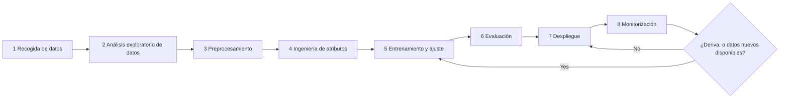
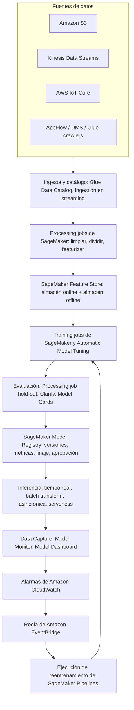
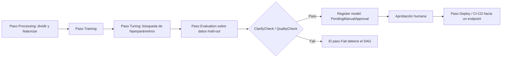
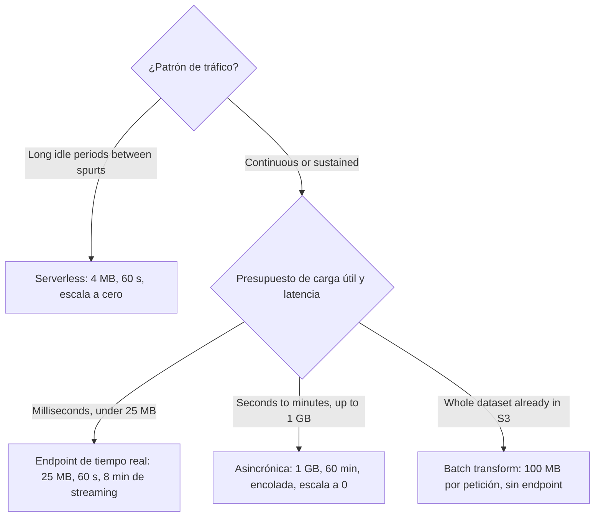
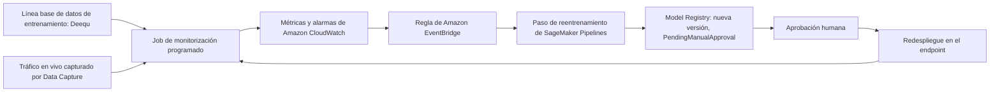
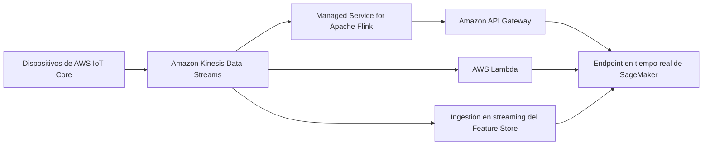

# Ciclo de vida de ML de extremo a extremo en AWS

Los proyectos de machine learning rara vez fracasan porque un modelo no se pueda entrenar. Fracasan porque nadie decidió *qué* etapa del ciclo de vida es dueña de *qué* servicio, porque un prototipo en un notebook se convirtió en un endpoint permanente, o porque nadie notó que los datos de entrada cambiaron seis meses después del lanzamiento. El examen AIF-C01 se construye justo alrededor de ese vacío: la Tarea 1.3 te pide situar la **recogida de datos, el análisis exploratorio (EDA), el preprocesamiento, la ingeniería de atributos, el entrenamiento, el ajuste de hiperparámetros, la evaluación, el despliegue y la monitorización** frente a los servicios AWS, y la Tarea 1.1 te pide distinguir la inferencia por **lotes, tiempo real, asincrónica y serverless**.

```text
=====================================================================
 EL CICLO DE VIDA DE ML EN AWS — NUEVE ETAPAS (AIF-C01 Tarea 1.3)
=====================================================================
  1 RECOGER ..... S3 · Kinesis Data Streams · IoT Core · AppFlow
                  DMS · API Gateway · Glue crawlers
  2 AED ......... SageMaker Studio · Athena · Glue · EMR
                  Data Wrangler (dentro de SageMaker Canvas)
  3 PREPROC ..... Jobs Processing de SageMaker · Glue · DataBrew
  4 ATRIBUTOS ... Feature Store (online + offline) · exportación de Wrangler
  5 ENTRENAR .... Training jobs · Automatic Model Tuning · AutoML API
                  JumpStart · HyperPod · Managed Spot Training
  6 EVALUAR .... Processing sobre datos hold-out · Clarify* · Model Cards
  7 DESPLEGAR .. tiempo real | batch transform | asincrónica
                  | serverless  (las cuatro opciones de inferencia)
  8 MONITORIZAR  Model Monitor* · Model Dashboard · Data Capture
  9 REENTRENAR   DAG de Pipelines · etapas de aprobación del Registry ·
                  EventBridge (deriva o calendario) · CodePipeline
---------------------------------------------------------------------
  * Clarify, Model Monitor, Ground Truth, A2I, Debugger, GeoSpatial,
    Role Manager y Studio Lab están CERRADOS a nuevos clientes
    (30 jun 2026; los docs indican 7/30/26) — consulta la sección 10.
  Capa de MLOps que prueba el examen: experimentación · procesos
  repetibles · sistemas escalables · deuda técnica · prontitud de
  producción · monitorización · reentrenamiento.
=====================================================================
```

> [!NOTE]
> **Lee esta lección como un manual de operaciones, no como un catálogo de servicios.** Cada número de este archivo es un límite publicado por AWS, tomado de la guía de desarrollador de SageMaker o de la referencia de la API de SageMaker. Donde AWS publica dos números en conflicto, aparecen ambos y se señala el preferente: consulta la sección 13.

Al terminar esta lección sabrás:

- situar cada una de las **nueve etapas del ciclo de vida** frente a la función de SageMaker y al servicio no-SageMaker que la respalda;
- aplicar el **marco de selección de tres preguntas** de AWS (construir frente a personalizar frente a llamar a una API, modalidad, control) antes de escribir código alguno;
- configurar los **almacenes online y offline de Feature Store** y explicar por qué un modelo de fraude necesita ambos;
- dimensionar un **endpoint serverless**, calcular la **concurrencia del batch transform** y conocer el techo exacto de cada una de las **cuatro opciones de inferencia**;
- construir el bucle **deriva → CloudWatch → EventBridge → reentrenamiento en Pipelines** y explicar qué monitor detecta qué deriva;
- defender un **veredicto comparativo**: SageMaker frente a construir en EC2, frente a plataformas no-AWS, frente a un proceso manual;
- detectar las **trampas de mantenimiento y retirada** (Ground Truth, Model Monitor, Clarify, Studio Lab, Mechanical Turk) que aparecen en los ítems del examen de 2026;
- responder **diez preguntas tipo examen** escritas con la voz oficial de las preguntas de práctica.

---

## 1. Las nueve etapas del ciclo de vida de ML en AWS

### 1.1 Mapa de servicios etapa por etapa

Esta tabla es el artefacto más examinable de toda la Tarea 1.3. La columna izquierda es el propio vocabulario de la guía del examen; las columnas centrales son los servicios que debes poder nombrar bajo presión.

| Etapa | Función de SageMaker AI | Otros servicios AWS | Nota verificada |
|---|---|---|---|
| 1. Enfoque del problema | Canvas, JumpStart, Model Cards (uso previsto + clasificación de riesgo) | Amazon Bedrock (ruta de modelos fundacionales), Amazon Q, Prescriptive Guidance | Valores de clasificación de riesgo: low / medium / high / unknown |
| 2. Ingesta de datos | Ground Truth **[mantenimiento]**, ingestión en streaming de Feature Store | S3, Kinesis Data Streams, IoT Core, DMS, AppFlow, API Gateway, Glue crawlers | Ground Truth cerró a nuevos clientes el 7/30/26; Mechanical Turk terminó en sep 2026 |
| 3. Procesamiento y EDA | Processing jobs, Data Wrangler (dentro de Canvas), notebooks de Studio | Glue (ETL + Data Catalog), EMR (Spark/Hadoop/Trino), Athena, DataBrew, MWAA | El Glue Data Catalog es compatible con Hive |
| 4. Ingeniería de atributos | Feature Store (online/offline), exportación de Data Wrangler | Glue, DataBrew, Redshift | El almacén offline es Parquet de solo inserción en S3 |
| 5. Entrenamiento del modelo | Training jobs, Automatic Model Tuning, AutoML API, JumpStart, HyperPod, Managed Spot | EC2 (P/G/Trn/Inf), ECS/EKS (autogestionado), Lambda (cargas ligeras) | Ahorros de Spot publicados como 80% (API) y 90% (FAQ): consulta la sección 13 |
| 6. Evaluación | Clarify **[mantenimiento]**, Processing sobre datos hold-out, Model Cards | Amazon Bedrock Evaluations, CloudWatch, SHAP / fmeval | Bedrock Evaluations es la ruta gestionada para modelos fundacionales |
| 7. Despliegue | Las cuatro opciones de inferencia, Model Registry + CI/CD, componentes de inferencia | Bedrock (API serverless), ECS/EKS (proyecto propio), Lambda + API Gateway | Techos en la sección 7.2 |
| 8. Monitorización | Model Monitor / Clarify **[mantenimiento]**, Model Dashboard, Data Capture | CloudWatch, EventBridge + SNS, Lambda, Athena + QuickSight, MLflow + Evidently | Cuatro tipos de monitor: calidad de datos, calidad del modelo, deriva de sesgo, deriva de atribución de atributos |
| 9. Reentrenamiento / MLOps | DAG de Pipelines, etapas de aprobación del Registry, seguimiento con MLflow | Step Functions, EventBridge (calendario/deriva), CodeBuild/CodePipeline, versionado en S3 | Deriva → EventBridge → reejecución del pipeline es el bucle canónico |

### 1.2 Los conceptos de MLOps que prueba el examen

La Tarea 1.3 no se detiene en las etapas. También nombra siete fundamentos de MLOps: cada uno se mapea a un mecanismo AWS concreto:

| Concepto de MLOps | Lo que el examen espera que digas | Mecanismo AWS |
|---|---|---|
| Experimentación | Cada ejecución se registra y es comparable | Experiments (Classic, solo en Studio Classic) o Apps de MLflow gestionadas con artefactos en tu S3 |
| Procesos repetibles | Mismo código, mismos datos, mismo resultado | SageMaker Pipelines (un DAG JSON) + Processing/Training jobs en contenedores |
| Sistemas escalables | El sistema crece con el tráfico y los datos | Auto scaling en endpoints de tiempo real, encolado asincrónico, almacén online de Feature Store |
| Deuda técnica | Notebooks sin seguimiento y endpoints ajustados a mano se pudren | Versiones del Model Registry, estado de aprobación, Model Cards, jobs en contenedores |
| Prontitud de producción | Nada se despliega sin evidencias | `ModelApprovalStatus=PendingManualApproval` en el pipeline, métricas de evaluación adjuntas |
| Monitorización | El tráfico en vivo se compara con una línea base | Data Capture + Model Monitor (líneas base Deequ) + alarmas de CloudWatch |
| Reentrenamiento | Una deriva o un calendario dispara una nueva ejecución | Regla de EventBridge sobre una alarma de CloudWatch → ejecución de Pipelines |

### 1.3 El ciclo de vida es un bucle, no una línea



La flecha que vuelve de **Monitorización** a **Entrenamiento** es el sentido mismo de MLOps. Un equipo que despliega y nunca vuelve a la etapa 5 tiene un *proyecto*, no un *sistema*, y eso es exactamente el lenguaje de «deuda técnica» y «prontitud de producción» que usa el examen.

**Ordena el ciclo de vida antes de memorizar los servicios:**

```dragdrop
{
  "question": "Coloca las etapas del ciclo de vida de ML en el orden en que AWS las documenta para el examen AIF-C01:",
  "items": [
    "Recogida de datos desde S3, Kinesis, IoT Core o AppFlow",
    "Análisis exploratorio de datos en Studio, Athena o Glue",
    "Preprocesamiento en un Processing job de SageMaker",
    "Ingeniería de atributos escrita en el Feature Store",
    "Entrenamiento y ajuste de hiperparámetros",
    "Evaluación sobre datos hold-out",
    "Despliegue en una de las cuatro opciones de inferencia",
    "Monitorización de deriva de datos, calidad, sesgo y atribución",
    "Reentrenamiento disparado por una deriva o un calendario"
  ],
  "correctOrder": [
    "Recogida de datos desde S3, Kinesis, IoT Core o AppFlow",
    "Análisis exploratorio de datos en Studio, Athena o Glue",
    "Preprocesamiento en un Processing job de SageMaker",
    "Ingeniería de atributos escrita en el Feature Store",
    "Entrenamiento y ajuste de hiperparámetros",
    "Evaluación sobre datos hold-out",
    "Despliegue en una de las cuatro opciones de inferencia",
    "Monitorización de deriva de datos, calidad, sesgo y atribución",
    "Reentrenamiento disparado por una deriva o un calendario"
  ],
  "explanation": "El examen espera exactamente esta secuencia: recoger, analizar, preprocesar, ingeniería de atributos, entrenar, ajustar, evaluar, desplegar, monitorizar, reentrenar. La ingeniería de atributos va antes del entrenamiento porque los atributos son una entrada del training job; la evaluación va después del entrenamiento pero antes del despliegue porque la prontitud de producción depende de las métricas hold-out; la monitorización solo existe cuando ya se ha desplegado algo."
}
```

---

## 2. Elegir la ruta en AWS: el marco de tres preguntas

Antes de elegir un servicio, AWS quiere que respondas tres preguntas en orden. Saltar directamente a «SageMaker» es el antipatrón arquitectónico más común del examen.

### 2.1 Pregunta 1: ¿llamar a una API, personalizar un modelo fundacional o construir el tuyo?

| Ruta | Elígela cuando | Servicio | Modelo de precios |
|---|---|---|---|
| API gestionada preentrenada | Una API gestionada ya resuelve la tarea (sentimiento, etiquetas, transcripción) | Amazon Comprehend, Rekognition, Transcribe, Polly, Translate, Lex, Forecast, Personalize | Por petición / por unidad de uso |
| Modelo fundacional, infraestructura mínima | Prompting, RAG, agentes o fine-tuning bastan; no quieres servidores | Amazon Bedrock | Basado en tokens |
| A medida / ML clásico con control total | Datos propietarios, algoritmo específico, control de latencia o de cumplimiento | Amazon SageMaker AI (Canvas → Autopilot → Studio) | Por hora-instancia + duración del job |

> [!WARNING]
> **Trampa clásica de examen:** construir un modelo de SageMaker a medida para análisis de sentimiento en inglés es un **antipatrón**. El sentimiento sobre texto es una capacidad resuelta y preentrenada de **Amazon Comprehend**. El examen recompensa el servicio correcto más barato, no el más impresionante.

### 2.2 Pregunta 2: ¿cuál es la modalidad de los datos?

| Modalidad de datos | Servicio gestionado | Redacción típica en el examen |
|---|---|---|
| Texto | Amazon Comprehend (NLP), Amazon Translate, Amazon Lex | «detectar el idioma / extraer entidades / intención» |
| Imagen y vídeo | Amazon Rekognition | «etiquetar objetos, caras, EPI, contenido inseguro» |
| Voz y habla | Amazon Transcribe (STT), Amazon Polly (TTS) | «generar subtítulos», «leer la alerta en voz alta» |
| Estructurado / series temporales | Amazon Forecast, Amazon Personalize | «previsión de demanda», «clientes que compraron» |
| Documentos (formularios, identificación, tablas) | Amazon Textract | «extraer campos de facturas» |
| Código y chat | Amazon Q, Amazon Bedrock | «responder preguntas internas desde una base de conocimiento» |

### 2.3 Pregunta 3: ¿cuánto control necesitas?

AWS documenta una **escalera de control** que sube de sin código a código completo:

```text
  SageMaker Canvas  ....  preparación de datos y construcción de modelos
        |                  sin o con poco código (aquí viven Data Wrangler
        |                  y la interfaz de Autopilot)
        v
  Autopilot (AutoML API) .. selección automática de algoritmos, HPO,
        |                   explicabilidad — la API está activa, la UI se
        |                   trasladó a Canvas el 30 nov 2023
        v
  Amazon Bedrock ........... personalización de FM serverless:
        |                   prompts, guardrails, bases de conocimiento,
        |                   fine-tuning, evaluaciones
        v
  SageMaker Studio ......... control total: Code Editor (Code-OSS),
                             JupyterLab, RStudio, Studio Classic,
                             Amazon Q Developer, training jobs,
                             endpoints dedicados, HyperPod
```

AWS también advierte en su propia guía que **Studio es el punto de partida equivocado para un equipo sin experiencia en ML: empieza con Canvas**.

### 2.4 Arquitectura de referencia: una cuenta, de extremo a extremo



**📚 ¿Sabías que…?** Los SageMaker Pipelines son literalmente un **DAG JSON**. Los tipos de paso documentados son Processing, Training, Tuning, AutoML, RegisterModel, DeployModel, Transform, Condition, Callback, Lambda, ClarifyCheck, QualityCheck, EMR, Notebook Job y Fail, y las salidas de un paso alimentan las entradas de los pasos aguas abajo, que es lo que hace automático el bucle del diagrama de arriba.

---

## 3. Ingesta de datos, almacenamiento y el Feature Store

### 3.1 De dónde vienen los datos

| Patrón de ingesta | Servicios AWS | Cifras que vale la pena memorizar |
|---|---|---|
| Almacenamiento de objetos / lake | Amazon S3 (+ Glue crawlers para el catálogo) | S3 es la fuente de verdad de los atributos offline y de las cargas capturadas |
| Streaming | Kinesis Data Streams, alimentado a menudo por AWS IoT Core | Patrón típico: Kinesis → Managed Service for Apache Flink → API Gateway → endpoint de SageMaker, o Lambda invocando el endpoint |
| Réplica de bases de datos | AWS Database Migration Service (DMS) | Réplica continua hacia S3 / Glue |
| SaaS y APIs | Amazon AppFlow, API Gateway | Extrae datos de Salesforce/Zendesk sin código |
| Atributos en streaming | Ingestión en streaming de Feature Store | Los atributos aterrizan en el almacén online para decisiones casi en tiempo real |

### 3.2 Feature Store: online frente a offline

| Propiedad | Almacén online | Almacén offline |
|---|---|---|
| Qué guarda | **Solo el registro más reciente** de cada grupo de atributos | **Historial completo**, de solo inserción |
| API / acceso | `GetRecord`, `PutRecord` | Parquet en S3, consultable con Amazon Athena |
| Latencia | **Milisegundos de un dígito** | Minutos a horas (velocidad analítica) |
| Uso principal | Consultas para inferencia en tiempo real | Entrenamiento, joins point-in-time, batch transform |
| Durabilidad de la escritura | Inmediata en `PutRecord` | Bufferizada, llega a S3 en **≤ 15 minutos** |
| Identidad de un registro | **identificador + event time** | identificador + event time + `write_time`, `api_invocation_time`, `is_deleted` |
| Regla de conflicto | Un **event time más antiguo nunca sobrescribe** un registro online más nuevo | De solo inserción; nada se sobrescribe |

### 3.3 Niveles del almacén online y semántica de escritura

AWS documenta dos niveles online:

- **Standard**: la configuración por defecto del almacén online;
- **InMemory**: respaldado por Amazon ElastiCache (Redis OSS) para las lecturas más rápidas. Es **solo online** (no hay replicación online↔offline) y **no** admite claves KMS gestionadas por el cliente.

En la vía de escritura, `PutRecord.TargetStores` acepta `{OnlineStore, OfflineStore}` con un **máximo de 2 entradas**, de modo que una sola llamada puede actualizar ambos almacenes, pero solo si un grupo tiene ambos habilitados.

**Ejemplo 5, frescura de atributos con cifras reales.** Un modelo de fraude llama a `GetRecord` y obtiene una respuesta en **milisegundos de un dígito**. El almacén offline del mismo grupo de atributos conserva cada versión histórica como Parquet en S3, que Athena puede consultar para un conjunto de entrenamiento correcto en point-in-time. Un `PutRecord` emitido a las **14:00** llega a S3 **a más tardar a las 14:15** (bufferización de 15 minutos). El entrenamiento ve por tanto una instantánea ligeramente retrasada mientras la inferencia ve la fila más nueva, que es exactamente por lo que el examen pide **ambos almacenes habilitados en un mismo grupo de atributos**.

```matching
{
  "question": "Empareja cada concepto de Feature Store o de ingesta con lo que realmente hace:",
  "pairs": [
    {"left": "Almacén online", "right": "Conserva solo el registro más reciente y responde GetRecord en milisegundos de un dígito"},
    {"left": "Almacén offline", "right": "Conserva el historial completo de solo inserción como Parquet en S3 para entrenamiento y batch"},
    {"left": "Nivel InMemory", "right": "Nivel solo online respaldado por ElastiCache, sin replicación de online a offline"},
    {"left": "Ingestión en streaming", "right": "Escribe eventos en vivo en el grupo de atributos para que la inferencia use datos casi en tiempo real"}
  ],
  "explanation": "El almacén online responde a la inferencia, el almacén offline responde al entrenamiento, InMemory cambia replicación por velocidad y la ingestión en streaming cierra la brecha entre el evento y el atributo. Un modelo de fraude en producción necesita todos: milisegundos en el momento de puntuar y corrección point-in-time en el momento de entrenar."
}
```

**📚 ¿Sabías que…?** La identidad del Feature Store no es solo una clave primaria: un registro se identifica de forma única por el **identificador de atributos más el event time**, y el almacén offline registra además `write_time`, `api_invocation_time` y un indicador `is_deleted`. Eso es lo que hace posibles los joins point-in-time: una consulta de entrenamiento a las 09:00 solo puede ver atributos cuyo event time sea anterior a las 09:00, aunque se hayan escrito después.

---

## 4. Procesamiento de datos, EDA e ingeniería de atributos

### 4.1 Qué servicio procesa qué carga de trabajo

| Opción | Tipo | Mejor para | Código | Detalle verificado |
|---|---|---|---|---|
| SageMaker Processing | Jobs gestionados | Preparación y evaluación reproducibles dentro del pipeline de ML | Scripts o contenedor BYOC | La capacidad de cómputo **se libera al terminar**: dejas de pagar |
| Data Wrangler (dentro de Canvas) | Visual sin o con poco código | Limpieza, EDA, generación de atributos, exportación a Feature Store | Poco o ningún código | Conecta con S3, Athena, Redshift, Snowflake, EMR |
| AWS Glue | ETL serverless + Data Catalog | Crawlers y ETL que alimentan las tablas de entrenamiento | PySpark o visual | Spark o Ray; catálogo compatible con Hive |
| Amazon EMR | Clusters gestionados | Spark, Hadoop, Trino, Flink a escala de petabytes | Control total | EMR ≥ 5.8.0 puede usar el Glue Data Catalog |
| Amazon Athena | SQL serverless | EDA ad-hoc sobre S3 | SQL ANSI | Paga por consulta y por datos escaneados |
| Glue DataBrew | Visual sin código | Más de 250 transformaciones preconstruidas dirigidas por recipe jobs | Ninguno | Un blog de AWS afirma hasta un **80% más rápido** en preparación de datos |
| Studio + EMR | Interactivo | EDA y depuración de jobs EMR Spark | Código de notebook | Monitoriza y depura EMR Spark desde Studio |

### 4.2 El contrato del Processing job

Un Processing job de SageMaker tiene un contrato de cuatro pasos que al examen le gusta probar:

```text
  Entrada S3  -->  contenedor gestionado (integrado o tu propia imagen)
                       |
                       |  preprocesamiento / ingeniería de atributos /
                       |  postprocesamiento / evaluación sobre datos hold-out
                       v
                 el cómputo se LIBERA  -->  salida S3

  Facturación: solo mientras corre el job. Sin endpoint, sin coste ocioso.
  Instancia típica en los ejemplos de AWS: ml.m5.xlarge, ProcessingInstanceCount = 1
```

Esa propiedad de que «el cómputo se libera» es la razón por la que los Processing jobs vencen a una instancia de notebook permanentemente conectada para cualquier cosa programada.

### 4.3 Dónde viven ahora las herramientas sin código

Dos migraciones importan para el examen de 2026:

- **Data Wrangler está integrado en SageMaker Canvas**: ya no es una experiencia aparte en la barra lateral de Studio;
- **la interfaz de Autopilot se trasladó a Canvas el 30 de noviembre de 2023**: la API de AutoML sigue documentada y siendo invocable, pero la experiencia visual de AutoML es Canvas.

**📚 ¿Sabías que…?** Amazon Athena cobra **por consulta y por gigabyte escaneado**, así que la EDA más barata es una tabla Parquet particionada más un filtro `WHERE dt = '…'`. Un escaneo de tabla completa de un CSV de 1 TB cuesta aproximadamente 100× más que la misma consulta sobre Parquet particionado: el examen no pide el precio, pero sí pregunta si Athena es «SQL serverless sobre S3».

---
## 5. Entrenamiento, ajuste de hiperparámetros y orquestación

### 5.1 Training jobs y el techo de coste

| Control | Valor | Por qué importa |
|---|---|---|
| Valor por defecto de `StoppingCondition.MaxRuntimeInSeconds` | **1 día** | El valor por defecto detiene rápidamente un job descontrolado |
| Máximo de `StoppingCondition.MaxRuntimeInSeconds` | **28 días** | Tope duro para un solo job |
| Duración total del job (en ejecución + en espera) | **30 días** | Techo absoluto durante la vida del job |
| `MaxWaitTimeInSeconds` para Managed Spot | **≥ MaxRuntimeInSeconds** | Obligatorio; de lo contrario no se puede usar Spot |
| Parada ordenada | SageMaker envía **`SIGTERM` y luego espera 120 s** | Tu código debe hacer checkpoint dentro de esa ventana |
| Instancia de ejemplo típica | `ml.m5.xlarge` | Usada en todos los ejemplos de pipeline de AWS |

### 5.2 Maneras de entrenar sin escribir el bucle tú mismo

| Enfoque | Qué automatiza | Notas |
|---|---|---|
| Training job | Entrenamiento en contenedores sobre cómputo gestionado | Tu algoritmo o uno integrado |
| Automatic Model Tuning (HPO) | Busca rangos de hiperparámetros | Métrica objetivo + rangos; ejecuta muchos training jobs |
| AutoML API | Selección de algoritmos, HPO, explicabilidad | La UI vive en Canvas desde nov 2023 |
| JumpStart | Hub de modelos: modelos desplegables y soluciones preconstruidas | La ruta más rápida hasta una línea base funcional |
| HyperPod | Clusters EKS/Slurm gestionados para entrenamiento e inferencia grandes | Afirmaciones de la guía de decisión de AWS (fuente única): entrenamiento −40%, gobernanza −40%, goodput ≥ 95% |
| Managed Spot Training | Capacidad interrumpible | Ahorros publicados como **hasta un 90%** (FAQ) y **hasta un 80%** (API): consulta la sección 13 |
| Instancias EC2 P/G/Trn/Inf | El control de hardware más profundo | Eres dueño del SO, controladores, frameworks, pila de serving |

### 5.3 Pipelines: la columna vertebral de la orquestación

Un SageMaker Pipeline es un **DAG JSON** cuyos pasos intercambian salidas como entradas. Los tipos de paso documentados son: Processing, Training, Tuning, AutoML, Register/Deploy model, Transform, Condition, Callback, Lambda, ClarifyCheck, QualityCheck, EMR, Notebook Job y Fail.

| Función del pipeline | Comportamiento verificado |
|---|---|
| Salidas de los pasos | Alimentan automáticamente las entradas de los pasos aguas abajo |
| Caché | `CacheConfig { Enabled, ExpireAfter: "30d" }`: los pasos sin cambios pueden omitirse hasta 30 días |
| Cómputo típico en los ejemplos | `ml.m5.xlarge`, `ProcessingInstanceCount=1` |
| Puerta de despliegue | `ModelApprovalStatus=PendingManualApproval` hasta que una persona apruebe |
| Facturación | Pagas por Studio más los jobs que el pipeline orquesta |
| Paso de fallo | Un nodo `Fail` permite que el DAG se detenga explícitamente en una comprensión de calidad |



### 5.4 Model Registry

El Model Registry es la respuesta de calidad de producción a «¿qué modelo está en vivo?». Almacena **Model Package Groups** versionados, y cada Model Package lleva métricas, **linaje**, una etapa de **staging**, un **estado de aprobación** y ganchos para el **despliegue CI/CD** y el reparto entre cuentas. Todo lo que no esté en el Registry es, en términos de examen, un experimento sin seguimiento.

---

## 6. Evaluación, documentación y gobernanza

### 6.1 Amazon SageMaker Clarify: tres análisis distintos

| Análisis | Entradas | Salida |
|---|---|---|
| Sesgo preentrenamiento | **Solo el dataset** (sin modelo) | Métricas de sesgo en JSON para los propios datos de entrenamiento |
| Sesgo postrainento | **Dataset + predicciones del modelo** | Métricas de sesgo calculadas sobre los resultados de la inferencia |
| Atribuciones de atributos (SHAP) | Modelo entrenado | Atribuciones SHAP globales, importancia por atributo |
| Dependencia parcial (PDP) | Modelo entrenado | Efecto marginal de un atributo sobre la predicción |

Clarify escribe métricas de sesgo en JSON, atribuciones globales y un informe visual en **S3**, y puede ejecutarse contra un endpoint en vivo **o** contra un **endpoint shadow** temporal que Clarify crea y luego borra.

> [!WARNING]
> **Advertencia de disponibilidad (2026).** Amazon SageMaker Clarify está en **mantenimiento y cerrado a nuevos clientes** (página de mantenimiento de AWS: 30 jun 2026; la documentación del cambio de disponibilidad indica una fecha efectiva de **7/30/26**). Los clientes existentes conservan el acceso pero no reciben nueva funcionalidad. Para la evaluación de modelos fundacionales AWS apunta a **Amazon Bedrock Evaluations**, y para sesgo/SHAP en trabajo nuevo AWS apunta a **SHAP más métricas de sesgo estandarizadas más MLflow**.

### 6.2 Model Cards y Model Dashboard

| Artefacto | Qué es | Campos clave | Estado (2026) |
|---|---|---|---|
| **Model Cards** | Un registro de documentación **inmutable** de un modelo | Usos previos, **clasificación de riesgo**, detalles del entrenamiento, resultados de evaluación; estado por defecto `DRAFT`; exportación a PDF | Activo |
| **Model Dashboard** | Un portal sobre todo tu conjunto | Modelos, monitores, linaje, tarjetas, clasificación de riesgo en {low, medium, high, unknown} | Activo |
| **Data Capture** | Registra cargas de petición/respuesta en vivo | Alimenta los monitores y el análisis shadow | Activo |
| Role Manager | Roles de IAM para ML por persona |: | **Cerrado a nuevos clientes** |

Si el examen dice «el propietario del modelo debe *registrar* los usos previos, la clasificación de riesgo, los detalles del entrenamiento y los resultados de evaluación», la respuesta es **Model Cards**: no el Dashboard (que agrega) ni Model Monitor (que solo rastrea deriva).

---

## 7. Despliegue: las cuatro opciones de inferencia

Este es el tema central de selección de servicios de toda la lección. SageMaker AI documenta exactamente **cuatro** opciones de inferencia, y cada una tiene un techo duro que debes poder recordar.

### 7.1 Lotes frente a tiempo real frente a asincrónica frente a serverless

| Dimensión | Tiempo real | Batch transform | Asincrónica | Serverless |
|---|---|---|---|---|
| Disparo | `InvokeEndpoint`, síncrono | Un job sobre un dataset en S3 | `InvokeEndpointAsync` (S3 entrada/salida + notificación de finalización) | Síncrono por petición |
| Latencia | Milisegundos / interactivo | Horas a días (sin conexión) | Casi tiempo real: segundos a minutos | Segundos; arranque en frío posible |
| Techo de carga útil / procesamiento | **25 MB / 60 s** (hasta 8 min con streaming de respuesta) | **≤ 100 MB por petición**, días de procesamiento | **1 GB / 60 min** | **4 MB / 60 s** |
| Capacidad y facturación | Instancia facturada continuamente mientras exista el endpoint | Solo la duración del job | Durante el procesamiento; el autoscaling puede reducir las instancias a **0** | Auto **escalado a cero** |
| Encolado | No | No aplicable | **Sí**: las peticiones se encolan mientras la capacidad es cero | No |
| Carga de trabajo típica | Puntuación de fraude, API de recomendaciones, chatbot | Puntuación de riesgo nocturna, relleno del lake, etiquetado de imágenes | Procesamiento de vídeo/documentos, cargas grandes | Tráfico irregular e imprevisible con periodos ociosos |

### 7.2 Los techos numéricos en un solo lugar

| Ítem | Número | Fuente |
|---|---|---|
| Carga útil / procesamiento en tiempo real | **25 MB / 60 s** (8 min con streaming) | `deploy-model-options`, `hosting-faqs` |
| Carga útil / procesamiento serverless | **4 MB / 60 s** | `serverless-endpoints` |
| Carga útil / procesamiento asincrónico | **1 GB / 60 min** | `hosting-faqs` |
| Carga útil batch por petición | **100 MB**; concurrencia × carga útil ≤ 100 MB | `batch-transform` |
| Rango de memoria serverless | **1024 to 6144 MB** en pasos de 1024; las vCPUs escalan con la memoria | `serverless-endpoints` |
| `MaxConcurrency` / tamaño de imagen serverless | **1 to 200** / **≤ 10 GB** | `serverless-endpoints` + API |
| Provisioned Concurrency en serverless | Responde «en milisegundos»; funciona con Application Auto Scaling | `serverless-endpoints` |
| Streaming bidireccional | HTTP/2 **puerto 8443**, sesión **≤ 30 min** | `realtime-endpoints-test-endpoints` |
| `MaxRuntime` de entrenamiento por defecto / máx. / total del job | **1 día / 28 días / 30 días** | `API_StoppingCondition` |
| Gracia de `SIGTERM` antes de una parada de entrenamiento | **120 s** | `API_StoppingCondition` |
| Escritura offline del Feature Store a S3 | **≤ 15 min** bufferizada; lectura online **ms de un dígito** | `feature-store-offline` |
| Alerta automática de deriva de atribución | **NDCG < 0.90** | `clarify-model-monitor-feature-attribution-drift` |

**Comprueba los techos antes de elegir una opción: manda la carga útil, no la preferencia de latencia:**

```fillblank
{
  "question": "Completa los techos de inferencia publicados en la guía de desarrollador de SageMaker:",
  "template": "Un endpoint de tiempo real acepta una carga útil de {{1}} MB procesada en {{2}} segundos, Serverless Inference acepta {{3}} MB y la inferencia asincrónica acepta hasta {{4}} GB durante {{5}} minutos.",
  "answers": {
    "1": "25",
    "2": "60",
    "3": "4",
    "4": "1",
    "5": "60"
  },
  "distractors": ["6", "100", "15", "8", "30"],
  "explanation": "La guía de desarrollador publica 25 MB / 60 s para tiempo real (hasta 8 minutos con streaming de respuesta), 4 MB / 60 s para serverless y 1 GB / 60 min para asincrónica. Batch transform es la opción con el techo de 100 MB por petición, y 6 MB es la cifra contradictoria de la FAQ que debes ignorar: consulta la sección 13."
}
```

### 7.3 Endpoints de tiempo real en detalle

- Endpoint HTTPS persistente invocado con **`InvokeEndpoint`**; el streaming de respuesta usa **`InvokeEndpointWithResponseStream`**.
- **HTTP/2 bidireccional en el puerto 8443**, con sesiones limitadas a **30 minutos**.
- Varios modelos pueden compartir un endpoint mediante **componentes de inferencia**: la respuesta del examen cuando pide alojar varios modelos sin pagar por varios endpoints.

### 7.4 Serverless Inference en detalle

Tú eliges la **memoria**; AWS asigna las vCPUs proporcionalmente. El tiempo de arranque en frío lo determinan **tamaño del modelo + descarga del modelo + arranque del contenedor**, y por eso la memoria debe ser **al menos del tamaño de tu modelo**.

Serverless tiene **exclusiones** documentadas: sin **GPUs**, sin paquetes de **AWS Marketplace**, sin **registros privados**, sin **endpoints multimodelo**, sin **configuración de VPC**, sin **data capture**, sin **Model Monitor** y sin **pipelines de inferencia**. Y la conversión es de un solo sentido: convertir un endpoint de tiempo real existente a serverless falla con un **`ValidationError`**, mientras que la conversión inversa está permitida y es de un solo sentido.

### 7.5 Asynchronous Inference en detalle

`InvokeEndpointAsync` toma su entrada de **S3**, escribe la salida en **S3** y envía una **notificación de finalización**. Las peticiones **se encolan mientras la capacidad es cero**, y el autoscaling puede reducir el número de instancias a **0**: esa combinación (cola + escalado a cero) es lo que hace de la asincrónica la respuesta correcta para cargas útiles grandes y lentas.

### 7.6 Batch transform en detalle

- `SplitType=Line` divide el archivo de entrada en mini-lotes;
- `BatchStrategy=MultiRecord|SingleRecord` con `MaxPayloadInMB`;
- el CSV con saltos de línea incrustados **no está soportado**;
- `MaxPayloadInMB=0` significa streaming troceado (no para algoritmos integrados);
- el nombre de salida por defecto es `input1.csv.out`;
- el `MaxConcurrentTransforms` ideal equivale al número de trabajadores paralelos que quieres.

### 7.7 Elegir entre las cuatro



**Ejemplo 1: elección de opción por la carga útil.** Una API de fraude recibe cargas de **3 KB** y debe responder en menos de **200 ms** → **tiempo real** (techos de 25 MB / 60 s). Más adelante se le pide al mismo modelo puntuar **vídeos de 800 MB que tardan 10 minutos** → eso supera el techo de 25 MB de tiempo real pero encaja en la **asincrónica** (≤ 1 GB, ≤ 60 min), así que cambias de opción y mantienes el escalado a cero.

**Ejemplo 2: dimensionado serverless.** Un modelo de **3,5 GB** necesita `MemorySizeInMB=4096` (la memoria debe ser ≥ tamaño del modelo; el rango permitido es 1024…6144). Fija `MaxConcurrency=50` (permitido 1 to 200) con `ProvisionedConcurrency=10` (debe ser ≤ `MaxConcurrency`) para precalentar parte del tráfico, y mantén la imagen del contenedor en **≤ 10 GB**.

**Ejemplo 3: aritmética de concurrencia batch.** Con `MaxPayloadInMB=25`, el `MaxConcurrentTransforms` legal máximo es **4**, porque 4 × 25 = 100 ≤ 100 MB. Fijar **5** rompería la regla documentada (5 × 25 = 125 > 100).

> [!WARNING]
> **No memorices las cifras de la FAQ para tiempo real.** La guía de desarrollador dice **25 MB**, mientras que la FAQ pública ha circulado **6 MB** (y una cifra asincrónica de 15 min en lugar de 60 min). Prefiere las cifras de la guía de desarrollador y revísalas antes del día del examen: consulta la sección 13.

---

## 8. Monitorización, deriva y el bucle de reentrenamiento

### 8.1 Los cuatro tipos de monitor

| Monitor | Qué compara | Mecanismo |
|---|---|---|
| **Calidad de datos** | Distribución de la entrada en vivo frente a la línea base de entrenamiento | Línea base calculada con **Deequ**; violaciones → CloudWatch |
| **Calidad del modelo** | Predicciones en vivo frente a las **etiquetas de Ground Truth** guardadas en S3 (p. ej., MSE) | Predicciones capturadas fusionadas con etiquetas según un calendario |
| **Deriva de sesgo** | Métricas de sesgo a lo largo del tiempo | Estadísticas de sesgo al estilo de Clarify programadas |
| **Deriva de atribución de atributos** | Rango de importancia de los atributos frente a la línea base | Ordenado por **NDCG**; alarma automática cuando **NDCG < 0,90** (un ranking totalmente invertido puntúa 0,69) |

Todos los monitores emiten métricas y violaciones a **Amazon CloudWatch**, que es la respuesta del examen cuando menciona «lanzar una alarma sobre umbrales». Ten en cuenta también que el **contenedor de monitorización preconstruido solo admite datos tabulares**: los modelos de NLP y de visión por computadora necesitan un contenedor bring-your-own.

### 8.2 De la alarma al modelo reentrenado

**Ejemplo 6: el bucle deriva → reentrenamiento con cifras reales.** Se calcula una línea base Deequ a partir de los datos de entrenamiento. Un job de monitorización programado compara el tráfico en vivo con ella. El monitor de atribución de atributos lanza una alarma automática cuando **el NDCG cae por debajo de 0,90**. Un ejemplo de sesgo usa un **rango DPPL de (−0,1, 0,1) evaluado durante 2 días** con intervalos de confianza bootstrap. La alarma va a **CloudWatch**, CloudWatch dispara una regla de **EventBridge**, y EventBridge inicia una ejecución de reentrenamiento de **SageMaker Pipelines** cuya nueva versión aterriza en el Model Registry como `PendingManualApproval`.



### 8.3 Qué recomienda ahora AWS en su lugar

Como Model Monitor y Clarify están cerrados a nuevos clientes, la propia documentación de cambios de disponibilidad de AWS apunta a un stack de reemplazo:

| Capacidad retirada | Reemplazo recomendado por AWS |
|---|---|
| SageMaker Model Monitor | Monitorización open source con **MLflow + Evidently AI**, más **QuickSight** y **CloudWatch** |
| SageMaker Clarify | **SHAP** + métricas de sesgo estandarizadas + **MLflow** |
| Evaluación de modelos fundacionales | **Amazon Bedrock Evaluations** |
| Experiments (Classic) | Nuevo SageMaker Studio + **MLflow 3.0 gestionado** (se prefieren Apps, artefactos en tu S3) |
| Studio Lab | **SageMaker Studio** |

**📚 ¿Sabías que…?** Experiments **Classic** está disponible solo en **Studio Classic**, y AWS ahora recomienda **MLflow 3.0** gestionado con Studio Apps: los artefactos del experimento se guardan en *tu* bucket S3, de modo que los datos de seguimiento sobreviven al notebook. MLflow es también la columna vertebral del reemplazo recomendado de Model Monitor.

---

## 9. Veredicto comparativo: SageMaker frente a las alternativas

### 9.1 SageMaker frente a servicios individuales

| Opción | Elígela cuando | Tú gestionas | Modelo de precios |
|---|---|---|---|
| **SageMaker AI** | Ciclo de vida completo más control sobre contenedores, instancias y latencia | Código de modelo, contenedores, HPO, escalado, compromisos coste/latencia | Por hora-instancia + jobs; Savings Plans de hasta **64%** |
| **Amazon Bedrock** | Uso de FM serverless (RAG, agentes, fine-tuning) sin infraestructura | Prompts, guardrails, bases de conocimiento, evaluaciones | Basado en tokens |
| **Amazon EC2** | El control de hardware más profundo, instancias aceleradas especializadas | SO, controladores, frameworks, pila de serving | Por hora + Savings Plans |
| **Amazon ECS** | Contenedores como unidad de despliegue, orquestación nativa de AWS | Imágenes, definiciones de tareas, escalado de servicios | Por instancia o AWS Fargate |
| **Amazon EKS** | Portabilidad de Kubernetes, stacks a medida (vLLM/Triton), HyperPod | Cluster, grupos de nodos, charts, autoscalers | Tarifa de cluster + EC2 |
| **AWS Lambda** | Pegamento de eventos: invocar un endpoint desde un stream, escribir atributos | Código de la función, memoria y timeout | Peticiones + duración |
| **APIs de IA gestionadas** | Una API preentrenada ya lo resuelve | Datos + llamadas a la API | Por petición / uso |

Los propios criterios de decisión de AWS son: gestión de infraestructura, compromisos de cómputo, preferencia de precios, soporte de la arquitectura del modelo y control sobre motor, configuración e infraestructura.

> [!IMPORTANT]
> **Veredicto comparativo: cuándo elegir cada camino**
> - **SageMaker frente a construirlo tú mismo en EC2:** ambos ejecutan tu contenedor, pero el EC2 hace que *tú* seas dueño del SO, los controladores, la pila GPU, el framework de serving, la lógica de escalado, los parches y cada segundo ocioso que pagas. Elige EC2 solo cuando necesites control de hardware o de controladores que SageMaker no puede exponer (instancias especializadas P/G/Trn/Inf, ajuste a nivel de kernel). En caso contrario, los endpoints gestionados, los Processing/Training jobs, los Pipelines y el Model Registry de SageMaker son la diferencia entre un *sistema* y un *hobby*. El coste tampoco es el factor decisivo: el EC2 cobra por hora igual que SageMaker, y SageMaker ofrece Savings Plans de hasta el 64%.
> - **SageMaker frente a plataformas no-AWS** (otras nubes, proveedores de ML gestionado, stacks de MLOps autoalojados): la portabilidad es real, los contenedores, MLflow y Kubernetes viajan, pero el marco del examen es la integración nativa de AWS: IAM, S3, Glue, Kinesis, EventBridge, CloudWatch, Bedrock y los créditos de free tier se vinculan a SageMaker sin código de pegamento. Si el requisito es «ejecutar en cualquier parte», un stack de Kubernetes (EKS u otro orquestador) con seguimiento en MLflow es defendible; si el requisito es «entregar rápido, gobernado, en AWS», no lo es. Ten en cuenta también que los modelos de SageMaker pueden importarse en Bedrock, de modo que los dos no se excluyen mutuamente.
> - **SageMaker frente a un proceso manual** (el notebook de un científico de datos, hojas de cálculo, scripts ad-hoc, CSV copiados a mano): el proceso manual siempre gana la primera semana y siempre pierde después. No puede probar repetibilidad (sin DAG de Pipelines), no puede probar qué versión sirvió una predicción concreta (sin linaje del Registry), no puede detectar deriva (sin línea base, sin alarma de CloudWatch) y no puede ser reejecutado por nadie más. AWS encuadra exactamente este fallo como **deuda técnica** y **prontitud de producción** en la Tarea 1.3. El veredicto es categórico: un proceso manual solo es aceptable en la etapa de experimentación, nunca en el despliegue.

### 9.2 Amazon Bedrock frente a Amazon SageMaker: la línea oficial

| Dimensión | Amazon Bedrock | Amazon SageMaker AI |
|---|---|---|
| Familia de modelos | Modelos fundacionales de múltiples proveedores | ML clásico **y** aprendizaje profundo a medida |
| Interacción | Serverless, basada en API | Training jobs, endpoints dedicados, clusters HyperPod |
| Infraestructura que gestionas | Prácticamente ninguna | Contenedores, tipos de instancia, políticas de escalado |
| Mejor ajuste | Prompting, RAG, agentes, guardrails, fine-tuning, evaluaciones | Control total sobre entrenamiento y serving |
| Interoperabilidad |: | **Los modelos de SageMaker pueden importarse en Bedrock** |

### 9.3 Arquitectura de inferencia en streaming

El patrón que AWS documenta en sus blogs de arquitectura:



---

## 10. Disponibilidad, mantenimiento y trampas de retirada

El examen de 2026 prueba activamente la disponibilidad. Responder correctamente significa saber qué significa un aviso de **mantenimiento** y qué significa una **retirada**.

### 10.1 Instantánea de disponibilidad (SageMaker, 2026)

| Estado | Funciones |
|---|---|
| **Mantenimiento, cerrado a nuevos clientes** (30 jun 2026) | A2I, Clarify, Debugger, GeoSpatial, Ground Truth, Model Monitor, Role Manager, Studio Lab |
| Fecha de cierre indicada en la documentación | Ground Truth, Model Monitor: **efectivo 7/30/26** |
| **Fin de soporte** | Amazon Mechanical Turk: **29 sep 2026** (docs de Ground Truth: cierre permanente 30 sep 2026) |
| Entró en sunset, fechas no obtenidas | SageMaker Profiler, Ground Truth Plus: consulta la sección 13 |
| **Activo** (sin aviso encontrado) | Studio, Pipelines, Processing, Training, Model Registry, las cuatro opciones de inferencia, Feature Store, Model Cards, Model Dashboard, Canvas, JumpStart, HyperPod, MLflow gestionado |

La redacción estándar de mantenimiento es: *«Los clientes no pueden darse de alta… AWS seguirá operando y dando soporte a estos servicios… pero no los mejorará ni añadirá funcionalidad.»* Los clientes existentes conservan el acceso; simplemente no hay nuevas funciones.

### 10.2 Mapa de funciones de SageMaker y su estado

| Función | Propósito | Estado (2026) |
|---|---|---|
| Studio | IDE: Code Editor (Code-OSS), JupyterLab, RStudio, Studio Classic + Amazon Q Developer | Activo |
| Studio Lab | JupyterLab 4 gratuito, sin cuenta AWS ni tarjeta | **Cerrado a nuevos clientes** |
| Processing | Pre/postprocesamiento, ingeniería de atributos, evaluación | Activo |
| Training + Tuning | Entrenamiento gestionado, HPO, Managed Spot | Activo |
| Pipelines | Orquestación DAG, MLOps repetible y reentrenamiento | Activo |
| Model Registry | Catálogo versionado, aprobación, staging, CI/CD | Activo |
| Endpoints ×4 | Tiempo real / lotes / asincrónica / serverless | Activo |
| Experiments Classic / MLflow | Seguimiento de ejecuciones | Classic: solo Studio Classic → migrar a MLflow gestionado |
| Feature Store | Grupos online/offline, datos de entrenamiento point-in-time | Activo |
| Clarify | Sesgo pre/postrainento, SHAP, PDP, evaluación de FM | **Cerrado a nuevos clientes** |
| Ground Truth | Etiquetado humano (fuerzas de trabajo privadas, de proveedor y MTurk) | **Cerrado**; MTurk terminó |
| Model Monitor | Calidad de datos, calidad del modelo, deriva de sesgo, deriva de atribución | **Cerrado a nuevos clientes** |
| Data Wrangler | Preparación visual y generación de atributos → Feature Store | Integrado en Canvas |
| Autopilot | AutoML: selección de algoritmos, HPO, explicabilidad | UI → Canvas (30 nov 2023); API activa |
| Canvas | Preparación de datos sin código + construcción de modelos | Activo |
| Model Cards / Dashboard | Registro de documentación / portal sobre modelos y riesgo | Activo |
| Role Manager | Roles de IAM para ML por persona | **Cerrado a nuevos clientes** |
| JumpStart | Hub de modelos, soluciones preconstruidas, modelos desplegables | Activo |
| HyperPod | Clusters EKS/Slurm gestionados para entrenamiento e inferencia | Activo |
| A2I / Debugger / GeoSpatial | Bucles humanos / depuración de entrenamiento / ML geoespacial | **Cerrado a nuevos clientes** |

> [!WARNING]
> **La pregunta de Ground Truth, respondida.** Si un cliente de AWS *absolutamente nuevo* pide un job de etiquetado de imágenes con SageMaker Ground Truth, la respuesta correcta es: **Ground Truth está cerrado a nuevos clientes desde el 30 de julio de 2026, así que se necesita otro enfoque de etiquetado**: no «funciona con Mechanical Turk» (Mechanical Turk terminó su soporte el **29 de sep de 2026**) y no «crea primero un endpoint» (el etiquetado nunca lo necesitó).

**📚 ¿Sabías que…?** Studio Lab, el entorno gratuito de JupyterLab 4 que no requería **ni cuenta AWS ni tarjeta de crédito**, tenía como límites publicados solo **12 GB de RAM y 15 GB de almacenamiento**, y ahora está cerrado a nuevos clientes con **SageMaker Studio** como reemplazo. Por eso «usa Studio Lab gratis» es un distractor en el material de 2026.

### 10.3 Actualizaciones de 2025 to 2026

Entre diciembre de 2024 y octubre de 2026 el ecosistema de SageMaker se renombró, se recortó y se redirigió varias veces. Cada fila de abajo proviene de un anuncio de AWS, de una página de cambio de disponibilidad de AWS o del historial de cambios de la certificación de AWS: nada aquí es de terceros, y las fechas que la propia AWS no publica se omiten deliberadamente (consulta la sección 13).

| Cambio | Fecha (publicada por AWS) | Lo que el examen quiere que sepas |
|---|---|---|
| **Amazon SageMaker pasa a llamarse Amazon SageMaker AI** | 3 dic 2024 | «SageMaker» en una pregunta significa SageMaker AI; el SageMaker de próxima generación (Unified Studio, Catalog, Lakehouse, zero-ETL) es la plataforma de analítica adyacente, no un tema de examen distinto |
| **Bedrock Studio se integra en SageMaker Unified Studio** | workspaces cerrados el 28 feb 2025 (docs actualizadas el 25 mar 2025) | Bedrock Studio desapareció: Bedrock ahora vive dentro de SageMaker Unified Studio o en el IDE de Bedrock |
| **Amazon Forecast cierra a nuevos clientes** | 29 jul 2024 | Las preguntas al estilo Forecast ahora apuntan a **SageMaker Canvas** |
| **Amazon Kendra en mantenimiento y después cerrado a nuevos clientes** | 30 jun → 30 jul 2026 | Búsqueda empresarial gestionada y QA generativo → **Amazon Bedrock Managed Knowledge Base** (Smart Parsing más la Agentic Retrieval API) |
| **Suscripciones de Amazon Q Developer bloqueadas; fin de soporte de la IDE/de pago** | 15 may 2026; EOS 30 abr 2027 | AWS documenta **Kiro** como sucesor de esas cargas de trabajo |
| **Amazon QuickSight → Amazon Quick Suite** | 9 oct 2025 | Los distractores de BI pueden nombrar Quick Suite en lugar de QuickSight |
| **AWS Chatbot pasa a llamarse Amazon Q Developer** | 26 feb 2025 | El nombre antiguo aún aparece en material AWS más viejo |
| **Model Monitor, Clarify, Ground Truth, A2I, Debugger, Role Manager, GeoSpatial, Studio Lab, Mechanical Turk y Profiler cierran a nuevos clientes** | 30 jul 2026 (docs de disponibilidad: 7/30/26) | Mantenamiento, **no** apagado y **no** cambio de marca: los clientes existentes conservan el acceso, sin nuevas funciones (consulta 10.1) |
| **Guía del examen AIF-C01 v1.0 → v1.1** | 26 mar → 30 abr 2026 | Siete objetivos nuevos (IA agéntica con MCP, ingeniería de contexto, precios basados en tokens, grounding de alucinaciones); **SageMaker JumpStart** se añade a la lista dentro del alcance y se elimina Amazon MemoryDB |

Dos datos de vocabulario completan el cuadro:

- **Maintenance** = sin nuevos clientes, sin nuevas funciones, aún con soporte · **sunset** = fin de operaciones planificado, normalmente anunciado con un año de antelación · **full shutdown** = retirado del portafolio de AWS. La referencia de Service Lifecycle de AWS define los tres estados, y cada fila de arriba está en los dos primeros.
- Las actualizaciones de la guía del examen llegan a la prueba aproximadamente **un mes** después de su publicación, así que todo lo que AWS publicó en v1.1 (30 abr 2026) ya es materia válida: incluidos SageMaker JumpStart, Bedrock AgentCore, Kiro y Strands Agents en la lista de servicios dentro del alcance.

**📚 ¿Sabías que…?** La página de disponibilidad de Kendra no dice «obsoleto»: redirige las nuevas aplicaciones de búsqueda a **Amazon Bedrock Managed Knowledge Base**, cuyo Smart Parsing y **Agentic Retrieval API** están documentados como el reemplazo de Kendra. «Kendra fue apagado» es por tanto un distractor: Kendra está en *mantenimiento*, que bajo el propio vocabulario de AWS significa que sigue funcionando para los clientes existentes.

---
## 11. Coste, free tier y los números que puedes memorizar con seguridad

### 11.1 Free tier de SageMaker (cada mes, durante los primeros 2 meses)

| Capacidad | Uso gratuito al mes |
|---|---|
| Notebooks de Studio + instancias de notebook | **250 horas** de `ml.t3.medium` |
| RStudio on SageMaker | **250 h** de `ml.t3.medium` RSession + RStudioServerPro gratuito |
| Data Wrangler | **25 horas** de `ml.m5.4xlarge` |
| Feature Store | **10 M unidades de escritura, 10 M unidades de lectura, 25 GB** de almacenamiento |
| Entrenamiento | **50 horas** de `m4.xlarge` o `m5.xlarge` |
| SageMaker con TensorBoard | **300 horas** de `ml.r5.large` |
| Inferencia en tiempo real | **125 horas** de `m4.xlarge` o `m5.xlarge` |
| Serverless Inference | **150.000 segundos** de duración de inferencia a demanda |
| Canvas / HyperPod | **160 h** de sesión / **50 h** de `m5.xlarge` |

### 11.2 Patrón de coste resuelto

El ejemplo resuelto de la propia AWS suma **$2,38**: 2 horas de `ml.m4.4xlarge` a **$0,96** cada una más 2 horas de `ml.m5.xlarge` a **$0,23** cada una, con las reglas integradas de Debugger facturadas a **$0**. Aprende el *patrón* (horas-instancia × tarifa + recargos del job), nunca la tarifa: los precios de `ml.*` dependen de la región y de la fecha.

### 11.3 Cuotas

Los recuentos de endpoints, las cuotas de pipelines, los límites de jobs concurrentes y la concurrencia serverless viven en **Service Quotas**. Nunca adivines una cuota numérica en una respuesta de examen o en una revisión de diseño: búscala.

---

## 12. Ejemplos de AWS con cifras

**Ejemplo 1: elección de opción por la carga útil (sección 7.7).** API de fraude: cargas de **3 KB**, **< 200 ms** → tiempo real (techos de 25 MB / 60 s). El mismo modelo puntúa vídeos de **800 MB** que tardan **10 minutos** → supera los 25 MB pero encaja en la asincrónica (≤ 1 GB, ≤ 60 min). Cambia de opción; mantén el escalado a cero.

**Ejemplo 2: dimensionado serverless (sección 7.4).** Modelo de **3,5 GB** → `MemorySizeInMB=4096`; `MaxConcurrency=50` (rango 1 to 200); `ProvisionedConcurrency=10` (≤ 50) para precalentar; imagen del contenedor **≤ 10 GB**.

**Ejemplo 3: aritmética de concurrencia en lotes (sección 7.6).** `MaxPayloadInMB=25` → `MaxConcurrentTransforms=4` máximo porque 4 × 25 = 100 ≤ 100 MB. Cinco trabajadores romperían la regla documentada.

**Ejemplo 4: presupuesto de free tier.** 250 horas de notebook ≈ **8,3 días-instancia**; 50 horas de entrenamiento ≈ **seis ejecuciones de 8 horas**; 125 horas de tiempo real ≈ **4,2 días** de hosting; 150.000 segundos serverless ≈ **41,7 horas facturables**. Superar las 250 horas de notebook en el mes 1 inicia la facturación medida.

**Ejemplo 5: frescura de atributos (sección 3.2).** `GetRecord` online responde en **milisegundos de un dígito**; la tienda offline guarda cada versión como Parquet en S3 (consultable con Athena) para joins point-in-time; un `PutRecord` de las **14:00** llega a S3 a más tardar a las **14:15**.

**Ejemplo 6: el bucle deriva → reentrenamiento (sección 8.2).** Línea base Deequ a partir de los datos de entrenamiento; monitorización programada del tráfico en vivo; la deriva de atribución lanza alarmas automáticas por debajo de **NDCG 0,90**; un ejemplo de sesgo usa **DPPL ∈ (−0,1, 0,1) durante 2 días** con intervalos de confianza bootstrap → CloudWatch → EventBridge → reentrenamiento con Pipelines.

**Ejemplo 7: techo de coste de entrenamiento (sección 5.1).** Un training job con el valor por defecto de `MaxRuntimeInSeconds` se detiene tras **1 día**; el máximo duro es **28 días**, y un job no puede superar los **30 días** en total. Al detenerse, SageMaker envía **`SIGTERM`** y espera **120 segundos** a que termine tu código de checkpoint.

---

## 13. Datos contradictorios, no verificables y no examinables

Los buenos candidatos al examen separan lo que AWS *documenta* de lo que AWS *comercializa*. Mantén esta lista fuera de tu set de memorización salvo donde se indique lo contrario.

| Afirmación | Lo que dicen las fuentes | Cómo manejarlo |
|---|---|---|
| Carga útil en tiempo real | Guía de desarrollador **25 MB** frente a FAQ pública **6 MB** (asincrónica 15 min frente a 60 min) | Prefiere la guía de desarrollador; verifícala de nuevo antes del día del examen |
| Ahorro con Spot | **Hasta un 90%** (FAQ/blogs) frente a **hasta un 80%** (API CreateTrainingJob) | Ambos son publicados por AWS; espera «hasta un 80 to 90%» |
| Savings Plans | Hasta un **64%** en SageMaker | Cifra única de la página de precios de AWS |
| Precios | Solo se cita aquí el ejemplo resuelto de AWS ($0,96, $0,23, total **$2,38**) | No memorices las tarifas de `ml.*` |
| Arranque en frío serverless de 10 to 60 s, percentiles de latencia, puntos de equilibrio de coste, «ahorro del 60 to 80% autoalojando en EKS» | **Solo de terceros** (devopsity.com) | No examinable |
| Retirada de Ground Truth Plus (30 jun 2026) y de SageMaker Profiler | AWS los lista como entrando en retirada planificada; **no se obtuvieron fechas** | No cites una fecha |
| Estado de Experiments (Classic) | La documentación dice que es solo de Studio Classic y recomienda MLflow; **no se encontró página de cambio de disponibilidad** | Estado para clientes nuevos sin confirmar |
| Canvas / Autopilot / JumpStart / Feature Store / Pipelines | **No se encontró aviso de mantenimiento** | La ausencia de un aviso no es una garantía: verifica en `docs.aws.amazon.com` |
| Cuotas de la cuenta | Viven en Service Quotas, no se obtuvieron | Nunca adivines una cuota numérica |
| Afirmaciones de HyperPod (entrenamiento −40%, gobernanza −40%, goodput ≥ 95%, latencia de inferencia −40%) | Declaración de **marketing** de fuente única en una guía de decisión | Trátalas como direccionales, no como hechos |
| Artículos de AWS re:Post | Alojados por AWS, pero contenido de **perspectiva** | No son documentación normativa |
| Detalles de Studio Lab más allá de 12 GB de RAM / 15 GB de almacenamiento; casos límite del free tier por región | Resumidos de la página de precios, no examinados | Verifica antes de citarlos |

Las fuentes primarias de esta lección son: la **Exam Guide** de AIF-C01; las páginas de la **guía de desarrollador** de SageMaker `deploy-model-options`, `hosting-faqs`, `serverless-endpoints`, `batch-transform`, `processing-job`, `pipelines-overview`, `define-pipeline`, `model-registry`, `clarify-configure-processing-jobs`, `model-monitor`, `feature-store*`, `model-cards`, `model-dashboard`, `data-wrangler`, `autopilot-automate-model-development`, `mlflow`; la **referencia de API** de SageMaker (`API_StoppingCondition`, `API_feature_store_PutRecord`); las **guías de decisión** `bedrock-or-sagemaker.html` y `genai-guide.html`; la página general de **servicios en mantenimiento**; y la página de **precios** de SageMaker.

---

## Casos Reales

AWS publica estos casos en `aws.amazon.com/solutions/case-studies/` y `aws.amazon.com/blogs/machine-learning/`. Pertenecen a esta lección porque cada uno mapea una **etapa del ciclo de vida** sobre una **elección de servicio** con una cifra asociada: que es exactamente cómo se plantean las preguntas de la Tarea 1.3.

### Caso 1, HAYAT HOLDING: el bucle completo de entrenar → desplegar → monitorizar en el suelo de la planta

Los entornos de ML construidos por ellos mismos eran «costosos en tiempo y engorrosos» en este fabricante de paneles MDF. El pipeline publicado: **194 sensores** sobre OPC-UA → SiteWise Edge Gateway en **AWS IoT Greengrass** → **SageMaker Model Training** + **Automatic Model Tuning** + **Model Deployment**, con **SageMaker Edge Manager** ejecutando el modelo en el dispositivo. Resultado: **$300.000 al año** ahorrados más mayor calidad de los paneles. *Lección de ciclo de vida:* las etapas 5 to 8 se ejecutan totalmente gestionadas, y Automatic Model Tuning reemplaza un barrido manual de hiperparámetros sobre 194 entradas. Fuente: `aws.amazon.com/blogs/machine-learning/hayat-holding-uses-amazon-sagemaker-to-increase-product-quality-and-optimize-manufacturing-output-saving-300000-annually` (2023).

### Caso 2, Forethought: la inferencia hecha en casa es un impuesto oculto

Un equipo de **3 personas** que soportaba **30 millones de interacciones al año** ejecutaba los modelos *y* Kubernetes por su cuenta en **Amazon EKS**, incluidas excepciones de memoria y caídas. Migraron a **endpoints multimodelo de SageMaker** y **Serverless Inference**: **−66%** de coste en los endpoints multimodelo (con *mejor* latencia), **≈ −80%** en serverless, y **más del 80%** de la inferencia con GPU ejecutándose ahora en SageMaker. *Lección de ciclo de vida:* etapa 7, los endpoints compartidos y el escalado a cero ganan a un clúster autoadministrado que tienes que atender a mano. Fuente: `aws.amazon.com/solutions/case-studies/forethought-technologies-case-study`.

### Caso 3, RareJob: el cuello de botella era la orquestación, no la calidad del modelo

Entrenar en un PC local permitía **un modelo por desarrollador**; el intento posterior con EC2/ECS seguía costando demasiado. **AWS Glue** y **Amazon Athena** alimentan jobs paralelos de **SageMaker Managed Spot Training**. Resultado: **−25%** en tiempo de entrenamiento, **> 10×** de eficiencia de los desarrolladores, **100 horas al mes** ahorradas, y las puntuaciones de las pruebas de habla devueltas en **2 to 3 minutos**. *Lección de ciclo de vida:* las etapas 1 to 3 (recolectar → EDA → preprocesar) pertenecen a Glue y Athena; la cola, no el algoritmo, era la restricción. Fuente: `aws.amazon.com/solutions/case-studies/rare-job-case-study` (2020).

### Caso 4, Chronomics: cuando la construcción interna falla, ve a AutoML

**Cuatro meses** de modelado interno personalizado de visión por computadora nunca alcanzaron el objetivo. **Amazon Rekognition Custom Labels** se entregó en **3 to 4 semanas** con **96,5% de precisión / 97,9% de F1**. Elevar el umbral de decisión a **0,99** produjo **99,6%** de precisión pero descartó **5%** de las predicciones; **0,999** dio **99,87%** descartando **27%**. *Lección de ciclo de vida:* etapa 6: la evaluación es lo que te dice cuándo dejar de construir, y la cola descartada necesita una ruta de revisión humana. Fuente: `aws.amazon.com/blogs/machine-learning/chronomics-detects-covid-19-test-results-with-amazon-rekognition-custom-labels` (2022).

### Caso 5, Sun Finance: separa el OCR del razonamiento

El primer intento enviaba fotos de documentos de identidad directamente a **Claude Sonnet 4** y puntuaba **61,8%** en total (**43%** en los números de documento): AWS lo rechazó. El pipeline reconstruido: OCR de **Amazon Textract** → **Amazon Rekognition** como fallback y enmascaramiento facial → estructuración con **Claude Sonnet 4** → reglas de validación, con **Amazon Titan Multimodal Embeddings** en **S3 Vectors** para similitud de fraude, evaluado sobre **585 imágenes**. Resultado: precisión **79,73% → 90,80%**, coste por documento **−91%**, tiempo de procesamiento **20 horas → menos de 5 segundos**, detección de fraude **81%**. *Lección de ciclo de vida:* la evaluación (etapa 6) mató al prototipo elegante, y el servicio preconstruido: no el modelo: es dueño de la extracción. Fuente: `aws.amazon.com/blogs/machine-learning/sun-finance-automates-id-extraction-and-fraud-detection-with-generative-ai-on-aws` (2026).

### Caso 6, Anthem: primero lo preconstruido, los humanos en la cola

La extracción manual de formularios de reclamación tomaba **20 minutos por reclamación**. Un pipeline de **Amazon Textract** (OCR más indexado/clasificación con ML detrás del portal de reclamaciones) automatizó el **80%** del flujo de trabajo con un objetivo del **90%+**, a través de miles de reclamaciones por día. *Lección de ciclo de vida:* etapas 1 to 2: llama a una API gestionada antes de entrenar cualquier cosa personalizada, y diseña la ruta de excepción humana para el 10 to 20% restante. Fuente: `aws.amazon.com/solutions/case-studies/anthem` (2021).

### Los seis casos en una sola tabla

| Caso (industria, año) | Etapas del ciclo de vida ejercitadas | Servicios de AWS (exactos) | Cifras verificadas | Fuente |
|---|---|---|---|---|
| **HAYAT HOLDING** (manufactura, 2023) | 5 to 8: entrenar → ajustar → desplegar → monitorizar en el borde | SageMaker Training, Automatic Model Tuning, Deployment, Edge Manager; AWS IoT Greengrass | **194 sensores**; **$300.000/año** | Blog de ML `hayat-holding-…` |
| **Forethought** (SaaS de soporte) | 7: elección de opción de despliegue | Endpoints multimodelo de SageMaker, Serverless Inference (migraron desde Amazon EKS) | **−66%** MME, **≈ −80%** serverless, **> 80%** de la inferencia con GPU; **30 M** de interacciones/año; equipo de **3 personas** | Caso `forethought-technologies` |
| **RareJob** (EdTech, 2020) | 1 to 5: ingestión, EDA, procesado, entrenamiento | AWS Glue, Amazon Athena, SageMaker Managed Spot Training | **−25%** de tiempo de entrenamiento, **> 10×** de eficiencia, **100 h/mes**, puntuaciones en **2 to 3 min** | Caso `rare-job` |
| **Chronomics** (health-tech, 2022) | 6: evaluación y la decisión de construir-frente-a-comprar | Amazon Rekognition Custom Labels (AutoML) | **3 to 4 sem** frente a **4 meses**, **96,5%** de precisión / **97,9%** de F1; umbral **0,99 → 99,6%** descarta **5%** | Blog de ML `chronomics-detects-covid-19…` |
| **Sun Finance** (fintech, 2026) | 3, 6, 7: preprocesado, evaluación, despliegue | Textract, Rekognition, Claude Sonnet 4, Titan Multimodal Embeddings, S3 Vectors, Lambda, Step Functions | **79,73 → 90,80%**, **−91%** de coste/doc, **20 h → < 5 s**, n = **585**; primer intento solo con LLM **61,8%** rechazado | Blog de ML `sun-finance-automates-id-extraction…` |
| **Anthem** (seguros de salud, 2021) | 1 to 2: llamar a una API preconstruida en lugar de entrenar | Amazon Textract | **20 min/reclamación** manual → **80%** automatizado, objetivo **90%+** | Caso `anthem` |

> [!WARNING]
> **Las cifras de los casos de estudio las afirman el cliente o AWS y no están auditadas.** «Hasta» es un techo, no una previsión, y solo dos de estos casos divulgan una base de muestra (Sun Finance: **585 imágenes**; Chronomics: su propio set de prueba etiquetado). Lleva siempre la cifra del «antes» junto a la del «después», y no repitas estadísticas de adopción que AWS nunca haya publicado: la única tasa de producción que declara AWS es la cifra del **65%** de más abajo.

**Cinco reglas que se repiten en los seis casos:**

1. **Elige la capa deliberadamente**: servicio preconstruido (Anthem, Chronomics) → ML gestionado personalizado (HAYAT, RareJob, Forethought) → IA generativa (Sun Finance). El examen recompensa la *capa más barata que funciona*.
2. **Línea base antes de construir**: un porcentaje sin «antes» es marketing, no una métrica.
3. **Separa las responsabilidades**: el OCR no es razonamiento (Sun Finance), y la recuperación no es generación.
4. **La evaluación es una fase, no una casilla**: los primeros intentos de Sun Finance y de Chronomics fallaron *en la etapa 6*.
5. **Mantén un humano en la cola**: el 5% descartado y el 10 to 20% no automatizado siguen necesitando a alguien.

**📚 ¿Sabías que…?** La única tasa de producción que AWS publica para su propio Generative AI Innovation Center es el **65%** de los proyectos que llegan a producción en 2025, algunos en tan solo **45 días**, de **más de 1.000** implementaciones, usando el marco de las **Five V's** de AWS: **Value → Visualize → Validate → Verify → Venture**. AWS nunca ha afirmado que todos los pilotos triunfen, así que cualquier opción que diga «100%» es errónea de entrada.

---

## 14. Preguntas de Práctica (Practice Questions)

```question
{
  "id": "aid-02-q1",
  "type": "multiple-choice",
  "question": "Un equipo de ciencia de datos quiere más variables en su dataset de entrenamiento para que el algoritmo pueda aprender patrones más ricos. ¿Qué paso del pipeline de ML cumple el requisito?",
  "options": [
    "Ajuste de hiperparámetros",
    "Ingeniería de atributos",
    "Evaluación del modelo",
    "Monitorización del modelo",
    "Recolección de datos"
  ],
  "correct": 1,
  "explanation": "La ingeniería de atributos es la etapa que crea, transforma y añade variables (atributos) al dataset de entrenamiento. El ajuste de hiperparámetros cambia la configuración del algoritmo, no los datos; la evaluación solo mide el modelo resultante; la monitorización observa el tráfico en vivo, y la recolección de datos simplemente trae los registros en bruto al lago."
}
```

```question
{
  "id": "aid-02-q2",
  "type": "multiple-choice",
  "question": "Los propietarios del modelo deben registrar los usos previos, una clasificación de riesgo, los detalles del entrenamiento y los resultados de evaluación en un documento inmutable para cada modelo. ¿Qué función de SageMaker ofrece esto?",
  "options": [
    "Role Manager",
    "Model Cards",
    "Model Dashboard",
    "Model Monitor"
  ],
  "correct": 1,
  "explanation": "Model Cards es el registro inmutable por modelo de los usos previos, la clasificación de riesgo, los detalles del entrenamiento y los resultados de evaluación, con estado por defecto DRAFT y exportación a PDF. El Model Dashboard agrega modelos, monitores y linaje; Role Manager gestiona roles de IAM por persona; Model Monitor solo rastrea deriva."
}
```

```question
{
  "id": "aid-02-q3",
  "type": "multiple-choice",
  "question": "El tráfico hacia un modelo es impredecible con largos periodos ociosos, el equipo no quiere gestionar instancias ni políticas de escalado, y los arranques en frío son aceptables. ¿Qué opción de inferencia encaja mejor?",
  "options": [
    "Endpoint de tiempo real",
    "Transformación por lotes",
    "Serverless Inference",
    "Inferencia asincrónica"
  ],
  "correct": 2,
  "explanation": "AWS documenta Serverless Inference para cargas de trabajo con periodos ociosos entre ráfagas de tráfico: escala a cero, cobra solo por el uso y no requiere gestionar instancias ni escalado. Los endpoints de tiempo real cobran continuamente mientras existen, la transformación por lotes es para datasets sin conexión, y la asincrónica se elige por cargas útiles grandes, no por tráfico irregular."
}
```

```question
{
  "id": "aid-02-q4",
  "type": "multiple-choice",
  "question": "Una aplicación envía archivos de vídeo de 800 MB que tardan varios minutos en procesarse, y se acepta latencia casi en tiempo real (segundos a minutos). ¿Qué opción de inferencia debería usarse?",
  "options": [
    "Endpoint de tiempo real",
    "Serverless Inference",
    "Inferencia asincrónica",
    "Transformación por lotes"
  ],
  "correct": 2,
  "explanation": "La inferencia asincrónica admite cargas de hasta 1 GB y tiempo de procesamiento de hasta 60 minutos, encola las peticiones mientras la capacidad es cero y puede escalar las instancias a 0. El tiempo real está limitado a 25 MB, el serverless a 4 MB, y la transformación por lotes no es adecuada porque estos archivos llegan de forma interactiva, no como un único dataset masivo en S3."
}
```

```question
{
  "id": "aid-02-q5",
  "type": "multiple-choice",
  "question": "Cinco terabytes de archivos de registro en Amazon S3 deben puntuarse cada noche. No hay llamadas interactivas ni necesidad de un endpoint persistente. ¿Qué opción de inferencia debería usarse?",
  "options": [
    "Endpoint de tiempo real con autoescalado",
    "Transformación por lotes",
    "Serverless Inference con Provisioned Concurrency",
    "Inferencia asincrónica"
  ],
  "correct": 1,
  "explanation": "La transformación por lotes está diseñada para lotes grandes de datos disponibles de antemano en S3 sin endpoint persistente: envías un job de transformación, se ejecuta durante la duración del job y solo pagas mientras se ejecuta. El tiempo real y el serverless mantienen abierta una ruta de invocación para tráfico interactivo, y la asincrónica está pensada para peticiones individuales encoladas, no para un job masivo nocturno."
}
```

```question
{
  "id": "aid-02-q6",
  "type": "multiple-choice",
  "question": "Después del despliegue, un equipo debe detectar la divergencia entre las entradas en vivo y los datos de entrenamiento y lanzar alarmas de Amazon CloudWatch cuando se superen los umbrales. ¿Qué capacidad ofrece esto?",
  "options": [
    "Estado de aprobación del Model Registry",
    "Monitorización de calidad de datos de Model Monitor",
    "SageMaker Experiments",
    "Autopilot"
  ],
  "correct": 1,
  "explanation": "Model Monitor compara el tráfico en vivo con una línea base calculada a partir de los datos de entrenamiento (usando Deequ) y publica métricas y violaciones en CloudWatch, que lanza la alarma. El Model Registry guarda versiones y estado de aprobación, Experiments rastrea ejecuciones de entrenamiento y AutoML construye modelos; ninguno de ellos observa las entradas de producción."
}
```

```question
{
  "id": "aid-02-q7",
  "type": "multiple-choice",
  "question": "Un cliente nuevo de AWS quiere ejecutar un trabajo de etiquetado de imágenes con Amazon SageMaker Ground Truth. ¿Qué debería esperar el arquitecto?",
  "options": [
    "Funciona de inmediato usando la fuerza de trabajo pública de Amazon Mechanical Turk",
    "Ground Truth está cerrado a nuevos clientes a partir del 30 de julio de 2026, así que se necesita otro enfoque de etiquetado",
    "Requiere crear primero un endpoint de tiempo real de SageMaker",
    "Solo admite etiquetado de vídeo, no de imágenes"
  ],
  "correct": 1,
  "explanation": "AWS lista Ground Truth en mantenimiento y cerrado a nuevos clientes, con la documentación de cambios de disponibilidad indicando una fecha efectiva de 7/30/26. Amazon Mechanical Turk, la opción de fuerza de trabajo pública, alcanzó el fin de soporte el 29 de septiembre de 2026. Ground Truth nunca requirió un endpoint de tiempo real y admite etiquetado de imágenes además de vídeo."
}
```

```question
{
  "id": "aid-02-q8",
  "type": "multiple-choice",
  "question": "Analistas de negocio sin experiencia en ingeniería de ML deben construir y evaluar modelos personalizados usando una interfaz visual. ¿Por dónde deberían empezar?",
  "options": [
    "SageMaker Studio con el SDK de Python",
    "Autopilot en Studio Classic",
    "SageMaker Canvas",
    "Amazon EC2 con una AMI de aprendizaje profundo"
  ],
  "correct": 2,
  "explanation": "AWS asigna la preparación de datos sin código y la construcción de modelos a SageMaker Canvas, que ahora también aloja Data Wrangler y la UI de Autopilot (trasladada allí el 30 de noviembre de 2023). Studio con el SDK y EC2 requieren habilidades de ingeniería, y la UI independiente de Autopilot en Studio Classic ya no existe."
}
```

```question
{
  "id": "aid-02-q9",
  "type": "multiple-choice",
  "question": "Un equipo necesita análisis de sentimiento gestionado y preentrenado para texto en inglés en lugar de construir un modelo personalizado. ¿Qué servicio debería usar?",
  "options": [
    "Amazon Rekognition",
    "Amazon Comprehend",
    "Amazon Polly",
    "Amazon Personalize"
  ],
  "correct": 1,
  "explanation": "Amazon Comprehend es el servicio de NLP gestionado que cubre sentimiento, entidades y detección de idioma. Rekognition procesa imágenes y vídeo, Polly convierte texto en voz y Personalize produce recomendaciones para datos de interacción estructurados."
}
```

```question
{
  "id": "aid-02-q10",
  "type": "multiple-choice",
  "question": "Un modelo de fraude necesita consultas de atributos en milisegundos en tiempo de inferencia más un dataset de entrenamiento histórico correcto en un punto en el tiempo. ¿Cómo debería configurarse SageMaker Feature Store?",
  "options": [
    "Solo la tienda online",
    "Solo la tienda offline, consultada en tiempo de inferencia",
    "Un feature group con la tienda online y la tienda offline habilitadas",
    "La tienda offline más un CSV mantenido manualmente para la inferencia"
  ],
  "correct": 2,
  "explanation": "La tienda online guarda solo el registro más reciente por identidad de atributo y responde GetRecord en milisegundos de un dígito para la inferencia, mientras que la tienda offline guarda el historial completo de solo inserción en Parquet en S3 para los joins de entrenamiento point-in-time. Solo online pierde el historial de entrenamiento; solo offline no puede servir consultas de milisegundos; un CSV manual reintroduce deuda técnica."
}
```

```question
{
  "id": "aid-02-q11",
  "type": "multiple-choice",
  "question": "Un equipo quiere alojar dos modelos detrás de un único endpoint de SageMaker en lugar de pagar por dos endpoints separados. ¿Qué función hace esto posible?",
  "options": [
    "Componentes de inferencia",
    "Provisioned Concurrency",
    "SplitType=Line",
    "CacheConfig"
  ],
  "correct": 0,
  "explanation": "Los endpoints de tiempo real pueden alojar varios modelos mediante componentes de inferencia, que es la forma documentada de reducir la proliferación de endpoints. Provisioned Concurrency pertenece a Serverless Inference, SplitType es una opción de transformación por lotes para dividir archivos de entrada en mini-lotes, y CacheConfig es un ajuste de SageMaker Pipelines."
}
```

```question
{
  "id": "aid-02-q12",
  "type": "multiple-choice",
  "question": "¿Qué par de pasos de SageMaker Pipeline usarías para añadir más variables a los datos de entrenamiento y para cambiar el comportamiento del algoritmo?",
  "options": [
    "Un paso Processing para ingeniería de atributos y un paso Tuning para búsqueda de hiperparámetros",
    "Un paso Evaluation y un paso Monitoring",
    "Un paso Callback y un paso Lambda",
    "Un paso RegisterModel y un paso Deploy"
  ],
  "correct": 0,
  "explanation": "Añadir variables es ingeniería de atributos, implementada como paso Processing, y cambiar el comportamiento del algoritmo es ajuste de hiperparámetros, implementado como paso Tuning. Evaluation y monitoring solo observan resultados, Callback y Lambda son primitivas de orquestación, y Register/Deploy gestionan la publicación."
}
```

```question
{
  "id": "aid-02-q13",
  "type": "multiple-choice",
  "question": "Un equipo de tres personas que gestiona 30 millones de interacciones con clientes al año está pagando un clúster de inferencia autoadministrado en Amazon EKS que no deja de fallar. ¿Qué migración coincide con el resultado que AWS publicó para este cliente?",
  "options": [
    "Mover los modelos a instancias con GPU de Amazon EC2 y conservar Kubernetes para la orquestación",
    "Endpoints multimodelo de SageMaker más Serverless Inference: coste de inferencia un 66% menor y hasta un 80% menor, con más del 80% de la inferencia con GPU ejecutándose en SageMaker",
    "Throughput aprovisionado de Amazon Bedrock para cada clasificador, sin importar su tamaño",
    "Un job de transformación por lotes de SageMaker invocado para cada petición en vivo"
  ],
  "correct": 1,
  "explanation": "El caso de Forethought de AWS informa de la migración desde un clúster EKS autoadministrado hacia endpoints multimodelo de SageMaker (−66% con mejor latencia) e Inferencia serverless (≈ −80%, titular de hasta −80%), con más del 80% de la inferencia con GPU en SageMaker. Mantener EC2 más Kubernetes conserva exactamente la carga que el cliente eliminó; el throughput aprovisionado es un control de coste de Bedrock, no una migración de plataforma de inferencia, y la transformación por lotes no tiene ruta de invocación para tráfico interactivo en vivo."
}
```

```question
{
  "id": "aid-02-q14",
  "type": "multiple-choice",
  "question": "¿Qué declaración coincide con el registro publicado por AWS de los cambios del ecosistema de SageMaker entre 2024 y 2026?",
  "options": [
    "Amazon SageMaker fue renombrado Amazon SageMaker AI el 3 de diciembre de 2024, y las nuevas aplicaciones de búsqueda empresarial se dirigen a Amazon Bedrock Managed Knowledge Base",
    "SageMaker fue apagado por completo y sus cargas de trabajo se trasladaron a Amazon Bedrock",
    "Amazon Forecast sigue abierto a nuevos clientes, con Amazon Kendra como su reemplazo",
    "Amazon Kendra fue eliminado por completo del portafolio de AWS sin ningún reemplazo documentado"
  ],
  "correct": 0,
  "explanation": "AWS anunció el cambio de nombre de Amazon SageMaker a Amazon SageMaker AI el 3 de diciembre de 2024, y la página de cambios de disponibilidad de Amazon Kendra envía las nuevas aplicaciones de búsqueda a Amazon Bedrock Managed Knowledge Base (Kendra entró en mantenimiento el 30 de junio de 2026 y cerró a nuevos clientes el 30 de julio de 2026). SageMaker en sí está activo, no apagado; Amazon Forecast cerró a nuevos clientes el 29 de julio de 2024 con SageMaker Canvas como destino de migración; y el vocabulario de ciclo de vida de AWS distingue mantenimiento, retirada planificada y apagado completo: Kendra está en mantenimiento, no retirado."
}
```

> [!SUCCESS]
> **Conclusiones Clave (Key Takeaways):**
> 1. **Nueve etapas, un bucle.** Recolección → EDA → preprocesado → ingeniería de atributos → entrenamiento → ajuste → evaluación → despliegue → monitorización, y la monitorización realimenta el entrenamiento. Cada etapa tiene una función de SageMaker con nombre *y* un servicio no-SageMaker con nombre.
> 2. **Cuatro opciones de inferencia, cuatro techos.** Tiempo real 25 MB / 60 s (8 min de streaming), serverless 4 MB / 60 s, asincrónica 1 GB / 60 min, transformación por lotes ≤ 100 MB por petición sin endpoint persistente. Empieza por ajustar la opción al patrón de tráfico y después a la carga útil.
> 3. **Feature Store necesita ambas tiendas.** Online = solo el registro más reciente, `GetRecord` en milisegundos de un dígito; offline = historial completo de solo inserción en Parquet en S3, alcanzable en 15 minutos: así es como consigues inferencia en milisegundos *y* entrenamiento correcto en un punto en el tiempo.
> 4. **La monitorización son cuatro monitores, un bus de alarmas.** Calidad de datos, calidad del modelo, deriva de sesgo y deriva de atribución de atributos (alarma automática por debajo de NDCG 0,90) publican todo en CloudWatch, y EventBridge convierte una alarma en un reentrenamiento de Pipelines.
> 5. **La disponibilidad es examinable en 2026.** Ground Truth, Model Monitor, Clarify, A2I, Debugger, GeoSpatial, Role Manager y Studio Lab están cerrados a nuevos clientes (30 jun 2026 / docs 7/30/26); Mechanical Turk terminó el 29 sep 2026; los reemplazos son MLflow + Evidently + QuickSight + CloudWatch y Amazon Bedrock Evaluations.
> 6. **Veredicto comparativo:** SageMaker gana a construir sobre EC2 en gobernanza y operaciones, gana a stacks no-AWS o artesanales en integración nativa de AWS y entrada con free tier, y gana a cualquier proceso manual de notebook en repetibilidad, linaje, detección de deriva y prontitud de producción.

