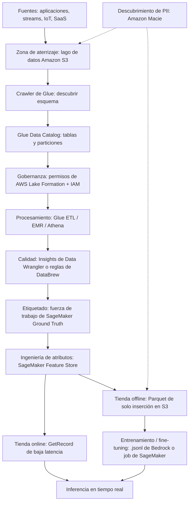
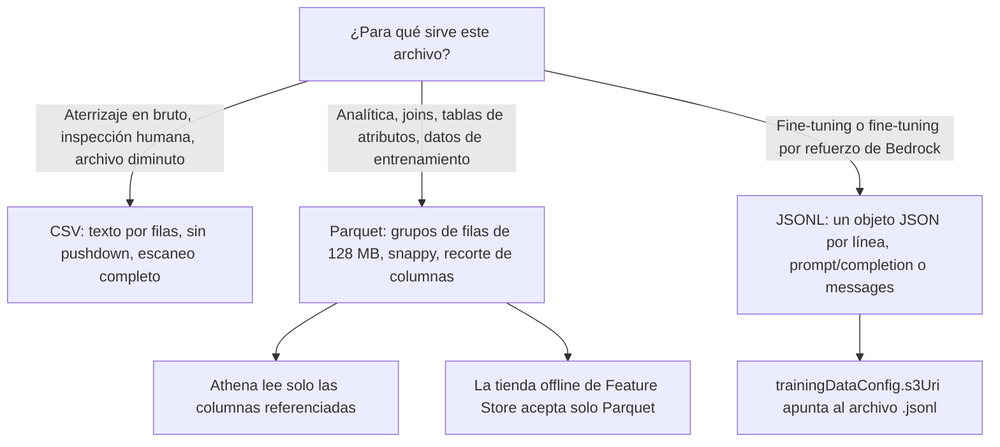
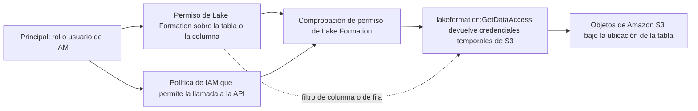
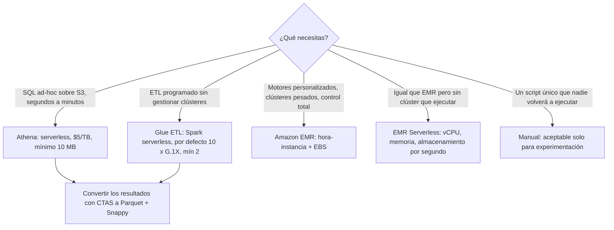
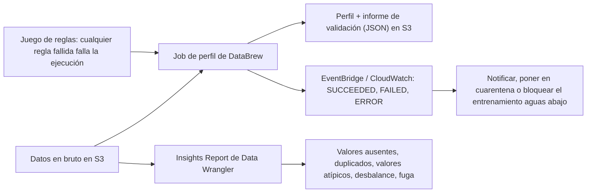
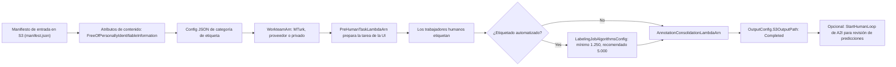
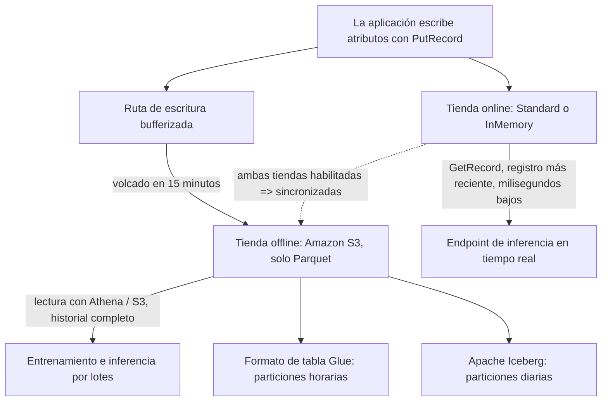
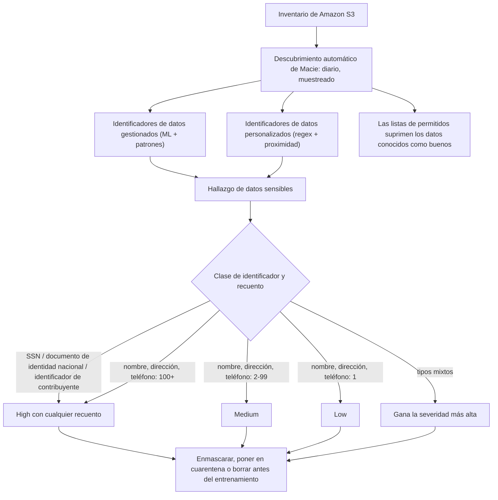

# Ingeniería de datos para IA en AWS

Los modelos no fallan en el entrenamiento. Fallan porque la tabla en la que se entrenaron tenía una columna que filtraba el objetivo, porque se escaneó un CSV de 3 TB en lugar de 0,25 TB de Parquet, porque un trabajo de etiquetado salió hacia Mechanical Turk sin declarar que las imágenes estaban libres de información personal identificable, o porque un feature group servía lecturas en milisegundos en línea mientras la copia offline todavía se bufferizaba hacia Amazon S3. La ingeniería de datos es la etapa en la que los cuatro errores son baratos de corregir, y el examen AIF-C01 lo sabe: **el Dominio 1 (Fundamentos de IA/ML) tiene un peso del 20%, el Dominio 2 (IA generativa) del 24%, el Dominio 3 (Aplicaciones de modelos fundacionales) del 28%, el Dominio 4 (IA responsable) del 14% y el Dominio 5 (Seguridad, cumplimiento y gobernanza) del 14%**, y esta lección se cruza con la Tarea 1.3 (ciclo de vida de ML), la Tarea 3.3 (fine-tuning) y las afirmaciones de ingeniería de datos segura del Dominio 5.

```text
=====================================================================
 INGENIERÍA DE DATOS PARA IA — LAS COSAS QUE EL EXAMEN REALMENTE PREGUNTA
=====================================================================
  A. ¿A DÓNDE VAN LOS DATOS?
     S3 -> crawlers de Glue -> Glue Data Catalog -> Athena / EMR / Glue
     gobernado por AWS Lake Formation (permisos + IAM, dos capas)

  B. ¿QUÉ MOTOR?
     Glue ....... ETL serverless, por defecto 10 workers x G.1X, mín 2
     EMR ......... hora-instancia + EBS; Serverless = vCPU/mem/segundo
     Athena ...... $5 por TB escaneado, mínimo 10 MB por consulta
     manual ...... siempre la opción perdedora en una respuesta de examen

  C. ¿SON BUENOS LOS DATOS?
     Data Wrangler (en SageMaker Canvas): más de 300 transformaciones,
        el Insights Report señala fuga, desbalance, valores atípicos
     DataBrew: job de perfil + reglas -> informe de validación JSON

  D. ¿ESTÁN ETIQUETADOS?
     Ground Truth: manifiesto -> categoría de etiqueta -> fuerza de trabajo ->
        Lambda de pre-anotación -> Lambda de consolidación -> salida
     La entrada de MTurk DEBE declarar FreeOfPersonallyIdentifiableInformation
     etiquetado automatizado: mínimo 1.250 objetos, se recomiendan 5.000

  E. ¿SON PRIVADOS, GOBERNADOS Y ESTÁN LISTOS PARA FINE-TUNING?
     Macie: identificadores de datos gestionados + personalizados, descubrimiento diario
     Feature Store: online (GetRecord) + offline (Parquet en S3)
     Bedrock: .jsonl, un objeto JSON por línea, URI de S3
=====================================================================
```

> [!NOTE]
> **Lee esta lección como un manual de decisiones.** Cada número de abajo está tomado de un documento publicado por AWS (guía de desarrollador de SageMaker, guías de usuario de Glue y Athena, guías de usuario de Lake Formation y Macie, guía de usuario de Bedrock, páginas de precios de AWS). Cuando una cifra se deriva en lugar de publicarse, se marca como derivada. Cuando una afirmación no está verificada, aparece en la sección 11: nunca en el set de memorización.

Al final de esta lección podrás:

- dibujar el **pipeline de datos extremo a extremo** de un proyecto de IA y nombrar el servicio de AWS en cada salto;
- elegir entre **CSV, Parquet y JSONL** y predecir la consecuencia de coste de esa elección en Athena;
- escoger el motor de procesamiento correcto, **Glue frente a EMR frente a Athena frente a un script manual**, y defenderlo;
- aplicar el modelo de **autorización de dos capas de Lake Formation** y nombrar el permiso que el acceso subyacente a S3 exige además;
- configurar un **trabajo de etiquetado con Ground Truth** de principio a fin, incluida la declaración de PII que lo hace o lo rompe;
- dimensionar una ejecución de **etiquetado automatizado** (suelo de 1.250, recomendación de 5.000, split de validación 20%/10%);
- explicar las **tiendas online y offline de Feature Store**, sus reglas de particionado y el buffer de escritura de 15 minutos;
- usar **Macie** para descubrir PII en S3 y predecir la severidad de un hallazgo;
- preparar un **dataset de fine-tuning `.jsonl`** para Amazon Bedrock y verificarlo contra los topes publicados por modelo;
- responder **diez preguntas al estilo del examen** con la voz oficial de las preguntas de práctica.

---

## 1. Dónde encaja esta lección en el examen

### 1.1 Las declaraciones de tarea para las que estás estudiando

La Exam Guide de AIF-C01 es el contrato. Tres declaraciones hacen que esta lección sea examinable:

| Declaración de la guía | Lo que debes poder hacer | Sección aquí |
|---|---|---|
| Tarea 1.3: «Describe los componentes de un pipeline de ML (recopilación de datos, EDA, preprocesado de datos, ingeniería de atributos…)» | Nombrar el componente y el servicio de AWS de cada etapa | 2, 5, 6 |
| Tarea 1.3: «Identifica los servicios de AWS relevantes … para cada etapa de un pipeline de ML (por ejemplo, SageMaker, Amazon SageMaker Data Wrangler, Amazon SageMaker Feature Store, Amazon SageMaker Model Monitor)» | Emparejar etapa → servicio bajo presión de tiempo | 1.2 |
| Tarea 3.3: «Describe cómo preparar datos para hacer fine-tuning de un MF (curación de datos, gobernanza, tamaño, etiquetado, representatividad, RLHF)» | Curar, gobernar, dimensionar, etiquetar y equilibrar un dataset de fine-tuning | 10 |
| Dominio 5: «mejores prácticas para la ingeniería de datos segura (evaluación de la calidad de datos, tecnologías de mejora de la privacidad, control de acceso a los datos, integridad de los datos)» más linaje de datos, catalogación de datos y Model Cards | Calidad, privacidad, control de acceso, integridad, linaje, catálogo | 4, 6, 9 |

### 1.2 La matriz herramienta-por-tarea

Esta tabla es el artefacto más reutilizable de la lección. Aprende la columna izquierda (la tarea) y la columna central (la herramienta principal); la columna derecha es donde viven los distractores del examen.

| Tarea | Herramienta principal de AWS | Alternativa | Configuración clave / trampa |
|---|---|---|---|
| Descubrimiento de esquemas y catálogo | Crawlers de AWS Glue → Glue Data Catalog | DDL de Athena, Lake Formation | también detecta Iceberg, Hudi y Delta Lake |
| ETL por lotes / Spark a escala | AWS Glue ETL (PySpark o Scala) | EMR / EMR Serverless | serverless; por defecto 10 × G.1X, mínimo 2 workers |
| Clústeres de big data pesados o personalizados | Amazon EMR | EMR Serverless | facturación por hora-instancia frente a vCPU-segundo |
| Analítica SQL serverless | Amazon Athena | Redshift Serverless | $5/TB; CTAS escribe Parquet u ORC |
| Acceso al lago gobernado y de grano fino | AWS Lake Formation | Solo IAM (`Super` → `IAMAllowedPrincipals`) | permisos de LF **e** IAM; `lakeformation:GetDataAccess` |
| Preparación de datos de ML visual / sin código | SageMaker Data Wrangler (en Canvas) | preparación de datos por chat en Canvas | más de 300 transformaciones; se ejecuta en m5.4xlarge |
| Perfiles y juegos de reglas de DQ, sin código | AWS Glue DataBrew | + EventBridge | job de perfil + reglas → informe JSON en S3 |
| Análisis de fuga de destino y desbalance | Insights Report de Data Wrangler | SageMaker Clarify (sesgo preentrenamiento) | el informe señala fuga y desbalance |
| Etiquetado humano | SageMaker Ground Truth | flujo personalizado / fuerza de trabajo privada | MTurk ⇒ la declaración de PII es obligatoria |
| Revisión humana de predicciones del modelo | Amazon A2I | trabajos de verificación de Ground Truth | **sin consolidación** en A2I |
| Servicio de atributos en tiempo real | **Tienda online** de Feature Store | DynamoDB | `GetRecord`; solo el registro más reciente |
| Almacenamiento de atributos para entrenamiento / lotes | **Tienda offline** de Feature Store | S3 + Athena | solo Parquet; Glue = por hora, Iceberg = diario |
| Descubrimiento de PII en S3 | Amazon Macie | Amazon Comprehend PII (texto) | identificadores gestionados + personalizados + listas de permitidos |
| Archivos de dataset de fine-tuning GenAI | JSONL de Bedrock en S3 |: | `.jsonl`, un objeto JSON por línea |

- **📚 ¿Sabías que…?** El Glue Data Catalog es **compatible con Hive**, que es la razón por la que Athena, EMR y el formato de tabla Glue del Feature Store pueden leer la misma definición de tabla. El propio blog de Big Data de AWS (2024) documenta que los crawlers de Glue detectan esquemas en **Apache Iceberg, Apache Hudi y Apache Delta Lake**: así que «qué formato de tabla» es ahora una decisión de gobernanza, no una limitación de catalogación.

---

## 2. El pipeline de datos de extremo a extremo

### 2.1 Un diagrama, once saltos



### 2.2 Por qué importa el orden

Cada salto existe para eliminar una clase de fallo:

| Salto | Qué pregunta responde | Fallo si se omite |
|---|---|---|
| Zona de aterrizaje (S3) | ¿Dónde está la fuente de verdad? | El entrenamiento lee una copia que nadie puede versionar |
| Crawler → Catálogo | ¿Cuál es el esquema y dónde están las particiones? | Cada consulta es un `read_csv` a medida con columnas escritas a mano |
| Lake Formation | ¿Quién puede leer qué columna y qué fila? | `s3:GetObject` de todo el bucket para cada analista |
| Procesamiento | ¿Cómo se convierten los archivos en bruto en tablas listas para el análisis? | Los notebooks hacen ETL de producción |
| Calidad | ¿Hay nulos, duplicados, valores atípicos, desbalance, fuga? | Un hueco de 99% en entrenamiento / 71% en validación descubierto tras el lanzamiento |
| Etiquetado | ¿Son correctas y consistentes las etiquetas? | Las etiquetas ruidosas limitan la precisión del modelo sin importar la arquitectura |
| Feature Store | ¿Pueden la inferencia y el entrenamiento leer los *mismos* atributos? | Discrepancia entre entrenamiento y servicio: el clásico bug silencioso |
| Macie | ¿Hay PII o una credencial en ese bucket? | Datos protegidos en un corpus de entrenamiento |

```dragdrop
{
  "question": "Ordena los saltos del pipeline de datos en la secuencia en la que un arquitecto AIF-C01 los construiría:",
  "items": [
    "Aterrizar archivos en bruto en un lago de datos Amazon S3",
    "Ejecutar un crawler de Glue para poblar el Glue Data Catalog",
    "Aplicar permisos de AWS Lake Formation encima de los permisos de IAM",
    "Procesar los datos en bruto con Glue, EMR o Athena",
    "Perfilar el resultado con Data Wrangler o un juego de reglas de DataBrew",
    "Etiquetar los objetos de entrenamiento con SageMaker Ground Truth",
    "Escribir los atributos en SageMaker Feature Store",
    "Entrenar o hacer fine-tuning sobre el dataset curado"
  ],
  "correctOrder": [
    "Aterrizar archivos en bruto en un lago de datos Amazon S3",
    "Ejecutar un crawler de Glue para poblar el Glue Data Catalog",
    "Aplicar permisos de AWS Lake Formation encima de los permisos de IAM",
    "Procesar los datos en bruto con Glue, EMR o Athena",
    "Perfilar el resultado con Data Wrangler o un juego de reglas de DataBrew",
    "Etiquetar los objetos de entrenamiento con SageMaker Ground Truth",
    "Escribir los atributos en SageMaker Feature Store",
    "Entrenar o hacer fine-tuning sobre el dataset curado"
  ],
  "explanation": "El almacenamiento precede a la catalogación porque un crawler necesita objetos que leer; la catalogación precede a la gobernanza porque los permisos de Lake Formation se adjuntan a las tablas catalogadas y sus columnas; la gobernanza precede al procesamiento porque cada consulta se ejecuta como una identidad; los controles de calidad siguen al procesamiento porque las reglas evalúan los datos transformados; el etiquetado sigue a la calidad porque un esquema roto produce anotaciones rotas; los atributos se registran después de que existan las etiquetas; y el entrenamiento va al final porque consume todo lo anterior."
}
```

> [!WARNING]
> **No confundas el catálogo con la capa de permisos.** El Glue Data Catalog almacena *metadatos* (esquema, particiones, ubicación de la tabla). AWS Lake Formation almacena *permisos* sobre esos metadatos **y** sobre la ubicación subyacente de los datos. Un crawler nunca concede acceso, y una política de IAM por sí sola no es el modelo de Lake Formation: consulta la sección 4.

---

## 3. Almacenamiento y formatos de datos: CSV frente a Parquet frente a JSONL

### 3.1 La comparación que decide tu factura de Athena

| Propiedad | CSV | Apache Parquet | JSONL (`.jsonl`) |
|---|---|---|---|
| Disposición | texto orientado a filas | columnar, bloques de grupos de filas | un objeto JSON por línea |
| Esquema | ninguno en el archivo (crawler o cabecera) | esquema autodescriptivo en el pie | implícito por registro |
| Compresión | pobre (solo archivo completo) | por columna; por defecto en Glue **snappy** | pobre |
| Pushdown de columna / predicado | no | sí | no |
| Particionable para lectura paralela | sí | sí | sí |
| Tamaño por defecto de bloque / franja | n/a | Parquet **128 MB** / ORC **64 MB** | n/a |
| Consumidor de AWS | aterrizaje en bruto, fuente de CTAS | Athena, Glue, Redshift, tienda offline de Feature Store | fine-tuning y fine-tuning por refuerzo de Bedrock |
| Efecto en el coste de Athena | escaneo del archivo completo | solo las columnas referenciadas | escaneo del archivo completo |
| Tipos complejos | plano | array / map / struct (Athena lee la fila completa desde Parquet → prefiere ORC) | JSON anidado |
| Úsalo cuando | intercambio legible por humanos, archivos diminutos | tablas de analítica y de entrenamiento de ML | registros de entrenamiento y validación de GenAI |

### 3.2 Los números detrás de los valores por defecto

| Ajuste | Valor | Fuente |
|---|---|---|
| Tamaño de grupo de filas / bloque de Parquet en Athena | **128 MB** | Guía de usuario de Athena, «Optimize your tables» |
| Tamaño de franja ORC en Athena | **64 MB** | Guía de usuario de Athena |
| ORC lee la franja completa si es menor que | **8 MB** (`hive.orc.max_buffer_size`) | Guía de usuario de Athena |
| Particiones máximas de `INSERT INTO` | **100** | ETL de CTAS/INSERT INTO de Athena |
| `compression` por defecto del escritor Parquet de Glue | **snappy** (también sin comprimir, gzip, lzo) | Guía de desarrollador de Glue, página de Parquet |
| `blockSize` por defecto del escritor Parquet de Glue | **134217728 bytes = 128 MB** | Guía de desarrollador de Glue, página de Parquet |
| Agrupación de archivos pequeños de Glue (`groupFiles`) | activa por defecto cuando la entrada supera los **50.000 archivos** | Guía de desarrollador de Glue, conexiones S3 |

**Ejemplo 1, la decisión de formato, con las propias cifras de AWS.** Toma una tabla de texto de cuatro columnas sin comprimir de **3 TB** en S3. Una consulta que lee **una** columna escanea los 3 TB completos: 3 TB × $5/TB = **$15,00**. Aplica **GZIP a razón de 3:1** y la misma tabla pasa a 1 TB → **$5,00**. Conviértela a **Parquet** y la consulta lee solo la columna referenciada: 1 TB ÷ 4 = 0,25 TB × $5/TB = **$1,25**. Eso es **12 veces más barato** que la línea base, 3× por la compresión y 4× por el recorte de columnas. AWS publica este ejemplo resuelto exacto en su página de precios de Athena.



- **📚 ¿Sabías que…?** La agrupación `groupFiles` de Glue solo se activa automáticamente cuando la entrada supera los **50.000 archivos**. Por debajo de ese umbral tienes que fijar tú mismo `"groupFiles": "inPartition"`: de lo contrario, un directorio de archivos pequeños se convierte en un directorio de *muchos* archivos Parquet diminutos, que es exactamente el problema de archivos pequeños que Athena te cobra por leer.

---
## 4. Catálogo y gobernanza: Glue Data Catalog y Lake Formation

### 4.1 Dos familias de permisos, no una

AWS Lake Formation documenta dos familias de permisos: permisos sobre el **Data Catalog** (bases de datos y tablas) y permisos sobre los **datos y ubicaciones de datos subyacentes** (prefijos de S3). De ahí salen tres reglas, y las tres son examinables:

1. un principal necesita **tanto** permisos de Lake Formation **como** permisos de IAM;
2. el acceso de lectura/escritura subyacente exige además **`lakeformation:GetDataAccess`**;
3. una configuración solo-IAM existe únicamente concediendo **`Super`** a **`IAMAllowedPrincipals`**.

### 4.2 Permisos de tabla

| Permiso | Ámbito | Capacidad destacable |
|---|---|---|
| `SELECT` | tabla | admite **filtros de columna** y **filtros de datos a nivel de fila/celda** (`DataCellsFilter`) |
| `INSERT` | tabla | escribir filas nuevas |
| `DELETE` | tabla | eliminar filas |
| `ALTER` | tabla | cambios de esquema y de partición |
| `DROP` | tabla | eliminar la tabla |
| `DESCRIBE` | tabla | leer esquema/metadatos |
| `Super` | base de datos, tabla o principal | todo; el puente que usa `IAMAllowedPrincipals` |



### 4.3 Qué reemplazó a las Governed Tables

> [!WARNING]
> **Las Governed Tables de Lake Formation están obsoletas, con efecto el 31 de diciembre de 2024.** El blog de Big Data de AWS (2 de octubre de 2024) afirma que las API de solo lectura empezaron a fallar después del **17 de febrero de 2025**, y AWS orienta a los clientes hacia **Apache Iceberg, Apache Hudi o Apache Delta Lake** como los formatos de tabla abiertos que proporcionan transacciones y gobernanza comparables. Si una respuesta de examen menciona las Governed Tables como un servicio actual, trátala como una trampa: prefiere la redacción Iceberg/Hudi/Delta.

**Ejemplo 2, filtrado de columnas y filas en la práctica.** Una tabla de analítica de RR. HH. tiene las columnas `employee_id`, `department`, `salary_band` y `ssn`. Un permiso `SELECT` de Lake Formation con un **filtro de columna** puede excluir `ssn` por completo para el rol de analista, mientras que un **filtro de fila** (`DataCellsFilter`) puede restringir las filas a `department = 'Ops'`. Ninguna de las dos cosas es posible con un simple permiso de prefijo de S3, que es precisamente el lenguaje de «control de acceso a los datos» e «integridad de los datos» del Dominio 5.

- **📚 ¿Sabías que…?** El permiso `SELECT` de Lake Formation es el único permiso de tabla documentado que admite **filtros de datos a nivel de fila y celda**. Todo lo demás de la lista de permisos de tabla (`INSERT`, `DELETE`, `ALTER`, `DROP`, `DESCRIBE`) es todo-o-nada a nivel de tabla o de columna.

---

## 5. Motores de procesamiento: Glue, EMR y Athena

### 5.1 Datos de facturación y escala

| Servicio | Unidad de facturación | Por defecto | Suelo |
|---|---|---|---|
| Job Spark de Glue | DPU-hours (workers) | **10 workers × G.1X** | **2 workers** |
| Shell Python de Glue | DPU (1 DPU = 16 GB) | **0,0625 DPU = 1 GB** (valor por defecto de la consola) | **0,0625 DPU** |
| Amazon EMR | por **hora-instancia** + almacenamiento EBS | clúster gestionado por el cliente | 1 nodo |
| EMR Serverless | vCPU + memoria + almacenamiento por **segundo** | aprovisionado automáticamente | mínimo de 1 minuto |
| Athena (SQL) | **$5 por TB escaneado** |: | **10 MB por consulta** |
| Data Wrangler (Studio Classic) | EC2 mientras se ejecuta | **m5.4xlarge** |: |
| Widget Insights de Wrangler | filas analizadas | **las primeras 10.000 filas** | 10.000 |

### 5.2 Tamaños de worker de Glue

| Tipo de worker | vCPU | Memoria | Disco | Ejecutores |
|---|---|---|---|---|
| Standard | 4 | 16 GB | 50 GB | 2 |
| G.1X | 4 | 16 GB | 64 GB | 1 |
| G.2X | 8 | 32 GB | 128 GB | 1 |
| Shell Python |: | 1 DPU = 16 GB (o 0,0625 DPU = 1 GB) |: |: |

**Ejemplo 3: dimensionar Glue correctamente.** El patrón de conversión a Parquet de Prescriptive Guidance de AWS ejecuta **2 workers**: el mínimo documentado: en lugar del valor por defecto de la consola **10 × G.1X**, que son **5 veces menos** DPUs asignados para el mismo job de conversión. Un job de shell Python configurado a **0,0625 DPU (1 GB)** en lugar de 1 DPU (16 GB) usa **16 veces menos** memoria y se factura proporcionalmente. El examen recompensa el patrón «empieza por el mínimo, escala con evidencia», no el valor por defecto de la consola.

### 5.3 Reglas de precios de Athena

| Regla | Valor |
|---|---|
| Precio por TB escaneado | **$5**, redondeado al MB más cercano |
| Mínimo facturado por consulta | **10 MB** |
| Sentencias DDL | **gratis** |
| Consultas fallidas | **gratis** |
| Consultas canceladas | **se facturan** |
| Ahorro documentado por compresión + particionado + columnar | **30% to 90%** |
| Benchmark de CTAS en la documentación de Athena | CSV → Parquet + Snappy particionado por año, aterrizado en **1,2 GB**, con la misma consulta más rápida y más barata |

**Ejemplo 4: el bucle de conversión con CTAS.** Un equipo mantiene una tabla CSV en bruto, ejecuta **CTAS** (`CREATE TABLE … AS SELECT`) para escribir **Parquet con compresión Snappy particionado por año**, aterriza en **1,2 GB** y apunta el panel de aguas abajo hacia la tabla nueva. La consulta escanea solo las columnas referenciadas de una partición: más barata *y* más rápida, sin cambio alguno en la aplicación. AWS documenta esto como el patrón ETL estándar (`CTAS/INSERT INTO`).

### 5.4 Elegir el motor



> [!IMPORTANT]
> **Veredicto comparativo: Glue frente a EMR frente a Athena frente a un proceso manual**
> - **AWS Glue** es la respuesta por defecto para *ETL por lotes serverless y catalogación*. Escribes PySpark o Scala, AWS lo ejecuta (por defecto 10 workers × G.1X, mínimo documentado 2), y solo se te factura en DPU-hours mientras el job se ejecuta. Elige Glue cuando el job tiene forma de Spark, el calendario es conocido y nadie quiere ser dueño de un clúster. La trampa es el coste por defecto: dejar 10 workers asignados cuando 2 bastan es un sobrecoste de 5× que el patrón prescriptivo propio de AWS evita.
> - **Amazon EMR** es la respuesta cuando necesitas *elección de motor, control del clúster o una escala que Glue no puede expresar*: Hadoop, Trino, Flink, AMIs personalizadas, familias de instancias concretas. La facturación es **por hora-instancia más EBS**, así que un clúster ocioso es dinero quemado. **EMR Serverless** elimina el clúster y factura **por vCPU, memoria y almacenamiento por segundo**, con autoescalado y aislamiento a nivel de job; es el camino intermedio cuando quieres los motores de EMR sin las operaciones de EMR.
> - **Amazon Athena** es *consulta, no transformación*: SQL ANSI serverless sobre S3 a **$5 por TB escaneado** con un mínimo de **10 MB por consulta**, DDL gratis y consultas fallidas gratis (las canceladas aún se facturan). Es la forma más barata de explorar y la forma equivocada de ejecutar un ETL nocturno multitenant, pero combinado con **CTAS** se *convierte* en una transformación, escribiendo Parquet u ORC para el siguiente paso.
> - **Un proceso manual** (un script en un portátil, un notebook ejecutado a mano, un CSV copiado) gana la primera semana y pierde después: no puede probar qué versión de los datos produjo un modelo concreto, no puede aplicar filtros de columna o de fila, no puede ser reejecutado por nadie más, y reintroduce silenciosamente el coste de escaneo completo del archivo que Parquet y el particionado debían eliminar. El Dominio 5 encuadra esto como fallos de **integridad de los datos, control de acceso a los datos y linaje de datos**. El veredicto es categórico: lo manual es aceptable para exploración, nunca para el pipeline que alimenta un modelo.

---

## 6. Calidad y preparación de datos: Data Wrangler y DataBrew

### 6.1 SageMaker Data Wrangler (ahora dentro de SageMaker Canvas)

| Capacidad | Detalle |
|---|---|
| Fuentes | Amazon S3, Athena, Redshift, Snowflake, Databricks |
| Interfaz | Data Flow |
| Transformaciones | **más de 300** |
| Lo que detecta el Insights / Quality Report | valores ausentes, duplicados, valores atípicos, desbalance de clases y **fuga de datos** |
| Exportaciones | S3, SageMaker Pipelines, Feature Store, un script de Python, un notebook |
| Instancia de análisis de Studio Classic | **m5.4xlarge** |
| Filas analizadas por el widget | **las primeras 10.000 filas** salvo que se seleccionen todas |

**Ejemplo 5, la detección de la fuga.** Un clasificador puntúa **99% sobre datos de entrenamiento y 71% sobre la validación retenida**. El informe Insights de Data Wrangler señala una columna derivada de la variable objetivo. El diagnóstico es **fuga de destino más sobreajuste**: elimina o deriva de forma segura la columna filtrada, y después reduce el sobreajuste con regularización o con datos más representativos. Entrenar más tiempo lo empeora, y borrar el set de validación solo lo oculta, los distractores del examen proponen exactamente esos dos movimientos equivocados.

### 6.2 Juegos de reglas y jobs de perfil de AWS Glue DataBrew

| Concepto | Comportamiento |
|---|---|
| Juego de reglas | **falla si cualquier regla falla** (evaluación todo-o-nada) |
| Adjuntado | los juegos de reglas se adjuntan a **jobs de perfil** |
| Salida | un perfil más un informe de validación (**JSON**) escrito en **S3** |
| Reglas de columna | permitidas solo para **tipos simples**: string, number, boolean |
| Eventos | los resultados emiten eventos de EventBridge/CloudWatch con `SUCCEEDED`, `FAILED` o `ERROR` |



**La distinción que el examen prueba:** **DataBrew** es la respuesta de *reglas y perfiles* (un juego de reglas, un job de perfil, un informe JSON, un evento), mientras que **Data Wrangler** es la respuesta de *flujo y transformación visual* (más de 300 transformaciones, un Insights Report que señala fuga, exportaciones al Feature Store). Ambos son gestionados: ninguno te pide aprovisionar un clúster de Spark tú mismo.

- **📚 ¿Sabías que…?** Las reglas de columna de DataBrew rechazan los tipos complejos: puedes escribir una regla para una columna `string`, `number` o `boolean`, pero no para un `struct` anidado. Esa es la razón por la que la validación profunda de JSON pertenece a un job de Glue o a un flujo de Data Wrangler, y por la que el documento de juego de reglas es deliberadamente poco profundo por diseño.

---

## 7. Etiquetado humano: Ground Truth y A2I

### 7.1 El flujo de etiquetado de doce pasos

| # | Paso | Objeto / parámetro | Fallo si se omite |
|---|---|---|---|
| 1 | Cargar los datos de entrada | Manifiesto de S3 (`ManifestS3Uri`) | no puede enumerar los objetos |
| 2 | Declarar los atributos de contenido | `FreeOfPersonallyIdentifiableInformation`, `FreeOfAdultContent` | **el job falla** en Mechanical Turk |
| 3 | Definir las etiquetas | `LabelCategoryConfigS3Uri` (JSON); ≥ 2 categorías para clasificación | no se renderiza ninguna etiqueta |
| 4 | Elegir la fuerza de trabajo | `WorkteamArn` (MTurk / proveedor / OIDC privado) | las tareas caducan sin reclamar |
| 5 | Configurar la tarea humana | `NumberOfHumanWorkersPerDataObject`, `TaskTimeLimitInSeconds`, `MaxConcurrentTaskCount` (por defecto **1.000**) | rendimiento o calidad mal configurados |
| 6 | Lambda de pre-anotación | `PreHumanTaskLambdaArn` (proporcionado por AWS) | la entrada nunca llega a la UI |
| 7 | UI del trabajador | HTML/Liquid o una plantilla integrada | instrucciones incorrectas → ruido de etiquetas |
| 8 | Consolidación de anotaciones | `AnnotationConsolidationLambdaArn` | votos en conflicto, sin consenso |
| 9 | Etiquetado automatizado opcional | `LabelingJobAlgorithmsConfig`; mínimo **1.250**, recomendado **5.000** | por debajo del mínimo → rechazado |
| 10 | Verificación / ajuste opcional | reejecución mostrando las etiquetas existentes | sin pase de control de calidad |
| 11 | Salida | `OutputConfig.S3OutputPath`; `In progress` → `Completed` | sin etiquetas para entrenar |
| 12 | Revisión de predicciones opcional | `CreateFlowDefinition` y `StartHumanLoop` de A2I | salidas sin revisar en producción |

### 7.2 Los números

| Parámetro | Valor |
|---|---|
| Mínimo del etiquetado automatizado (aprendizaje activo) | **1.250 objetos** |
| Recomendación firme de AWS | **5.000 objetos** |
| Split de validación cuando hay < 5.000 objetos | **20%** |
| Split de validación cuando hay > 5.000 objetos | **10%** |
| Tareas automatizadas admitidas | clasificación de imágenes, bounding box, segmentación semántica, clasificación de texto |
| Valor por defecto de `MaxConcurrentTaskCount` | **1.000** (ampliable a **5.000** vía AWS Support) |
| Consolidación | Lambda posterior a la anotación; **no disponible para Amazon A2I** |
| Patrón de ARN de Mechanical Turk | `arn:aws:sagemaker:<region>:394669845002:workteam/public-crowd/default` |

**Ejemplo 6: la aritmética del split de validación por aprendizaje activo.** **4.000** objetos (< 5.000) → validación = 20% = **800** objetos, quedando **3.200** en el bucle. **20.000** objetos → validación = 10% = **2.000**. Un trabajo con **800** objetos se rechaza de plano (por debajo del suelo de 1.250); **5.000** es el suelo recomendado con firmeza. Observa lo que la aritmética *no* dice: 4.000 objetos es legal pero deja solo 3.200 para el aprendizaje, mientras que 5.000 cuesta 500 objetos de validación y aún supera el suelo con margen.

**Ejemplo 7, el presupuesto de bounding boxes.** En el notebook oficial de ejemplo de detección de objetos de AWS, una etiqueta de bounding box humana cuesta **$0,08 + 5 × $0,036 = $0,26**, y una etiqueta automática cuesta **$0,08**. Así que **100 imágenes** etiquetadas por humanos rondan los **$26**, mientras que **1.000 imágenes** con etiquetado automático aterrizan cerca de **$200** de principio a fin en unas **6 horas** de tiempo total de ejecución (unas 167 imágenes/hora, una cifra derivada de una demo que también incluye la sobrecarga de entrenamiento e inferencia, no un SLA de AWS). Trata los tramos de precio por objeto que hayas podido ver como **históricos**: AWS comercializa ahora Ground Truth+ sin una tabla pública por objeto.

### 7.3 Diagrama del flujo



> [!WARNING]
> **Dos trampas de Ground Truth que hacen fallar los trabajos, no solo las preguntas.**
> (1) En la fuerza de trabajo de Amazon Mechanical Turk, el clasificador `FreeOfPersonallyIdentifiableInformation` **debe** declararse; sin él, AWS afirma que el trabajo de etiquetado fallará. El atributo opcional `FreeOfAdultContent` sigue el mismo mecanismo de declaración.
> (2) Mechanical Turk **no** admite trabajos de etiquetado de **fotogramas de vídeo** ni de **nubes de puntos 3D**; esos requieren otra fuerza de trabajo. Y recuerda el contexto de disponibilidad establecido en la Lección 2: Ground Truth está en mantenimiento y cerrado a nuevos clientes (30 de junio de 2026; la documentación de cambios de disponibilidad indica 7/30/26) y Amazon Mechanical Turk alcanzó el fin de soporte el **29 de septiembre de 2026**: así que una pregunta de un cliente *nuevo* apunta hacia otro enfoque de etiquetado, mientras que la mecánica anterior sigue siendo vocabulario examinable.

**La distinción de A2I:** Amazon A2I es para la **revisión humana de predicciones del modelo**, creada con `CreateFlowDefinition` y `StartHumanLoop`. **No tiene consolidación de anotaciones**, así que no puede usarse para fusionar varios votos de trabajadores en una etiqueta de consenso: esa capacidad pertenece al `AnnotationConsolidationLambdaArn` de Ground Truth.

---

## 8. SageMaker Feature Store: online y offline

### 8.1 Las dos tiendas

| Aspecto | Tienda online | Tienda offline |
|---|---|---|
| Propósito | consulta para inferencia en tiempo real | exploración, entrenamiento, inferencia por lotes |
| API | `GetRecord` | consulta con Athena / lectura en S3 |
| Latencia | milisegundos bajos | no ligada a la latencia |
| Retención | **el registro más reciente** por identificador | **solo inserción**, historial completo |
| Almacenamiento | gestionado; `Standard` o `InMemory` (ElastiCache Redis OSS) | Amazon S3, **solo Parquet** |
| Ruta de escritura | casi en tiempo real | bufferizado, volcado a S3 **en 15 minutos** |
| Particionado | n/a | formato de tabla Glue → **por hora**; Apache Iceberg → **diario** |
| Formato de tabla | n/a | `Glue` (por defecto) o `Apache Iceberg` |
| Sincronización | ambas habilitadas ⇒ las tiendas se sincronizan (evita la discrepancia entre entrenamiento y servicio) | igual |
| Notas | `InMemory` es solo online, sin clave KMS gestionada por el cliente, aprovisionamiento de **~10 to 15 min** | Iceberg habilita la compactación de archivos pequeños |

### 8.2 Semántica de escritura y modos de capacidad

- Los datos de `PutRecord` están **bufferizados, agrupados y escritos en Amazon S3 en un plazo de 15 minutos**;
- niveles online: **Standard** (por defecto) e **InMemory** («powered by Amazon ElastiCache (Redis OSS)»), ambos **solo online**; sin replicación de online→offline y **sin clave KMS gestionada por el cliente** para `InMemory`;
- modos de capacidad: **`ON_DEMAND`** y **`PROVISIONED`** (superar la capacidad aprovisionada limita las peticiones); un grupo puede cambiarse a on-demand **una vez cada 24 horas**, y `PROVISIONED` solo se permite en grupos solo-offline o `Standard`;
- `InMemory` tarda aproximadamente **10 to 15 minutos** en aprovisionarse.

**Ejemplo 8, la aritmática de ingestión de Feature Store.** La escala del ejemplo de AWS es «lotes grandes (**1 millón de filas** de datos o más)». Como la salida de `PutRecord` se vuelca a S3 **en un plazo de 15 minutos**, un job de entrenamiento iniciado inmediatamente después de la ingestión puede esperar hasta 15 minutos a la copia offline, mientras que `GetRecord` sirve la copia online antes. A lo largo de un día, una tienda offline en formato Glue aterriza **24 particiones horarias**, mientras que una tienda en formato Iceberg aterriza **1 partición diaria**, ninguna de las dos es configurable.



> [!WARNING]
> **La tienda offline acepta solo Parquet.** Escribir CSV en la tienda offline de Feature Store no es una opción: el formato documentado es Parquet en S3, particionado por hora bajo el formato de tabla Glue por defecto o diario bajo Apache Iceberg. Y el **nivel `InMemory` es solo online**: si una pregunta ofrece «`InMemory` más historial offline completo», la respuesta es errónea en ambos sentidos (sin replicación y sin clave KMS gestionada por el cliente).

---

## 9. Privacidad, PII e ingeniería de datos segura con Amazon Macie

### 9.1 Cómo Macie encuentra datos sensibles

| Mecanismo | Qué es | Ejemplos |
|---|---|---|
| **Identificadores de datos gestionados** | detección basada en ML combinada con emparejamiento de patrones | `USA_SOCIAL_SECURITY_NUMBER`, `CREDIT_CARD_NUMBER`, `AWS_CREDENTIALS` |
| **Identificadores de datos personalizados** | tu expresión regular más reglas de proximidad | identificadores internos de empleados con el prefijo de la empresa |
| **Listas de permitidos** | datos conocidos como buenos excluidos de los hallazgos | fixtures de prueba que parecen SSN falsos |
| Descubrimiento automático | evalúa el inventario de S3 **a diario** con muestreo | cobertura continua sin un job de escaneo |
| Retención de hallazgos | los hallazgos de datos sensibles se guardan **90 días** | planifica exportaciones si necesitas más historial |

### 9.2 Severidad: la tabla que debes poder predecir

| Tipo de dato | 1 aparición | 2 to 99 | 100+ |
|---|---|---|---|
| La mayoría de la PII (fecha de nacimiento, carné de conducir, nombre, dirección, teléfono, cookie HTTP) | Low | Medium | High |
| Coordenadas GPS | Low | Medium | Medium |
| Número de pasaporte | Medium | High | High |
| VIN | Low | Low | Medium |
| **SSN, documento de identidad nacional, NINO, residencia permanente, censo electoral, identificador de contribuyente** | **High** | **High** | **High** |

Los hallazgos de tipos múltiples toman la severidad **más alta** entre los tipos detectados.

**Ejemplo 9: la cola de triaje de Macie.** Un objeto con **1** nombre completo → **Low**; **50** nombres → **Medium**; **150** nombres → **High**. Un objeto distinto con **1 SSN** → **High** de inmediato, porque los identificadores tipo SSN son High sin importar el recuento. Un objeto que contiene **10 nombres (Medium)** *y* **5 números de pasaporte (High)** → la severidad del hallazgo es **High**, porque los hallazgos de tipos múltiples toman la severidad más alta. Las colas se priorizan por *sensibilidad del identificador*, no por volumen en bruto.



**El emparejamiento del Dominio 5:** Amazon Macie es el servicio nombrado por AWS para el **descubrimiento de PII/PHI/credenciales en S3** y aparece en la lista de servicios del Dominio 5 del AIF-C01. Emparéjalo con **Amazon Comprehend para la PII detectada dentro del texto en tiempo de inferencia**, y con los **filtros de columna y de fila de Lake Formation** (sección 4) para el control de acceso. Macie descubre *qué hay allí*; Lake Formation decide *quién puede verlo*; KMS decide *cómo se cifra*.

- **📚 ¿Sabías que…?** El descubrimiento automático de Macie no escanea cada objeto de forma continua: evalúa el **inventario de S3 a diario con muestreo**, y los hallazgos de datos sensibles se guardan durante **90 días**. Si tu historia de cumplimiento necesita un historial forense completo, exporta los hallazgos a S3 o a Security Hub; no asumas que viven en Macie para siempre.

---
## 10. Preparar datos de entrenamiento para el fine-tuning de modelos fundacionales

### 10.1 El formato no es negociable

Amazon Bedrock lo dice directamente: *«Creas archivos `.jsonl`, donde cada línea es un objeto JSON que corresponde a un registro.»* Los registros no conversacionales llevan `prompt` y `completion`; los conversacionales llevan un array `messages` con turnos alternos de `user` y `assistant`. AWS también publica una regla de estimación: *«Usa aproximadamente **6 caracteres por token** para estimar … el tamaño del dataset.»* Los archivos viven en S3 y se referencian mediante `trainingDataConfig.s3Uri` y `validationDataConfig.s3Uri` en `CreateModelCustomizationJob`.

### 10.2 Límites publicados de datasets

| Modelo | Registros mín. | Registros máx. | Tokens máx. | Archivo máx. train / val |
|---|---|---|---|---|
| Titan Text G1 Express / Lite (fine-tuning) |, |, | **4.096** (batch 1) | **1 GB** / **100 MB** |
| Anthropic Claude 3 Haiku (fine-tuning) | **32** | **10.000** train / **1.000** val | **32.000** | **10 GB** / **1 GB** |
| Meta Llama 3.1 / 3.3 (fine-tuning) | **100** | **10.000** (cuotas) | **16.000** in+out |: |
| Cohere Command (fine-tuning) |, | **10.000** train / **1.000** val | **4.096** in / **2.048** out |, |
| Amazon Nova Understanding (fine-tuning) | **8** | **20.000** | contexto de **32k** |: |
| Amazon Nova reinforcement fine-tuning | **100** | **100 to 20.000** |, |, |
| Titan Multimodal Embeddings G1 (fine-tuning) | **1.000** | **500.000** |, |, |
| Titan Image Generator G1 (fine-tuning) | **5** | **10.000** |, |, |

Un guion significa *no publicado en esa tabla*: nunca adivines un valor que AWS no haya publicado.

### 10.3 Detalles de Amazon Nova

- **Fine-tuning de Understanding:** **8 to 20k** muestras, contexto de **32k**, hasta **10 imágenes por muestra** (cada una ≤ **10 MB**), hasta **1 vídeo por muestra** de ≤ **90 segundos** y ≤ **50 MB**.
- **Reinforcement fine-tuning:** JSONL en formato de chat-completion de OpenAI con un array `messages` más `reference_answer`, **mínimo 100 registros**, un prompt por línea, y Bedrock **valida automáticamente** el formato.

**Ejemplo 10: dimensionar un dataset de Claude 3 Haiku.** El suelo es de **32 registros**, el techo es de **10.000** registros de entrenamiento (más **1.000** de validación), el tope de tokens es de **32.000** y el tope del archivo de entrenamiento es de **10 GB**. Usando la regla de AWS de **~6 caracteres por token**, una muestra de 4.096 tokens ronda los **24.576 caracteres** (derivado), así que el tope de ~1 GB limita mucho más tarde que el tope de registros para prompts cortos. Llama 3.1/3.3 limita antes: **100 to 10.000** registros y **16.000** tokens in+out. La tokenización varía, así que trata la cifra de 6 caracteres por token como un estimador, no como una garantía.

**Ejemplo 11: curación, gobernanza y representatividad.** La redacción de la guía del examen para la Tarea 3.3 es específica: los datasets deben mostrar **inclusividad, diversidad, fuentes de datos curadas y datasets equilibrados**, y la preparación incluye **curación de datos, gobernanza, tamaño, etiquetado, representatividad y RLHF**. En concreto: deduplica antes de contar registros (un archivo de 10.000 líneas con 3.000 duplicados son 7.000 registros efectivos, no 10.000); equilibra las clases antes de dividir; reserva un archivo de validación dentro de los techos de **1.000 registros** de arriba; y elimina la PII con Macie **antes** de que el archivo llegue a `trainingDataConfig.s3Uri`.

```matching
{
  "question": "Empareja cada formato de datos o servicio con el trabajo para el que está pensado:",
  "pairs": [
    {"left": "Apache Parquet", "right": "Analítica columnar y almacenamiento offline de Feature Store, con recorte de columnas de Athena"},
    {"left": "JSONL (.jsonl)", "right": "Fine-tuning de Amazon Bedrock: un objeto JSON por línea en un URI de S3"},
    {"left": "CSV", "right": "Aterrizaje en bruto e intercambio legible por humanos, escaneado por completo por Athena"},
    {"left": "Crawler de AWS Glue", "right": "Descubre el esquema y popula el Glue Data Catalog"},
    {"left": "Amazon Macie", "right": "Descubre PII y credenciales en S3 con identificadores gestionados y personalizados"},
    {"left": "Amazon Athena", "right": "SQL serverless sobre S3 a $5 por TB escaneado, mínimo 10 MB por consulta"}
  ],
  "explanation": "Parquet existe para recortar los bytes escaneados (el propio ejemplo de AWS pasa de $15,00 a $1,25 por consulta), JSONL existe porque Bedrock lee un objeto JSON por línea, CSV es el formato de aterrizaje barato con una ruta de lectura cara, el crawler es la forma en la que el catálogo aprende un esquema, Macie es la respuesta del Dominio 5 para el descubrimiento de PII, y Athena es la respuesta de SQL serverless con un precio por terabyte."
}
```

---

## 11. Datos contradictorios, no verificables y no examinables

Mantén esto fuera de tu set de memorización. Nada de lo de aquí debe aparecer como una respuesta de examen confiada.

| Afirmación | Lo que dicen las fuentes | Cómo manejarlo |
|---|---|---|
| Tramos de precio por objeto de Ground Truth ($0,08 / $0,04 / $0,02) | Una presentación de AWS de 2018; la página de precios actual comercializa «Ground Truth+» sin tabla pública por objeto | Trata los tramos como **históricos**; la cifra de $0,26 proviene de un notebook de ejemplo de AWS, no de una lista de precios |
| Rendimiento del etiquetado automático (~167 imágenes/hora) | **Derivada** de una demo que incluye la sobrecarga de entrenamiento e inferencia | Una ilustración, no un SLA de AWS |
| Precios de almacenamiento S3, DPU-hour de Glue, hora-instancia de EMR, Macie por GB, Feature Store online, sesión de DataBrew | No obtenidos para esta lección | Nunca inventes un precio |
| Si el AIF-C01 aún prueba las Governed Tables | Obsoletas el **31 de diciembre de 2024**; no se nombran en la guía del examen | Prefiere las respuestas Iceberg / Hudi / Delta |
| «Escala de petabyte» de Data Wrangler | Lenguaje de marketing; sin límite documentado de tamaño de flujo | Solo direccional |
| Aritmética de caracteres por token | Solo la regla de AWS de «~6 caracteres por token»; la tokenización varía | Úsala como estimador |
| Límite de 100 particiones de `INSERT INTO` de Athena y límites de bucket/partición de CTAS | Sensibles al servicio y a la versión | Verifícalos antes de citarlos |
| «Sin claves KMS gestionadas por el cliente» del nivel `InMemory` | Texto de la documentación actual; puede cambiar | Verifica en `docs.aws.amazon.com` |
| Nombres de Data Wrangler: «Canvas» frente al antiguo nombre independiente | AWS documenta Data Wrangler como una función de **SageMaker Canvas**; «Amazon SageMaker Data Wrangler» sigue siendo vocabulario válido de examen | Cualquier nombre es aceptable |
| Proporciones de split train/validación (60/20/20, 70/15/15, 80/10/10) | Convención, **no** un mandato de AWS | El examen prueba el *propósito* de cada split |

Las fuentes primarias de esta lección son: la **Exam Guide** de AIF-C01; las páginas de la guía de desarrollador de SageMaker `feature-store`, `feature-store-offline`, `feature-store-storage-configurations-online-store`, `sms`, `sms-create-labeling-job-api`, `sms-automated-labeling`, `data-wrangler`, `data-wrangler-transform`; la referencia de API de SageMaker `API_CreateFeatureGroup`, `API_HumanTaskConfig`; las páginas de Parquet y conexiones S3 de la guía de desarrollador de Glue; la guía de usuario de Athena `columnar-storage`, `ctas-insert-into-etl`; el resumen y la referencia de permisos de Lake Formation; la guía de usuario de Macie `data-classification`, `managed-data-identifiers`, `findings-severity`; la guía de usuario de Bedrock `model-customization-prepare`, `model-customization-submit`, `rft-prepare-data`; la guía de usuario de Nova `fine-tune-prepare-data-understanding`; y las páginas de precios de AWS de Athena más la comparación entre EMR y EMR Serverless.

---

## 12. Veredicto comparativo y tablas de resumen

### 12.1 Calidad, etiquetado y gobernanza de un vistazo

| Preocupación | Servicio | El número que hay que recordar |
|---|---|---|
| Preparación visual de datos y detección de fuga | SageMaker Data Wrangler (en Canvas) | más de **300** transformaciones; el widget Insights lee las **primeras 10.000 filas**; el análisis corre en **m5.4xlarge** |
| Perfiles y reglas sin código | AWS Glue DataBrew | el juego de reglas falla si **cualquier** regla falla; informe JSON a S3 |
| Etiquetado humano | SageMaker Ground Truth | suelo automatizado **1.250**, recomendado **5.000**; validación **20% / 10%** |
| Revisión humana de predicciones | Amazon A2I | **sin** consolidación de anotaciones |
| Atributos en tiempo real | Tienda online de Feature Store | `GetRecord`, solo el registro más reciente |
| Atributos para entrenamiento | Tienda offline de Feature Store | solo Parquet; buffer de escritura de **15 minutos**; particiones **horarias / diarias** |
| Descubrimiento de PII en S3 | Amazon Macie | descubrimiento diario sobre el inventario; hallazgos guardados **90 días** |
| Control de acceso al lago | AWS Lake Formation | permisos de LF **+** IAM, más `lakeformation:GetDataAccess` |
| Formato de archivo de fine-tuning | Amazon Bedrock | `.jsonl`, **~6 caracteres por token** |

### 12.2 Los cinco «valores por defecto» examinables

| Si la pregunta dice… | El valor por defecto que deberías nombrar |
|---|---|
| «ETL serverless» | AWS Glue, **10 workers × G.1X**, mínimo **2** |
| «SQL serverless sobre S3» | Amazon Athena, **$5/TB**, mínimo de **10 MB** por consulta |
| «tabla de analítica columnar» | Parquet, grupos de filas de **128 MB**, escritor de Glue con **snappy** por defecto |
| «servicio de atributos para un endpoint en tiempo real» | Tienda **online** de Feature Store, con la tienda offline habilitada también |
| «encontrar PII en mi bucket de S3» | Amazon Macie, identificadores de datos gestionados + personalizados |

- **📚 ¿Sabías que…?** El suelo de facturación de Athena es de **10 MB por consulta**, redondeado al MB más cercano. Las sentencias DDL y las consultas fallidas son gratis, pero las consultas **canceladas** se facturan: así que «ejecutarla, mirarla y pulsar cancelar» no es una estrategia gratuita. El hábito seguro más barato es `LIMIT` más un filtro de partición antes de comprometerte con un escaneo completo.

### 12.3 Actualizaciones de 2025 to 2026

El conjunto de cambios verificado de 2025 to 2026 toca esta lección en exactamente tres sitios: los servicios de calidad y etiquetado de SageMaker pasaron a mantenimiento, la búsqueda empresarial se trasladó a Bedrock, y la propia guía del examen se revisó. Nada de lo de aquí es especulación: cada fila lleva el documento de AWS del que procede.

**Vocabulario de ciclo de vida (Referencia General de AWS, «Service lifecycle», 24 sep 2026):** **Mantenimiento** = sin nuevos clientes, sin nuevas funciones, aún con soporte · **Retirada planificada** = fin de operaciones planificado, normalmente con un horizonte de 12 meses · **Apagado completo** = eliminado del portafolio. La mayoría de los distractores del examen se equivocan aquí convirtiendo «mantenimiento» en «descontinuado»: el servicio sigue funcionando para los clientes existentes.

| Cambio | Fecha | Estado para la ingeniería de datos | Dirección para clientes nuevos | Fuente |
|---|---|---|---|---|
| Amazon SageMaker pasa a llamarse **Amazon SageMaker AI**, con SageMaker de próxima generación al lado | 3 dic 2024 | solo un cambio de nombre: los mismos servicios | usa **SageMaker AI** en las respuestas | Blog de AWS, «next generation of Amazon SageMaker» |
| Fin de soporte de **Ground Truth Plus** | 30 jun 2026 | retirada planificada | trabajos de etiquetado estándar con Ground Truth | AWS What's New, disponibilidad del servicio |
| **Model Monitor, Clarify, Ground Truth, A2I, Studio Lab, Debugger, Role Manager, Geospatial, Profiler** ya no abiertos a nuevos clientes | **30 jul 2026** | **mantenimiento**: los clientes existentes los conservan, sin nuevas funciones | **Bedrock Model Evaluations** para evaluación; métricas y detección de anomalías de CloudWatch, Evidently, EventBridge + Lambda y SHAP para monitorización | Avisos de cambios de disponibilidad de SageMaker (`model-monitor-availability-change`, `clarify-availability-change`) |
| Fin de soporte de **Amazon Mechanical Turk** | **30 sep 2026** (post de What's New fechado el 29 sep) | retirada planificada | Ground Truth con un proveedor o una fuerza de trabajo privada, u otro servicio de etiquetado | Ciclo de vida de servicios de la Referencia General de AWS |
| **Amazon Kendra** en mantenimiento el 30 jun 2026 → cerrado a nuevos clientes el 30 jul 2026 | 2026 | mantenimiento, después sin nuevos clientes | **Amazon Bedrock Managed Knowledge Base** (Smart Parsing, Agentic Retrieval API) | `kendra-availability-change` |
| **Exam Guide v1.1** del AIF-C01 | 30 abr 2026 | añade el objetivo **5.1.4** (prevención de fuga de datos, validación de salidas, pistas de auditoría, toxicidad), **4.2.2** (SageMaker Clarify **más Bedrock Model Evaluations**) y la lista de servicios de la **1.3.4** (Bedrock, Amazon Quick, Kiro, SageMaker AI); **se elimina Amazon MemoryDB** del alcance | estudia la redacción de v1.1 | Historial de cambios de las guías de examen de AWS Certification (v1.0 = 26 mar 2026) |

**Lo que *no* cambió:** nada del conjunto de actualizaciones verificado de 2025 to 2026 altera las cifras de Glue, Athena, Lake Formation, Feature Store o Macie memorizadas en esta lección: el valor por defecto de Glue de **10 workers × G.1X** (mínimo documentado **2**), el **$5 por TB** de Athena con un suelo de **10 MB**, el buffer de escritura de **15 minutos** de Feature Store, la retención de hallazgos de **90 días** de Macie y el modelo de dos capas de Lake Formation siguen tal cual están escritos. La única primitiva de almacenamiento genuinamente nueva que vale la pena conocer es **Amazon S3 Vectors**, lanzada en re:Invent 2025: Sun Finance guarda allí sus embeddings de similitud de fraude (sección 13), y las Knowledge Bases de Bedrock la aceptan ahora como store de vectores.

- **📚 ¿Sabías que…?** AWS afirma que las actualizaciones de la guía del examen aparecen en el examen aproximadamente **un mes** después de su publicación. La guía del examen v1.0 se publicó el **26 mar 2026** y la v1.1 el **30 abr 2026**, así que los siete objetivos nuevos (IA agéntica y MCP, ingeniería de contexto, precios basados en tokens, versionado de prompts, detección de alucinaciones y grounding, métricas de alineación con el negocio, ML tradicional frente a MF) fueron materia válida desde aproximadamente finales de mayo de 2026, y el examen sigue llamándose **AIF-C01**.

---

## 13. Casos Reales

Las secciones 1 to 12 toman sus cifras de la documentación de AWS. Esta sección añade la otra mitad de la evidencia: lo que los *clientes* de AWS publicaron sobre la ejecución de esos mismos servicios en producción. Cada cifra de abajo es una afirmación de un cliente publicada por AWS (sin auditar, y las cifras de «hasta» son techos), recuperada el 6 de octubre de 2026 de `aws.amazon.com/solutions/case-studies/*` y `aws.amazon.com/blogs/machine-learning/*`.

### 13.1 Cinco pipelines de producción: servicios, cifras, fuentes

| # | Cliente (industria, año) | Servicios de AWS en el pipeline | Resultado documentado | Fuente |
|---|---|---|---|---|
| 1 | **Anthem** (seguros de salud, 2021) | **Amazon Textract**: OCR más detección de tablas y formularios | teclado manual de **20 min por reclamación** → **80%** del flujo automatizado, objetivo de **90%+**, miles de reclamaciones/día | `aws.amazon.com/solutions/case-studies/anthem` |
| 2 | **RareJob** (EdTech, 2020) | **AWS Glue** + **Amazon Athena** alimentando el entrenamiento **gestionado con spot** de SageMaker | tiempo de entrenamiento **−25%**, eficiencia de los desarrolladores **> 10×**, **100 h/mes** ahorradas, puntuaciones devueltas en **2 to 3 min** | `aws.amazon.com/solutions/case-studies/rare-job-case-study` |
| 3 | **Sun Finance** (fintech, 2026) | **Textract** → **Rekognition** → **Bedrock (Claude Sonnet 4)** → reglas de validación → **Titan Multimodal Embeddings en S3 Vectors** | precisión **79,73% → 90,80%**, coste por documento **−91%**, **20 h → < 5 s**, fraude detectado **81%** | Blog de ML de AWS, 30 abr 2026 |
| 4 | **Chronomics** (health-tech, 2022) | **Rekognition Custom Labels** (etiquetado AutoML) | construcción interna atascada en **4 meses** → **3 to 4 semanas**, **96,5%** de precisión / **97,9%** de F1 | Blog de ML de AWS, 13 dic 2022 |
| 5 | **Bynder** (gestión de activos digitales, 2025) | **Amazon Bedrock** + **Amazon Titan Multimodal Embeddings** sobre **175 M de activos / 18 PB** | tiempo de búsqueda **−75%**, opciones utilizables **~ +50%** a través de **4.000 clientes** | `aws.amazon.com/solutions/case-studies/bynder-bedrock-case-study` |

**Expediente de caso 1: Anthem: primero el OCR preconstruido, los humanos en la cola.** Los formularios de reclamación llegaban como escaneos e imágenes, y teclearlos a mano tomaba **20 minutos por reclamación** a un coste que AWS describe como millonario. Anthem eligió la capa *preconstruida* que la sección 1.2 llama por defecto: **Amazon Textract** realiza el OCR más la extracción de tablas y formularios, y un paso de clasificación enruta cada resultado. El resultado publicado es el **80%** del flujo automatizado con un objetivo de **90%+** a través de miles de reclamaciones por día. La consecuencia relevante para el examen es la cola: el **10 to 20%** restante todavía necesita una ruta de excepción humana, que es exactamente el problema que **Amazon A2I** (sección 7) existe para resolver.

**Expediente de caso 2, RareJob: el único cliente que ejecuta este stack de catálogo.** El puntuador de pruebas de habla PROGOS primero entrenó en el PC local de un desarrollador (un modelo por desarrollador) y después en EC2 y ECS, y ambos se bottleneckizaron en la cola en lugar de en la calidad del modelo. La arquitectura entregada pone **AWS Glue** y **Amazon Athena** delante del **entrenamiento gestionado con spot de SageMaker**: la preparación de datos y el SQL exploratorio corren en los servicios gestionados mientras los jobs paralelos con spot reemplazan la cola. El resultado publicado es **−25%** de tiempo de entrenamiento, **> 10×** de eficiencia de los desarrolladores, **100 horas al mes** recuperadas y puntuaciones devueltas en **2 to 3 minutos**. Este es el Veredicto comparativo de la sección 5 observado en producción, Glue y Athena son la capa de alimentación, nunca el modelo.

**Expediente de caso 3: Sun Finance: el prototipo fallido documentado.** El **60%** de las solicitudes de microcrédito necesitaban revisión manual, tomando entre **10 minutos y 20 horas** cada una. El primer intento: enviar fotos de documentos de identidad directamente a **Claude Sonnet 4** para extracción en JSON: puntuó solo **61,8%** en total y **43%** en los números de documento sobre un set de evaluación de **585 imágenes**, y AWS lo rechazó porque las protecciones de privacidad del modelo bloquean la extracción directa de PII. El pipeline entregado separa las responsabilidades que esta lección mantiene separadas: **Textract** para el OCR, **Rekognition** como fallback y manejo de rostros, el LLM solo para *estructurar* el texto ya extraído, reglas explícitas de validación y **Titan Multimodal Embeddings en Amazon S3 Vectors** para la búsqueda por similitud de fraude. La precisión subió de **79,73% → 90,80%** (número de documento **74,32% → 89,40%**, tipo de documento **78,43% → 96,40%**), el coste por documento bajó **91%**, y el procesamiento pasó de **20 horas a menos de 5 segundos**.

### 13.2 Antes y después, lado a lado

| Cliente | Métrica | Antes | Después | Cambio |
|---|---|---|---|---|
| Sun Finance | precisión de extracción global | 79,73% | **90,80%** | **+11,07 pp** |
| Sun Finance | precisión de número de documento / tipo de documento | 74,32% / 78,43% | **89,40% / 96,40%** | +15 pp / +18 pp |
| Sun Finance | *primer intento, solo LLM para OCR* |: | *61,8% (número de documento 43%)* | **rechazado por AWS** |
| Nippon India | precisión del asistente · alucinación | línea base de RAG ingenuo | **+> 95%** · **−90 to 95%** | la ganancia vino de la ingeniería de recuperación, no de un modelo más grande |
| Chronomics | tiempo de construcción del modelo | 4 meses internamente | **3 to 4 semanas** con AutoML | **~ 4× más rápido** |
| Alnylam | triaje de quejas · búsqueda de información | 3 to 4 días · 15 min | **horas · 30 s** | ~ 10× · 30× más rápido |
| RareJob | tiempo de entrenamiento · eficiencia de los desarrolladores | PC local y EC2/ECS | **−25%** · **> 10×** | **100 h/mes** recuperadas |

```plot
{
  "type": "bar",
  "title": "Precisión de documentos de identidad de Sun Finance por pipeline (n = 585 imágenes)",
  "data": [
    {"Pipeline": "Attempt 1: LLM only", "Accuracy": 61.8},
    {"Pipeline": "Attempt 2: Textract + Claude", "Accuracy": 85.0},
    {"Pipeline": "Shipped: + Rekognition + validation", "Accuracy": 90.8}
  ],
  "xKey": "Pipeline",
  "yKey": "Accuracy",
  "xLabel": "Versión del pipeline",
  "yLabel": "Precisión (%)"
}
```

- **📚 ¿Sabías que…?** El Generative AI Innovation Center de AWS publica la única tasa de resultados de proyectos de todo su corpus de casos: el **65%** de sus proyectos de IA generativa llegó a producción en 2025 (algunos en tan solo **45 días**), de **más de 1.000** implementaciones, evaluadas con el marco de las **Five V's** de AWS: **Value → Visualize → Validate → Verify → Venture**. El otro **35%** no se entregó, así que planifica iteración en lugar de una línea recta desde el piloto hasta producción.

> [!WARNING]
> **Las cifras de los casos de estudio son evidencia de marketing, no constantes de examen, y cada una tiene una línea base.** Las afirman el cliente/AWS y no están auditadas, las cifras de «hasta» son techos más que promedios, y solo Sun Finance (**n = 585**) y Adobe (su propio set de pruebas) divulgan una base de muestra. Los patrones de fallo documentados son la lección real: la inferencia hecha en casa (Forethought abandonó su propio Amazon EKS por endpoints multimodelo de SageMaker, **−66%**, e Inferencia serverless, **≈ −80%**), el OCR solo con LLM (el primer intento de Sun Finance, **61,8%**) y cuatro meses de visión por computadora personalizada interna (Chronomics, antes de que Rekognition Custom Labels entregara **96,5%** en 3 to 4 semanas). Nunca cites un porcentaje sin su «antes», y nunca cites un techo como un promedio.

---

## 14. Preguntas de Práctica (Practice Questions)

```question
{
  "id": "aid-03-q1",
  "type": "multiple-choice",
  "question": "Un ingeniero debe servir la puntuación más reciente de segmentación de clientes a un endpoint en tiempo real con lecturas en milisegundos de un dígito y, simultáneamente, mantener el historial completo de atributos para el entrenamiento. ¿Qué diseño cumple ambos requisitos?",
  "options": [
    "Escribir los atributos solo en un prefijo de S3 y consultar con Athena en tiempo de inferencia",
    "Configurar un Feature Group de SageMaker Feature Store con una tienda online y una tienda offline",
    "Guardar los atributos en Amazon DynamoDB y exportarlos a S3 manualmente una vez al mes",
    "Usar los jobs de perfil de AWS Glue DataBrew como capa de servicio"
  ],
  "correct": 1,
  "explanation": "La tienda online responde a GetRecord con el registro más reciente en milisegundos bajos mientras la tienda offline guarda el historial completo de solo inserción como Parquet en S3, y AWS sincroniza las dos cuando ambas están habilitadas para evitar la discrepancia entre entrenamiento y servicio. Un prefijo de S3 consultado con Athena no puede cumplir la latencia de milisegundos de un dígito, una exportación mensual a DynamoDB deja la copia offline obsoleta y reintroduce un paso manual, y los jobs de perfil de DataBrew no tienen API de servicio."
}
```

```question
{
  "id": "aid-03-q2",
  "type": "multiple-choice",
  "question": "Un trabajo de SageMaker Ground Truth enviado a la fuerza de trabajo de Amazon Mechanical Turk falla de inmediato. El manifiesto y el rol de IAM son correctos. ¿Cuál es la causa más probable?",
  "options": [
    "El manifiesto no está en formato Parquet",
    "No se declaró el clasificador FreeOfPersonallyIdentifiableInformation",
    "La configuración de etiquetas contiene más de dos etiquetas",
    "MaxConcurrentTaskCount se dejó en el valor por defecto de 1.000"
  ],
  "correct": 1,
  "explanation": "AWS documenta que las entradas de Mechanical Turk deben declarar FreeOfPersonallyIdentifiableInformation y que un trabajo sin ello falla. Los manifiestos de Ground Truth son JSON y no Parquet, tener más de dos etiquetas es normal en trabajos multiclase, y un MaxConcurrentTaskCount de 1.000 es exactamente el valor por defecto documentado."
}
```

```question
{
  "id": "aid-03-q3",
  "type": "multiple-choice",
  "question": "¿Qué afirmación sobre la tienda offline de SageMaker Feature Store es verdadera?",
  "options": [
    "Almacena CSV y solo refresca bajo demanda",
    "Almacena Parquet, es de solo inserción y llega a Amazon S3 en 15 minutos desde PutRecord",
    "Retiene solo el registro con la hora de evento más reciente",
    "Requiere el tipo de almacenamiento InMemory"
  ],
  "correct": 1,
  "explanation": "La tienda offline es Parquet de solo inserción en S3 y la salida de PutRecord se bufferiza y se vuelca en 15 minutos. Retener solo el registro más reciente describe la tienda online, InMemory es un nivel solo online respaldado por ElastiCache, y el CSV no es un formato offline aceptado."
}
```

```question
{
  "id": "aid-03-q4",
  "type": "multiple-choice",
  "question": "Usando el ejemplo publicado por AWS, ¿cuánto cuesta una consulta de Athena de una sola columna sobre una tabla de cuatro columnas de 3 TB tras la compresión GZIP 3:1 más la conversión a Parquet, cuando la consulta lee una de las cuatro columnas?",
  "options": ["$15,00", "$5,00", "$1,25", "$0,00"]
  ,
  "correct": 2,
  "explanation": "3 TB dividido entre 3 por la compresión GZIP son 1 TB, y leer una de cuatro columnas en Parquet escanea 0,25 TB; a $5 por TB eso es $1,25. $15,00 es la línea base sin comprimir, $5,00 es compresión sin recorte de columnas, y $0,00 es erróneo porque una consulta exitosa siempre factura por los bytes escaneados por encima del mínimo de 10 MB."
}
```

```question
{
  "id": "aid-03-q5",
  "type": "multiple-choice",
  "question": "¿Qué combinación detecta y remedia mejor PII como números de la seguridad social y números de pasaporte en Amazon S3 antes de que esos datos se usen como entrada de entrenamiento?",
  "options": [
    "Amazon Macie para descubrir la PII, y después enmascarar o poner en cuarentena los objetos afectados",
    "Amazon Rekognition custom labels para detectar PII",
    "Amazon SageMaker Clarify para detectar PII",
    "Solo reglas de AWS Config"
  ],
  "correct": 0,
  "explanation": "Amazon Macie proporciona identificadores de datos gestionados, identificadores de datos personalizados y listas de permitidos que descubren PII, PHI y credenciales en S3, que es exactamente la respuesta de ingeniería de datos segura del Dominio 5. Rekognition etiqueta imágenes, Clarify analiza sesgo y atribución de atributos, y AWS Config evalúa la configuración de los recursos, no el contenido de los objetos."
}
```

```question
{
  "id": "aid-03-q6",
  "type": "multiple-choice",
  "question": "¿Qué par distingue correctamente entre AWS Glue DataBrew y Amazon SageMaker Data Wrangler?",
  "options": [
    "DataBrew es solo SQL, mientras que Data Wrangler no tiene informes de calidad",
    "DataBrew ejecuta jobs de perfil con informes de validación de juegos de reglas, mientras que Data Wrangler ofrece flujos visuales, más de 300 transformaciones y un Insights Report que señala la fuga de destino",
    "Ambos te piden aprovisionar y ajustar clústeres de Spark tú mismo",
    "Data Wrangler escribe solo en Amazon DynamoDB"
  ],
  "correct": 1,
  "explanation": "Los jobs de perfil de DataBrew más los juegos de reglas producen un informe de validación JSON en S3, y Data Wrangler ofrece Data Flow, más de 300 transformaciones y un Insights Report que detecta valores ausentes, duplicados, valores atípicos, desbalance de clases y fuga de datos. Ambos son servicios gestionados, y Data Wrangler exporta a S3, Pipelines, Feature Store, un script de Python y un notebook."
}
```

```question
{
  "id": "aid-03-q7",
  "type": "multiple-choice",
  "question": "¿Qué tamaño de entrada satisface el mínimo documentado de Ground Truth para el etiquetado automatizado (aprendizaje activo) y está más cerca de la recomendación firme de AWS?",
  "options": ["500 objetos", "1.250 objetos", "5.000 objetos", "50.000 objetos"]
  ,
  "correct": 2,
  "explanation": "El mínimo documentado es de 1.250 objetos, pero AWS sugiere con firmeza un mínimo de 5.000 objetos, así que 5.000 supera el suelo y coincide con la recomendación. 500 objetos está por debajo del mínimo y se rechazaría, 1.250 es legal pero justo en el suelo, y 50.000 está muy por encima de lo que pide la pregunta."
}
```

```question
{
  "id": "aid-03-q8",
  "type": "multiple-choice",
  "question": "¿Qué modelo de permisos describe correctamente a AWS Lake Formation?",
  "options": [
    "Las políticas de IAM por sí solas son siempre suficientes y los permisos de Lake Formation se ignoran",
    "Los principales necesitan permisos de Lake Formation y permisos de IAM, más lakeformation:GetDataAccess para las lecturas y escrituras subyacentes en S3",
    "Solo existe el permiso Super, y solo para cuentas externas",
    "Lake Formation reemplaza el cifrado con KMS de los datos en S3"
  ],
  "correct": 1,
  "explanation": "AWS documenta la autorización de dos capas: permisos de Lake Formation más permisos de IAM, con lakeformation:GetDataAccess requerido para el acceso subyacente a los datos. Super se puede conceder internamente, incluido a IAMAllowedPrincipals para configuraciones solo-IAM, y el cifrado con KMS es un control separado que Lake Formation no reemplaza."
}
```

```question
{
  "id": "aid-03-q9",
  "type": "multiple-choice",
  "question": "¿Qué formato de datos requiere un trabajo de fine-tuning supervisado de Amazon Bedrock para un modelo de texto a texto?",
  "options": [
    "CSV con una fila de cabecera",
    "Un archivo .jsonl donde cada línea es un objeto JSON con prompt y completion, o un array messages",
    "Un único archivo JSON array con formato legible",
    "ORC con una partición de tabla de Glue"
  ],
  "correct": 1,
  "explanation": "Bedrock requiere .jsonl con un objeto JSON por línea, referenciado por un URI de S3 a través de trainingDataConfig.s3Uri. CSV, un único array JSON con formato legible y ORC no son válidos para este propósito; ORC y Parquet son formatos de analítica, no entradas de fine-tuning de Bedrock."
}
```

```question
{
  "id": "aid-03-q10",
  "type": "multiple-choice",
  "question": "Un clasificador puntúa 99% sobre datos de entrenamiento pero 71% sobre la validación retenida, y el Insights Report de Data Wrangler señala una columna derivada del objetivo. ¿Qué par de acciones lo aborda mejor?",
  "options": [
    "Entrenar más épocas y eliminar el split de validación",
    "Eliminar o derivar de forma segura la columna filtrada y después reducir el sobreajuste con regularización o con datos más representativos",
    "Subir la tasa de aprendizaje y barajar solo los datos de entrenamiento",
    "Borrar el 50% del set de validación para que las métricas coincidan"
  ],
  "correct": 1,
  "explanation": "Un hueco grande entre entrenamiento y validación combinado con una columna derivada del objetivo es la firma de fuga más sobreajuste, así que la solución es eliminar la fuente filtrada y después regularizar o enriquecer los datos. Más épocas empeoran el sobreajuste, subir la tasa de aprendizaje puede desestabilizar el entrenamiento, y borrar datos de validación oculta el problema en lugar de resolverlo."
}
```

```question
{
  "id": "aid-03-q11",
  "type": "multiple-choice",
  "question": "Un equipo de analítica quiere SQL ANSI serverless sobre datos que ya están en Amazon S3 sin aprovisionar clústeres, y quiere el menor coste para una consulta que lee una columna de una tabla grande. ¿Qué enfoque es correcto?",
  "options": [
    "Amazon Athena sobre una tabla Parquet particionada por fecha, de modo que solo se escaneen las columnas y particiones referenciadas",
    "Amazon Athena sobre una tabla CSV sin particionar, ya que Athena cobra por consulta y no por byte",
    "Amazon EMR con un clúster de larga duración, ya que EMR siempre es más barato que Athena",
    "ETL visual de AWS Glue ejecutado de forma interactiva para cada pregunta ad-hoc"
  ],
  "correct": 0,
  "explanation": "Athena cobra $5 por TB escaneado con un mínimo de 10 MB, así que Parquet columnar más recorte de particiones minimiza los bytes escaneados y AWS documenta ahorros de 30% a 90% por la compresión, el particionado y el almacenamiento columnar. Athena factura por los bytes escaneados, no una tarifa plana por consulta, EMR factura por hora-instancia más EBS y no es inherentemente más barato, y ejecutar un job de ETL para cada pregunta ad-hoc no es ni serverless ni rápido."
}
```

```question
{
  "id": "aid-03-q12",
  "type": "multiple-choice",
  "question": "Un ingeniero de datos debe convertir una tabla CSV en bruto en una tabla columnar compacta para que las consultas y los jobs de entrenamiento aguas abajo lean muchos menos bytes. ¿Qué patrón de AWS recomienda la documentación?",
  "options": [
    "Usar CTAS de Athena para escribir Parquet con compresión Snappy y particionar el resultado por una columna de fecha",
    "Copiar el CSV a un segundo prefijo de S3 y añadir un README que describa el esquema",
    "Habilitar solo crawlers de AWS Glue, ya que un crawler convierte los formatos de archivo automáticamente",
    "Guardar los datos en la tienda online de Feature Store y consultarlos con GetRecord"
  ],
  "correct": 0,
  "explanation": "CTAS e INSERT INTO son el patrón ETL documentado para escribir Parquet u ORC, y el propio benchmark de AWS convirtió una tabla CSV en Parquet con Snappy particionado por año, aterrizando en 1,2 GB con una consulta más rápida y más barata. Un crawler solo descubre el esquema, copiar el CSV no cambia el volumen de escaneo, y la tienda online sirve consultas de un solo registro, no escaneos analíticos."
}
```

```question
{
  "id": "aid-03-q13",
  "type": "multiple-choice",
  "question": "Un prototipo de fintech envía fotografías de documentos de identidad directamente a un modelo de lenguaje que devuelve campos JSON. Sobre un set de evaluación de 585 imágenes puntúa 61,8% en total y 43% en los números de documento, y las protecciones de privacidad del modelo bloquean la extracción directa de PII. ¿Qué pipeline coincide con el resultado que AWS publicó para este cliente?",
  "options": [
    "Subir el límite máximo de tokens y reejecutar el mismo prompt, porque los límites de tokens explican el déficit",
    "Textract para el OCR, Rekognition como fallback y para el manejo de rostros, el LLM solo para estructurar, más reglas explícitas de validación",
    "Hacer fine-tuning del modelo de lenguaje con 20 imágenes y bajar el umbral de confianza para que se acepte cada campo",
    "Escribir las imágenes en la tienda offline de Feature Store y consultarlas con Athena"
  ],
  "correct": 1,
  "explanation": "El pipeline entregado de Sun Finance separa el OCR del razonamiento: Textract extrae, Rekognition cubre el fallback y el manejo de rostros, Claude Sonnet 4 solo estructura el texto ya extraído, y las reglas de validación comprueban el resultado: elevando la precisión de 79,73% a 90,80% mientras recortaba el coste por documento un 91% y el procesamiento de 20 horas a menos de 5 segundos. El intento solo con LLM puntuó 61,8% (43% en números de documento) y fue rechazado, así que más tokens y un umbral más bajo no arreglan una división de trabajo equivocada; Feature Store guarda atributos Parquet para entrenar y servir, no imágenes en bruto."
}
```

```question
{
  "id": "aid-03-q14",
  "type": "multiple-choice",
  "question": "A partir del 30 de julio de 2026, ¿qué declaración sobre los servicios de calidad de datos y etiquetado humano de SageMaker es correcta?",
  "options": [
    "SageMaker Clarify, Model Monitor, Ground Truth y A2I están apagados para todos los clientes y renombrados como Bedrock Model Evaluations",
    "Los cuatro siguen abiertos a nuevos clientes con nuevas funciones planificadas hasta 2027",
    "Ya no están abiertos a nuevos clientes y no reciben nuevas funciones mientras los clientes existentes siguen usándolos; Amazon Mechanical Turk alcanzó por separado el fin de soporte el 30 de septiembre de 2026",
    "Solo Ground Truth se vio afectado, porque Clarify y Model Monitor nunca formaron parte del cambio de disponibilidad"
  ],
  "correct": 2,
  "explanation": "Los avisos de cambios de disponibilidad de SageMaker listan Mechanical Turk, Ground Truth, Augmented AI (A2I), Model Monitor, Clarify, Debugger, Role Manager, Geospatial, Studio Lab y Profiler como ya no abiertos a nuevos clientes desde el 30 de julio de 2026: eso es mantenimiento, no un apagado y no un cambio de marca, y AWS dirige las nuevas cargas de trabajo de evaluación hacia Bedrock Model Evaluations. Amazon Mechanical Turk alcanzó el fin de soporte el 30 de septiembre de 2026 (un post de What's New fechado el 29 de septiembre), y Ground Truth Plus terminó antes, el 30 de junio de 2026."
}
```

> [!SUCCESS]
> **Conclusiones Clave (Key Takeaways):**
> 1. **Un pipeline, servicios con nombre.** Aterrizaje en S3 → crawler de Glue → Glue Data Catalog → permisos de Lake Formation + IAM → procesamiento con Glue/EMR/Athena → calidad con Data Wrangler o DataBrew → etiquetado con Ground Truth → Feature Store → entrenamiento o fine-tuning. Cada salto elimina una clase de fallo: esquema desconocido, acceso descontrolado, datos sucios, etiquetas ruidosas, discrepancia entre entrenamiento y servicio.
> 2. **El formato es una decisión de coste.** CSV escanea archivos completos, Parquet recorta columnas (grupos de filas de 128 MB, snappy por defecto en Glue) y JSONL alimenta a Bedrock. El propio ejemplo de AWS convierte una consulta de **$15,00** en **$1,25**: 3× por la compresión y 4× por el recorte de columnas.
> 3. **Tres motores, tres modelos de facturación.** Glue es serverless en DPU-hours (por defecto 10 × G.1X, mínimo 2), EMR es hora-instancia + EBS (EMR Serverless es vCPU/memoria/almacenamiento por segundo), Athena es **$5 por TB escaneado** con un suelo de **10 MB**. Un script manual es la respuesta solo para exploración.
> 4. **El etiquetado tiene suelos duros.** El etiquetado automatizado necesita **1.250** objetos como mínimo y AWS recomienda **5.000**; el split de validación es del **20%** por debajo de 5.000 objetos y del **10%** por encima; `MaxConcurrentTaskCount` tiene por defecto **1.000**; Mechanical Turk exige la declaración `FreeOfPersonallyIdentifiableInformation` o el job falla; la consolidación no existe en A2I.
> 5. **Feature Store significa ambas tiendas.** Online = `GetRecord`, registro más reciente, milisegundos bajos, `Standard` o `InMemory`; offline = **Parquet** de solo inserción en S3, volcado **en 15 minutos**, particionado **por hora** (Glue) o **diario** (Iceberg). Solo online pierde el historial; solo offline no puede servir la latencia.
> 6. **La gobernanza es de dos capas y el descubrimiento de PII es Macie.** Lake Formation necesita permisos de LF **e** IAM más `lakeformation:GetDataAccess`, con filtros de columna y de fila en `SELECT`; las Governed Tables están obsoletas (31 dic 2024). Macie descubre PII a diario con identificadores gestionados y personalizados, guarda los hallazgos **90 días** y califica los identificadores tipo SSN como **High con cualquier recuento**.
> 7. **Veredicto comparativo:** Glue gana a un script ETL manual en repetibilidad e integración con el catálogo; EMR gana a Glue cuando necesitas control del motor o del clúster; Athena gana a ambos para lecturas ad-hoc y pierde frente a ellos para transformaciones programadas salvo que se combine con CTAS; y ningún proceso manual puede probar linaje de datos, control de acceso a nivel de columna ni entradas de entrenamiento reproducibles: que es exactamente cómo el Dominio 5 encuadra la ingeniería de datos segura.

