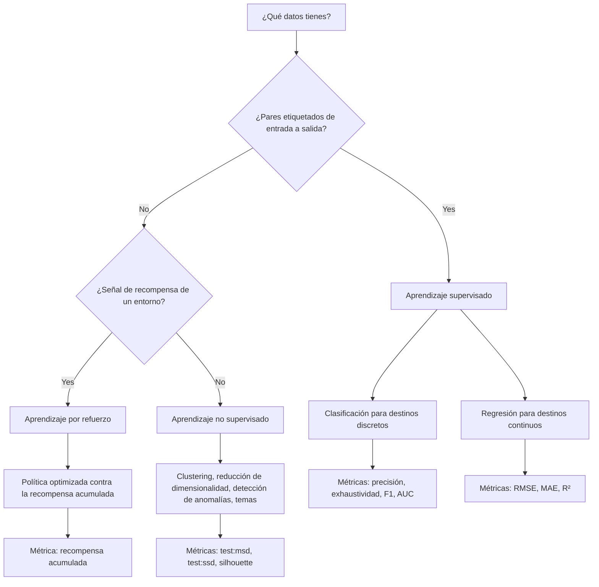
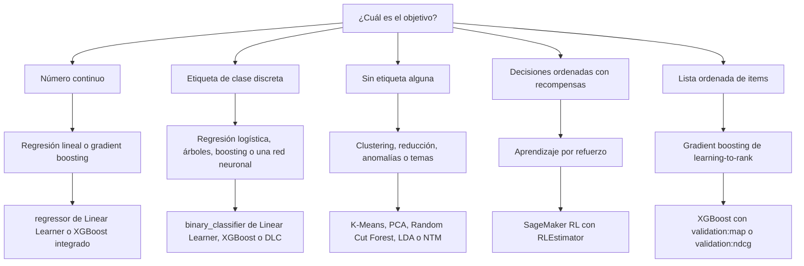
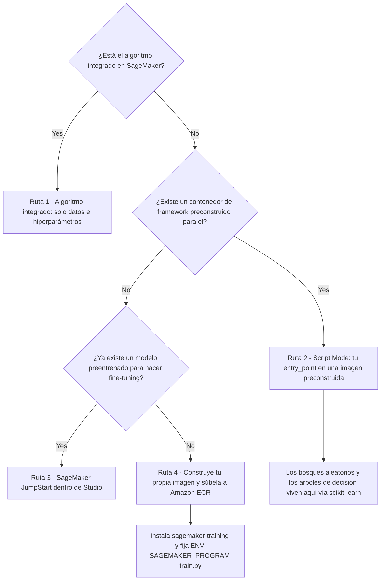
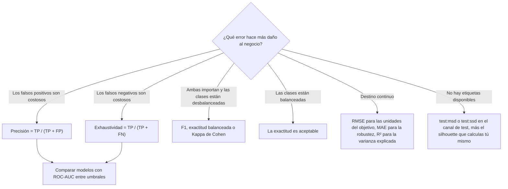
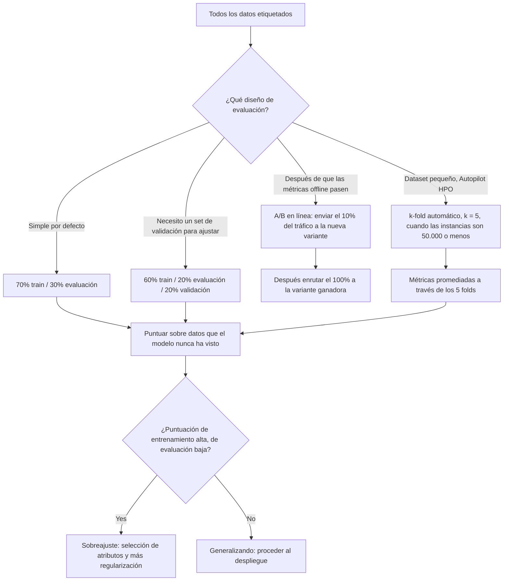

# Algoritmos de ML y evaluación de modelos en AWS

Un algoritmo es fácil de nombrar y difícil de justificar. El examen AIF-C01 casi nunca pregunta *«qué algoritmo existe»*: pregunta *«el negocio necesita X, las etiquetas se parecen a Y, y AWS te da Z; justifica la pareja y defiende la métrica.»* La Tarea 2.1 te pide **seleccionar técnicas de ML apropiadas para casos de uso concretos** (regresión, clasificación, clustering), la Tarea 2.2 te pide **describir el aprendizaje supervisado, no supervisado y por refuerzo**, y la Tarea 1.4 te pide **describir las métricas de rendimiento del modelo** (exactitud, AUC, F1) **y las métricas de negocio** (coste por usuario, coste de desarrollo, opinión del cliente, ROI). Esta lección convierte esas tres frases en un sistema de decisiones operable.

```text
=====================================================================
 ALGORITMOS Y EVALUACIÓN EN AWS — LAS TRES PREGUNTAS DEL EXAMEN
=====================================================================
  ¿QUÉ PARADIGMA? ....... supervisado | no supervisado | por refuerzo
                          (Tarea 2.2 — ¿etiquetas? ¿recompensa? ¿ninguna?)
  ¿QUÉ ALGORITMO? ....... lineal | árbol | boosting | k-NN | neuronal
                          | k-means | PCA | aprendizaje profundo
                          (Tarea 2.1 — regresión / clasificación /
                           clustering)
  ¿QUÉ RUTA DE AWS? ..... integrado | script mode | JumpStart | BYOC
  ¿QUÉ MÉTRICA? ......... exactitud | precisión | exhaustividad | F1 | AUC
                          | RMSE | MAE | R² | test:msd
  ¿QUÉ SPLIT? ........... 70/30 | 60/20/20 | holdout 20-30%
                          | k-fold k = 5-10 | A/B 10% y después 100%
---------------------------------------------------------------------
  LA TRAMPA DETRÁS DE CADA ITEM:
    una alta exactitud puede producirla un modelo que predice
    únicamente la clase mayoritaria. El examen recompensa al
    candidato que comprueba la matriz de confusión antes de
    celebrar.
=====================================================================
```

> [!NOTE]
> **Cómo leer esta lección.** Las secciones 1 a 5 responden *«qué algoritmo y qué herramienta de AWS»*; las secciones 6 a 10 responden *«cómo demuestro que funciona»*; las secciones 11 a 13 son el veredicto, la aritmética y las trampas. Cada número de aquí está tomado de una página publicada por AWS (guía de desarrollador de SageMaker o de machine learning, documentación de Clarify, blogs de ML de AWS, o la guía del examen AIF-C01), y las afirmaciones no verificadas están aisladas en la sección 13.

Al final de esta lección podrás:

- elegir entre **aprendizaje supervisado, no supervisado y por refuerzo** a partir de la forma de los datos solamente;
- mapear **dieciséis familias de algoritmos** a su caso de uso, su ruta de AWS y su hiperparámetro clave;
- declarar qué algoritmos están **integrados en SageMaker**, y cuál famosamente **no** lo está;
- calcular **exactitud, precisión, exhaustividad, F1, MAE, MSE, RMSE y R²** a partir de una matriz de confusión o un set de residuos sin calculadora;
- escoger el **split** correcto (70/30, 60/20/20, holdout 20 to 30%, k-fold 5 to 10) y defenderlo;
- diagnosticar **infraajuste frente a sobreajuste** y aplicar el remedio prescrito por AWS en la dirección correcta;
- atacar el **desbalance de clases** con las tres palancas que AWS documenta (reponderación, resampling, cambio de métrica);
- responder **diez preguntas al estilo del examen** escritas con la voz oficial.

---

## 1. Los tres paradigmas de aprendizaje y cómo los implementa AWS

### 1.1 Guía de selección: lee los datos, no el eslogan

El examen decide el paradigma por ti con una pista: **¿qué contiene el dataset de entrenamiento?** Pares etiquetados de entrada→salida apuntan al aprendizaje supervisado; atributos sin respuestas apuntan al no supervisado; una señal de recompensa que vuelve desde un entorno apunta al aprendizaje por refuerzo.

| Pregunta que haces a los datos | Elige | Por qué (redacción de AWS) | Implementación de AWS |
|---|---|---|---|
| ¿Pares etiquetados de entrada→salida, predecir un destino conocido? | **Supervisado** | Clasificación / regresión | Linear Learner, XGBoost, k-NN, Image Classification |
| ¿Solo atributos; quieres grupos, valores atípicos, forma compacta o temas? | **No supervisado** | Sin respuestas durante el entrenamiento | k-means, PCA, Random Cut Forest, LDA / NTM |
| ¿Decisiones secuenciales, señal de recompensa, bucle agente: entorno? | **Por refuerzo** | Política aprendida de la recompensa | SageMaker RL (`RLEstimator`), Intel Coach, Ray RLlib |
| ¿Las etiquetas son escasas pero la tarea sigue siendo predictiva? | Supervisado + **transferencia** | Reutilizar un modelo preentrenado | SageMaker JumpStart, contenedores de Hugging Face |
| ¿No sabes qué algoritmo gana? | **AutoML** | Construye y ajusta candidatos automáticamente | SageMaker Autopilot, AutoGluon-Tabular |

La distinción en la que los ítems del examen más se apoyan: **el aprendizaje no supervisado nunca ve un set de validación con etiquetas.** La propia documentación de k-means de SageMaker dice que *«no usa un dataset de validación»* porque no hay nada contra lo que validar: toma un canal de **test** y reporta solo métricas basadas en distancia. Una pregunta que ofrece `validation:f1` para un job de clustering está probando si te diste cuenta.

### 1.2 Cómo se ve cada paradigma como flujo de trabajo



### 1.3 Aprendizaje por refuerzo en SageMaker: los hechos concretos

El aprendizaje por refuerzo (RL) es el paradigma que el examen prueba por *reconocimiento de nombre* más que por cálculo. Las afirmaciones verificadas de AWS son:

- SageMaker AI admite RL en **TensorFlow y Apache MXNet**;
- admite los toolkits **Intel Coach** y **Ray RLlib**;
- la FAQ de SageMaker lista los algoritmos **DQN, PPO, A3C y muchos más**;
- el repositorio abierto de contenedores de RL incluye imágenes de **Vowpal Wabbit (VW)**;
- los jobs se lanzaban con el **`RLEstimator`**.

Si una pregunta describe a un agente aprendiendo una política para maximizar la recompensa acumulada en una simulación, la respuesta es SageMaker RL con Coach o Ray RLlib: nunca k-means, nunca Autopilot, nunca PCA.

- **📚 ¿Sabías que…?** El soporte de RL de SageMaker es deliberadamente estrecho: **solo TensorFlow y MXNet** como frameworks. Si una opción ofrece *«SageMaker RL con PyTorch»*, es un distractor: la lista de frameworks documentados no incluye PyTorch, aunque PyTorch está totalmente soportado para aprendizaje profundo **supervisado** a través de los contenedores de aprendizaje profundo preconstruidos.

**Comprueba tu selección de paradigma:**

```matching
{
  "question": "Empareja cada escenario con el paradigma de aprendizaje y la herramienta de AWS que lo implementa:",
  "pairs": [
    {"left": "Datos etiquetados de churn, predecir cancelación sí/no", "right": "Clasificación supervisada: binary_classifier de Linear Learner o XGBoost"},
    {"left": "50.000 transacciones sin etiquetas, agrupar clientes en segmentos", "right": "Clustering no supervisado: K-Means integrado con test:msd y test:ssd"},
    {"left": "Un brazo robótico aprende una política de recoger y colocar desde recompensas", "right": "Aprendizaje por refuerzo: SageMaker RL con RLEstimator, Coach o Ray RLlib"},
    {"left": "10.000 filas de sensores, encontrar las 40 lecturas que rompen el patrón", "right": "Detección de anomalías no supervisada: Random Cut Forest"},
    {"left": "Predecir el tiempo de entrega en días a partir de atributos de ruta y clima", "right": "Regresión supervisada: regressor de Linear Learner o XGBoost, puntuado con RMSE"},
    {"left": "10.000 documentos, descubrir temas recurrentes sin etiquetas", "right": "Modelado de temas no supervisado: LDA o Neural Topic Model"}
  ],
  "explanation": "El paradigma lo decide la presencia de etiquetas, no la industria. Objetivo etiquetado => supervisado (clasificación para destinos discretos, regresión para continuos). Solo atributos => no supervisado (clustering, anomalías, temas, reducción de dimensionalidad). Un bucle de recompensa => por refuerzo. La herramienta de AWS sigue del paradigma: Linear Learner y XGBoost son algoritmos supervisados integrados, K-Means/Random Cut Forest/LDA son algoritmos no supervisados integrados, y SageMaker RL es la única ruta para políticas impulsadas por recompensa."
}
```

---

## 2. La matriz algoritmo → caso de uso → ruta de AWS

Esta es la tabla más examinable del Dominio 2. Léela como tres preguntas respondidas a la vez: *qué familia*, *qué caso de negocio*, *dónde corre en AWS*.

### 2.1 La matriz completa

| Familia de algoritmo | Caso de uso | Ruta de AWS | Configuración / métrica clave |
|---|---|---|---|
| Regresión lineal | Predicción de precio y de tiempo de entrega | **Linear Learner** integrado (`regressor`) | Variantes de loss; `validation:rmse` |
| Regresión logística | Churn, predicción de clic en anuncios | **Linear Learner** integrado (`binary_classifier`) | `validation:precision` / `validation:recall` |
| Árbol de decisión | Decisiones basadas en reglas y explicables | **Contenedor de scikit-learn + Script Mode** (sin integrado) | Script `entry_point` |
| Bosque aleatorio | Línea base tabular | **Contenedor de scikit-learn + Script Mode** («no out-of-the-box») | `n_estimators`, `min_samples_leaf` |
| XGBoost (gradient boosting) | Tabular, fraude, ranking | **XGBoost integrado** | `num_round` (obligatorio), `eta`, `max_depth` |
| LightGBM / CatBoost | Datasets tabulares grandes | **Integrados** (CSV, File mode, CPU de instancia única) | GOSS + EFB / ordered boosting |
| Ensamblado con AutoML | La línea base defendible más rápida | **AutoGluon-Tabular** integrado o **SageMaker Autopilot** | objetivo binario por defecto de Autopilot = F1 |
| k-NN | Búsqueda de items/usuarios | **k-NN integrado** | `k`; recordIO o CSV; paralelizable |
| Redes neuronales / aprendizaje profundo | Imágenes, texto, secuencias | **Contenedores DL**: TensorFlow, PyTorch, MXNet, Chainer, **Hugging Face** | instancias con GPU, imágenes DLC |
| Fine-tuning de transformer / MF | Adaptar un modelo fundacional | **SageMaker JumpStart** (`ModelTrainer`) | `model_id` + canales train/validation |
| k-means | Segmentación, agrupamiento | **K-Means integrado** | `k`, `init_method`; `test:msd` / `test:ssd` |
| PCA | Reducción de atributos | **PCA integrado** | `feature_dim`, `num_components` |
| Detección de anomalías | Valores atípicos de sensores / IP | **Random Cut Forest**, **IP Insights** | Puntuación sobre el canal de test |
| Modelado de temas | Temas de documentos | **LDA**, **Neural Topic Model** integrados | Entrada de texto |
| Control secuencial | Agente, robótica, política | **SageMaker RL** `RLEstimator` (Coach / Ray RLlib / VW) | TensorFlow o MXNet |
| Series temporales | Predicción de demanda | **Deep AR Forecasting** integrado | Objetivo secuencial |

### 2.2 Del tipo de tarea a la familia de algoritmos



### 2.3 Las listas de integrados que debes poder reproducir

AWS organiza sus algoritmos integrados en los grupos **supervisado**, **no supervisado** y **por refuerzo**. El set supervisado tabular es el que el examen más reutiliza:

**Integrados tabulares (clasificación o regresión):** AutoGluon-Tabular, CatBoost, Factorization Machines, k-NN, LightGBM, **Linear Learner**, TabTransformer, **XGBoost**.

La documentación de Linear Learner es explícita sobre lo que es: *«aprende una función lineal para regresión o una función de umbral lineal para clasificación»*: lo que lo convierte en la respuesta integrada siempre que una pregunta dice **regresión logística** o **regresión lineal**.

**Integrados no supervisados:** PCA (reducción de dimensionalidad), K-Means (clustering), Random Cut Forest (detección de anomalías), IP Insights (anomalías de dirección IP), LDA y Neural Topic Model (modelado de temas).

> [!WARNING]
> **No hay bosques aleatorios listos para usar en SageMaker.** La propia documentación de script mode de AWS lo afirma textualmente. La ruta documentada es el **contenedor de scikit-learn + Script Mode**: tu script de entrenamiento instancia `RandomForestRegressor` o `RandomForestClassifier` y SageMaker lo ejecuta dentro de la imagen de scikit-learn preconstruida. Una opción que ofrezca *«llamar al algoritmo integrado `RandomForest` con `num_round`»* está ofreciendo dos mentiras a la vez: el algoritmo no está integrado, y `num_round` es un hiperparámetro de XGBoost.

- **📚 ¿Sabías que…?** AWS publica **listas** de algoritmos, nunca un recuento. Cualquier opción que empiece *«SageMaker tiene exactamente N algoritmos integrados»* es un número inventado: las listas cambian a medida que se añaden y se eliminan algoritmos (AutoGluon-Tabular y TabTransformer son adiciones recientes al set tabular). Aprende la pertenencia a las listas, no un total.

---

## 3. Las familias supervisadas: lineales, árboles, boosting y redes neuronales

### 3.1 Linear Learner: el caballo de batalla de regresión y clasificación

Linear Learner es la respuesta a *«qué integrado hace regresión lineal o logística?»* y porta tres propiedades examinables:

| Propiedad | Valor verificado |
|---|---|
| Tareas | Regresión (`regressor`) y clasificación (`binary_classifier`) |
| Métricas emitidas | `validation:precision`, `validation:recall`, `validation:rmse`, `validation:absolute_loss`, `validation:objective_loss` |
| Regla de ajuste de AWS | *«Para evitar el sobreajuste, recomendamos ajustar el modelo contra una métrica de validación en lugar de una métrica de entrenamiento.»* |
| Comportamiento del Tuner | Su hiperparámetro `num_models` se desactiva bajo ajuste automático de modelos |

Esa regla de ajuste es una respuesta gratis siempre que una opción diga *«ajustar contra la métrica de entrenamiento»*. El remedio documentado es lo opuesto: **ajusta sobre la métrica de validación.**

### 3.2 Gradient boosting: tres integrados más un envoltorio de AutoML

El gradient boosting está representado en SageMaker por **tres** algoritmos integrados más una opción de ensamblado por stacking:

| Algoritmo | Rasgo distintivo | Hiperparámetros destacables |
|---|---|---|
| **XGBoost** | Regresión, clasificación binaria/multiclase **y ranking** | `num_round` (obligatorio), `eta`, `max_depth`, `subsample`, `alpha`, `min_child_weight` |
| **CatBoost** | Ordered boosting, atributos categóricos nativos | Manejo de categorías sin codificación manual |
| **LightGBM** | GOSS (gradient-based one-side sampling) + EFB (exclusive feature bundling) | Velocidad en tabulares grandes |
| **AutoGluon-Tabular** | Ensamblado por stacking de muchos modelos base | La línea base defendible más rápida |

**Detalles de XGBoost que el examen reutiliza:**

- el contenedor cubre XGBoost **1.0, 1.2, 1.3, 1.5, 1.7 y 3.0**;
- **`num_round` es obligatorio** (más `num_class` para `multi:softmax` y `multi:softprob`);
- el objetivo por defecto es **`reg:squarederror`**: así que un job de XGBoost sin configurar es un job de *regresión*;
- el entrenamiento con GPU se habilita con **`tree_method=gpu_hist`**;
- los hiperparámetros de mayor impacto para el ajuste son **`alpha`, `min_child_weight`, `subsample`, `eta` y `num_round`**.

### 3.3 El menú de métricas de XGBoost: doce objetivos con direcciones

El ajuste automático de modelos necesita un objetivo **y una dirección**. XGBoost expone doce métricas de validación, y la dirección es parte de la respuesta:

| Maximizar | Minimizar |
|---|---|
| `validation:accuracy` | `validation:error` |
| `validation:auc` | `validation:logloss` |
| `validation:f1` | `validation:mae` |
| `validation:map` | `validation:merror` |
| `validation:ndcg` | `validation:mlogloss` |
|: | `validation:mse` |
|: | `validation:rmse` |

En esta tabla viven dos trampas. Primero, **las métricas de ranking (`map`, `ndcg`) son Maximizar** mientras que cada métrica de error es **Minimizar**: seleccionar `validation:rmse` con dirección `Maximizar` ajustaría el modelo hacia el *peor* resultado. Segundo, **`merror` y `mlogloss` son los hermanos multiclase de `error` y `logloss`**; confundirlos en una opción es un patrón de distractor común.

### 3.4 Árboles, bosques y redes neuronales: las rutas que necesitan código

| Familia | Ruta en SageMaker | Por qué |
|---|---|---|
| Árbol de decisión | Contenedor de scikit-learn + Script Mode | No existe un árbol de decisión integrado |
| Bosque aleatorio | Contenedor de scikit-learn + Script Mode | AWS: *«no 'out-of-the-box' random forest algorithm»* |
| Cualquier modelo personalizado | Script Mode con tu imagen de framework | Tu script `entry_point` corre en una imagen preconstruida |
| Red neuronal profunda | **Contenedores DL** preconstruidos: TensorFlow, MXNet, PyTorch, Chainer, Hugging Face | Listos para GPU, gestionados |
| Integrados de visión / NLP | Image Classification, Object Detection, Semantic Segmentation, NTM, Object2Vec, TabTransformer, Deep AR Forecasting | Algoritmos profundos integrados |
| Transformer con fine-tuning | SageMaker JumpStart | Modelo preentrenado, código mínimo |

Object2Vec merece un gancho de memoria específico: usa **entropía cruzada para clasificación** y **error cuadrático medio (MSE) para regresión**: el mismo algoritmo cambia su función de loss con la tarea, que es exactamente el tipo de detalle que una opción puede voltear para fabricar una respuesta errónea.

---

## 4. Las familias no supervisadas: clustering, reducción, anomalías y temas

### 4.1 K-Means: no existe set de validación

K-Means es la forma favorita del examen de comprobar que entiendes que **el aprendizaje no supervisado no tiene set de validación etiquetado**. Los puntos de documentación verificados:

- *«Al ser no supervisado, no usa un dataset de validación… Pero sí toma un dataset de test.»*
- Métricas objetivo: **`test:msd`** (distancias cuadradas medias) y **`test:ssd`**: **ambas Minimizar**;
- la inferencia devuelve **`closest_cluster`** y **`distance_to_cluster`**;
- hiperparámetros: **`k`**, **`init_method`** (`random` o `k-means++`), **`mini_batch_size`**.

Observa la dirección: las métricas de distancia se **minimizan**, porque una distancia cuadrada más pequeña significa conglomerados más ajustados. Cada objetivo de clustering basado en distancia en SageMaker apunta en la misma dirección.

### 4.2 Silhouette: una métrica real que no es una métrica de SageMaker

El coeficiente silhouette va de **−1 a 1**; un valor cercano a **1** significa que los puntos están ajustados dentro de su propio conglomerado *y* lejos de los otros. La guía de AWS es **emparejar silhouette con la inercia**, y dejar claro que **SageMaker no la emite**: la calculas tú mismo fuera del job de entrenamiento. Una pregunta que ofrezca *«seleccionar `validation:silhouette` como objetivo de ajuste»* está probando precisamente ese límite.

### 4.3 PCA: tres hiperparámetros obligatorios

PCA está integrado, y su configuración es examinable porque es corta:

| Parámetro | Requisito | Significado |
|---|---|---|
| `feature_dim` | **Obligatorio** | Dimensionalidad de cada vector de entrada |
| `mini_batch_size` | **Obligatorio** | Filas procesadas por paso de gradiente |
| `num_components` | **Obligatorio** | Número de componentes principales a conservar |
| `algorithm_mode` | Opcional | `regular`, `stable` o `randomized` |
| `subtract_mean` | Opcional | Si centrar los datos |
| `extra_components` | Opcional | Componentes extra calculados más allá de `num_components` |

PCA devuelve la **`mean`**, la matriz de autovectores **`v`** y los valores singulares **`s`**: que es como luego reconstruyes o proyectas datos con los componentes que conservaste.

### 4.4 Detección de anomalías y modelado de temas

| Necesidad | Algoritmo integrado | Notas |
|---|---|---|
| Detección de valores atípicos numéricos (sensores, métricas) | **Random Cut Forest** | Puntúa un canal de test; no supervisado |
| Anomalías de red / IP | **IP Insights** | Aprende patrones normales de asociación de IP |
| Descubrimiento de temas en documentos | **LDA** (Latent Dirichlet Allocation) | Modelo de temas clásico |
| Descubrimiento de temas a escala | **Neural Topic Model (NTM)** | Variante de aprendizaje profundo |

- **📚 ¿Sabías que…?** `test:msd` y `test:ssd` *no* son sinónimos intercambiables: **`msd` es la** distancia cuadrada **media** y **`ssd` es la** distancia cuadrada **suma** al centroide. En un set de test de *n* filas, `ssd = msd × n`, así que `ssd` crece con el tamaño del dataset mientras `msd` no. Ambas se minimizan, y ambas son objetivos de clustering válidos, pero solo `msd` es comparable entre sets de test de distinto tamaño.

---
## 5. Cuatro rutas hacia un algoritmo

AWS documenta exactamente **cuatro** formas de poner un algoritmo en marcha, y el examen prueba si puedes nombrarlas en orden de esfuerzo creciente.

| # | Ruta | Qué aportas tú | Qué aporta AWS | Cuándo usarla |
|---|---|---|---|---|
| 1 | **Algoritmo integrado** | Datos + hiperparámetros | *«Sin código para empezar a ejecutar experimentos»* | El algoritmo está en la lista de integrados |
| 2 | **Script Mode** | Tu script de entrenamiento (`entry_point`) | Un contenedor de framework preconstruido | Tu algoritmo existe en un framework del que AWS ya tiene imagen |
| 3 | **JumpStart** | Un `model_id` y canales de entrenamiento | Un modelo preentrenado para ajustar y desplegar *«dentro de Amazon SageMaker Studio»* | Quieres un modelo fundacional o preentrenado con código mínimo |
| 4 | **Bring your own container (BYOC)** | Dockerfile + código de entrenamiento | Alojamiento en Amazon ECR | Nada preconstruido encaja |

### 5.1 El flujo de decisión



### 5.2 BYOC: las tres reglas de contenedor innegociables

Si una pregunta te empuja a la Ruta 4, tres hechos documentados deciden la respuesta:

1. el paquete de toolkit **`sagemaker-training`** es **obligatorio**;
2. **`ENV SAGEMAKER_PROGRAM train.py`** es *la única variable de entorno requerida*: nombra el punto de entrada que SageMaker invoca;
3. **`/opt/ml` y todos sus subdirectores están reservados por el entrenamiento de SageMaker**, así que las entradas, los artefactos del modelo y la salida deben seguir ese diseño.

Dos reglas de contenedor más aparecen como distractores:

- SageMaker **sobrescribe el `CMD` por defecto** de tu imagen añadiendo el argumento `train`;
- las imágenes con GPU deben ser **compatibles con `nvidia-docker`**: incluye el **CUDA toolkit**, pero **no incluyas los drivers de NVIDIA**: los aporta el host.

### 5.3 Las ventanas de soporte de los contenedores son fechas examinables

| Contenedor | Fecha GA | Fin del soporte de parches |
|---|---|---|
| XGBoost **3.0-5** | 17 nov 2025 | **17 nov 2026** |
| Scikit-Learn **1.4-2** | 30 oct 2025 | **30 oct 2026** |

AWS publica un calendario explícito de **GA → fin de parches** para sus contenedores de algoritmos. El patrón que vale la pena memorizar es el *formato*: aproximadamente **un año** de soporte de parches tras la disponibilidad general, que es la razón por la que un ítem de examen fechado en 2026 puede referenciar legítimamente a un lanzamiento de 2025 que alcanza el fin de parches en ese mismo año.

---

## 6. Métricas de evaluación: fórmulas, direcciones y cuándo usarlas

### 6.1 La hoja de fórmulas

| Métrica | Fórmula | Dirección | Cuándo usarla |
|---|---|---|---|
| Exactitud | (TP+TN)/(TP+TN+FP+FN) | Más alta, mejor | Clases balanceadas; corrección global |
| Precisión | TP/(TP+FP) | Más alta, mejor | **Los falsos positivos son costosos** |
| Exhaustividad | TP/(TP+FN) | Más alta, mejor | **Los falsos negativos son costosos** |
| F1 | 2·P·R/(P+R) = 2TP/(2TP+FP+FN) | Más alta, mejor | Datos binarios desbalanceados; objetivo binario por defecto de Autopilot |
| ROC-AUC | Área bajo TPR frente a FPR en todos los umbrales | 0.5 aleatorio → 1.0 | Comparación de modelos entre umbrales; datos sesgados |
| Exactitud balanceada | (Exhaustividad + Tasa de verdaderos negativos)/2 | Más alta, mejor | Tanto el castigo de FP como el de FN son altos |
| Matriz de confusión | Tabla de recuentos, predicho × real | Recuentos (sin dirección) | Diagnóstico: *qué* clases se confunden |
| MSE | Σ(ŷ−y)²/n | Más bajo, mejor | Castiga con dureza los errores grandes |
| RMSE | √MSE | Más bajo, **unidades del objetivo** | Reportar el error en dólares o en grados |
| MAE | Σ\|ŷ−y\|/n | Más bajo, unidades del objetivo | Robusta y fácil de interpretar |
| R² | 1 − SS_res/SS_tot | Más cercano a 1 | Proporción de varianza explicada |
| Silhouette | (b−a)/max(a,b), promediado | −1..1, más cercano a 1 | Cohesión del conglomerado; **no es una métrica de SageMaker** |
| `test:msd` / `test:ssd` | Distancia cuadrada media / suma al centroide | **Minimizar** | Métricas objetivo oficiales de k-means |
| mAP / NDCG | Calidad del ranking | Más alta, mejor | Ranking y recomendación (`validation:map`, `validation:ndcg`) |

El resumen que AWS hace de la relación entre precisión y exhaustividad vale la pena memorizarlo textual: **la precisión recorta los falsos positivos, la exhaustividad recorta los falsos negativos, y la F1 es la media armónica de ambas.**

### 6.2 Elegir una métrica a partir de la matriz de confusión



### 6.3 Matriz de confusión resuelta #1: datos de churn balanceados

Un modelo de churn se evalúa sobre **200 clientes**: **TP = 80, FP = 20, FN = 10, TN = 90**.

$$
\text{Accuracy} = \frac{TP+TN}{N} = \frac{80+90}{200} = \frac{170}{200} = 0.85
$$

$$
\text{Precision} = \frac{TP}{TP+FP} = \frac{80}{100} = 0.80
$$

$$
\text{Recall} = \frac{TP}{TP+FN} = \frac{80}{90} = 0.889
$$

$$
F1 = \frac{2TP}{2TP+FP+FN} = \frac{160}{190} = 0.842
$$

Lectura: el modelo captura alrededor del **89% de los que se van**, pero **20 de sus 100 alertas son incorrectas**. Una exactitud de 0,85 es respetable aquí *porque las clases están razonablemente balanceadas* (90 positivos, 110 negativos).

### 6.4 Matriz de confusión resuelta #2: la trampa del 1% de fraude

Un modelo de fraude se evalúa sobre **10.000 transacciones de las cuales solo 100 son fraudulentas**: **TP = 85, FP = 40, FN = 15, TN = 9.860**.

$$
\text{Accuracy} = \frac{85+9860}{10000} = \frac{9945}{10000} = 99.45\%
$$

Sin embargo, un modelo que **siempre predice «no fraude»** ya puntúa:

$$
\frac{9900}{10000} = 99.0\%
$$

Así que una exactitud de 99,45% compra **0,45 puntos porcentuales** sobre una línea base inútil. Las métricas que importan:

$$
\text{Precision} = \frac{85}{85+40} = \frac{85}{125} = 0.68
$$

$$
\text{Recall} = \frac{85}{85+15} = \frac{85}{100} = 0.85
$$

$$
F1 = \frac{2 \times 85}{170+40+15} = \frac{170}{225} = 0.756
$$

Lectura: **el 32% de las alertas de fraude son falsas alarmas**, el modelo se salta 15 de cada 100 fraudes, y la exactitud titular es casi sin sentido. Este es el patrón de evaluación más repetido del material propio de AWS sobre detección de fraude.

> [!WARNING]
> **La exactitud es la métrica trampa del Dominio 1.** Cuando una clase domina, fraude al **0,173%**, churn al 2%, tasas de defecto por debajo del 1%, un modelo perezoso alcanza una exactitud casi perfecta prediciendo la clase mayoritaria cada vez. Antes de aceptar una cifra de exactitud, pregúntate: *¿qué puntuaría un predictor de la clase mayoritaria?* Si la respuesta está a menos de un punto de tu modelo, cambia a **precisión, exhaustividad, F1, ROC-AUC, exactitud balanceada o Kappa de Cohen**, y barre el umbral de decisión de 0,1 a 0,9.

---

## 7. Splits de datos, validación cruzada y pruebas A/B

### 7.1 Los estándares de split publicados

| Estándar | Valor oficial | Fuente |
|---|---|---|
| Split por defecto de Amazon ML | **70% train / 30% evaluación** | Guía de desarrollador de ML, evaluación de modelos |
| Split en tres vías recomendado | **60% train / 20% evaluación / 20% validación** | Guía de desarrollador de ML, evaluación de modelos |
| Porción holdout de SageMaker | **20 to 30%** de los datos de entrenamiento | Guía de desarrollador de SageMaker, validación de modelos |
| `k` de k-fold de SageMaker | Típicamente **5 to 10** | Guía de desarrollador de SageMaker, validación de modelos |
| Validación cruzada HPO de Autopilot | Automática con **k = 5** cuando hay ≤ **50.000** instancias de entrenamiento | Guía de desarrollador de SageMaker, métricas de autopilot |
| Split del ensamblado de Autopilot | **80% train / 20% validación** | Guía de desarrollador de SageMaker, métricas de autopilot |
| Tráfico de prueba A/B en línea | **10% → después 100%** | Guía de desarrollador de SageMaker, validación de modelos |
| Registros autoevaluados de Clarify | **100** (la mayoría de tareas), **300** (conocimiento factual) | Guía de desarrollador de SageMaker, Clarify |

La razón que AWS da para retener datos es una frase que vale la pena reproducir en una respuesta de examen: evaluar sobre datos de entrenamiento *«recompensa a los modelos que pueden "memorizar" los datos de entrenamiento, en lugar de generalizar a partir de ellos.»*

### 7.2 Aritmética de splits y validación cruzada sobre 100.000 filas

| Esquema | Train | Validación / evaluación | Test | Notas |
|---|---|---|---|---|
| 70/30 por defecto | **70.000** | **30.000** |: | Valor por defecto de Amazon ML |
| 60/20/20 en tres vías | **60.000** | **20.000** | **20.000** | Train / evaluación / validación |
| Holdout 20 to 30% | 70.000 to 80.000 |: | **20.000 to 30.000** | Rango recomendado por SageMaker |
| k = 5 | 80.000 por fold | 20.000 por fold |: | 5 modelos, métricas promediadas |
| k = 10 | 90.000 por fold | 10.000 por fold |: | 10 modelos, métricas promediadas |

### 7.3 Validación cruzada de Autopilot: el umbral de 50.000 instancias

Con **40.000 instancias de entrenamiento** (≤ 50.000, así que se aplica el modo HPO con validación cruzada automática de **k = 5**):

1. el split automático **80/20** da **32.000 train / 8.000 validación**;
2. cada uno de los **5 folds** entrena con 4/5 × 32.000 = **25.600** instancias;
3. cada fold valida sobre **6.400** instancias;
4. las cinco puntuaciones de validación se **promedian** en el objetivo reportado.

Un dataset de **60.000 instancias** **supera** el umbral de ≤ 50.000, así que la validación cruzada automática en modo HPO no se activa: mientras que el **modo ensemble** ejecuta validación cruzada sin importar el tamaño junto a su split automático 80/20.

### 7.4 Cómo encaja el bucle



**Comprobación interactiva: las fórmulas que no deberías tener que buscar:**

```fillblank
{
  "question": "Completa las cuatro fórmulas de métricas usadas a lo largo de esta lección:",
  "template": "Precisión = {{1}} / (TP + FP)   |   Exhaustividad = TP / (TP + {{2}})   |   F1 = 2 x {{3}} / (P + {{3}})   |   RMSE = {{4}} de MSE",
  "answers": {
    "1": "TP",
    "2": "FN",
    "3": "P x R",
    "4": "raíz cuadrada"
  },
  "distractors": ["TN", "FP", "exactitud", "varianza", "log loss", "media"],
  "explanation": "La precisión es la proporción de positivos predichos que son realmente positivos (TP / (TP + FP)); la exhaustividad es la proporción de positivos reales que el modelo encontró de verdad (TP / (TP + FN)); la F1 es la media armónica 2PR / (P + R), que se niega a dejar que un número fuerte oculte uno débil; y la RMSE es la raíz cuadrada del error cuadrático medio, que es lo que devuelve el error a las propias unidades del objetivo después de que el cuadrado haya castigado los fallos grandes."
}
```

---

## 8. Infraajuste, sobreajuste y los controles de ajuste que los corrigen

### 8.1 El diagnóstico

| Señal | Diagnóstico | Remedio prescrito por AWS |
|---|---|---|
| Error alto **sobre datos de entrenamiento** | **Infraajuste**: el modelo es demasiado simple | Añadir atributos, cambiar el procesamiento, **reducir** la regularización, más pasadas |
| Error de entrenamiento bajo, **error de evaluación alto** | **Sobreajuste**: *«funciona bien sobre los datos de entrenamiento pero no funciona bien sobre los datos de evaluación… memorizando los datos»* | Selección de atributos, **aumentar** la regularización, ajustar sobre una métrica de **validación**, early stopping o Hyperband |
| Ambas puntuaciones malas | Datos insuficientes | Aumentar los ejemplos de entrenamiento; aumentar el número de pasadas |
| Las métricas de producción decaen | Deriva de datos / de concepto | Model Monitor + sesgo postrainento de Clarify; reentrenar |
| La exactitud se ve genial, el modelo inútil | Métrica equivocada | Cambiar a AUC / F1 / exactitud balanceada / Kappa de Cohen; barrer el umbral 0,1 to 0,9 |

La firma oficial de sobreajuste de AWS es corta: **alta exactitud de entrenamiento más baja exactitud de prueba.** La dirección del remedio importa tanto como el remedio: *el sobreajuste recibe más regularización, el infraajuste recibe menos*. Invertirlas es un distractor clásico.

### 8.2 Los controles de ajuste que previenen el sobreajuste mecánicamente

Cuatro controles documentados hacen el trabajo que un humano haría a ojo:

1. **Ajusta contra una métrica de validación, no de entrenamiento.** La documentación de Linear Learner lo establece como recomendación, no como preferencia.
2. **Early stopping.** En cada época, la métrica objetivo se compara con la **mediana de medias móviles** de jobs anteriores; los jobs con peor rendimiento se detienen antes: AWS dice que esto *«te ayuda a evitar el sobreajuste de tu modelo»*. El ajuste es `early_stopping_type='Auto'`.
3. **Hyperband** también termina antes los jobs con peor rendimiento, asignando el presupuesto a configuraciones prometedoras.
4. **Dirección de la regularización**: aumenta el sobreajuste, reduce el infraajuste.

| Control | Mecanismo | Redacción / ajuste de AWS |
|---|---|---|
| Ajuste por métrica de validación | El objetivo nunca ve las filas de entrenamiento | *«tuning the model against a validation metric»* |
| Early stopping | Comparar con la **mediana de medias móviles** de jobs anteriores | `early_stopping_type='Auto'` |
| Hyperband | Asignación de recursos con corchetes, elimina los jobs débiles | Terminación temprana consciente del recurso |
| Regularización | Control de capacidad | **Aumentar** para sobreajuste, **reducir** para infraajuste |

### 8.3 Ordena la secuencia de diagnóstico

```dragdrop
{
  "question": "Ordena los pasos que un equipo debe seguir cuando las puntuaciones de un modelo se ven mal:",
  "items": [
    "Comparar la puntuación de entrenamiento con la de evaluación o validación",
    "Clasificar el hueco: malo en ambos = infraajuste, bueno en train y malo en evaluación = sobreajuste",
    "Comprobar si la métrica elegida siquiera puede expresar el problema (exactitud de clase mayoritaria, MSE en unidades al cuadrado)",
    "Aplicar el remedio correspondiente: más atributos y menos regularización para infraajuste, selección de atributos y más regularización para sobreajuste",
    "Reajustar contra una métrica de validación con early stopping o Hyperband habilitado",
    "Confirmar sobre un set retenido que el modelo nunca ha visto (holdout del 20 al 30 por ciento, o k-fold con k entre 5 y 10)"
  ],
  "correctOrder": [
    "Comparar la puntuación de entrenamiento con la de evaluación o validación",
    "Clasificar el hueco: malo en ambos = infraajuste, bueno en train y malo en evaluación = sobreajuste",
    "Comprobar si la métrica elegida siquiera puede expresar el problema (exactitud de clase mayoritaria, MSE en unidades al cuadrado)",
    "Aplicar el remedio correspondiente: más atributos y menos regularización para infraajuste, selección de atributos y más regularización para sobreajuste",
    "Reajustar contra una métrica de validación con early stopping o Hyperband habilitado",
    "Confirmar sobre un set retenido que el modelo nunca ha visto (holdout del 20 al 30 por ciento, o k-fold con k entre 5 y 10)"
  ],
  "explanation": "El diagnóstico debe preceder al remedio, porque los dos remedios son opuestos: el sobreajuste necesita más regularización y selección de atributos, el infraajuste necesita menos regularización y más atributos. La comprobación de la métrica va antes del remedio porque un predictor de la clase mayoritaria puede ocultar ambos problemas detrás de una cifra alta de exactitud. Reajustar contra una métrica de validación con early stopping o Hyperband es la versión mecánica de la misma solución, y la confirmación final debe usar datos que el modelo haya visto de verdad por primera vez."
}
```

- **📚 ¿Sabías que…?** El early stopping en el ajuste automático de modelos de SageMaker **no** compara tu job con un objetivo fijo: compara el valor del objetivo de cada época con la **mediana de las medias móviles de todos los jobs anteriores**. Eso hace que el umbral sea adaptativo: un job inicial inusualmente fuerte sube la barra para todo lo que sigue, y un job inicial débil la baja. La lista de soporte de early stopping lleva un sello de «vigente a 13 de diciembre de 2018», así que trata cualquier afirmación sobre *qué* algoritmos lo soportan como histórica.

---

## 9. Datos desbalanceados: tres palancas y los números detrás de ellas

AWS documenta **tres palancas independientes** para el desbalance. Una respuesta fuerte usa al menos dos de ellas a la vez.

### 9.1 Las tres palancas

| Palanca | Mecanismo | Implementación de AWS | Restricción |
|---|---|---|---|
| **1. Resampling** | Rebalancear las propias filas | **Balance** de SageMaker Data Wrangler: oversampler aleatorio, undersampler aleatorio, **SMOTE** | **Solo clasificación binaria** |
| **2. Pesos de clase** | Castigar los errores en la clase rara | `scale_pos_weight` de XGBoost; `positive_example_weight_mult='balanced'` (binario) / `balance_multiclass_weights` (multiclase) de Linear Learner; Autopilot lo aplica automáticamente | Los pesos cambian el límite de decisión, no los datos |
| **3. Cambio de métrica** | Medir lo que la exactitud oculta | AUC, F1, exactitud de clasificación balanceada, Kappa de Cohen | La dirección de la métrica debe coincidir con el objetivo de ajuste |

### 9.2 Aritmética de pesos de clase

**Caso A: un split binario de 98% / 2%.** Para que la clase minoritaria cuente tanto como la mayoritaria:

$$
0.02 \times w = 0.98 \implies w = \frac{0.98}{0.02} = 49
$$

Así que `positive_example_weight_mult='balanced'` de Linear Learner sobre un dataset 98/2 produce un peso positivo de **49**.

**Caso B: el propio dataset de fraude de AWS.** Con **284.807** ejemplos de los cuales **492** son fraudulentos (**0,173%**), la variante XGBoost de AWS usa la regla de la raíz cuadrada en lugar del ratio crudo:

$$
\text{scale\_pos\_weight} = \sqrt{\frac{284{,}315}{492}} = \sqrt{577.9} \approx 24
$$

El ratio crudo sería **577,9**; el amortiguamiento por raíz cuadrada mantiene el entrenamiento estable mientras aún le dice al modelo que el fraude importa. AWS reporta además que elevar el **Kappa de Cohen por encima de 0,8** sería *«generally very favorable»* en ese problema.

### 9.3 Lo que te cuesta la ponderación: el compromiso documentado

Ponderar no es gratis. El propio ejemplo multiclase de AWS muestra ambas caras:

| Medida | Antes de balancear | Después de balancear |
|---|---|---|
| Exhaustividad de la clase rara (Aspen) | **1%** | **por encima del 50%** |
| Exhaustividad de cada clase | alguna colapsa al ~1% | **todas por encima del 50%** |
| Exhaustividad de la clase dominante (Lodgepole Pine) | **81%** | **52%** |
| Exactitud global | **72%** | **59%** |

La lección que el examen quiere: **cambiaste 13 puntos de exactitud por un modelo que de verdad reconoce la clase rara.** En un problema desbalanceado, ese intercambio suele ser correcto, pero debe ser una *decisión*, no un efecto secundario.

### 9.4 El cambio de métrica, lado a lado

| Situación | Métrica a la que ir | Por qué falla la exactitud |
|---|---|---|
| Fraude con prevalencia de 0,173% | ROC-AUC (`job_objective='AUC'` en Autopilot) | Línea base de 99,0% prediciendo siempre «no fraude» |
| Binario, moderadamente desbalanceado | F1 (objetivo binario **por defecto** de Autopilot) | La media armónica se niega a ocultar un lado débil |
| Tanto FP como FN caros | Exactitud balanceada = (Exhaustividad + TNR)/2, o Kappa de Cohen | La clase mayoritaria domina la exactitud simple |
| El umbral necesita ajuste | Curva precisión/exhaustividad, barrer 0,1 to 0,9 | Un solo umbral rara vez optimiza ambas |

> [!NOTE]
> **Autopilot hace dos de las tres palancas por ti.** Su objetivo binario por defecto es **F1** (cambia a **AUC** con `job_objective='AUC'` para datos sesgados más allá del 99%), y *«automatically applied up-weighting to the minority class using `scale_pos_weight`»*. Si una pregunta pide qué hace automáticamente Autopilot con datos binarios desbalanceados, la respuesta es **tanto el valor por defecto de la métrica como la ponderación**.

---
## 10. Evaluación por tipo de tarea: la tabla de consulta

| Tipo de tarea | Configuración | Métricas principales | Nombres de métricas emitidas por AWS | Trampa |
|---|---|---|---|---|
| Binario (balanceado) | train/val/test o 70/30 | Exactitud, F1, ROC-AUC | `validation:precision` / `:recall` de Linear Learner; `validation:f1` / `:auc` de XGBoost | Confiar solo en la exactitud |
| Binario (desbalanceado) | Split estratificado antes del resampling | Precisión, exhaustividad, F1, AUC, exactitud balanceada, Kappa de Cohen | `scale_pos_weight` + `validation:auc` de XGBoost; `job_objective='AUC'` de Autopilot | 99% de exactitud prediciendo la mayoría |
| Multiclase | Promediado macro/micro | Exhaustividad por clase, macro-F1, matriz de confusión | `balance_multiclass_weights` de Linear Learner; `multiclass_average_strategy` de Clarify | La exactitud oculta el colapso de la clase rara |
| Regresión | Holdout 20 to 30% | RMSE, MAE, R² | `validation:rmse` / `:mae` / `:mse` de XGBoost; `validation:rmse`, `validation:absolute_loss` de Linear Learner | Citar el MSE en unidades al cuadrado |
| Ranking / recomendador | Split ordenado en el tiempo | mAP, NDCG | `validation:map`, `validation:ndcg` de XGBoost | Un split aleatorio filtra el futuro |
| Clustering | Canal de test, sin etiquetas | `test:msd` / `test:ssd`, silhouette, inercia | `test:msd`, `test:ssd` de k-means en SageMaker (ambas **Minimizar**) | Buscar un set de validación que no existe |
| Reducción de dimensionalidad | Varianza retenida | Varianza explicada | PCA devuelve `v`, `s`, `mean` | Elegir `num_components` arbitrariamente |
| Texto de MF / GenAI | Referencias o evaluadores humanos | ROUGE-N, BERTScore, exact match, F1 sobre palabras, fluidez/coherencia | Jobs de evaluación de Clarify (100 / 300 registros) | Aplicar exactitud o F1 de clasificación a texto abierto |

### 10.1 Métricas de modelos fundacionales: lo que Clarify calcula de verdad

| Tarea | Métricas automáticas | Datasets integrados | Dimensiones humanas |
|---|---|---|---|
| Generación abierta | Conocimiento factual, robustez semántica, estereotipado de prompts, toxicidad | TREX, BOLD, WikiText, CrowS-Pairs, RealToxicityPrompts | Fluidez, Coherencia, Toxicidad, Exactitud, Consistencia, Relevancia + personalizadas |
| Resumen de texto | **ROUGE-N**, **BERTScore** | Government Report Dataset, Gigaword | Las mismas dimensiones humanas |
| Respuesta a preguntas | Exact match, quasi exact match, **F1 sobre palabras** = (2·P·R)/(P+R) | BoolQ, NaturalQuestions, TriviaQA |: |
| Clasificación de texto | Exactitud de clasificación, precisión, exhaustividad, **exactitud de clasificación balanceada** = *«la suma de la exhaustividad y la tasa de verdaderos negativos dividida entre 2»* | Women's Ecommerce Clothing Reviews |: |

Dos cifras de muestreo son examinables: Clarify evalúa **100 registros por defecto** para la mayoría de tareas y **300 para conocimiento factual**. Y un nombre de métrica de sesgo es único de Clarify: **CI (Class Imbalance)**.

- **📚 ¿Sabías que…?** La exactitud de clasificación balanceada tiene una glosa oficial de AWS: *«la suma de la exhaustividad y la tasa de verdaderos negativos dividida entre 2.»* Para un problema multiclase se degrada con elegancia a la **media de la exhaustividad por clase**: que es exactamente la razón por la que sobrevive al desbalance de clases mientras la exactitud simple no: cada clase contribuye por igual sin importar cuántas filas posea.

---

## 11. Juntar los tres ejes

El examen casi siempre fuerza una elección a través de **tres ejes a la vez**: la familia de algoritmos, el tipo de tarea y la herramienta de AWS que implementa la pareja. Acertar dos de los tres no basta.

> [!IMPORTANT]
> **Veredicto comparativo: elección de algoritmo × tipo de tarea × herramienta de AWS**
> - **Regresión lineal/logística → Linear Learner (integrado).** Elígelo cuando el destino es continuo (`regressor`, puntuado con `validation:rmse`) o binario (`binary_classifier`, puntuado con `validation:precision` / `validation:recall`). Es la respuesta documentada a *«qué integrado hace regresión lineal o logística»*, y su regla de ajuste es explícita: ajusta sobre una métrica de **validación**. No llegues a XGBoost primero cuando el examen nombra la regresión lineal o logística por su nombre.
> - **Gradient boosting → XGBoost integrado, con LightGBM o CatBoost para datos tabulares grandes o categóricos.** Elígelo para clasificación, regresión y ranking tabulares. Es la única familia que ofrece métricas de **ranking** (`validation:map`, `validation:ndcg`) como objetivos de primera clase, y `num_round` es obligatorio. Cuando los datos son enormes y mayoritariamente catególicos, los integrados LightGBM y CatBoost son los hermanos más rápidos: los tres están integrados, ninguno necesita Script Mode.
> - **Árboles y bosques aleatorios → contenedor de scikit-learn + Script Mode.** Este es el sustituto documentado del algoritmo que SageMaker *no* distribuye. Si una opción afirma un bosque aleatorio integrado, es errónea; si una opción dice *«construye tu propia imagen Docker primero»*, es sobreingeniería: la Ruta 2 existe precisamente para este caso.
> - **Clustering → K-Means integrado; reducción de dimensionalidad → PCA integrado; valores atípicos → Random Cut Forest o IP Insights.** Todos son no supervisados, así que el diseño de evaluación cambia: **no hay set de validación**, la puntuación ocurre sobre un **canal de test**, K-Means minimiza `test:msd` / `test:ssd`, y **el silhouette lo calculas tú**. Los tres hiperparámetros obligatorios de PCA (`feature_dim`, `mini_batch_size`, `num_components`) son un detalle de respuesta corta favorito.
> - **Imágenes, texto y secuencias → contenedores de aprendizaje profundo preconstruidos** (TensorFlow, PyTorch, MXNet, Chainer, Hugging Face) para entrenar tu propia red, o **SageMaker JumpStart** cuando un modelo preentrenado puede ajustarse y desplegarse *«dentro de SageMaker Studio»*. Control secuencial impulsado por recompensa → **SageMaker RL** con `RLEstimator`, Coach o Ray RLlib sobre TensorFlow o MXNet. Estas tres rutas son respuestas mutuamente excluyentes; el tipo de tarea elige una.
> - **Cuando el algoritmo es genuinamente desconocido → AutoML.** SageMaker Autopilot o el integrado AutoGluon-Tabular construirán y ajustarán candidatos por ti, usando por defecto **F1** en problemas binarios, ejecutando **validación cruzada automática con k = 5 a ≤ 50.000 instancias**, y aplicando `scale_pos_weight` a la clase minoritaria automáticamente. AutoML es la respuesta correcta solo cuando la pregunta enfatiza *la velocidad hasta una línea base defendible*, no cuando enfatiza *el control sobre el algoritmo*.

---

## 12. Ejemplos resueltos con cifras

**Ejemplo resuelto 1: métricas de regresión desde cero.** Valores verdaderos $y = [100, 120, 140, 160, 180]$, predicciones $\hat{y} = [110, 115, 150, 155, 190]$, así que los errores son $[10, -5, 10, -5, 10]$.

- $\text{MAE} = (10+5+10+5+10)/5 = 40/5 = \mathbf{8.0}$
- $\text{MSE} = (100+25+100+25+100)/5 = 350/5 = \mathbf{70}$
- $\text{RMSE} = \sqrt{70} \approx \mathbf{8.37}$: de vuelta a las propias unidades del objetivo
- $\bar{y} = 140$, así que $SS_{tot} = 1600+400+0+400+1600 = 4000$, y $R^2 = 1 - 350/4000 = \mathbf{0.9125}$

El patrón: **el MSE castiga los dos fallos de 10 puntos cuatro veces más duro que los fallos de 5 puntos** (100 frente a 25), y el RMSE deshace ese cuadrado para que la cifra pueda citarse en dólares o en días.

**Ejemplo resuelto 2: aritmética de splits sobre 100.000 filas.** El valor por defecto 70/30 da **70.000 / 30.000**; el recomendado 60/20/20 da **60.000 / 20.000 / 20.000**; el holdout del 20 to 30% de SageMaker reserva **20.000 to 30.000** filas para test; k = 10 da **90.000 train / 10.000 validación por fold** a lo largo de 10 modelos cuyas métricas promedias.

**Ejemplo resuelto 3: la aritmética de la validación cruzada de Autopilot.** Dataset de **40.000 instancias** (≤ 50.000 → k-fold automático, k = 5, en modo HPO): 80/20 da **32.000 train / 8.000 validación**; cada uno de los 5 folds entrena con 4/5 × 32.000 = **25.600** y valida sobre **6.400**; las cinco puntuaciones se promedian. La misma receta sobre **60.000 instancias** **superaría** el umbral y perdería la validación cruzada automática en modo HPO.

**Ejemplo resuelto 4: la aritmética de pesos de clase, ambas variantes.** 98% negativo / 2% positivo ⇒ $0.02 \times w = 0.98 \Rightarrow w = \mathbf{49}$. La variante de fraude de AWS usa en cambio $\text{scale\_pos\_weight} = \sqrt{284{,}315/492} = \sqrt{577.9} \approx \mathbf{24}$. Ambas son legítimas; el ratio crudo es más severo, la raíz cuadrada es el amortiguamiento documentado para el sesgo extremo.

**Ejemplo resuelto 5: la matriz de confusión desbalanceada completa.** 10.000 transacciones, 100 fraudes, TP = 85, FP = 40, FN = 15, TN = 9.860 ⇒ exactitud **99,45%**, línea base de la mayoría **99,0%**, precisión **0,68**, exhaustividad **0,85**, F1 **0,756**. La decisión que sigue: reportar F1 o AUC, no la exactitud, y declarar que **40 de 125 alertas (32%) son falsas alarmas**.

**Ejemplo resuelto 6, balancear un set de evaluación de 600 predicciones.** Un modelo produce TP = 480, FP = 60, FN = 20, TN = 40 sobre 1.000 filas. Exactitud = $880/1000 = \mathbf{0.88}$; precisión = $480/540 = \mathbf{0.889}$; exhaustividad = $480/500 = \mathbf{0.96}$; F1 = $2(0.889)(0.96)/(0.889+0.96) = 1.707/1.849 = \mathbf{0.923}$. La tasa de verdaderos negativos = $40/100 = 0.40$, así que la exactitud balanceada = $(0.96 + 0.40)/2 = \mathbf{0.68}$, muy por debajo de la exactitud de 0,88, porque la clase negativa es donde el modelo falla. **Ese hueco entre 0,88 y 0,68 es exactamente lo que la exactitud balanceada existe para exponer.**

---

## 13. Trampas, conflictos y afirmaciones no verificadas

> [!WARNING]
> **Trampas de día de examen para esta lección:**
> - **No hay bosque aleatorio integrado.** La ruta es el **contenedor de scikit-learn + Script Mode**. Una opción que invente un algoritmo integrado `RandomForest` con un parámetro `num_round` contiene dos errores.
> - **k-means no tiene set de validación.** Puntúa un canal de **test** con `test:msd` y `test:ssd`, ambas **Minimizar**. Una opción que ofrezca `validation:f1` para clustering es errónea.
> - **Silhouette no es una métrica de SageMaker.** Rango −1..1, más cercano a 1 es mejor, emparéjala con la inercia, y calcúlala tú mismo.
> - **La dirección de la regularización se invierte con el diagnóstico.** Sobreajuste → **aumentar** la regularización y hacer selección de atributos. Infraajuste → **reducir** la regularización y añadir atributos. Invertirlas es un distractor estándar.
> - **Ajusta sobre validación, nunca sobre entrenamiento.** AWS declara la recomendación explícitamente para Linear Learner.
> - **PCA necesita exactamente tres hiperparámetros obligatorios:** `feature_dim`, `mini_batch_size`, `num_components`.
> - **`num_round` de XGBoost es obligatorio y su objetivo por defecto es `reg:squarederror`**: un job de XGBoost sin configurar es un job de regresión.
> - **El resampling a través de Balance de Data Wrangler (incluido SMOTE) es solo de clasificación binaria.** Para multiclase, usa `balance_multiclass_weights` o cambios de métrica.
> - **El valor por defecto binario de Autopilot es F1**, y aplica `scale_pos_weight` automáticamente; cambia a AUC solo para sesgos extremos como datos de fraude de > 99%.
> - **Los splits de ranking deben estar ordenados en el tiempo.** Un split aleatorio en un problema de recomendador filtra el futuro.
> - **Nunca inventes un umbral de aprobación.** No hay ningún estándar de AWS que diga *«la F1 debe superar 0,8»*: afirmaciones así son no verificables.

### 13.1 Afirmaciones contradictorias, no verificables y no examinables

| Afirmación | Estado | Cómo manejarlo |
|---|---|---|
| Recuento de «N algoritmos integrados de SageMaker» | **Sin número oficial**: AWS publica listas, no recuentos | Aprende la pertenencia a las listas, nunca un total |
| Lista de soporte de early stopping | Marcada como *«current as of December 13, 2018»* | Trátala como histórica; no memorices la lista |
| Cadenas de versión del contenedor de XGBoost | Se renderizan de forma inconsistente entre páginas de documentación | Usa `xgboost.html`: 1.0, 1.2, 1.3, 1.5, 1.7, 3.0 |
| Un umbral numérico de aprobación para cualquier métrica | **No existe tal estándar de AWS** | Nunca afirmes «la F1 debe ser > 0,8» |
| Si JumpStart expone una entrada de primera clase para bosques aleatorios | Solo está documentada la ruta del contenedor de scikit-learn + Script Mode | Responde Script Mode |
| Si Bedrock Model Evaluation refleja las métricas clásicas de clasificación de Clarify | Solo se verificó la tabla de tareas/métricas de modelos fundacionales | No reclames paridad |
| Nombres de benchmarks no-AWS (MMLU, BIG-bench, HELM, GLUE) | No están en la guía del examen | BLEU/ROUGE/BERTScore están en el alcance; las suites de benchmarks no |
| Tipo de pregunta de caso de estudio | La guía del examen en HTML lista cuatro tipos; un render PDF también lista el caso de estudio | Verifica de nuevo el PDF actual antes de apoyarte en él |

Las fuentes primarias de esta lección son: la **Exam Guide** de AIF-C01; las páginas de la guía de desarrollador de SageMaker `algorithms`, `algorithms-tabular`, `xgboost`, `xgboost-tuning`, `linear-learner-tuning`, `k-means`, `PCA-reference`, `object2vec`, `how-it-works-model-validation`, `autopilot-metrics-validation`, `automatic-model-tuning-early-stopping`, `your-algorithms-training-algo-dockerfile`, `train-model`, `pre-built-containers-frameworks-deep-learning`, `pre-built-containers-support-policy`, `clarify-foundation-model-evaluate-overview` y `reinforcement-learning`; las páginas de la guía de desarrollador de machine learning `model-fit-underfitting-vs-overfitting` y `evaluating_models`; y las entradas del blog de Machine Learning de AWS sobre detección de fraude, balanceo con Data Wrangler, Autopilot para servicios financieros y clasificación multiclase de Linear Learner.

---

## Casos Reales

Cada regla de las secciones 1 a 13 tiene su versión de cliente. Los cuatro casos de abajo provienen del digest de casos de estudio del curso (fuentes restringidas a `aws.amazon.com/solutions/case-studies/*` y `aws.amazon.com/blogs/machine-learning/*`), y cada uno se eligió porque es una historia de **selección de algoritmo o de evaluación** y no una anécdota de marketing: alguien eligió una ruta de la sección 5, eligió una métrica de la sección 6, y después midió el resultado sobre datos en los que el modelo no había sido entrenado.

| Caso (industria, fuente) | Ruta de la sección 5 | Servicios de AWS nombrados por AWS | Resultado documentado | Qué regla de la lección prueba |
|---|---|---|---|---|
| **Chronomics** (health-tech, ML Blog, 13 dic 2022) | Ruta 1: AutoML gestionado preconstruido | **Amazon Rekognition Custom Labels**, `DetectCustomLabels` | **96,5% de exactitud / 97,9% de F1 en 3 to 4 semanas**, tras 4 meses de CV interna sin alcanzar el objetivo | Elige la ruta por esfuerzo, y trata el umbral de confianza como una decisión |
| **Sun Finance** (fintech, ML Blog, 30 abr 2026) | Ruta 1 compuesta con pegamento de la Ruta 4 | **Amazon Textract**, **Amazon Rekognition**, **Amazon Bedrock** (Claude Sonnet 4), Lambda, Step Functions, **S3 Vectors** | **79,73% → 90,80%** de exactitud, **−91%** de coste por documento, **20 h → < 5 s** | Evalúa cada intento; separa el OCR del razonamiento |
| **HAYAT HOLDING** (manufactura, ML Blog, 2023) | Ruta 1 + ajuste gestionado | **SageMaker** Training, **Automatic Model Tuning**, Model Deployment, **Edge Manager**; **AWS IoT Greengrass** | **$300.000 al año** ahorrados a través de **194 sensores** | Ajusta contra una métrica de validación automáticamente, no a mano |
| **Adobe** (software, ML Blog, 11 jun 2025) | Ruta 3: RAG gestionado, con benchmark | **Bedrock Knowledge Bases**, **OpenSearch Service**, **Amazon Titan Text Embeddings V2** | **+20% de precisión de recuperación** sobre el propio set de pruebas de Adobe | Haz benchmark de configuraciones candidatas sobre datos retenidos |

### Caso de estudio 1, Chronomics: el umbral es una decisión, no un detalle

Después de cuatro meses de modelado interno de visión por computadora que nunca alcanzó su objetivo, Chronomics trasladó la misma tarea de leer pruebas de COVID a **Amazon Rekognition Custom Labels** (AutoML) y se entregó en **3 to 4 semanas** con **96,5% de exactitud y 97,9% de F1**, puntuado con `DetectCustomLabels`. La parte examinable es lo que pasó después: elevar el umbral de confianza compró precisión y pagó por ella con cobertura.

| Umbral de confianza | Resultado reportado | Predicciones descartadas | Decisión que el equipo debe tomar |
|---|---|---|---|
| **0,99** | **99,6%** | **5%** | Enrutar el 5% descartado a una ruta de revisión humana o de **Amazon A2I** |
| **0,999** | **99,87%** | **27%** | Un cuarto de todas las predicciones necesita ahora otra respuesta: ¿es eso asequible? |

*Fuente:* AWS Machine Learning Blog, `blogs/machine-learning/chronomics-detects-covid-19-test-results-with-amazon-rekognition-custom-labels` (13 dic 2022).

La lección refleja la sección 6: una sola cifra de exactitud nunca te dice cuánto cuesta un cambio de umbral. Chronomics no reentrenó entre las dos filas: solo cambió *qué predicciones estaba dispuesto a firmar*, que es la razón por la que «qué pasa con las filas descartadas?» debe responderse antes del despliegue.

### Caso de estudio 2, Sun Finance: evalúa cada intento, y nunca dejes que un modelo haga dos trabajos

Sun Finance automatizó la extracción de documentos KYC en nueve países. La escalera de intentos documentada es la narrativa de evaluación más limpia del digest:

| Intento | Pipeline | Exactitud medida | Veredicto |
|---|---|---|---|
| 1 | **Claude Sonnet 4 solo** (OCR solo con LLM) | **61,8%** en total, **43%** en el número de documento | **Rechazado**: las protecciones de privacidad bloquean la extracción directa de PII |
| 2 | **OCR de Textract + estructuración con Claude** | **85%** | Prometedor, no producción |
| 3 | **Textract → fallback de Rekognition → Claude → reglas de validación** | **90,80%** | Entregado |

| Medida | Antes | Después | Δ |
|---|---|---|---|
| Exactitud global | **79,73%** | **90,80%** | **+11,07 pp** |
| Extracción del número de documento | **74,32%** | **89,40%** | **+15 pp** |
| Clasificación del tipo de documento | **78,43%** | **96,40%** | **+18 pp** |
| Tiempo de procesamiento | hasta **20 h** | **< 5 s** | ~ 1000× más rápido |
| Coste por documento | línea base | **−91%** | economía unitaria |

*Fuente:* AWS Machine Learning Blog, `blogs/machine-learning/sun-finance-automates-id-extraction-and-fraud-detection-with-generative-ai-on-aws` (30 abr 2026); evaluado sobre **585 imágenes**.

Aquí viven dos hábitos de examen. Primero, **el intento 1 se midió y se rechazó**: el equipo no entregó por sensaciones, entregó sobre un set de evaluación retenido. Segundo, **el OCR y el razonamiento son trabajos separados**: el servicio de extracción preconstruido (Ruta 1) hizo la lectura, el modelo fundacional solo estructuró lo que ya estaba leído, y las reglas de validación cazaron el resto.

### Caso de estudio 3, HAYAT HOLDING: el ajuste automático reemplaza al barrido manual

HAYAT HOLDING transmite **194 sensores** por OPC-UA hacia un SiteWise Edge Gateway de **AWS IoT Greengrass**, y después entrena en **SageMaker Model Training** con **SageMaker Automatic Model Tuning**, despliega con **SageMaker Model Deployment** y ejecuta los modelos en el dispositivo a través de **SageMaker Edge Manager**. El resultado documentado son **$300.000 al año** ahorrados más mayor calidad de los paneles.

*Fuente:* AWS Machine Learning Blog, `blogs/machine-learning/hayat-holding-uses-amazon-sagemaker-to-increase-product-quality-and-optimize-manufacturing-output-saving-300000-annually` (2023).

Esta es la 8.2 corriendo sin supervisión: en lugar de un humano barriendo hiperparámetros a ojo, el tuner busca en el espacio de configuración contra una métrica de **validación** y detiene antes los jobs débiles. Cuando una pregunta pide cómo un equipo escala el ajuste a muchos modelos o entradas, la respuesta documentada es Automatic Model Tuning: no una hoja de cálculo más grande.

### Caso de estudio 4, Adobe: el chunking y los embeddings también son hiperparámetros

Adobe mejoró la búsqueda de documentación para desarrolladores con **Amazon Bedrock Knowledge Bases**, probando cuatro estrategias de chunking (**400 tokens con 20% de solapamiento**, 1.000 tokens, jerárquica, semántica) emparejadas con **Amazon Titan Text Embeddings V2** hacia **OpenSearch Service**, recuperadas a través de la **Retrieve API**. El resultado sobre el propio set de pruebas de Adobe fue **+20% de precisión de recuperación**, y la estrategia más simple, **chunks de 400 tokens con 20% de solapamiento**, fue también la más precisa.

*Fuente:* AWS Machine Learning Blog, `blogs/machine-learning/adobe-enhances-developer-productivity-using-amazon-bedrock-knowledge-bases` (11 jun 2025).

La disciplina de evaluación es idéntica a la sección 7: **los candidatos se compararon sobre un set de prueba fijo y retenido**, no sobre las consultas con las que se construyeron. La calidad de la recuperación es un problema de selección de modelo: el tamaño del chunk, el solapamiento y la elección del embedding son los hiperparámetros, y la métrica decide.

- **📚 ¿Sabías que…?** AWS publica exactamente **una** tasa de resultados de proyectos: el **65%** de los proyectos del Generative AI Innovation Center llegó a producción en **2025**, de **más de 1.000** implementaciones, con algunos entregándose en tan solo **45 días**. El método detrás es el **Five V's framework, Value → Visualize → Validate → Verify → Venture**, que parte de métricas de línea base (exactitud *y* resultado de negocio) antes de entrenar un solo modelo. Fuente: AWS Machine Learning Blog, `blogs/machine-learning/beyond-pilots-a-proven-framework-for-scaling-ai-to-production` (2025). El corolario que a los examinadores les gusta: **el 35% no llegó a producción**, así que la evaluación es una fase, no una ceremonia.

- **📚 ¿Sabías que…?** La ruta humana para el 5% descartado de Chronomics ya tiene nombre de producto: **Amazon Augmented AI (A2I)**, disponible desde **2020** con **más de 60 flujos de trabajo**, existe porque *«los clientes todavía dicen que hay casos de uso críticos en los que se requiere el juicio humano.»* A2I es la forma en que un pipeline de visión o de documentos con umbral alto convierte las abstenciones en resultados revisados en lugar de filas descartadas: el mismo principio de diseño que la ruta de excepción humana de Anthem para las reclamaciones que Textract no automatizó.

> [!WARNING]
> **Las cifras de los casos de estudio son evidencia, no umbrales.** Cada porcentaje de esta sección lo afirma **el cliente o AWS y no está auditado**; solo Sun Finance (**n = 585**) y Adobe (su propio set de pruebas) divulgan una base de muestra, y frases como *«hasta»* marcan un **techo**, no un resultado típico. El examen **no** contiene una regla como *«la F1 debe superar 0,96»* o *«la exactitud debe alcanzar el 90,80%»*: esas provienen del dataset de un solo cliente. Usa los casos para recordar la **forma** de una decisión (medir una línea base, evaluar sobre datos retenidos, elegir una ruta, nombrar la métrica), nunca para inventar un umbral de aprobación.

---

## 14. Preguntas de Práctica (Practice Questions)

```question
{
  "id": "aid-04-q1",
  "type": "multiple-choice",
  "question": "Un equipo tiene 50.000 filas etiquetadas y debe predecir un tiempo de entrega continuo en días. ¿Qué pareja de técnica y métrica es correcta?",
  "options": [
    "Clustering con el coeficiente silhouette",
    "Regresión con RMSE",
    "Clasificación binaria con precisión",
    "Aprendizaje por refuerzo con recompensa acumulada"
  ],
  "correct": 1,
  "explanation": "Un destino continuo hace que esto sea regresión, y el RMSE reporta el error en las propias unidades del objetivo (días), que es lo que un stakeholder de negocio puede interpretar. El silhouette se aplica a clustering sin etiquetas, la precisión se aplica a una etiqueta de dos clases, y el aprendizaje por refuerzo requiere una señal de recompensa de un entorno en lugar de una tabla de atributos etiquetada."
}
```

```question
{
  "id": "aid-04-q2",
  "type": "multiple-choice",
  "question": "Un modelo de churn se evalúa sobre 200 clientes con TP = 80, FP = 20, FN = 10 y TN = 90. ¿Cuáles son su precisión y su F1?",
  "options": [
    "0,85 y 0,87",
    "0,80 y 0,84",
    "0,89 y 0,80",
    "0,90 y 0,88"
  ],
  "correct": 1,
  "explanation": "Precisión = TP / (TP + FP) = 80 / 100 = 0,80. Exhaustividad = TP / (TP + FN) = 80 / 90 = 0,889. F1 = 2TP / (2TP + FP + FN) = 160 / 190 = 0,842, que redondeado es 0,84. La exactitud sería 170 / 200 = 0,85, que es la razón por la que la opción A tienta a los candidatos que calculan la exactitud y asumen que es la precisión."
}
```

```question
{
  "id": "aid-04-q3",
  "type": "multiple-choice",
  "question": "Un modelo de fraude se evalúa sobre 10.000 transacciones de las cuales 100 son fraudulentas: TP = 85, FP = 40, FN = 15, TN = 9.860. ¿Qué declaración es correcta?",
  "options": [
    "Una exactitud de 99,45% es fiable porque supera el 99%",
    "La precisión es 0,85 y la exhaustividad es 0,68",
    "La precisión es 0,68, la exhaustividad es 0,85, y la exactitud engaña porque un predictor de la clase mayoritaria ya puntúa 99,0%",
    "La F1 no puede calcularse sin puntuaciones de probabilidad"
  ],
  "correct": 2,
  "explanation": "Precisión = 85 / (85 + 40) = 85 / 125 = 0,68; exhaustividad = 85 / (85 + 15) = 85 / 100 = 0,85; F1 = 170 / 225 = 0,756. Exactitud = 9.945 / 10.000 = 99,45%, pero predecir «no fraude» para cada fila ya produce 9.900 / 10.000 = 99,0%, así que el modelo añade menos de medio punto porcentual sobre una línea base inútil. La opción B invierte precisión y exhaustividad, y la F1 es calculable solo a partir de los recuentos."
}
```

```question
{
  "id": "aid-04-q4",
  "type": "multiple-choice",
  "question": "Un modelo muestra alta exactitud de entrenamiento y baja exactitud de prueba. ¿Qué dos acciones recomienda AWS? (Selecciona DOS.)",
  "options": [
    "Aumentar la regularización",
    "Reducir el número de épocas de entrenamiento como solución principal",
    "Realizar selección de atributos para simplificar el modelo",
    "Evaluar solo sobre los datos de entrenamiento",
    "Eliminar el split de validación"
  ],
  "correct": 0,
  "explanation": "Los remedios de sobreajuste de AWS son la selección de atributos y el aumento de la regularización; el modelo está memorizando los datos de entrenamiento en lugar de generalizar, así que debe simplificarse y acotarse. Reducir épocas puede ayudar pero no es el emparejamiento documentado, y evaluar solo sobre datos de entrenamiento o borrar el split de validación destruye la evidencia que reveló el hueco en primer lugar."
}
```

```question
{
  "id": "aid-04-q5",
  "type": "multiple-choice",
  "question": "Un equipo debe agrupar clientes sin etiquetas predefinidas y después medir la comprensión y la separación de los conglomerados. ¿Qué opción es correcta?",
  "options": [
    "K-Means integrado con test:msd y test:ssd como métricas objetivo, calculando el silhouette por separado",
    "PCA integrado ajustado sobre validation:f1",
    "Linear Learner en modo binary_classifier puntuado sobre test:ssd",
    "Random Cut Forest ajustado sobre validation:auc"
  ],
  "correct": 0,
  "explanation": "K-Means es el algoritmo de clustering integrado; al ser no supervisado no tiene dataset de validación, así que puntúa un canal de test con test:msd y test:ssd, ambas Minimizar. El silhouette es una medida legítima de comprensión/separación que va de -1 a 1 pero no es emitida por SageMaker, así que la calculas tú mismo. PCA hace reducción de dimensionalidad no supervisada y no tiene métrica f1, Linear Learner es supervisado, y Random Cut Forest es para detección de anomalías en lugar de segmentación de clientes."
}
```

```question
{
  "id": "aid-04-q6",
  "type": "multiple-choice",
  "question": "Debes reducir el espacio de atributos antes del entrenamiento conservando solo las direcciones de varianza más informativas. ¿Qué algoritmo integrado y qué hiperparámetros obligatorios son correctos?",
  "options": [
    "Object2Vec con output_layer",
    "PCA con feature_dim, mini_batch_size y num_components",
    "BlazingText con num_class",
    "IP Insights con num_round"
  ],
  "correct": 1,
  "explanation": "PCA es el algoritmo integrado de reducción de dimensionalidad y requiere exactamente tres hiperparámetros: feature_dim, mini_batch_size y num_components, con los opcionales algorithm_mode (regular, stable o randomized), subtract_mean y extra_components. num_round pertenece a XGBoost, Object2Vec sirve embeddings para clasificación o regresión, BlazingText es clasificación de texto o vectores de palabras, y IP Insights detecta anomalías de dirección IP."
}
```

```question
{
  "id": "aid-04-q7",
  "type": "multiple-choice",
  "question": "¿Qué dos algoritmos están integrados en SageMaker para clasificación o regresión tabular? (Selecciona DOS.)",
  "options": [
    "Bosque aleatorio",
    "XGBoost",
    "LightGBM",
    "Latent Dirichlet Allocation",
    "Segmentación semántica"
  ],
  "correct": 1,
  "explanation": "La lista tabular integrada es AutoGluon-Tabular, CatBoost, Factorization Machines, k-NN, LightGBM, Linear Learner, TabTransformer y XGBoost, así que XGBoost y LightGBM son ambos correctos. AWS declara explícitamente que no hay bosque aleatorio listo para usar en SageMaker (usa el contenedor de scikit-learn con Script Mode), LDA es un modelo de temas no supervisado, y la Segmentación semántica es un algoritmo de visión por computadora."
}
```

```question
{
  "id": "aid-04-q8",
  "type": "multiple-choice",
  "question": "Un equipo insiste en el bosque aleatorio y quiere el camino más corto en SageMaker sin construir una imagen Docker. ¿Qué deberían hacer?",
  "options": [
    "Llamar a un algoritmo integrado RandomForest configurado con num_round",
    "Usar el contenedor de scikit-learn de SageMaker en Script Mode con un script que instancia RandomForestRegressor",
    "Usar el aprendizaje por refuerzo de SageMaker con Ray RLlib",
    "Evaluar el modelo a través de Amazon Bedrock Model Evaluation"
  ],
  "correct": 1,
  "explanation": "AWS documenta que no hay bosque aleatorio listo para usar y apunta a los contenedores de scikit-learn más Script Mode: tú aportas un script entry_point que corre dentro de la imagen preconstruida, que es la Ruta 2 de las cuatro rutas documentadas y no requiere Dockerfile. La opción A inventa un algoritmo integrado y atribuye mal un hiperparámetro de XGBoost, la opción C resuelve un problema de control impulsado por recompensa, y la opción D evalúa modelos fundacionales en lugar de algoritmos tabulares clásicos."
}
```

```question
{
  "id": "aid-04-q9",
  "type": "multiple-choice",
  "question": "Un agente debe aprender una política que maximice la recompensa acumulada dentro de un simulador. ¿Qué enfoque encaja?",
  "options": [
    "SageMaker k-means evaluado con silhouette",
    "SageMaker Autopilot con el objetivo F1 por defecto",
    "SageMaker aprendizaje por refuerzo usando RLEstimator con Ray RLlib o Intel Coach",
    "SageMaker PCA configurado con num_components"
  ],
  "correct": 2,
  "explanation": "Un escenario de agente impulsado por recompensa que aprende una política es aprendizaje por refuerzo, que SageMaker soporta a través del RLEstimator con los toolkits Intel Coach y Ray RLlib sobre TensorFlow y Apache MXNet, con algoritmos como DQN, PPO y A3C. K-means y PCA son no supervisados y no tienen noción de recompensa, mientras que Autopilot realiza AutoML supervisado sobre datos tabulares y optimiza un objetivo de clasificación o regresión."
}
```

```question
{
  "id": "aid-04-q10",
  "type": "multiple-choice",
  "question": "Un modelo de precios de vivienda debe castigar los fallos grandes mucho más duro que los pequeños, y el error reportado debe expresarse en dólares. ¿Qué métrica debería ser el objetivo de ajuste?",
  "options": [
    "Exactitud",
    "MSE en dólares al cuadrado",
    "RMSE",
    "Exhaustividad"
  ],
  "correct": 2,
  "explanation": "Elevar al cuadrado los residuos dentro del MSE ya castiga los errores grandes de forma desproporcionadamente dura, y tomar la raíz cuadrada devuelve el resultado a las propias unidades del objetivo, así que el RMSE es a la vez punitivo y reportable en dólares. Reportar el MSE deja la cifra en dólares al cuadrado, que no es interpretable para el negocio. La exactitud y la exhaustividad son métricas de clasificación y no se aplican a un destino continuo."
}
```

```question
{
  "id": "aid-04-q11",
  "type": "multiple-choice",
  "question": "Un dataset binario desbalanceado es 98% negativo y 2% positivo. Usando la ponderación balanceada de ejemplos positivos de Linear Learner, ¿qué peso positivo resulta?",
  "options": [
    "2",
    "49",
    "24",
    "577,9"
  ],
  "correct": 1,
  "explanation": "El balanceo requiere 0,02 x w = 0,98, así que w = 0,98 / 0,02 = 49. La opción C, aproximadamente 24, es el amortiguamiento por raíz cuadrada que AWS usa para el ratio de fraude mucho más extremo donde scale_pos_weight = sqrt(284.315 / 492) = sqrt(577,9) = 24; la opción D, 577,9, es ese ratio antes del amortiguamiento; y la opción A simplemente restate la proporción minoritaria."
}
```

```question
{
  "id": "aid-04-q12",
  "type": "multiple-choice",
  "question": "Un modelo de visión procesa 1.000 predicciones. En el umbral de confianza 0,99 descarta 50 predicciones (5%) y acepta 950, de las cuales 946 son correctas. ¿Cuáles son la precisión sobre las predicciones aceptadas y la cobertura?",
  "options": [
    "Precisión 99,6% y cobertura 95%",
    "Precisión 95,0% y cobertura 99,6%",
    "Precisión 99,6% y cobertura 100%",
    "Precisión 94,6% y cobertura 95%"
  ],
  "correct": 0,
  "explanation": "Precisión = aceptadas correctas / aceptadas = 946 / 950 = 0,9958, que redondeado es 99,6%. Cobertura = aceptadas / total = 950 / 1.000 = 95%. El umbral no cambió el modelo, cambió qué predicciones el equipo está dispuesto a firmar: elevar el umbral compra precisión y paga con cobertura, que es la razón por la que la cola descartada necesita una ruta humana o de Amazon A2I. La opción C ignora las 50 filas descartadas, la opción B intercambia las dos cantidades, y la opción D divide por el denominador equivocado (946 / 1.000 = 94,6% es la exactitud sobre todas las filas, no la precisión)."
}
```

```question
{
  "id": "aid-04-q13",
  "type": "multiple-choice",
  "question": "Un equipo de fintech envía fotos de documento de identidad directamente a un modelo de lenguaje y puntúa 61,8% de exactitud global (43% en el número de documento) sobre un set de evaluación de 585 imágenes. ¿Qué rediseño coincide con el resultado documentado de AWS?",
  "options": [
    "Subir el límite máximo de tokens y conservar el pipeline de un solo LLM",
    "Textract para el OCR, Rekognition como fallback y comprobaciones de rostro, el LLM solo para estructurar, más reglas de validación, alcanzando 90,80% de exactitud",
    "Bajar el umbral de confianza para que se acepte cada extracción",
    "Hacer fine-tuning del LLM con 10 imágenes y reevaluar sobre los datos de entrenamiento"
  ],
  "correct": 1,
  "explanation": "La progresión documentada de Sun Finance es 61,8% con Claude solo (rechazado porque las protecciones de privacidad bloquean la extracción directa de PII), 85% una vez que Textract hizo el OCR, y 90,80% para el pipeline completo con reglas de validación, con un 91% menos de coste por documento. La lección coincide con la sección 1 de esta lección: deja que un servicio preconstruido haga la extracción y conserva el modelo de lenguaje para la estructuración, y después evalúa cada intento sobre datos retenidos. Subir los límites de tokens no arregla la exactitud de la extracción, bajar el umbral acepta respuestas incorrectas en lugar de corregirlas, y reevaluar sobre datos de entrenamiento oculta el problema en lugar de medirlo."
}
```

> [!WARNING]
> **Armadillas de esta lección: léelas una vez más antes del examen:**
> - **No hay bosque aleatorio integrado**: contenedor de scikit-learn + Script Mode, siempre;
> - **No hay set de validación para clustering**: `test:msd` / `test:ssd`, ambas Minimizar, y el silhouette lo calculas tú;
> - **Tres hiperparámetros obligatorios de PCA**: `feature_dim`, `mini_batch_size`, `num_components`;
> - **Hiperparámetro obligatorio de XGBoost**: `num_round`, con objetivo por defecto `reg:squarederror`;
> - **El sobreajuste recibe más regularización, el infraajuste recibe menos**: la dirección es toda la pregunta;
> - **El valor por defecto binario de Autopilot es F1**, aplica automáticamente `scale_pos_weight`, y la validación cruzada automática con k = 5 se aplica a ≤ 50.000 instancias de entrenamiento;
> - **Balance / SMOTE en Data Wrangler es solo de clasificación binaria**;
> - **Solo cuatro rutas**: integrado, Script Mode, JumpStart, BYOC (`sagemaker-training` + `SAGEMAKER_PROGRAM` en Amazon ECR);
> - **Exactitud balanceada = (exhaustividad + tasa de verdaderos negativos) / 2**: si la exactitud se ve perfecta y la balanceada no, las clases están desbalanceadas.

> [!SUCCESS]
> **Conclusiones Clave (Key Takeaways):**
> 1. **El paradigma viene de los datos:** pares etiquetados → **supervisado** (clasificación / regresión), solo atributos → **no supervisado** (clustering / PCA / anomalías / temas), bucle de recompensa → **por refuerzo** (SageMaker RL, `RLEstimator`, Coach o Ray RLlib sobre TensorFlow o MXNet);
> 2. **La ruta de AWS viene de la disponibilidad del algoritmo:** integrado (Linear Learner, XGBoost, LightGBM, CatBoost, AutoGluon-Tabular, k-NN, TabTransformer, K-Means, PCA, Random Cut Forest, IP Insights, LDA, NTM, Deep AR) → Script Mode (bosques aleatorios y árboles de decisión vía el contenedor de scikit-learn) → JumpStart (fine-tuning de un modelo preentrenado) → BYOC (`sagemaker-training`, `ENV SAGEMAKER_PROGRAM train.py`, `/opt/ml` reservado, subir a **Amazon ECR**);
> 3. **Las métricas siguen al error que hace daño:** la precisión recorta **falsos positivos**, la exhaustividad recorta **falsos negativos**, F1 = 2·P·R/(P+R); en la matriz de fraude de 10.000 transacciones, la exactitud lee **99,45%** mientras la precisión es **0,68**, la exhaustividad **0,85** y la F1 **0,756**, y un predictor de la clase mayoritaria ya puntúa **99,0%**;
> 4. **Las métricas de regresión viven en las unidades del objetivo:** con errores `[10, −5, 10, −5, 10]`, MAE = **8,0**, MSE = **70**, RMSE ≈ **8,37**, R² = **0,9125**: el MSE castiga los fallos grandes, el RMSE hace la cifra reportable;
> 5. **Los splits están publicados, no adivinados:** 70/30 por defecto, 60/20/20 en tres vías, holdout **20 to 30%**, k-fold **k = 5 to 10**, Auto **k = 5** de Autopilot a ≤ 50.000 instancias con un split 80/20, pruebas A/B **10% → 100%**;
> 6. **El sobreajuste y el infraajuste tienen remedios opuestos:** sobreajuste (train alto, test bajo) → **selección de atributos + aumentar regularización**; infraajuste (malo en ambos) → **añadir atributos + reducir regularización**; en cualquier caso, ajusta sobre una métrica de **validación** y deja que el early stopping (`early_stopping_type='Auto'`) o Hyperband detengan los jobs débiles;
> 7. **El desbalance tiene tres palancas:** resamplear (Balance / SMOTE, **solo binario**), reponderar (`scale_pos_weight`, `positive_example_weight_mult='balanced'` ⇒ **49** en un split 98/2, `balance_multiclass_weights`, Autopilot repondera automáticamente), y cambiar la métrica (AUC, F1, exactitud balanceada, Kappa de Cohen: AWS llama al Kappa **por encima de 0,8** muy favorable en sus datos de fraude);
> 8. **Veredicto comparativo:** elige **Linear Learner** cuando el examen nombra regresión lineal/logística, **XGBoost** para clasificación, regresión o ranking tabular, **scikit-learn + Script Mode** para árboles y bosques, **K-Means / PCA / Random Cut Forest** para problemas sin etiquetas, **DLC o JumpStart** para imágenes, texto y secuencias, **SageMaker RL** para control impulsado por recompensa, y **Autopilot / AutoGluon** solo cuando la pregunta valora la velocidad hasta una línea base por encima del control del algoritmo.

