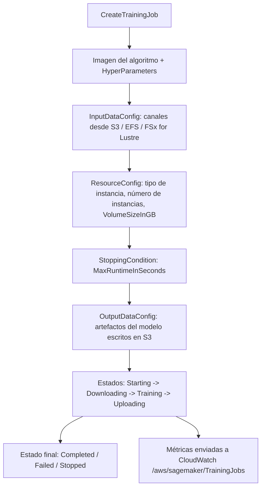
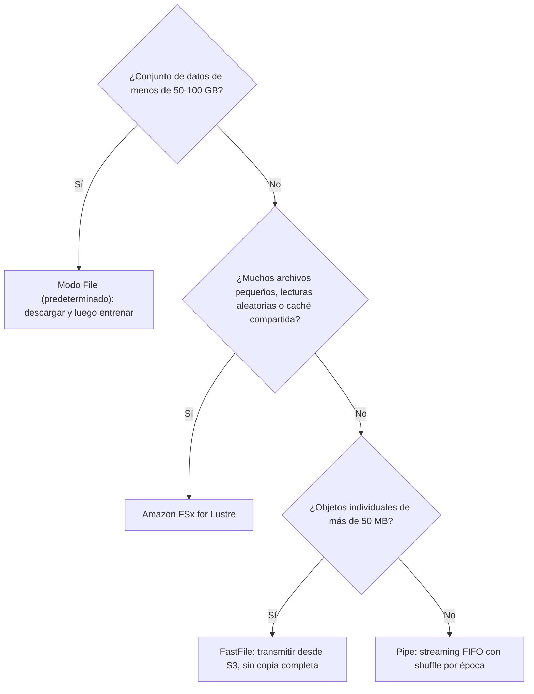
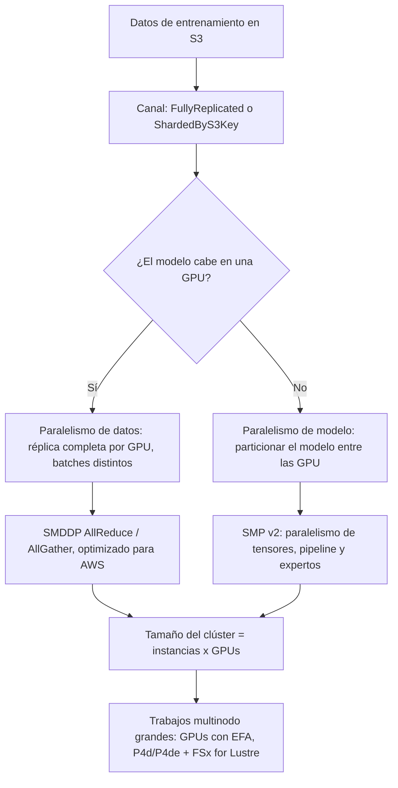
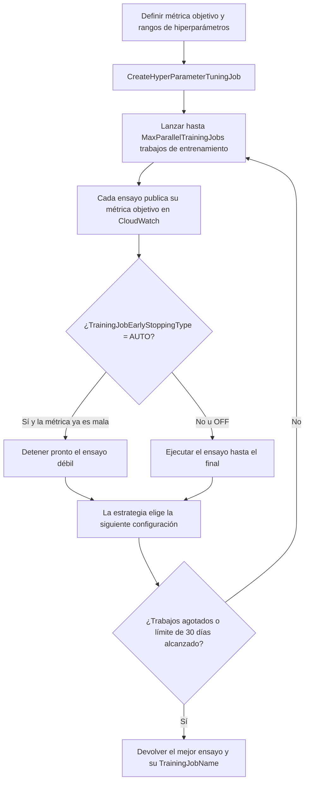
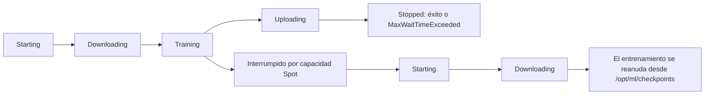

# Entrenamiento y ajuste de hiperparámetros en Amazon SageMaker

Un trabajo de entrenamiento es el objeto más caro que creas antes de que un modelo sirva una sola petición — y es el objeto sobre el que el examen AIF-C01 te pide razonar con más precisión. El Dominio 1 concentra el **20%** del contenido puntuado, y la Tarea 1.3 nombra textualmente *«realizar ajuste de hiperparámetros u optimización de modelos»*. El modo de fallo nunca es «no sabías que SageMaker puede entrenar». Es que elegiste **modo File** para un conjunto de datos de 600 GB de archivos pequeños, o escogiste **Bayesian** cuando el requisito era *«reproducir el mismo conjunto de combinaciones en cada re-ejecución»*, o activaste Spot sin checkpoint y luego te topaste con el límite de espera de **3.600 segundos** que tus notas no documentaban.

```text
=====================================================================
 UN TRABAJO DE ENTRENAMIENTO EN SAGEMAKER, PIEZA A PIEZA   (AIF-C01 Tarea 1.3)
=====================================================================
  AlgorithmSpecification ... imagen de entrenamiento + TrainingInputMode
  ResourceConfig ........... tipo de instancia, número de instancias,
                             VolumeSizeInGB (almacenamiento ML)
  StoppingCondition ........ MaxRuntimeInSeconds
  InputDataConfig .......... canales (S3 / EFS / FSx for Lustre)
  OutputDataConfig ......... artefactos del modelo -> S3
  HyperParameters .......... los ajustes de tu algoritmo
  RoleArn .................. rol IAM que asume el trabajo
  CheckpointConfig ......... URI S3 para reanudar en Spot (opcional)
  EnableNetworkIsolation / EnableInterContainerTraffic ...
---------------------------------------------------------------------
  MODOS DE ENTRADA (enum de la API):   File (predeterminado) | FastFile | Pipe
  ESTRATEGIAS DE AJUSTE:               Bayesian (predet. del SDK) | Random |
                                       Grid | Hyperband
  FÓRMULA DE AHORRO SPOT:              (1 - facturable / entrenamiento) x 100
  MONITORIZACIÓN:                      CloudWatch /aws/sagemaker/TrainingJobs
=====================================================================
```

> [!NOTE]
> **Cómo leer esta lección.** Cada número de abajo es un límite publicado por AWS, tomado de la guía del desarrollador de SageMaker, la referencia de la API de SageMaker o una página de precios de AWS. Cuando AWS publica dos números distintos para lo mismo — como hace con el ahorro Spot y con el tiempo máximo de ejecución de un ajuste — aparecen ambos, y la respuesta preferida para el examen está marcada en la sección 12 y en la sección 13.

Al terminar esta lección sabrás:

- nombrar los **campos obligatorios** de `CreateTrainingJob` y explicar qué controla cada uno;
- elegir entre los modos de entrada **File, FastFile y Pipe** usando los propios umbrales de tamaño de AWS, y configurar **canales** (`s3_data_type`, `distribution`, `compression`, `record_wrapping`);
- seleccionar una **familia de instancias `ml.*`** para entrenamiento frente a inferencia, y calcular el **tamaño del clúster** como instancias × GPU;
- decidir entre **paralelismo de datos** y **paralelismo de modelo**, y nombrar las bibliotecas de AWS (**SMDDP**, **SMP v2**) que los implementan;
- ejecutar **Automatic Model Tuning** y elegir la **estrategia** adecuada: Grid vs. Random vs. Bayesian vs. Hyperband;
- configurar correctamente **Managed Spot Training** (`MaxWaitTimeInSeconds ≥ MaxRuntimeInSeconds`) y calcular el **ahorro real** con la fórmula oficial;
- dimensionar un flujo de **checkpoint** para que un trabajo interrumpido se reanude en lugar de reiniciarse;
- leer las **métricas de entrenamiento** en CloudWatch y explicar qué hacen **Debugger** y **Experiments** — y que Debugger está cerrado para clientes nuevos;
- defender un **veredicto comparativo** sobre Grid vs. Random vs. Bayesian y sobre **entrenamiento gestionado frente a hacerlo tú mismo**;
- responder **diez preguntas estilo examen** redactadas en el tono oficial, incluidos dos cálculos de coste.

---

## 1. Anatomía de un trabajo de entrenamiento en SageMaker

### 1.1 Las ocho piezas obligatorias

`CreateTrainingJob` es una sola llamada a la API, pero es un paquete de ocho decisiones independientes. El examen tiende a probarlas como «¿cuál de estas falta o está mal configurada?», así que apréndetelas como una lista de verificación.

| Campo | Qué contiene | Qué sale mal cuando lo equivocas |
|---|---|---|
| `AlgorithmSpecification` | URI de la imagen de entrenamiento, `TrainingInputMode`, punto de entrada | Contenedor equivocado → el trabajo nunca arranca; modo de entrada equivocado → véase la sección 2 |
| `ResourceConfig` | Tipo de instancia, número de instancias, `VolumeSizeInGB` | Volumen demasiado pequeño → el modo File falla en la descarga; pocas instancias → OOM |
| `StoppingCondition` | `MaxRuntimeInSeconds` (predeterminado **1 día**, máx. **28 días**) | El valor por defecto detiene en un día un trabajo descontrolado; la vida total del trabajo se limita a **30 días** |
| `InputDataConfig` | Uno o más **canales** apuntando a S3, EFS o FSx | Un canal en otra Región → el trabajo no puede leerlo |
| `OutputDataConfig` | `S3OutputPath` para `model.tar.gz` | Los artefactos acaban en un sitio donde nadie mira |
| `HyperParameters` | Mapa de cadenas con los ajustes del algoritmo | Claves que el algoritmo no acepta → fallo inmediato |
| `RoleArn` | Rol IAM que asume el trabajo | Falta `s3:GetObject` → acceso denegado silencioso |
| `CheckpointConfig` | `S3Uri` para checkpoints | Ausente → las interrupciones de Spot fuerzan un reinicio completo (sección 7) |

Dos límites vale la pena memorizar porque son baratos de recordar y aparecen a menudo: el `MaxRuntimeInSeconds` de un trabajo arranca en **1 día** y para en firme a los **28 días**, y entre ejecución y espera el trabajo no puede superar **30 días**. Al detenerse, SageMaker envía **`SIGTERM`** y espera **120 segundos** a que tu código vuelque lo pendiente — que es exactamente la ventana en la que tu manejador de checkpoints tiene que trabajar.

### 1.2 El ciclo de vida real de un trabajo



### 1.3 Cómo cuesta el entrenamiento y cómo se factura

SageMaker factura **por instancia-seundo en horas de instancia parciales, sin mínimo y sin compromiso previo**. Eso importa más que cualquier tarifa por hora: un trabajo de entrenamiento de 90 segundos cuesta 90 segundos de una instancia, no una hora completa.

| Artículo del free tier (primeros 2 meses) | Cantidad | Equivalente aproximado |
|---|---|---|
| Instancias de notebook `ml.t3.medium` | **250 horas** | ~8,3 días-de-instancia de trabajo interactivo |
| **Entrenamiento** en `ml.m4.xlarge` / `ml.m5.xlarge` | **50 horas** | ~seis ejecuciones de 8 horas |
| Inferencia en tiempo real | **125 horas** | ~4,2 días de hosting |

- **📚 ¿Sabías que…?** El free tier de SageMaker para entrenamiento son **50 horas de `ml.m4.xlarge` o `ml.m5.xlarge`** en los dos primeros meses — suficiente para unos seis días laborables completos de entrenamiento continuo de CPU, pero solo para unas pocas ejecuciones en GPU. AWS etiqueta la ventana de dos meses como una promoción en la página de precios, así que confirma los términos antes de presupuestar un curso alrededor de ella.

---

## 2. Cómo entran los datos en el trabajo: modos de entrada y canales

Este es el tema de mayor rendimiento de la lección. AWS documenta exactamente **tres** modos de entrada en el enum de la API — `File`, `FastFile` y `Pipe` — y la guía del desarrollador todavía llama a File el **predeterminado**.

### 2.1 Los tres modos lado a lado

| Dimensión | **File** (predeterminado) | **FastFile** | **Pipe** |
|---|---|---|---|
| Movimiento | Todo el conjunto de datos se descarga al almacenamiento ML **antes** de que empiece el entrenamiento | Solo se identifican los objetos; S3 se expone como un sistema de archivos POSIX y se transmite bajo demanda | S3 se transmite por una tubería FIFO con alto pre-fetch |
| Latencia de arranque | Máxima — el entrenamiento espera a la copia completa | Baja — sin copia completa | Baja |
| Espacio local necesario | **El conjunto de datos completo + artefactos** (`VolumeSizeInGB` debe caber) | Solo artefactos | Solo artefactos |
| Patrón de lectura | Aleatoria o secuencial (disco local) | Mejor secuencial, aleatoria aceptable | Secuencial; un lector por tubería |
| Manifiestos | Prefijo, manifiesto, **manifiesto aumentado** | **Solo prefijo** | Prefijo / manifiesto, más RecordIO y Gzip |
| Shuffling / fragmentación | `ShardedByS3Key` | Hereda el diseño de S3 | Fragmentación gestionada + shuffle por época |
| Entrenamiento incremental | **Compatible — elige File** | No indicado | No indicado |
| Advertencias | La sobrecarga crece con el número de archivos; debes dimensionar el volumen | Posibles cargos extra de CloudTrail / KMS | AWS lo describe como «en gran medida reemplazado por … el modo de archivo rápido» |
| Mejor para | Datos pequeños (**< 50–100 GB**), modo local | Archivos grandes (**> 50 MB**, ideal **> 150 MB**) | Datos enormes donde el disco local es la restricción |

### 2.2 Modo File: el predeterminado que te cuesta tiempo en silencio

En el modo File la instancia de entrenamiento debe tener **espacio de almacenamiento suficiente para alojar el conjunto de datos completo** — esa es una cita literal de la guía del desarrollador, y es el mecanismo detrás del clásico ítem del examen: *«el entrenamiento solo comienza tras una larga fase de transferencia de datos y el almacenamiento de la instancia debe contener el conjunto de datos completo»*. Respuesta: **File**.

El modo File es también el único modo que la documentación vincula explícitamente al **entrenamiento incremental**, y acepta los tres valores de `s3_data_type`, incluido `AugmentedManifestFile`. La fragmentación entre instancias se hace con `distribution = ShardedByS3Key`.

La propia guía de dimensionamiento de AWS: el modo File sirve para conjuntos de datos **por debajo de 50–100 GB**, y a la tasa documentada de **50 GB en unos 5 minutos** con fragments de 100 MB, AWS aconseja serializar los archivos menores de **50 MB** en trozos de unos **150 MB** (TFRecord o RecordIO).

**Ejemplo resuelto 1 — dimensionamiento del modo File (sección 12, Ejemplo 1).** Un conjunto de datos de 80 GB en modo File necesita un volumen **≥ 80 GB** más espacio para la salida. A la tasa de AWS la descarga lleva unos **8 minutos** antes de que se ejecute el paso uno — roughly el **21% de un trabajo de 30 minutos** dedicado a copiar. Cambia a FastFile, o fragmenta con `ShardedByS3Key`.

### 2.3 FastFile: transmite sin copiar

FastFile **identifica los objetos pero no descarga nada**. S3 se expone como un sistema de archivos POSIX y se lee bajo demanda, así que el arranque es rápido y el espacio local solo hace falta para los artefactos. Dos restricciones que memorizar: acepta **solo prefijo** (sin manifiesto aumentado), y las lecturas aleatorias funcionan pero **las lecturas secuenciales son las mejores**. Pueden aplicarse cargos extra de **CloudTrail y KMS** porque FastFile registra el acceso a nivel de objeto.

### 2.4 Pipe: el modo de streaming original

Pipe transmite los objetos de S3 por una **tubería FIFO** con alto pre-fetch, deja el disco solo para los artefactos y te ofrece **shuffle por época** gestionado, compresión **Gzip** y envoltura **RecordIO**. AWS ahora lo describe como «en gran medida reemplazado por … el modo de archivo rápido», así que en el examen Pipe suele ser el distractor de *streaming* cuando FastFile es la mejor respuesta, o la respuesta correcta cuando la pregunta menciona RecordIO/Gzip/shuffle por época.

### 2.5 Canales: cómo se enumeran y se dividen los objetos

Un canal es una entrada del trabajo. Sus campos de configuración es donde el examen esconde detalles.

| Campo | Valores | Significado |
|---|---|---|
| `s3_data_type` | `S3Prefix` (predeterminado), `ManifestFile`, `AugmentedManifestFile` | Cómo se enumeran los objetos |
| `distribution` | `FullyReplicated` (predeterminado), `ShardedByS3Key` | Copia completa en cada instancia vs. fragmentos entre nodos |
| `input_mode` | `File` / `Pipe` / `FastFile` / sin definir | Anulación por canal del `TrainingInputMode` del trabajo |
| `compression` | `None`, `Gzip` | Gzip se aplica en el modo Pipe |
| `record_wrapping` | `None`, `RecordIO` | Canalizaciones RecordIO (al estilo MXNet) |
| `shuffle_config.seed` | Entero | Shuffle determinista; en el modo Pipe re-mezcla cada época |

Los almacenes compatibles son **Amazon S3, Amazon EFS y Amazon FSx for Lustre** (más S3 Express One Zone), y el conjunto de datos debe estar en la **misma Región que el trabajo de entrenamiento** — un bucket de S3 en `us-west-2` alimentando un trabajo en `us-east-1` no es un patrón compatible.

### 2.6 Cómo elegir un modo, con los umbrales de AWS



| Forma de los datos | Ruta recomendada por AWS |
|---|---|
| < 50–100 GB, o entrenamiento incremental | **Modo File** |
| Archivos **> 50 MB**, idealmente **> 150 MB**, importa la latencia de arranque | **FastFile** |
| Conjunto grande, **muchos archivos pequeños** o lecturas **aleatorias** | **Amazon FSx for Lustre** |
| Datos enormes, el disco local es el cuello de botella, se necesita RecordIO/Gzip | **Pipe** |
| Datos ya en EFS o FSx for Lustre | Móntalos; sin ninguna copia a S3 |

> [!WARNING]
> **Las tres trampas del modo de entrada que aparecen en cada convocatoria de examen.**
> - **El modo File es el predeterminado** — una pregunta que describe una larga fase de transferencia previa al entrenamiento y un volumen dimensionado al conjunto de datos está describiendo File, no Pipe.
> - **FastFile acepta solo prefijo.** Si la pregunta menciona un **manifiesto aumentado** (típico de datasets estilo RLHF o de sentimiento construidos con SageMaker Ground Truth / refuerzo contextual), FastFile no puede ser la respuesta.
> - **La cercanía regional es incondicional.** Tanto el conjunto de datos como el bucket de checkpoints deben estar en la Región del trabajo de entrenamiento. Las lecturas cross-Region son un distractor, nunca una solución.

---

## 3. Elegir compute: las familias de instancias `ml.*`

### 3.1 La regla de nombres

Toda SKU de compute de SageMaker lleva el prefijo **`ml.`**. Ese prefijo es la pista más barata del examen: si una opción dice `p4d.24xlarge` sin el `ml.` cuando el contexto es un trabajo de entrenamiento o un endpoint de SageMaker, está describiendo EC2, no SageMaker. Las familias se separan con claridad por papel.

| Familia | Papel | Ejemplos verificados | Notas |
|---|---|---|---|
| `ml.p5` | Entrenamiento, máxima escala de GPU | `ml.p5.48xlarge` — 8 × H100 | GA **4 de agosto de 2023**; 640 GB de HBM, 192 vCPU, 2 TiB, 3.200 Gbps EFAv2 |
| `ml.p6` | Entrenamiento, GPU más reciente | P6-B200 — 8 × Blackwell, 1.440 GB de HBM | GA **6 de junio de 2025** (`us-west-2`) |
| `ml.p4d` / `ml.p4de` | Entrenamiento, punto óptimo distribuido | `ml.p4d.24xlarge` — 8 × A100 de 40 GB (p4de: 80 GB) | La elección de AWS para multinodo + paralelismo de modelo (EFA) |
| `ml.p3` / `ml.p3dn` | Entrenamiento, GPU de generación anterior | 2xlarge / 8xlarge / 16xlarge / p3dn.24xlarge | 1 / 4 / 8 / 8 GPU — los mismos recuentos que EC2 p3 |
| `ml.g4dn` / `ml.g5` / `ml.g6` | GPU de entrenamiento **y** de inferencia | `ml.g4dn.xlarge` (GPU predeterminada del notebook) | Training Compiler probado en G4dn y G5 |
| `ml.trn1` | **Entrenamiento** en Trainium | `ml.trn1.*` (hasta 16 dispositivos) | Estimador de PyTorch; `torchrun` compatible |
| `ml.m4` / `ml.m5` / `ml.c4` / `ml.c5` / `ml.t3` | Entrenamiento en CPU y uso general | `ml.m4.xlarge`, `ml.c4.xlarge`, `ml.t3.medium` | Free tier: 50 h de entrenamiento en m4/m5.xlarge |
| `ml.inf1` / `ml.inf2` | **Solo inferencia** (Inferentia) | `ml.inf2` (despliegue) | **No** es una familia de entrenamiento — un distractor clásico |

### 3.2 El hardware de GPU que publica AWS

| Instancia | vCPU | Memoria | GPU | Memoria total de GPU | Red |
|---|---|---|---|---|---|
| `ml.p5.48xlarge` | 192 | 2 TiB | 8 × H100 | 640 GB (80/GPU) | 3.200 Gbps EFAv2 |
| `ml.p4d.24xlarge` | 96 | 1.152 GB | 8 × A100 | 320 GB (40/GPU) | 400 Gbps ENA + EFA |
| `ml.p4de.24xlarge` | 96 | 1.152 GB | 8 × A100 | 640 GB (80/GPU) | 400 Gbps ENA + EFA |
| `ml.p3.16xlarge` | 64 | 488 GiB | 8 × V100 | 128 GB (16/GPU) | 25 Gbps NVLink |
| `ml.p3.8xlarge` | 32 | 244 GiB | 4 × V100 | 64 GB | 10 Gbps NVLink |
| `ml.p3.2xlarge` | 8 | 61 GiB | 1 × V100 | 16 GB | hasta 10 Gbps |
| `ml.p3dn.24xlarge` | 96 | 768 GiB | 8 × V100 | 256 GB (32/GPU) | 100 Gbps |

### 3.3 Dos reglas de dimensionamiento que deciden tu factura

**Regla 1 — escala el tamaño de la instancia antes de añadir instancias.** La guía de entrenamiento distribuido de AWS es explícita: un **único `ml.p3.16xlarge` supera a dos `ml.p3.8xlarge`** para las mismas 8 GPU, porque pagas un solo interconecto en lugar de un salto de red. Añadir instancias es lo que haces cuando una sola máquina no puede alojar el modelo o los datos.

**Regla 2 — el tamaño del clúster = instancias × GPU.** Dos nodos `ml.p3.16xlarge` te dan un clúster de **16 GPU**, no de 8. Todo grado de paralelismo, cálculo de batch size y coste de comunicación de la sección 4 se deriva de ese producto.

**Ejemplo resuelto 2 — dimensionamiento distribuido (sección 12, Ejemplo 2).** `ml.p3.16xlarge × 2` = 8 GPU por nodo → tamaño del clúster **16**. La referencia publicada de AWS para un LLM de 70.000 millones de parámetros es **32 × `ml.p4d.24xlarge`** = **256 GPU**, con grado de paralelismo de datos fragmentado 256 y batch size 2; un modelo de 175B necesita **64 × `ml.p4d.24xlarge`**, mientras que un modelo de 7B cabe en **1 × `ml.p4d.24xlarge`**.

- **📚 ¿Sabías que…?** `ml.p5.48xlarge` se entrega con **8 × H100 y 640 GB de memoria total de GPU** y **3.200 Gbps de red EFAv2** — más ancho de banda que la mayoría de los racks hace una década, y la razón por la que el entrenamiento multinodo en esa familia está limitado por ancho de banda y no por cómputo. Alcanzó la disponibilidad general el **4 de agosto de 2023**, inicialmente en `us-east-1` y `us-west-2`.

---

## 4. Entrenamiento distribuido: paralelismo de datos vs. paralelismo de modelo

### 4.1 La distinción que el examen busca

| Estrategia | Qué se divide | Cuándo usarla | Mecanismo |
|---|---|---|---|
| **Paralelismo de datos** | Los **datos** — cada GPU mantiene una réplica completa del modelo y ve un batch distinto | El modelo cabe en una GPU; quieres rendimiento | Los gradientes se sincronizan tras cada paso (AllReduce) |
| **Paralelismo de modelo** | El **modelo** — se particiona entre las GPU | El modelo **no cabe** en la memoria de una GPU | Particionado de tensores / pipeline / expertos más activation checkpointing |

La formulación del examen suele ser un síntoma: *«el modelo no cabe en la memoria de una sola GPU, pero el conjunto de datos es modesto»* → **paralelismo de modelo**. El espejo — *«el modelo entrena bien en una GPU pero el conjunto de datos es enorme»* → **paralelismo de datos**.



### 4.2 Las bibliotecas que nombra AWS

| Biblioteca | Qué hace | Notas |
|---|---|---|
| **SMDDP** (SageMaker Distributed Data Parallel) | Colectivos AllReduce / AllGather optimizados para redes de AWS | Backend para PyTorch DDP/FSDP y DeepSpeed |
| **SMP v2** (SageMaker Distributed Model Parallel) | Datos fragmentados más paralelismo de tensores, pipeline y expertos; activation checkpointing y offloading | El camino para los modelos que no caben en un dispositivo |
| Horovod, `torchrun`, MPI, parameter server | Alternativas a nivel de framework | Siguen documentadas; no son específicas de AWS |

Para **trabajos multinodo grandes**, la guía de AWS converge siempre en el mismo stack: **GPUs con EFA, idealmente `ml.p4d`/`ml.p4de` (A100) o más nuevas, más Amazon FSx for Lustre** para el conjunto de datos. EFA importa porque evita el stack de red del sistema operativo; FSx importa porque mil archivos pequeños leídos desde S3 dejarían con hambre a 256 GPU.

**Ejemplo resuelto 3 — cuánto modelo cabe dónde (sección 12, Ejemplo 3).** Las referencias publicadas de AWS: Llama 2 **7B → 1 × `ml.p4d.24xlarge`**; Llama 2 **70B → 32 × `ml.p4d.24xlarge`**; **175B → 64 ×**; **GPT-2 10B → 16 ×**. Léelas como una regla práctica: el número de parámetros, no el tamaño del conjunto de datos, determina el número de instancias una vez que se supera la capacidad de una GPU.

---

## 5. Automatic Model Tuning: qué hace un trabajo de ajuste

### 5.1 La idea en una frase

**Automatic Model Tuning (AMT)** ejecuta muchos trabajos de entrenamiento sobre los rangos de hiperparámetros que le suministras y conserva el que mejor rendimiento obtiene en tu **métrica objetivo**. Tú defines los rangos; SageMaker ejecuta la búsqueda; tú recibes el mejor ensayo.

El examen lo llama *«ajuste de hiperparámetros u optimización de modelos»* y cae de lleno en la Tarea 1.3.

### 5.2 El flujo del trabajo de ajuste



### 5.3 Rangos, escalas y la métrica objetivo

Los rangos de hiperparámetros tienen tipo y escala. `Auto`, `Linear`, `Logarithmic` y `ReverseLogarithmic` son las cuatro opciones de escala, y cada una tiene una regla de dominio que conviene conocer porque es una comprobación de corrección gratuita en el examen:

| Escala | Úsala para | Regla de dominio |
|---|---|---|
| `Auto` | Predeterminado cuando no hay razón para elegir | Cualquier rango válido |
| `Linear` | Parámetros de efecto proporcional (batch size, drop-out en un rango estrecho) | Cualquier rango válido |
| `Logarithmic` | Learning rate, momentum — valores que abarcan órdenes de magnitud | El valor debe ser **> 0** |
| `ReverseLogarithmic` | Parámetros que se agrupan cerca del techo del rango | **0 ≤ x < 1** |

`TrainingJobEarlyStoppingType` es **`OFF`** por defecto y puede ponerse en **`AUTO`** para detener ensayos que claramente no van a ganar. El **warm start** reutiliza los ensayos padre de un trabajo de ajuste anterior, lo que reduce el coste y el tiempo real cuando amplías una búsqueda en lugar de reiniciarla.

### 5.4 Los límites que debes poder recitar

| Recurso | Predeterminado | Aumentar a |
|---|---|---|
| Trabajos de ajuste concurrentes (cuenta) | **100** | — |
| Hiperparámetros por trabajo de ajuste | **30** | — (menos es más rápido) |
| Métricas por trabajo de ajuste | **20** | — |
| Trabajos de entrenamiento paralelos por trabajo de ajuste | **10** | **100** |
| Trabajos de entrenamiento por trabajo de ajuste (Bayesian / Hyperband / Grid) | **750** | — |
| Trabajos de entrenamiento por trabajo de ajuste (**Random**) | **750** | **10.000** |
| Tiempo máximo de ejecución del trabajo de ajuste | **30 días** | — |
| Valores por parámetro categórico | **30** | — |

De ahí se siguen dos consecuencias. Primero, AWS aconseja mantener el número de hiperparámetros **muy por debajo del límite de 30** — cada dimensión extra diluye la búsqueda. Segundo, `RandomSeed` hace que una búsqueda Random o Hyperband sea **reproducible hasta en un 100%**, que es el mecanismo detrás del ítem del examen de «reproducir combinaciones idénticas».

**Ejemplo resuelto 4 — presupuesto de ajuste y aritmética de cuotas (sección 12, Ejemplo 4).** `MaxNumberOfTrainingJobs = 20`, una hora cada uno en `ml.g4dn.12xlarge` al precio publicado de AWS de **4,89 $/h** → **20 × 4,89 $ = 97,80 $**. Con `MaxParallelTrainingJobs = 10` ejecutas **2 oleadas ≈ 2 horas** en lugar de 20. Llevarlo a 100 trabajos cuesta **489 $** sin garantía de mayor precisión. Aparte, el propio ejemplo de cuota de AWS: **10 trabajos de ajuste × 100 trabajos de entrenamiento × 20 concurrentes** en `ml.m4.xlarge` supera los límites de 100 ajustes concurrentes y 750 trabajos, pero necesita un aumento para **20 trabajos de entrenamiento concurrentes** (predeterminado 10) y **200 instancias `ml.m4.xlarge`** (predeterminado 20).

- **📚 ¿Sabías que…?** Un trabajo de ajuste de SageMaker no es un producto de compute separado — es un **orquestador** que crea trabajos de entrenamiento ordinarios y observa sus métricas de CloudWatch. Por eso las cuotas del trabajo de ajuste se expresan tanto en *trabajos de ajuste* (100 concurrentes) como en *trabajos de entrenamiento* (10 paralelos, 750 en total): se te factura por las mismas instancias-seundo de cualquier forma.

---

## 6. Estrategias de ajuste: Grid vs. Random vs. Bayesian vs. Hyperband

Esta es la comparación que el examen te pide hacer bajo presión de tiempo. Apréndete la fila que difiere, no la tabla entera.

### 6.1 La comparación completa

| Dimensión | **Bayesian** (predeterminado del SDK) | **Random** | **Grid** | **Hyperband** |
|---|---|---|---|---|
| Cómo elige | Regresión sobre ensayos previos | Sorteos aleatorios, **ignora** los resultados previos | Cada combinación categórica distinta | Multi-fidelity: reasigna épocas, detiene trabajos débiles |
| Paralelismo | Bajo — secuencial, «no puede escalar masivamente» | **Máximo** (trabajos independientes) | Moderado (barrido exhaustivo) | Muchos trabajos paralelos |
| Tipos de parámetro | int / continuo / categórico | int / continuo / categórico | **Solo categórico** | Según permita el algoritmo |
| Trabajos permitidos | 750 (fijo) | 750 → **10.000** | Auto-calculado = número de combinaciones | 750 (fijo) |
| Reproducibilidad | La semilla la mejora | Misma semilla → **hasta 100%** | Idéntica por diseño | Misma semilla → **hasta 100%** |
| Restricción de algoritmo | Cualquiera | Cualquiera | Cualquiera (con rangos categóricos) | **Solo iterativo** — XGBoost y RCF sí; árboles y k-NN no |
| Mejor cuando | Presupuesto limitado, aprender entre ejecuciones | Búsqueda paralela grande, con tiempo acotado | Auditorías, cobertura uniforme, re-ejecuciones | Trabajos largos de deep learning iterativos |
| Ventaja citada por AWS | Mejor uso de un presupuesto pequeño | «El mayor número de trabajos paralelos» | Determinismo | Hasta **3× más rápido** que Bayesian (afirmación de AWS) |

### 6.2 Grid: determinista, categórica, combinatoria

Grid enumera cada combinación distinta de los valores categóricos que le das, y SageMaker calcula el número de trabajos automáticamente — deberías fijar `MaxNumberOfTrainingJobs` a ese número. Es la estrategia para **reproducir resultados** y para una cobertura uniforme del espacio de búsqueda.

**Ejemplo resuelto 5 — número de trabajos de Grid (sección 12, Ejemplo 5).** Dos parámetros categóricos con **5** y **4** valores → 5 × 4 = **20** combinaciones → SageMaker crea **20** trabajos de entrenamiento. Añade un tercer parámetro con **3** valores → **60** trabajos. Grid explota combinatoriamente, y por eso AWS deriva los espacios de búsqueda grandes hacia Bayesian o Random.

### 6.3 Random: máximo paralelismo, cero aprendizaje

Como Random **ignora los resultados previos**, cada ensayo es independiente y la estrategia admite el mayor número de trabajos de entrenamiento paralelos de todas. Es también la única estrategia cuyo techo de trabajos puede elevarse de **750 a 10.000**, y con un `RandomSeed` fijo reproduce la secuencia idéntica de configuraciones.

### 6.4 Bayesian: el predeterminado del SDK y un optimizador secuencial

Bayesian construye un modelo de regresión sobre los ensayos completados hasta el momento y propone la siguiente configuración donde la mejora parece más probable. Eso lo convierte en el **mejor uso de un presupuesto pequeño** y en el **predeterminado del `HyperparameterTuner` del SDK de SageMaker** — pero también lo hace secuencial: el ensayo *n+1* depende del ensayo *n*, así que AWS afirma que **no puede escalar masivamente** en paralelo.

### 6.5 Hyperband: multi-fidelity, solo algoritmos iterativos

Hyperband reasigna épocas entre rondas sucesivas, detiene pronto los trabajos débiles y ejecuta muchos trabajos en paralelo. La restricción dura es el algoritmo: necesita algoritmos **iterativos** que puedan juzgarse significativamente a medio camino. **XGBoost y Random Cut Forest califican; los árboles de decisión y k-NN no.** AWS lo comercializa como hasta **3× más rápido** que Bayesian — esa cifra proviene de una página *what-is* de AWS, así que cítala como una afirmación de AWS y no como un benchmark reproducido.

> [!WARNING]
> **Selección de estrategia, reducida a cuatro frases.**
> - Debe reproducir el conjunto **idéntico** de combinaciones en cada re-ejecución, **solo categórico** → **Grid**.
> - Necesitas el **mayor número de trabajos independientes paralelos** → **Random**.
> - Presupuesto pequeño, rangos mixtos int/continuo/categórico, ruta predeterminada → **Bayesian**.
> - Trabajos largos de deep learning con un algoritmo **iterativo** y necesitas velocidad → **Hyperband** — pero nunca Hyperband para k-NN o un modelo de árboles.

---

## 7. Managed Spot Training y checkpoints

### 7.1 Qué es

**Managed Spot Training** ejecuta tu trabajo de entrenamiento en capacidad **Spot** de EC2 con SageMaker gestionando las interrupciones por ti. AWS lo lanzó el **26 de agosto de 2019** y desde entonces ha publicado dos cifras de ahorro distintas — ambas publicadas por AWS, y ambas aparecen en el material del examen:

| Fuente | Afirmación |
|---|---|
| Guía del desarrollador de SageMaker (`model-managed-spot-training`) | Ahorro **hasta el 90%** |
| Referencia de la API `CreateTrainingJob` | Ahorro **hasta el 80%** |
| Demostración del blog de lanzamiento de AWS (2019) | 837 facturables de 2.423 segundos → **65%** real |
| Historia de cliente del ML Blog de AWS (2020) | **70%** de recorte del coste de EC2, **+40%** de trabajos diarios completados |

### 7.2 La fórmula oficial — y el único cálculo que necesitas

$$
\text{Savings (\%)} = \left(1 - \frac{\text{BillableTimeInSeconds}}{\text{TrainingTimeInSeconds}}\right) \times 100
$$

**Ejemplo resuelto 6 — aritmética del ahorro Spot (sección 12, Ejemplo 6).** Un trabajo se ejecuta durante **500 segundos** y se le factura por **100 segundos**:

$$
(1 - 100/500) \times 100 = 80\%
$$

El trabajo de demostración del blog de lanzamiento de AWS corrió **2.423 segundos** y se le facturó por **837** → $(1 - 837/2423) \times 100 \approx \mathbf{65\%}$. Calcula el ahorro por trabajo; nunca asumas una cifra fija.

**Ejemplo resuelto 7 — On-Demand vs. Spot para una ejecución con GPU (sección 12, Ejemplo 7).** `ml.g4dn.12xlarge` publicado por AWS = **4,89 $/h**. Dos horas On-Demand = **9,78 $**. Si solo **36 de los 120 minutos** de tiempo real son facturables en Spot: $0.6 \times 4.89 \approx$ **2,93 $** — alrededor de un **70% de ahorro**, coincidente con la historia del cliente Cinnamon AI.

```plot
{
  "type": "line",
  "title": "Ahorro Spot en función de la fracción facturable",
  "data": [
    {"billableShare": 0.1, "savings": 90},
    {"billableShare": 0.2, "savings": 80},
    {"billableShare": 0.35, "savings": 65},
    {"billableShare": 0.5, "savings": 50},
    {"billableShare": 0.65, "savings": 35},
    {"billableShare": 0.8, "savings": 20},
    {"billableShare": 1.0, "savings": 0}
  ],
  "xKey": "billableShare",
  "yKey": "savings",
  "xLabel": "BillableTimeInSeconds / TrainingTimeInSeconds",
  "yLabel": "Ahorro (%)"
}
```

### 7.3 Las dos reglas de configuración

| Regla | Valor | Por qué |
|---|---|---|
| `MaxWaitTimeInSeconds` vs. `MaxRuntimeInSeconds` | Espera **≥** ejecución | Requisito duro de AWS; de lo contrario no se puede usar Spot |
| Algoritmos integrados / de Marketplace sin checkpointing | `MaxWaitTimeInSeconds` limitado a **3.600 s** | Sin checkpoints un trabajo interrumpido debe reiniciarse, así que AWS limita la espera |
| Algoritmos con checkpointing | Sin límite de 3.600 s — la propia demo de AWS usó **48 horas** | Reanudar hace que las esperas largas valgan la pena |
| Apagado elegante | `SIGTERM`, luego **120 s** | Tu código de checkpoint debe terminar dentro de esa ventana |

**Ejemplo resuelto 8 — configuración Spot (sección 12, Ejemplo 8).** Un trabajo con checkpointing de 6 horas: `MaxRuntimeInSeconds = 21.600` y `MaxWaitTimeInSeconds` **mayor que eso** (la demo de AWS usó 48 h = 172.800 s), más `CheckpointConfig.S3Uri`. Ejecuta el mismo trabajo de 6 horas **sin** checkpointing y el límite de espera es **3.600 s** — así que o añades checkpointing o ejecutas On-Demand.

### 7.4 Checkpoints: reanudar, no reiniciar

| Propiedad | Comportamiento verificado |
|---|---|
| Ruta local | **`/opt/ml/checkpoints`** |
| Se persiste en | `CheckpointConfig.S3Uri` |
| Se restauran | **Al inicio del trabajo** — el trabajo se reanuda, no se reinicia |
| Archivos copiados a S3 *después* del inicio del trabajo | **No** se recuperan al reanudar |
| Borrados locales | Se propagan a S3 |
| Ubicación del bucket | Debe estar en la **misma Región** que el trabajo |
| Reanudación en el SDK | Un **nuevo estimator** apuntando al **mismo `checkpoint_s3_uri`** |

### 7.5 Cómo es realmente un trabajo interrumpido



La máquina de estados documentada es `Starting → Downloading → Training → Uploading`, con bucles `Interrupted → Starting → …` en medio y un estado terminal `Stopped: MaxWaitTimeExceeded` cuando el presupuesto de espera se agota antes de que termine el trabajo.

```fillblank
{
  "question": "Completa la fórmula oficial de ahorro de Managed Spot Training:",
  "template": "Ahorro (%) = (1 - {{1}} / {{2}}) x 100. Un trabajo con 100 segundos facturables de 500 segundos de entrenamiento ahorró {{3}}%.",
  "answers": {
    "1": "BillableTimeInSeconds",
    "2": "TrainingTimeInSeconds",
    "3": "80"
  },
  "distractors": ["MaxWaitTimeInSeconds", "MaxRuntimeInSeconds", "65", "90"],
  "explanation": "AWS documenta el ahorro como (1 - BillableTimeInSeconds / TrainingTimeInSeconds) x 100, y su propio ejemplo de 100 segundos facturables de 500 de entrenamiento arroja 80%. El 65% es la cifra del trabajo de demostración del blog de lanzamiento de 2019 (837 de 2.423 segundos), y el 90% / 80% son los rangos principales de la guía del desarrollador y de la referencia de la API respectivamente — ninguno es un resultado por trabajo."
}
```

---

## 8. Observar la ejecución: métricas, Debugger y Experiments

### 8.1 Dónde acaban los números

Las métricas de entrenamiento se publican en **Amazon CloudWatch** bajo el namespace **`/aws/sagemaker/TrainingJobs`**, y la vista **Training jobs → Monitor** de la consola de SageMaker las grafica. Esa es la respuesta siempre que una pregunta pregunte cómo sabes si un trabajo está convergiendo, divergiendo o saturando la GPU.

### 8.2 Debugger: tensores, reglas y acciones

| Capacidad | Qué observa | Qué puede hacer |
|---|---|---|
| Recolección de tensores | Gradientes, activaciones, parámetros | Detectar gradientes desvanecientes/explotantes, picos de loss |
| Métricas del sistema | Utilización de GPU, memoria, E/S | Detectar una canalización de entrada asfixiada |
| **Reglas integradas** | Heurísticas preentrenadas | Disparar acciones: **`StopTraining()`**, **`Email()`**, **`SMS()`** |
| Reglas personalizadas | Tu propio Python | Se factura por tiempo de instancia |
| Precios | Reglas integradas **gratis**; reglas personalizadas facturan tiempo de instancia | — |
| **Estado (2026)** | **Ya no está abierta a clientes nuevos** | Los clientes existentes conservan el acceso |

Así que el ítem del examen *«detener automáticamente el trabajo de entrenamiento cuando se dispare una regla de gradiente desvaneciente y enviar un correo al equipo»* se resuelve con **las acciones integradas de Debugger** — con la salvedad de que Debugger está cerrado para clientes nuevos.

### 8.3 SageMaker Experiments

**Experiments** rastrea cada ensayo y cada ejecución — los hiperparámetros usados, las métricas producidas, los artefactos escritos — para que puedas comparar ejecuciones lado a lado. La salida de Debugger puede dirigirse a **TensorBoard** para su visualización. Experiments es la respuesta a «¿cuál de mis 20 ejecuciones fue la mejor y con qué ajustes?»; Debugger es la respuesta a «¿qué está pasando dentro de esta ejecución ahora mismo?».

> [!WARNING]
> **Trampas de disponibilidad en la pila de monitorización.**
> - **Debugger está cerrado para clientes nuevos.** Las cuentas existentes lo conservan; una cuenta completamente nueva no puede empezar a usarlo. Las reglas integradas son gratis, las reglas personalizadas facturan tiempo de instancia.
> - **Experiments (Classic)** está ligado a Studio Classic y AWS dirige el trabajo nuevo al **MLflow** gestionado. No construyas una arquitectura nueva sobre Experiments Classic sin volver a comprobar la documentación actual.
> - Las métricas en **`/aws/sagemaker/TrainingJobs`** están disponibles en cualquier caso — CloudWatch es la respuesta siempre correcta a «¿dónde acaban las métricas de entrenamiento?».

---

## 9. Rutas que se saltan por completo el bucle de entrenamiento

### 9.1 JumpStart: modelos preentrenados que puedes afinar

**JumpStart** es el centro de modelos preentrenados de código abierto de SageMaker, procedentes de **TensorFlow Hub, PyTorch Hub, Hugging Face y GluonCV**. Dos números importan para el examen: cubre **15 tipos de problema**, de los cuales **8 son entrenables** — es decir, puedes hacer entrenamiento incremental / fine-tuning sobre ellos — y se integra con **Automatic Model Tuning**.

### 9.2 Autopilot: AutoML para tabulares (y, vía v2, más)

| Etapa | Qué hace Autopilot |
|---|---|
| 1 | Análisis del conjunto de datos |
| 2 | Clasificación del tipo de problema |
| 3 | Preselección de algoritmos — **árboles de decisión potenciados por gradiente, redes neuronales profundas feedforward, regresión logística** |
| 4 | Preprocesamiento y selección de características |
| 5 | **Optimización de hiperparámetros (HPO)** |
| 6 | Entrenar, clasificar, opcionalmente auto-desplegar más un informe de Clarify |

Alcance: **datos tabulares de hasta cientos de gigabytes**; las tareas de **texto, imagen y previsión** más el fine-tuning de LLM se gestionan a través de la **API AutoML v2**. La UI se trasladó a **SageMaker Canvas el 30 de noviembre de 2023**, así que los usuarios sin código van a Canvas y Autopilot sigue siendo la vía de la API.

### 9.3 Cómo elegir un punto de partida

| Tienes | Mejor primer movimiento |
|---|---|
| No hay modelo, hay un tipo de problema público, quieres una línea base rápida | **JumpStart** |
| Un conjunto de datos tabular etiquetado, sin ingeniero de ML | **SageMaker Canvas** (Autopilot por debajo) |
| Un conjunto etiquetado y quieres la API | **Autopilot / API AutoML v2** |
| Un algoritmo personalizado y tu propio contenedor | **Trabajo de entrenamiento** |
| Un espacio de búsqueda alrededor de un trabajo de entrenamiento que funciona | **Automatic Model Tuning** |
| Presupuesto para muchos intentos a bajo coste | **Managed Spot Training** + checkpoints |

- **📚 ¿Sabías que…?** La preselección de algoritmos de Autopilot es deliberadamente pequeña — árboles potenciados por gradiente, una DNN feedforward y regresión logística — porque AutoML es un motor de *selección y ajuste*, no un laboratorio de investigación. La etapa de HPO que ejecuta internamente es el mismo mecanismo de Automatic Model Tuning descrito en la sección 5, y por eso los dos comparten el lenguaje de cuotas.

---

## 10. Veredicto comparativo: estrategias y entrenamiento gestionado frente a hacerlo tú mismo

### 10.1 Entrenamiento gestionado vs. construirlo yourself

| Dimensión | **Gestionado (trabajos de entrenamiento de SageMaker, AMT, Spot)** | **DIY (EC2 / ECS / EKS autoadministrado)** |
|---|---|---|
| Infraestructura | Tipo de instancia, número, volumen — sin trabajo de SO | SO, controladores, CUDA, imágenes de frameworks, parcheo |
| Interrupciones | Managed Spot con reanudación por checkpoint | Tú construyes el manejador de preempción |
| Ajuste | AMT con cuatro estrategias, warm start, parada temprana | Tu propio script de barrido y planificador |
| Métricas | CloudWatch `/aws/sagemaker/TrainingJobs` listo para usar | Tú instrumentas y agregas |
| Debugger / Experiments | Integrado (Debugger cerrado para clientes nuevos) | Tus propios profilers y almacén de seguimiento |
| Preparación de datos | File / FastFile / Pipe, EFS, FSx for Lustre | Tú cableas la capa de almacenamiento |
| Facturación | Por segundo, sin mínimo, Savings Plans hasta **64%** | Por segundo en la instancia subyacente + tu mano de obra |
| Mejor cuando | Importan la velocidad, la gobernanza y la integración nativa de AWS | Control de hardware/driver que SageMaker no puede exponer |

### 10.2 Estrategias de ajuste de un vistazo

| Requisito | Estrategia |
|---|---|
| Reproducir las combinaciones idénticas en cada re-ejecución, solo categórico | **Grid** |
| Mayor número de trabajos independientes paralelos | **Random** |
| Mejor uso de un presupuesto pequeño; predeterminado del SDK | **Bayesian** |
| Trabajos largos de deep learning iterativos, importa la velocidad | **Hyperband** |

> [!IMPORTANT]
> **Veredicto comparativo — Grid vs. Random vs. Bayesian vs. Hyperband; entrenamiento gestionado vs. hacerlo tú mismo**
> - **Grid vs. Random vs. Bayesian:** **Grid** es la única estrategia que *garantiza* un conjunto idéntico y uniformemente cubierto de combinaciones en cada re-ejecución — y la única restringida a parámetros **categóricos**, con su número de trabajos calculado automáticamente como número de combinaciones distintas (5 × 4 = 20 trabajos; añade un tercer parámetro con 3 valores y llegas a 60). **Random** ignora los resultados previos, y por eso mismo AWS la llama la estrategia que ejecuta el *mayor número de trabajos paralelos*, y la única cuyo techo puede elevarse de 750 a **10.000** — con un `RandomSeed` fijo es **reproducible hasta en un 100%**. **Bayesian** es el predeterminado del SDK y el mejor uso de un presupuesto pequeño, pero es secuencial — una regresión sobre ensayos previos — así que AWS afirma que «no puede escalar masivamente». Elige **Grid** para auditorías y determinismo, **Random** para amplitud y velocidad real, **Bayesian** cuando cada hora de entrenamiento es cara y el espacio de búsqueda mezcla rangos int, continuos y categóricos. **Hyperband** queda fuera de este triángulo: es multi-fidelity y necesita un algoritmo **iterativo**, así que es la jugada de velocidad para XGBoost/RCF y queda descartada para árboles y k-NN.
> - **Entrenamiento gestionado vs. DIY:** el entrenamiento gestionado gana en **tiempo hasta el primer resultado, manejo de interrupciones, canalización de cuotas y métricas, e integración nativa de AWS**, y cuesta lo mismo por instancia-seundo que el EC2 subyacente — no estás pagando una prima por la orquestación, no estás pagando por ociosidad, y la facturación por segundo sin mínimo significa que un trabajo de 90 segundos cuesta 90 segundos. Elige DIY (EC2/ECS/EKS) solo cuando necesites control que SageMaker no expone: ajuste a nivel de kernel, controladores especiales, una build de framework no compatible, o un estate de Kubernetes existente que no puedes bifurcar. Un notebook con un script de shell no es una alternativa en ninguna de las dos columnas — no puede demostrar qué hiperparámetros produjeron un modelo dado, no puede reanudarse tras una interrupción y no puede ser re-ejecutado por otra persona. La respuesta por defecto del examen es la ruta gestionada salvo que una pregunta nombre un requisito concreto de control.

---

## 11. Límites, cuotas y evidencia de coste en un solo lugar

### 11.1 Límites y benchmarks publicados

| Ítem | Número | Fuente |
|---|---|---|
| Modos de entrada (enum de la API) | `Pipe`, `File` (predeterminado), `FastFile` | Guía del desarrollador |
| Guía del modo File | < **50–100 GB**; 50 GB ≈ **5 min** con fragments de 100 MB | Guía de mejores prácticas |
| Guía de FastFile | Archivos **> 50 MB** (ideal **> 150 MB**); sin manifiesto aumentado | Guía del desarrollador |
| Hiperparámetros / métricas / valores categóricos de AMT | **30 / 20 / 30** | Límites de AMT |
| Trabajos de ajuste paralelos / trabajos de entrenamiento paralelos de AMT | **100** / **10 → 100** | Límites de AMT |
| Trabajos de entrenamiento por trabajo de ajuste de AMT | **750** (Random → **10.000**) | Límites de AMT |
| Tiempo máximo de ejecución de AMT | **30 días** | Límites de AMT |
| Hyperband vs. Bayesian | Hasta **3× más rápido** (afirmación de AWS) | Página what-is de AWS |
| Afirmación de ahorro Spot | **90%** (guía) / **80%** (API) | Guía del desarrollador / referencia de la API |
| Límite de espera Spot sin checkpointing | **3.600 s** | Guía del desarrollador |
| Referencia de paralelismo de modelo | Llama 2 70B → **32 × `ml.p4d.24xlarge`**; 175B → **64 ×** | Guía de mejores prácticas |
| Free tier de entrenamiento | **50 h** de `m4.xlarge`/`m5.xlarge`, primeros 2 meses | Página de precios |
| Dato de precio publicado | `ml.g4dn.12xlarge` **4,89 $/h** | Página de precios de AWS Canvas |
| Duración del trabajo de entrenamiento | predeterminado **1 día**, máx. **28 días**, **30 días** en total | Referencia de la API |
| Parada elegante | `SIGTERM` + **120 s** | Guía del desarrollador |

### 11.2 Evidencia de coste

| Evidencia | Número |
|---|---|
| Fórmula de ahorro | $(1 - \text{billable} / \text{training}) \times 100$ |
| Afirmación de lanzamiento (2019) | «hasta el **90%**» |
| Trabajo de demostración de lanzamiento (2019) | 837 / 2.423 s → **65%** |
| Resultado de cliente (2020) | **70%** de recorte del coste de EC2, **+40%** de trabajos diarios |
| Presentación de costes de re:Invent (2024) | Spot hasta **90%**; Savings Plans hasta **64%**; elección de familia de instancias **25–35%** |
| Granularidad de facturación | Por segundo en horas de instancia parciales, sin mínimo, sin pago inicial |

### 11.3 Actualizaciones de 2025–2026

Cada número de las secciones 1–10 procede de páginas de AWS comprobadas el **6 de octubre de 2026**. Lo que realmente se movió en 2025–2026 fue sobre todo **disponibilidad**, no aritmética: el producto cambió de nombre, toda una franja de funciones de SageMaker alrededor del bucle de entrenamiento pasó a mantenimiento, y la guía del examen se revisó. Los cambios de disponibilidad importan en el examen porque una función cerrada para clientes nuevos puede ser la respuesta equivocada incluso cuando la guía del desarrollador todavía la documenta por completo.

| Actualización | Fecha | Qué publicó AWS | Por qué importa para entrenamiento / ajuste |
|---|---|---|---|
| «Amazon SageMaker» → **Amazon SageMaker AI** | 3 dic 2024 | «el Amazon SageMaker actual ha sido renombrado como Amazon SageMaker AI», anunciado junto con el SageMaker de nueva generación (Unified Studio, Catalog, Lakehouse, zero-ETL) | El texto del examen todavía dice «SageMaker»; el nombre del producto ahora es SageMaker AI |
| **Model Monitor, Clarify, Ground Truth, A2I, Debugger, Role Manager, Geospatial, Studio Lab, Mechanical Turk, Profiler** cerrados para clientes nuevos | **30 jul 2026** | Aviso de fin de soporte de SageMaker AI: «ya no abiertos a nuevos clientes a partir del 30 de julio de 2026» | El estado es **mantenimiento**, no cierre: las cuentas existentes conservan la función y no se prevén funciones nuevas |
| Fin de soporte de SageMaker **Ground Truth Plus** | **30 jun 2026** | Anuncio de fin de soporte | Ground Truth en sí sigue existiendo para etiquetado |
| Fin de soporte de SageMaker **Mechanical Turk** | **30 sep 2026** (entrada de What's New: 29 sep) | Dos páginas de AWS difieren en un día | Ground Truth o un etiquetador de terceros |
| Fin de soporte de SageMaker **Profiler** | **30 jun 2027** | Ocaso planificado | No inicies trabajos de profiling nuevos con él |
| Guía de reemplazo de **Model Monitor** | 30 jul 2026 | Métricas y detección de anomalías de CloudWatch, Amazon Evidently, EventBridge + Lambda, SHAP | CloudWatch sigue siendo la respuesta de métricas (sección 8) |
| Guía de reemplazo de **Clarify** | 30 jul 2026 | Amazon Bedrock Model Evaluations, SHAP, Bedrock Guardrails | Las preguntas de sesgo y evaluación apuntan cada vez más a Bedrock |
| **Amazon Forecast** cerrado para clientes nuevos | 29 jul 2024 | Migrar el uso existente a **SageMaker Canvas** | Refuerza la sección 9: Canvas es el destino sin código |
| **Guía del examen AIF-C01 v1.1** | **30 abr 2026** (v1.0: 26 mar 2026) | Siete objetivos nuevos — 1.2.6 ML tradicional vs. FM, 2.1.4 precios por token, 2.1.5 ingeniería de contexto, 2.1.6 IA agéntica / MCP, 3.2.5 Prompt Management, 3.4.5 métricas de negocio, 5.1.5 detección de alucinaciones; **SageMaker JumpStart** añadido al alcance, Amazon MemoryDB eliminado | La Tarea 1.3 («realizar ajuste de hiperparámetros u optimización de modelos») y el peso del **20%** del Dominio 1 siguen intactos; el formato sigue siendo 65 preguntas, 90 minutos, se aprueba con **700/1000** |

El vocabulario de ciclo de vida propio de AWS (AWS General Reference, *Service lifecycle*) vale la pena aprenderlo porque te dice qué significa realmente «cerrado»: **Maintenance** = sin clientes nuevos, sin funciones nuevas, todavía soportado; **Sunset** = un fin de operaciones planificado, normalmente con unos 12 meses de horizonte; **Full Shutdown** = eliminado del portafolio. Cada ítem de SageMaker del aviso del 30 de julio de 2026 está en el primer estado, no en el tercero — y por eso esta lección mantiene Debugger en la sección 8 con una fecha adjunta en lugar de borrarlo.

- **📚 ¿Sabías que…?** AWS afirma que los cambios en la guía del examen aparecen en el examen real aproximadamente **un mes después de su publicación** — así que los objetivos de la v1.1 publicados el **30 de abril de 2026** se pudieron examinar desde aproximadamente **finales de mayo de 2026**. Esa misma revisión puso **SageMaker JumpStart** en la lista de servicios del alcance (sección 9.1 de esta lección), eliminó Amazon MemoryDB y dejó intacta la aritmética del examen: **65 preguntas (50 puntuadas + 15 sin puntuar), 90 minutos, 100 USD, 700/1000 para aprobar, validez de tres años**, con dominios ponderados **20 / 24 / 28 / 14 / 14**.

---

## 12. Ejemplos prácticos de AWS con números

**Ejemplo 1 — dimensionamiento del modo File.** Conjunto de datos de 80 GB, modo File → volumen **≥ 80 GB** más margen para la salida. A la tasa documentada de AWS (50 GB ≈ 5 min con fragments de 100 MB) la copia lleva ≈ **8 minutos**, alrededor del **21% de un trabajo de 30 minutos**, antes del primer paso de entrenamiento. Solución: FastFile, o `distribution = ShardedByS3Key`.

**Ejemplo 2 — dimensionamiento distribuido.** `ml.p3.16xlarge × 2` → 8 GPU/nodo → tamaño del clúster **16**. Guía de AWS: prueba primero el **nodo individual más grande** (1 × 16xlarge supera a 2 × 8xlarge para las mismas 8 GPU). Escala de referencia: 7B → **1 × `ml.p4d.24xlarge`**, 70B → **32 ×** (256 GPU, grado de paralelismo de datos fragmentado 256, batch 2), 175B → **64 ×**.

**Ejemplo 3 — el ajuste del modelo determina el número de instancias.** El número de parámetros, no el tamaño del conjunto de datos, decide el número de nodos una vez que se supera la memoria de una GPU: 8 × A100 de 40 GB = **320 GB** en un `ml.p4d.24xlarge`, 8 × H100 = **640 GB** en un `ml.p5.48xlarge`. Si el modelo más el estado del optimizador excede el dispositivo, ninguna cantidad de paralelismo de datos ayuda — necesitas **paralelismo de modelo** (SMP v2).

**Ejemplo 4 — presupuesto de ajuste y aritmética de cuotas.** `MaxNumberOfTrainingJobs = 20` × 1 h × `ml.g4dn.12xlarge` a **4,89 $/h** = **97,80 $**; con `MaxParallelTrainingJobs = 10` → **2 oleadas ≈ 2 h** en lugar de 20 h. Con 100 trabajos la factura es de **489 $** sin garantía de precisión. El ejemplo de cuota de AWS: 10 trabajos de ajuste × 100 trabajos de entrenamiento × 20 concurrentes → supera los límites de 100 ajustes y 750 trabajos, pero necesita aumentos para **20 trabajos de entrenamiento concurrentes** (predeterminado 10) y **200 instancias `ml.m4.xlarge`** (predeterminado 20).

**Ejemplo 5 — número de trabajos de Grid.** 5 valores × 4 valores = **20** trabajos. Añade un tercer parámetro con 3 valores → **60** trabajos. Grid crece multiplicativamente; ese es el argumento para Bayesian o Random en cualquier espacio no trivial.

**Ejemplo 6 — ahorro Spot.** 500 s de entrenamiento, 100 s facturados → $(1 - 100/500) \times 100 = \mathbf{80\%}$. Trabajo del blog de lanzamiento: 837 / 2.423 → ≈ **65%**. El mismo trabajo con una fracción facturable del 90% solo ahorraría un 10% — el ahorro es una medición por trabajo, nunca un descuento fijo.

**Ejemplo 7 — On-Demand vs. Spot.** `ml.g4dn.12xlarge` al precio publicado por AWS de **4,89 $/h**: 2 h On-Demand = **9,78 $**. Spot con 36 minutos facturables de 120 → $0.6 \times 4.89 \approx$ **2,93 $**, es decir ≈ **70% de ahorro**.

**Ejemplo 8 — configuración Spot + checkpoint.** Trabajo de 6 horas: `MaxRuntimeInSeconds = 21.600`, `MaxWaitTimeInSeconds` **mayor** (la demo de AWS usó 48 h), más `CheckpointConfig.S3Uri` y código que escribe en **`/opt/ml/checkpoints`**. El mismo trabajo con un algoritmo integrado y **sin** checkpointing → espera limitada a **3.600 s** → ejecuta On-Demand en su lugar.

- **📚 ¿Sabías que…?** SageMaker factura el entrenamiento **por segundo y sin mínimo**, así que el experimento fallido más barato es el rápido. Ese es el argumento real detrás de `TrainingJobEarlyStoppingType = AUTO`: detener un ensayo sin esperanzas en el minuto 12 en lugar del minuto 60 es una reducción de 5/6 en la factura de ese ensayo, y con hasta **100 trabajos de entrenamiento paralelos** por trabajo de ajuste esos ahorros se multiplican por toda la búsqueda.

---

## 13. Hechos en conflicto, sin verificar y no examinables

Separa lo que AWS *documenta* de lo que AWS *comercializa*. Mantén esta tabla fuera de tu conjunto de memorización salvo donde se marque «usar para el examen».

| Afirmación | Qué dicen las fuentes | Cómo manejarla |
|---|---|---|
| Ahorro Spot | Guía del desarrollador **«hasta el 90%»** vs. API `CreateTrainingJob` **«hasta el 80%»** | Ambas publicadas por AWS; espera «hasta el 80–90%», y calcula siempre el número real con la fórmula |
| Descuento Spot por instancia / Región | Varía por AZ y por hora; AWS publica solo los rangos + la fórmula | Nunca memorices un descuento por instancia |
| Tiempo máximo de ejecución del ajuste | La página de límites dice **30 días**; `API_ResourceLimits` muestra `MaxRuntimeInSeconds` hasta **15.768.000 s** (≈ 182,5 días) | **Usa 30 días para el examen** |
| Grid en la consola | Un recorrido por la consola lista solo «random, Bayesian o Hyperband»; CLI/API aceptan `Grid` | Grid es válido — API/CLI son normativos |
| Hyperband «3× más rápido» | De una página de marketing *what-is* de AWS, no del capítulo de la guía del desarrollador | Cítalo como una afirmación de AWS, no como un benchmark |
| Precio por hora de `ml.p3.2xlarge` | Rastreadores de terceros citan **3,825 $/h** — sin confirmar | No lo memorices; las páginas de precios se renderizan en cliente |
| `ml.g4dn.12xlarge` = **4,89 $/h** | Publicado por AWS en la página de precios de Canvas | Utilizable en cálculos, pero puede cambiar |
| Número de modelos de JumpStart | Modelos dados de baja el **13 mar 2026**; sin recuento fijo verificado | Usa **15 tipos de problema / 8 entrenables** (tabla de la documentación) y espera que derive |
| «Automatic Model Training» como producto | El nombre formal de AWS es **Automatic Model Tuning (AMT)**; «entrenamiento automático de modelos» es prosa en la documentación de Autopilot | No existe ese servicio |
| Estado de Experiments (Classic) | Solo en Studio Classic; AWS dirige el trabajo nuevo al MLflow gestionado | Vuelve a comprobarlo antes de diseñar alrededor |
| Matriz de Regiones de `ml.g6` / `ml.p6e` | Los nombres aparecen en páginas de precios y What's New; no se recuperó la lista completa de Regiones | No afirmes Regiones |
| Términos del free tier (50 h de entrenamiento) | Promoción de «primeros 2 meses» en la página de precios | Confírmalo antes de citarlo |

Las fuentes primarias de esta lección: las páginas de la **guía del desarrollador** de SageMaker `model-access-training-data`, `model-access-training-data-best-practices`, `automatic-model-tuning{,-how-it-works,-considerations,-limits}`, `multiple-algorithm-hpo-create-tuning-jobs`, `model-managed-spot-training{,-status}`, `model-checkpoints{,-resume}`, `distributed-training{,-get-started,-scenarios}`, `model-parallel-intro-v2`, `model-parallel-best-practices-v2`, `train-debugger`, `debugger-debug-training-jobs`, `debugger-built-in-actions`, `experiments-mlops`, `view-train-metrics`, `cmn-info-instance-types`, `jumpstart-models`, `studio-jumpstart`, `use-auto-ml`, `autopilot-automate-model-development`; la **referencia de la API** `API_CreateTrainingJob`, `API_AlgorithmSpecification`, `API_Channel`, `API_HyperParameterTuningJobConfig`, `API_ResourceLimits`, `API_StoppingCondition`; **boto3** `create_training_job` / `describe_training_job`; el **SDK** de SageMaker `HyperparameterTuner`; la **guía del examen AIF-C01**; y las páginas de **precios** de SageMaker.

---

## 14. Casos Reales

AWS publica pocas historias de clientes sobre *entrenamiento* como tal — el momento facturable rara vez es fotogénico —, así que estas cuatro son la mitad de entrenamiento y ajuste del registro de casos de estudio de AWS: cada una nombra sus servicios, sus números y su fuente, y cada una se mapea con una sección de arriba. Lee cada porcentaje como una cifra **afirmada por el cliente o por AWS, sin auditar**, y lee «hasta» como un techo.

### 14.1 Las cuatro historias

**HAYAT HOLDING — Automatic Model Tuning en una línea de producción real (manufactura, 2023).** El fabricante de paneles MDF había construido sus propios entornos de ML y los describía como «costosos en tiempo y engorrosos». La arquitectura publicada ejecuta **194 sensores** por OPC-UA hacia un **SiteWise Edge Gateway** de AWS IoT Greengrass, y luego **SageMaker Model Training + Automatic Model Tuning + Model Deployment**, con **SageMaker Edge Manager** sirviendo el modelo resultante en el dispositivo. Resultado comunicado: **300.000 dólares al año** de ahorro, junto con mayor calidad y producción optimizada. Esto es la sección 5 en producción — barridos manuales de hiperparámetros reemplazados por AMT en 194 entradas — con el destino de despliegue un dispositivo edge en lugar de un endpoint. Fuente: AWS Machine Learning Blog, `blogs/machine-learning/hayat-holding-uses-amazon-sagemaker-to-increase-product-quality-and-optimize-manufacturing-output-saving-300000-annually` (2023).

**RareJob — entrenamiento Spot gestionado en lugar de una cola (EdTech, 2020).** La evaluación de pruebas de habla (PROGOS) empezó en un PC local, lo que permitía **un modelo por desarrollador**, y luego pasó a EC2/ECS y seguía costando demasiado. La arquitectura de AWS alimenta **AWS Glue** y **Amazon Athena** hacia **trabajos de entrenamiento Spot gestionados de SageMaker** en paralelo. Resultado comunicado: **25% menos de tiempo de entrenamiento**, **más de 10× de eficiencia de desarrollo**, **100 horas al mes** de ahorro y puntuaciones devueltas en **2–3 minutos**. Esto es la sección 7 en producción: el cuello de botella era la cola, no la calidad del modelo, y Spot más orquestación convirtió una cola serial en un fan-out. Fuente: caso de estudio de AWS, `solutions/case-studies/rare-job-case-study` (2020).

**Chronomics — el fallo documentado del entrenamiento DIY (salud digital, 2022).** Cuatro meses de modelado interno de visión por computador personalizado para leer resultados de pruebas de COVID-19 nunca alcanzaron el objetivo. El equipo se lanzó con **Amazon Rekognition Custom Labels** (AutoML de AWS) en **3–4 semanas** con **96,5% de precisión / 97,9% de F1**, puntuado con `DetectCustomLabels`. El análisis de umbrales publicado es la parte que vale la pena memorizar: un umbral de confianza de **0,99 → el 99,6%** de predicciones correctas con un **5% descartado**, y **0,999 → 99,87%** con un **27% descartado**. La lección es la selección de nivel (sección 9): para una tarea de visión estrecha, el AutoML gestionado superó a un bucle de entrenamiento construido a mano, y alguien tiene que decidir todavía qué pasa con el 5% descartado — la ruta humana que AWS documenta para esa cola es **Amazon A2I**. Fuente: AWS Machine Learning Blog, `blogs/machine-learning/chronomics-detects-covid-19-test-results-with-amazon-rekognition-custom-labels` (2022).

**Forethought — lo que la infraestructura DIY le cuesta a un equipo de tres personas (soporte de clientes SaaS).** SupportGPT gestiona **30 millones de interacciones al año** con varios modelos por cliente, y el equipo de **3 personas** no podía ejecutar a la vez modelos y Kubernetes — excepciones de memoria y caídas los expulsaron de su propio **Amazon EKS**. Migraron a **SageMaker multi-model endpoints** y **SageMaker Serverless Inference**: **66% menos de coste** en multi-model endpoints *con mejor latencia*, **aproximadamente un 80% menos** en Serverless (titular: **hasta el 80%**), y **más del 80% de la inferencia de GPU** ejecutándose ahora en SageMaker. La conexión con esta lección es el veredicto de la sección 10: cada dólar ahorrado en serving vuelve al presupuesto de entrenamiento y ajuste, y la infraestructura autoadministrada es el impuesto oculto del que advierten ambas columnas de esa tabla. Fuente: caso de estudio de AWS, `solutions/case-studies/forethought-technologies-case-study`.

### 14.2 Servicios, números y fuentes de un vistazo

| Caso (año) | Servicios de AWS nombrados en la fuente | Cifras principales | Fuente |
|---|---|---|---|
| **HAYAT HOLDING** (2023) | SageMaker Training, **Automatic Model Tuning**, Model Deployment, **Edge Manager**; AWS IoT Greengrass (SiteWise Edge Gateway) | **194** sensores; **300.000 $/año** de ahorro | ML Blog `hayat-holding-uses-amazon-sagemaker-…-saving-300000-annually` |
| **RareJob** (2020) | SageMaker **entrenamiento Spot gestionado**, AWS Glue, Amazon Athena | **−25%** de tiempo de entrenamiento; **>10×** de eficiencia de desarrollo; **100 h/mes**; puntuaciones en **2–3 min** | Caso de estudio `rare-job-case-study` |
| **Chronomics** (2022) | **Rekognition Custom Labels** (AutoML), `DetectCustomLabels` | **4 meses → 3–4 semanas**; **96,5% / 97,9% de F1**; 0,99 → **99,6%** (5% descartado) | ML Blog `chronomics-detects-covid-19-test-results-…` |
| **Forethought** (año no publicado) | SageMaker **multi-model endpoints**, **Serverless Inference** | **−66%** en MME; **≈ −80%** en Serverless; **>80%** de la inferencia de GPU | Caso de estudio `forethought-technologies-case-study` |

- **📚 ¿Sabías que…?** El «antes» más demoledor de todo el registro de casos de estudio pertenece a **Sun Finance** (fintech, ML Blog 2026): su primer prototipo enviaba fotos de identificación directamente a **Claude Sonnet 4** y puntuó **61,8% en total — 43% en el número de identificación — y fue rechazado**. Separar los trabajos (Amazon Textract para OCR, Rekognition como respaldo y para enmascarar caras, el modelo solo para estructurar, más reglas de validación en **585 imágenes**) llevó el mismo pipeline al **85%** y luego al **90,80%** de precisión, **−91%** de coste por documento y **20 horas → menos de 5 segundos**. El bucle de entrenamiento nunca fue el problema; la evaluación lo era.

### 14.3 Qué demuestra cada caso frente a esta lección

| Caso | Antes | Después | Sección de la lección que demuestra |
|---|---|---|---|
| HAYAT HOLDING | Entornos de ML construidos a mano, barridos manuales | Trabajos de ajuste AMT alimentando un despliegue edge | §5 — AMT reemplaza los barridos manuales de hiperparámetros |
| RareJob | Un modelo por desarrollador en un PC local | Trabajos Spot gestionados en paralelo con Glue/Athena | §7 — ahorro Spot y fan-out con checkpoints |
| Chronomics | 4 meses de visión por computador interna, por debajo del objetivo | 3–4 semanas de AutoML gestionado | §9 — elige el punto de partida antes de construir |
| Forethought | Clúster EKS propio, equipo de 3 personas | Multi-model endpoints + Serverless Inference | §10 — gestionado vs. DIY, también en el lado del serving |

> [!WARNING]
> **Cómo leer un caso de estudio de cliente.**
> - **Todas estas cifras son afirmadas por el cliente o por AWS y sin auditar.** Solo Sun Finance (**n = 585 imágenes**) y Adobe (su propio conjunto de pruebas) divulgan una base muestral, y el sello de año de la página se renderiza en cliente — trata cualquier año como indicativo.
> - **«Hasta» es un techo.** El **hasta −80%** de Forethought es el mejor caso; las dos cifras impresas son **−66%** y **≈ −80%**. Nunca cites un techo como un ahorro esperado, en ninguna dirección.
> - **La única tasa de resultado publicada es el 65%**: AWS informa que el **65%** de los proyectos del Generative AI Innovation Center llegaron a producción en 2025, de **más de 1.000** implementaciones — así que planifica para el otro 35%, y ten en cuenta que AWS nunca afirma el 100%.

---

## Preguntas de Práctica (Practice Questions)

```question
{
  "id": "aid-05-q1",
  "type": "multiple-choice",
  "question": "Un trabajo de entrenamiento solo comienza tras una larga fase de transferencia de datos, y el volumen de almacenamiento de la instancia debe ser lo bastante grande para contener el conjunto de datos completo. ¿Qué modo de entrada se está usando?",
  "options": [
    "Pipe",
    "FastFile",
    "File",
    "FSx for Lustre"
  ],
  "correct": 2,
  "explanation": "El modo File es el predeterminado: descarga el conjunto de datos completo al almacenamiento ML antes de que empiece el entrenamiento, así que el entrenamiento solo comienza cuando termina la copia y VolumeSizeInGB debe caber el conjunto de datos. Pipe y FastFile transmiten bajo demanda y solo necesitan espacio para los artefactos, mientras que FSx for Lustre es un servicio de almacenamiento, no un modo de entrada."
}
```

```question
{
  "id": "aid-05-q2",
  "type": "multiple-choice",
  "question": "Un conjunto de datos de 600 GB consiste en muchos archivos pequeños (menos de 20 MB cada uno) y se lee aleatoriamente durante el entrenamiento. ¿Qué recomiendan la documentación de SageMaker?",
  "options": [
    "Modo File desde Amazon S3",
    "FastFile desde Amazon S3",
    "Amazon FSx for Lustre",
    "Un manifiesto aumentado en modo File"
  ],
  "correct": 2,
  "explanation": "La guía de AWS es modo File para conjuntos de datos por debajo de unos 50-100 GB, FastFile para archivos individuales por encima de 50 MB (idealmente por encima de 150 MB) y Amazon FSx for Lustre cuando los datos son grandes, están formados por muchos archivos pequeños o se leen aleatoriamente. Un manifiesto aumentado no cambia el patrón de lectura, y FastFile rinde mejor con acceso secuencial a objetos grandes."
}
```

```question
{
  "id": "aid-05-q3",
  "type": "multiple-choice",
  "question": "Un equipo debe reproducir un conjunto idéntico de combinaciones de hiperparámetros en cada re-ejecución, usando solo hiperparámetros categóricos. ¿Qué estrategia de ajuste debería usarse?",
  "options": [
    "Bayesian",
    "Random",
    "Grid",
    "Hyperband"
  ],
  "correct": 2,
  "explanation": "Grid enumera cada combinación categórica distinta, así que el número de trabajos es determinista y los trabajos de ajuste idénticos producen resultados idénticos — por eso AWS llama a Grid la estrategia para reproducir resultados y una cobertura uniforme. Bayesian aprende de ensayos previos y es secuencial, Random sortea de forma independiente (reproducible solo con un RandomSeed fijo) y Hyperband reasigna épocas en lugar de enumerar un espacio."
}
```

```question
{
  "id": "aid-05-q4",
  "type": "multiple-choice",
  "question": "¿Qué estrategia de ajuste permite el mayor número de trabajos de entrenamiento independientes y concurrentes cuyos resultados no se influyen entre sí?",
  "options": [
    "Bayesian",
    "Grid",
    "Hyperband",
    "Random"
  ],
  "correct": 3,
  "explanation": "Random ignora los resultados previos, así que cada ensayo es independiente y AWS lo documenta como la estrategia que ejecuta el mayor número de trabajos paralelos de todas — es también la única cuyo techo puede elevarse de 750 a 10.000 trabajos de entrenamiento. Bayesian es secuencial y, en palabras de AWS, no puede escalar masivamente; Grid barre combinaciones; Hyperband detiene trabajos débiles en lugar de ejecutarlos de forma independiente."
}
```

```question
{
  "id": "aid-05-q5",
  "type": "multiple-choice",
  "question": "Un ingeniero aplica Hyperband a un clasificador k-Nearest Neighbors y el trabajo de ajuste es rechazado. ¿Por qué, y qué debería usar en su lugar?",
  "options": [
    "Hyperband requiere algoritmos iterativos como XGBoost; usa Bayesian para k-NN",
    "Hyperband requiere rangos solo categóricos; usa Random",
    "Hyperband requiere un MaxNumberOfTrainingJobs de al menos 100",
    "Hyperband no está disponible en SageMaker; usa Grid"
  ],
  "correct": 0,
  "explanation": "Hyperband es una estrategia multi-fidelity: reasigna épocas entre rondas y detiene pronto los trabajos débiles, lo cual solo tiene sentido para algoritmos iterativos que mejoran con más iteraciones. XGBoost y Random Cut Forest califican; los árboles de decisión y k-NN no. Bayesian (o Random o Grid) funciona con cualquier algoritmo, y el único requisito especial de Grid son rangos categóricos."
}
```

```question
{
  "id": "aid-05-q6",
  "type": "multiple-choice",
  "question": "Un trabajo de Managed Spot Training se ejecutó durante 500 segundos y se le facturó por 100 segundos. Usando la fórmula oficial de AWS, ¿qué ahorro consiguió?",
  "options": [
    "50%",
    "65%",
    "80%",
    "90%"
  ],
  "correct": 2,
  "explanation": "AWS documenta el ahorro como (1 - BillableTimeInSeconds / TrainingTimeInSeconds) x 100, así que (1 - 100/500) x 100 = 80%. La cifra del 65% procede del trabajo del blog de lanzamiento de 2019 (837 segundos facturables de 2.423), y el 90% y el 80% son los rangos principales publicados en la guía del desarrollador y en la referencia de la API de CreateTrainingJob respectivamente."
}
```

```question
{
  "id": "aid-05-q7",
  "type": "multiple-choice",
  "question": "Un trabajo de entrenamiento de 6 horas con checkpointing debe ejecutarse en Managed Spot Training. ¿Qué configuración es correcta?",
  "options": [
    "MaxRuntimeInSeconds de 21,600 con MaxWaitTimeInSeconds de 7,200",
    "MaxRuntimeInSeconds de 21,600 con MaxWaitTimeInSeconds mayor que él, más una URI S3 de CheckpointConfig",
    "Activar solo Spot, dejando MaxWaitTimeInSeconds en su valor predeterminado",
    "Limitar MaxWaitTimeInSeconds a 3,600 porque todos los trabajos Spot se limitan a una hora"
  ],
  "correct": 1,
  "explanation": "AWS exige que MaxWaitTimeInSeconds sea mayor o igual que MaxRuntimeInSeconds, y una URI S3 de CheckpointConfig es lo que permite que un trabajo interrumpido se reanude desde /opt/ml/checkpoints en lugar de reiniciarse. El límite de 3.600 segundos se aplica solo a algoritmos integrados y de Marketplace que no admiten checkpointing, y 7.200 segundos de espera frente a un tiempo de ejecución de 21.600 viola la regla por completo."
}
```

```question
{
  "id": "aid-05-q8",
  "type": "multiple-choice",
  "question": "Un modelo no cabe en la memoria de una sola GPU, pero el conjunto de datos de entrenamiento es modesto. ¿Qué estrategia debería usarse?",
  "options": [
    "Paralelismo de datos",
    "Paralelismo de modelo",
    "Canales de datos totalmente replicados",
    "Batch transform"
  ],
  "correct": 1,
  "explanation": "El paralelismo de datos da a cada GPU una réplica completa del modelo y divide los datos, así que no puede ayudar cuando el propio modelo no cabe. El paralelismo de modelo particiona el modelo entre las GPU usando el SMP v2 de SageMaker (paralelismo de tensores, pipeline y expertos con activation checkpointing). Los canales totalmente replicados copian el conjunto de datos completo a cada instancia, y batch transform es una opción de inferencia."
}
```

```question
{
  "id": "aid-05-q9",
  "type": "multiple-choice",
  "question": "Un trabajo de ajuste ejecuta MaxNumberOfTrainingJobs = 12, cada uno de 1,5 horas en ml.g4dn.12xlarge al precio publicado por AWS de 4,89 dólares por hora, con MaxParallelTrainingJobs = 6. ¿Cuál es el coste máximo de cómputo y el tiempo mínimo de reloj?",
  "options": [
    "88,02 dólares y 1,5 horas",
    "58,68 dólares y 3 horas",
    "88,02 dólares y 3 horas",
    "176,04 dólares y 1,5 horas"
  ],
  "correct": 2,
  "explanation": "Las horas-instancia son 12 x 1,5 = 18, y 18 x 4,89 = 88,02 dólares. Con 6 trabajos ejecutándose a la vez, 12 trabajos necesitan 2 oleadas de 1,5 horas, así que el tiempo transcurrido mínimo es de 3 horas. El paralelismo reduce el tiempo de reloj pero nunca las horas-instancia, así que 58,68 dólares (el coste de solo una oleada) y 1,5 horas infravaloran la factura."
}
```

```question
{
  "id": "aid-05-q10",
  "type": "multiple-choice",
  "question": "Un equipo quiere que un trabajo de entrenamiento se detenga automáticamente cuando una regla de Debugger detecte gradientes desvanecientes, y quiere que el equipo reciba un correo en ese mismo momento. ¿Qué capacidad proporciona ambas acciones?",
  "options": [
    "SageMaker Experiments",
    "Reglas integradas de Debugger con acciones StopTraining y Email",
    "Optimización de hiperparámetros de Autopilot",
    "Estado de aprobación de Model Registry"
  ],
  "correct": 1,
  "explanation": "Las reglas de Debugger admiten las acciones StopTraining(), Email() y SMS(), y las reglas integradas son gratis mientras que las personalizadas facturan tiempo de instancia. Ten en cuenta la salvedad de disponibilidad: Debugger ya no está abierto a clientes nuevos, así que una cuenta existente podría usarlo pero una nueva no. Experiments rastrea ejecuciones para compararlas, Autopilot construye y ajusta modelos, y Model Registry almacena el estado de aprobación."
}
```

```question
{
  "id": "aid-05-q11",
  "type": "multiple-choice",
  "question": "Un trabajo de entrenamiento con checkpointing se ejecuta durante 4 horas de reloj en ml.g4dn.12xlarge al precio publicado por AWS de 4,89 dólares por hora bajo Managed Spot Training, y solo 45 de los 240 minutos son facturables. Usando la fórmula oficial de AWS, ¿qué ahorro consiguió el trabajo y cuánto se le cobró?",
  "options": [
    "81,25% de ahorro; 3,67 dólares",
    "75% de ahorro; 3,67 dólares",
    "81,25% de ahorro; 19,56 dólares",
    "18,75% de ahorro; 3,67 dólares"
  ],
  "correct": 0,
  "explanation": "AWS define el ahorro como (1 - BillableTimeInSeconds / TrainingTimeInSeconds) x 100, así que (1 - 45/240) x 100 = 81,25%. Spot factura solo el tiempo facturable: 45 minutos = 0,75 h, y 0,75 x 4,89 = 3,67 dólares, frente a 19,56 dólares (4 x 4,89) por la misma ejecución On-Demand. El 75% sería la respuesta si el trabajo hubiera corrido 180 en lugar de 240 minutos, 19,56 dólares es la factura On-Demand y no la de Spot, y el 18,75% es la propia cuota facturable — el exacto inverso de la fórmula. La cifra del 90% es el techo principal de la guía del desarrollador, nunca un resultado por trabajo."
}
```

```question
{
  "id": "aid-05-q12",
  "type": "multiple-choice",
  "question": "El 30 de julio de 2026, una cuenta de AWS completamente nueva intenta habilitar SageMaker Clarify y SageMaker Debugger y no puede. ¿Cuál es el estado documentado de estos dos servicios?",
  "options": [
    "Ambos están en un cierre total e inaccesibles para cualquier cuenta",
    "Ambos están cerrados para clientes nuevos pero siguen disponibles para los existentes, sin funciones nuevas previstas",
    "Ambos han sido renombrados como Amazon Bedrock Model Evaluations",
    "Ambos aceptan de nuevo clientes nuevos, con funciones nuevas previstas para 2027"
  ],
  "correct": 1,
  "explanation": "El aviso de fin de soporte de SageMaker AI lista Debugger, Model Monitor, Clarify, Ground Truth, A2I, Role Manager, Geospatial, Studio Lab, Mechanical Turk y Profiler como ya no abiertos a nuevos clientes a partir del 30 de julio de 2026. El vocabulario de ciclo de vida de AWS llama a ese estado mantenimiento — todavía soportado para clientes existentes, sin funciones nuevas — que no es ni un cierre ni un cambio de marca; la guía de reemplazo documentada de Clarify dirige el trabajo nuevo hacia Amazon Bedrock Model Evaluations, SHAP y Guardrails, mientras que CloudWatch sigue siendo la respuesta para las métricas de entrenamiento."
}
```

```matching
{
  "question": "Relaciona cada requisito de ajuste con la estrategia que lo satisface:",
  "pairs": [
    {"left": "Reproducir las combinaciones idénticas en cada re-ejecución, solo categórico", "right": "Grid - enumera cada combinación distinta; número de trabajos auto-calculado"},
    {"left": "Mayor número de trabajos de entrenamiento paralelos e independientes", "right": "Random - ignora los resultados previos; techo elevable de 750 a 10.000"},
    {"left": "Mejor uso de un presupuesto pequeño; predeterminado del SDK de SageMaker", "right": "Bayesian - regresión sobre ensayos previos; secuencial, no puede escalar masivamente"},
    {"left": "Trabajo largo de deep learning iterativo donde importa la velocidad", "right": "Hyperband - multi-fidelity; solo algoritmos iterativos; AWS afirma hasta 3x más rápido"},
    {"left": "Detener un ensayo débil antes de que agote todo su tiempo de ejecución", "right": "TrainingJobEarlyStoppingType = AUTO (el predeterminado es OFF)"},
    {"left": "Ampliar una búsqueda anterior en lugar de empezar de cero", "right": "Warm start - reutiliza los ensayos padre de un trabajo de ajuste anterior"}
  ],
  "explanation": "Grid es la jugada del determinismo y es solo categórica; Random maximiza el paralelismo independiente y es reproducible con un RandomSeed fijo; Bayesian es el predeterminado para presupuestos pequeños pero es secuencial; Hyperband necesita un algoritmo iterativo. La parada temprana (AUTO) y los warm starts son controles ortogonales que reducen el coste sea cual sea la estrategia que elijas."
}
```

---

> [!WARNING]
> **Trampas de examen para esta lección:**
> - **El modo File es el predeterminado** — una transferencia larga previa al entrenamiento más un volumen dimensionado al conjunto de datos significa File, no Pipe;
> - **FastFile acepta solo prefijo** — un manifiesto aumentado significa modo File (o un almacén como EFS/FSx), nunca FastFile;
> - **Los datos y los checkpoints deben estar en la Región del trabajo**, siempre;
> - **Grid es solo categórica**; Random da el mayor número de trabajos paralelos; Bayesian es el secuencial predeterminado del SDK; Hyperband necesita un algoritmo **iterativo** — k-NN y árboles quedan fuera;
> - **Spot: `MaxWaitTimeInSeconds ≥ MaxRuntimeInSeconds`**, y el límite de espera de **3.600 segundos** se aplica solo a algoritmos **sin** checkpointing;
> - **El ahorro Spot es una medición, no un descuento** — calcula $(1 - \text{billable}/\text{training}) \times 100$ por trabajo; el 90% y el 80% son rangos principales publicados por AWS;
> - **Los checkpoints viven en `/opt/ml/checkpoints`** y se restauran al inicio del trabajo — los archivos copiados a S3 *después* del inicio no se recuperan;
> - **`ml.inf1` / `ml.inf2` son familias de inferencia**, no de entrenamiento;
> - **Debugger está cerrado para clientes nuevos**, y las reglas integradas son gratis mientras que las personalizadas facturan tiempo de instancia;
> - **Límites de AMT:** 30 hiperparámetros, 20 métricas, 30 valores categóricos, 100 trabajos de ajuste concurrentes, 10 → 100 trabajos de entrenamiento paralelos, 750 trabajos (Random → 10.000), límite de ejecución de 30 días.

> [!SUCCESS]
> **Conclusiones Clave (Key Takeaways):**
> 1. Un trabajo de entrenamiento son ocho campos — algoritmo y `TrainingInputMode`, `ResourceConfig` (tipo, número, `VolumeSizeInGB`), `StoppingCondition`, canales de `InputDataConfig`, `OutputDataConfig`, `HyperParameters`, rol y `CheckpointConfig` opcional — más dos números de tiempo de ejecución (`MaxRuntimeInSeconds` predeterminado **1 día**, máx. **28 días**; **30 días** en total) más la ventana elegante de `SIGTERM` + **120 s**.
> 2. **Tres modos de entrada, tres trabajos:** **File** (predeterminado — copia completa primero, el volumen debe caberlo, obligatorio para entrenamiento incremental, < 50–100 GB), **FastFile** (streaming, solo prefijo, archivos > 50 MB), **Pipe** (streaming FIFO, Gzip, RecordIO, shuffle por época); los canales añaden `s3_data_type`, `distribution = ShardedByS3Key` y cercanía regional.
> 3. **El paralelismo de datos divide los datos; el paralelismo de modelo divide el modelo.** Tamaño del clúster = instancias × GPU, escala el tamaño de la instancia antes de añadir instancias, y recurre a GPUs con EFA (`ml.p4d`/`ml.p4de`) más FSx for Lustre en trabajos multinodo grandes — Llama 2 70B es la propia referencia de AWS de **32 × `ml.p4d.24xlarge`**.
> 4. **Las estrategias de AMT difieren en un eje cada una:** Grid = determinista, solo categórica, número de trabajos auto-calculado; Random = máximo paralelismo independiente, 750 → **10.000** trabajos; Bayesian = secuencial predeterminado del SDK, mejor uso de presupuesto pequeño; Hyperband = multi-fidelity, **solo algoritmos iterativos**, AWS afirma hasta **3× más rápido**. Límites: **30 / 20 / 30** (hiperparámetros / métricas / valores categóricos), **100** trabajos de ajuste concurrentes, **10 → 100** trabajos de entrenamiento paralelos, **30 días**.
> 5. **Managed Spot** es configuración más aritmética: `MaxWaitTimeInSeconds ≥ MaxRuntimeInSeconds`, un límite de espera de **3.600 s** cuando no hay checkpointing, checkpoints en **`/opt/ml/checkpoints` → S3** para reanudar en lugar de reiniciar, y ahorro calculado como $(1 - \text{billable}/\text{training}) \times 100$ — 100/500 s = **80%**, la demo de 2019 = **65%**, y las cifras del 90% / 80% son rangos principales de dos páginas distintas de AWS.
> 6. **Observabilidad:** las métricas de entrenamiento van a CloudWatch **`/aws/sagemaker/TrainingJobs`**; Debugger observa tensores y dispara `StopTraining()` / `Email()` / `SMS()` pero está **cerrado para clientes nuevos** (reglas integradas gratis, personalizadas facturadas); Experiments compara ensayos entre ejecuciones.
> 7. **Veredicto comparativo:** elige **Grid** para reproducibilidad y cobertura uniforme, **Random** para amplitud paralela, **Bayesian** para un presupuesto pequeño y rangos mixtos, **Hyperband** para trabajos largos de deep learning iterativos; y prefiere el **entrenamiento gestionado** al DIY salvo que necesites el control de hardware o de drivers que SageMaker no expone — la factura por segundo es la misma, y la orquestación, el manejo de interrupciones y la canalización de métricas no lo son.
