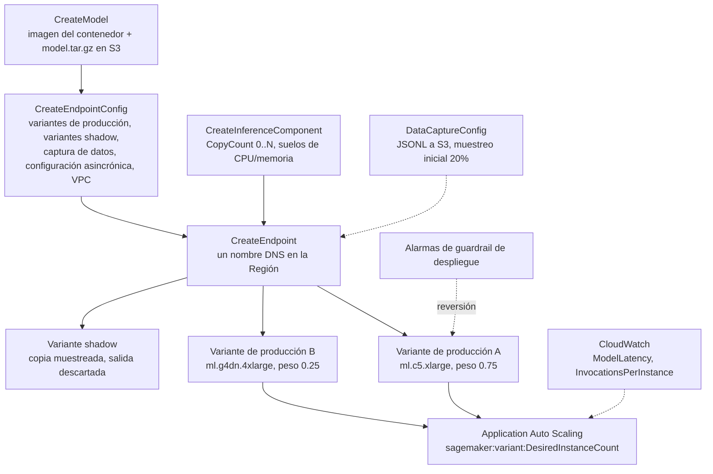
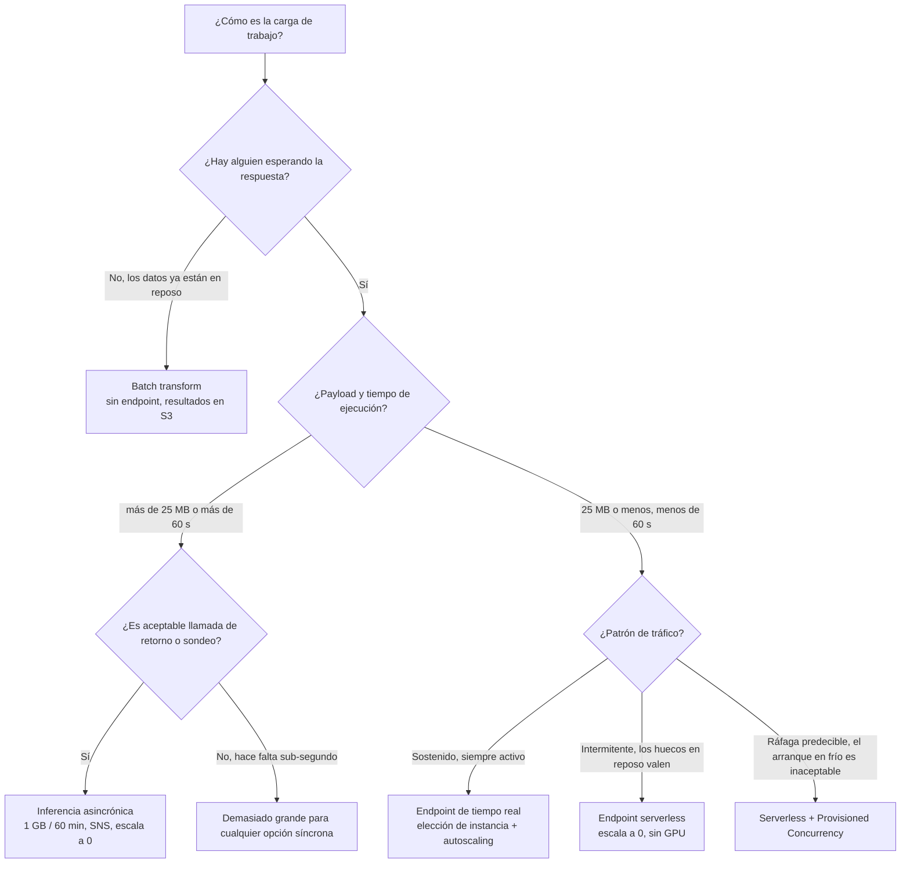
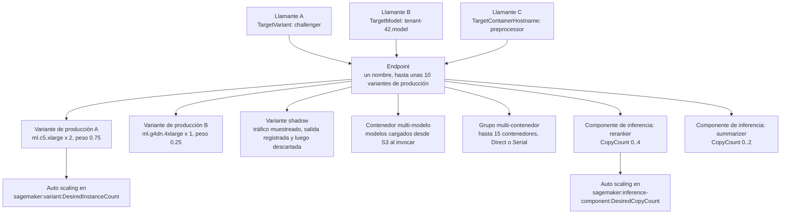
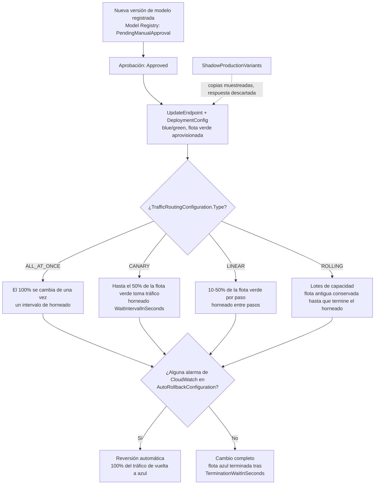
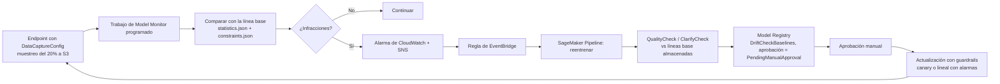

# Despliegue e inferencia en Amazon SageMaker

El entrenamiento produce un artefacto; **la inferencia es donde el modelo se encuentra con quien lo llama, y donde empieza la factura**. En el examen AIF-C01 esto es territorio del Dominio 2, *«Tarea 2.1: seleccionar la opción de despliegue adecuada para una solución de IA/ML»*, y es la tarea con más peso de selección de servicios de toda la guía. El modo de fallo nunca es «no sabías que SageMaker puede alojar un modelo». Es que elegiste **serverless** para una carga útil de 800 MB, **batch** para una interfaz de chat sub-segundo, **tiempo real** para un trabajo que se ejecuta dos veces por la noche, o configuraste un canary al **60%** de la flota verde y nunca notaste que ese número está limitado.

```text
=====================================================================
 LAS CUATRO OPCIONES DE DESPLIEGUE   (exactamente cuatro — AIF-C01 Tarea 2.1)
=====================================================================
  TIEMPO REAL ...... endpoint REST persistente, latencia en ms,
                     tráfico sostenido, payload <= 25 MB, GPU sí
  SERVERLESS ..... escala a 0, sin tipo de instancia, 4 MB / 60 s,
                     tráfico intermitente, GPU no, arranque en frío
  ASINCRÓNICA ........ encolada vía InvokeEndpointAsync, 1 GB / 60 min,
                     resultados en S3 + SNS, escala a 0, GPU sí
  BATCH .......... sin endpoint alguno, trabajo sobre datos en reposo,
                     100 MB por lote, días de ejecución, resultados en S3
---------------------------------------------------------------------
  MODELO DE OBJETOS:  CreateModel -> CreateEndpointConfig -> CreateEndpoint
                     (+ CreateInferenceComponent, opcional)
  TOPOLOGÍAS:    modelo único | multi-modelo | multi-contenedor |
                 pipeline serial | componentes de inferencia
  DESPLIEGUE:    blue/green (predeterminado) | ALL_AT_ONCE | CANARY | LINEAR
  MONITORIZACIÓN: calidad de datos | calidad del modelo | desviación de sesgo |
                 desviación de la atribución de atributos (requiere captura de datos)
=====================================================================
```

> [!NOTE]
> **Cómo leer esta lección.** Cada techo, tiempo de espera y precio de abajo es una cifra publicada por AWS, tomada de la guía del desarrollador de SageMaker, la referencia de la API de SageMaker o la página de precios de SageMaker. Cuando AWS ha publicado un *cambio*, y en 2026 ha publicado dos grandes, el cierre de Model Monitor a clientes nuevos y la discontinuación de Edge Manager, el cambio aparece marcado en la sección donde de otro modo habrías aplicado el dato antiguo.

Al terminar esta lección sabrás:

- nombrar las **exactamente cuatro** opciones de inferencia y recitar el techo de carga útil, de ejecución y de endpoint de cada una;
- recorrer el modelo de objetos `CreateModel` → `CreateEndpointConfig` → `CreateEndpoint` y decir qué hace cada campo;
- elegir entre las **cinco topologías** que caben detrás de un endpoint (modelo único, multi-modelo, multi-contenedor, pipeline serial, componentes de inferencia) con sus límites de contenedor y de variante;
- configurar **auto scaling** en la dimensión escalable correcta, incluidas las métricas objetivo que la propia AWS documenta;
- ejecutar **pruebas A/B, variantes shadow y despliegues blue/green con guardrails**, incluidos los límites porcentuales del canary y del lineal;
- explicar la **captura de datos** y los cuatro tipos de **Model Monitor**, y el cambio de disponibilidad de 2026 que los cierra a clientes nuevos;
- calcular el coste real de un endpoint de tiempo real, un endpoint serverless y una configuración con Provisioned Concurrency a partir de los propios ejemplos resueltos de AWS;
- conectar **SageMaker Projects, operadores de EKS y Neo** en una historia de CI/CD y de edge;
- defender un **veredicto comparativo** entre tiempo real frente a serverless frente a batch frente a asincrónica frente a edge;
- responder **diez preguntas estilo examen** redactadas en el tono oficial, incluidos dos ítems de aritmética.

---

## 1. El modelo de objetos: tres llamadas y una cuarta opcional

### 1.1 Qué decide cada llamada a la API

Desplegar en SageMaker no es un solo botón. Es una cadena de tres llamadas a la API, cada una de las cuales es dueña de una decisión distinta, más una cuarta opcional para componentes. Al examen le encanta la forma *«¿cuál de esto se configura dónde?», así que apréndete la tabla de propiedad de memoria.

| Llamada a la API | Qué decides ahí | Campos que nombra el examen |
|---|---|---|
| `CreateModel` | **Qué** es el modelo | `PrimaryContainer.Image` / `ModelDataUrl`, `ExecutionRoleArn`, `VpcConfig`, `EnableNetworkIsolation` |
| `CreateEndpointConfig` | **Cómo** se sirve | `ProductionVariants`, `ShadowProductionVariants`, `DataCaptureConfig`, `AsyncInferenceConfig`, `VpcConfig`, `KmsKeyId` |
| `CreateEndpoint` | **Adónde** va el tráfico | nombre del endpoint; luego se actualiza con `UpdateEndpoint` + `DeploymentConfig` |
| `CreateInferenceComponent` (opcional) | **Cuánto** del endpoint recibe un modelo | `VariantName`, `ModelPackageName`/`InferenceComponentName`, `RuntimeConfig.InitialCopyCount`, `ComputeConfigRequirements` (`NumberOfCpuCoresRequired`, `MinMemoryRequiredInMb`) |

Dos llamadas de seguimiento importan tanto como las tres anteriores:

- **`UpdateEndpointWeightsAndCapacities`** re-pondera variantes vivas *sin* reemplazar el endpoint; esta es la palanca del A/B;
- **`UpdateEndpoint` + `DeploymentConfig`** intercambia toda la flota detrás del endpoint usando una configuración de enrutamiento de tráfico con guardrails.

### 1.2 La arquitectura de despliegue



### 1.3 Dónde vive el interruptor asincrónico

La presencia de `AsyncInferenceConfig` dentro de la configuración del endpoint es lo que convierte un endpoint en **exclusivamente asincrónico**. Ese campo lleva `S3OutputPath`, los temas SNS opcionales `SuccessTopic`/`ErrorTopic`, `ClientConfig` (`MaxConcurrentInvocationsPerInstance`) y el TTL de la petición. Un endpoint creado con él acepta **solo `InvokeEndpointAsync`**: las llamadas síncronas `Invoke` no son el contrato.

- **📚 ¿Sabías que…?** La cola de peticiones asincrónicas está respaldada por **Amazon SQS** con un TTL documentado de **6 horas** (`RequestTTLSeconds` máximo **21.600**), y la propia invocación expira a los **900 segundos** por defecto con un máximo de **3.600 segundos**. Por eso AWS describe la asincrónica como *«encolada, casi en tiempo real»* y no como un sustituto del batch: la cola olvida tu petición a las 6 horas aunque tu modelo hubiera terminado a la larga.

---

## 2. Las cuatro opciones de inferencia

### 2.1 Endpoints de tiempo real

Un endpoint de tiempo real es un **endpoint REST persistente** con latencia en milisegundos, pensado para **tráfico sostenido y predecible**. Tú eliges el tipo y el número de instancias, activas el auto scaling, obtienes captura de datos, Model Monitor, variantes shadow y despliegues con guardrails. También pagas por él **cada segundo que existe**: la facturación de tiempo real es la hora-instancia mientras está en marcha, medida por segundo con un mínimo de un minuto, más el volumen EBS y la transferencia de datos.

### 2.2 Serverless Inference

Serverless elimina la elección de instancia: tú das una configuración de memoria (**1024, 2048, 3072, 4096, 5120 o 6144 MB**, con la vCPU escalando en paralelo) y AWS escala el endpoint desde el tráfico **hasta cero**. La imagen de contenedor máxima es **10 GB**, y cada contenedor ejecuta **1 worker con 1 copia del modelo**. En reposo no cuesta nada; la primera petición tras un periodo en reposo paga un arranque en frío que AWS describe solo como *«unos segundos extra»*.

Las exclusiones son la lista favorita del examen, porque cada una mata una opción que suena plausible:

| No soportado en serverless | Dónde sí se soporta |
|---|---|
| GPU | tiempo real, asincrónica, batch |
| Paquetes de Marketplace y registros privados | tiempo real |
| Endpoints multi-modelo | tiempo real |
| Configuración VPC y aislamiento de red | tiempo real |
| Captura de datos y **Model Monitor** | tiempo real (captura en el trabajo para batch) |
| Múltiples variantes de producción / A/B | tiempo real |
| Pipelines de inferencia (serial) | tiempo real |

> [!WARNING]
> **Serverless es unidireccional.** Crear una configuración de endpoint que mezcle una variante serverless con las funciones anteriores lanza un **`ValidationError`**. Y la conversión es asimétrica por diseño: puedes fallar *desde* una configuración de tiempo real *hacia* serverless eliminando las piezas no soportadas, pero AWS documenta la dirección contraria como una puerta de un solo sentido. Recuerda también los techos duros antes de comprometerte: payload de **4 MB** y **60 segundos** de procesamiento, frente a los **25 MB** de tiempo real.

**Ejemplo resuelto 1, la factura mensual serverless (ejemplo de precios de AWS).** 10.000.000 peticiones × 100 ms = **1.000.000 segundos** de cómputo × **0,00004 USD/segundo** = **40,00 USD**; 10 GB de transferencia de datos × **0,016 USD/GB** = **0,16 USD** → **40,16 USD al mes**, y **0,00 USD** en reposo. El mismo tráfico en un endpoint de tiempo real se factura igualmente sirva 10 peticiones o 10 millones, que es todo el argumento de serverless con carga intermitente.

### 2.3 Transformación por lotes (batch transform)

Batch transform **no tiene endpoint**. Apuntas un trabajo de transformación a datos que ya están en reposo, este levanta instancias, escribe los resultados en S3 como **`<input>.out`** (por ejemplo `input.csv.out`), y el cómputo desaparece con el trabajo. La carga útil es por lote mediante **`MaxPayloadInMB`** (hasta **100 MB**), el techo del trabajo es de **3.600 segundos**, y es la respuesta correcta siempre que los datos estén disponibles de antemano y nadie esté esperando.

**Ejemplo resuelto 7, aritmética de la carga útil del batch.** La regla documentada es `MaxConcurrentTransforms × MaxPayloadInMB ≤ 100 MB`: **4 × 25 MB = 100 MB es legal**, **4 × 50 MB = 200 MB se rechaza**. Poner `MaxPayloadInMB: 0` cambia a streaming troceado, que los algoritmos integrados **no** soportan, así que el camino por defecto es el acotado.

### 2.4 Inferencia asincrónica

La inferencia asincrónica toma una petición grande, **la encola** y deja que quien llama haga sondeo a S3 o reciba un mensaje SNS. Es la opción con la carga útil más grande (**1 GB**) y la ventana de procesamiento más larga (**60 minutos** por defecto **900 s**, máximo **3.600 s**), escala a **cero** entre ráfagas, y es la única opción cuyo *camino de éxito* es asincrónico por construcción.

**Ejemplo resuelto 3: cuándo solo encaja la asincrónica.** Un modelo de vídeo debe aceptar un archivo de **800 MB**, puede tardar **40 minutos**, y quien llama quiere una notificación SNS. Tiempo real se detiene en **25 MB / 60 s**; serverless se detiene en **4 MB**; batch limita la carga útil por lote a **100 MB**. La asincrónica a **1 GB / 60 min** con `S3OutputPath` y `SuccessTopic` es la única configuración que supera los tres requisitos.

### 2.5 Los techos lado a lado

| Techo | Tiempo real | Serverless | Asincrónica | Batch transform |
|---|---|---|---|---|
| Payload | **25 MB** | **4 MB** | **1 GB** | **100 MB** por lote (`MaxPayloadInMB`) |
| Tiempo de procesamiento | **60 s** (8 min con streaming) | **60 s** | **60 min** (900 s por defecto) | trabajo de **3.600 s** |
| Patrón de tráfico | sostenido | intermitente | encolado | GB, hasta días |
| El endpoint persiste | sí | sí (escala a 0 en reposo) | sí (escala a 0) | no (solo el trabajo) |
| TTL de la cola |: |: | **6 h** (máx. 21.600 s) |: |
| GPU | sí | **no** | sí | sí |
| Captura de datos / Model Monitor | sí | **no** | sí | captura en el trabajo |
| Salida | síncrona | síncrona | S3 + **SNS** opcional | S3 `.out` |

*Fuentes: `deploy-model-options`, `hosting-faqs`, `async-inference-troubleshooting`, `batch-transform` (2026).*



- **📚 ¿Sabías que…?** AWS nunca publica una cifra exacta de arranque en frío. La guía del desarrollador dice que una petición tras un periodo de escalar a cero paga *«unos segundos extra»* para la descarga del modelo y el arranque del contenedor, mientras que las unidades de **Provisioned Concurrency** se documentan como *«listas en milisegundos»*. Cualquier opción de examen que cite una cifra precisa de p95 de arranque en frío en segundos la está inventando.

---

## 3. Elegir una opción: la matriz de decisión

Las cuatro opciones son solo media historia. Una vez sabes *cuándo* llega el tráfico, la pregunta restante es *cuántos modelos* y *cómo comparten cómputo*. Esta matriz es la Tarea 2.1 del examen en forma de tabla.

| Situación | Elige | Por qué / ajuste clave |
|---|---|---|
| Interfaz interactiva, sub-segundo, siempre activa | **Endpoint de tiempo real** | 25 MB, latencia constante, autoscaling, monitorización + guardrails |
| Tráfico con picos, huecos en reposo, el arranque en frío es aceptable | **Serverless** | escala a 0, sin elección de instancia, 4 MB / 60 s, sin GPU |
| Ráfaga predecible, nunca un arranque en frío | **Serverless + Provisioned Concurrency** | caliente en milisegundos, facturado por ms |
| Puntuación nocturna de un archivo de 50 GB | **Batch transform** | sin endpoint, GB de datos, salida a S3 |
| Entrada de 800 MB, minutos de trabajo, se quiere llamada de retorno | **Asincrónica** | 1 GB / 60 min, S3 de entrada y salida, SNS, escala a 0 |
| Miles de modelos del mismo framework | **Endpoint multi-modelo** | contenedor compartido, se añaden vía S3, tolerante al arranque en frío |
| Pocos frameworks, poco tráfico en cada uno | **Multi-contenedor (Direct)** | `TargetContainerHostname`, ámbito IAM, ≤15 contenedores |
| Pre/post-procesamiento encadenado a un modelo | **Pipeline de inferencia serial** | `Mode=Serial`; solo se permite un MME dentro |
| Varios modelos, CPU y memoria por modelo | **Componentes de inferencia** | `CopyCount`, autoscaling a 0 |
| Candidato frente a incumbente con tráfico en vivo | **Variantes de producción (A/B)** | pesos + `TargetVariant` + `UpdateEndpointWeightsAndCapacities` |
| Validar sin que los usuarios lo vean | **Variante shadow** | copias muestreadas, solo se devuelve la respuesta de producción |
| Cambio con aborto basado en alarmas | **Blue/green + canary o lineal** | `DeploymentConfig` + alarmas de CloudWatch + reversión automática |
| Modelos a cámaras/robots, sin llamadas a la nube | **Compilación Neo (+ plan de edge por etapas)** | Edge Manager discontinuado el 26 de abril de 2024 |
| Código del modelo en tu propia VPC o Kubernetes | **Imagen BYOC en ECR + operador EKS** | CRD `HostingDeployment`; controladores ACK |

**Comprueba tu selección de opciones:**

```matching
{
  "question": "Relaciona cada descripción de carga de trabajo con la opción de despliegue que AWS documenta para ella:",
  "pairs": [
    {"left": "Interfaz de chat estable, respuestas sub-segundo, necesita métricas de latencia por variante", "right": "Endpoint de tiempo real con variantes de producción - 25 MB, latencia en ms, autoscaling"},
    {"left": "El tráfico está a cero durante 26 días y se dispara a fin de mes", "right": "Serverless con Provisioned Concurrency: escala a 0, caliente en milisegundos"},
    {"left": "Puntuación nocturna de un archivo de 6 GB, nadie esperando", "right": "Batch transform: sin endpoint, GB de datos, resultados como archivos.out en S3"},
    {"left": "Vídeo de 800 MB, 40 minutos de procesamiento, devolución vía SNS", "right": "Inferencia asincrónica: payload de 1 GB, techo de 60 min, salida en S3 más temas SNS"},
    {"left": "460 modelos de inquilinos, aproximadamente un 2% llamados en cualquier día dado", "right": "Endpoint multi-modelo por framework: contenedor compartido, carga y descarga desde S3"},
    {"left": "Comparar un candidato con producción sin que los usuarios vean sus respuestas", "right": "Variante de producción shadow: copia muestreada, solo se devuelve la respuesta de producción"}
  ],
  "explanation": "El tiempo real es la respuesta de baja latencia sostenida; serverless es dueño del caso de huecos en reposo y gana predecibilidad con Provisioned Concurrency; batch es dueño de los datos en reposo; la asincrónica es dueña de las cargas útiles grandes con devolución; los endpoints multi-modelo son dueños de muchos modelos del mismo framework con tráfico mixto caliente/frío; las variantes shadow son el único mecanismo que evalúa un candidato con tráfico en vivo sin devolver nunca su salida."
}
```

---

## 4. Topologías de endpoint: cinco maneras de compartir un endpoint

Un solo nombre DNS de endpoint puede frontear mucho más que un modelo. AWS documenta cinco topologías, y el examen las prueba como *«qué topología, qué selector, qué límite»*.

| | Modelo único | Multi-modelo (MME) | Multi-contenedor (MCE) | Componente de inferencia | Variantes de producción |
|---|---|---|---|---|---|
| Comparte el endpoint | 1 modelo | N modelos, **1 contenedor compartido** | ≤ **15 contenedores** | N modelos, recursos por modelo | ≤ ~10 variantes |
| Selección en la invocación | implícita | `TargetModel` | `TargetContainerHostname` | nombre del modelo | `TargetVariant` / peso |
| Frameworks | cualquiera | **el mismo** (NVIDIA Triton para GPU) | heterogéneos | heterogéneos | heterogéneos |
| Añadir un modelo sin actualizar el endpoint | no | **sí** (subir a S3) | no | **sí** (componente nuevo) | no |
| Arranque en frío | no | **sí** (carga/descarga) | no | no | no |
| Ámbito IAM |: | `sagemaker:TargetModel` | `sagemaker:TargetContainerHostname` | CPU/memoria por componente | instancias por variante |
| A/B + guardrails | vía actualización | limitado | limitado | vía componentes | **nativo** |
| Uso típico | un modelo | muchos modelos de inquilinos | unos pocos modelos con poco tráfico | modelos fundacionales en una flota compartida | pruebas y despliegue |

*Fuentes: `model-deploy-feature-matrix`, `multi-model-endpoints`, `multi-container-create` (2026). La frase **«multi-access endpoint»** no aparece en ninguna página de documentación de AWS: los tres nombres reales son multi-modelo, multi-contenedor y componente de inferencia.*

### 4.1 Endpoints multi-modelo

Un MME pone **un único contenedor de servicio compartido** detrás del endpoint y carga/descarga modelos desde S3 **al invocar**, de modo que puedes añadir o retirar modelos subiendo un objeto; **sin actualizar el endpoint**. Los modelos deben compartir un framework; el uso de GPU requiere **NVIDIA Triton**. El coste es el arranque en frío en el primer acierto a un modelo que no está residente, y la restricción es que **un pipeline serial puede contener como máximo un MME**.

### 4.2 Endpoints multi-contenedor

Un MCE pone hasta **15 contenedores** detrás de un endpoint. `Mode=Direct` enruta con la cabecera de petición `TargetContainerHostname` (y la clave IAM `sagemaker:TargetContainerHostname`); `Mode=Serial` los encadena como un pipeline. El modo Direct **no soporta GPU**, y el ML Blog de AWS afirma **hasta un 90% de ahorro de coste** frente a ejecutar un endpoint aparte por contenedor.

### 4.3 Componentes de inferencia

La respuesta moderna para *«varios modelos, necesidades de recursos distintas, en una misma flota»*: cada componente declara `NumberOfCpuCoresRequired`, `MinMemoryRequiredInMb` y `CopyCount`, hace autoscaling en su propia dimensión (`DesiredCopyCount`) y puede escalar sus copias **hasta cero**. Esta es también la topología que permite que un modelo fundacional y un clasificador pequeño compartan capacidad sin que ninguno de los dos sea dueño del número de instancias.

### 4.4 La arquitectura de despliegue bajo un endpoint



- **📚 ¿Sabías que…?** El techo de **~10 variantes de producción** procede de una entrada del AWS Machine Learning Blog (2022), no de una página de cuotas: AWS lo publica como guía y no como cuota del servicio. Trátalo como «más o menos diez, no diseñes por encima», y recuerda que cada variante lleva su propio tipo de instancia, número, peso y dimensión de CloudWatch.

---

## 5. Auto scaling, capacidad caliente y escalar a cero

### 5.1 Los tres pasos estándar

AWS documenta la misma secuencia para cada objetivo de escalado de SageMaker: **registrar el objetivo escalable** (espacio de nombres `sagemaker`) → **definir la política** → **`PutScalingPolicy`** con `TargetTrackingScaling` o `StepScaling`. El seguimiento de objetivo es el tipo de política recomendado para las variantes de producción.

| Objetivo | Dimensión escalable | Métrica / nota |
|---|---|---|
| Variante de producción | `sagemaker:variant:DesiredInstanceCount` | `SageMakerVariantInvocationsPerInstance` (ejemplo documentado de objetivo **70**/min), `ConcurrentRequestsPerModel`, `CPUUtilization` |
| Componente de inferencia | `sagemaker:inference-component:DesiredCopyCount` | `SageMakerInferenceComponentInvocationsPerCopy` (ejemplo **1**), mínimo **0** |
| Provisioned Concurrency serverless | `sagemaker:variant:DesiredProvisionedConcurrency` | seguimiento de objetivo sobre unidades de PC (ejemplo 1 to 10) |
| Endpoint explicable | dimensión de la variante | `ExplanationsPerInstance` (con `EnableExplanations`) |
| Recuperación al escalar a cero |: | `NoCapacityInvocationFailures` → **step scaling** |
| Excluido |: | instancias **burstable T2** |

*Fuentes: `endpoint-auto-scaling-policy`, `endpoint-auto-scaling-add-code-define`, `endpoint-auto-scaling-zero-instances` (2026).*

### 5.2 Escalar a cero y el camino de recuperación

Escalar a cero aplica a las copias **serverless, asincrónicas y de componentes de inferencia**. En una variante de tiempo real la consola impone un **número mínimo de instancias ≥ 1**, y **las instancias burstable T2 no pueden hacer auto scaling en absoluto**. La recuperación desde cero no es instantánea: CloudWatch emite **`NoCapacityInvocationFailures`**, la política de **step scaling** reacciona, y AWS documenta la recuperación como que lleva *«varios minutos»*.

**Ejemplo resuelto 6, aritmética del seguimiento de objetivo.** Seguimiento de objetivo sobre `SageMakerVariantInvocationsPerInstance` con `TargetValue = 70` mantiene cada instancia cerca de **70 invocaciones por minuto**; `ScaleOutCooldown` de **300 s** y `ScaleInCooldown` de **600 s** impiden que la flota entre en bucle. Registrar `MinCapacity = 1`, `MaxCapacity = 8` limita el gasto a 8 × **0,204 USD/h** = **1,63 USD/h** de cómputo, la configuración de tiempo real más barata que es legal, e infinitamente más cara que un endpoint serverless sentado a cero.

```fillblank
{
  "question": "Completa las reglas de auto scaling de los endpoints de SageMaker:",
  "template": "El tipo de política recomendado para una variante de producción es {{1}}. Escala en la métrica {{2}}, con un objetivo de ejemplo documentado de {{3}} invocaciones por minuto. Las instancias de la familia {{4}} no pueden hacer auto scaling en absoluto, y un endpoint escalado a cero se recupera a través de {{5}} de CloudWatch disparado en una política de step scaling.",
  "answers": {
    "1": "target tracking",
    "2": "SageMakerVariantInvocationsPerInstance",
    "3": "70",
    "4": "burstable T2",
    "5": "NoCapacityInvocationFailures"
  },
  "distractors": ["step scaling", "SageMakerEndpointInvocations", "100", "burstable T3", "ModelLatencyAlarm", "CPUUtilization"],
  "explanation": "AWS recomienda target tracking para las variantes de producción sobre SageMakerVariantInvocationsPerInstance con un ejemplo documentado de 70; las instancias burstable T2 quedan excluidas del auto scaling; y un endpoint que escaló a cero señala NoCapacityInvocationFailures, que una política de step scaling reconvierte en capacidad a lo largo de varios minutos."
}
```

---

## 6. Pruebas y despliegue: A/B, variantes shadow y guardrails

### 6.1 Pruebas A/B con variantes de producción

Las pruebas A/B son simplemente **pesos de variante**: `InitialVariantWeight` reparte el tráfico (el propio recorrido de AWS empieza en **1 / 1 = 50/50**), `TargetVariant` fija un llamante concreto a una variante concreta independientemente del peso, y `UpdateEndpointWeightsAndCapacities` re-pondera el reparto **en vivo, sin reemplazar el endpoint**. Las métricas por variante aterrizan en CloudWatch bajo la dimensión de la variante.

**Ejemplo resuelto 5: el recorrido del peso.** Dos variantes con `InitialVariantWeight 1/1` → **50/50**. La variante 2 gana la comparación → `UpdateEndpointWeightsAndCapacities` fija **25/75**, moviendo el **75%** del tráfico a la variante 2. El paso final **0/1** lo da todo a la variante 2, y la variante 1 se elimina. `TargetVariant` anula los pesos para un llamante fijado.

### 6.2 Despliegues shadow

`ShadowProductionVariants` en la configuración del endpoint envía una **copia muestreada** del tráfico en vivo al candidato. El comportamiento crítico, y la frase favorita del examen sobre este tema, es que **solo la respuesta de la variante de producción llega al llamante**; la salida de la shadow se registra o se descarta. Las actualizaciones shadow en sí mismas son **blue/green**: la configuración del endpoint cambia entre bastidores.

### 6.3 Guardrails de despliegue

Los guardrails son cómo envías un modelo sin apostar el endpoint por él. Blue/green es el **predeterminado para actualizaciones de modelo**, el rolling reemplaza capacidad en lotes, y el tipo de enrutamiento de tráfico es un enumerado explícito.

| Modo | Unidad de cambio | Límite | Horneado | Con alarma |
|---|---|---|---|---|
| `ALL_AT_ONCE` | 100% del tráfico |: | un intervalo de horneado | → 100% de vuelta a azul |
| `CANARY` | % de la **flota verde** | **≤ 50%** | `WaitIntervalInSeconds` (ejemplo 600 s) | → 100% de vuelta a azul |
| `LINEAR` | % de verde por paso | **10 to 50%** por paso | por paso (ejemplo 300 s) | → 100% de vuelta a azul |
| Rolling | lotes de instancia/capacidad | tamaño de lote del cliente | por lote | la flota antigua se conserva hasta que termine el horneado |
| Plan de despliegue edge | % de la flota o dispositivos con nombre | plan por etapas | por etapa | `ROLLBACK_ON_FAILURE` |

*Fuentes: `deployment-guardrails`, `deployment-guardrails-blue-green-canary`, `deployment-guardrails-blue-green-linear` (2026). Controles: `WaitIntervalInSeconds`, `MaximumExecutionTimeoutInSeconds`, `AutoRollbackConfiguration.Alarms[]`.*

**Ejemplo resuelto 3 (despliegue): temporización del canary.** `Type: CANARY`, `CanarySize: 30%`, `WaitIntervalInSeconds: 600`, `TerminationWaitInSeconds: 600`, `MaximumExecutionTimeoutInSeconds: 1800`: el **30% de la flota verde** toma tráfico durante **10 minutos**, el resto se cambia solo si no salta ninguna alarma, la flota azul muere **10 minutos** después del corte, y el despliegue completo se aborta a los **30 minutos**. El 30% es válido porque el límite es **≤ 50%**.

**Ejemplo resuelto 4 (despliegue), el suelo del lineal.** `LinearStepSize: 20%` con `WaitIntervalInSeconds: 300` significa 100 / 20 = **5 pasos × 5 minutos = al menos 25 minutos** de horneado, cómodamente dentro de un `MaximumExecutionTimeoutInSeconds` de una hora. Un paso fuera de **10 to 50%** es inválido, el 5% y el 60% se rechazan ambos.



- **📚 ¿Sabías que…?** Un canary se mide contra la flota **verde**, no contra el tráfico total: el límite de AWS es *«no más del 50% de la flota verde»*, y por eso una pregunta sobre una flota verde de 8 instancias acepta `CAPACITY_PERCENT 50` y rechaza `60` y `80`. Es un porcentaje de dos pasos: primero del verde, luego del endpoint completo.

---

## 7. Monitorización: captura de datos, Model Monitor y el bucle de desviación

### 7.1 La captura de datos es la precondición

`DataCaptureConfig` vive en la configuración del endpoint y tiene tres campos: `EnableCapture`, `InitialSamplingPercentage` (0 to 100) y `DestinationS3Uri`. El **muestreo predeterminado del SDK es del 20%**, los registros se escriben como **JSONL** bajo `s3://…/{endpoint}/{variant}/yyyy/mm/dd/hh/`, y la captura **se detiene por encima del 75% de uso de disco**. Sin captura, no hay monitorización: Model Monitor lee lo que escribió la captura.

### 7.2 Los cuatro tipos de monitor

| Monitor | Detecta | ¿Necesita verdad de referencia? | Línea base | Motor / métrica | Alerta |
|---|---|---|---|---|---|
| **Calidad de datos** | desviación de entrada, cambio de datos aguas arriba | **No** | `statistics.json` + `constraints.json` | estadísticas/restricciones (**solo tabular**) | CloudWatch ante infracciones |
| **Calidad del modelo** | desviación de exactitud, precisión, recall, F1, AUC, RMSE, MAE | **Sí** (etiquetas en S3) | restricciones de métrica | trabajo de procesamiento programado | CloudWatch + SNS |
| **Desviación del sesgo** | cambio de equidad frente al entrenamiento (p. ej. DPPL) | atributos protegidos | línea de base de sesgo de Clarify | Clarify + intervalos de confianza bootstrap (ejemplo de 2 días, DPPL −0,1…0,1) | CloudWatch |
| **Desviación de la atribución de atributos** | cambió la importancia SHAP | No | línea base SHAP | comparación de ranking **NDCG** | **NDCG < 0,90** |
| Salud del endpoint/sistema | latencia, 5xx, invocaciones, CPU | No | métricas de CloudWatch | `ModelLatency`, `InvocationsPerInstance`, `NoCapacityInvocationFailures` | reversión automática por guardrails |

*Fuentes: `model-monitor`, `clarify-model-monitor-feature-attribution-drift` (2026).*

### 7.3 El cambio de disponibilidad de 2026

> [!WARNING]
> **Model Monitor y SageMaker Clarify quedan cerrados a clientes nuevos desde el 30 de julio de 2026.** Los clientes existentes conservan el acceso sin funciones nuevas; el anuncio de disponibilidad de servicios de AWS de junio de 2026 los lista entre las funciones de SageMaker que pasan a mantenimiento. Para proyectos **nuevos** AWS apunta a **MLflow Apps + Evidently AI + QuickSight + CloudWatch** (siete soluciones publicadas en `aws-samples`, normalmente conectadas con Athena, EventBridge y Lambda). Una opción de examen que diga *«crear un nuevo programa de Model Monitor»* para una cuenta completamente nueva a finales de 2026 está probando si leíste la página de disponibilidad.

### 7.4 El bucle de desviación a reentrenamiento

La desviación no es una alerta que lees; es un disparador que conectas. El camino documentado: una infracción levanta una alarma de CloudWatch → SNS notifica → **EventBridge** hace coincidir la alarma e invoca Lambda o inicia un **CodePipeline** → un **SageMaker Pipeline** reentrena → los pasos `QualityCheck` / `ClarifyCheck` comparan al candidato con las líneas base almacenadas en el **Model Registry** (`DriftCheckBaselines`) → un humano aprueba → sale una actualización con guardrails.



- **📚 ¿Sabías que…?** La desviación de la atribución de atributos se puntúa con **NDCG** sobre ranking SHAP y el umbral de alerta documentado por AWS es **NDCG < 0,90**: un valor de 0,69 significa que la importancia de atributos en vivo ha divergido materialmente del entrenamiento. Model Monitor en sí solo produce métricas **tabulares**, así que un modelo cuyos atributos son embeddings de texto queda completamente fuera de su motor estadístico.

### 7.5 Actualizaciones de 2025 to 2026

Las secciones 7.1 to 7.4 describen lo que Model Monitor *hace*; este subapartado describe lo que AWS *le hizo*, porque los dos ya no se mueven juntos. El aviso de fin de soporte de SageMaker AI de AWS lista **Model Monitor** y **Clarify**, junto con Mechanical Turk, Ground Truth, Augmented AI (A2I), Studio Lab, Debugger, Role Manager, Geospatial y Profiler, entre las funciones **«ya no abiertas a clientes nuevos a partir del 30 de julio de 2026»**. El estado que AWS les asigna es **mantenimiento**: los clientes existentes los conservan, no salen funciones nuevas, no se apaga nada y no se cambia nada de marca.

| Función en el aviso | Fecha documentada | Estado del ciclo de vida | Dirección documentada para el trabajo nuevo |
|---|---|---|---|
| SageMaker **Model Monitor** | cerrado a clientes nuevos el **30 de julio de 2026** | **Mantenimiento** | métricas de CloudWatch y detección de anomalías, Amazon Evidently, EventBridge + Lambda, líneas base SHAP |
| SageMaker **Clarify** | cerrado a clientes nuevos el **30 de julio de 2026** | **Mantenimiento** | **Bedrock Model Evaluations**, SHAP, Bedrock Guardrails |
| Ground Truth, **A2I (Augmented AI)**, Studio Lab, Debugger, Role Manager, Geospatial | cerrados a clientes nuevos el **30 de julio de 2026** | **Mantenimiento**: todavía soportado, sin funciones nuevas | página de cada función; la revisión humana de A2I se convierte en una cola más una aplicación que tú construyes |
| SageMaker **Mechanical Turk** | cerrado a clientes nuevos el **30 de julio de 2026**, **EOS 30 de septiembre de 2026** (publicación de What's New fechada el 29 de septiembre) | fin de soporte | Ground Truth con un proveedor o una fuerza de trabajo privada, u otro servicio de etiquetado |
| Ground Truth Plus | **EOS 30 de junio de 2026** | fin de soporte | trabajos de etiquetado estándar de Ground Truth |
| SageMaker **Profiler** | **EOS 30 de junio de 2027** | puesta en retirada | alternativas de observabilidad de SageMaker |
| Amazon **Forecast** (distractor: no es un servicio de monitorización) | cerrado a clientes nuevos el **29 de julio de 2024** | mantenimiento | SageMaker Canvas |

*Fuentes: la página de funciones de SageMaker AI, `model-monitor-availability-change`, `clarify-availability-change`, los anuncios de disponibilidad de servicios de AWS What's New de junio y septiembre de 2026, y la página `service-lifecycle` de la Referencia General de AWS (24 de septiembre de 2026). El conflicto del 29 frente al 30 de septiembre sobre Mechanical Turk es del propio AWS y aquí no se resuelve.*

AWS define el vocabulario del ciclo de vida en exactamente un documento, y el examen prueba las *palabras* con más frecuencia que las fechas:

| Estado del ciclo de vida | Qué dice AWS que significa | Cómo responder en el examen |
|---|---|---|
| **Maintenance** | sin clientes nuevos, sin funciones nuevas, **todavía soportado** | «cerrado a clientes nuevos» no es «muerto»: una cuenta creada antes del 30 de julio de 2026 todavía puede ejecutar un programa de Model Monitor |
| **Sunset** | fin de operaciones planificado con una fecha publicada, normalmente un horizonte de 12 meses | existe un límite y la función sigue funcionando hasta él: SageMaker Profiler corre hasta el **30 de junio de 2027** |
| **Full Shutdown** | eliminado del portafolio de AWS | la API y la consola ya no están; nunca una respuesta válida para una construcción nueva |

**Dónde el cambio afecta a una respuesta de examen:**

- *«Crear un programa de Model Monitor para una cuenta **nueva»* → no disponible desde el **30 de julio de 2026**; la dirección documentada son las métricas de CloudWatch y la detección de anomalías, **Amazon Evidently**, un bucle **EventBridge + Lambda** y líneas base SHAP que calculas tú mismo;
- *«Evaluar la calidad y el sesgo de un candidato para un proyecto **nuevo»* → **Bedrock Model Evaluations** es la pareja que AWS ahora escribe en el objetivo **4.2.2** de la guía del examen, con **SHAP** y **Bedrock Guardrails** nombrados junto a Clarify;
- *«Enrutear predicciones de baja confianza a un humano»* → **A2I** está en el mismo aviso, así que una construcción nueva llega a una cola más una aplicación de revisión, o a Ground Truth, en lugar de a Augmented AI;
- *«Cliente existente, 2026, conserva sus programas de Model Monitor»* → correcto: **mantenimiento** significa soportado, y solo se bloquean las altas *nuevas*.

**Lo que *no* cambió:** cada mecánica memorizada arriba se comporta igual que está escrito, `DataCaptureConfig` con su muestreo predeterminado del **20%** del SDK, el diseño JSONL bajo `{endpoint}/{variant}/…`, la detención por encima del **75% de disco**, los cuatro tipos de monitor y sus motores (estadísticas y restricciones, restricciones de métrica, intervalos bootstrap de Clarify, **NDCG < 0,90**), el bucle de desviación a través de EventBridge hacia un SageMaker Pipeline y el `DriftCheckBaselines` del Model Registry, y la limitación de **solo tabular** del motor estadístico de Model Monitor. El aviso de 2026 cambia *quién puede darse de alta*, no lo que hace el software, que es toda la distinción entre *mantenimiento* y *cierre*.

**Redacción de la guía del examen que ahora vas a encontrar (v1.1, publicada el 30 de abril de 2026):**

- el objetivo **1.1.3** cambió sus ejemplos resueltos a **inferencia asincrónica y serverless**, dos de las cuatro opciones de esta lección, así que el vocabulario de despliegue aparece ahora antes en la guía de lo que aparecía antes de la v1.1;
- el objetivo **4.2.2** dice **Clarify más Bedrock Model Evaluations**, y el objetivo **1.3.4** lista **Bedrock, Amazon Quick, Kiro y SageMaker AI** como el conjunto de servicios;
- el historial de cambios de la guía afirma que las actualizaciones llegan al examen aproximadamente **un mes** después de la publicación, y el examen sigue llamándose **AIF-C01** (65 preguntas, 90 minutos, se aprueba con 700/1000).

Por último, el nombre del producto: desde el **3 de diciembre de 2024** AWS documenta que *«el Amazon SageMaker actual ha sido renombrado como **Amazon SageMaker AI**»*, con el SageMaker de próxima generación (Unified Studio, Catalog, Lakehouse, zero-ETL) sentado a su lado. Cada llamada a la API de la sección 1 está intacta, `CreateModel`, `CreateEndpointConfig` y `CreateEndpoint` siguen viviendo bajo el espacio de nombres `sagemaker`, pero la consola, la página del servicio y la lista de servicios del examen dicen **SageMaker AI**.

- **📚 ¿Sabías que…?** AWS define los tres estados del ciclo de vida en exactamente un sitio, la página **`service-lifecycle` de la Referencia General de AWS**, actualizada por última vez el **24 de septiembre de 2026**, y Model Monitor está en el estado más suave, **Maintenance**. Una función en **Sunset** ya lleva una fecha final publicada (SageMaker Profiler, **30 de junio de 2027**), mientras que **Full Shutdown** significa que la API ya no está en el portafolio. Por eso *«Model Monitor está discontinuado»* y *«Model Monitor fue renombrado como Bedrock Model Evaluations»* son ambos falsos: está cerrado a clientes *nuevos*, sin cambios para los existentes, y la pareja con Bedrock vive en la redacción de la guía del examen y no en un cambio de nombre.

---

## 8. Dimensionamiento, coste e Inference Recommender

### 8.1 De qué se compone la factura

| Artículo | Valor de ejemplo de AWS | Fuente |
|---|---|---|
| Alojamiento `ml.c5.xlarge` | **0,204 USD/hora** | ejemplo resuelto de precios de SageMaker |
| `ml.m5.4xlarge` (trabajo de Model Monitor) | **0,922 USD/hora** | ejemplo resuelto de precios de SageMaker |
| Datos de entrada / salida | **0,016 USD/GB** | ejemplo resuelto de precios de SageMaker |
| Cómputo serverless bajo demanda | **0,00004 USD/segundo** | ejemplo resuelto de precios de SageMaker |
| Serverless con Provisioned Concurrency | **0,000023 USD/segundo** | ejemplo resuelto de precios de SageMaker |
| Free tier: tiempo real | **125 horas** de `m4.xlarge`/`m5.xlarge`, primeros 2 meses | free tier de SageMaker |
| Free tier: serverless | **150.000 segundos**, primeros 2 meses | free tier de SageMaker |
| Total mensual de ejemplo en tiempo real | **305,88 USD** | ejemplo resuelto de precios de SageMaker |
| Total mensual de ejemplo serverless | **40,16 USD** | ejemplo resuelto de precios de SageMaker |
| Ejemplo con Provisioned Concurrency | **173,20 USD** = 144 + 23 + 6 + 0,208 | ejemplo resuelto de precios de SageMaker |

*Los precios son los propios ejemplos resueltos de AWS y son ejemplos específicos de Región, no una tarifa. Los Savings Plans (1 o 3 años, compromisos de USD/hora) cubren endpoints de tiempo real, batch transform, entrenamiento y procesamiento.*

**Ejemplo resuelto 2: la factura mensual de tiempo real.** 2 × `ml.c5.xlarge` × 24 h × 31 d = **1.488 horas-instancia** × **0,204 USD** = **303,52 USD**; un trabajo de Model Monitor de **2,5 h** × **0,922 USD** = **2,31 USD**; datos de 3.100 MB de entrada + 310 MB de salida ≈ **0,06 USD** → **≈ 305,88 USD al mes**. La monitorización es menos del **1%** de la factura; el cómputo en reposo es aproximadamente el **99%** de ella. Compara eso con el ejemplo serverless de **40,16 USD** y tienes todo el argumento de coste en dos números.

**Ejemplo resuelto 8, arranque en frío frente a Provisioned Concurrency.** En reposo → escalar a cero → la siguiente petición paga la descarga del modelo y el arranque del contenedor (*«unos segundos extra»*). Comprar determinismo en su lugar: Provisioned Concurrency **144 USD** + cómputo de PC a **0,000023 USD/s** + **6 USD** bajo demanda tras los **150.000 segundos gratis** = **173,20 USD al mes**, aproximadamente **4×** la línea de cómputo bajo demanda, y solo vale la pena cuando un arranque en frío rompería un SLA.

### 8.2 Inference Recommender

Antes de adivinar una instancia, ejecuta un trabajo de recomendación. Un trabajo **`Default`** tarda **hasta 45 minutos** y arranca desde un ARN de Model Package; un trabajo **`Advanced`** ejecuta unas **2 horas** con pruebas de carga. Salida: tipo e número de instancias recomendados, latencia, **coste por hora y coste por inferencia**, más utilización de CPU y memoria: exactamente la evidencia que quiere una pregunta de dimensionamiento.

- **📚 ¿Sabías que…?** Los endpoints de tiempo real se facturan **por segundo con un mínimo de un minuto** mientras existen, y por eso el examen trata un endpoint sin escalar y siempre activo como un problema de *coste* y no de *rendimiento*. Un endpoint que no sirve nada a las 03:00 sigue pagando horas-instancia, EBS y datos, y esa es la frase detrás de cada pregunta de «qué opción evita el coste en reposo»: serverless, la asincrónica y las copias de componentes de inferencia son las tres que pueden llegar a **cero**.

---

## 9. MLOps: CI/CD, Kubernetes y el edge

### 9.1 SageMaker Projects y el camino de CI/CD

Los **Projects** de SageMaker envían plantillas que aprovisionan **AWS CodePipeline** (o Jenkins), integración de Git a través de **CodeConnections** y una pila de **CloudFormation**. El flujo canónico es **origen → compilación (un SageMaker Pipeline ejecuta entrenamiento y evaluación) → endpoint de staging → aprobación manual → endpoint de producción**, con una regla de EventBridge sobre la transición de estado del Model Registry `PendingManualApproval → Approved`. Las imágenes de contenedor siguen **CodeBuild → ECR → `ImageVersion` → EventBridge**.

**Comprueba el orden del pipeline con puerta de control:**

```dragdrop
{
  "question": "Ordena las etapas de un pipeline MLOps de un SageMaker Project, desde el commit hasta producción:",
  "items": [
    "Origen: commit en el repositorio Git conectado (CodeConnections)",
    "Compilación: CodeBuild construye la imagen y la sube a Amazon ECR",
    "Entrenar y evaluar: SageMaker Pipeline ejecuta entrenamiento, evaluación y RegisterModel",
    "Desplegar en el endpoint de staging",
    "Puerta de aprobación manual (estado del Model Registry de PendingManualApproval a Approved)",
    "Desplegar en el endpoint de producción bajo guardrails de despliegue"
  ],
  "correctOrder": [
    "Origen: commit en el repositorio Git conectado (CodeConnections)",
    "Compilación: CodeBuild construye la imagen y la sube a Amazon ECR",
    "Entrenar y evaluar: SageMaker Pipeline ejecuta entrenamiento, evaluación y RegisterModel",
    "Desplegar en el endpoint de staging",
    "Puerta de aprobación manual (estado del Model Registry de PendingManualApproval a Approved)",
    "Desplegar en el endpoint de producción bajo guardrails de despliegue"
  ],
  "explanation": "El orden de la plantilla es origen, compilación, SageMaker Pipeline (entrenar, evaluar, registrar), endpoint de staging, aprobación manual, producción. La aprobación es el punto de control: ningún modelo llega a producción sin que el estado del Model Registry pase de PendingManualApproval a Approved, que es también lo que escucha una regla de EventBridge."
}
```

### 9.2 Kubernetes

El camino soportado son los **SageMaker Operators basados en ACK**: un `kubectl apply` de un recurso personalizado **`HostingDeployment`** crea o actualiza un endpoint, AWS documenta que la reconciliación tarda **hasta 15 minutos**, mientras que los componentes de **Kubeflow** dirigen los trabajos de entrenamiento, ajuste y batch transform. Esta es la respuesta cuando la pregunta dice *«el equipo ya ejecuta Kubernetes y quiere gestionar los endpoints de SageMaker desde ahí»*.

### 9.3 Edge: Neo, y la discontinuación de Edge Manager

**Neo** compila un modelo entrenado para un destino con `CreateCompilationJob`, donde **`TargetDevice` y `TargetPlatform` son mutuamente excluyentes**. Los objetivos de nube incluyen `ml_c5`; los objetivos de edge incluyen `jetson_nano`, `rasp3b` / `rasp4b` y `coreml`. La compilación sobrevive; la flota gestionada a su alrededor no.

> [!WARNING]
> **Amazon SageMaker Edge Manager fue discontinuado el 26 de abril de 2024.** La compilación con Neo todavía existe y sigue siendo la respuesta correcta para *«compilar un modelo para cámaras, robots o Raspberry Pi»*, pero las flotas de dispositivos, los despliegues de modelos y la consola de administración asociada de Edge Manager no son una respuesta válida en 2026. Mecánicas antiguas que todavía pueden aparecer en material anterior: `CreateEdgeDeploymentPlan` con despliegues por etapas (porcentajes o nombres de dispositivo), `ROLLBACK_ON_FAILURE` y `StartEdgeDeploymentStage`. Si una opción ofrece **Edge Manager** para un despliegue nuevo, es un distractor histórico.

- **📚 ¿Sabías que…?** `CreateCompilationJob` devuelve un artefacto de modelo que puedes alojar **tanto** en la nube **como** en un dispositivo: la misma familia de trabajos de compilación cubre las instancias de inferencia `ml_c5` y las placas `rasp4b`. Esa simetría es la razón por la que Neo aparece tanto en una pregunta de dimensionamiento de nube como en una pregunta de IoT, y por la que `TargetDevice` XOR `TargetPlatform` es una regla real de la API y no prosa de documentación.

---

## 10. Veredicto comparativo

> [!IMPORTANT]
> **Veredicto comparativo: tiempo real frente a serverless frente a batch frente a asincrónica frente a edge**
> - **Tiempo real** es la respuesta siempre que un humano o un cliente síncrono está esperando: tráfico sostenido, **25 MB / 60 s**, elección de instancia, auto scaling de seguimiento de objetivo, captura de datos, Model Monitor, variantes shadow y despliegues canary con guardrails viven todos aquí y en ningún otro sitio a plena fuerza. Su modo de fallo es financiero, no funcional: las horas-instancia se acumulan cada segundo que el endpoint existe, y el propio ejemplo de AWS es de **305,88 USD/mes** de los cuales aproximadamente el **99%** es cómputo del que estabas pagando mientras estaba en reposo.
> - **Serverless** gana con tráfico **intermitente**: sin tipo de instancia, dimensionado solo por memoria (1024 to 6144 MB), escala a **cero**, y el ejemplo resuelto de AWS de **40,16 USD/mes** para 10 millones de peticiones de 100 ms con **0 USD** en reposo. Su modo de fallo es la capacidad y el arranque en frío: **sin GPU, sin endpoints multi-modelo, sin configuración VPC, sin captura de datos, sin Model Monitor, sin variantes A/B**, un techo de **4 MB / 60 s**, y un arranque en frío medido solo como *«unos segundos extra»*. Añade **Provisioned Concurrency** cuando un pico nunca debe pagar ese arranque en frío (**173,20 USD/mes** en el ejemplo de AWS, caliente *«en milisegundos»*).
> - **Batch transform** es la respuesta cuando los datos ya están en reposo y nadie está esperando: sin endpoint alguno, **100 MB por carga útil** bajo la regla `MaxConcurrentTransforms × MaxPayloadInMB ≤ 100 MB`, trabajos de hasta **3.600 s**, resultados como `input.csv.out` en S3. Su modo de fallo es que le pidan una respuesta interactiva: batch no tiene ningún endpoint al que llamar.
> - **La asincrónica** es la respuesta cuando la carga útil o el tiempo de procesamiento rompen todas las opciones síncronas: **1 GB / 60 minutos**, encolada con un TTL de **6 horas**, salida en S3, temas SNS de éxito y error, y escala a cero entre ráfagas. Su modo de fallo es un SLA sub-segundo: la cola es la función, no el defecto.
> - **Edge** es la respuesta cuando el modelo debe ejecutarse **sin llamadas a la nube**: **Neo** compila para `jetson_nano`, `rasp3b`/`rasp4b` o `coreml`, con planes por etapas y `ROLLBACK_ON_FAILURE` para el despliegue de flotas, pero **Edge Manager en sí fue discontinuado el 26 de abril de 2024**, así que la compilación con Neo es la parte durable de la historia. Su modo de fallo son modelos en desviación que no puedes monitorizar, y exactamente por eso una decisión de edge debe acompañarse de una historia de reentrenamiento.
> - **Regla mnemotécnica para el examen:** *¿quién está esperando, y cuán grande es la carga útil?* Un humano esperando bajo 25 MB → **tiempo real**; un humano esperando con presupuesto para reposo → **serverless**; nadie esperando con datos en reposo → **batch**; nadie esperando pero la carga útil es enorme → **asincrónica**; nadie esperando porque no hay red → **edge**.

---

## 11. Ejemplos prácticos de AWS con números

| # | Escenario | Aritmética | Resultado |
|---|---|---|---|
| 1 | Mes serverless: 10.000.000 peticiones × 100 ms | 1.000.000 s × 0,00004 USD + 10 GB × 0,016 USD | **40,16 USD**, 0 USD en reposo |
| 2 | Mes de tiempo real: 2 × `ml.c5.xlarge` × 24 h × 31 d | 1.488 h × 0,204 USD + 2,5 h × 0,922 USD + ~0,06 USD de datos | **≈ 305,88 USD** |
| 3 | Canary 30%, horneado 600 s, terminación 600 s, tiempo máximo 1800 s | 10 min solo verde, aborto a los 30 min | límite **≤ 50%** |
| 4 | Lineal por pasos del 20%, horneado de 300 s | 100/20 = 5 pasos × 5 min | **≥ 25 min** de horneado |
| 5 | Pesos A/B | 1/1 → 25/75 → 0/1 con `UpdateEndpointWeightsAndCapacities` | 50/50 → 75% → 100% |
| 6 | Seguimiento de objetivo a 70 invocaciones/min, máximo 8 instancias | 8 × 0,204 USD | límite de **1,63 USD/h** |
| 7 | Regla de carga útil del batch | 4 × 25 MB = 100 MB (legal) frente a 4 × 50 MB = 200 MB (rechazado) | ≤ **100 MB** |
| 8 | Mes de Provisioned Concurrency | 144 + 23 + 6 + 0,208 USD | **173,20 USD**, ≈ **4×** la línea de cómputo |

---

## 12. Hechos en conflicto, sin verificar y no examinables

Separa lo que AWS *documenta* de lo que los terceros *repiten*. Mantén esta tabla fuera de tu conjunto de memorización salvo donde diga «úsala para el examen».

| Afirmación | Qué dicen las fuentes | Cómo manejarla |
|---|---|---|
| «Multi-access endpoint» | No es un término de AWS en ninguna página de documentación | Nunca lo uses; los nombres reales son multi-modelo, multi-contenedor, componente de inferencia |
| Tarifa serverless por petición (p. ej. 0,20 USD / 1.000 peticiones) | Solo blogs de terceros; los ejemplos de AWS facturan **duración + datos** | No la cites; verifica en la calculadora en vivo |
| Segundos exactos de arranque en frío | AWS dice *«unos segundos extra»*; Provisioned Concurrency es *«milisegundos»* | No existe ninguna cifra oficial de p95 |
| Región de las tarifas de 0,204 USD/h y 0,922 USD/h | Los ejemplos resueltos de AWS no etiquetan la Región | Trátalas como tarifas de ejemplo, no como una lista de precios garantizada |
| «Hasta 10 variantes de producción» | AWS Machine Learning Blog (2022), no una página de cuotas | Úsala como guía; no la trates como una cuota dura |
| Recuentos de configuración de Inference Recommender | La documentación de pruebas de carga dice «hasta 10», la consola dice «hasta 8 tipos de instancia» | Redacción de UI frente a API, no una cuota del servicio |
| Reemplazo de Edge Manager | Edge Manager discontinuado el **26 de abril de 2024**; la página de guía del sucesor no se verificó para esta lección | La compilación con Neo está confirmada; trata a los sucesores de gestión de flotas como abiertos |
| Catálogo Inf1/Inf2/Trn1/P4d y cuotas de GPU por Región | No se recuperaron para esta lección | Usa solo los ejemplos verificados: `ml.m5.xlarge`, `ml.c5.xlarge`, `ml.g4dn.4xlarge`, `ml.r5.large`, `ml.g5.8xlarge`, `ml.p3.2xlarge` |

Las fuentes primarias de esta lección: las páginas de la guía del desarrollador de SageMaker `deploy-model-options`, `model-deploy-feature-matrix`, `hosting-faqs`, `realtime-endpoints-deploy-models`, `serverless-endpoints`, `batch-transform`, `async-inference`, `multi-model-endpoints`, `multi-container-create`, `multi-container-endpoints`, `endpoint-auto-scaling-policy`, `endpoint-auto-scaling-add-code-define`, `endpoint-auto-scaling-zero-instances`, `model-ab-testing`, `model-shadow-deployment`, `deployment-guardrails*`, `model-monitor`, `model-monitor-availability-change`, `clarify-model-monitor-feature-attribution-drift`, `model-monitor-data-capture-endpoint`, `pipelines-quality-clarify-baseline-lifecycle`, `inference-recommender-recommendation-jobs`, `sagemaker-projects-templates-sm`, `kubernetes-sagemaker-operators`, `edge`, `neo-supported-devices-edge-devices`; la **referencia de la API** `CreateEndpointConfig`, `InvokeEndpointAsync`, `DataCaptureConfig`; el anuncio de disponibilidad de servicios **What's New** de AWS de junio de 2026; y las páginas de **precios** de SageMaker.

---

## 13. Casos Reales

Las secciones 1 to 12 toman sus techos de la documentación de AWS. Esta sección añade la otra mitad de la evidencia: lo que los *clientes* de AWS publicaron sobre servir modelos en producción con esos mismos servicios. Cada cifra de abajo es una afirmación de cliente publicada por AWS, recuperada el 6 de octubre de 2026 de `aws.amazon.com/solutions/case-studies/*` y `aws.amazon.com/blogs/machine-learning/*`, y cada una está sin auditar: «hasta» es un techo, no una media.

### 13.1 Cinco casos de despliegue: servicios, números, fuentes

| # | Cliente (industria, año) | Servicios en el despliegue | Resultado documentado | Fuente |
|---|---|---|---|---|
| 1 | **Forethought** (soporte al cliente SaaS, año no publicado en la página) | desde su propio **Amazon EKS** → **endpoints multi-modelo** de SageMaker + **Serverless Inference** | MME **−66%** con mejor latencia, serverless **≈ −80%** (titular **hasta −80%**), **>80%** de la inferencia GPU en SageMaker, **30 M** de interacciones/año, equipo de **3 personas** | `solutions/case-studies/forethought-technologies-case-study` |
| 2 | **HAYAT HOLDING** (fabricación de MDF, 2023) | **OPC-UA → AWS IoT Greengrass** SiteWise Edge Gateway → Entrenamiento de SageMaker + **Automatic Model Tuning** + Despliegue + **Edge Manager** en el dispositivo | **194 sensores** monitorizados, **300.000 USD/año** ahorrados | ML Blog `hayat-holding-uses-amazon-sagemaker-to-increase-product-quality-and-optimize-manufacturing-output-saving-300000-annually` |
| 3 | **Prime Focus Technologies** (medios, 2025) | **Amazon Bedrock** + agentes de **AWS Lambda** sobre CLEAR, **14 M+** de activos | coste de localización **−20 to 30%**, exactitud **+20 to 30%**, tiempo de respuesta **−30 to 40%**; el primer intento con APIs externas de LLM fue **demasiado lento para etiquetado en vivo** | `solutions/case-studies/prime-focus-case-study` |
| 4 | **Epilot** (software energético, 2026) | API → **Amazon SQS** → **AWS Lambda** → **Bedrock (Claude Sonnet)**, modelo elegido con **Bedrock Evaluations**, datos en una **Región de la UE** | tiempo de atención **−87%**, **55.000** resúmenes/mes, MVP en **2 meses**, el **80%** de los usuarios dice que simplifica el trabajo | `solutions/case-studies/epilot-genai-case-study` |
| 5 | **Chronomics** (salud digital, 2022) | **Amazon Rekognition Custom Labels** con umbral de puntuación y una cola humana | **4 meses** internos → **3 to 4 semanas**, exactitud **96,5%** / F1 **97,9%**; umbral **0,99 → 99,6%** (**5%** descartado), **0,999 → 99,87%** (**27%** descartado) | ML Blog `chronomics-detects-covid-19-test-results-with-amazon-rekognition-custom-labels` |

**Caso 1: Forethought: la inferencia hazlo tú es un impuesto que puedes cotizar.**
- **Contexto:** SupportGPT maneja **30 millones de interacciones al año** con varios modelos por cliente, operado por un **equipo de 3 personas** que además tenía que operar Amazon EKS a través de excepciones de memoria y caídas.
- **Movimiento de despliegue:** desde su propio EKS hacia **endpoints multi-modelo** de SageMaker (un contenedor compartido, modelos añadidos por subida a S3 sin actualizar el endpoint) más **Serverless Inference** para los clasificadores pequeños.
- **Números:** **−66%** en MME *con mejor latencia*, **≈ −80%** en serverless, titular **hasta −80%**, y ahora **>80%** de la inferencia GPU en SageMaker.
- **Se mapea a:** §4.1 para la topología, §2.2 para escalar a cero, y §8 para el argumento de coste: un endpoint siempre activo se factura llegue o no el tráfico.
- **Fuente:** `aws.amazon.com/solutions/case-studies/forethought-technologies-case-study` (no se publica año en la página).

**Caso 2: HAYAT HOLDING: un patrón de edge que sobrevivió a su nombre de producto.**
- **Contexto:** fabricación de paneles MDF; el cliente llamó a sus entornos de ML construidos en casa «lentos y engorrosos».
- **Pipeline:** **194 sensores** sobre **OPC-UA** → SiteWise Edge Gateway dentro de **AWS IoT Greengrass** → Entrenamiento de modelos de SageMaker con **Automatic Model Tuning** → Despliegue de modelos con **SageMaker Edge Manager** ejecutando el modelo en el dispositivo.
- **Números:** **300.000 USD al año** ahorrados, con mayor calidad del panel y producción optimizada: el ajuste automático reemplazó los barridos manuales de hiperparámetros en 194 entradas.
- **Se mapea a:** §9.3: el *patrón* (entrenamiento gestionado, ajuste automático, compilar y enviar al dispositivo) está vigente, pero **Edge Manager fue discontinuado el 26 de abril de 2024**, así que el nombre de producto dentro de un caso de 2023 es un distractor para una construcción en 2026 mientras la compilación con **Neo** sobrevive.
- **Fuente:** AWS Machine Learning Blog, `hayat-holding-uses-amazon-sagemaker-to-increase-product-quality-and-optimize-manufacturing-output-saving-300000-annually` (2023).

**Caso 3: Prime Focus Technologies: la latencia decidió el emplazamiento antes de que corriera la matriz de opciones.**
- **Contexto:** la plataforma CLEAR aloja **más de 14 millones de activos** (Disney Star, CBS, Lionsgate) y cubre localización más etiquetado de cricket **en vivo**.
- **Números:** localización **coste −20 to 30%**, **exactitud +20 to 30%**, **tiempo de respuesta −30 to 40%**.
- **La frase de despliegue:** el **primer intento usó APIs externas de LLM cuya latencia era demasiado alta para el etiquetado en vivo**, y la latencia *«cayó drásticamente»* una vez la carga de trabajo corrió en AWS detrás de **Amazon Bedrock** y agentes de **AWS Lambda**.
- **Se mapea a:** la primera pregunta de §2: *¿quién está esperando?* Un etiquetador en vivo es un llamante sub-segundo, así que cualquier emplazamiento fuera del presupuesto de latencia queda eliminado **antes** de comparar jamás tiempo real, serverless, asincrónica y batch.
- **Fuente:** `aws.amazon.com/solutions/case-studies/prime-focus-case-study` (2025).

**Caso 4: Epilot: una cadena dirigida por eventos donde la cola es la arquitectura.**
- **Contexto:** software energético de Colonia, resumiendo largas cadenas de correos de clientes para más de 170 empresas de servicios.
- **Pipeline:** API → **Amazon SQS** → **AWS Lambda** → **Amazon Bedrock (Claude Sonnet)**; el modelo se eligió con **Amazon Bedrock Evaluations** (valoraciones humanas entre versiones del prompt), y un agente posterior escribe registros **con humanos verificando**: ningún agente escribe sin supervisión.
- **Números:** tiempo de atención **−87%**, **55.000 resúmenes al mes** con una tasa de fallo despreciable, el **80%** de los usuarios dice que simplifica su trabajo, MVP en **2 meses**, datos procesados mantenidos en una **Región de la UE**.
- **Se mapea a:** la lógica de cola de §2.4 en un entorno serverless: desacopla al llamante del trabajo con **SQS**, mantén la pieza tolerante al frío en **Lambda** y trata la *residencia* y la *evaluación* como puertas de predespliegue y no como una reflexión tardía.
- **Fuente:** `aws.amazon.com/solutions/case-studies/epilot-genai-case-study` (indexado en julio de 2026).

**Caso 5: Chronomics: la cola de monitoreo que debes decidir antes de desplegar.**
- **Contexto:** un lector de resultados de pruebas de COVID para el que **4 meses** de visión por computador personalizada interna nunca alcanzó el objetivo.
- **Movimiento:** **Amazon Rekognition Custom Labels** (AutoML) entregado en **3 to 4 semanas** con un **96,5% de exactitud / 97,9% de F1**, puntuado por `DetectCustomLabels`.
- **La decisión de monitorización:** umbral **0,99 → 99,6%** con un **5%** de predicciones descartadas, umbral **0,999 → 99,87%** con un **27%** descartado: la precisión se compra con cobertura, y alguien debe ser dueño de la cola descartada.
- **Se mapea a:** §7, donde un umbral de infracción es igualmente una elección de precisión frente a cobertura, y el camino humano documentado, **A2I** (GA 2020, **más de 60 flujos de trabajo**), está él mismo cerrado a clientes nuevos desde el **30 de julio de 2026** (§7.5).
- **Fuente:** AWS Machine Learning Blog, `chronomics-detects-covid-19-test-results-with-amazon-rekognition-custom-labels` (13 de diciembre de 2022).

### 13.2 Antes y después, lado a lado

| Cliente | Métrica | Antes | Después | Cambio |
|---|---|---|---|---|
| Forethought | coste de inferencia, modelos compartidos | Amazon EKS autogestionado, GPU siempre activa | **−66%** con mejor latencia | **hasta −80%** en el titular |
| Forethought | clasificadores pequeños | servicio autogestionado | **≈ −80%** en Serverless Inference | **>80%** de la inferencia GPU en SageMaker |
| HAYAT | coste operativo anual | entornos de ML construidos en casa | **−300.000 USD/año** | **194 sensores** en un pipeline de edge |
| Prime Focus | coste de localización · exactitud · tiempo de respuesta | referencia del proveedor | **−20 to 30% · +20 to 30% · −30 to 40%** | **14 M+** de activos, latencia de etiquetado en vivo |
| Epilot | tiempo de atención de correos de clientes | referencia | **−87%** | **55.000** resúmenes al mes |
| Chronomics | tiempo de construcción | 4 meses internos, nunca en el objetivo | **3 to 4 semanas** | exactitud **96,5%** / F1 **97,9%** |

### 13.3 Qué demuestra cada caso para la Tarea 2.1

| Caso | Sección de la lección | La conclusión con forma de examen |
|---|---|---|
| **Forethought** | §4.1 + §2.2 | un contenedor compartido más un endpoint que escala a cero gana a un endpoint siempre activo por modelo |
| **HAYAT HOLDING** | §9.3 | entrenamiento gestionado con ajuste automático más despliegue en el dispositivo; el *patrón* está vigente, el nombre *Edge Manager* está retirado |
| **Prime Focus** | matriz de decisión de §2 | la latencia y el emplazamiento se resuelven **antes** de comparar las cuatro opciones |
| **Epilot** | §2.4 + §5 | una cola (SQS) desacopla al llamante del trabajo; la residencia y la evaluación son puertas, no reflexiones tardías |
| **Chronomics** | §7 | un umbral de confianza es una decisión de monitorización, y la cola humana necesita un servicio que las cuentas nuevas todavía puedan usar |

**Cinco reglas que puedes llevarte al examen desde estos casos:**

- **La topología antes que el tipo de instancia.** Forethought ahorró dos tercios de su factura cambiando *cómo comparten cómputo los modelos* (multi-modelo, serverless), no negociando un mejor precio de instancia;
- **El coste en reposo es el modo de fallo por defecto.** Cada ahorro publicado de arriba proviene de quitar capacidad que corría para nadie: la misma aritmética que los 305,88 USD frente a 40,16 USD de §8;
- **El emplazamiento precede a la selección de opción.** Prime Focus no podía evaluar ninguna de las cuatro opciones hasta que el modelo corrió en algún sitio lo bastante rápido; la latencia es un *filtro*, no una *puntuación*;
- **Una arquitectura publicada puede ser anterior a una retirada.** El pipeline de HAYAT es correcto como patrón y está obsoleto como lista de productos: comprueba el aviso de disponibilidad antes de citar los nombres de servicio de un caso;
- **Cada porcentaje necesita una línea base y una cola humana.** Chronomics compró 3,1 puntos de precisión descartando el 5% de las predicciones, y el propio primer intento de Sun Finance solo puntuó 61,8% antes de que se partiera el pipeline.

- **📚 ¿Sabías que…?** El Generative AI Innovation Center de AWS publica la única tasa de resultados de proyectos de todo su corpus de casos: el **65%** de sus proyectos de IA generativa llegó a producción en 2025 (algunos en tan solo **45 días**) de más de **1.000** implementaciones, evaluadas con el marco de **las cinco V** de AWS: **Value → Visualize → Validate → Verify → Venture**. El otro **35%** no salió, así que planifica iteración en lugar de una línea recta desde el piloto hasta producción.

> [!WARNING]
> **Tres trampas en los casos de arriba.**
> - **Las cifras son evidencia de marketing, no constantes de examen.** Son afirmaciones del cliente/AWS y sin auditar, «hasta» es un techo y no una media (el titular de Forethought es *hasta* −80%), y solo Sun Finance (**n = 585**) y Adobe (conjunto de pruebas propio) revelan una base de muestreo. Nunca cites un porcentaje sin su «antes»;
> - **La lista de servicios de un caso envejece más rápido que su arquitectura.** El pipeline de 2023 de HAYAT ejecuta **SageMaker Edge Manager**, discontinuado el **26 de abril de 2024**, así que repetir el nombre de producto del caso es un distractor de 2026 aunque el patrón de edge que hay detrás todavía se sostenga;
> - **La decisión de despliegue puede haber terminado antes de que corra la matriz.** El primer intento de Prime Focus falló en el *emplazamiento*, las APIs externas de LLM eran demasiado lentas para el etiquetado en vivo, así que una pregunta construida sobre un presupuesto de latencia puede eliminar todas las opciones salvo la que puede colocarse lo bastante cerca.

---

## Preguntas de Práctica (Practice Questions)

```question
{
  "id": "aid-06-q1",
  "type": "multiple-choice",
  "question": "Una API de puntuación de fraude debe responder en menos de 200 ms con tráfico estable, y el equipo necesita métricas de latencia por variante. ¿Qué opción encaja mejor?",
  "options": [
    "Batch transform que escribe los resultados en Amazon S3",
    "Inferencia asincrónica con un tema SNS de éxito",
    "Un endpoint de tiempo real con variantes de producción",
    "Inferencia serverless con la configuración predeterminada"
  ],
  "correct": 2,
  "explanation": "El tiempo real está diseñado para tráfico sostenido con latencia en milisegundos, y las variantes de producción dan métricas de CloudWatch por variante más autoscaling y guardrails. Batch transform es sin conexión y no tiene endpoint, la asincrónica es trabajo largo encolado con un techo de 60 minutos, y serverless limita las cargas útiles a 4 MB, no tiene GPU y no soporta múltiples variantes de producción."
}
```

```question
{
  "id": "aid-06-q2",
  "type": "multiple-choice",
  "question": "Un trabajo nocturno puntúa un conjunto de datos de 6 GB. Nadie espera el resultado y ningún endpoint debería permanecer en ejecución. ¿Qué opción debería usarse?",
  "options": [
    "Un endpoint de tiempo real con autoscaling mínimo de 1",
    "Inferencia serverless",
    "Batch transform",
    "Inferencia asincrónica con escalado a cero"
  ],
  "correct": 2,
  "explanation": "Batch transform se ejecuta sobre datos que ya están en reposo sin ningún endpoint persistente, acepta hasta 100 MB por lote de carga útil, puede ejecutarse durante días y escribe los resultados como archivos .out en S3. Serverless limita las cargas útiles a 4 MB, la asincrónica todavía requiere una configuración de endpoint, y un endpoint de tiempo real factura horas-instancia toda la noche."
}
```

```question
{
  "id": "aid-06-q3",
  "type": "multiple-choice",
  "question": "Un modelo de vídeo debe aceptar un archivo de 800 MB, puede tardar 40 minutos en procesarse, y quien llama quiere un mensaje SNS cuando el resultado esté listo. ¿Qué configuración satisface los tres requisitos?",
  "options": [
    "Un endpoint de tiempo real con el límite de carga útil elevado a 1 GB",
    "Un endpoint asincrónico con AsyncInferenceConfig, S3OutputPath y un SuccessTopic de SNS",
    "Un endpoint serverless con 6144 MB de memoria",
    "Un trabajo de batch transform con MaxPayloadInMB fijado a 800"
  ],
  "correct": 1,
  "explanation": "La inferencia asincrónica documenta una carga útil de 1 GB, un techo de procesamiento de 60 minutos (900 segundos por defecto, 3.600 segundos como máximo), salida en S3 y temas SNS opcionales de éxito y error. El tiempo real se detiene en 25 MB y 60 segundos, serverless se detiene en 4 MB, y MaxPayloadInMB está limitado a 100 MB para batch transform."
}
```

```question
{
  "id": "aid-06-q4",
  "type": "multiple-choice",
  "question": "¿Qué lista coincide con las exclusiones documentadas de Serverless Inference?",
  "options": [
    "GPU, paquetes de Marketplace, registros privados, endpoints multi-modelo, configuración VPC, captura de datos, múltiples variantes de producción, Model Monitor y pipelines de inferencia",
    "Autoscaling, artefactos de modelo de Amazon S3, roles de IAM y métricas de CloudWatch",
    "Batch transform, variantes shadow, Edge Manager y CodePipeline",
    "Provisioned Concurrency, cifrado KMS, contenedores personalizados e imágenes en Amazon ECR"
  ],
  "correct": 0,
  "explanation": "AWS lista las GPU, los paquetes de Marketplace, los registros privados, los endpoints multi-modelo, la configuración VPC, el aislamiento de red, la captura de datos, las múltiples variantes de producción, Model Monitor y los pipelines de inferencia como no soportados en endpoints serverless. Autoscaling, artefactos de S3, IAM, CloudWatch, Provisioned Concurrency, KMS y las imágenes personalizadas de ECR se soportan todos."
}
```

```question
{
  "id": "aid-06-q5",
  "type": "multiple-choice",
  "question": "El tráfico está casi a cero durante 26 días y se dispara a fin de mes. El equipo no quiere coste en reposo y quiere latencia predecible durante el pico. ¿Qué combinación es correcta?",
  "options": [
    "Un endpoint de tiempo real con step scaling hasta cero instancias",
    "Inferencia serverless más Provisioned Concurrency escalado con Application Auto Scaling",
    "Un endpoint multi-modelo con seguimiento de objetivo a 70 invocaciones por instancia",
    "Batch transform programado cada hora"
  ],
  "correct": 1,
  "explanation": "Serverless escala a cero por diseño integrado, y Provisioned Concurrency mantiene unidades calientes documentadas como listas en milisegundos; es él mismo un objetivo de auto scaling en sagemaker:variant:DesiredProvisionedConcurrency. Las variantes de tiempo real imponen un número mínimo de instancias de al menos 1 y las instancias burstable T2 quedan excluidas del auto scaling por completo, así que el step scaling hasta cero no es el camino documentado."
}
```

```question
{
  "id": "aid-06-q6",
  "type": "multiple-choice",
  "question": "Un equipo debe alojar 400 modelos de inquilinos scikit-learn y 60 de PyTorch. Se añaden modelos cada semana y aproximadamente un 2% se llama en cualquier día dado. ¿Qué topología es la mejor?",
  "options": [
    "460 endpoints de tiempo real separados",
    "Un endpoint multi-modelo por framework",
    "Un endpoint multi-contenedor que contiene 460 contenedores",
    "Un endpoint serverless por modelo"
  ],
  "correct": 1,
  "explanation": "Los endpoints multi-modelo están hechos para muchos modelos del mismo framework con tráfico mixto caliente y frío: un único contenedor de servicio compartido carga y descarga modelos desde S3 al invocar, y los modelos pueden añadirse sin actualizar el endpoint. Los endpoints multi-contenedor se limitan a 15 contenedores, y un endpoint por modelo o un endpoint serverless por modelo sería prohibitivo en coste porque el tiempo real factura horas-instancia independientemente del tráfico."
}
```

```question
{
  "id": "aid-06-q7",
  "type": "multiple-choice",
  "question": "Una nueva versión de modelo debe compararse con producción con tráfico en vivo, pero los llamantes nunca deben recibir sus respuestas. ¿Qué mecanismo proporciona esto?",
  "options": [
    "Variantes de producción con pesos de 99 y 1",
    "Una variante de producción shadow con muestreo de tráfico",
    "Desplazamiento de tráfico canary al 10 por ciento",
    "Batch transform sobre una copia del registro de tráfico"
  ],
  "correct": 1,
  "explanation": "ShadowProductionVariants reciben copias muestreadas del tráfico en vivo mientras solo la respuesta de la variante de producción llega al llamante; la salida de la shadow se registra o se descarta. Las variantes ponderadas y el desplazamiento canary exponen a usuarios reales al candidato, y un batch transform sobre una copia registrada no es tráfico en vivo."
}
```

```question
{
  "id": "aid-06-q8",
  "type": "multiple-choice",
  "question": "Un despliegue canary empieza ahora y la flota verde contiene 8 instancias. ¿Qué valor de CanarySize es válido?",
  "options": [
    "CAPACITY_PERCENT 60",
    "CAPACITY_PERCENT 50",
    "CAPACITY_PERCENT 80",
    "CAPACITY_PERCENT 0"
  ],
  "correct": 1,
  "explanation": "AWS limita un canary a no más del 50 por ciento de la flota verde, así que 50 es el valor válido más grande; 60 y 80 superan el límite documentado y 0 no desplazaría tráfico alguno, lo cual echa por tierra el despliegue."
}
```

```question
{
  "id": "aid-06-q9",
  "type": "multiple-choice",
  "question": "Model Monitor informa de una desviación de la atribución de atributos con un valor NDCG de 0,69. ¿Qué significa el umbral documentado en este caso?",
  "options": [
    "Nada, porque NDCG no tiene umbral en AWS",
    "Se levanta una alerta porque el valor está por debajo de 0,90",
    "El endpoint se elimina automáticamente",
    "El reentrenamiento es obligatorio en 24 horas"
  ],
  "correct": 1,
  "explanation": "El umbral de alerta documentado para la desviación de la atribución de atributos es NDCG por debajo de 0,90, así que 0,69 significa que los ranking SHAP en vivo se han desviado de la línea base del entrenamiento y salta una alerta. AWS no elimina endpoints automáticamente ni impone un plazo de reentrenamiento de 24 horas; el reentrenamiento solo lo dispara la automatización que el cliente conecte a la alarma de CloudWatch."
}
```

```question
{
  "id": "aid-06-q10",
  "type": "multiple-choice",
  "question": "Un equipo quiere este flujo: fusión en main, compilar y entrenar, registrar el modelo, desplegar en un endpoint de staging, puerta humana, y después producción. ¿Qué patrón construido por AWS lo proporciona?",
  "options": [
    "Amazon CodeGuru Reviewer por sí solo",
    "Un SageMaker Project con CodePipeline, aprobación del Model Registry y una etapa de aprobación manual entre staging y producción",
    "Una regla de EventBridge que llama a UpdateEndpoint en cada commit",
    "Un plan de despliegue de SageMaker Edge Manager"
  ],
  "correct": 1,
  "explanation": "Las plantillas de SageMaker Project aprovisionan CodePipeline (o Jenkins) con integración de Git a través de CodeConnections, un SageMaker Pipeline para compilar y entrenar, un endpoint de staging, una etapa de aprobación manual y producción, con el estado de aprobación del Model Registry como el disparador que escucha EventBridge. CodeGuru es un revisor de código y no construye ningún pipeline, una regla de EventBridge en cada commit no tiene puerta de control, y Edge Manager fue discontinuado el 26 de abril de 2024."
}
```

```question
{
  "id": "aid-06-q11",
  "type": "multiple-choice",
  "question": "Un equipo SaaS de tres personas sirve varios modelos por cliente desde su propio clúster Amazon EKS y paga por capacidad GPU siempre activa. ¿Migrar a qué combinación coincide con el resultado del caso de estudio publicado por AWS?",
  "options": [
    "Un endpoint de tiempo real dedicado por modelo de cliente con seguimiento de objetivo a 70 invocaciones por instancia",
    "Endpoints multi-modelo de SageMaker para los modelos compartidos más Serverless Inference para los clasificadores pequeños, documentado en menos 66 por ciento y aproximadamente menos 80 por ciento",
    "Batch transform sobre los registros de interacción ya almacenados en Amazon S3",
    "Provisioned Throughput en Amazon Bedrock con un compromiso de tres años"
  ],
  "correct": 1,
  "explanation": "El caso de estudio de Forethought de AWS documenta un salto desde el propio Amazon EKS del cliente hacia endpoints multi-modelo de SageMaker, que recortaron el coste un 66 por ciento con mejor latencia, más Serverless Inference en aproximadamente un 80 por ciento, con un titular de hasta 80 por ciento y más del 80 por ciento de la inferencia GPU en SageMaker detrás de 30 millones de interacciones al año y un equipo de tres personas. Un endpoint por modelo repite el problema de coste que el caso estaba corrigiendo, batch transform no puede responder a un asistente en vivo, y el throughput aprovisionado de Bedrock no es lo que AWS midió."
}
```

```question
{
  "id": "aid-06-q12",
  "type": "multiple-choice",
  "question": "¿Cuál es el estado documentado de Amazon SageMaker Model Monitor y SageMaker Clarify a 30 de julio de 2026?",
  "options": [
    "Ambos siguen totalmente abiertos a clientes nuevos con funciones nuevas previstas",
    "Ambos están en cierre total e inaccesibles para cualquiera",
    "Ambos están cerrados a clientes nuevos mientras los existentes siguen usándolos, sin funciones nuevas previstas",
    "Ambos han sido renombrados como Amazon Bedrock Model Evaluations"
  ],
  "correct": 2,
  "explanation": "El aviso de fin de soporte de SageMaker AI de AWS lista Model Monitor y Clarify como ya no abiertos a clientes nuevos a partir del 30 de julio de 2026, que es el estado de mantenimiento: todavía soportado para clientes existentes, sin funciones nuevas, sin apagado y sin cambio de marca. Para el trabajo nuevo AWS apunta a las métricas de CloudWatch y la detección de anomalías, Amazon Evidently, EventBridge con Lambda y SHAP para la monitorización, y a Bedrock Model Evaluations, SHAP y Guardrails para la evaluación."
}
```

```question
{
  "id": "aid-06-q13",
  "type": "multiple-choice",
  "question": "En el vocabulario de ciclo de vida de la Referencia General de AWS, ¿qué significa el estado Maintenance?",
  "options": [
    "El servicio ha sido eliminado del portafolio de AWS y sus APIs ya no funcionan",
    "Sin clientes nuevos y sin funciones nuevas, pero la función todavía está soportada para los clientes existentes",
    "Un fin de operaciones planificado con una fecha publicada, normalmente un horizonte de unos 12 meses",
    "La función ha sido renombrada y todos los clientes existentes se migran automáticamente"
  ],
  "correct": 1,
  "explanation": "AWS define exactamente tres estados: Maintenance significa sin clientes nuevos, sin funciones nuevas, todavía soportado; Sunset significa un fin de operaciones planificado con una fecha publicada en un horizonte de unos 12 meses, como SageMaker Profiler el 30 de junio de 2027; Full Shutdown significa que el servicio se elimina del portafolio. Model Monitor y Clarify están en Maintenance, así que una opción de examen que los describa como muertos o como renombrados está probando si leíste el vocabulario y no la fecha del titular."
}
```

```matching
{
  "question": "Relaciona cada número de despliegue con lo que limita:",
  "pairs": [
    {"left": "25 MB", "right": "Techo de carga útil de tiempo real: las cargas útiles más grandes deben ir a la asincrónica o al batch"},
    {"left": "4 MB", "right": "Techo de carga útil serverless, junto a un límite de procesamiento de 60 segundos"},
    {"left": "1 GB", "right": "Techo de carga útil de la inferencia asincrónica, con hasta 60 minutos de procesamiento"},
    {"left": "100 MB", "right": "MaxPayloadInMB de batch transform, y MaxConcurrentTransforms x MaxPayloadInMB deben quedarse en o por debajo"},
    {"left": "50 por ciento", "right": "CanarySize máximo como proporción de la flota verde"},
    {"left": "15 contenedores", "right": "Máximo de contenedores detrás de un endpoint multi-contenedor"},
    {"left": "6 horas", "right": "TTL de la cola asincrónica: RequestTTLSeconds máximo 21.600"}
  ],
  "explanation": "Estos son los techos que el examen prueba directamente: 25 MB en tiempo real, 4 MB en serverless, 1 GB en la asincrónica, 100 MB por lote, canary limitado al 50 por ciento del verde, 15 contenedores por endpoint multi-contenedor y un TTL de cola asincrónica de 6 horas. Cada uno de ellos es un límite duro documentado, no una guía."
}
```

---

> [!WARNING]
> **Trampas de examen para esta lección:**
> - **Exactamente cuatro** opciones de despliegue: tiempo real, serverless, batch transform, asincrónica: «multi-access endpoint» no es un término de AWS en absoluto;
> - **Techos de carga útil:** tiempo real **25 MB**, serverless **4 MB**, asincrónica **1 GB**, batch **100 MB** por lote; procesamiento **60 s / 60 s / 60 min / trabajo de 3.600 s**;
> - **La asincrónica es un endpoint distinto**: la presencia de `AsyncInferenceConfig` significa `InvokeEndpointAsync`, un TTL de cola de **6 horas** y un tiempo de espera de invocación de **900 s** por defecto (máx. 3.600 s);
> - **Exclusiones de serverless**: sin GPU, sin Marketplace ni registros privados, sin MME, sin configuración VPC, sin captura de datos, sin Model Monitor, sin múltiples variantes, sin pipelines de inferencia, y el camino de migración es **unidireccional**;
> - **Auto scaling**: se recomienda target tracking sobre `SageMakerVariantInvocationsPerInstance` (objetivo de ejemplo **70**), **burstable T2** queda excluido, y el mínimo de la consola de tiempo real es **≥ 1** instancia;
> - **Canary ≤ 50%** de la **flota verde**, pasos lineales **10 to 50%**: ambos son límites duros, y cualquier alarma en `AutoRollbackConfiguration.Alarms[]` devuelve el tráfico a azul;
> - **Las variantes shadow nunca responden a un llamante**; las variantes ponderadas y los canary sí;
> - **La captura de datos es la precondición de Model Monitor**, el muestreo predeterminado del SDK es del **20%**, diseño JSONL bajo el prefijo del endpoint y la variante, y la captura se detiene por encima del **75% de disco**;
> - **Model Monitor y Clarify están cerrados a clientes nuevos desde el 30 de julio de 2026**: las construcciones nuevas usan MLflow Apps, Evidently AI, QuickSight y CloudWatch;
> - **Las alertas de desviación de la atribución de atributos saltan por debajo de NDCG 0,90**; las métricas de Model Monitor son **solo tabulares**;
> - **Edge Manager fue discontinuado el 26 de abril de 2024**: Neo (`CreateCompilationJob`, `TargetDevice` XOR `TargetPlatform`) es la respuesta de edge que sobrevive;
> - **`TargetModel`** selecciona un modelo en un MME, **`TargetContainerHostname`** selecciona un contenedor en un MCE, **`TargetVariant`** selecciona una variante: tres cabeceras distintas para tres topologías distintas.

> [!SUCCESS]
> **Conclusiones Clave (Key Takeaways):**
> 1. **Cuatro opciones, cuatro formas:** **tiempo real** (REST persistente, 25 MB / 60 s, tráfico sostenido, GPU, monitorización y guardrails), **serverless** (4 MB / 60 s, escala a 0, sin GPU, sin Model Monitor, memoria 1024 to 6144 MB), **asincrónica** (`InvokeEndpointAsync`, 1 GB / 60 min, TTL de cola de 6 horas, S3 + SNS, escala a 0) y **batch transform** (sin endpoint, 100 MB por lote, trabajo de 3.600 s, resultados como `.out` en S3).
> 2. **El modelo de objetos es `CreateModel` → `CreateEndpointConfig` → `CreateEndpoint`**, con `CreateInferenceComponent` opcional; la configuración del endpoint es donde viven `ProductionVariants`, `ShadowProductionVariants`, `DataCaptureConfig` y `AsyncInferenceConfig`, y donde se elige una topología entre modelo único, multi-modelo (≤ muchos modelos del mismo framework, un contenedor compartido, carga/descarga desde S3), multi-contenedor (≤ **15**, `TargetContainerHostname`), pipeline serial y componentes de inferencia (`CopyCount`, suelos de CPU/memoria, escala a 0).
> 3. **El escalado tiene dos regímenes:** las variantes de producción escalan en `sagemaker:variant:DesiredInstanceCount` con target tracking sobre `SageMakerVariantInvocationsPerInstance` (ejemplo documentado **70**), nunca en **burstable T2**, y nunca por debajo de **1** instancia; serverless, la asincrónica y los componentes de inferencia llegan a **cero**, recuperándose a través de `NoCapacityInvocationFailures` en step scaling a lo largo de *«varios minutos»*.
> 4. **La seguridad del despliegue es aritmética acotada:** A/B mediante `InitialVariantWeight`, `TargetVariant` y `UpdateEndpointWeightsAndCapacities`; variantes shadow donde **solo la respuesta de producción llega al llamante**; guardrails con `ALL_AT_ONCE`, **CANARY ≤ 50% del verde** y **LINEAR 10 to 50% por paso**, cada uno con `WaitIntervalInSeconds`, `MaximumExecutionTimeoutInSeconds` y `AutoRollbackConfiguration.Alarms[]` para la reversión automática.
> 5. **La monitorización necesita primero la captura:** `DataCaptureConfig` (`InitialSamplingPercentage`, **20%** por defecto del SDK, se detiene al **75% de disco**) alimenta los cuatro tipos de monitor, calidad de datos, calidad del modelo, desviación del sesgo, desviación de la atribución de atributos (**alerta por debajo de NDCG 0,90**), y la alarma de desviación cierra el bucle a través de EventBridge hacia un SageMaker Pipeline, `QualityCheck`/`ClarifyCheck`, el `DriftCheckBaselines` del Model Registry y una aprobación manual. **A 30 de julio de 2026 Model Monitor y Clarify están cerrados a clientes nuevos.**
> 6. **El coste es el selector real:** los propios ejemplos de AWS dan **305,88 USD/mes** para dos `ml.c5.xlarge` en reposo (aproximadamente **99%** de cómputo) frente a **40,16 USD/mes** para 10 millones de peticiones serverless con **0 USD** en reposo, y **173,20 USD/mes** cuando Provisioned Concurrency compra un calor *«en milisegundos»*; Inference Recommender cuantifica la elección con un trabajo Default de **45 minutos** o Advanced de **~2 horas**.
> 7. **Veredicto comparativo:** *¿quién espera y cuán grande es la carga útil?* Humano esperando bajo 25 MB → **tiempo real**; presupuesto para reposo → **serverless** (+ Provisioned Concurrency para calor garantizado); datos en reposo, nadie esperando → **batch**; carga útil enorme o ejecución larga → **asincrónica**; sin red alguna → **edge compilado con Neo** (Edge Manager discontinuado el 26 de abril de 2024), y envíalo a través de **SageMaker Projects** con CodePipeline, staging, una puerta de aprobación manual y producción con guardrails.
