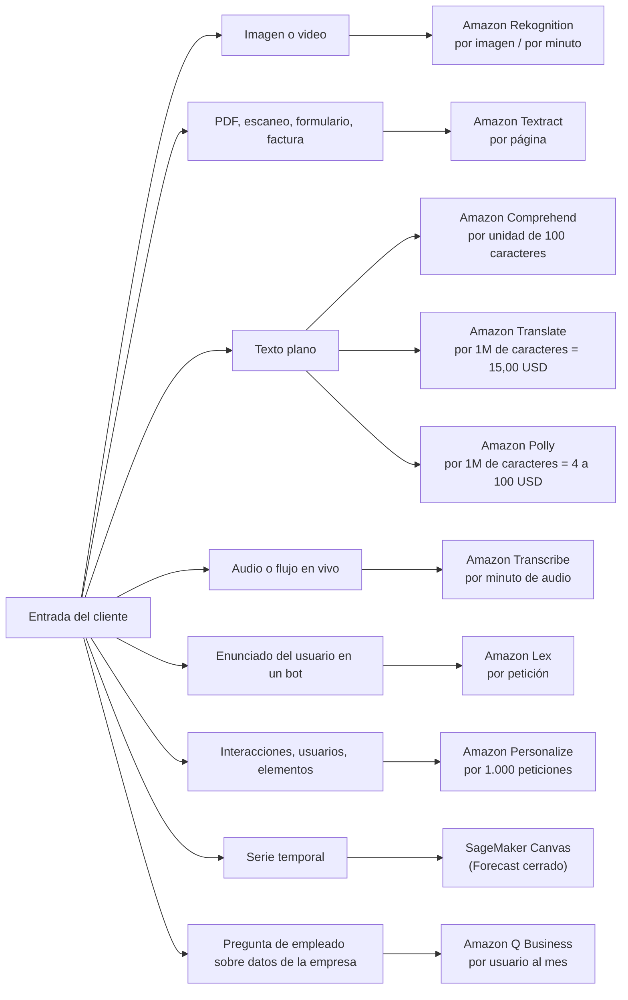
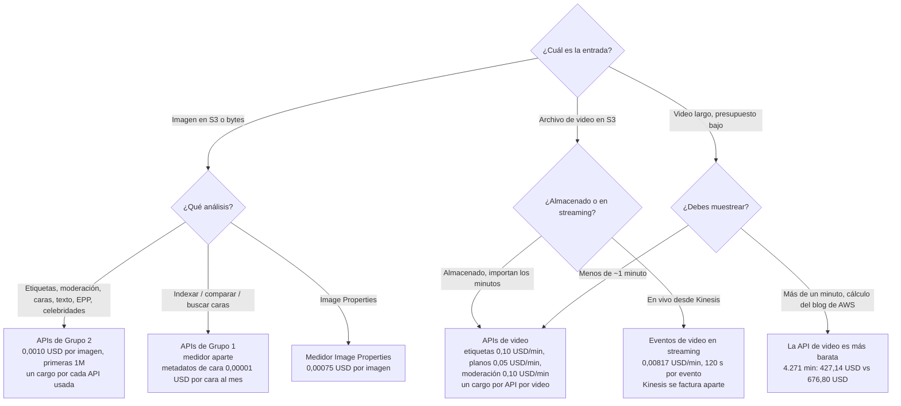
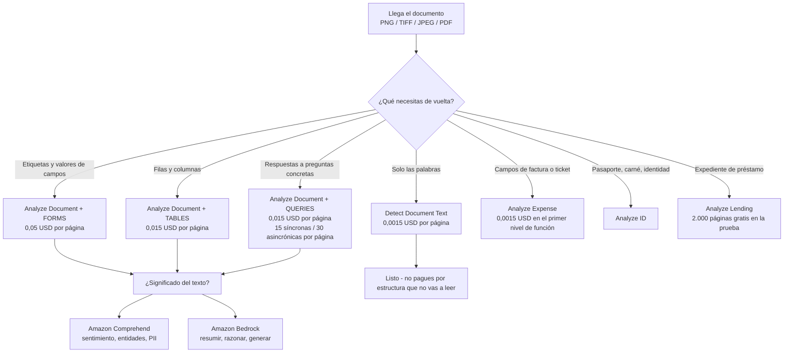
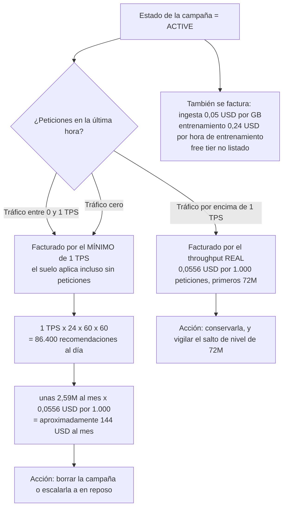

# Servicios de IA prefabricados de AWS: visión, lenguaje, voz y conversación

Todo lo que has construido hasta ahora: pipelines de datos, algoritmos, trabajos de entrenamiento, endpoints: era **tuyo**: tus datos, tu modelo, tu factura de horas-instancia. Esta lección trata de la otra mitad de la superficie del AIF-C01: los servicios donde **AWS ya es dueño del modelo** y tú alquilas la respuesta por unidad. Ese único cambio de propiedad cambia cada decisión que tomas. Ya no ajustas hiperparámetros; eliges **la API correcta, el conjunto de funciones correcto dentro de esa API y el medidor correcto**, y el examen prueba exactamente eso, porque «¿qué servicio?» y «¿cuánto cuesta?» son las dos formas de pregunta que se repiten en los cinco dominios.

```text
=====================================================================
  LA CAPA PREFABRICADA — diez servicios, cuatro modalidades, una pregunta
=====================================================================
  IMAGEN / VIDEO ..... Amazon Rekognition ......... por imagen / por minuto
  DOCUMENTO .......... Amazon Textract ............ por página
  TEXTO ................ Amazon Comprehend .......... por unidad de 100 caracteres
  TEXTO -> TEXTO ......... Amazon Translate ........... por carácter
  TEXTO -> VOZ ....... Amazon Polly ............... por carácter
  VOZ -> TEXTO ....... Amazon Transcribe .......... por minuto de audio
  CONVERSACIÓN ........ Amazon Lex ................. por petición
  RECOMENDACIONES ..... Amazon Personalize ......... por 1.000 peticiones
  PRONÓSTICO ......... Amazon Forecast ............ CERRADO 2024-07-29
                        -> Amazon SageMaker Canvas
  PREGUNTAS DE EMPRESA ...... Amazon Q ................... por usuario / mes
---------------------------------------------------------------------
  REGLA DEL EXAMEN: el tipo de entrada nombra el servicio, y la unidad
  de facturación nombra la respuesta. Aprende la unidad y podrás
  calcular la factura.
=====================================================================
```

> [!NOTE]
> **Cómo leer esta lección.** Cada precio, cuota y cifra de free tier de abajo procede de una página de precios de AWS, una página de «Directrices y cuotas» de AWS, un FAQ de AWS o un ejemplo resuelto de AWS, capturados en 2026. Cuando un número circula solo en calculadoras de terceros, tarifas de streaming de Lex, algunas tarifas de nivel 2/3 de Transcribe, precios por unidad de Textract Layout y Signatures, se marca como *no memorices* en la sección donde de otro modo te tentarías a usarlo. Cuando AWS y un blog discrepan, gana AWS; cuando una página de AWS y otra página de AWS discrepan, la página de precios gana para las tarifas y la página de cuotas gana para los límites.

Al terminar esta lección sabrás:

- mapear **modalidad a servicio** y defender la elección frente a tres distractores plausibles;
- enunciar la **unidad de facturación** de cada servicio del alcance y calcular una factura mensual a partir de los propios ejemplos resueltos de AWS;
- recordar los **free tiers cuya duración difiere**: 12 meses para la mayoría, **3 meses para Textract**, 60 días para Amazon Q Business;
- aplicar la división de medición **Grupo 1 / Grupo 2 de Rekognition** y explicar por qué dos APIs sobre una imagen cuesta el doble;
- elegir la **combinación correcta de API y funciones de Textract** para OCR, formularios, tablas, consultas, documentos de identidad, gastos y préstamos;
- defender el **mínimo de 1 TPS aprovisionada de Personalize** y la respuesta sobre el **ciclo de vida de Amazon Forecast**;
- separar **servicios prefabricados, construcciones a medida en SageMaker y Amazon Bedrock** con el veredicto comparativo;
- responder **diez preguntas estilo examen** redactadas en el tono oficial, incluidos cuatro ítems de aritmética.

---

## 1. El panorama prefabricado: para qué sirve cada servicio

### 1.1 Diez servicios, cuatro modalidades

El examen AIF-C01 no te pide que recuerdes nombres de métodos de API de memoria. Te pide que leas una descripción de carga de trabajo y nombres el servicio. Esa es una tarea de **clasificación**, y arranca de una única entrada: *¿qué te está entregando el cliente?*

| Servicio | Modalidad | El trabajo que hace | Unidad de facturación | Tarifa principal de AWS (2026) |
|---|---|---|---|---|
| **Amazon Rekognition** | Imagen + video | Etiquetas, detección/búsqueda/verificación de caras, reconocimiento de celebridades, moderación, texto en imagen, EPP, seguimiento de personas | Por imagen **y** por minuto, **por API** | Imagen de Grupo 2 **0,0010 USD**; video almacenado **0,10 USD/min** |
| **Amazon Comprehend** | Texto | Entidades, sentimiento, frases clave, idioma, sintaxis, detección/enmascaramiento de PII, temas, toxicidad, seguridad de prompts, clasificación personalizada | Por **unidad de 100 caracteres**, mínimo 3 unidades | **0,0001 USD/unidad** (unos 1 USD por 1M de caracteres) |
| **Amazon Textract** | Documento | OCR más formularios, tablas, consultas en lenguaje natural, firmas, diseño, gastos, documentos de identidad y préstamos | Por **página** | OCR **0,0015 USD** → Forms+Tables+Queries **0,070 USD** |
| **Amazon Translate** | Texto → texto | Traducción automática de texto, HTML y documentos, con terminología personalizada | Por **carácter** (incluidos los espacios) | **15,00 USD por 1M de caracteres** |
| **Amazon Polly** | Texto → voz | TTS neural y generativo para IVR, eLearning, accesibilidad, narración; Speech Marks de SSML | Por **carácter** | Estándar **4,00 USD** → Long-Form **100,00 USD por 1M de caracteres** |
| **Amazon Transcribe** | Voz → texto | ASR por lotes y en vivo, transcripciones de centros de contacto, diarización, enmascaramiento, Call Analytics | Por **minuto de audio**, incrementos de 1 s | Streaming Nivel 1 **0,01 USD/min**; CA post-llamada **0,03 USD/min** |
| **Amazon Lex** | Texto/voz de entrada | NLU de intención y slot para chatbots e IVR, con cumplimiento mediante Lambda | Por **petición** (voz o texto) | Voz **0,004 USD**; texto **0,00075 USD** |
| **Amazon Personalize** | Interacciones | Recomendaciones en tiempo real, reordenación, personalización por lotes | Por GB / hora de entrenamiento / **1.000 peticiones** | **0,0556 USD por 1.000** (primeros 72M/mes) |
| **Amazon Forecast** | Series temporales | Pronóstico de demanda, energía y transporte |: | **Cerrado a clientes nuevos el 29 de julio de 2024** → SageMaker Canvas |
| **Amazon Q** | Texto (empresa) | Asistente de Q Business con permisos, ayuda de codificación de Q Developer, asistencia de agente de Q en Connect | Por **usuario/mes** + capacidad de índice | Lite **3 USD** / Pro **20 USD** por usuario al mes |



### 1.2 Qué significa «prefabricado» en este examen

Un servicio prefabricado es **una API con un contrato de salida fijo**. Envías un JPEG y recibes etiquetas con puntuaciones de confianza y cajas delimitadoras; envías 550 caracteres y recibes entidades con desplazamientos. No puedes cambiar el vocabulario de etiquetas en `DetectLabels` de Rekognition (para eso está Rekognition Custom Labels), no puedes hacer que Comprehend devuelva un párrafo de razonamiento (eso es tarea de un modelo fundacional), y no puedes preguntarle a Textract qué *significa* el documento (para eso están Textract Queries si buscas estructura, o Comprehend/Bedrock si buscas semántica).

Tres consecuencias gobiernan el examen entero:

1. **El precio es por unidad, no por hora**: imágenes, páginas, caracteres, minutos, peticiones, usuarios. Ninguna instancia que dimensionar, ningún endpoint en reposo del que olvidarte (con una excepción bien ruidosa: las campañas de Personalize, sección 8.1).
2. **La selección de funciones dentro de un servicio cambia la factura**: Textract OCR cuesta **0,0015 USD** por página y Textract Forms cuesta **0,05 USD** por página, un multiplicador de **33×** sobre el mismo documento.
3. **Los free tiers no son uniformes**: 12 meses para la mayoría de servicios, **3 meses para Textract**, una **prueba de 60 días** para Amazon Q Business, y **nada** para Personalize.

- **📚 ¿Sabías que…?** La lista de servicios de IA/ML del alcance de la guía del examen AIF-C01 contiene **14 servicios**: Amazon Augmented AI (A2I), Amazon Bedrock, Amazon Comprehend, Amazon Fraud Detector, Amazon Kendra, Amazon Lex, Amazon Personalize, Amazon Polly, Amazon Q, Amazon Rekognition, Amazon SageMaker, Amazon Textract, Amazon Transcribe y Amazon Translate. Ocho de los diez servicios de esta lección salen directamente de esa lista: Amazon Forecast **no** (es una pregunta de ciclo de vida, no de construcción), y Amazon Q se añadió en una revisión posterior de la guía junto con Aurora, Bedrock AgentCore, Kiro, Strands Agents, SageMaker JumpStart y AWS Transform. Comprueba de nuevo la lista del alcance actual antes del día del examen; la lista ha cambiado antes y volverá a cambiar.

---

## 2. Amazon Rekognition: imágenes, video, caras y moderación

### 2.1 Dos grupos de API, una imagen

Rekognition es el servicio con el medidor más malinterpretado de todo el conjunto prefabricado, y la razón es histórica. En la reducción de precios del **9 de noviembre de 2021** AWS dividió las APIs de imagen en dos grupos que se **miden por separado**, y esa división sigue gobernando la facturación en 2026.

| Grupo 1, APIs de cara y de usuario | Grupo 2, APIs de detección |
|---|---|
| `CompareFaces`, `IndexFaces`, `SearchFaceByImage`, `SearchFaces` | `DetectFaces`, `DetectModerationLabels`, `DetectLabels` |
| `AssociateFaces`, `DisassociateFaces`, `SearchUsersByImage`, `SearchUsers` | `DetectText`, `RecognizeCelebrities`, `DetectProtectiveEquipment` |

La regla que el examen realmente prueba: **la facturación de imagen es por imagen, por llamada a la API**. Ejecuta `DetectLabels` y después `DetectModerationLabels` sobre las mismas 2,5 millones de imágenes y has procesado **5 millones de imágenes facturadas**, no 2,5 millones. El video se comporta igual: un minuto de video almacenado analizado por la API de etiquetas y por la API de moderación de contenido factura **dos minutos**, uno por API.

### 2.2 Los medidores

| Medidor | Precio (página de precios de AWS, 2026) |
|---|---|
| Imagen de Grupo 2, primeras 1M de imágenes/mes | **0,0010 USD por imagen** |
| Imagen de Grupo 2, más allá de 1M | 0,0008 USD por imagen |
| Image Properties (medidor aparte) | **0,00075 USD por imagen** primeras 1M, después 0,0006 |
| Video almacenado: detección de etiquetas | **0,10 USD por minuto** |
| Video almacenado: detección de planos | **0,05 USD por minuto** |
| Video almacenado: moderación de contenido | **0,10 USD por minuto** |
| Eventos de video en streaming (entrada de Kinesis Video Streams) | **0,00817 USD por minuto**, hasta **120 segundos** analizados por evento; Kinesis se factura aparte |
| Almacenamiento de metadatos de cara | **0,00001 USD por cara al mes**: el *«0,01 USD por 1.000 vectores de cara al mes»* del FAQ |

### 2.3 Límites duros y free tier

| Límite | Valor |
|---|---|
| Imagen desde S3 / imagen como bytes | **15 MB** / **5 MB** (4 MB para la API de EPP) |
| Dimensión mínima de imagen | **80 px** (64 px para EPP) |
| Archivo de video | **10 GB**, **6 horas**, H.264 o MPEG-4/MOV |
| Trabajos de video concurrentes | **20 por cuenta** |
| Ventana de análisis de eventos en streaming | **120 segundos** por evento |
| Free tier (12 meses) | **5.000 imágenes/mes** + **60 minutos de video/mes** para etiquetas, moderación, caras, búsqueda de caras, celebridades, texto y seguimiento de personas |

### 2.4 Ejemplos resueltos de AWS

**Ejemplo 1: 2,5 millones de imágenes de moderación.** El propio ejemplo de precios de AWS ejecuta `DetectModerationLabels` sobre 2.500.000 imágenes en un mes:

$$
1{,}000{,}000 \times \$0.0010 + 1{,}500{,}000 \times \$0.0008 = \$1{,}000 + \$1{,}200 = \$2{,}200 \text{ per month}
$$

Añade una segunda API sobre las mismas imágenes (digamos `DetectText` para marcas de agua) y la factura se duplica a **4.400 USD/mes**, porque cada API factura su propio recuento de imágenes.

**Ejemplo 2: API de video frente a muestreo de fotogramas.** Para un vídeo de 60 segundos:

| Enfoque | Aritmética | Coste |
|---|---|---|
| API de video, detección de etiquetas | 1 minuto × 0,10 USD | **0,10 USD** |
| Muestreo de fotogramas a 2 fps, imágenes de Grupo 2 | 120 imágenes × 0,0010 USD | **0,12 USD** + tu propio cómputo de extracción |

La brecha se amplía con la duración: en un análisis del blog de AWS de **4.271 minutos** de video, la API de video costó **427,14 USD** mientras que el muestreo de imágenes a 2 fps costó **512,57 USD por las imágenes más 164,23 USD por la Lambda que las muestreó: 676,80 USD en total**. Por debajo de aproximadamente un minuto las dos están cerca; por encima, la API de video gana en precio *y* devuelve marcas de tiempo, límites de plano y seguimiento de personas que el muestreo de fotogramas no puede dar.



> [!WARNING]
> **Las tres trampas de Rekognition que cuestan preguntas.**
> 1. **Dos APIs sobre un activo = dos activos facturados.** Grupo 1 y Grupo 2 se miden por separado, y dentro de un grupo cada llamada a la API factura su propia imagen (o su propio minuto de video).
> 2. **La moderación de video es una API de video, no una API de imagen.** Si la opción dice *«facturado por imagen»* para videos almacenados en S3, está describiendo muestreo de fotogramas: una elección de ingeniería válida, pero no la respuesta nativa del servicio, que es **0,10 USD por minuto de video**.
> 3. **Los eventos en streaming no son de forma libre.** Cada evento disparado por Kinesis analiza como máximo **120 segundos**, cuesta **0,00817 USD/min**, y encima sigues pagando Kinesis.

- **📚 ¿Sabías que…?** El medidor de metadatos de cara tiene dos grafías oficiales del mismo número: la página de precios dice **0,00001 USD por cara al mes** y el FAQ dice **0,01 USD por 1.000 vectores de cara al mes**. Son idénticos (0,01 ÷ 1.000 = 0,00001). A las opciones del examen les encanta presentar uno como descuento del otro: son el mismo precio, y ambos son *almacenamiento*: una colección de 500.000 caras cuesta **5,00 USD/mes** busques en ella o no.

---

## 3. Amazon Comprehend: lo que el texto está diciendo

### 3.1 La unidad y el mínimo

Comprehend mide en **unidades de 100 caracteres** con un **mínimo de 3 unidades (300 caracteres) por petición**. La tarifa estándar en los ejemplos resueltos de AWS es de **0,0001 USD por unidad**, es decir **1,00 USD por 1.000.000 de caracteres**.

El mínimo es donde los candidatos pierden preguntas fáciles. Un tweet de 120 caracteres es una unidad de contenido real, pero se factura como **3 unidades = 0,0003 USD**. Un ticket de soporte de 600 caracteres se factura como **6 unidades = 0,0006 USD**. Las peticiones por lotes son iguales: pagas por lo que envías, redondeado al alza por petición.

**Ejemplo resuelto: tickets de soporte.** 10.000 tickets de 550 caracteres cada uno: 550 ÷ 100 = 5,5 → **6 unidades por petición** → 10.000 × 6 = 60.000 unidades × 0,0001 USD = **6,00 USD al mes**. Observa lo que ese número enseña: a este volumen Comprehend es prácticamente gratis, y exactamente por eso el examen lo empareja con una pregunta de *selección de funciones* y no con una de *coste*.

### 3.2 Qué incluye la superficie de la API

| Capacidad | API / función | Notas para el examen |
|---|---|---|
| Entidades | `DetectEntities` | Personas, organizaciones, lugares, fechas, cantidades, con confianza |
| Sentimiento | `DetectSentiment` | Positivo / negativo / neutral / mixto, con puntuaciones |
| Frases clave | `DetectKeyPhrases` | Extracción de frases nominales |
| Idioma | `DetectDominantLanguage` | También prerrequisito de otras llamadas |
| Sintaxis | `DetectSyntax` | Etiquetado de categoría gramatical |
| Sentimiento dirigido | `DetectTargetedSentiment` | Sentimiento por entidad, no a nivel de documento |
| PII | `ContainsPiiEntities`, `DetectPiiEntities` | Detección **y** enmascaramiento |
| Temas | `DetectTopics` | Modelado de temas sobre un lote |
| Toxicidad | `DetectToxicity` | Puntuaciones de toxicidad del texto |
| Seguridad de prompts | Clasificación de seguridad de prompts | Filtre las entradas antes de que lleguen a un modelo |
| Clasificación personalizada | `CreateClassifier` | Etiqueta tus propias categorías |
| Entidades personalizadas | `CreateEntityRecognizer` | Tu propio vocabulario de entidades |

### 3.3 Custom Comprehend: donde cambia el medidor

| Artículo | Tarifa |
|---|---|
| Entrenamiento | **3,00 USD por hora**, facturado por segundo |
| Gestión del modelo | **0,50 USD al mes** por modelo |
| Endpoint mientras está en marcha | Facturado en **incrementos de 1 segundo**, **mínimo de 60 segundos** |
| Throughput aprovisionado | **1 unidad de inferencia (IU) = 100 caracteres/segundo** a **0,0005 USD por segundo** |
| Trabajo de modelado de temas | Primeros **100 MB a precio fijo**, después **0,004 USD por MB** |
| Free tier | **50.000 unidades (5M de caracteres) por API al mes**; **sin free tier para Custom Comprehend** |

### 3.4 Límites que vale la pena memorizar

| Límite | Valor |
|---|---|
| Lote síncrono | **25 documentos por petición** |
| Tamaño de documento asincrónico | **1 MB por documento**, **5 GB por petición** |
| Trabajos asincrónicos activos | **10 por API** |
| Endpoints | **20 por Región**, **200 IU por Región**, **50 IU por endpoint** |
| Cuerpo de petición personalizada síncrona | **10 KB** |

- **📚 ¿Sabías que…?** La **clasificación de seguridad de prompts** de Comprehend es el puente entre esta lección y Bedrock: AWS la añadió para que puedas filtrar un prompt de usuario en busca de contenido dañino *antes* de que llegue a un modelo fundacional. En el examen, una pregunta sobre «filtrar una entrada antes de la generación» tiene dos respuestas que parecen válidas y solo una es correcta: **Comprehend** clasifica y puntuúa el texto; **Bedrock Guardrails** aplica políticas en el momento de la generación. Lee con cuidado en qué lado de la llamada te coloca la pregunta.

---

## 4. Amazon Textract: estructura a partir de documentos

### 4.1 Cinco APIs, un interruptor de funciones

Textract expone **cinco APIs**: `Detect Document Text`, `Analyze Document`, `Analyze Expense`, `Analyze ID` y `Analyze Lending`. Solo `Analyze Document` lleva tipos de función, **Forms, Tables, Queries, Custom Queries, Signatures y Layout**, y son combinables en una sola llamada, con precio por página *por función habilitada*.

| API | Qué devuelve | Cuándo usarla |
|---|---|---|
| `Detect Document Text` | Palabras y líneas (OCR puro) | Texto limpio, sin estructura |
| `Analyze Document` | KEY_VALUE_SET, celdas TABLE, respuestas de Query, SIGNATURE, LAYOUT | Formularios, tablas, preguntas, firmas |
| `Analyze Expense` | Campos y partidas de factura/ticket | Cuentas por pagar |
| `Analyze ID` | Campos y fotos del documento de identidad | Verificaciones de cliente (KYC) |
| `Analyze Lending` | Campos del expediente de hipoteca/préstamo | Pipelines de préstamos |

### 4.2 La escalera de precios (us-west-2, primeras 1M de páginas al mes)

| Configuración | Precio por página |
|---|---|
| Solo OCR (`Detect Document Text`) | **0,0015 USD** |
| Tables | **0,015 USD** |
| Forms | **0,05 USD** |
| Queries | **0,015 USD** |
| Tables + Queries | **0,020 USD** |
| Forms + Tables + Queries | **0,070 USD** |
| Custom Queries | **0,025 USD** |

De esa tabla salen dos hechos. Primero, **habilitar Forms multiplica la factura de OCR por 33×**. Segundo, **Forms + Tables + Queries a 0,070 USD es aproximadamente 47× el solo OCR**, y por eso al examen le encanta la pregunta *«¿qué funciones necesita realmente la carga de trabajo?»*.

> [!NOTE]
> **Signatures y Layout.** La página pública de precios de Textract de AWS pone precio a las seis combinaciones de funciones de arriba. `Layout` a **0,004 USD/página** y `Signatures` a **0,0035 USD/página** aparecen en una plantilla de precios de ejemplo de la AWS Solutions Library, y la documentación de AWS indica que Layout es **gratis cuando Tables está habilitado**. Trata esos dos precios por unidad como *verifícalos antes de citarlos*, pero memoriza la regla: **Layout viaja junto con Tables, y cada otra función añade su propio cargo por página.**

### 4.3 Queries: precio por página, no por respuesta

Queries te permiten hacer preguntas en lenguaje natural sobre un documento, *«¿Cuál es el número de cuenta?»*, y recibir respuestas con coordenadas de página. Los límites son **15 consultas por página de forma síncrona** y **30 por página de forma asincrónica**, y la regla crítica de precios es que **se factura por página independientemente de cuántas respuestas vuelvan**. Hacer una pregunta o quince preguntas sobre la misma página cuesta lo mismo. Hacer la misma pregunta a 100.000 páginas cuesta 100.000 × 0,015 USD.

### 4.4 Free tier: tres meses, no doce

| API de Textract | Free tier | Duración |
|---|---|---|
| `Detect Document Text` | **1.000 páginas/mes** | **3 meses** |
| `Analyze Document` (solo Signatures) | 1.000 páginas/mes | **3 meses** |
| `Analyze Document` (cualquier otra función) | **100 páginas/mes** | **3 meses** |
| `Analyze Expense` | 100 páginas/mes | **3 meses** |
| `Analyze ID` | 100 páginas/mes | **3 meses** |
| `Analyze Lending` | 2.000 páginas/mes | **3 meses** |
| Custom Queries | **Sin free tier** |: |

El recuento de páginas es sencillo y deliberadamente favorable al examen: **una imagen (PNG, TIFF o JPEG) es una página**, y **cada página de un PDF es una página**.

**Ejemplo resuelto, selección de funciones.** El OCR de 100.000 páginas cuesta **150 USD**. Forms + Tables sobre 5.000 páginas cuesta 5.000 × (0,05 + 0,015 USD) = **325 USD**. El segundo trabajo toca **20× menos páginas** y cuesta **2,2× más**, 0,065 USD por página frente a 0,0015 USD, una diferencia unitaria de **43×**. La lección no es «evita Forms»; es «habilita solo las funciones que vas a leer».



---

## 5. Amazon Translate: traducción automática de alto volumen

### 5.1 Tarifas

| Tipo de traducción | Tarifa por 1M de caracteres |
|---|---|
| Texto estándar (tiempo real), HTML, documentos por lotes | **15,00 USD** |
| Traducción de documentos **DOCX** en tiempo real | **30,00 USD** |
| **Active Custom Translation** (modelo personalizado) | **60,00 USD** |

Los caracteres incluyen espacios, así que no puedes engañar al medidor eliminando espacios en blanco.

### 5.2 Free tier

- **2.000.000 de caracteres al mes durante 12 meses** para la traducción estándar y por lotes;
- **Active Custom Translation: 500.000 caracteres al mes durante 2 meses**;
- **Sin free tier alguno** para la traducción de documentos en tiempo real.

### 5.3 Por qué no se te cobra

El FAQ de AWS traza una línea inusualmente precisa: **no** se te cobra cuando el **idioma de origen es igual al idioma de destino**, y **no** se te cobra cuando la llamada **falla y no devuelve ninguna traducción**. Sí se te cobra por el contenido no traducible que todavía produce salida. En la práctica eso significa que un bucle mal configurado que «traduce» inglés a inglés es gratis, y también que el examen puede preguntar por excepciones de facturación sin aritmética alguna.

### 5.4 Terminología personalizada

La terminología personalizada es cómo fijas nombres de marca, códigos de producto y términos legales. Sus límites son todo material de examen citable:

| Límite | Valor |
|---|---|
| Tamaño del archivo | **10 MB** |
| Archivos por cuenta por Región | **100** |
| Idiomas de destino por archivo | **10** |
| Bytes por término | **200** |
| Archivos por petición | **1** |
| Emparejamiento | **Sensible a mayúsculas** |

**Ejemplo resuelto: localizar un manual.** 100 páginas × 20.000 caracteres = 2.000.000 de caracteres:

| Opción | Aritmética | Coste |
|---|---|---|
| Traducción estándar | 2 × 15,00 USD | **30,00 USD** |
| Active Custom Translation | 2 × 60,00 USD | **120,00 USD** |
| Un solo artículo de 6.500 caracteres | 6.500 ÷ 1.000.000 × 15,00 USD | **0,0975 USD** |

---

## 6. Amazon Polly y Amazon Transcribe: el par de voz

Polly y Transcribe son las dos mitades del mismo problema, y al examen le gusta ponerlos en la misma lista de opciones para ver si sabes en qué dirección fluye el audio.

### 6.1 Amazon Polly: texto a voz

| Motor | Precio por 1M de caracteres | Free tier al mes |
|---|---|---|
| Estándar | **4,00 USD** (4,80 USD en GovCloud) | 5.000.000 de caracteres |
| Neural | **16,00 USD** (19,20 USD en GovCloud) | 1.000.000 de caracteres (primeros 12 meses) |
| Generativo | **30,00 USD** | 100.000 caracteres (primeros 12 meses) |
| Long-Form | **100,00 USD** | 500.000 caracteres (primeros 12 meses) |

**La regla de doble facturación:** `Speech` y `Speech Marks` son **peticiones facturadas por separado**. Pedir ambos para los mismos 1.000 caracteres factura **2.000 caracteres**. Las Speech Marks son lo que un reproductor web usa para resaltar palabras en sincronía con el audio, así que el patrón es común en eLearning, y duplica la línea de Polly en la factura.

**Ejemplo resuelto: un millón de caracteres:**

| Motor | Solo audio | Audio + Speech Marks |
|---|---|---|
| Estándar | **4,00 USD** | 8,00 USD |
| Neural | **16,00 USD** | **32,00 USD** |
| Generativo | **30,00 USD** | 60,00 USD |
| Long-Form | **100,00 USD** | 200,00 USD |

Polly se factura **por carácter**, nunca por petición: una opción que diga «por petición de síntesis» es un distractor.

### 6.2 Amazon Transcribe: voz a texto

Transcribe factura en **incrementos de 1 segundo sin mínimo**, algo inusual y que vale la pena memorizar por sí solo: un clip de 3 segundos cuesta tres segundos, no un minuto redondeado.

| Producto | Tarifa por minuto de audio (niveles del ejemplo de AWS) |
|---|---|
| Transcripción por lotes, Nivel 1 | Aproximadamente **0,006 USD** |
| Transcripción en streaming, Nivel 1 | **0,01 USD** |
| Call Analytics, **post-llamada** | **0,0300 USD** primeros 250K min → **0,0186 USD** siguientes 750K → **0,0138 USD** siguientes 4M |
| Call Analytics, **tiempo real** | **0,0375 USD** → **0,0233 USD** → **0,0173 USD** |
| Resumen de llamadas generativo | **0,0024 USD** → **0,0015 USD** → **0,0011 USD**, **mínimo de 15 segundos por petición** |

**Qué está incluido frente a lo que cuesta extra:**

| Incluido sin cargo extra | Medidor extra |
|---|---|
| Vocabularios personalizados | **Enmascaramiento de PII** |
| Filtrado de vocabulario | **Modelos de idioma personalizados** |
| Diarización de hablantes | |
| Identificación de idioma | |
| Formatos de transcripción (JSON, TXT, SRT, VTT) | |

Dos reglas estructurales: **el audio estéreo factura la duración total una vez, no por canal**, y **Call Analytics devuelve campos de información**, tiempo de habla, interrupciones, silencios, sentimiento por participante, que la transcripción simple no devuelve.

**Ejemplo resuelto: un centro de contacto de 200.000 llamadas.** 200.000 llamadas × 10 minutos = **2.000.000 de minutos** de analítica post-llamada:

$$
250{,}000 \times \$0.0300 + 750{,}000 \times \$0.0186 + 1{,}000{,}000 \times \$0.0138
= \$7{,}500 + \$13{,}950 + \$13{,}800 = \$35{,}250 \text{ per month}
$$

**Límites y free tier:**

| Límite | Valor |
|---|---|
| Archivo de audio por lotes | **28.800 segundos (8 horas)** |
| Lotes médicos y de Call Analytics | **14.400 segundos (4 horas)** |
| Duración mínima de audio | **500 ms** |
| Cola de trabajos | **10.000 trabajos** |
| Concurrencia de Call Analytics | **100 trabajos** |
| Free tier | **60 minutos al mes durante 12 meses**, compartidos entre Transcribe, Call Analytics y Transcribe Medical; sin GovCloud, sin arrastre |

- **📚 ¿Sabías que…?** El free tier **estándar de 5M de caracteres de Polly** es la única cifra de la página de precios de AWS que omite el calificativo *«primeros 12 meses»* que sí se usa para Neural, Long-Form y Generativo, mientras que páginas de terceros lo llaman con confianza «gratis para siempre». No construyas una respuesta sobre eso: memoriza la página tal como dice, y trata cualquier afirmación de un free tier de Polly permanente como sin verificar. La misma disciplina aplica a las tarifas de streaming de Lex, que circulan en calculadoras de terceros pero no están en el propio extracto de precios de AWS, los números de Lex publicados por AWS son **0,004 USD de voz** y **0,00075 USD de texto**.

---

## 7. Amazon Lex: intenciones, slots y el medidor por petición

### 7.1 La factura

| Tipo de petición | Precio |
|---|---|
| Petición de voz | **0,004 USD** |
| Petición de texto | **0,00075 USD** |

Ejemplo resuelto de AWS: **8.000 peticiones de voz + 2.000 de texto** = 8.000 × 0,004 USD + 2.000 × 0,00075 USD = 32,00 + 1,50 = **33,50 USD al mes**.

### 7.2 Qué cuenta como una petición

- **Cada entrada del usuario es una petición facturada.** Cinco mensajes escritos en una conversación son cinco peticiones.
- **En una conversación en streaming, todos los turnos viajan en una sola llamada a la API**: Lex V2 transmite sobre **HTTP/2**, y el intercambio completo es una sola llamada facturable en lugar de cinco.
- La entrada de voz está limitada a **15 segundos por petición**.
- Las respuestas llevan puntuaciones de confianza de NLU, sentimiento y un campo `interpretationSource` que puede ser `Bedrock` o `Lex`: la pista del examen de que Lex puede estar respaldado por un modelo fundacional para el significado generativo mientras devuelve una intención estructurada.

### 7.3 Free tier

**10.000 peticiones de texto + 5.000 de voz al mes durante el primer año.**

### 7.4 Dónde termina Lex

Lex responde *«¿qué quiso el usuario?»*: intención, slots, estado de sesión, estado de cumplimiento. **No** responde preguntas abiertas sobre contenido de empresa, y no genera prosa. Ese límite es el conjunto de distractores más común de esta lección: **Q Business** para respuestas que respetan permisos sobre datos de la empresa, **Bedrock** para generación abierta, **Lex** para el enrutamiento estructurado de intenciones hacia una Lambda.

---

## 8. Amazon Personalize y Amazon Forecast

### 8.1 Personalize: el medidor con suelo

| Medidor | Tarifa |
|---|---|
| Ingesta de datos | **0,05 USD por GB** |
| Entrenamiento | **0,24 USD por hora de entrenamiento** |
| Inferencia en tiempo real | **0,0556 USD por 1.000 peticiones** (primeros 72M/mes), **0,0278 USD** (siguientes 648M), **0,0139 USD** (por encima de 720M) |
| Modelo de hora de recomendador | **0,375 / 0,045 / 0,018 / 0,005 USD por 100.000 usuarios**, con **4.000 / 6.000 / 9.000 / 14.000 recomendaciones gratis por hora**; los extras a **0,0833 / 0,0417 / 0,0208 USD por 1.000** |
| Free tier | **Ninguno listado en la página de precios** |

**La trampa: el throughput aprovisionado mínimo.** Por defecto, cada campaña activa debe mantener **al menos 1 transacción aprovisionada por segundo (TPS)**, y AWS afirma claramente que el mínimo aplica **«aunque no hagas ninguna petición»**: se factura el **mayor entre el mínimo y el TPS real**.

La aritmética es brutal y el propio Knowledge Center de AWS la publica: 1 TPS mantenida durante un día son

$$
1 \times 24 \times 60 \times 60 = 86{,}400 \text{ billed recommendations per day}
$$

lo cual a 0,0556 USD por 1.000 sale a aproximadamente **144 USD al mes para una campaña que nadie está llamando** (unas 2,59 millones de recomendaciones al mes). La respuesta operativa es corta: **borra las campañas en reposo**.



### 8.2 Amazon Forecast: una pregunta de ciclo de vida, no de construcción

| Hecho | Detalle |
|---|---|
| Cerrado a clientes nuevos | **29 de julio de 2024** |
| Clientes existentes | Sigan trabajando; **sin funciones nuevas** |
| Reemplazo documentado | **Amazon SageMaker Canvas** |
| Estado del ciclo de vida de AWS | Listado bajo **«Services in Maintenance»** (2024-07-29) |
| Vocabulario del ciclo de vida de AWS | **Maintenance → Sunset (normalmente ~12 meses) → Full Shutdown** |

> [!WARNING]
> **No respondas «Amazon Forecast» a una pregunta de pronóstico desde cero.** Forecast está cerrado a clientes nuevos desde el **29 de julio de 2024** y aparece en la lista de mantenimiento de AWS; el camino de migración documentado es **Amazon SageMaker Canvas**. Los clientes existentes siguen ejecutando sus predictores: así que una opción que diga *«los clientes existentes deben migrar inmediatamente»* es igualmente incorrecta. La respuesta correcta del examen es siempre la pareja: **nuevos → SageMaker Canvas, existentes → seguir sin funciones nuevas**. Y Personalize *no* es un servicio de pronóstico: recomienda elementos a partir de interacciones, no proyecta una serie temporal.

---

## 9. Amazon Q: la respuesta por usuario

Amazon Q está explícitamente **dentro del alcance del AIF-C01**, y es el único servicio de esta lección con precio **por usuario al mes** en lugar de por unidad de trabajo. Esa diferencia es toda la pregunta.

| SKU | Precio | Qué compra |
|---|---|---|
| **Q Business Lite** | **3 USD por usuario al mes** | Respuestas de aproximadamente una página |
| **Q Business Pro** | **20 USD por usuario al mes** | Aproximadamente siete páginas, Q Apps, Q in QuickSight Reader Pro, plugins |
| **Q Business index** | Por hora de capacidad de índice | Se factura mientras el índice existe; la facturación empieza en el primer uso |
| **Q Business trial** | **60 días** | Hasta **50 usuarios Pro o Lite por aplicación** + **1.500 horas de índice** |
| **Q Developer Free** | **0 USD** | **50 peticiones agentic/mes**, transformación de **1.000 LOC/mes** en Java |
| **Q Developer Pro** | **19 USD por usuario al mes** | **4.000 LOC/mes agrupados** en la cuenta pagadora, **0,003 USD/LOC** de exceso, indemnización por PI |
| **Q in Connect** | **0,0015 USD por mensaje de chat**, **0,0080 USD por minuto de voz** | Asistencia de centro de contacto |

Tres lecturas que el examen prueba:

1. **Q Business es RAG empresarial que respeta los permisos.** Responde preguntas sobre tus conectores (S3, Confluence, Salesforce y docenas más) **respetando los permisos de cada usuario**, y cita las fuentes. Ese es un producto distinto de «un chatbot público anónimo».
2. **La prueba es de 60 días, no de 12 meses**: el periodo gratis más corto de esta lección, y el que los candidatos confunden con más frecuencia con el free tier de AWS de 12 meses.
3. **El exceso de Q Developer Pro es por línea de código**, a **0,003 USD/LOC** sobre los 4.000 LOC/mes agrupados: un medidor que nadie espera, y por eso favorito para una opción numérica.

---

## 10. ¿Qué servicio de IA? El árbol de decisión

Todo lo anterior colapsa en un diagrama. Lee la entrada primero, después la intención, después el medidor: ese orden es exactamente como el examen escribe sus opciones.

```mermaid
flowchart TD
    START["¿Qué te está entregando el cliente?"]
    START -->|"Imagen o video"| VIS{"¿Qué necesitas de ello?"}
    VIS -->|"Etiquetas, caras, moderación, texto en imagen, EPP"| REK["Amazon Rekognition<br/>por imagen / por minuto, por API"]
    VIS -->|"Defecto de nicho o visión de dominio específico"| CUSTOM["Rekognition Custom Labels<br/>o SageMaker con tus datos etiquetados"]
    VIS -->|"Un documento como imagen"| TX2["Amazon Textract"]

    START -->|"Documento: PDF, escaneo, factura, identidad"| DOC{"¿Estructura o solo palabras?"}
    DOC -->|"Solo palabras"| OCR2["Textract Detect Document Text<br/>0,0015 USD por página"]
    DOC -->|"Formularios, tablas, consultas, identidad, gastos"| AN2["APIs Analyze* de Textract<br/>0,015 a 0,070 USD por página"]
    DOC -->|"Lo que el texto significa"| CO2["Amazon Comprehend<br/>por unidad de 100 caracteres, mín. 3"]

    START -->|"Texto plano"| TXT{"¿Qué necesitas de él?"}
    TXT -->|"Entidades, sentimiento, PII, temas, toxicidad"| CMP["Amazon Comprehend<br/>0,0001 USD por unidad"]
    TXT -->|"Otro idioma"| TRN["Amazon Translate<br/>15,00 USD por 1M de caracteres"]
    TXT -->|"Voz de salida para el usuario"| POL["Amazon Polly<br/>4 a 100 USD por 1M de caracteres"]
    TXT -->|"Generación abierta o razonamiento"| BED["Amazon Bedrock<br/>por token de entrada y de salida"]

    START -->|"Audio"| AUD{"¿Archivos en reposo o en vivo?"}
    AUD -->|"Archivos, centro de contacto, diarización"| TRL["Amazon Transcribe<br/>por minuto de audio"]
    AUD -->|"Flujo en vivo"| TRLS["Transcribe streaming<br/>0,01 USD por minuto Nivel 1"]

    START -->|"Enunciado del usuario en un bot"| LX["Amazon Lex<br/>0,004 USD voz / 0,00075 USD texto"]

    START -->|"Interacciones, usuarios, elementos"| PERS["Amazon Personalize<br/>0,0556 USD por 1.000 + mínimo de 1 TPS"]

    START -->|"Serie temporal a pronosticar"| FC2["Amazon SageMaker Canvas<br/>Forecast cerrado a clientes nuevos"]

    START -->|"Empleado pregunta sobre datos de la empresa"| QB["Amazon Q Business<br/>3 USD Lite / 20 USD Pro por usuario"]

    START -->|"Desarrollador pregunta sobre el código"| QD["Amazon Q Developer<br/>Gratis o 19 USD por usuario"]
```



Practica el mapeo hasta que sea automático:

```matching
{
  "question": "Relaciona cada frase de carga de trabajo con el servicio de AWS y su unidad de facturación:",
  "pairs": [
    {"left": "Marcar contenido explícito en videos almacenados en S3", "right": "Moderación de contenido de Amazon Rekognition Video: facturado por minuto de video a 0,10 USD"},
    {"left": "Extraer pares clave-valor y celdas de tablas de PDFs de préstamo escaneados", "right": "Amazon Textract AnalyzeDocument con FORMS y TABLES: facturado por página a 0,05 y 0,015 USD"},
    {"left": "Enmascarar números de tarjeta de crédito en tickets de soporte de 550 caracteres", "right": "Detección y enmascaramiento de PII de Amazon Comprehend: facturado por unidad de 100 caracteres con un mínimo de 3 unidades"},
    {"left": "Mantener un nombre de producto fuera de un trabajo de localización de 2.000.000 de caracteres", "right": "Terminología personalizada de Amazon Translate - 10 MB por archivo, 100 archivos por cuenta por Región, 200 bytes por término"},
    {"left": "Devolver una transcripción de chat a un supervisor con sentimiento por participante", "right": "Amazon Transcribe Call Analytics post-llamada: facturado por minuto de audio a 0,0300 USD para los primeros 250K minutos"},
    {"left": "Enrutar una llamada de voz a la Lambda correcta por intención y slot", "right": "Amazon Lex: facturado por petición a 0,004 USD por voz y 0,00075 USD por texto"},
    {"left": "Servir recomendaciones en tiempo real mientras una campaña en reposo todavía cuesta dinero", "right": "Amazon Personalize - 0,0556 USD por 1.000 peticiones más un mínimo por defecto de 1 TPS aprovisionada por campaña"},
    {"left": "Responder a la pregunta de un empleado sobre Confluence con sus propios permisos", "right": "Amazon Q Business - 3 USD Lite o 20 USD Pro por usuario al mes más capacidad de índice por hora"}
  ],
  "explanation": "Cada frase nombra primero un tipo de entrada: video a Rekognition, documentos a Textract, texto sin procesar a Comprehend, memoria de traducción a Translate, audio a Transcribe, enunciados del usuario a Lex, historial de interacciones a Personalize y contenido de empresa a Q Business. Una vez la entrada elige el servicio, la unidad de facturación elige la respuesta: por minuto, por página, por unidad, por carácter, por petición, por 1.000 peticiones o por usuario."
}
```

- **📚 ¿Sabías que…?** Las respuestas de Amazon Lex V2 llevan un campo `interpretationSource` que puede leer **`Bedrock`** en lugar de **`Lex`**: el NLU del bot puede estar impulsado por un modelo fundacional mientras la respuesta sigue siendo una intención estructurada con slots y confianza. Por eso «usa Bedrock en lugar de Lex» es un distractor *parcialmente* equivocado: Bedrock te da generación y razonamiento, Lex te da la máquina de estados de la conversación, la sesión, los ganchos de cumplimiento y el medidor por petición con el que el centro de contacto presupuesta.

---

## 11. Free tiers, límites y los números que debes memorizar

### 11.1 Free tier: memoriza los atípicos

| Servicio | Unidad | Cantidad | Duración |
|---|---|---|---|
| Rekognition Image / Video | imágenes / minutos de video | 5.000 / 60 al mes | **12 meses** |
| Comprehend | unidades de 100 caracteres, por API | 50.000/mes (5M de caracteres) | **12 meses**; Custom excluido |
| Textract `Detect Document Text` | páginas | 1.000/mes | **3 meses** |
| Textract `Analyze Document` | páginas | 100/mes (1.000 solo Signatures) | **3 meses** |
| Translate | caracteres | 2.000.000/mes | **12 meses** |
| Polly Estándar / Neural | caracteres | 5.000.000 / 1.000.000 al mes | Estándar carece del calificativo de 12 meses; Neural 12 meses |
| Transcribe (+ Call Analytics, Medical) | minutos de audio | 60/mes | **12 meses** |
| Lex | peticiones de texto + voz | 10.000 + 5.000/mes | primer año |
| Amazon Q Business | usuarios + índice | 50 usuarios/app + 1.500 horas de índice | **prueba de 60 días** |
| Personalize |, | **ninguno listado** |, |

Las tres duraciones son el regalo del examen: **12 meses** para casi todo, **3 meses** para Textract, **60 días** para Q Business.

### 11.2 Límites duros que vale la pena memorizar

| Servicio | Límite | Valor |
|---|---|---|
| Rekognition | imagen (S3 / bytes) / video | 15 MB / 5 MB (4 MB EPP) / video 10 GB, 6 h, H.264 |
| Rekognition | dimensión mínima / trabajos de video concurrentes / longitud del evento | 80 px (64 px EPP) / 20 por cuenta / 120 s |
| Comprehend | unidad de facturación + mínimo | 100 caracteres + 3 unidades (300 caracteres) por petición |
| Comprehend | lote síncrono / doc. asincrónico / trabajos activos / límites de endpoint | 25 docs / 1 MB / 10 trabajos / 20 endpoints, 50 IU cada uno |
| Textract | consultas por página / duración del free tier | 15 síncronas, 30 asincrónicas / **3 meses** |
| Translate | archivo de terminología / archivos / idiomas de destino / término | 10 MB / 100 / 10 / 200 bytes |
| Transcribe | máx. audio por lotes / lote Medical + CA | 28.800 s (8 h) / 14.400 s (4 h) |
| Transcribe | duración mínima / cola / concurrencia de CA | 500 ms / 10.000 trabajos / 100 trabajos |
| Lex | entrada de voz / free tier | 15 s / 10.000 texto + 5.000 voz |
| Personalize | TPS aprovisionada mínima por defecto | **1 TPS por campaña activa** |

### 11.3 Ejemplos resueltos de AWS, todos en una tabla

| # | Escenario de AWS | Aritmética | Resultado |
|---|---|---|---|
| 1 | 2,5M de imágenes de Grupo 2 | 1M × 0,0010 USD + 1,5M × 0,0008 USD | **2.200 USD/mes** |
| 2 | 100k min de etiquetas + 100k min de planos + 50k min de moderación | 100k × 0,10 USD + 100k × 0,05 USD + 50k × 0,10 USD | **20.000 USD/mes** |
| 3 | 10.000 peticiones de Comprehend × 550 caracteres | 6 unidades cada una = 60.000 × 0,0001 USD | **6,00 USD/mes** |
| 4 | 100.000 páginas de OCR | 100k × 0,0015 USD | **150 USD** |
| 5 | 5.000 páginas de Forms + Tables | 5.000 × (0,05 + 0,015 USD) | **325 USD** |
| 6 | 2M de minutos de analítica post-llamada | 250k × 0,03 USD + 750k × 0,0186 USD + 1M × 0,0138 USD | **35.250 USD/mes** |
| 7 | 8.000 peticiones de voz + 2.000 de texto en Lex | 8.000 × 0,004 USD + 2.000 × 0,00075 USD | **33,50 USD/mes** |
| 8 | 1M de caracteres de Polly, audio + Speech Marks, Neural | 1M × 16,00 USD × 2 | **32,00 USD** |
| 9 | Campaña de Personalize en reposo a 1 TPS durante un día | 86.400 recomendaciones/día ≈ 2,59M/mes × 0,0556 USD/1.000 | **≈ 144 USD/mes** |
| 10 | 2M de caracteres localizados, estándar vs Active Custom | 2 × 15,00 USD vs 2 × 60,00 USD | **30,00 USD vs 120,00 USD** |

### 11.4 Entrada dentro, salida fuera

| Servicio | Entrada admitida | Salida principal |
|---|---|---|
| Rekognition | JPEG/PNG (S3 ≤15 MB, bytes ≤5 MB); video ≤10 GB, 6 h; flujo de Kinesis | Etiquetas JSON con confianza y cajas, vectores de cara, etiquetas de moderación, geometría del texto, marcas de tiempo |
| Comprehend | Texto UTF-8; PDF/DOCX; archivos de lote en S3 | Entidades, puntuaciones de sentimiento, frases clave, idioma, tramos de PII o texto enmascarado, clases, indicadores de toxicidad |
| Textract | PNG/JPEG/TIFF (1 página), PDF (multipágina) | Bloques: palabras/líneas, KEY_VALUE_SET, celdas TABLE, Query → Answer, SIGNATURE, LAYOUT |
| Translate | Texto (tiempo real), documentos en S3 (HTML/TXT/DOCX), datos paralelos | Texto o documentos traducidos |
| Polly | Texto más SSML | Audio (MP3, OGG, PCM …) y/o tokens de tiempo JSON de Speech Marks |
| Transcribe | Audio/vídeo en S3 (mp3, mp4, wav, flac, ogg, amr, webm, m4a) o audio en vivo (HTTP/2, WebSocket) | Transcripciones (JSON/TXT/SRT/VTT), diarización, sentimiento, campos de Call Analytics |
| Lex | Enunciados de texto o voz ≤15 s; flujo HTTP/2 | Intención, slots, estado de sesión, estado de cumplimiento, mensajes, sentimiento |
| Personalize | Conjuntos de datos de interacciones/usuarios/elementos (S3 o rastreadores de eventos) | Resultados de GetRecommendations, ranking, archivos de recomendación por lotes |
| Q Business | Preguntas más conectores (S3, Confluence, Salesforce, 40+) y archivos | Respuestas citadas que respetan permisos, contenido generado, Q Apps, insights de QuickSight |
| Q Developer | Código, repos, preguntas CLI/consola, errores de compilación | Sugerencias de código, refactorizaciones, análisis de seguridad, parches de transformación Java/.NET |

- **📚 ¿Sabías que…?** Dos servicios de esta lección **no te cobran cuando no pasa nada**: Translate no factura una llamada cuyo idioma de origen es igual al de destino o que falla sin devolver traducción: mientras que el **mínimo de 300 caracteres** de Comprehend significa que una petición de 40 caracteres cuesta lo mismo que una de 300. Al examen le encanta emparejar una regla de «sin cargo» con una regla de «cargo mínimo» en la misma lista de opciones para ver si estás recordando un servicio concreto o solo la sensación general del precio por unidad.

---

## 12. Veredicto comparativo

> [!IMPORTANT]
> **Veredicto comparativo: servicio prefabricado frente a SageMaker a medida frente a Amazon Bedrock**
> - **El servicio prefabricado** (Rekognition, Comprehend, Textract, Translate, Polly, Transcribe, Lex, Personalize, Q) es la respuesta cuando la tarea es **un problema conocido con una API que encaja y un contrato de salida predecible**: etiquetas con confianza, tramos de entidades, pares clave-valor, transcripciones, intenciones y slots, recomendaciones. Pagas **por unidad**, no despliegue **nada**, no entrenas **nada**, y llegas a producción en una tarde. Su modo de fallo es la **forma**: si la salida requerida no es la salida de la API, una clase de defecto de nicho, un diseño de documento propietario, una respuesta que debe citar tus propios documentos, ningún ajuste de parámetros cambiará la respuesta, porque no hay parámetros que ajustar. Las propias cifras de AWS muestran también el techo: Textract Forms a **0,05 USD/página** frente al OCR a **0,0015 USD/página** es una prima del **33×** por la estructura.
> - **SageMaker a medida** (Rekognition Custom Labels, algoritmos integrados, fine-tuning con JumpStart, tu propio trabajo de entrenamiento) es la respuesta cuando tienes **datos etiquetados y una tarea que las APIs prefabricadas hacen mal**, inspección de defectos visuales, un diseño de documento que nadie más usa, un modelo de sentimiento ajustado al vocabulario de tu industria. Cambias el medidor por unidad por **horas de entrenamiento y horas de endpoint**: el propio camino personalizado de Comprehend factura **3 USD/hora** para entrenar, **0,50 USD/mes** para gestionar y **0,0005 USD/segundo por unidad de inferencia** mientras un endpoint está en marcha, y los endpoints de SageMaker facturan cada segundo que existen. Su modo de fallo es el **coste fijo y la carga de MLOps**: ahora eres dueño del etiquetado de datos, la evaluación, la desviación y la factura del endpoint en reposo, la misma lección de los **305,88 USD/mes de cómputo mayormente en reposo** de la Lección 6.
> - **Amazon Bedrock** es la respuesta cuando el trabajo es **generación abierta o razonamiento sobre tu contenido**: resúmenes, borradores, extracción con tus propias palabras, RAG sobre una base de conocimiento, agentes de varios pasos, o elección multi-modelo con throughput aprovisionado. Pagas **por token de entrada y de salida**, puedes intercambiar modelos sin reescribir la aplicación, y Guardrails/Knowledge Bases/Agents te dan la capa de gobernanza. Su modo de fallo es el **determinismo**: una respuesta generativa a «¿cuál es el número de cuenta?» es la herramienta equivocada cuando Textract Queries devuelve ese valor a **0,015 USD/página** con una coordenada de página y cero posibilidad de invención, y los tokens generativos cuestan dinero en cada llamada, donde una API de clasificación cuesta una fracción de céntimo.
> - **Regla mnemotécnica para el examen:** *¿la pregunta describe una tarea fija con una API que encaja?* Sí → **servicio prefabricado**, y después elige el **conjunto de funciones más barato que devuelva lo que vas a leer** (OCR antes que Forms; transcripción simple antes que Call Analytics). *¿Tienes datos etiquetados y una tarea que la API hace mal?* → **SageMaker a medida**. *¿La salida es abierta, conversacional o fundamentada en tus documentos?* → **Bedrock**, o **Amazon Q Business** cuando la pregunta añade *respuestas que respetan permisos para empleados sobre datos de la empresa* a **3/20 USD por usuario al mes**. Cuando una opción ofrece «construir un modelo a medida» para una tarea con una API prefabricada dedicada, es un distractor; cuando una opción ofrece la API prefabricada para una tarea que necesita tus propias etiquetas, es el otro distractor.

---

## 13. Trampas de examen para esta lección

> [!WARNING]
> **Las diez trampas que cuestan preguntas en este material exacto:**
> 1. **Rekognition factura por API.** Dos APIs sobre una imagen = dos imágenes facturadas; dos APIs de video sobre un video = dos minutos facturados. Grupo 1 y Grupo 2 son **medidores separados**.
> 2. **El mínimo de Comprehend es de 300 caracteres (3 unidades)**, así que una petición de 120 caracteres todavía factura 3 unidades a **0,0001 USD cada una**.
> 3. **El free tier de Textract es de 3 meses, no de 12**, y **Custom Queries no tiene free tier alguno**.
> 4. **El OCR de Textract es 0,0015 USD y Forms es 0,05 USD**: habilita solo lo que leas; Tables+Queries es **0,020 USD**, Forms+Tables+Queries es **0,070 USD**.
> 5. **Polly factura por carácter, y Speech Marks factura por separado**: 1.000 caracteres con audio y Speech Marks = **2.000 caracteres facturados**.
> 6. **Transcribe factura en incrementos de 1 segundo sin mínimo**, el estéreo factura **la duración total una vez**, y Call Analytics devuelve campos de información que la transcripción simple no da.
> 7. **Lex cobra 0,004 USD por petición de voz y 0,00075 USD por petición de texto**, pero una **conversación en streaming es una sola llamada a la API**, y la entrada de voz está limitada a **15 segundos**.
> 8. **El mínimo por defecto de Personalize es de 1 TPS aprovisionada por campaña activa, facturada incluso con cero peticiones**: 86.400 recomendaciones al día, unos **144 USD/mes** para una campaña en reposo. Borra las campañas en reposo.
> 9. **Amazon Forecast está cerrado a clientes nuevos desde el 29 de julio de 2024**: el trabajo nuevo va a **Amazon SageMaker Canvas**, los clientes existentes siguen sin funciones nuevas.
> 10. **Amazon Q es por usuario, no por token**: Lite **3 USD**, Pro **20 USD**, Q Developer Pro **19 USD** con **0,003 USD/LOC** de exceso, Q in Connect **0,0015 USD por mensaje de chat** y **0,0080 USD por minuto de voz**, prueba de **60 días**.
>
> Y dos marcas de «no memorices»: las **tarifas de streaming de Lex** y los precios por unidad de **Textract Layout (0,004 USD) / Signatures (0,0035 USD)** proceden de rastreadores de terceros y de una plantilla de ejemplo de AWS, no de las páginas públicas de precios: AWS publica las tarifas de petición/respuesta de Lex y las seis combinaciones de funciones con precio de Textract. Verifícalos en la página de precios antes de citarlos.

---

## Vigilancia del ciclo de vida de los servicios

AWS retira y renombra servicios de IA según un calendario publicado, y parte de este examen es distinguir un anuncio de **mantenimiento** de un **cierre total**. El vocabulario procede de la Referencia General de AWS (Service Lifecycle, actualizada por última vez el 24 de septiembre de 2026) y es el mismo vocabulario que la sección 8.2 ya usó para Amazon Forecast:

- **Maintenance**: cerrado a clientes nuevos y a funciones nuevas, pero todavía soportado para los clientes existentes;
- **Sunset**: un fin de operaciones planificado, normalmente anunciado con unos **12 meses** de antelación;
- **Full Shutdown**: el servicio se elimina por completo del portafolio de AWS.

### Actualizaciones de 2026 (en octubre de 2026)

Cada fila de abajo está verificada contra una página de cambio de disponibilidad de AWS, una publicación de AWS What's New, un blog de AWS o la guía del examen AIF-C01. Nada de aquí procede de un rastreador de terceros.

| Servicio o función | Fecha | Estado | Reemplazo documentado |
|---|---|---|---|
| **Amazon Forecast** | Cerrado a clientes nuevos el **29 de julio de 2024** | Mantenimiento | **Amazon SageMaker Canvas** |
| **Amazon Kendra** | Mantenimiento el **30 de junio de 2026**; cerrado a clientes nuevos el **30 de julio de 2026** | Mantenimiento | **Amazon Bedrock Managed Knowledge Base** (Smart Parsing + API Agentic Retrieval) |
| **Amazon Q Business** | La página de disponibilidad ahora dice **«ya no abierto a clientes nuevos»**: **AWS no ha publicado fecha de cierre** | Sin clientes nuevos | **Amazon Quick** (trae tu propia identidad); Guardrails y User Store **no** se transfieren |
| **Amazon Q Developer** | Altas bloqueadas el **15 de mayo de 2026**; funciones de IDE y de pago **fin de soporte el 30 de abril de 2027** | Ruta de Sunset | **Kiro** |
| **SageMaker Model Monitor, Clarify, Ground Truth, A2I, Debugger, Role Manager, Geospatial, Studio Lab, Mechanical Turk, Profiler** | Cerrados a clientes nuevos el **30 de julio de 2026** (Mechanical Turk fin de soporte el **30 de septiembre de 2026**; Profiler el **30 de junio de 2027**) | **Mantenimiento, no cierre total** | Clarify → **Bedrock Model Evaluations**; Model Monitor → métricas de CloudWatch y detección de anomalías |
| **Ground Truth Plus** | Fin de soporte el **30 de junio de 2026** | Sunset | Ground Truth |
| **Amazon QuickSight → Quick Suite** | **9 de octubre de 2025** | Ampliado y renombrado | Amazon Quick Suite (Author Pro **50 → 40 USD**) |
| **AWS Chatbot** | **26 de febrero de 2025** | Renombrado | **Amazon Q Developer** |
| **Amazon MemoryDB** | Eliminado de la lista del alcance del AIF-C01 el **30 de abril de 2026** | Fuera del alcance del examen |: |

El propio examen se movió al mismo tiempo. AWS publicó la guía del examen **v1.0 el 26 de marzo de 2026** y **v1.1 el 30 de abril de 2026**, y afirma que los cambios de la guía llegan al examen en vivo aproximadamente **un mes después de la publicación**:

| Cambio de la guía del examen (v1.1, 30 de abril de 2026) | Detalle |
|---|---|
| Añadido a la lista del alcance | Amazon Aurora, **Amazon Bedrock AgentCore**, **Kiro**, **Strands Agents**, **Amazon Q**, SageMaker JumpStart, AWS Transform |
| Eliminado de la lista del alcance | **Amazon MemoryDB** |
| Nuevo objetivo **2.1.6** | IA agéntica: patrones multiagente, **MCP**, gestión de memoria, uso de herramientas, orquestación |
| Nuevos objetivos **2.1.4 / 2.1.5** | Precios por token y su efecto en coste y rendimiento; ingeniería de contexto |
| Nuevo objetivo **3.2.5** | Versionado de prompts mediante **Bedrock Prompt Management** |
| Nuevo objetivo **5.1.5** | Detección de alucinaciones y anclaje: anclaje RAG, validación de salidas, puntuación de confianza |
| Sin cambios | **65 preguntas (50 puntuadas + 15 sin puntuar)**, **90 minutos**, **100 USD**, se aprueba con **700/1000**, validez de 3 años, dominios ponderados **20 / 24 / 28 / 14 / 14** |

Dos de las respuestas de esta lección ganaron por tanto un hermano de 2026: **Forecast → SageMaker Canvas** (cerrado el 29 de julio de 2024) y ahora **Kendra → Bedrock Managed Knowledge Base** (cerrado el 30 de julio de 2026). Ambas son preguntas de ciclo de vida, no de construcción: el examen quiere la *pareja* (clientes nuevos → reemplazo, clientes existentes → seguir funcionando, sin funciones nuevas).

```fillblank
{
  "question": "Completa los hechos verificados del ciclo de vida de servicios 2025-2026 de esta lección:",
  "template": "Amazon Kendra entró en mantenimiento el {{1}} y se cerró a clientes nuevos el {{2}}, con {{3}} documentado como el reemplazo para nuevas aplicaciones de búsqueda. La guía del examen AIF-C01 v1.1 se publicó el {{4}}, y SageMaker Model Monitor y Clarify se cerraron a clientes nuevos el {{5}}.",
  "answers": {
    "1": "30 de junio de 2026",
    "2": "30 de julio de 2026",
    "3": "Amazon Bedrock Managed Knowledge Base",
    "4": "30 de abril de 2026",
    "5": "30 de julio de 2026"
  },
  "distractors": [
    "29 de julio de 2024",
    "Amazon SageMaker Canvas",
    "26 de marzo de 2026",
    "13 de octubre de 2025",
    "Amazon Quick"
  ],
  "explanation": "Kendra entró en mantenimiento el 30 de junio de 2026 y se cerró a clientes nuevos el 30 de julio de 2026, con Amazon Bedrock Managed Knowledge Base documentado como el camino para las aplicaciones nuevas. La guía del examen v1.1 se publicó el 30 de abril de 2026, y Model Monitor y Clarify se cerraron a clientes nuevos el 30 de julio de 2026: mantenimiento, no cierre total. El 29 de julio de 2024 es la fecha de Amazon Forecast y SageMaker Canvas es el reemplazo de Forecast, no el de Kendra."
}
```

> [!WARNING]
> **Lee el lenguaje del ciclo de vida literalmente.**
> 1. **«Cerrado a clientes nuevos» es mantenimiento, no cierre total.** Los clientes existentes siguen usando Model Monitor, Clarify, Kendra y Q Business mientras no llegan funciones nuevas. Una opción que diga *«el servicio fue discontinuado»* o *«los clientes existentes deben migrar inmediatamente»* es la trampa de Forecast reciclada, y es incorrecta.
> 2. **Una fecha se memoriza deliberadamente poco.** La página de disponibilidad de Q Business de AWS dice **«ya no abierto a clientes nuevos»** pero no publica **ninguna fecha**, y el renombrado de Quick → Amazon Quick aparece solo en una respuesta de AWS re:Post y no en una publicación de AWS News Blog. Cualquier opción que cite una fecha de cierre concreta de Q Business en 2026 está afirmando algo que AWS no ha escrito.
> 3. **Las decisiones de mantenimiento son respuestas de examen, no curiosidades.** Cuando un servicio de la lista del alcance entra en mantenimiento, la respuesta correcta empareja el *reemplazo documentado* con la *continuidad para los clientes existentes*: nunca una migración forzosa y nunca «todavía acepta altas nuevas».

- **📚 ¿Sabías que…?** La logística del examen no se movió mientras el contenido sí: AIF-C01 sigue siendo de **65 preguntas (50 puntuadas + 15 sin puntuar)** en **90 minutos** por **100 USD**, nota de aprobación **700/1000**, válido durante **3 años**, pero las versiones en italiano y alemán se retiraron después del **15 de octubre de 2026**. AWS también dice que las actualizaciones de la guía llegan al examen en vivo aproximadamente un mes después de la publicación, así que los nuevos objetivos de la v1.1: IA agéntica con **MCP**, ingeniería de contexto, precios por token, versionado de prompts y anclaje de alucinaciones: fueron examinables desde alrededor de finales de mayo de 2026.

---

## Casos Reales

Las tablas de precios te dicen cuánto cuesta un servicio; las historias de clientes publicadas por AWS te dicen **cuándo recurrir a él**. Cada cifra de abajo se cita del caso de estudio de AWS o de la publicación del AWS Machine Learning Blog nombrada en la columna Fuente. Todos son afirmaciones del cliente o de AWS y sin auditar, y cuando una fuente dice «hasta», trátalo como un techo y no como una expectativa.

### Caso 1, Anthem: primero el Textract prefabricado, humanos para la cola

La extracción de formularios de reclamación de Anthem costaba supuestamente millones de dólares al año y llevaba **20 minutos por reclamación** cuando se gestionaba manualmente. La arquitectura publicada por AWS enruta los documentos del portal mediante OCR de **Amazon Textract** más un paso de índice/clasificación de ML. El resultado informado: **80% del flujo automatizado**, con un objetivo del **90%+**, a través de miles de reclamaciones al día. La parte relevante para el examen es qué pasa con el resto: una tarea de extracción regulada y estructurada con una API prefabricada que encaja recibe el **servicio prefabricado primero**, y el 10 to 20% restante de casos difíciles va a una ruta de excepción humana: que es exactamente para lo que existe **Amazon A2I**. Fuente: `aws.amazon.com/solutions/case-studies/anthem` (sesión de re:Invent 2020).

### Caso 2, Chronomics: cuatro meses de visión casera → 3 to 4 semanas de AutoML

Chronomics pasó **4 meses** construyendo un modelo de visión por computador interno para leer resultados de pruebas de COVID-19 y nunca alcanzó su objetivo. Cambiar a **Amazon Rekognition Custom Labels** se entregó en **3 to 4 semanas** con un **96,5% de exactitud / 97,9% de F1**, puntuado con `DetectCustomLabels`. La aritmética del umbral es el detalle relevante para el examen: con un umbral de **0,99**, las predicciones aceptadas son correctas en un **99,6%** pero se **descarta** el **5%** de las predicciones; con **0,999**, la precisión sube al **99,87%** mientras se descarta el **27%**. Alguien debe decidir qué pasa con la cola descartada, la respuesta de revisión humana/A2I, antes de fijar el umbral. Fuente: AWS Machine Learning Blog, 13 de diciembre de 2022, `aws.amazon.com/blogs/machine-learning/chronomics-detects-covid-19-test-results-with-amazon-rekognition-custom-labels`.

### Caso 3, Sun Finance: la trampa del OCR solo con LLM, y la solución

Sun Finance (préstamos fintech en 9 países) tenía el **60% de las solicitudes de micropréstamos** necesitando revisión manual, cada una entre **10 minutos y 20 horas**. Intento 1: enviar fotos de identidad directamente a **Claude Sonnet 4** para extracción en JSON: puntuó **61,8% general** y solo un **43%** en números de identidad, y fue **rechazado**, porque las protecciones de privacidad bloquean la extracción directa de PII. El intento 2, construido con el Generative AI Innovation Center de AWS, separa las etapas: **Textract** para OCR → **Rekognition** como respaldo y verificación de cara → el modelo fundacional **solo para estructurar** → reglas de validación, con **Titan Multimodal Embeddings** en **S3 Vectors** para similitud de fraude, evaluado sobre **585 imágenes**. Resultados: exactitud general **79,73% → 90,80%** (número de identidad **74,32% → 89,40%**, tipo de documento **78,43% → 96,40%**), **−91%** de coste por documento, **20 horas → menos de 5 segundos**, detección de fraude al **81%**. Ángulo de examen: **el OCR no es razonamiento**: la API prefabricada determinista lee los caracteres, y el modelo solo redacta la respuesta. Fuente: AWS Machine Learning Blog, 30 de abril de 2026, `aws.amazon.com/blogs/machine-learning/sun-finance-automates-id-extraction-and-fraud-detection-with-generative-ai-on-aws`.

### Caso 4, Alnylam: Amazon Q Business con citas bajo GxP

La triaje de quejas de Alnylam Pharmaceuticals tardaba **3 to 4 días**, y encontrar una respuesta interna llevaba **15+ minutos**. Usando **Amazon Bedrock**, **Amazon S3** y **Amazon Q Business**, el equipo construyó un prototipo de admisión y triaje en **3 meses** bajo restricciones GxP, más **AskALNY**, un asistente de Slack que sirve a **2.000 empleados y 1.000 contratistas** y devuelve respuestas **con enlaces a las fuentes**. Resultados informados: la triaje cayó de **3 to 4 días a horas**, la búsqueda de información de **15 minutos a 30 segundos**, y **más de 250 casos de uso** siguieron a los dos primeros. Ángulo de examen: *«respuestas que respetan permisos sobre datos de la empresa, con citas»* es **Amazon Q Business** a **3 USD Lite / 20 USD Pro por usuario al mes**: no Lex (enrutamiento de intenciones hacia una Lambda) y no una llamada desnuda a Bedrock (sin capa de conectores ni de permisos). Fuente: `aws.amazon.com/solutions/case-studies/alnylam-case-study`.

| Caso | Nivel del árbol de decisión de esta lección | Servicios de AWS nombrados por AWS | Cifras principales | Fuente |
|---|---|---|---|---|
| **Anthem** (seguro de salud) | **Prefabricado** | Amazon Textract | 20 min/reclamación → **80% automatizado**, objetivo **90%+** | `aws.amazon.com/solutions/case-studies/anthem` |
| **Chronomics** (salud digital) | **Prefabricado + AutoML** | Rekognition Custom Labels | **4 meses → 3 to 4 semanas**; **96,5% / 97,9% de F1**; umbral 0,99 → 99,6% (5% descartado) | AWS ML Blog, 13 de diciembre de 2022 |
| **Sun Finance** (fintech) | **Híbrido: OCR prefabricado + estructuración generativa** | Textract, Rekognition, Bedrock (Claude Sonnet 4, embeddings de Titan), Lambda, Step Functions, S3 Vectors | **79,73% → 90,80%**; **−91%** de coste/doc; **20 h → <5 s**; intento solo con LLM **61,8%** rechazado | AWS ML Blog, 30 de abril de 2026 |
| **Alnylam** (biotecnología) | **Generativo + preguntas de empresa** | Bedrock, Amazon S3, **Amazon Q Business** | triaje **3 to 4 d → horas**; búsqueda **15 min → 30 s**; **3.000 usuarios**; **250+** casos de uso | `aws.amazon.com/solutions/case-studies/alnylam-case-study` |

| Patrón que prueba esta lección | Evidencia del caso (cifras verificadas) | La respuesta de examen que sostiene |
|---|---|---|
| Servicio prefabricado primero para extracción estructurada y regulada | Anthem **80% automatizado** con Textract | Elige la API prefabricada, y después diseña la ruta de excepción humana |
| Un modelo casero es un impuesto oculto | Chronomics **4 meses → 3 to 4 semanas**, **96,5%** con Custom Labels | Prueba el nivel prefabricado/AutoML antes de construir; itera sobre datos, no sobre esperanza |
| La extracción solo con LLM falla | Intento 1 de Sun Finance: **61,8%** general, **43%** números de identidad, rechazado | Separa OCR de razonamiento: **Textract/Rekognition leen, el modelo redacta** |
| Respuestas que respetan permisos sobre datos de la empresa | AskALNY de Alnylam, **3.000 usuarios**, respuestas **con enlaces a las fuentes** | **Amazon Q Business**, no Lex y no una llamada cruda a Bedrock |
| La latencia y la residencia son requisitos duros | Sun Finance **20 h → <5 s**; prototipo rechazado | Mide la referencia antes de construir: un porcentaje sin un «antes» es marketing |

- **📚 ¿Sabías que…?** La única tasa de preparación para producción que publica AWS es del **65%**: de más de **1.000** implementaciones del Generative AI Innovation Center, **el 65% llegó a producción en 2025**, algunas en tan solo **45 días**, usando el marco de **las cinco V** de AWS (**Value → Visualize → Validate → Verify → Venture**). Nunca memorices «todo piloto sale bien»: el otro **35%** es la cifra que te enseña a fijar la referencia de la métrica antes de construir, y a planificar una ruta humana para lo que el modelo hace mal.

---

## Preguntas de Práctica (Practice Questions)

```question
{
  "id": "aid-07-q1",
  "type": "multiple-choice",
  "question": "Una empresa de medios debe marcar contenido adulto explícito y sugestivo en videos almacenados en Amazon S3. ¿Qué servicio y unidad de precios encajan mejor?",
  "options": [
    "Amazon Rekognition DetectModerationLabels, facturado por imagen",
    "Moderación de contenido de Amazon Rekognition Video, facturado por minuto de video procesado",
    "Detección de toxicidad de Amazon Comprehend, facturado por unidad de 100 caracteres",
    "Amazon Transcribe Call Analytics, facturado por minuto de audio",
    "Guardrails de Amazon Bedrock, facturado por token de entrada"
  ],
  "correct": 1,
  "explanation": "La moderación de video es una API de video asincrónica medida por minuto de video almacenado a 0,10 USD por minuto. La opción A describe DetectModerationLabels sobre imágenes fijas, lo cual requeriría muestreo de fotogramas y se facturaría por imagen. La detección de toxicidad de Comprehend es una función de texto, Transcribe Call Analytics es audio, y los guardrails de Bedrock operan sobre contenido generado en lugar de sobre video almacenado."
}
```

```question
{
  "id": "aid-07-q2",
  "type": "multiple-choice",
  "question": "Un equipo envía 600 caracteres por llamada a Amazon Comprehend para reconocimiento de entidades. ¿Cuál es el tamaño mínimo facturable de cada petición?",
  "options": [
    "100 caracteres",
    "300 caracteres",
    "600 caracteres",
    "6.000 caracteres",
    "1.000 caracteres"
  ],
  "correct": 1,
  "explanation": "Comprehend mide en unidades de 100 caracteres con un mínimo documentado de 3 unidades por petición, así que el suelo es de 300 caracteres. Esta petición concreta de 600 caracteres factura 6 unidades a 0,0001 USD cada una, pero la pregunta pide el tamaño mínimo facturable, y ahí es donde los candidatos que olvidan el suelo de 3 unidades pierden la pregunta."
}
```

```question
{
  "id": "aid-07-q3",
  "type": "multiple-choice",
  "question": "Una entidad de préstamos debe extraer pares clave-valor, celdas de tablas y la respuesta a la pregunta \"¿Cuál es el número de cuenta?\" de PDFs de préstamo escaneados. ¿Qué configuración debería usar?",
  "options": [
    "Amazon Textract DetectDocumentText (solo OCR)",
    "Amazon Textract AnalyzeDocument con FORMS, TABLES y QUERIES",
    "Clasificación personalizada de Amazon Comprehend con detección de PII",
    "Amazon Rekognition DetectText",
    "Amazon Textract AnalyzeID"
  ],
  "correct": 1,
  "explanation": "AnalyzeDocument es la única API de Textract que combina Forms, Tables y Queries en una sola llamada, y esos tipos de función son los que devuelven KEY_VALUE_SET, celdas TABLE y respuestas de Query. DetectDocumentText devuelve solo palabras y líneas sin estructura, Comprehend no lee documentos escaneados, DetectText de Rekognition es para texto dentro de imágenes y no de documentos, y AnalyzeID está construido para documentos de identidad y no para expedientes de préstamo."
}
```

```question
{
  "id": "aid-07-q4",
  "type": "multiple-choice",
  "question": "¿Qué afirmación sobre el free tier de Amazon Textract es correcta?",
  "options": [
    "12 meses, con 1.000 páginas al mes para cada API",
    "3 meses; DetectDocumentText recibe 1.000 páginas al mes mientras que las combinaciones de Forms y Tables reciben 100 páginas al mes",
    "Páginas ilimitadas durante los primeros 30 días",
    "3 meses, incluidas 1.000 páginas gratis al mes para Custom Queries",
    "60 días, con 500 páginas al mes en todas las APIs"
  ],
  "correct": 1,
  "explanation": "El free tier de Textract dura 3 meses en lugar de los 12 meses que ofrecen la mayoría de los otros servicios de IA de AWS, con 1.000 páginas al mes para DetectDocumentText, 100 páginas al mes para AnalyzeDocument cuando se habilita cualquier función distinta de Signatures, y sin free tier alguno para Custom Queries. La cifra de 60 días pertenece a la prueba de Amazon Q Business, no a Textract."
}
```

```question
{
  "id": "aid-07-q5",
  "type": "multiple-choice",
  "question": "Una plataforma de aprendizaje sintetizará 10 millones de caracteres al mes usando voces Neural de Amazon Polly. ¿Cuál es el coste mensual a precio de lista antes de cualquier free tier?",
  "options": [
    "160 USD",
    "40 USD",
    "16 USD",
    "300 USD",
    "Las voces Neural se facturan por petición, no por carácter"
  ],
  "correct": 0,
  "explanation": "Neural cuesta 16,00 USD por 1 millón de caracteres, así que 10 millones de caracteres cuestan 10 × 16,00 USD = 160,00 USD. 40 USD sería el motor Estándar a 4,00 USD por millón, 16 USD es un millón de caracteres Neural, y 300 USD corresponde a una combinación de motores distinta. Polly factura por carácter, nunca por petición de síntesis."
}
```

```question
{
  "id": "aid-07-q6",
  "type": "multiple-choice",
  "question": "Un centro de contacto necesita transcripciones más información como tiempo de habla, interrupciones y sentimiento por participante para llamadas almacenadas en Amazon S3. ¿Qué servicio y unidad encajan mejor?",
  "options": [
    "Transcripción estándar de Amazon Transcribe, por minuto de audio",
    "Amazon Transcribe Call Analytics post-llamada, por minuto de audio",
    "Transcribe streaming de Amazon, por incremento de 1 segundo",
    "Amazon Polly, por carácter",
    "Amazon Lex, por petición"
  ],
  "correct": 1,
  "explanation": "Call Analytics post-llamada devuelve los campos de información que enumera la pregunta y se factura por minuto de audio a 0,0300 USD para los primeros 250.000 minutos, y después 0,0186 USD y 0,0138 USD. La transcripción estándar entrega una transcripción sin esos campos de información, la transcripción en streaming es para audio en vivo y no para archivos en reposo, Polly convierte texto en voz, y Lex gestiona intenciones y no transcripciones."
}
```

```question
{
  "id": "aid-07-q7",
  "type": "multiple-choice",
  "question": "Un chatbot debe entender las intenciones y los slots del usuario tanto en texto como en voz, y después llamar a una función AWS Lambda para cumplir la petición. ¿Qué servicio y medidor aplican?",
  "options": [
    "Amazon Q Business, por usuario al mes",
    "Amazon Lex, por petición de entrada del usuario a 0,004 USD por voz y 0,00075 USD por texto",
    "Amazon Bedrock, por token de entrada y de salida",
    "Amazon Kendra, por hora de índice",
    "Amazon Comprehend, por unidad de 100 caracteres"
  ],
  "correct": 1,
  "explanation": "Lex es el servicio de conversación: devuelve intención, slots, estado de sesión y estado de cumplimiento, y factura por petición a 0,004 USD por voz y 0,00075 USD por texto, con 10.000 peticiones de texto más 5.000 de voz gratis durante el primer año. Q Business se pricea por usuario al mes, Bedrock se mide por tokens, Kendra es un índice de búsqueda empresarial, y Comprehend realiza analítica de texto y no gestión de diálogos."
}
```

```question
{
  "id": "aid-07-q8",
  "type": "multiple-choice",
  "question": "Un equipo con poco tráfico lanza recomendaciones en tiempo real con Amazon Personalize y después deja la campaña funcionando sin uso durante un mes. ¿Qué debería esperar el arquitecto?",
  "options": [
    "Sin cargo hasta que se sirva la primera recomendación",
    "Un mínimo por defecto de 1 TPS aprovisionada por campaña activa se factura incluso sin peticiones, aproximadamente 86.400 recomendaciones al día",
    "Solo se facturan las recomendaciones con éxito, no las peticiones",
    "Las campañas son gratis; solo se factura la ingesta de datos a 0,05 USD por GB",
    "La facturación se pausa automáticamente tras 24 horas de inactividad"
  ],
  "correct": 1,
  "explanation": "Personalize factura el mayor entre el throughput aprovisionado mínimo y el throughput real, y el mínimo por defecto es de 1 TPS por campaña activa que aplica aunque no hagas ninguna petición. Una TPS mantenida durante un día son 1 × 24 × 60 × 60 = 86.400 recomendaciones facturables, que a 0,0556 USD por 1.000 son aproximadamente 144 USD al mes. La respuesta operativa es borrar las campañas en reposo."
}
```

```question
{
  "id": "aid-07-q9",
  "type": "multiple-choice",
  "question": "Un cliente nuevo de AWS quiere un pronóstico de demanda gestionado para sus tiendas minoristas. ¿Qué guía es correcta?",
  "options": [
    "Amazon Forecast, que es gratis durante 12 meses para todos los clientes nuevos",
    "Amazon Forecast, disponible para clientes nuevos a petición a través de AWS Support",
    "Amazon SageMaker Canvas, porque Amazon Forecast se cerró a clientes nuevos el 29 de julio de 2024",
    "Recetas de pronóstico de Amazon Personalize",
    "Analítica de Amazon Q Business"
  ],
  "correct": 2,
  "explanation": "Amazon Forecast está cerrado a clientes nuevos desde el 29 de julio de 2024, figura en la lista de servicios de AWS en mantenimiento, y está documentado como que se traslada a Amazon SageMaker Canvas; los clientes existentes siguen trabajando sin funciones nuevas. Forecast nunca fue gratis durante 12 meses, el acceso no se concede a través de Support, Personalize es un servicio de recomendación y no de pronóstico, y Q Business es un asistente empresarial."
}
```

```question
{
  "id": "aid-07-q10",
  "type": "multiple-choice",
  "question": "De la lista del alcance del AIF-C01, ¿qué servicio encaja con un asistente empresarial que responde preguntas de empleados sobre datos de la empresa con respuestas que respetan los permisos?",
  "options": [
    "Amazon Q Business a 3 USD Lite o 20 USD Pro por usuario al mes, más capacidad de índice por hora",
    "Amazon Forecast, facturado por hora de entrenamiento del predictor",
    "Amazon Rekognition Custom Labels, facturado por imagen",
    "Amazon Transcribe, facturado por minuto de audio",
    "Amazon Personalize, facturado por 1.000 peticiones"
  ],
  "correct": 0,
  "explanation": "Amazon Q Business está explícitamente en la lista del alcance del AIF-C01 y es el servicio que responde preguntas sobre conectores como S3, Confluence y Salesforce respetando los permisos de cada usuario; se pricea por suscripción de usuario más capacidad de índice, con una prueba de 60 días de hasta 50 usuarios por aplicación y 1.500 horas de índice. Forecast no está en el alcance y está cerrado a clientes nuevos, Rekognition y Transcribe no entregan preguntas de respuesta empresarial, y Personalize sirve recomendaciones y no respuestas."
}
```

```question
{
  "id": "aid-07-q11",
  "type": "multiple-choice",
  "question": "Un equipo de ingeniería debe evitar que su nombre en clave de producto se traduzca en un trabajo de localización de 2.000.000 de caracteres. ¿Qué función y coste aplican con Amazon Translate estándar?",
  "options": [
    "Terminología personalizada, con la traducción costando todavía 30,00 USD al mes a la tarifa estándar",
    "Terminología personalizada, que añade 50 USD fijos al mes a la tarifa estándar",
    "Active Custom Translation, costando 30,00 USD por el trabajo",
    "Terminología personalizada, y el trabajo se vuelve gratis porque ningún carácter cambia",
    "No existe ninguna función; el equipo debe post-editar cada cadena"
  ],
  "correct": 0,
  "explanation": "La terminología personalizada te permite fijar nombres de marca y nombres en clave sin cargo aparte: 10 MB por archivo, 100 archivos por cuenta por Región, 10 idiomas de destino por archivo, 200 bytes por término y un archivo por petición, con emparejamiento sensible a mayúsculas. La traducción en sí todavía se factura por carácter a 15,00 USD por 1 millón de caracteres, así que 2.000.000 de caracteres cuestan 2 × 15,00 USD = 30,00 USD. Active Custom Translation es una función distinta a 60,00 USD por millón, y los caracteres que atraviesan la terminología personalizada no quedan exentos de facturación."
}
```

```question
{
  "id": "aid-07-q12",
  "type": "multiple-choice",
  "question": "Un desarrollador quiere un asistente de AWS que pueda responder preguntas sobre un código Java en el IDE y transformar 1.000 líneas de código al mes sin coste. ¿Qué opción es correcta?",
  "options": [
    "Free tier de Amazon Q Developer, que incluye 50 peticiones agentic al mes y 1.000 LOC al mes de transformación Java",
    "Amazon Q Business Lite a 3 USD por usuario al mes",
    "Amazon Q Developer Pro, que es gratis durante los primeros 12 meses",
    "Precios heredados de Amazon CodeWhisperer a 0,004 USD por petición",
    "Amazon Bedrock con throughput aprovisionado"
  ],
  "correct": 0,
  "explanation": "El free tier de Q Developer documenta 50 peticiones agentic al mes y 1.000 líneas de código al mes de transformación Java, mientras que Q Developer Pro cuesta 19 USD por usuario al mes, agrupa 4.000 LOC al mes en la cuenta pagadora y cobra 0,003 USD por línea de código por encima de ese grupo. Q Business Lite es el SKU del asistente empresarial y no el del asistente de codificación, y Bedrock es IA generativa medida por tokens y no un asistente de codificación de IDE."
}
```

```question
{
  "id": "aid-07-q13",
  "type": "multiple-choice",
  "question": "Un prototipo fintech envía fotos de documentos de identidad directamente a un modelo fundacional y le pide que devuelva JSON estructurado. Evaluado sobre 585 imágenes, el prototipo puntúa 61,8% general y 43% en números de identidad, por lo que se rechaza. ¿Qué rediseño coincide con el resultado que AWS publicó?",
  "options": [
    "Subir los tokens máximos de salida del modelo y re-ejecutar el pipeline idéntico",
    "Amazon Textract para OCR, Amazon Rekognition como respaldo y verificación de cara, y el modelo fundacional solo para estructurar, con reglas de validación",
    "Hacer fine-tuning del modelo fundacional con diez imágenes y bajar el umbral de confianza para aceptar cada resultado",
    "Reemplazar el pipeline por clasificación personalizada de Amazon Comprehend a 0,0001 USD por unidad de 100 caracteres",
    "Solo Amazon Rekognition DetectText, facturado por imagen a 0,0010 USD"
  ],
  "correct": 1,
  "explanation": "Esta es la progresión documentada de Sun Finance: un primer intento solo con LLM puntuó 61,8% general y 43% en números de identidad porque las protecciones de privacidad bloquean la extracción directa de PII, mientras que el diseño aceptado separó el OCR del razonamiento: Textract lee los caracteres, Rekognition cubre el respaldo y la verificación de cara, el modelo solo estructura la respuesta, y las reglas de validación capturan lo demás, alcanzando entre 79,73% y 90,80% de exactitud con un 91% menos de coste por documento. Subir los límites de tokens y hacer fine-tuning con diez imágenes no corrige un error de elección de herramienta, Comprehend analiza texto y no lee imágenes de documentos, y DetectText por sí solo devuelve palabras sin estructura."
}
```

```question
{
  "id": "aid-07-q14",
  "type": "multiple-choice",
  "question": "Amazon Kendra entró en mantenimiento el 30 de junio de 2026 y se cerró a clientes nuevos el 30 de julio de 2026. Una organización necesita búsqueda empresarial gestionada con preguntas de respuesta generativa sobre su contenido de Amazon S3. ¿Qué guía es correcta?",
  "options": [
    "Amazon Personalize, porque la búsqueda y las recomendaciones comparten un medidor",
    "Amazon Bedrock Managed Knowledge Base, el reemplazo documentado para nuevas aplicaciones de búsqueda empresarial",
    "Amazon Q Business, que reemplaza a Kendra y se factura por página procesada",
    "Amazon Forecast emparejado con Amazon SageMaker Canvas, la pareja de migración estándar",
    "Reconstruir solo sobre Amazon OpenSearch Service, ya que la respuesta generativa está fuera del alcance de este examen"
  ],
  "correct": 1,
  "explanation": "La página de cambio de disponibilidad de Kendra de AWS dirige las nuevas aplicaciones de búsqueda hacia Amazon Bedrock Managed Knowledge Base (Smart Parsing, almacén vectorial híbrido, API Agentic Retrieval); los clientes existentes de Kendra siguen ejecutando sus índices sin funciones nuevas. Personalize es un servicio de recomendación, Q Business es un asistente empresarial por usuario y no un reemplazo de Kendra por página, la pareja Forecast → SageMaker Canvas pertenece a la pregunta del ciclo de vida de pronóstico del 29 de julio de 2024, y la respuesta generativa sobre contenido de empresa está plenamente dentro del alcance del AIF-C01."
}
```

```dragdrop
{
  "question": "Ordena estos hechos de precios de AWS desde el periodo gratis o de prueba más corto hasta el más largo:",
  "items": [
    "Amazon Q Business: prueba de 60 días, hasta 50 usuarios por aplicación más 1.500 horas de índice",
    "Amazon Textract - 3 meses, 1.000 páginas al mes para DetectDocumentText",
    "Amazon Polly Neural, Rekognition, Comprehend, Translate, Transcribe y Lex - 12 meses",
    "Amazon Personalize: sin free tier listado en la página de precios"
  ],
  "correctOrder": [
    "Amazon Personalize: sin free tier listado en la página de precios",
    "Amazon Q Business: prueba de 60 días, hasta 50 usuarios por aplicación más 1.500 horas de índice",
    "Amazon Textract - 3 meses, 1.000 páginas al mes para DetectDocumentText",
    "Amazon Polly Neural, Rekognition, Comprehend, Translate, Transcribe y Lex - 12 meses"
  ],
  "explanation": "El orden va desde ningún periodo gratis hasta el más largo: Personalize no lista free tier, Q Business te da 60 días, Textract te da 3 meses en lugar de los 12 habituales, y el resto de los servicios prefabricados dan 12 meses. Confundir estas tres duraciones - 60 días, 3 meses y 12 meses: es el patrón de distractor más fiable que AWS usa contra el material de esta lección."
}
```

---

> [!WARNING]
> **Lista de verificación final de examen para esta lección:**
> - Nombra el **tipo de entrada primero**, después el servicio, después la **unidad de facturación**: ese orden responde a toda pregunta de «¿qué servicio?»;
> - **Rekognition**: por imagen **y** por minuto **por API**; Grupo 1 y Grupo 2 son medidores separados; moderación de video **0,10 USD/min**; eventos en streaming **0,00817 USD/min** con ventana de **120 s**; metadatos de cara **0,00001 USD por cara al mes**;
> - **Comprehend**: unidades de 100 caracteres, **mínimo de 3 unidades**, **0,0001 USD** por unidad, entrenamiento personalizado **3 USD/hora** y gestión del modelo **0,50 USD/mes**, sin free tier para Custom;
> - **Textract**: cinco APIs, precios por página impulsados por funciones desde **0,0015 hasta 0,070 USD**, consultas **15 síncronas / 30 asincrónicas por página** y facturadas **por página**, free tier de **3 meses** sin **nivel para Custom Queries**;
> - **Translate**: **15,00 USD por 1M** estándar, **30 USD** DOCX, **60 USD** Active Custom, **2M de caracteres gratis durante 12 meses**, terminología sensible a mayúsculas limitada a **10 MB / 100 archivos / 10 idiomas / 200 bytes**;
> - **Polly**: **4 / 16 / 30 / 100 USD por 1M de caracteres** según el motor, y **Speech Marks factura por separado**;
> - **Transcribe**: **incrementos de 1 segundo sin mínimo**, Call Analytics post-llamada desde **0,0300 USD/min**, audio por lotes de máximo **8 horas**, **60 minutos gratis al mes**;
> - **Lex**: **0,004 USD voz / 0,00075 USD texto**, límite de voz de **15 segundos**, conversación en streaming = **una llamada a la API**;
> - **Personalize**: ingesta **0,05 USD/GB**, entrenamiento **0,24 USD/hora**, **0,0556 USD por 1.000 peticiones**, y un **mínimo de 1 TPS que factura mientras está en reposo**;
> - **Forecast**: cerrado a clientes nuevos el **29 de julio de 2024** → **SageMaker Canvas**; **Amazon Q**: Lite **3 USD**, Pro **20 USD**, Developer Pro **19 USD**, Connect **0,0015 USD** por chat y **0,0080 USD** por minuto de voz, prueba de **60 días**.

> [!SUCCESS]
> **Conclusiones Clave (Key Takeaways):**
> 1. **El tipo de entrada nombra el servicio y la unidad de facturación nombra la respuesta**: imágenes y video → **Rekognition** (por imagen / por minuto, por API), documentos → **Textract** (por página), texto sin procesar → **Comprehend** (por unidad de 100 caracteres, mínimo 3), traducción → **Translate** (por carácter), voz de salida → **Polly** (por carácter), audio de entrada → **Transcribe** (por minuto de audio), turnos de bot → **Lex** (por petición), historial de interacciones → **Personalize** (por 1.000 peticiones), preguntas de empresa → **Amazon Q** (por usuario al mes).
> 2. **La granularidad de la medición es la aritmética favorita del examen**: Rekognition cobra **una vez por API por activo** (Grupo 1 y Grupo 2 por separado, APIs de video por minuto por API), Comprehend redondea cada petición a al menos **300 caracteres**, Textract factura **por página independientemente de cuántas respuestas de Query vuelvan**, y Polly factura **voz y Speech Marks por separado**.
> 3. **Los free tiers son deliberadamente no uniformes**: **12 meses** para Rekognition (5.000 imágenes + 60 minutos de video), Comprehend (50.000 unidades por API), Translate (2M de caracteres), Polly, Transcribe (60 minutos) y Lex (10.000 texto + 5.000 voz); **3 meses** para Textract; **60 días** para Amazon Q Business; **nada** para Personalize o Custom Comprehend.
> 4. **La selección de funciones dentro de un servicio es una decisión de precios**: OCR de Textract **0,0015 USD** frente a Forms **0,05 USD** frente a Forms+Tables+Queries **0,070 USD**; transcripción estándar de Transcribe frente a Call Analytics a **0,0300 USD/min**; Polly Estándar **4 USD** frente a Long-Form **100 USD** por millón de caracteres. Habilita solo lo que vas a leer.
> 5. **Dos respuestas de ciclo de vida deben memorizarse literalmente**: **Amazon Forecast se cerró a clientes nuevos el 29 de julio de 2024**, listado en mantenimiento, con **Amazon SageMaker Canvas** como reemplazo documentado y los clientes existentes continuando sin funciones nuevas; **Amazon Q está en el alcance del AIF-C01**, priceado a **3 USD Lite / 20 USD Pro / 19 USD Q Developer Pro** más horas de índice y **0,0015 USD por mensaje de chat / 0,0080 USD por minuto de voz** en Connect.
> 6. **El único mínimo por defecto de esta lección es la 1 TPS aprovisionada por campaña activa de Personalize**, facturada incluso con tráfico cero, **86.400 recomendaciones al día, aproximadamente 144 USD/mes**, así que la primera acción del arquitecto en un lanzamiento con poco tráfico es borrar las campañas en reposo.
> 7. **Veredicto comparativo:** tarea fija con una API que encaja → **servicio prefabricado**; datos etiquetados y una tarea que la API hace mal → **SageMaker a medida** (horas de entrenamiento y horas de endpoint); generación abierta o respuestas fundamentadas → **Bedrock**, o **Amazon Q Business** cuando la pregunta añade respuestas que respetan permisos sobre datos de la empresa, y cuando una opción ofrece construir un modelo a medida para una tarea que ya tiene una API dedicada, es un distractor.
