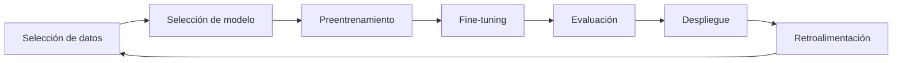
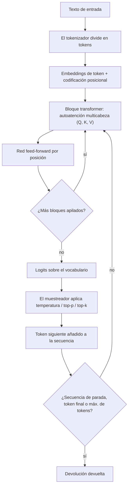
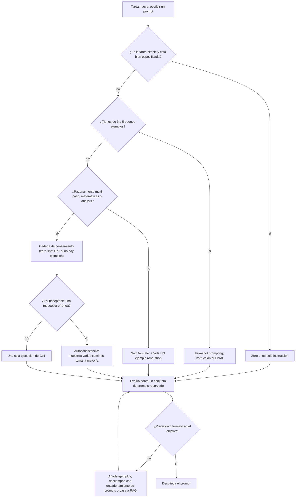
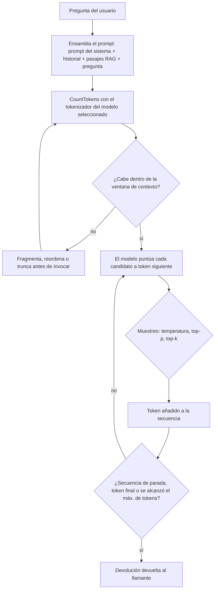
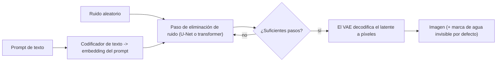
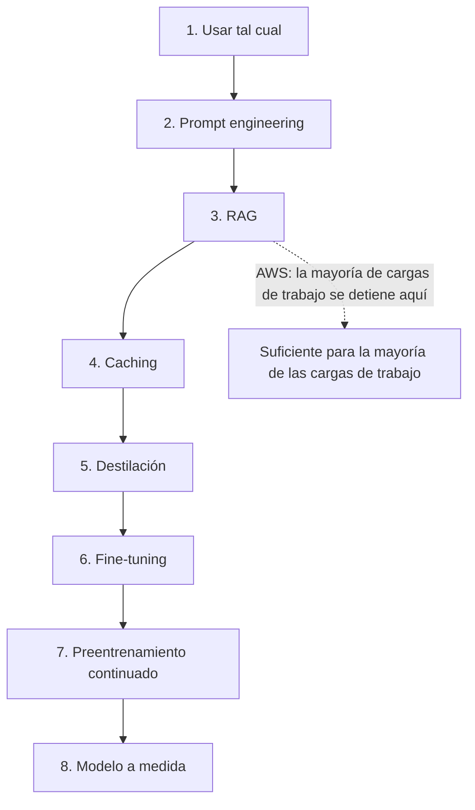

# Fundamentos de IA generativa: tokens, transformers, prompting y modelos fundacionales

Esta es la lección de mayor apalancamiento del curso. **El Dominio 2 (Fundamentos de IA generativa) pesa un 24% y el Dominio 3 (Aplicaciones de modelos fundacionales) pesa un 28%** del contenido puntuado — **52% en total** — y casi toda pregunta dentro de esos dos dominios se construye con el mismo conjunto pequeño de objetos: un **token**, una **ventana de contexto**, un **prompt**, un **parámetro de inferencia**, un **embedding** y un **modelo fundacional (FM)**. Aprende los objetos y los números pegados a ellos, y medio examen se convierte en aritmética más vocabulario en lugar de adivinación.

```text
=====================================================================
 LA MITAD GENERATIVA DEL EXAMEN AIF-C01               (Resumen: oct 2026)
=====================================================================
  DOMINIO 2  Fundamentos de IA generativa ............. 24 %
  DOMINIO 3  Aplicaciones de modelos fundacionales ..... 28 %
  ----------------------------------------------------------
  peso combinado del material de esta lección .......... 52 %
---------------------------------------------------------------------
  TAREA 2.1 VOCABULARIO
    tokens · fragmentación · embeddings · vectores · prompt engineering ·
    LLM transformer · modelos fundacionales · modelos multimodales ·
    modelos de difusión
  CICLO DE VIDA DE UN FM
    selección de datos -> selección de modelo -> preentrenamiento ->
    fine-tuning -> evaluación -> despliegue -> retroalimentación
---------------------------------------------------------------------
  VENTAJAS DE AWS ... adaptabilidad · capacidad de respuesta ·
                      habilidad conversacional · generación de contenido
  RIESGOS DE AWS    ... alucinaciones · escasa interpretabilidad ·
                      imprecisión · no determinismo
=====================================================================
```

> [!NOTE]
> **Cómo leer esta lección.** Cada límite, valor predeterminado y porcentaje de abajo procede de la Guía del examen AIF-C01, la guía del usuario de Amazon Bedrock, un blog de AWS o una publicación de ciencia de AWS. Dos reglas gobiernan las cifras: **cuando AWS publica una figura, AWS gana sobre cualquier calculadora de terceros** — esto importa más para la estimación de tokens, donde el popular *«~4 caracteres por token»* que circula por internet **no** es una cifra de AWS —; y **los porcentajes de marketing se reproducen como afirmaciones de AWS**, claramente etiquetados como tales, porque su metodología no está verificada de forma independiente.

Al terminar esta lección sabrás:

- explicar la **autoatención** en términos de consulta/clave/valor y decir por qué los transformers superan a las RNN en secuencias largas;
- estimar **tokens** con ambas reglas publicadas por AWS (6 caracteres por token, y 4,7 caracteres por token para embeddings en inglés) y saber cuál de las dos usa la pregunta;
- presupuestar una **ventana de contexto** como prompt del sistema + entrada del cliente + contexto RAG + salida, y predecir qué hace un **Context Window Overflow** al comportamiento;
- elegir entre **zero-shot, few-shot, cadena de pensamiento, autoconsistencia y encadenamiento de prompts** y enunciar el coste de cada uno;
- fijar **temperatura, top-p, top-k, máx. de tokens, secuencias de parada y penalizaciones** para una carga de trabajo y defender la respuesta de determinismo;
- leer una **tabla de modalidades** y elegir la familia de FM correcta para entradas de texto, embeddings, imagen, video o imagen+texto;
- recorrer el **espectro de personalización** desde el prompt engineering hasta un modelo a medida y nombrar las cifras que AWS adjunta a la destilación y al fine-tuning por refuerzo;
- evaluar un FM con **ROUGE, BLEU, BERTScore, LLM-as-a-judge y evaluación humana**;
- aplicar las **seis políticas de Guardrails** y la escalera de mitigación de alucinaciones de tres pasos;
- defender el **veredicto comparativo** entre IA generativa, ML tradicional y sistemas basados en reglas.

---

## 1. Qué es la IA generativa — y qué no es

### 1.1 La definición que el examen realmente usa

La IA generativa es la clase de sistemas que **crea contenido nuevo**: texto, código, imágenes, video, audio y embeddings. Esa única palabra — *nuevo* — es toda la distinción. Un modelo de ML tradicional responde *«¿a qué cubo pertenece esta fila?»*; un modelo generativo responde *«escríbeme algo que pertenezca a este cubo»*. Los modelos fundacionales son los motores de debajo: modelos grandes entrenados en corpus amplios que tú adaptas mediante **prompting, generación aumentada por recuperación (RAG) o fine-tuning** en lugar de reentrenar.

AWS es explícito sobre el intercambio. Los modelos fundacionales son **no deterministas**: *«las mismas entradas pueden producir respuestas distintas»*. Esa propiedad es lo que los hace útiles para redactar y hacer lluvia de ideas, y lo que los hace peligrosos para extracción, puntuación y cualquier cosa que un auditor lea dos veces.

### 1.2 Las ventajas y los riesgos que nombra AWS

La guía del examen enumera cuatro ventajas y cuatro desventajas. No son decoración: cada ventaja se empareja con un control, y cada riesgo se empareja con una mitigación que se te pedirá nombrar.

| Ventaja (guía del examen AIF-C01) | Qué entrega | El control que la mantiene útil |
|---|---|---|
| **Adaptabilidad** | un modelo, muchas tareas mediante prompting y fine-tuning | espectro de personalización (sección 9) |
| **Capacidad de respuesta** | salida condicionada por el prompt completo | presupuestado de la ventana de contexto (sección 7) |
| **Habilidad conversacional** | diálogo multi-turno sobre tus datos | RAG más Guardrails (sección 11) |
| **Generación de contenido** | texto, código, imagen, audio y video nuevos | evaluación y revisión humana (sección 10) |

| Desventaja (guía del examen AIF-C01) | Fallo que produce | Mitigación que documenta AWS |
|---|---|---|
| **Alucinación** | fabricación segura de sí misma | refinamiento del prompt → RAG → modelo distinto; verificaciones de grounding contextual |
| **Escasa interpretabilidad** | sin importancias de atributos legibles | evaluación programática + juez + humana |
| **Imprecisión** | hechos equivocados, formato equivocado | grounding, ROUGE/BLEU/BERTScore, conjuntos de prompts reservados |
| **No determinismo** | misma entrada, salida distinta | temperatura 0, semillas fijas, Guardrails, humano en el bucle |

### 1.3 El ciclo de vida del modelo fundacional

La Tarea 2.1 exige el ciclo de vida en orden. También es la forma de la mayoría de preguntas de secuenciación del examen.



- **📚 ¿Sabías que…?** La propia redacción de la guía del examen para el ciclo de vida es un *ciclo*, no una línea: **la retroalimentación vuelve a la selección de datos**. Por eso *«monitoriza el modelo desplegado y devuelve datos de producción al corpus»* se lee como correcto en el examen, mientras que *«el despliegue es el paso final»* se lee como un distractor — y es el mismo bucle que hace de la *desviación* un problema de IA generativa y no solo un problema de ML clásico.

---

## 2. Tokens: la unidad en la que se mide todo

### 2.1 Qué es un token

Un **token** es el trozo de texto que un modelo realmente lee y escribe. Un **tokenizador** divide el texto bruto en tokens antes de que el modelo lo ve, y la generación ocurre un token a vez. La propiedad crítica es que **la tokenización es específica del modelo**: la misma frase puede ser de 12 tokens en un modelo y de 17 en otro, y por eso una fórmula fija de *«palabras ÷ X = tokens»* no es fiable, y por eso Amazon Bedrock expone una API **CountTokens** que cuenta con el tokenizador *del modelo seleccionado* sobre la entrada exacta que vas a invocar.

La **fragmentación** es el concepto compañero: cuando un documento es más largo que el límite de entrada de un modelo, lo divides en segmentos (párrafos, secciones, páginas) para que cada segmento quepa. La calidad de la fragmentación es la palanca más grande de un sistema RAG — AWS publicó un caso en el que una mejor fragmentación por sí sola elevó **la relevancia contextual del 67% al 93%** y eliminó alucinaciones **sin cambiar el prompt**.

### 2.2 Las dos reglas de estimación publicadas por AWS

| Regla | Fuente de AWS | Para qué sirve | Valor exacto |
|---|---|---|---|
| **≈ 6 caracteres por token** | Bedrock *Prepare model customizations* | cuotas de fine-tuning y planificación de conjuntos de datos | caracteres permitidos = cuota de tokens × 6 |
| **≈ 4,7 caracteres por token (inglés)** | Bedrock *Titan Text Embeddings* | límites de entrada de embeddings | 8.192 tokens ≈ **38.502 caracteres** |

> [!WARNING]
> **La regla de *«~4 caracteres por token»* que encontrarás en blogs no es una cifra de AWS.** Circula ampliamente en calculadoras de tokens de terceros, y es lo bastante cerca para ser tentadora — y lo bastante equivocada como para hacerte fallar un ítem de aritmética. En el examen, usa las cifras de AWS: **6 caracteres por token** para fine-tuning y planificación de cuotas, **4,7 caracteres por token** para entrada en inglés a Titan Text Embeddings V2. Cuando una opción se construye sobre 4 caracteres por token, se construye sobre un número que AWS nunca publicó.

### 2.3 Ejemplo resuelto 1 — cuota de fine-tuning en caracteres

Un equipo quiere hacer fine-tuning de **Amazon Titan Text G1 Express** y tiene un prompt de muestra de **30.000 caracteres**. La cuota de fine-tuning con batch size 1 para ese modelo es de **4.096 tokens de entrada+salida**.

1. Convierte la cuota a caracteres: $4{,}096 \times 6 = 24{,}576$ caracteres permitidos.
2. Convierte la muestra a tokens: $30{,}000 \div 6 = 5{,}000$ tokens — **904 tokens por encima** de la cuota de 4.096.
3. Convierte el exceso de vuelta a caracteres: $30{,}000 - 24{,}576 = 5{,}424$ caracteres de más.

**Respuesta:** la muestra supera la cuota en **5.424 caracteres**; divídela en dos registros o trúncala. El distractor *«50.000 caracteres»* es el límite de Titan *Embeddings V2*, un modelo distinto con un límite distinto.

### 2.4 Ejemplo resuelto 2 — ¿qué límite de embeddings actúa primero?

Titan Text Embeddings V2 acepta **8.192 tokens *o* 50.000 caracteres**. ¿Cuál de los dos detiene primero un documento largo en inglés?

1. El inglés promedia **4,7 caracteres por token**, así que el límite de tokens actúa en $8{,}192 \times 4.7 \approx 38{,}502$ caracteres.
2. Un artículo de **50.000 caracteres** se convierte por tanto en $50{,}000 \div 4.7 \approx 10{,}638$ tokens.
3. Exceso: $10{,}638 - 8{,}192 = 2{,}446$ tokens.

**Respuesta:** **el límite de tokens actúa primero**, en unos 38.502 caracteres para inglés — 11.498 caracteres *antes* del techo de 50.000 caracteres. El remedio documentado por AWS es segmentar el documento en párrafos o secciones e insertar cada uno.

- **📚 ¿Sabías que…?** El endpoint **CountTokens** de Bedrock responde una pregunta que ninguna fórmula puede: ejecuta el tokenizador *del propio modelo invocado* sobre tu cadena exacta. El mismo artículo de 47.000 caracteres puede estar por encima del presupuesto en un modelo y cómodamente por debajo en otro, y por eso AWS documenta CountTokens como el paso de planificación previo a cualquier llamada sensible a cuotas, y no como una comodidad opcional.

---

## 3. Transformers y autoatención: cómo lee un modelo una secuencia

### 3.1 Consulta, clave y valor

La **autoatención** permite que cada token de una secuencia mire a todos los demás y decida qué importa. Cada embedding de token se proyecta en tres vectores, y las descripciones de AWS son la redacción exacta que usa el examen:

| Vector | La respuesta que da | Papel en la puntuación de atención |
|---|---|---|
| **Consulta (Q)** | *«¿qué estoy buscando?»* | lo que este token quiere encontrar en otra parte de la secuencia |
| **Clave (K)** | *«¿qué ofrezco?»* | la etiqueta que cada token publica sobre sí mismo |
| **Valor (V)** | *«¿qué transmito?»* | el contenido realmente llevado a la siguiente capa |

Las puntuaciones de atención se calculan a partir de **Q emparejada contra K**, y después se usan para ponderar los vectores **V**. El resultado es una representación de cada token que ya contiene su contexto — y por eso *«banco»* en *«banco del río»* y *«banco»* en *«cuenta bancaria»* terminan como vectores distintos aunque fueran la misma cadena de entrada.

### 3.2 El bloque transformer y la codificación posicional

Un bloque transformer es, en la definición de AWS, **autoatención multicabeza más una red feed-forward por posición**. Varias cabezas atienden en paralelo para que cabezas distintas puedan especializarse — una siguiendo la sintaxis, otra la correferencia, otra la distancia. Como la atención en sí es ciega al orden, la **codificación posicional** inyecta el orden de la secuencia para que el modelo sepa qué token vino primero.

### 3.3 Por qué los transformers superan a las RNN y por qué los modelos tipo GPT son pilas de decodificadores

Los transformers procesan **la secuencia completa en paralelo**, donde una RNN debe recorrerla una posición a vez. Las consecuencias son las dos cosas que vale la pena memorizar: **entrenamiento más rápido** y la capacidad de manejar **secuencias mucho más largas**. Los modelos tipo GPT son pilas de bloques de **decodificador** y son **autorregresivos** — producen un token, lo añaden a la entrada y vuelven a ejecutar.



> [!NOTE]
> Dos redacciones que al examen le encantan: un bloque transformer es *«autoatención multicabeza **más** una red feed-forward por posición»* — no atención sola —, y es la **codificación posicional**, no el mecanismo de atención en sí, lo que suministra el orden de las palabras. Si un distractor afirma que la atención preserva el orden naturalmente, está probando si recuerdas que la atención es invariante a permutaciones.

---

## 4. Embeddings, vectores y bases de datos vectoriales

### 4.1 De las tablas one-hot al espacio de embeddings

Antes de los embeddings, los datos categóricos vivían en **tablas one-hot**: un vector alto y disperso donde cada palabra era una columna independiente y no existía noción de significado entre ellas. **Los embeddings reemplazan eso** con un vector denso en el que palabras semánticamente similares quedan **unas cerca de otras**. La recompensa es aritmética que el one-hot encoding nunca pudo hacer — el ejemplo documentado por AWS es `París − Francia + Alemania ≈ Berlín`, donde la *dirección* entre dos embeddings codifica una relación.

### 4.2 ¿Quién calcula la similitud: el modelo o la base de datos?

Un detalle que decide muchos puntos: el modelo **produce** el vector; la **base de datos vectorial calcula** la similitud, usando **similitud coseno o k vecinos más cercanos (k-NN)**. La recuperación en un pipeline RAG es por tanto una operación de base de datos, y la guía del examen nombra los almacenes de embeddings que espera que reconozcas.

| Almacén nombrado en la Tarea 3.1 | Mecanismo de recuperación | Encuadre típico del AIF-C01 |
|---|---|---|
| **Amazon OpenSearch Service** | k-NN / búsqueda vectorial | búsqueda vectorial gestionada junto a texto completo |
| **Amazon Aurora** | **pgvector** en Aurora PostgreSQL | datos relacionales con recuperación vectorial |
| **Amazon Neptune** | búsqueda vectorial sobre el grafo | relaciones *y* similitud |
| **Amazon DocumentDB (con compatibilidad con MongoDB)** | búsqueda vectorial | cargas de trabajo documentales con embeddings |
| **Amazon RDS for PostgreSQL** | pgvector | despliegues al estilo auto gestionado sobre AWS |

### 4.3 Los modelos de embeddings y sus límites verificados

| Modelo | Dirección | Especificación verificada |
|---|---|---|
| **Amazon Titan Text Embeddings G1** | texto → vector | máx. entrada **8K tokens**; vector de salida máx. **1.536** dimensiones |
| **Amazon Titan Text Embeddings V2** (`amazon.titan-embed-text-v2:0`) | texto → vector | **8.192 tokens o 50.000 caracteres** de entrada; **1.024** dimensiones (también 512 y 256); **4,7 caracteres por token** para inglés |
| **Cohere Embed v3** | texto → vector | **1.024** valores |
| **Amazon Titan Multimodal Embeddings G1** | imagen o texto → vector compartido | compara un prompt contra una imagen generada por **similitud coseno** |

### 4.4 Ejemplo resuelto 3 — lo que un almacén de vectores te cuesta realmente en bytes

Titan Text Embeddings V2 devuelve **1.024** dimensiones. Asumiendo floats de 32 bits (4 bytes por valor — una asunción, no una cifra publicada por AWS), un vector es:

$$
1{,}024 \times 4\ \text{bytes} = 4{,}096\ \text{bytes} \approx 4\ \text{KB}
$$

Para una base de conocimiento de **100.000 pasajes**:

$$
100{,}000 \times 4\ \text{KB} = 400{,}000\ \text{KB} \approx 400\ \text{MB}
$$

**Respuesta:** aproximadamente **400 MB de carga útil de vectores en bruto** antes de la sobrecarga del índice, los metadatos y el sharding. Ese es el número que te llevas a la elección entre OpenSearch, Aurora (pgvector), Neptune, DocumentDB y RDS for PostgreSQL — y es la razón por la que la reducción de dimensionalidad a **512 o 256** (ambas admitidas por V2) es una palanca de coste legítima: al mitad las dimensiones, la carga útil en bruto se reduce a unos **200 MB**.

- **📚 ¿Sabías que…?** La aritmética de embeddings no es un truco de fiesta — es evidencia de que el espacio de vectores codifica *relaciones como direcciones*. `París − Francia + Alemania ≈ Berlín` funciona porque el desplazamiento de *«capital de»* es coherente entre países. En el examen esto aparece de forma indirecta: cuando una pregunta dice que los vectores colocan elementos semánticamente similares cerca unos de otros, la respuesta pretendida casi siempre trata sobre **similitud coseno en una base de datos vectorial**, no sobre el modelo releyendo el texto.

---

## 5. Prompt engineering: la primera palanca que siempre debes tirar

### 5.1 El vocabulario de los shots

| Término | Definición (AWS) |
|---|---|
| **Zero-shot** | solo instrucción, **sin** ejemplos de entrada→salida |
| **One-shot** | exactamente **un** ejemplo resuelto |
| **Few-shot** | **k** ejemplos emparejados; un *«shot»* es un par entrada→salida |
| **Instrucción** | la descripción de la tarea; AWS dice poner la **pregunta o la instrucción al final** del prompt |
| **Conjunto de prueba reservado** | prompts reservados del desarrollo para poder medir regresiones con honestidad |

### 5.2 La tabla de técnicas

| Técnica | Definición | Cuándo dice AWS usarla | Intercompensación |
|---|---|---|---|
| **Zero-shot** | solo instrucción | tareas simples y bien especificadas | la más barata; menos control de formato |
| **One-shot** | exactamente 1 ejemplo | un ejemplar fija el formato | pequeña adición de tokens |
| **Few-shot (in-context)** | k ejemplos emparejados | control de formato o tono; **3–5** para clasificación simple | más tokens de entrada → más coste y latencia |
| **Cadena de pensamiento (CoT)** | pasos intermedios de razonamiento (*«piensa paso a paso…»*) | análisis multi-paso, matemáticas, razonamiento complejo | **+latencia, +tokens de salida** |
| **Zero-shot CoT** | una frase detonante de CoT sin ejemplo resuelto | razonamiento sin la carga del ejemplo | la misma sobrecarga de CoT |
| **Autoconsistencia** | muestrea varios caminos de razonamiento, toma la respuesta mayoritaria | razonamiento de alto riesgo | multiplica el coste de inferencia |
| **Encadenamiento de prompts / Prompt Flows** | la salida del paso N se convierte en la entrada del paso N+1 | tareas complejas descomponibles | complejidad de orquestación |

### 5.3 Cadena de pensamiento: qué compra y qué cuesta

Amazon Bedrock documenta que la cadena de pensamiento — comercializada como **model reasoning** en la consola — *«a menudo puede mejorar la precisión del modelo al darle al modelo la oportunidad de pensar antes de responder»*. El coste es igual de explícito: **latencia aumentada y tokens de salida aumentados**. Y la exclusión importa tanto como el beneficio: AWS afirma que **las tareas simples no son buen candidato para la cadena de pensamiento**. Pedir a un modelo que razoné extensamente para clasificar un ticket de soporte en una de cuatro colas es pagar tokens de salida sin precisión.

### 5.4 El árbol de decisión del prompt engineering



### 5.5 Ejemplo resuelto 4 — lo que el few-shot prompting cuesta de verdad

Una instrucción cuesta **80 tokens**; un ejemplo etiquetado cuesta **60 tokens**.

| Variante | Tokens de entrada | Múltiplo del zero-shot |
|---|---|---|
| Zero-shot | $80$ | 1,00× |
| One-shot | $80 + 60 = 140$ | 1,75× |
| **3-shot** | $80 + (3 \times 60) = 260$ | 3,25× |
| 5-shot | $80 + (5 \times 60) = 380$ | **4,75×** |

**Respuesta:** un prompt de 5-shot cuesta **4,75×** los tokens de entrada del zero-shot por la *misma única respuesta*. Como AWS dice que **de 3 a 5 ejemplos bastan** para clasificación simple de texto, **3 shots es el punto óptimo** — obtienes control de formato a 3,25× en lugar de 4,75×. Y si después añades cadena de pensamiento, el coste se mueve al lado de la **salida**, donde el `maxTokenCount` predeterminado de Titan Text de **512** empieza a morder; súbelo antes de activar el razonamiento.

```matching
{
  "question": "Relaciona cada técnica de prompt engineering con la guía de AWS sobre cuándo recurrir a ella:",
  "pairs": [
    {"left": "Zero-shot prompting", "right": "Tarea simple y bien especificada: solo instrucción, la opción más barata, menos control de formato"},
    {"left": "Few-shot prompting", "right": "Hay que controlar el formato o el tono: de 3 a 5 ejemplos few-shot con la instrucción al final"},
    {"left": "Cadena de pensamiento (model reasoning)", "right": "Razonamiento multi-paso o matemáticas: mejora la precisión, pero aumentan la latencia y los tokens de salida"},
    {"left": "Autoconsistencia", "right": "Razonamiento de alto riesgo: muestrea varios caminos de razonamiento y conserva la respuesta mayoritaria"},
    {"left": "Encadenamiento de prompts / Prompt Flows", "right": "Tarea compleja que se descompone: la salida del paso N se convierte en la entrada del paso N+1"}
  ],
  "explanation": "El examen prueba el emparejamiento de técnica con tarea, no la capacidad de recitar definiciones. Tarea simple significa zero-shot; control de formato significa de 3 a 5 ejemplos few-shot con la instrucción al final; razonamiento significa cadena de pensamiento y pagas en latencia y tokens de salida; alto riesgo significa autoconsistencia y pagas en inferencia multiplicada; trabajo descomponible significa encadenamiento y pagas en complejidad de orquestación."
}
```

- **📚 ¿Sabías que…?** La guía de prompt engineering de AWS esconde dos hábitos que separan un prompt que funciona de una demo: pon la **pregunta o la instrucción al final** del prompt (para que los tokens más relevantes queden más cerca de donde empieza la generación), y mantén un **conjunto reservado de prompts** que nunca enseñes al equipo mientras iteras. Sin el conjunto reservado, *«el prompt mejoró»* es una anécdota — la misma disciplina que un conjunto de prueba reservado en ML clásico, aplicada al texto.

---

## 6. Parámetros de inferencia: dirigir el siguiente token

### 6.1 La tabla completa de parámetros

Cada número de aquí está verificado contra las páginas *Inference response generation* y *Titan Text* de Bedrock.

| Parámetro | Controla | Más bajo → | Más alto → | Úsalo cuando | Rango / predeterminado verificado |
|---|---|---|---|---|---|
| **Temperatura** | forma de la distribución de probabilidad del siguiente token | más pronunciada → **determinista, factual, repetitiva** | más plana → **aleatoria, creativa** | 0–0,3 para extracción, SQL, clasificación, QA; 0,7–1,0 para lluvia de ideas y copy | **0,0–1,0**; **predeterminado de Titan 0,7** |
| **Top-p** | corte de probabilidad acumulada | menor conjunto de candidatos → estable, repetitivo | conjunto más amplio → más diverso | afina *junto a* la temperatura, nunca ambas agresivamente | **0,0–1,0**; **predeterminado de Titan 0,9** |
| **Top-k** | recuento de candidatos más probables conservados | salidas más seguras y probables | se admiten tokens menos probables | control fino de diversidad; **específico de Claude** en Bedrock | entero ≥ 0, específico del modelo |
| **Máx. de tokens** | tope de la salida generada | más barata, más corta, menor latencia | más larga, más cara, puede divagar | fíjalo justo por encima del tamaño realista de la respuesta | **predeterminado de Titan 512**; Lite **4.096**, Express **8.192**, Premier **3.072** |
| **Secuencias de parada** | detener la generación en una secuencia de caracteres | — | — | cierra la salida antes de `END`, o antes de un segundo objeto JSON | Converse **0–2.500** elementos; Agents **0–4**; **1–1.000** caracteres por elemento |
| **Penalizaciones** (frecuencia / presencia / recuento) | castigan la repetición | menos repetición | más repetición tolerada | detiene bucles y ecos en generaciones largas | las expone **AI21 Labs Jurassic** en Bedrock |
| *Imagen:* **cfgScale / seed / quality / numberOfImages** | adhesión, reproducibilidad, fidelidad, lote | adhesión más laxa al prompt | adhesión más estricta | fija `seed` para comparar ejecuciones | Nova Canvas `quality` = standard o premium; **máx. 5 imágenes** |

### 6.2 Los valores predeterminados que debes saber de memoria

| Familia de modelo | temperature | topP | maxTokenCount |
|---|---|---|---|
| **Amazon Titan Text G1** | **0,7** | **0,9** | **512** (Lite 4.096 / Express 8.192 / Premier 3.072 como máximo) |
| **Anthropic Claude (en Bedrock)** | añade **Top K** como palanca extra | — | específico del modelo |
| **AI21 Labs Jurassic** | — | — | añade **penalizaciones de presencia / recuento / frecuencia** |

> [!WARNING]
> **Bajar la temperatura no hace que un modelo sea veraz — lo hace repetitivo.** Temperatura 0 (o un valor bajo con top-p reducido) es la respuesta correcta para preguntas de *determinismo*: extracción de cláusulas contractuales, generación de SQL, clasificación, cualquier carga de trabajo cuya salida deba ser reproducible y auditable. Es la respuesta **equivocada** para la alucinación, porque un modelo determinista producirá la *misma* fabricación cada vez. Para la alucinación, la respuesta del examen es la escalera de mitigación de la sección 11: refina el prompt, añade RAG o prueba un modelo distinto.

### 6.3 Ejemplo resuelto 5 — tres cargas de trabajo, tres conjuntos de parámetros

Un equipo ejecuta tres trabajos sobre el mismo modelo Titan Text Express. Asume el mismo prompt y el mismo tope de salida predeterminado de 512 tokens.

1. **Extracción de cláusulas contractuales** (debe ser auditable): temperatura **0,0**, top-p bajado de 0,9 hacia **0,1–0,3**. Efecto: la distribución se pronuncia, el conjunto de candidatos se encoge, y las re-ejecuciones convergen en la misma extracción.
2. **Lluvia de ideas de titulares de campaña**: temperatura **1,0**, top-p dejado en **0,9**. Efecto: la distribución se aplana, más de la cola es alcanzable, y la diversidad sube — al coste de la reproducibilidad.
3. **Razonamiento de cadena de pensamiento sobre una respuesta de 400 tokens**: temperatura **0,2**, pero `maxTokenCount` subido de **512** a al menos **1.024**, porque los tokens de razonamiento son tokens de *salida*. Dejar el predeterminado trunca la cadena en medio de la derivación.

**Respuesta:** el determinismo se compra con **temperatura y top-p**; la creatividad con **temperatura**; y la capacidad de razonamiento con **máx. de tokens** — el parámetro que más a menudo se olvida, porque el fallo parece un error y no un ajuste.

---

## 7. Ventanas de contexto: el presupuesto que falla en silencio

### 7.1 Qué cabe realmente

La **ventana de contexto** es el número máximo de tokens que un modelo considera a la vez, y es un presupuesto sobre *todo* en la llamada:

$$
\text{context window} \ge \text{system prompt} + \text{client input} + \text{RAG context} + \text{output}
$$

Fija `maxTokenCount` por sustracción: **ventana − tokens de entrada − margen de seguridad**. Nunca por intuición.

### 7.2 El buffer circular FIFO y el Context Window Overflow

El blog de seguridad de AWS describe la ventana de contexto como un **buffer circular FIFO**. Una vez lleno, **cada token nuevo expulsa en silencio el token más antiguo** — sin error, sin advertencia, solo comportamiento a la deriva. El fenómeno tiene nombre en AWS: **Context Window Overflow (CWO)**. La historia de terror práctica es que el **prompt del sistema suele ser el contenido más antiguo**, así que bajo CWO las instrucciones que definen el comportamiento de tu agente son lo primero en desaparecer — y la aplicación sigue devolviendo 200 OK mientras ignora sus propias reglas.

### 7.3 Ejemplo resuelto 6 — un presupuesto de ventana de contexto

Prompt del sistema **400** + pasajes RAG **1.600** + historial de conversación **900** + pregunta **100**:

$$
400 + 1{,}600 + 900 + 100 = 3{,}000\ \text{input tokens}
$$

Con `maxTokenCount` en el máximo de Titan Text Premier de **3.072**, el total se convierte en $3{,}000 + 3{,}072 = 6{,}072$ tokens de demanda. Si la ventana del modelo es menor que eso, el desbordamiento no lanza una excepción — los 3.000 tokens más antiguos aproximadamente (empezando por el prompt del sistema) se expulsan a medida que avanza la generación, y el comportamiento se va a la deriva en lugar de fallar.

**Corrige, en orden:** ejecuta **CountTokens** sobre el prompt exacto → fija `maxTokenCount` = ventana − entrada − margen → acorta u ordena de nuevo los pasajes RAG → resume turnos más antiguos del historial.

### 7.4 El flujo de generación de extremo a extremo



- **📚 ¿Sabías que…?** La ventana de contexto **no** se publica como un único número fijo por familia de modelo en las páginas que AWS ha verificado para este resumen, así que los ítems de *«¿qué modelo tiene la ventana más grande?»* dependen de anuncios y deben re-comprobarse cerca del día del examen. Lo que **sí** está verificado y es estable: los máximos de `maxTokenCount` de Titan Text (**4.096 / 8.192 / 3.072**), Titan Embeddings **8K** tokens, Embeddings V2 **8.192** tokens, la suma de entrada + salida del fine-tuning de Llama **16.000** (**10.000** para el 90B), y el fine-tuning de Claude 3 Haiku **32.000** tokens. Presupuesta desde esas cifras, no desde un titular de blog.

---

## 8. Modelos fundacionales por modalidad — y cómo se hacen las imágenes

### 8.1 La tabla de modalidades

| Modalidad | Entrada → salida | Modelos listados por AWS verificados | Especificación verificada |
|---|---|---|---|
| **Texto → Texto** | texto → texto | Amazon Titan Text G1 Lite/Express/**Premier**; Amazon Nova; Anthropic Claude; Meta Llama 3.1 8B/70B, 3.2 1B/3B, 3.3 70B; Cohere Command / Command Light; Mistral AI; AI21 Labs Jurassic; DeepSeek-R1; OpenAI gpt-oss-20b | `maxTokenCount` de Titan: Lite **4.096** · Express **8.192** · Premier **3.072** |
| **Texto → Embeddings** | texto → vector | Titan Text Embeddings **G1** y **V2**; Cohere Embed v3 | G1: 8K entrada / **1.536** salida · V2: 8.192 tokens o 50.000 caracteres / **1.024** (512, 256) salida · Cohere v3: **1.024** valores |
| **Texto → Imagen** | texto (± imagen de referencia) → imagen | Amazon Titan Image Generator G1; Amazon Nova Canvas; Stability AI SDXL / 3.5 Large / Stable Image Core | Titan Image: descripción de 3–1.024 caracteres, lado 512–4.096 px, ≤ **5** imágenes de referencia, **marca de agua invisible activada por defecto** |
| **Texto + Imagen → Texto** | imagen + texto → texto | Meta Llama 3.2 11B/90B Instruct Vision, Llama 3.3 70B Vision Instruct | tokens de imagen = `min(2,max(H//560,1)) × min(2,max(W//560,1)) × 1601` → **1.601–6.404** |
| **Texto → Video** | texto → video | Amazon Nova Reel | transformer de difusión latente (VAE + codificador de texto + removedor de ruido) |
| **Imagen/Texto → Embeddings multimodales** | cualquiera → vector compartido | Amazon Titan Multimodal Embeddings G1 | compara prompt vs. imagen generada por similitud coseno |
| **Generación de audio** | audio de salida | AWS lista la generación de audio como un caso de uso de IA generativa en alcance | ningún FM de audio de Bedrock verificado en este resumen — trátalo como no confirmado |

### 8.2 Cómo un modelo de difusión produce una imagen

El entrenamiento de difusión enseña a un modelo a **eliminar ruido que se añadió a imágenes reales**. La generación ejecuta ese proceso al revés: empieza desde **ruido aleatorio** y elimina el ruido iterativamente, cada paso condicionado por el embedding del prompt de texto. La **difusión latente** hace el trabajo en un espacio latente comprimido (una U-Net, o un removedor de ruido transformer) y solo entonces decodifica a píxeles.

**Amazon Nova Canvas y Nova Reel** son **modelos de difusión latente con backbones transformer** — a menudo llamados *diffusion transformers* — construidos con tres partes: un **VAE** que convierte entre píxeles y tokens visuales, un **codificador de texto** para el prompt, y un **removedor de ruido transformer**. **Amazon Titan Image Generator** es un FM de difusión condicionado por texto: codifica el prompt, empareja vectores en un espacio conjunto de embeddings texto/imagen, y convierte una codificación aleatoria de baja resolución en la imagen final.



### 8.3 Ejemplo resuelto 7 — las entradas de visión también son aritmética de tokens

La fórmula publicada por AWS para los tokens de imagen en el fine-tuning de visión de Llama es:

$$
\text{tokens} = \min(2, \max(H // 560,\ 1)) \times \min(2, \max(W // 560,\ 1)) \times 1601
$$

| Imagen | Cálculo del factor | Tokens |
|---|---|---|
| 560 × 560 | $1 \times 1 \times 1601$ | **1.601** |
| 1.120 × 1.120 | $2 \times 2 \times 1601$ | **6.404** |
| 300 × 900 | $1 \times 1 \times 1601$ (la altura se fija en 1, la anchura se fija en 2) | **1.601** |

Contra la cuota de fine-tuning de **16.000** de suma de entrada más salida para Meta Llama 3.2: una imagen de 1.120 × 1.120 = 6.404 ✓, dos = 12.808 ✓, tres = 19.212 ✗ — **por encima de la cuota**.

**Respuesta:** dos imágenes grandes caben, tres no, y el comportamiento de fijado significa que una imagen pequeña todavía cuesta al menos **1.601 tokens**.

- **📚 ¿Sabías que…?** Amazon Titan Image Generator se envía con una **marca de agua invisible activada por defecto** y acepta como máximo **5 imágenes de referencia** — ambos son hechos con forma de examen porque responden dos preguntas distintas: *«¿cómo hace AWS que el contenido generado sea **identificable**?»* (la marca de agua, un control de transparencia) y *«¿cuánta personalización admite la API?»* (5 imágenes, no 50). Empareja cualquiera de las dos con la Responsible AI Lens de la sección 11 cuando una pregunta pida un artefacto de transparencia.

### 8.4 Actualizaciones de 2025–2026

La tabla de modalidades de 8.1 es la línea base de la guía del examen; el roster detrás de ella se movió dos veces dentro de la ventana que AWS verificó para esta lección. Todo lo de abajo procede de AWS What's New, la guía del usuario de Amazon Bedrock y la propia cobertura de re:Invent 2025 de AWS — solo funciones y fechas publicadas por el propio AWS.

| Cambio verificado | Fecha | Por qué importa en el examen |
|---|---|---|
| Familia **Amazon Nova 2** anunciada; modelo de voz a voz **Nova 2 Sonic** GA (`amazon.nova-2-sonic-v1:0`, 7 idiomas) y **Nova 2 Omni** en preview; **Nova 2 Lite** lista un contexto de **1M de tokens** con code interpreter, web grounding y MCP remoto | 1–4 de diciembre de 2025 (Sonic GA el **2 de diciembre de 2025**) | una modalidad **voz de entrada → voz de salida** y un modelo **omni** (texto, imagen, video y voz de entrada → texto + imagen de salida) se unen a la tabla de modalidades; la Nova de generación 1 (Micro/Lite/Pro/Premier, Canvas, Reel, Sonic, Embeddings) sigue listada |
| **Anthropic Claude Sonnet 4.6** añadido a Bedrock | **17 de febrero de 2026** | **1M de contexto / 64K de salida** — el par contexto-salida más grande que AWS publica para la línea Claude 4.x, y una respuesta directa a *«¿qué modelo encaja para un trabajo de documentos largos?»* |
| **Seis modelos de pesos abiertos** gestionados en Bedrock — DeepSeek V3.2, MiniMax M2.1, GLM 4.7 / 4.7 Flash, Kimi K2.5, Qwen3 Coder Next — servidos a través de **Project Mantle** | **1 de febrero de 2026** | los pesos abiertos son ahora una opción de **selección de modelo gestionado** en Bedrock, y no una decisión de auto alojamiento |
| **OpenAI GPT-6 Astra** GA y **GLM 5.3 (Z.ai)** GA en Bedrock | 8 de septiembre de 2026 / 5 de octubre de 2026 | crece la amplitud de proveedores; las reglas del ciclo de vida de FM, la evaluación y Guardrails no cambian con ello |
| **Amazon Bedrock AgentCore** GA (Runtime, Gateway, Memory), después **Policy** GA (Cedar o lenguaje natural) y **Evaluations** GA (**13 evaluadores**) | 13 de octubre de 2025 / 3 de marzo de 2026 / 31 de marzo de 2026 | el material de **IA agéntica** — uso de herramientas, **MCP**, gestión de memoria, orquestación |
| **Política de ciclo de vida del modelo**: **Active → Legacy → EOL**, con aproximadamente una ventana de Legacy de **6 meses** para la mayoría de modelos | 7 de septiembre de 2026 | **Legacy** bloquea a los *clientes nuevos* y el *nuevo Provisioned Throughput*; no apaga los endpoints existentes |
| **Guía del examen AIF-C01 v1.1** publicada (el examen sigue siendo AIF-C01) | **30 de abril de 2026** | nuevos objetivos: precios por token (**2.1.4**), **ingeniería de contexto** (**2.1.5**), IA agéntica incl. MCP (**2.1.6**), versionado de Prompt Management (**3.2.5**), métricas de alineación con el negocio (**3.4.5**), detección de alucinaciones y grounding (**5.1.5**) |

Guardrails creció junto al roster de modelos: AWS ahora documenta **salvaguardas de código**, un **ApplyGuardrail API** independiente — filtra un prompt para *cualquier* modelo sin invocar un FM — y **salvaguardas entre cuentas** que aplican un guardrail en toda una AWS Organization. El **juego de seis políticas** y las afirmaciones publicadas (**88%** de bloqueo de contenido dañino, **99%** de precisión de Automated Reasoning) no cambian, así que la sección 11 todavía responde cada pregunta de política; lo que cambió es *dónde* pueden aplicarse esas políticas.

- **📚 ¿Sabías que…?** La guía v1.1 convirtió **los precios por token en un objetivo explícito (2.1.4)** — el examen ahora espera que razones sobre cómo los recuentos de tokens y los cambios de precios moldean el coste y el rendimiento, que es exactamente la aritmética ya practicada en las secciones 2, 5 y 7. AWS afirma que los cambios de la guía aparecen en el examen aproximadamente **un mes después de su publicación**, así que todo lo que añadió la v1.1 está activo: el formato sigue sin cambios en **65 preguntas (50 puntuadas + 15 sin puntuar)**, **90 minutos**, **700/1000** para aprobar.

---

## 9. El espectro de personalización: prompt primero, modelo a medida al final

### 9.1 La escalera que publica AWS

| Paso | Técnica | Qué te cuesta | Cuándo es la respuesta |
|---|---|---|---|
| 1 | **Usar el modelo tal cual** | nada | el comportamiento base ya es bastante bueno |
| 2 | **Prompt engineering** | unos pocos tokens de entrada | formato, tono, definición de la tarea |
| 3 | **RAG (con caching cerca)** | infraestructura de recuperación + tokens de contexto | las respuestas deben estar ancladas en **tus** documentos |
| 4 | **Caching** | almacenamiento de caché | los prefijos idénticos se repiten a volumen |
| 5 | **Destilación de modelos** | un modelo profesor + una ejecución de entrenamiento de estudiante | necesitas velocidad y recortes de coste en una tarea *fija* |
| 6 | **Fine-tuning** | un conjunto de datos etiquetado + horas de entrenamiento | el estilo, el formato o el comportamiento de dominio deben quedar incorporados |
| 7 | **Preentrenamiento continuado** | un corpus de dominio grande | el modelo debe absorber un dominio completamente nuevo |
| 8 | **Modelo a medida** | un presupuesto completo de preentrenamiento | ningún FM existente encaja |

El propio resumen de AWS: **la mayoría de las cargas de trabajo nunca pasan del paso 3**. Esa frase vale más en el examen que cualquier técnica individual, porque convierte *«¿qué personalización debo usar?»* en *«¿cuál es el peldaño más barato que arregla el problema?»* — y cada peldaño más barato que te saltes es coste y latencia que pagas por nada.



### 9.2 El vocabulario de fine-tuning de la Tarea 3.3

| Técnica | Qué es | Encuadre de examen |
|---|---|---|
| **RLHF** | aprendizaje por refuerzo con retroalimentación de **humanos**: humanos ordenan salidas, un modelo de recompensa aprende de los rankings | el paso nombrado de preferencia humana |
| **Ajuste de instrucciones** | entrenamiento supervisado sobre pares instrucción→respuesta | enseña al modelo a *seguir* instrucciones |
| **Adaptación de dominio** | exponer el modelo a texto y tareas de un dominio | vocabulario y estilo de una industria |
| **Aprendizaje por transferencia** | reutilizar conocimiento de una tarea en otra | el principio general bajo la adaptación |
| **Preentrenamiento continuado** | alimentar periódicamente el preentrenamiento con datos nuevos de dominio | mantiene un modelo al día a medida que el corpus deriva |

### 9.3 Fine-tuning por refuerzo y destilación — las cifras

El **fine-tuning por refuerzo (RFT)** usa funciones de recompensa — una función **Lambda** de AWS que implementa verificación basada en reglas (RLVR), o un **modelo como juez** (RLAIF) — con el método de optimización **GRPO**. AWS afirma **hasta un 66% de mejora de precisión**. Guardrails sobre la propia función: **mínimo 100 registros**, **máximo 20.000 prompts** para los modelos Nova, y el propio consejo de AWS de **omitir el RFT cuando la recompensa base ya supera el 95%**.

**Model Distillation** (GA en mayo de 2025) entrena un estudiante más pequeño sobre las salidas del profesor. AWS afirma que el estudiante puede ser **hasta un 500% más rápido**, **un 75% más barato**, con **menos del 2% de pérdida de precisión**.

### 9.4 Ejemplo resuelto 8 — ¿debería este equipo hacer fine-tuning?

Un equipo de soporte quiere que su asistente adopte el estilo corporativo de la empresa. Recompensa de evaluación base en su conjunto de prompts reservado: **91%**.

1. La base **91% < 95%**, así que el RFT está *técnicamente* disponible — pero necesita **≥ 100 registros etiquetados** y añade entrenamiento y mantenimiento de la función de recompensa.
2. La escalera de AWS dice intentar primero los pasos **1–3**: prompt engineering (reglas de estilo corporativo en el prompt del sistema) y **RAG** (la base de conocimiento de respuestas pasadas).
3. Si el estilo todavía falla después de los pasos 1–3, **el fine-tuning (paso 6)** es el peldaño correcto — y el equipo necesita un conjunto de datos etiquetado, no más ajustes de temperatura.

**Respuesta:** no empieces en el paso 6. Si la recompensa base alguna vez alcanza **por encima del 95%**, AWS dice explícitamente que **omitas el RFT por completo**.

```fillblank
{
  "question": "Completa el espectro de personalización con las propias cifras de AWS:",
  "template": "AWS dice que la mayoría de las cargas de trabajo nunca pasan del paso {{1}} del espectro: usar tal cual, prompt engineering, RAG, caching, destilación, fine-tuning, preentrenamiento continuado, modelo a medida. Model Distillation (GA en mayo de 2025) afirma un estudiante hasta un {{2}}% más barato con menos del 2% de pérdida de precisión, y el fine-tuning por refuerzo necesita un mínimo de {{3}} registros y como máximo 20.000 prompts para los modelos Nova.",
  "answers": {
    "1": "3",
    "2": "75",
    "3": "100"
  },
  "distractors": ["6", "50", "1.000"],
  "explanation": "El paso 3 es RAG, y la guía publicada de AWS es que la mayoría de las cargas de trabajo nunca van más allá - prompt engineering más recuperación cubre la mayoría de los casos de uso de respuesta anclada. La destilación se afirma hasta un 500% más rápida y un 75% más barata con menos del 2% de pérdida de precisión, y el fine-tuning por refuerzo requiere al menos 100 registros, como máximo 20.000 prompts para Nova, y debe omitirse cuando la recompensa base ya supera el 95%."
}
```

- **📚 ¿Sabías que…?** El espectro de personalización es la respuesta directa a la forma recurrente del examen de *«el equipo quiere hacer fine-tuning, ¿qué deberían hacer primero?»* — y el **66% de mejora de precisión de RFT**, el **500% más rápido / 75% más barato / <2% de pérdida de precisión de la destilación** y el *«la mayoría de las cargas de trabajo nunca pasan del paso 3»* de AWS son todas afirmaciones de AWS reproducidas tal como se publican. Úsalas como *direcciones* (la destilación es más barata, el RFT puede ayudar en tareas difíciles, el prompting y el RAG van primero) y no como promesas que tu arquitectura deba cumplir.

---

## 10. Evaluar la IA generativa

### 10.1 Tres familias de evaluación en Amazon Bedrock Model Evaluation

| Familia | Qué es | Métricas / notas |
|---|---|---|
| **Programática** | puntuación automática contra verdad de referencia | **exactitud** (0–1), **robustez** (más bajo = más robusto; sensibilidad a espacios en blanco, mayúsculas, errores tipográficos, números escritos con palabras), **toxicidad** (basada en Detoxify; más cercano a 0 = más limpio) |
| **LLM-as-a-judge** | un segundo modelo puntúa al primero | calidad: corrección, completitud, **fidelidad**; UX: utilidad, coherencia, relevancia; instrucción: seguir instrucciones, estilo/tono; seguridad: dañosidad, estereotipos, rechazo |
| **Basada en humanos** | tu equipo **o** un workflow gestionado por AWS | evaluación humana del propio equipo documentada a **0,21 USD por tarea completada** |

Los conjuntos de datos integrados incluyen **Real Toxicity, BOLD, TREX, WikiText-2, Gigaword, BoolQ, Natural Questions** y **TriviaQA**.

### 10.2 Las reglas del juez que aparecen literalmente como respuestas

- AWS afirma que LLM-as-a-judge entrega **hasta un 98% de ahorro de costes** frente a la revisión humana.
- Mejor práctica: usa un **modelo evaluador de una familia distinta a la del generador** — un juez de la misma familia hereda los mismos puntos ciegos.
- **Fidelidad** es la métrica de alucinación: ¿la respuesta se queda dentro del contexto recuperado?
- La revisión humana no se reemplaza; se **capa** — métricas de juez para la escala, workflows humanos para el visto bueno.

### 10.3 Las métricas clásicas de generación de texto de la Tarea 3.4

| Métrica | Qué mide | Referencia que necesita |
|---|---|---|
| **ROUGE** | **solapamiento** de n-gramas contra una referencia | un **resumen** de referencia (solapamiento orientado a recall) |
| **BLEU** | **solapamiento** de n-gramas contra una referencia | una **traducción** de referencia (solapamiento orientado a precisión) |
| **BERTScore** | **similitud semántica** vía embeddings contextuales | una respuesta de referencia; empareja el significado, no la redacción exacta |

### 10.4 Métricas específicas de RAG

La triada de RAG es **relevancia contextual**, **fidelidad** y **relevancia de la respuesta**; AWS añadió **precisión de citas** y **cobertura de citas** en 2025, ambas puntuadas 0–1 (la cobertura no aplica cuando la respuesta es totalmente infiel). El caso publicado de AWS: una mejor fragmentación elevó **la relevancia contextual del 67% al 93%** y eliminó alucinaciones **sin cambiar el prompt** — la evidencia más clara disponible de que en RAG, la *calidad de la recuperación* suele ser el error, y el prompt no.

### 10.5 Ejemplo resuelto 9 — juez más humano, con precios

Un equipo debe evaluar 2.000 generaciones:

1. **LLM-as-a-judge** puntúa las 2.000 en corrección, completitud, fidelidad y seguridad — AWS afirma **hasta un 98% de ahorro de costes** frente a hacerlo a mano.
2. **Revisión humana** sobre una muestra del 10% de 200 tareas a los **0,21 USD por tarea completada** documentados: $200 \times 0.21 = \$42.00$.
3. El **modelo juez procede de una familia distinta** a la del generador, así que los modos de fallo compartidos no se cancelan.

**Respuesta:** juez a escala para la cobertura, humanos por **42,00 USD** para una muestra de 200 tareas por autoridad — el patrón que AWS documenta, en lugar de evaluación solo con juez o solo con humanos.

---

## 11. Guardrails, mitigación de alucinaciones e IA responsable

### 11.1 Las seis políticas de Guardrails

| Política | Qué bloquea o comprueba |
|---|---|
| **Filtros de contenido** | Odio, Insultos, Sexual, Violencia, Conducta indebida, **Prompt Attack** |
| **Temas denegados** | temas que tú has declarado fuera de límites |
| **Filtros de PII** | detectar y enmascarar información personal identificable |
| **Filtros de palabras** | términos concretos que nunca quieres que se devuelvan |
| **Verificaciones de grounding contextual** | respuestas **no ancladas** en el contexto que tú suministras |
| **Verificaciones de Automated Reasoning** | afirmaciones que violan tus reglas/políticas formalizadas |

AWS afirma: **88%** de bloqueo de contenido dañino, **99%** de precisión de validación de Automated Reasoning, y **más del 75%** de las respuestas alucinadas filtradas por las verificaciones de grounding.

### 11.2 Verificaciones de Automated Reasoning — los límites que vale la pena memorizar

| Límite | Valor |
|---|---|
| Idioma | **solo inglés (EE. UU.)** |
| Streaming | **no admitido** |
| Protección contra prompt injection | **no la proporciona** esta verificación |
| Detección de temas fuera de tema | **no la proporciona** esta verificación |
| Documentos de origen | **≤ 5 MB / 50.000 caracteres** |
| Modos | **solo modo de detección** — hallazgos, no bloqueo |

> [!WARNING]
> **Automated Reasoning es un bisturí, no una valla.** Detecta violaciones de tu política formalizada y reporta hallazgos — **no** hace streaming, **no** habla ningún idioma salvo inglés (EE. UU.), **no** detiene la prompt injection y **no** detecta prompts fuera de tema. Un distractor que ofrezca *«verificaciones de Automated Reasoning para bloquear jailbreaks»* está probando dos de esos límites a la vez. Para comportamiento de bloqueo, la respuesta del examen es **filtros de contenido** y protección **prompt attack** dentro del juego de seis políticas.

### 11.3 La escalera de mitigación de alucinaciones — en el orden de AWS

AWS documenta exactamente tres rutas, en esta secuencia:

1. **Refina u optimiza el prompt** — la más barata, sin infraestructura.
2. **Usa RAG para suministrar datos relevantes** — ancla la respuesta en tus documentos.
3. **Prueba un modelo distinto** — algunos modelos alucinan menos en tu carga de trabajo.

Después, encima de la escalera, las **verificaciones de grounding contextual** en Guardrails detectan respuestas que no están soportadas por la fuente (AWS afirma **>75% filtradas**).

### 11.4 Ejemplo resuelto 10 — ¿cuánto te deja realmente un filtrado del 75%?

Un chatbot de producción emite **1.000 respuestas al día**, y el equipo activa **solo** las verificaciones de grounding contextual:

$$
1{,}000 \times (1 - 0.75) = 250
$$

**Respuesta:** aproximadamente **250 respuestas sin anclar pasan todavía** por cada 1.000 cuando las verificaciones de grounding son el *único* control — y por eso AWS **apila** controles: filtros de contenido al **88%**, Automated Reasoning al **99%** en violaciones de política, trabajos de evaluación antes de la publicación, y revisión humana para los casos que quedan. Ningún porcentaje de esta sección sustituye a la pila.

### 11.5 Las dimensiones de IA responsable y sus artefactos

AWS evalúa los sistemas de IA generativa en ocho dimensiones — **equidad, explicabilidad, veracidad/robustez, gobernanza, transparencia, privacidad y seguridad, seguridad (safety)** y **controlabilidad** — que están codificadas en la **Responsible AI Lens de AWS Well-Architected**. El artefacto de transparencia que AWS publica para sus propios servicios es la **AI Service Card**, y el vocabulario de esa misma lente es lo que cita un ítem de *«¿de qué dimensión trata esto?»*.

- **📚 ¿Sabías que…?** Los porcentajes de guardrail publicados por AWS (**88% / 99% / >75%**), el **66%** de mejora de RFT, el **98%** de ahorro de LLM-as-a-judge, la afirmación de destilación del **500% más rápido / 75% más barato** y el caso de fragmentación del **67% → 93%** son todas **afirmaciones de AWS con sus propias metodologías** — se reproducen aquí tal como las publica AWS. En el examen, funcionan como pistas de *ordenación* (qué control es más fuerte, qué paso viene primero), y no como garantías; trata cualquier opción que convierta una afirmación en un absoluto como sospechosa.

---

## 12. Veredicto comparativo

> [!IMPORTANT]
> **Veredicto comparativo — IA generativa frente a ML tradicional frente a sistemas basados en reglas**
> - **Lógica y reglas** es la respuesta cuando el flujo es **simple, repetitivo y debe ser auditable**: comprobaciones de elegibilidad, enrutamiento de IVR, cálculo de comisiones. Cuesta casi nada construirlo, es **totalmente determinista**, solo falla en casos límite no manejados, y lo depuras con tests unitarios. Las propias palabras de AWS: las reglas son **baratas, de bajo riesgo y fáciles de auditar** para flujos simples. Su modo de fallo es la complejidad — en el momento en que la decisión necesita contexto que las reglas no pueden enumerar, el manual de reglas se convierte en el pasivo.
> - **ML tradicional / IA clásica** es la respuesta cuando **un trabajo debe hacerse muy bien**: detección de intención, predicción de abandono, puntuación de fraude, un pronóstico. Necesitas un conjunto de datos etiquetado, obtienes una **etiqueta, clase, puntuación o índice** — y para ese único trabajo es **más barato y más rápido** que un modelo fundacional. Su modo de fallo es el alcance: no puede escribir, resumir ni mantener una conversación, porque nunca estuvo generando nada.
> - **IA generativa (modelos fundacionales)** es la respuesta donde **producir algo nuevo importa**: resúmenes, borradores, traducción, QA sobre documentos, generación de código, agentes multi-paso. Es **no determinista** — las mismas entradas pueden producir respuestas distintas —, así que necesita revisión con humano en el bucle, anclaje con RAG, Guardrails y evaluación donde los otros dos solo necesitan tests. Su modo de fallo es la *fabricación plausible*: el modelo está seguro y equivocado, que es un modo de fallo que ni las reglas ni un clasificador producen de la misma manera.
> - **Regla mnemotécnica para el examen:** *¿la pregunta necesita contenido nuevo, o comprensión de entradas desordenadas dependientes de datos?* → **IA generativa**. *¿Es una tarea predictiva estrecha y única con etiquetas?* → **ML tradicional**. *¿Es una decisión fija, repetitiva y auditable?* → **reglas**. La propia metáfora de AWS es la barrera contra el error opuesto: usar IA generativa en una tarea de reglas es *«como usar un mazo para clavar un chinche»* — y una opción que proponga GenAI para una búsqueda determinista es un distractor por definición.

| Dimensión | Lógica y reglas | ML tradicional / IA clásica | IA generativa (FM) |
|---|---|---|---|
| **Salida** | ramas fijas, búsquedas | etiqueta, clase, puntuación, pronóstico | **contenido nuevo**: texto, código, imagen, video, audio, embeddings |
| **Ejemplos** | enrutamiento de IVR, comprobaciones de elegibilidad | detección de intención, abandono, puntuación de fraude | resúmenes, traducción, borradores, QA sobre docs, gen. de código |
| **Determinismo** | totalmente determinista | determinista para una entrada dada | **no determinista / probabilístico** |
| **Umbral de fiabilidad** | 100%, auditable | alta para una tarea | más baja → humano en el bucle, RAG, guardrails |
| **Coste y latencia** | muy bajos | **más barato y más rápido** para un trabajo estrecho | más altos («un mazo para un chinche» si se usa mal) |
| **Datos para construir** | ninguno (reglas escritas a mano) | conjunto etiquetado por tarea | ninguno para prompting; conjunto etiquetado para fine-tuning |
| **Modo de fallo** | caso límite no manejado | etiqueta o puntuación equivocadas | **alucinación**, fabricación plausible, sesgo |
| **Elígelo cuando** | simple, repetitivo, debe ser auditable | un trabajo hecho muy bien | debes **generar** algo nuevo |
| **Controles necesarios** | tests unitarios | evaluación offline + monitorización | Guardrails, filtros de PII, verificaciones de grounding, revisión humana |

---

## 13. Trampas de examen para esta lección

> [!WARNING]
> **Las diez trampas que cuestan marcas en este material exacto:**
> 1. **La temperatura 0 arregla el determinismo, no la alucinación.** Un modelo determinista repite la misma fabricación — la respuesta de alucinación es prompt → RAG → modelo distinto.
> 2. **La estimación de tokens usa las cifras de AWS**: **6 caracteres por token** para cuotas y **4,7 caracteres por token** para embeddings en inglés — nunca el *«~4»* estándar de blogs.
> 3. **La ventana de contexto es un buffer circular FIFO**: el desbordamiento **expulsa en silencio los tokens más antiguos**, empezando por el prompt del sistema, en lugar de lanzar un error.
> 4. **La cadena de pensamiento añade latencia y tokens de salida** y AWS dice que **las tareas simples no son buen candidato** para ella.
> 5. **Few-shot es de 3 a 5 ejemplos**, con la **instrucción al final** y un **conjunto de prompts reservado** para la medición.
> 6. **Los predeterminados de Titan son temperatura 0,7, topP 0,9, maxTokenCount 512** — y los máximos de `maxTokenCount` son Lite **4.096** / Express **8.192** / Premier **3.072**.
> 7. **La similitud la calcula la base de datos vectorial** (coseno / k-NN), no el modelo; los almacenes nombrados en la Tarea 3.1 son **OpenSearch, Aurora, Neptune, DocumentDB y RDS for PostgreSQL**.
> 8. **Las verificaciones de Automated Reasoning son solo modo de detección**, solo inglés (EE. UU.), sin streaming, sin protección contra prompt injection, documentos ≤ **5 MB / 50.000 caracteres**.
> 9. **LLM-as-a-judge debe venir de una familia de modelo distinta** a la del generador, y las métricas clásicas de la Tarea 3.4 son **ROUGE, BLEU y BERTScore**.
> 10. **La mayoría de las cargas de trabajo nunca pasan del paso 3 (RAG)** del espectro de personalización — una opción que salta directamente al fine-tuning para una tarea de QA anclada en documentos es la trampa.
>
> Y una marca de *«no memorices»*: **los precios por token en dólares de los modelos y embeddings de Bedrock** no se verificaron para esta lección. El único precio verificado en este material es **0,21 USD por tarea humana de evaluación completada** (AWS News Blog, 2024). Del mismo modo, **los números de capas, el número de cabezas de atención y los tamaños ocultos** de LLMs concretos no son hechos examinados por AWS — no gastes tu presupuesto de recuerdo en ellos.

---

## 14. Casos Reales

Todo hasta aquí es mecanismo — cómo se comportan los tokens, la recuperación, los parámetros de inferencia y Guardrails. Esta sección es evidencia: despliegues de IA generativa publicados por AWS, cada uno con los servicios usados, las cifras que AWS y el cliente imprimieron, y la fuente. Léelos como **ejemplos de patrón** para el Dominio 3 (Aplicaciones de modelos fundacionales, 28%): el examen rara vez pide el nombre de una empresa, pero pregunta constantemente qué *forma* de arquitectura entrega qué resultado — y estas son las formas que el propio AWS publica.

### 14.1 Seis despliegues de IA generativa, con servicios y cifras

| Cliente (industria) | Servicios de AWS | Cifras publicadas por AWS | Fuente |
|---|---|---|---|
| **Bynder** (gestión de activos digitales) | **Amazon Bedrock** con **Amazon Titan Multimodal Embeddings** para vectores de imagen y de consulta, y después búsqueda por similitud coseno | tiempo de búsqueda **−75%**, resultados útiles por búsqueda **~+50%**, más de **175 M de activos / 18 PB / 4.000 clientes** | Caso de estudio de AWS, `aws.amazon.com/solutions/case-studies/bynder-bedrock-case-study` |
| **Epilot** (software energético) | **Amazon SQS → AWS Lambda → Amazon Bedrock (Claude Sonnet)**; modelo elegido con **Amazon Bedrock Evaluations**; datos mantenidos en una **Región de la UE** | tiempo de manejo de correos **−87%**, **55.000 resúmenes/mes**, el **80%** de los usuarios dice que simplifica el trabajo, MVP en **2 meses** | Caso de estudio de AWS, `aws.amazon.com/solutions/case-studies/epilot-genai-case-study` |
| **Alnylam Pharmaceuticals** (biotecnología) | **Amazon Bedrock + Amazon S3** RAG para triaje de quejas, más **Amazon Q Business** (asistente AskALNY que devuelve enlaces de origen) | triaje **3–4 días → horas**, búsqueda de información **15 min → 30 s**, **2.000 empleados + 1.000 contratistas**, **más de 250** casos de uso | Caso de estudio de AWS, `aws.amazon.com/solutions/case-studies/alnylam-case-study` |
| **Sun Finance** (fintech) | OCR con **Amazon Textract** → respaldo con **Amazon Rekognition** → estructuración con **Claude Sonnet 4** → reglas de validación → **Titan Multimodal Embeddings** en **S3 Vectors** para similitud de fraude | exactitud **79,73% → 90,80%**, coste por documento **−91%**, procesamiento **20 h → <5 s**, detección de fraude **81%** | AWS Machine Learning Blog, 30 de abril de 2026 |
| **Nippon India Mutual Fund** (servicios financieros) | **Bedrock Knowledge Bases** (FM como parser, reformulación de consultas, RAG multi-consulta, reranker, GraphRAG) + **Bedrock Guardrails** + citas | exactitud **+>95%**, alucinación **−90–95%**, generación de informes **2 días → ~10 minutos** | AWS Machine Learning Blog, 29 de julio de 2025 |
| **Adobe** (software) | **Bedrock Knowledge Bases** con fragmentos de **400 tokens / 20% de solapamiento**, **Titan Text Embeddings V2**, **Amazon OpenSearch Service**, API Retrieve | exactitud de recuperación **+20%** sobre su búsqueda existente en su propio conjunto de prueba | AWS Machine Learning Blog, 11 de junio de 2025 |

### 14.2 Los tres casos de los que el examen va a tomar prestado

**Sun Finance — el OCR y el razonamiento son trabajos separados.** El primer prototipo enviaba fotos de identificación directamente a un LLM y fue **rechazado con un 61,8% en total (43% en los números de identificación)**; AWS atribuye el fallo a protecciones de privacidad que bloquean la extracción directa de PII. Separar las preocupaciones — **Textract lee, Claude estructura, las reglas validan** — produjo **85%** en el segundo intento y **90,80%** en el pipeline publicado, con **−91%** de coste por documento y **20 horas → menos de 5 segundos** por caso. Eso es la escalera de mitigación de la sección 11 aplicada antes de tocar los parámetros: arregla el *pipeline*, no la temperatura.

**Nippon India — la recuperación gana al ajuste de parámetros.** El RAG ingenuo se degradaba a medida que crecía el volumen de documentos y producía alucinaciones, así que el equipo hizo ingeniería de *recuperación* — FM como parser, reformulación de consultas, RAG multi-consulta, modelos reranker, GraphRAG, filtrado por metadatos — y añadió **Bedrock Guardrails** y citas encima: **+>95%** de exactitud, **−90–95%** de alucinación, informes cayendo de **2 días a unos 10 minutos**. AWS señala todo esto como funciones de producto GA, y no como código exclusivo del cliente. La lectura con forma de examen: cuando un asistente anclado alucina, la escalera sigue siendo prompt → RAG → modelo distinto, y la *calidad de la recuperación* suele ser el error (sección 10.4).

**Adobe — la fragmentación es un hiperparámetro medible.** Se hicieron benchmark de cuatro estrategias de fragmentación en el propio conjunto de prueba de Adobe; **fragmentos de 400 tokens con 20% de solapamiento** fueron a la vez los más simples y los más precisos, dando **+20%** de exactitud de recuperación sobre la búsqueda existente al insertarlos con **Titan Text Embeddings V2** en **Amazon OpenSearch Service**. Es la confirmación en vivo de la sección 2.1: la calidad de la fragmentación, no la redacción del prompt, es la palanca más grande de un sistema RAG.

### 14.3 Antes y después — las cifras que vale la pena llevarse al examen

| Métrica | Antes | Después | Cambio |
|---|---|---|---|
| Sun Finance — exactitud del documento | 79,73% | **90,80%** | **+11,07 puntos** |
| Sun Finance — *primer intento, solo LLM* | — | **61,8%** (número de ID 43%) | **rechazado** |
| Sun Finance — tiempo de procesamiento · coste por doc | hasta 20 h · base | **<5 s** · **−91%** | ~1.000× más rápido |
| Nippon India — exactitud · alucinación | base | **+>95%** · **−90–95%** | ingeniería de recuperación |
| Adobe — exactitud de recuperación | búsqueda existente | **+20%** | fragmentación + embeddings V2 |
| Bynder — tiempo de búsqueda · opciones útiles | base | **−75%** · **~+50%** | embeddings multimodales |
| Epilot — tiempo de manejo de correos | base | **−87%** | cadena serverless de Bedrock |

> [!WARNING]
> **Las cifras de los casos de estudio son afirmaciones, no garantías — y *«hasta»* es un techo.** Cada porcentaje de arriba es **afirmado por el cliente o por AWS y no auditado**; solo Sun Finance (**n = 585** documentos) y Adobe (su propio conjunto de prueba) revelan una base muestral, y las etiquetas de año se renderizan en el cliente, así que varias etiquetas son solo indicativas. AWS publica exactamente una tasa de resultados de proyectos: el **65%** de los proyectos del Generative AI Innovation Center llegó a producción en 2025, extraído de **más de 1.000** implementaciones — lo que significa que **el 35% no llegó**. Una opción que convierta un porcentaje de caso de estudio en una promesa (*«migrar a Bedrock **reducirá** el coste de inferencia en un 80%»*) es un distractor; la respuesta alineada con AWS mantiene una **línea base, un paso de evaluación y una ruta de revisión humana** en el panorama.

- **📚 ¿Sabías que…?** Los fallos documentados son la parte con más forma de examen de estos casos: la extracción **solo con LLM** de Sun Finance (**61,8%**), el primer intento de Prime Focus Technologies con **APIs de LLM externos cuya latencia era demasiado alta para etiquetado en vivo**, y los **4 meses** de visión por computadora interna de Chronomics que nunca alcanzaron el objetivo antes de que **Rekognition Custom Labels** se entregara en **3–4 semanas con un 96,5% de exactitud / 97,9% F1**. Los tres reescriben la sección 12 en forma de producción — elige el nivel deliberadamente (prefabricado → personalizado gestionado → generativo), y evalúa antes de lanzar: **Epilot eligió su modelo con Bedrock Evaluations** y no en un notebook.

---

## Preguntas de Práctica (Practice Questions)

```question
{
  "id": "aid-08-q1",
  "type": "multiple-choice",
  "question": "Un equipo de operaciones legales debe extraer cláusulas contractuales para que los resultados sean reproducibles y auditable entre ejecuciones. ¿Qué cambio de parámetro de inferencia mejora más el determinismo?",
  "options": [
    "Subir la temperatura a 1,0 y el top-p a 1,0",
    "Fijar la temperatura a 0 (o un valor muy bajo) y bajar el top-p",
    "Subir maxTokenCount al máximo del modelo",
    "Añadir más secuencias de parada a la petición",
    "Cambiar el modelo a un prompt de cadena de pensamiento"
  ],
  "correct": 1,
  "explanation": "La temperatura forma la distribución del siguiente token: bajarla pronuncia la curva hacia los tokens de alta probabilidad, y bajar el top-p encoge el conjunto de candidatos, así que las re-ejecuciones convergen en la misma salida. Subir la temperatura a 1,0 hace lo contrario, maxTokenCount solo acota la longitud, y las secuencias de parada detienen la generación sin reducir la aleatoriedad. La cadena de pensamiento añade tokens de razonamiento y latencia, que va en contra de un requisito estricto de reproducibilidad."
}
```

```question
{
  "id": "aid-08-q2",
  "type": "multiple-choice",
  "question": "Una muestra de fine-tuning de Titan Text G1 Express puede usar como máximo 4.096 tokens de entrada más salida (batch size 1). Usando la regla de estimación publicada por AWS, ¿cuál es el cupo aproximado en caracteres para esa muestra?",
  "options": [
    "6.827 caracteres",
    "24.576 caracteres",
    "40.960 caracteres",
    "50.000 caracteres",
    "32.768 caracteres"
  ],
  "correct": 1,
  "explanation": "AWS publica la regla de usar aproximadamente 6 caracteres por token para planificar tamaños de conjuntos de datos y cupos, así que 4.096 × 6 = 24.576 caracteres. 6.827 sale de dividir en lugar de multiplicar (4.096 × 1,667 o 4.096 / 0,6), 40.960 es el recuento de tokens multiplicado por 10, 50.000 es el tope de caracteres de Titan Text Embeddings V2 - un modelo distinto con un límite distinto - y 32.768 es una potencia de dos arbitraria que AWS nunca publica para este propósito."
}
```

```question
{
  "id": "aid-08-q3",
  "type": "multiple-choice",
  "question": "Titan Text Embeddings V2 acepta 8.192 tokens o 50.000 caracteres, y el inglés promedia unos 4,7 caracteres por token. Se envía a insertar un artículo de base de conocimiento de 47.000 caracteres. ¿Qué ocurre?",
  "options": [
    "Cabe, porque 47.000 es menos de 50.000 caracteres",
    "Cabe, porque 47.000 dividido entre 4,7 es exactamente 8.192 tokens",
    "Supera el límite de tokens - unos 10.000 tokens - así que el artículo debe segmentarse",
    "Supera el límite solo cuando la entrada es multilingüe",
    "Se rechaza solo si la dimensionalidad de salida se fija en 1.536"
  ],
  "correct": 2,
  "explanation": "47.000 / 4,7 son unos 10.000 tokens, que está por encima del techo de 8.192 tokens. El límite de tokens actúa realmente en unos 8.192 × 4,7 = 38.502 caracteres para inglés, bien antes del límite de 50.000 caracteres, así que el artículo debe dividirse en párrafos o secciones - el remedio documentado por AWS. La opción B es aritméticamente imposible (8.192 × 4,7 son 38.502, no 47.000), el tope de caracteres no es lo que falla aquí, y la dimensionalidad (1.024 o 512 o 256) no cambia el límite de entrada."
}
```

```question
{
  "id": "aid-08-q4",
  "type": "multiple-choice",
  "question": "Un asistente RAG ensambla un prompt con un prompt de sistema de 400 tokens, 1.600 tokens de pasajes recuperados, 900 tokens de historial de conversación y una pregunta de 100 tokens, y después fija maxTokenCount a 3.072 (máximo de Titan Text Premier). ¿Qué predice el modelo de ventana de contexto de AWS si la ventana del modelo se excede durante la generación?",
  "options": [
    "La API devuelve un error de validación y no se generan tokens",
    "La generación tiene éxito pero cada token se trunca en silencio a media longitud",
    "Los tokens más antiguos - normalmente el prompt del sistema - se expulsan en silencio a medida que llegan tokens nuevos, y el comportamiento deriva sin un error",
    "Los tokens más nuevos se descartan primero, así que la pregunta del usuario desaparece",
    "La temperatura se restablece automáticamente a 0 hasta la siguiente petición"
  ],
  "correct": 2,
  "explanation": "La demanda de entrada es 400 + 1.600 + 900 + 100 = 3.000 tokens, y sumar la asignación de salida de 3.072 tokens da 6.072 tokens de demanda total. AWS describe la ventana de contexto como un buffer circular FIFO: una vez lleno, cada token nuevo expulsa en silencio el más antiguo - que normalmente es el prompt del sistema - produciendo Context Window Overflow con comportamiento a la deriva en lugar de una excepción. Sin truncado de tokens individuales, sin restablecimiento automático de la temperatura, y los tokens más nuevos se expulsan al final, no al principio."
}
```

```question
{
  "id": "aid-08-q5",
  "type": "multiple-choice",
  "question": "Un desarrollador quiere que un LLM resuelva un problema de palabras de aritmética multi-paso. ¿Qué técnica recomienda Amazon Bedrock y cuál es su coste?",
  "options": [
    "Few-shot prompting; el coste es crear y mantener un conjunto de datos etiquetado",
    "Cadena de pensamiento (model reasoning); el coste es latencia aumentada y tokens de salida aumentados",
    "Bajar el top-p; el coste es creatividad reducida en la respuesta",
    "Secuencias de parada; el coste es respuestas truncadas",
    "RAG sobre una base de conocimiento; el coste es el almacenamiento de embeddings"
  ],
  "correct": 1,
  "explanation": "Amazon Bedrock documenta que la cadena de pensamiento a menudo puede mejorar la precisión del modelo al darle la oportunidad de pensar antes de responder, y nombra el coste explícitamente como latencia aumentada y tokens de salida aumentados. AWS también señala que las tareas simples no son buen candidato para la cadena de pensamiento, así que la técnica se elige específicamente para razonamiento multi-paso. Bajar el top-p reduce el conjunto de candidatos en lugar de añadir razonamiento, las secuencias de parada truncan la salida, y RAG suministra hechos externos en lugar de un proceso de razonamiento."
}
```

```question
{
  "id": "aid-08-q6",
  "type": "multiple-choice",
  "question": "Una empresa enruta llamadas de clientes con un motor de reglas determinista que está totalmente auditado. ¿Cuál es la recomendación más alineada con AWS?",
  "options": [
    "Reemplazar el motor de reglas por IA generativa, porque la IA generativa siempre es más precisa",
    "Mantener las reglas para el flujo simple y repetitivo, y usar IA generativa solo donde se requiera generar contenido nuevo o comprensión compleja dependiente de datos",
    "Reentrenar el motor de reglas semanalmente como un modelo de clasificación de ML tradicional",
    "Usar IA generativa pero desactivar el filtrado de salida, porque las reglas tampoco necesitan filtrado",
    "Mover las reglas al prompt de sistema de un modelo fundacional y borrar el motor"
  ],
  "correct": 1,
  "explanation": "AWS describe los sistemas basados en reglas como baratos, de bajo riesgo y fáciles de auditar para flujos simples y repetitivos, y dice que la IA generativa marca la diferencia donde importa generar salidas nuevas - usar IA generativa en una tarea de reglas es como usar un mazo para clavar un chinche. Los modelos fundacionales no son deterministas, así que reemplazar un motor determinista auditado reduciría la fiabilidad mientras añade coste. Desactivar el filtrado de salida ignora la capa de Guardrails, y un plan de reentrenamiento semanal es una respuesta de ML clásico a una pregunta de reglas."
}
```

```question
{
  "id": "aid-08-q7",
  "type": "multiple-choice",
  "question": "¿Cómo produce una imagen un modelo de imágenes como Amazon Nova Canvas o Amazon Titan Image Generator?",
  "options": [
    "Busca en una biblioteca de imágenes y devuelve la foto de stock más cercana",
    "Empieza desde ruido aleatorio y elimina el ruido iterativamente, condicionado por un embedding del prompt de texto",
    "Analiza el prompt en un grafo de escena 3D y lo renderiza en un motor de juego",
    "Copia filas de píxeles de sus imágenes de entrenamiento en secuencia",
    "Recupera la imagen más cercana de una base de datos vectorial y la escala"
  ],
  "correct": 1,
  "explanation": "Los modelos de difusión se entrenan para eliminar el ruido añadido a imágenes reales, y la generación invierte ese proceso: empieza desde ruido aleatorio y elimina el ruido paso a paso, cada paso condicionado por el embedding del prompt. Nova Canvas y Nova Reel son modelos de difusión latente con backbones transformer - un VAE, un codificador de texto y un removedor de ruido transformer - y Titan Image Generator es un modelo fundacional de difusión condicionado por texto que empareja vectores en un espacio conjunto de embeddings texto/imagen. No hay ninguna recuperación de fotos de stock, renderizado de grafo de escena ni copia de píxeles, y la marca de agua que aplica por defecto es un control de transparencia posterior a la generación."
}
```

```question
{
  "id": "aid-08-q8",
  "type": "multiple-choice",
  "question": "Un chatbot RAG afirma con seguridad cosas que no se encuentran en los documentos recuperados. ¿Qué ruta de mitigación listan los documentos de AWS, en orden?",
  "options": [
    "Aumentar la temperatura, añadir secuencias de parada y después desactivar la recuperación",
    "Refinar u optimizar el prompt, después usar RAG para suministrar datos más relevantes, después probar un modelo distinto - con las verificaciones de grounding contextual de Guardrails encima",
    "Subir el top-p a 1,0, después subir maxTokenCount al máximo del modelo",
    "Solo fine-tuning, sin paso de evaluación",
    "Activar las verificaciones de Automated Reasoning en modo streaming para bloquear la respuesta"
  ],
  "correct": 1,
  "explanation": "Amazon Bedrock documenta exactamente tres rutas de mitigación de la alucinación, en este orden: refinar u optimizar el prompt, usar RAG para suministrar datos relevantes, y probar un modelo distinto. Las verificaciones de grounding contextual en Guardrails detectan después las respuestas que no están ancladas en la fuente suministrada, con AWS afirmando que se filtran más del 75% de las respuestas alucinadas. Una temperatura y un top-p más altos aumentan la aleatoriedad, las secuencias de parada solo detienen la generación, el fine-tuning sin evaluación salta el bucle de retroalimentación, y las verificaciones de Automated Reasoning no admiten streaming y operan solo en modo de detección."
}
```

```question
{
  "id": "aid-08-q9",
  "type": "multiple-choice",
  "question": "¿Qué capacidad permite a un equipo comparar modelos fundacionales en fidelidad y dañosidad sin contratar revisores, permitiendo todavía revisión humana después?",
  "options": [
    "Amazon Bedrock Model Evaluation con métricas LLM-as-a-judge, combinado con workflows de evaluación basada en humanos",
    "Filtros de métrica de CloudWatch Logs en el grupo de logs de la aplicación",
    "Solo la política de temas denegados de Bedrock Guardrails",
    "Reglas de AWS Config que comprueban la configuración del endpoint",
    "Versionado de Amazon Bedrock Prompt Flow"
  ],
  "correct": 0,
  "explanation": "Amazon Bedrock Model Evaluation ofrece tres familias: métricas programáticas (exactitud, robustez, toxicidad), métricas LLM-as-a-judge que incluyen fidelidad y dañosidad entre las dimensiones de calidad y seguridad, y evaluación basada en humanos ejecutada por tu propio equipo o gestionada por AWS - documentada a 0,21 USD por tarea completada. La mejor práctica declarada por AWS es usar un modelo evaluador de una familia de modelo distinta a la del generador. CloudWatch y Config no puntúan la calidad de la generación, y los temas denegados de Guardrails es una política de contenido en tiempo de ejecución y no un workflow de evaluación."
}
```

```question
{
  "id": "aid-08-q10",
  "type": "multiple-choice",
  "question": "¿Qué conjunto de servicios nombra explícitamente la guía del examen AIF-C01 para almacenar embeddings?",
  "options": [
    "Amazon S3 Glacier, Amazon SQS y Amazon SNS",
    "Amazon OpenSearch Service, Amazon Aurora, Amazon Neptune, Amazon DocumentDB (con compatibilidad con MongoDB) y Amazon RDS for PostgreSQL",
    "Amazon GuardDuty, Amazon Inspector y AWS Shield",
    "Amazon Bedrock Guardrails, Amazon Rekognition y Amazon Textract",
    "Amazon Kinesis Data Firehose, Amazon MSK y Amazon ElastiCache"
  ],
  "correct": 1,
  "explanation": "La Declaración de Tarea 3.1 nombra exactamente esos cinco almacenes: OpenSearch, Aurora, Neptune, DocumentDB con compatibilidad con MongoDB y RDS for PostgreSQL. El modelo fundacional produce los vectores; la base de datos vectorial realiza la recuperación por similitud coseno o por k vecinos más cercanos sobre ellos. Los otros grupos de opciones son archivado y mensajería, escaneo de seguridad, servicios de IA generativa/visión/documento, y streaming o caché - ninguno de ellos está nombrado como almacén de embeddings en la guía del examen."
}
```

```question
{
  "id": "aid-08-q11",
  "type": "multiple-choice",
  "question": "Un equipo necesita un modelo fundacional que acepte una imagen más una pregunta de texto y devuelva texto, para QA sobre capturas de pantalla. ¿Qué emparejamiento de modalidad y familia de modelo es correcto?",
  "options": [
    "Texto a embeddings; Amazon Titan Text Embeddings V2",
    "Texto a imagen; Amazon Nova Canvas",
    "Texto-imagen a texto; Meta Llama 3.2 11B/90B Instruct Vision o Llama 3.3 70B Vision Instruct",
    "Texto a video; Amazon Nova Reel",
    "Imagen a embeddings; Amazon Titan Multimodal Embeddings G1 con un paso de postprocesamiento"
  ],
  "correct": 2,
  "explanation": "La tabla de modalidades de AWS lista los modelos Text-Image-to-Text - imagen y texto de entrada, texto de salida - y nombra las familias Meta Llama 3.2 11B/90B Instruct Vision y Llama 3.3 70B Vision Instruct exactamente para esta forma. Titan Text Embeddings V2 devuelve un vector en lugar de una respuesta, Nova Canvas produce una imagen desde texto, Nova Reel produce video, y Titan Multimodal Embeddings G1 solo inserta ambas entradas en un espacio vectorial compartido para comparación de similitud - no devuelve una respuesta textual a una pregunta."
}
```

```question
{
  "id": "aid-08-q12",
  "type": "multiple-choice",
  "question": "Un equipo tiene un conjunto de datos de fine-tuning de 180.000 caracteres y entrenará un modelo cuyo cupo con batch size 1 es de 8.192 tokens de entrada-más-salida por registro. Usando la regla de planificación publicada por AWS, ¿cuán grande es aproximadamente el conjunto de datos en tokens, y cuál es el número mínimo de registros en los que debe dividirse?",
  "options": [
    "Unos 5.000 tokens; 1 registro basta",
    "Unos 30.000 tokens; al menos 4 registros",
    "Unos 30.000 tokens; al menos 3 registros",
    "Unos 1.080.000 tokens; al menos 132 registros",
    "Unos 30.000 tokens; al menos 8 registros"
  ],
  "correct": 1,
  "explanation": "La regla de planificación de fine-tuning de AWS es aproximadamente 6 caracteres por token, así que 180.000 / 6 = 30.000 tokens. Contra el cupo de registro de 8.192 tokens, 30.000 / 8.192 = 3,66, que se redondea al alza a 4 registros - 3 registros solo contendrían 3 × 8.192 = 24.576 tokens y dejarían 5.424 tokens (aproximadamente 32.544 caracteres) sin entrenar. La opción A aplica la regla hacia atrás una segunda vez (30.000 / 6), la opción C trunca 3,66 en lugar de redondear al alza, la opción D multiplica por 6 en lugar de dividir, y la opción E asume el cupo de 4.096 tokens de un modelo más pequeño en lugar del 8.192 enunciado en la pregunta."
}
```

```question
{
  "id": "aid-08-q13",
  "type": "multiple-choice",
  "question": "Una fintech envía fotografías de documentos de identidad directamente a un modelo Claude para extracción JSON. En una evaluación de 585 imágenes el prototipo puntúa 61,8% en total y 43% en números de identificación, así que se rechaza. ¿Qué pipeline coincide con la corrección publicada por AWS, y qué resultado reportó AWS?",
  "options": [
    "Mantener solo Claude, fijar la temperatura a 0 y añadir de 3 a 5 ejemplos few-shot; 85% de exactitud",
    "Amazon Textract para OCR, Amazon Rekognition como respaldo con enmascarado de caras, Claude Sonnet 4 para estructuración más reglas de validación, y Titan Multimodal Embeddings en S3 Vectors para similitud de fraude; 90,80% de exactitud con una reducción del 91% en el coste por documento",
    "Amazon Rekognition Custom Labels AutoML entrenado en las 585 imágenes; 96,5% de exactitud en 3 a 4 semanas",
    "Amazon Bedrock Knowledge Bases con Guardrails y reranking; alucinaciones reducidas entre 90 y 95%",
    "Amazon Bedrock Model Evaluation solo con LLM-as-a-judge; hasta un 98% de ahorro en la revisión"
  ],
  "correct": 1,
  "explanation": "El pipeline de Sun Finance publicado por AWS separa la lectura del razonamiento: Textract realiza el OCR, Rekognition suministra el respaldo y el enmascarado de caras, Claude Sonnet 4 estructura los campos extraídos, las reglas de validación los comprueban, y Titan Multimodal Embeddings en S3 Vectors soportan la similitud de fraude - reportado con una exactitud del 79,73% subiendo al 90,80%, el coste por documento bajando un 91%, y 20 horas recortadas a menos de 5 segundos. El primer intento rechazado fue solo con LLM al 61,8% porque las protecciones de privacidad de AWS bloquean la extracción directa de PII, y bajar la temperatura no puede reparar un problema de pipeline. La opción C es el caso de visión por computadora de Chronomics, la opción D es el caso RAG de Nippon India, y la opción E mide la calidad en lugar de arreglar la extracción."
}
```

```dragdrop
{
  "question": "Ordena estos controles de IA generativa desde la primera respuesta documentada por AWS a una alucinación hasta el último recurso:",
  "items": [
    "Paso 3 - probar un modelo fundacional distinto",
    "Paso 1 - refinar u optimizar el prompt",
    "Paso 2 - usar RAG para suministrar datos relevantes",
    "Capa encima - verificaciones de grounding contextual de Guardrails (AWS afirma que se filtran más del 75% de las respuestas alucinadas)",
    "Red de seguridad final - trabajos de evaluación y revisión humana antes de la publicación"
  ],
  "correctOrder": [
    "Paso 1 - refinar u optimizar el prompt",
    "Paso 2 - usar RAG para suministrar datos relevantes",
    "Paso 3 - probar un modelo fundacional distinto",
    "Capa encima - verificaciones de grounding contextual de Guardrails (AWS afirma que se filtran más del 75% de las respuestas alucinadas)",
    "Red de seguridad final - trabajos de evaluación y revisión humana antes de la publicación"
  ],
  "explanation": "Amazon Bedrock documenta la escalera de mitigación en exactamente este orden: refinar el prompt primero porque no cuesta nada, añadir RAG segundo porque ancla la respuesta en tus propios datos, y cambiar de modelo tercero. Las verificaciones de grounding contextual son un control apilado sobre esa escalera y no un peldaño de ella, y la revisión humana más la evaluación sigue siendo la red de seguridad final - ningún porcentaje único sustituye a la pila, que es la razón por la que AWS también publica 88% de bloqueo de contenido dañino y 99% de precisión de validación de Automated Reasoning como controles separados y acumulativos."
}
```

---

> [!WARNING]
> **Lista de verificación final de examen para esta lección:**
> - **Vocabulario primero**: token, fragmentación, embedding, vector, prompt engineering, LLM transformer, modelo fundacional, modelo multimodal, modelo de difusión — cada término de la Tarea 2.1 debe poder definirse en una frase.
> - **Dos reglas de tokens**: **6 caracteres por token** para cupos y planificación de fine-tuning; **4,7 caracteres por token** para entrada en inglés a Titan Text Embeddings V2. Nunca *«~4»*.
> - **Ventana de contexto** = prompt del sistema + entrada del cliente + contexto RAG + salida; es un **buffer circular FIFO**, y el desbordamiento **expulsa en silencio los tokens más antiguos** (Context Window Overflow).
> - **Parámetros**: temperatura y top-p en el rango **0,0–1,0**; predeterminados de Titan **0,7 / 0,9 / 512**; máximos de Titan **4.096 / 8.192 / 3.072**; secuencias de parada **0–2.500** en Converse, **0–4** en Agents, **1–1.000** caracteres cada una.
> - **Prompting**: zero-shot = sin ejemplos; few-shot = de **3 a 5** ejemplos con la **instrucción al final**; cadena de pensamiento = precisión a cambio de **+latencia y +tokens de salida**, y **las tareas simples no son buen candidato**.
> - **Embeddings**: V2 = **8.192 tokens o 50.000 caracteres de entrada, 1.024 dimensiones de salida**; G1 = **8K de entrada, 1.536 de salida**; la recuperación es **coseno / k-NN en la base de datos vectorial** (OpenSearch, Aurora, Neptune, DocumentDB, RDS for PostgreSQL).
> - **Evaluación**: programática (**exactitud, robustez, toxicidad**), **LLM-as-a-judge** (usa una **familia de modelo distinta**), humana (**0,21 USD por tarea**); métricas de la Tarea 3.4 = **ROUGE, BLEU, BERTScore**.
> - **Guardrails**: seis políticas — filtros de contenido, temas denegados, filtros de PII, filtros de palabras, **verificaciones de grounding contextual**, **verificaciones de Automated Reasoning** (solo modo de detección, solo inglés (EE. UU.), sin streaming, ≤ 5 MB / 50.000 caracteres).
> - **Personalización**: prompt engineering → RAG → caching → destilación → fine-tuning → preentrenamiento continuado → modelo a medida; **la mayoría de las cargas de trabajo nunca pasan del paso 3 (RAG)**.

> [!SUCCESS]
> **Conclusiones Clave (Key Takeaways):**
> 1. **La IA generativa crea contenido nuevo** — texto, código, imagen, video, audio, embeddings —, que es exactamente lo que la separa del ML tradicional (etiqueta/puntuación/pronóstico) y de las reglas (ramas fijas). Las ventajas nombradas por AWS son adaptabilidad, capacidad de respuesta, habilidad conversacional y generación de contenido; los riesgos nombrados son alucinaciones, escasa interpretabilidad, imprecisión y **no determinismo**.
> 2. **Los tokens son la unidad de contabilidad.** La tokenización es específica del modelo, así que usa **CountTokens** de Bedrock para recuentos exactos y las dos estimaciones publicadas por AWS para planificar: **6 caracteres por token** para cupos y **4,7 caracteres por token** para embeddings en inglés (8.192 × 4,7 ≈ **38.502 caracteres**, que actúa antes del tope de 50.000 caracteres).
> 3. **Un bloque transformer es autoatención multicabeza más una red feed-forward por posición**, con la **codificación posicional** suministrando el orden; la atención proyecta cada token en **consulta (qué busca), clave (qué ofrece) y valor (qué transmite)**, y la secuencia completa se procesa **en paralelo** — a diferencia de las RNN. Los modelos tipo GPT son pilas de bloques de **decodificador** y son **autorregresivos**.
> 4. **El modelo inserta; la base de datos vectorial recupera.** La similitud coseno y el k-NN se ejecutan sobre vectores en OpenSearch, Aurora (pgvector), Neptune, DocumentDB o RDS for PostgreSQL — y con 1.024 dimensiones × 4 bytes, **100.000 pasajes ≈ 400 MB** de carga útil de vectores en bruto.
> 5. **El prompting es el paso 2 del espectro y normalmente basta**: zero-shot para tareas simples, **de 3 a 5 ejemplos few-shot** con la instrucción al final, cadena de pensamiento para razonamiento multi-paso a cambio de **latencia y tokens de salida**, autoconsistencia para alto riesgo — todo medido contra un **conjunto de prompts reservado**.
> 6. **Los parámetros de inferencia dirigen, no verifican.** Una temperatura y un top-p más bajos compran **determinismo** (nunca veracidad); `maxTokenCount` es **512** por defecto en Titan; la ventana de contexto es un **buffer circular FIFO** cuyo desbordamiento expulsa los **tokens más antiguos — normalmente el prompt del sistema — en silencio**.
> 7. **Veredicto comparativo:** flujo fijo, auditable y repetitivo → **reglas**; una tarea predictiva estrecha con etiquetas → **ML tradicional**; contenido nuevo o comprensión compleja dependiente de datos → **IA generativa**, con anclaje mediante RAG, Guardrails y revisión humana — porque un modelo fundacional es **no determinista**, y usarlo en una tarea de reglas es un mazo para un chinche.
