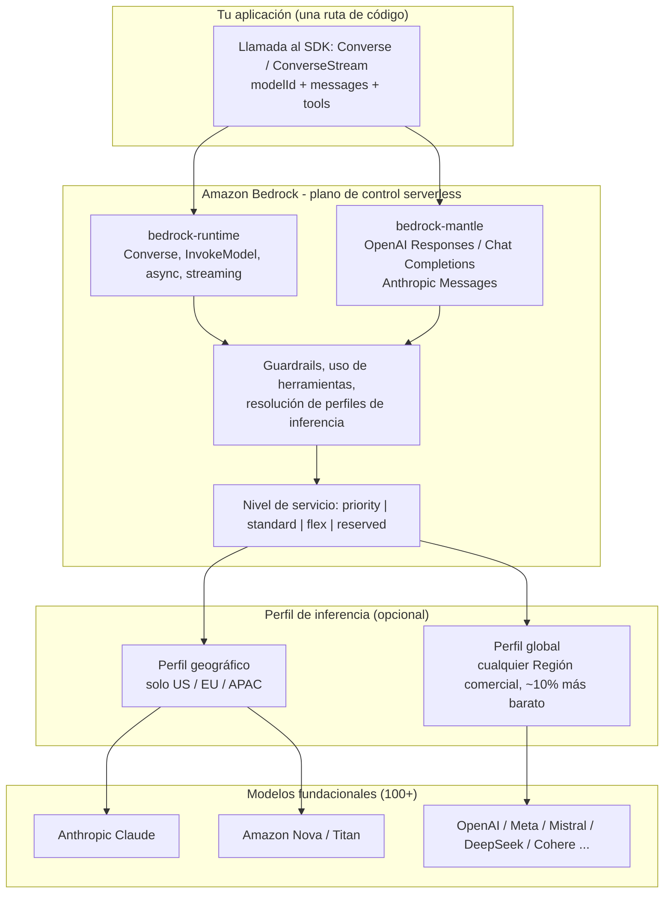
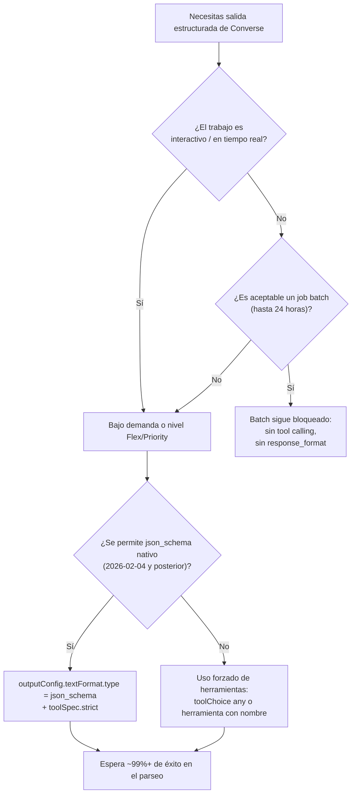
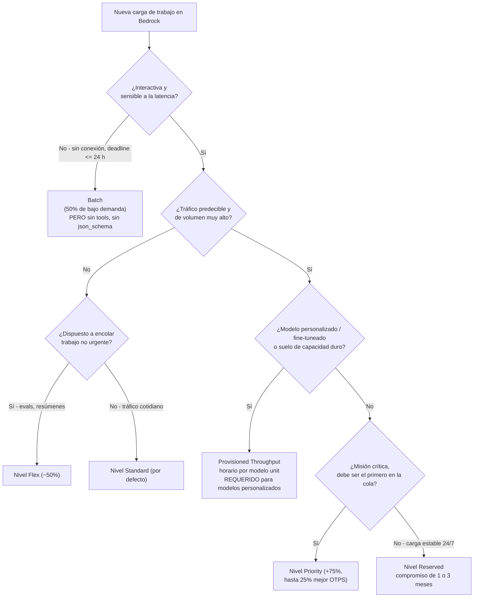
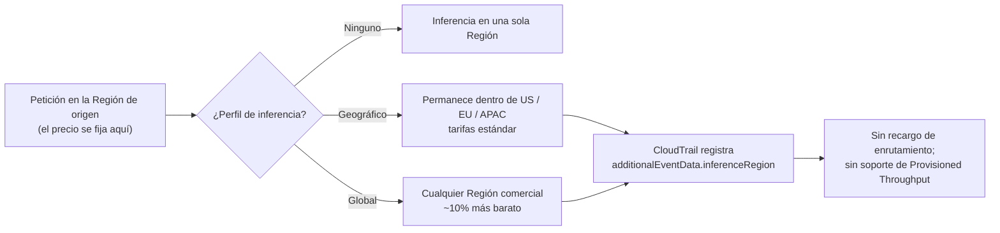
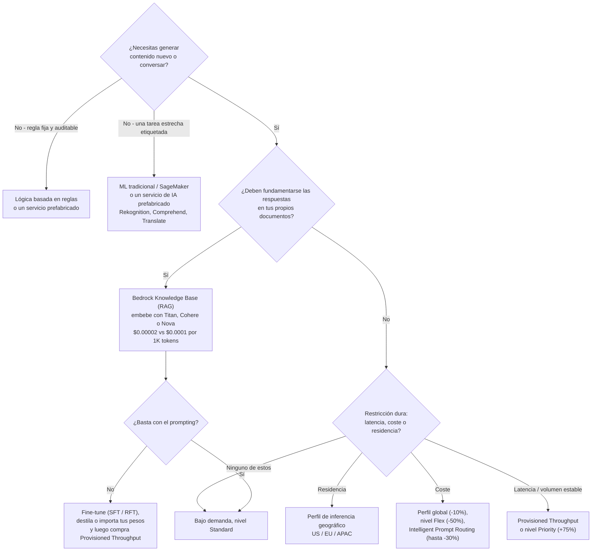
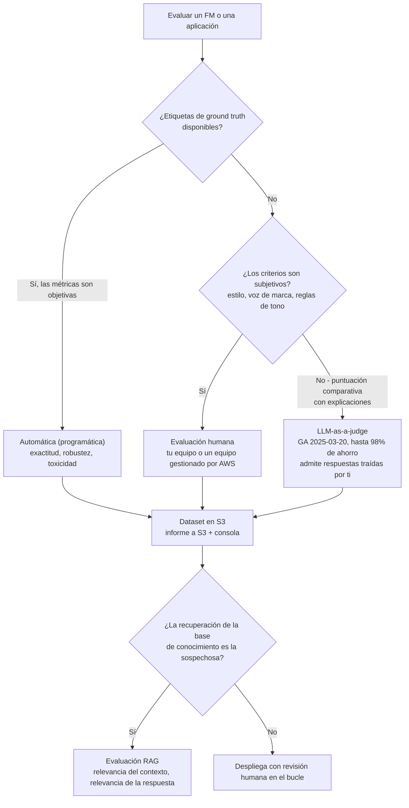

# Fundamentos de Amazon Bedrock: APIs, acceso a modelos, precios, tipos de inferencia y evaluaciones

Amazon Bedrock es el servicio que el examen AIF-C01 nombra más que ningún otro, y también es el servicio que más rápido cambia. Esa combinación es peligrosa: memorizar una lista de modelos o un precio por token es una estrategia de estudio con caducidad de semanas, mientras que memorizar **mecanismos**, cómo se comportan de verdad bajo demanda, batch, Provisioned Throughput, los niveles de servicio y los perfiles de inferencia entre Regiones, sigue siendo correcto durante años. Esta lección está construida alrededor de esa división. Cada cifra de abajo está anclada a una fuente AWS de primera parte en **octubre de 2026**, y todo lo que AWS no confirma se marca en lugar de enseñarse.

```text
====================================================================
 AMAZON BEDROCK DE UN VISTAZO               (Digesto: oct 2026)
====================================================================
  MODELO DE SERVICIO ..... totalmente gestionado, serverless, API única
  CATÁLOGO DE MODELOS .... "100+" modelos fundacionales, 19 proveedores
                           de primera parte (AI21, Amazon, Anthropic,
                           Cohere, DeepSeek, Google, Luma, Meta,
                           MiniMax, Mistral, Moonshot, NVIDIA, OpenAI,
                           Qwen, Stability, TwelveLabs, Writer, xAI,
                           Z.AI)
  ENDPOINTS .............. bedrock-runtime  (Invoke / Converse)
                           bedrock-mantle   (OpenAI Responses + Chat
                           Completions, Anthropic Messages)
  EJES DE PRECIO ......... bajo demanda (por token) · batch (50% de
                           descuento, <=24 h) · provisionado (por hora
                           por modelo unit) · niveles de servicio
                           (priority/standard/flex/reserved) · perfiles
                           entre Regiones
  PERSONALIZACIÓN ........ fine-tuning supervisado · fine-tuning por
                           refuerzo · destilación · importación de
                           modelos
  EVALUACIÓN ............. automática · humana · LLM-as-a-judge
====================================================================
```

> [!NOTE]
> **Cómo leer esta lección.** AWS publica la lista de modelos, los precios y la compatibilidad de funciones de Bedrock de forma continua, así que el examen premia las respuestas de *mecanismo* por encima de las de *disponibilidad*. Tres reglas de lectura aplican durante toda la lección: (1) **la cifra publicada por la propia AWS vence a cualquier rastreador de terceros**; (2) **los porcentajes de marketing se reproducen como afirmaciones de AWS**, etiquetados como tales, porque su metodología no está auditada de forma independiente; y (3) **un hecho que AWS no confirma de primera parte se muestra como no verificado**, nunca como material de memorización.

Al final de esta lección podrás:

- explicar qué significa operativamente «totalmente gestionado, serverless, API única» y nombrar los dos endpoints de Bedrock;
- enunciar las reglas de acceso a modelos de 2026, incluido el formulario de Anthropic que la mayoría de los candidatos olvida;
- elegir entre **bajo demanda, batch y Provisioned Throughput**, y entre los cuatro **niveles de servicio**, usando precio, latencia, compromiso y compatibilidad de funciones;
- elegir el **perfil de inferencia** adecuado para coste frente a residencia de datos y predecir qué registrará CloudTrail;
- recorrer un **árbol de decisión de selección de modelo** y defender una elección con precios por token verificados;
- nombrar las cuatro rutas de personalización y decir cuál requiere Provisioned Throughput;
- seleccionar evaluación **automática, humana o LLM-as-a-judge** para una métrica dada;
- defender el **veredicto comparativo** entre Bedrock, SageMaker autogestionado, un servicio de IA prefabricado y construirlo tú mismo.

---

## 1. Qué es Amazon Bedrock

### 1.1 La definición que usa AWS

Amazon Bedrock es un **servicio totalmente gestionado y serverless que te da una única API para invocar modelos fundacionales de muchos proveedores**. Tres palabras cargan toda la propuesta de valor:

- **Totalmente gestionado**: AWS ejecuta la infraestructura, el escalado y el alojamiento del modelo; nunca ves una instancia, una URL de endpoint ni una GPU.
- **Serverless**: pagas por token (bajo demanda y batch) o por hora (Provisioned Throughput); no hay factura de capacidad ociosa salvo que la compres deliberadamente.
- **API única**: una forma de petición, un SDK, un conjunto de acciones de IAM; cambiar de Anthropic Claude a Amazon Nova es un cambio de `modelId`, no una reescritura.

Esa última propiedad es la frase más examinable de esta lección. Una pregunta que dice *«sin reescribir la lógica de la aplicación»* apunta a la API unificada, y cada otra opción de esa pregunta (enrutamiento entre Regiones, Provisioned Throughput, importación de modelos) es un mecanismo completamente distinto.

### 1.2 El catálogo de proveedores

AWS lista **más de 100** modelos fundacionales sin publicar un recuento exacto. La lista de proveedores de primera parte verificada en octubre de 2026 es:

| Grupo de proveedor | Proveedores en Bedrock |
|---|---|
| **Laboratorios de EE. UU.** | AI21 Labs, Anthropic, Cohere, Google, Meta, NVIDIA, OpenAI, Writer, xAI, Z.AI |
| **Amazon de primera parte** | Amazon (familia Nova, familia Titan, Nova Canvas / Reel / Multimodal Embeddings) |
| **Laboratorios europeos** | Mistral AI (Francia), Stability AI, Luma AI |
| **Laboratorios asiáticos** | DeepSeek, MiniMax, Moonshot AI, Qwen, TwelveLabs |
| **Tus propios pesos** | Custom Model Import (arquitecturas Llama, Mistral, Mixtral, Qwen, GPT-OSS, GPTBigCode) |

> **📚 ¿Sabías que…?** **DeepSeek es compatible oficialmente**: DeepSeek V3.2, V3.1 y R1 aparecen todos en la página *Models at a glance* de AWS, y V3.2 funciona tanto en `bedrock-runtime` como en el endpoint compatible con OpenAI `bedrock-mantle`. Los candidatos que se saltan el catálogo actual suelen asumir que DeepSeek solo está disponible a través de un marketplace o de una pila autogestionada; en el examen, «Amazon Bedrock no aloja DeepSeek» es un distractor por construcción.

### 1.3 Los dos endpoints

Bedrock expone dos endpoints de servicio, y el examen prueba qué operaciones viven en cada uno:

| Endpoint | Operaciones | Propósito | Guía de AWS |
|---|---|---|---|
| **`bedrock-runtime`** | `InvokeModel`, `InvokeModelWithResponseStream`, `Converse`, `ConverseStream`, `StartAsyncInvoke`, `InvokeModelWithBidirectionalStream` | Invocar modelos para inferencia: cargas útiles del proveedor en bruto y la API Converse agnóstica de proveedor | **Recomendado para aplicaciones nuevas** |
| **`bedrock-mantle`** | **Responses** y **Chat Completions** compatibles con OpenAI; **Messages** de Anthropic | Compatibilidad directa: el código existente del SDK de OpenAI o Anthropic funciona contra Bedrock sin cambios | Usar para migrar código de SDK existente |

La distinción importa en la práctica: `bedrock-mantle` existe para que una aplicación escrita para el SDK de OpenAI o Anthropic pueda apuntar a Bedrock con un cambio de URL base y de clave, mientras que `bedrock-runtime` es el hogar de Converse: la API que te da herramientas, Guardrails y paridad multiproveedor en una sola forma de petición.

### 1.4 Arquitectura: una API, muchos modelos



### 1.5 Qué promete AWS sobre tus datos

Dos compromisos aparecen en la visión general de la documentación de Bedrock y ambos tienen forma de examen:

1. **Las entradas y salidas no se comparten con proveedores de modelos de terceros.**
2. **Las entradas y salidas no se usan para entrenar los modelos fundacionales base.** El fine-tuning, en cambio, entrena una **copia privada del modelo que pertenece a tu cuenta**: que es la razón por la que un modelo personalizado es tuyo y por la que se factura de forma distinta.

> **📚 ¿Sabías que…?** La garantía de «no se usa para entrenar los modelos base» es precisamente la razón por la que el fine-tuning se describe como la creación de un *modelo personalizado privado*: tu JSONL etiquetado va a S3, un job de entrenamiento produce un checkpoint que solo tu cuenta puede invocar, y el FM base que usan otros clientes no se toca. El hecho complementario que los candidatos pierden es que **invocar un modelo fine-tuneado supervisadamente requiere Provisioned Throughput**, bajo demanda no lo ejecutará, mientras que **Custom Model Import** (trae tus propios pesos) *sí* puede ejecutarse bajo demanda.

### 1.6 Cuatro cosas que Bedrock no es

Confusiones que producen opciones equivocadas más a menudo que cualquier otro hecho sobre Bedrock:

| Confusión común | Lo que Bedrock realmente es |
|---|---|
| «Bedrock es un modelo como Claude o Nova» | Bedrock es el **servicio gestionado y la API**; Claude, Nova, Llama y el resto son los modelos que aloja |
| «Bedrock despliega mi job de entrenamiento» | El entrenamiento y la gestión de endpoints son **terreno de SageMaker AI**; Bedrock sirve FMs preentrenados (más sus propios jobs de personalización) |
| «Bedrock es un servicio de IA prefabricado como Rekognition» | Los servicios prefabricados responden **una tarea estrecha**; Bedrock es una **API de FM de propósito general** con la que prompteas, fundamentas y personalizas |
| «Usar Bedrock significa que mis prompts van al proveedor del modelo» | Las entradas y salidas **no se comparten con proveedores de terceros** y **no se usan para entrenar los FM base** |

---

## 2. Acceso a modelos: qué desbloquea de verdad una invocación

El acceso a modelos solía ser un opt-in con clic por modelo. En 2026 el flujo es más simple, con **una excepción que todavía tropieza a los candidatos**:

| Paso | Requisito | Alcance |
|---|---|---|
| 1 | **El acceso a modelos está activado por defecto** en las Regiones comerciales de AWS | No se necesita acción para la mayoría de los modelos |
| 2 | Permisos de IAM para AWS Marketplace: `aws-marketplace:Subscribe`, `aws-marketplace:Unsubscribe`, `aws-marketplace:ViewSubscriptions` | Necesarios **solo la primera vez** que activas un modelo proveniente de Marketplace |
| 3 | Un **método de pago válido** en la cuenta | Siempre |
| 4 | **Solicitud Anthropic form-to-use (FTU)** | **Modelos de Anthropic en `bedrock-runtime`**: no se requiere para Anthropic Messages en `bedrock-mantle` |

Después del paso 4, `InvokeModel`/`Converse` tienen éxito; antes, obtienes un error de acceso que parece un problema de IAM y no lo es.

> [!WARNING]
> **No memorices la lista de modelos, memoriza el mecanismo de acceso.** El catálogo de Bedrock, la compatibilidad de funciones por modelo (streaming, herramientas, fine-tuning, Provisioned Throughput) y los precios cambian semanalmente. En el examen, una opción construida sobre *«el modelo X no está disponible en la Región Y»* es casi siempre un distractor caducado. Los hechos duraderos son: **acceso activado por defecto**, **permisos de Marketplace en el primer habilitamiento**, el **formulario Anthropic FTU** y **un método de pago válido**. Cuando una pregunta depende de si un modelo nuevo específico existe, busca una opción que describa un *mecanismo*, eso es casi siempre la respuesta pretendida.

---

## 3. La superficie de la API: Invoke, Converse y los endpoints de compatibilidad

### 3.1 Familias de operaciones

| Familia | Operaciones | Endpoint | Para qué sirve |
|---|---|---|---|
| **Invoke** | `InvokeModel`, `InvokeModelWithResponseStream` | `bedrock-runtime` | **Cargas útiles del proveedor en bruto** de un solo disparo o en streaming: tú construyes el JSON del proveedor |
| **Converse** | `Converse`, `ConverseStream` | `bedrock-runtime` | Messages, tools, Guardrails e inferencia **agnóstica de proveedor** |
| **Chat Completions** | compatible con OpenAI | `bedrock-mantle` | Uso directo del SDK de OpenAI |
| **Responses** | compatible con OpenAI | `bedrock-mantle` | OpenAI Responses API (familias GPT-OSS y GPT) |
| **Messages** | Anthropic Messages | `bedrock-mantle` | El código del SDK de Anthropic funciona contra Bedrock sin cambios |
| **Async** | `StartAsyncInvoke` (subconjunto de modelos) | `bedrock-runtime` | Jobs de larga duración con un destino de callback |
| **Bidireccional** | `InvokeModelWithBidirectionalStream` | `bedrock-runtime` | Sesiones de audio en tiempo real: **no usable con claves de API de Bedrock** |

### 3.2 Parámetros de inferencia de Converse: exactamente cuatro

La `InferenceConfiguration` base de la API Converse contiene **cuatro** parámetros y nada más:

| Parámetro | Tipo / rango | Significado |
|---|---|---|
| `maxTokens` | entero | Máximo de tokens a **generar** |
| `temperature` | 0 to 1 | Aleatoriedad del muestreo: más bajo es más determinista |
| `topP` | 0 to 1 | Corte del muestreo por núcleo |
| `stopSequences` | hasta **2.500** cadenas | La generación se detiene cuando se produce cualquier secuencia |

Los ajustes específicos del modelo (por ejemplo `topK` o el presupuesto `thinking` de un proveedor) van a **`additionalModelRequestFields`**, que se pasa al modelo. Una opción que afirma que Converse expone cinco o seis parámetros base de primera clase está probando si conoces el límite entre la API portable y el escape hatch específico del proveedor.

### 3.3 Streaming

El streaming usa `InvokeModelWithResponseStream` (familia Invoke) o `ConverseStream` (familia Converse), con la acción IAM **`bedrock:InvokeModelWithResponseStream`**. Si un modelo dado puede hacer streaming es comprobable por programa: `GetFoundationModel` devuelve **`responseStreamingSupported`**. Si una pregunta pregunta «¿cómo confirmas la compatibilidad con streaming antes de prometerlo en la UI?», esa bandera es la respuesta.

### 3.4 Uso de herramientas y elección forzada de herramienta

`toolChoice` tiene exactamente tres valores:

| Valor | Comportamiento | Disponibilidad |
|---|---|---|
| `auto` | El modelo decide si llamar a una herramienta (por defecto) | Todos los modelos que admiten herramientas |
| `any` | Debe llamar **al menos a una** herramienta; sin texto libre | Todos los modelos que admiten herramientas |
| `tool` | Debe llamar a **una herramienta concreta con nombre** | Documentado **solo para Anthropic Claude 3+ y Amazon Nova** |

Esa tercera fila es un micro-hecho clásico de examen: forzar una herramienta *con nombre* no es universal, y una opción que lo generaliza a todos los modelos de Bedrock es incorrecta.

### 3.5 Salida estructurada

Existen dos rutas para JSON conforme al esquema:

1. **Uso forzado de herramientas** (`toolChoice: {any: {}}` o `{tool: {name:...}}`): la ruta histórica, porque constreñir el modelo al esquema JSON de una herramienta es estructural en lugar de advisory.
2. **Salida estructurada nativa**: añadida a `Converse`/`ConverseStream` el **2026-02-04** mediante `outputConfig.textFormat.type = "json_schema"` junto con `toolSpec.strict`.

La brecha de fiabilidad es grande y publicada por AWS: una prueba de la comunidad con **102 muestras** en AWS Builder Center encontró que el JSON solo con prompt («devuelve JSON válido») tenía éxito aproximadamente el **70 to 80%** de las veces frente al **99%+** con uso forzado de herramientas. Convierte eso en una cifra operativa: 10.000 documentos de factura con un 70% de éxito solo con prompt significan unos **2.500 análisis y reintentos fallidos**; al 99% significan unos **100**.

**Ejemplo resuelto 1, elegir el mecanismo correcto para 10.000 extracciones estructuradas.** El trabajo necesita JSON estricto, sin interactividad y resultados para la mañana. Respuesta: **Converse bajo demanda o en nivel Flex con `outputConfig.textFormat.type = "json_schema"`**, porque **la inferencia por lotes no admite salida estructurada ni tool calling**, y tampoco admite modelos provisionados. Dos trampas separadas, una pregunta.



> **📚 ¿Sabías que…?** La instrucción de JSON solo con prompt falla por una razón estructural: el modelo está *muestreando*, no validando. Pedirlo cortésmente en el system prompt cambia la probabilidad de que aparezcan llaves; no crea una restricción. El uso forzado de herramientas y la salida `json_schema` funcionan ambos porque hacen que la salida inválida sea **imposible por construcción** más que improbable: que es también la razón por la que la propia guía de fiabilidad de AWS trata el «solo di JSON en el prompt» como una respuesta distractor en toda pregunta de salida estructurada.

### 3.6 Anatomía de la petición: dónde vive cada ajuste

```text
POST /model/<modelId>/converse          <-- bedrock-runtime
  headers: Authorization (SigV4), X-Amz-Target
{
  "modelId": "anthropic.claude-...",      <-- cambia esto para cambiar de modelo
  "system":    [ {"text": "..."} ],       <-- system prompt (a nivel de Bedrock)
  "messages": [ {"role": "user", "content": [...]} ],
  "inferenceConfig": {                    <-- EXACTAMENTE CUATRO params base
      "maxTokens": 1024,
      "temperature": 0.2,
      "topP": 0.9,
      "stopSequences": ["</answer>"]      <-- hasta 2.500 cadenas
  },
  "additionalModelRequestFields": {       <-- extras específicos del proveedor
      "topK": 50, "thinking": {"type": "enabled"}
  },
  "toolConfig": {
      "tools": [{"toolSpec": {"name": "get_weather", ...}}],
      "toolChoice": {"auto": {}}
  },
  "guardrailIdentifier": "...",           <-- se aplica en Bedrock, no en el modelo
  "promptVariables": {...}
}
Response 200  ->  output.message.content,  usage.inputTokens / outputTokens
Streaming      ->  ConverseStream (IAM: bedrock:InvokeModelWithResponseStream)
```

Dos lecturas de esta carga importan en el examen: la **superficie portable** (`system`, `messages`, `inferenceConfig`, `toolConfig`, `guardrailIdentifier`) es la misma para cada proveedor, que es lo que convierte un cambio de proveedor en un cambio de una línea; y **`additionalModelRequestFields` es el escape hatch deliberado** para todo lo específico del proveedor, que es la razón por la que la lista de parámetros base se queda en cuatro sin importar cuántos ajustes exponga un modelo dado.

---

## 4. Precios: cuatro mecanismos y cuatro niveles de servicio

Los precios de Bedrock no son un modelo: son **un par ortogonal de elecciones**: *cómo compras capacidad* (bajo demanda / batch / provisionado) y *qué nivel de servicio aceptas* (priority / standard / flex / reserved).

### 4.1 Los tres mecanismos de capacidad

| Dimensión | **Bajo demanda** | **Batch** | **Provisioned Throughput** |
|---|---|---|---|
| Unidad de precio | por 1M de tokens de entrada / 1M de salida | **50% de bajo demanda** por token | **por hora por modelo unit (MU)** |
| Compromiso | ninguno | ninguno | **plazo de 1 o 6 meses** (algunas opciones horarias sin compromiso) |
| Latencia | tiempo real | **asíncrono, normalmente ≤ 24 h, sin SLA** | tiempo real y predecible |
| Ideal para | picos impredecibles, prototipos | trabajo masivo sin conexión: conjuntos de evaluación, resumen de archivo, clasificación masiva | producción estable de gran volumen; **requerido para modelos personalizados** |
| Tool calling | sí | **no** | sí |
| Salida estructurada | sí | **no** | sí |
| Ejecuta modelos provisionados | n/a | **no** | n/a |
| Facturación | tokens de cada petición | tokens de cada job | **por hora incluso ocioso** |
| Capacidad | compartida entre niveles | cuota de batch separada | unidades de modelo dedicadas (cuota vía AWS Support) |

### 4.2 Los cuatro niveles de servicio (el segundo eje)

`serviceTier` se fija por petición y aplica al tráfico **bajo demanda**:

| Nivel | Valor `serviceTier` | Regla de precio | Cuándo AWS dice usarlo |
|---|---|---|---|
| **Priority** | `priority` | Precio estándar **+75%**, para hasta **25% más de rendimiento de tokens de salida** | Tráfico en tiempo real, orientado al cliente, de misión crítica |
| **Standard** | `default` (u omitido) | Tarifa estándar | Trabajo cotidiano: el valor por defecto |
| **Flex** | `flex` | **−50%**, en cola después de Standard bajo carga | Evaluaciones, resumen, pasos en segundo plano y agénticos |
| **Reserved** | `reserved` | Precio comprometido, plazo de **1 o 3 meses**, el desbordamiento va a Standard | Carga predecible 24/7 que necesita capacidad garantizada |

Las condiciones de entrada del nivel Reserved publicadas por AWS (fuente secundaria: AWS Builder Center) son **≥ 100K tokens de entrada por minuto y ≥ 10K tokens de salida por minuto**, un compromiso de **1 o 3 meses**, **99,5%** de tiempo activo con desbordamiento a Standard.

### 4.3 Ejemplo resuelto 2: aritmética pura bajo demanda

El propio ejemplo de AWS: **Amazon Titan Text Lite** a **$0.0003 por 1K tokens de entrada** y **$0.0004 por 1K tokens de salida**.

$$
\frac{2{,}000}{1{,}000}\times \$0.0003 + \frac{1{,}000}{1{,}000}\times \$0.0004 = \$0.001 \text{ per call}
$$

Con **1.000 llamadas por hora** eso son **$1.00 por hora**. El segundo ejemplo de AWS, **AI21 Jurassic-2 Mid** a $0.0125 por 1K tokens en ambos sentidos, para **10.000 de entrada / 2.000 de salida**:

$$
\frac{10{,}000}{1{,}000}\times \$0.0125 + \frac{2{,}000}{1{,}000}\times \$0.0125 = \$0.15 \text{ per request}
$$

### 4.4 Ejemplo resuelto 3: batch ahorra exactamente el 50%

**Claude 3.5 Sonnet** (Public Extended Access): **$6.00 entrada / $30.00 salida** por 1M de tokens bajo demanda, **$3.00 / $15.00** en batch. Un job de **10M de entrada + 2M de salida**:

| Modo | Cálculo | Total |
|---|---|---:|
| Bajo demanda | $10 \times 6.00 + 2 \times 30.00$ | **$120.00** |
| Batch | $10 \times 3.00 + 2 \times 15.00$ | **$60.00** |
| **Ahorro** | | **$60.00 (50%)** |

La entrega es normalmente **dentro de 24 horas**, y el job **no puede usar tool calling ni salida estructurada**.

### 4.5 Ejemplo resuelto 4: Provisioned Throughput arde uses o no uses la capacidad

La aritmética documentada de AWS para una modelo unit a **$16.20/hora**:

$$
1 \times \$16.20 \times 24 \text{ h} \times 31 \text{ d} = \$12{,}052.80 \text{ per month}
$$

Tarifas horarias publicadas para **Cohere Command** por modelo unit: **$49.50** (sin compromiso), **$39.60** (1 mes, −20%), **$23.77** (6 meses, **−52%**). **Llama 2** 13B/70B provisionado: **$21.18** (1 mes) y **$13.08** (6 meses). La regla de decisión: el provisionado solo gana cuando el coste de las horas ociosas es menor que la capacidad y el ahorro por token que realmente capturas: para Claude, Nova y la mayoría de los modelos modernos AWS no publica tarifas horarias para nada y te pide contactar con el equipo de cuenta.

### 4.6 Ejemplo resuelto 5: aritmética de niveles de servicio

**DeepSeek V3.1** en `ap-southeast-2` tiene un precio de **$0.5974 entrada / $1.7304 salida** por 1M de tokens en el nivel Standard. Aplicando los modificadores documentados:

| Nivel | Entrada por 1M | Salida por 1M | 1M entrada + 1M salida |
|---|---:|---:|---:|
| Standard | $0.5974 | $1.7304 | **$2.33** |
| Priority (+75%) | $1.0455 | $3.0282 | **$4.07** |
| Flex (−50%) | $0.2987 | $0.8652 | **$1.16** |

Envía **10% del tráfico a Priority, 60% a Flex y 30% a Standard** y la mezcla es $0.10 \times 4.07 + 0.60 \times 1.16 + 0.30 \times 2.33 \approx \$1.80$: unos **23% por debajo** del precio todo-Standard de $2.33. La disciplina de niveles, no la elección del modelo, es normalmente la optimización más barata disponible.

### 4.7 Precios de tokens verificados (USD por 1M, Standard / bajo demanda)

| Proveedor | Modelo | Entrada | Salida | Nota |
|---|---|---:|---:|---|
| Anthropic | Claude 3.5 Sonnet | $6.00 | $30.00 | batch $3 / $15; escritura de caché $7.50; lectura de caché $0.60 |
| DeepSeek | DeepSeek V3.2 | $0.62 | $1.85 | Regiones de EE. UU.; $0.74 / $2.22 en Mumbai, São Paulo, Jakarta, Tokio, Estocolmo |
| MiniMax | M2 / M2.1 / M2.5 | $0.30 | $1.20 | Regiones de EE. UU. |
| Mistral AI | Mistral Large 3 | $0.50 | $1.50 | Regiones de EE. UU. |
| Google | Gemma 4 31B / E2B | $0.14 / $0.04 | $0.40 / $0.08 | Regiones de EE. UU. |
| Moonshot AI | Kimi K2.5 | $0.60 | $3.00 | Regiones de EE. UU. |
| NVIDIA | Nemotron 3 Super 120B | $0.18 | $0.78 | Regiones de EE. UU. |
| AI21 Labs | Jamba 1.5 Large / Mini | $2.00 / $0.20 | $8.00 / $0.40 | Regiones de EE. UU. |
| Cohere | Rerank 3.5 | **$2.00 por 1.000 consultas** |: | 1 consulta cubre ≤ 100 fragmentos de documentos |

Precios fijos y horarios que vale la pena conocer: **almacenamiento de modelos personalizados $1.95/mes**, **Titan Text Embeddings V2 $0.00002 por 1K tokens**, **Cohere Embeddings $0.0001 por 1K tokens** (una **brecha de 5×** en el mismo trabajo).



### 4.8 Dos palancas de ahorro más: enrutamiento y caché

**Intelligent Prompt Routing** opera *dentro* de una familia de modelos, Claude Sonnet ↔ Claude Haiku, Nova Pro ↔ Nova Lite, y la página de precios de AWS afirma que puede reducir el coste en **hasta un 30%**. La aritmética detrás de la afirmación es simple: envía los prompts fáciles al hermano barato y conserva los prompts difíciles en el modelo fuerte.

**Ejemplo resuelto 10: aritmética de enrutamiento.** Usa un ancla **verificada**: Claude 3.5 Sonnet a **$6.00 / $30.00** por 1M de tokens. La tarifa por token del hermano **no está publicada en las fuentes verificadas para esta lección**, así que asume un modelo clase Haiku a **$1.00 / $5.00** (ilustrativo) y una mezcla diaria de **10M entrada / 2M salida**:

| Estrategia | Cálculo | Coste diario |
|---|---|---:|
| Todo el tráfico en el modelo fuerte | $10 \times 6.00 + 2 \times 30.00$ | **$120.00** |
| 50% del volumen enrutado al hermano barato | $0.5 \times (10 \times 1.00 + 2 \times 5.00) + 0.5 \times 120.00$ | **$70.00** |
| **Ahorro en esta mezcla** | | **$50.00 (42%)** |

Se siguen dos lecturas. Primero, la afirmación publicada por AWS es **«hasta un 30%»**, que es la cifra conservadora en tráfico real: nunca cites el 42% ilustrativo como una cifra de AWS. Segundo, el enrutamiento es una palanca de *mezcla de tráfico* más que un descuento por petición, que es exactamente lo que lo separa de batch (**−50%** en cada token), del nivel Flex (**−50%** en cada token) y de un perfil global (**−10%** en cada token).

**Prompt caching (Amazon Nova)** es la otra palanca, y sus límites son precisos: un **mínimo de 1.000 tokens** por checkpoint, **como máximo 4 checkpoints** por petición, un time to live de **5 minutos** y un tope de caché de **20.000 tokens**. Los tokens de entrada en caché se facturan a la tarifa de lectura de caché: para Claude 3.5 Sonnet eso es **$0.60 por 1M** frente a **$6.00** sin caché (una **reducción de 10×**), mientras que una *escritura* de caché cuesta **$7.50 por 1M** (una **prima del 25%**). El caching por tanto solo compensa cuando un checkpoint se lee repetidamente dentro de su TTL.

Haz corresponder cada mecanismo de precios con su regla documentada:

```matching
{
  "question": "Haz corresponder cada mecanismo de precios de Amazon Bedrock con su comportamiento documentado:",
  "pairs": [
    {"left": "Inferencia por lotes (batch)", "right": "50% de bajo demanda, asíncrono, normalmente completado en 24 horas"},
    {"left": "Nivel de servicio Flex", "right": "50% por debajo de Standard, en cola después de Standard cuando la demanda es alta"},
    {"left": "Nivel de servicio Priority", "right": "Precio estándar más 75%, para hasta 25% más de rendimiento de tokens de salida"},
    {"left": "Perfil global entre Regiones", "right": "Un 10% más barato aproximadamente, puede procesarse en cualquier Región comercial"},
    {"left": "Provisioned Throughput", "right": "Horario por modelo unit con plazo de 1 o 6 meses, facturado incluso cuando está ocioso"},
    {"left": "Intelligent Prompt Routing", "right": "Hasta un 30% de ahorro al enrutar dentro de una sola familia de modelos"}
  ],
  "explanation": "Cada palanca tiene su propio número y su propio mecanismo: batch es un tipo de job a mitad de precio con una ventana de 24 horas, Flex y Priority son niveles de servicio bajo demanda con -50% y +75%, el perfil global es una opción de enrutamiento que vale unos -10%, Provisioned Throughput es una reserva de capacidad facturada por hora por modelo unit, y el enrutamiento de prompts ahorra hasta un 30% al enviar prompts fáciles a un modelo hermano más barato dentro de la misma familia."
}
```

---

## 5. Inferencia entre Regiones: perfiles, precio y residencia

### 5.1 Perfiles geográficos frente a globales

La inferencia entre Regiones se expresa mediante **perfiles de inferencia**, y hay dos tipos:

| Propiedad | **Perfil geográfico** | **Perfil global** |
|---|---|---|
| Alcance del enrutamiento | Dentro de una sola geografía: **solo US, EU o APAC** | **Cualquier Región comercial de AWS** |
| Precio | Tarifas estándar | **~10% más barato** (entrada y salida) |
| Residencia de datos | Los datos permanecen dentro de la geografía | Puede procesarse en una Región que no hayas habilitado manualmente |
| Recargo | **Ninguno**, el precio siempre sale de la Región de **origen** | **Ninguno**, la misma regla |
| IAM | IAM regional estándar | Necesita IAM con `aws:RequestedRegion: "unspecified"` |
| Uso típico en el examen | Preguntas de **cumplimiento / residencia** | Preguntas de **coste** |

### 5.2 Qué muestra CloudTrail

Las peticiones entre Regiones pueden enrutar a Regiones que **no están habilitadas manualmente en tu cuenta**; los datos permanecen en la red de AWS y se cifran en tránsito. AWS CloudTrail registra dónde ocurrió realmente el trabajo en **`additionalEventData.inferenceRegion`**: que es exactamente la razón por la que una entrada de CloudTrail puede mostrar una Región distinta de la Región de origen de la petición sin implicar un error de facturación. **El precio siempre usa la Región de origen**, así que no hay recargo de enrutamiento.

### 5.3 Dos límites que los candidatos pierden

1. **Los perfiles de inferencia no admiten Provisioned Throughput.** La capacidad reservada por modelo unit y el enrutamiento entre Regiones son mecanismos separados; no puedes combinarlos.
2. **Los perfiles de aplicación existen para el etiquetado de asignación de costes**: un concepto distinto de los perfiles de enrutamiento, usado para atribuir gasto en lugar de situar cómputo.

**Ejemplo resuelto 6: economía entre Regiones.** Un perfil geográfico como `us.amazon.nova-lite-v1:0` mantiene el procesamiento dentro de Estados Unidos a tarifas estándar. Un perfil **global** es aproximadamente **10% más barato** pero puede ejecutarse en cualquier Región comercial. Para una carga de trabajo financiera de la UE la elección la decide la residencia, no el precio: elige el perfil **geográfico (EU)** y acepta la tarifa más alta.



> **📚 ¿Sabías que…?** El **descuento del ~10% del perfil global** y la regla del **«precio desde la Región de origen»** apuntan en direcciones opuestas y ambas son ciertas: tu factura se calcula con la lista de precios de tu Región de origen, pero las tarifas del pool global se publican aproximadamente un 10% más bajas, de modo que enrutar globalmente ahorra dinero sin una línea de recargo. Mientras tanto **Intelligent Prompt Routing**, una función completamente distinta, puede reducir el coste en **hasta un 30%** al enrutar dentro de una familia de modelos (Claude Sonnet ↔ Claude Haiku, Nova Pro ↔ Nova Lite). Tres palancas de ahorro separadas, tres mecanismos distintos: batch (−50%), nivel Flex (−50%), perfil global (−10%), enrutamiento de prompts (hasta −30%).

---

## 6. Elegir un modelo: el árbol de decisión que AWS realmente enseña

### 6.1 El árbol de decisión



### 6.2 Matriz verificada de proveedor × modelo

| Proveedor | Modelos verificados en Bedrock | runtime | mantle | Personalización |
|---|---|---|---|---|
| **Amazon** | Nova 2 Lite / 2 Sonic / Pro / Lite / Micro / Premier, Nova Canvas, Nova Reel, Nova Multimodal Embeddings; Titan Text / Image / Embeddings | Sí | parcial | **SFT + RFT (Nova 2 Lite)**; imagen/embedding de Titan |
| **Anthropic** | Claude Sonnet 5.5, Opus 5.5, Fable 5.1/5, Mythos 5.1/5, Opus 5, Sonnet 5; Claude 3.5 Haiku, Claude 3 Haiku | Sí | Sí (Messages) | no documentado |
| **OpenAI** | familia GPT-6, GPT-6.1 Sol, familia GPT-5.x, **gpt-oss 20B/120B**, GPT-OSS Safeguard | Sí | Sí (Responses/Chat) | **RFT en `openai.gpt-oss-20b`** |
| **Meta** | Llama 4, 3.3, 3.2, 3.1, 3, 2 | Sí |: | **SFT: 3.1 8B/70B, 3.2 1B/3B/11B-V/90B-V, 3.3 70B-V** |
| **Mistral AI** | Mistral Large 3, Mistral Small, Ministral 3B/8B/14B, Magistral Small, Devstral 2, Pixtral Large, Voxtral, Mixtral 8x7B, Mistral 7B | Sí | Sí (Chat) | importar arquitecturas Mistral/Mixtral |
| **Cohere** | Command R, Command R+, Embed English/Multilingual/v4, **Rerank 3.5** | Sí |: | **SFT: Command, Command Light** |
| **AI21 Labs** | Jamba 1.5 Large, Jamba 1.5 Mini | Sí |: | Jamba 1.5 Mini listado |
| **DeepSeek** | **V3.2, V3.1, R1** | Sí | solo V3.2 / V3.1 |: |
| **Google** | Gemma 4 (31B, 26B-A4B, E2B), Gemma 3 (12B, 27B, 4B) | Gemma 3 | **Gemma 4 es solo mantle** |: |
| **Qwen** | Qwen3 235B A22B, Qwen3 32B, Qwen3 Next 80B, Qwen3 Coder, Qwen3 VL | Sí | Sí | **RFT en `qwen.qwen3-32b`** |
| **Moonshot / MiniMax / NVIDIA / xAI** | Kimi K3/K2.5, familia M2, Nemotron 3 / Nano 3, Grok 4.7/4.6/4.3 | Sí | algunos |: |
| **Tu modelo** | **Custom Model Import**: Llama 2/3/3.1/3.2/3.3, Mistral, Mixtral, Qwen2/2.5/3, GPT-OSS, GPTBigCode | Sí |: | pesos < 200 GB texto / < 100 GB multimodal, contexto < 128K |

### 6.3 Ejemplo resuelto 7: mismo trabajo, 5× de coste de embeddings

Un blog de AWS calculó una ingesta RAG de un **documento de 5M de tokens** más **0,5M de tokens de consulta** = **5,5M de tokens**:

| Modelo de embeddings | Tarifa por 1K tokens | Coste para 5,5M de tokens |
|---|---:|---:|
| Amazon Titan Text Embeddings V2 | $0.00002 | **$0.11** |
| Cohere Embeddings | $0.0001 | **$0.55** |

Mismo corpus, mismo trabajo, **una diferencia de 5×**: que es la razón por la que la elección del modelo de embeddings, y no solo la del LLM, pertenece a una pregunta de coste.

### Novedades de 2025 to 2026

Las secciones 6.1 to 6.3 enseñan un *proceso* de decisión que sobrevive a la rotación del catálogo; este subapartado registra qué rotó realmente entre finales de 2025 y octubre de 2026, para que una lista de modelos caducada nunca se convierta en una respuesta incorrecta. Cada fila de abajo está verificada contra una publicación What's New de AWS, una página de documentación de AWS, la página de precios de Bedrock o un blog de AWS: nada aquí viene de un rastreador de terceros.

**Cambios de catálogo (verificados):**

| Cambio | Fecha verificada | Lo que AWS publicó | Fuente |
|---|---|---|---|
| **Familia Amazon Nova 2** | re:Invent 2025, **1 to 4 dic 2025** | **Nova 2 Lite** (contexto de 1M, code interpreter, web grounding, MCP remoto), **Nova 2 Sonic** speech-to-speech **GA el 2 dic 2025** (`amazon.nova-2-sonic-v1:0`, 7 idiomas), **Nova 2 Omni** **vista previa el 2 dic 2025** (texto/imagen/vídeo/voz de entrada → texto e imagen de salida, más de 200 idiomas de texto), **Nova 2 Pro** *early access* (GA sin confirmar), **Nova Forge** para entrenamiento personalizado; los modelos Nova de primera generación siguen listados | AWS What's New y AWS Blog |
| **Claude Sonnet 4.6** | **17 feb 2026** | ventana de contexto de **1M**, salida máxima de **64K**, corte de entrenamiento ago 2025 | Ficha del modelo en Bedrock `model-card-anthropic-claude-sonnet-4-6` |
| **Seis modelos de pesos abiertos en Project Mantle** | **1 feb 2026** | DeepSeek V3.2, MiniMax M2.1, GLM 4.7 / 4.7 Flash, Kimi K2.5 y Qwen3 Coder Next servidos a través del endpoint Mantle compatible con OpenAI, junto a los **18** modelos de pesos abiertos añadidos en re:Invent 2025 | AWS What's New |
| **OpenAI GPT-6 Astra** | **GA el 8 sep 2026** | contexto de **1M**, uso de ordenador y navegador | AWS What's New |
| **GLM 5.3 (Z.AI)** | **GA el 5 oct 2026** | **753B** de parámetros totales / **40B** activos, contexto de **1M**, salida de **128K** | AWS What's New |
| **Política de ciclo de vida de modelos de Bedrock** | vigente desde el **7 sep 2026** | **Active → Legacy → EOL**; la mayoría de los modelos reciben una ventana **Legacy** de **6 meses** (existe una variante de **45 días**); **Legacy bloquea clientes nuevos y Provisioned Throughput nuevo**, mientras el uso existente continúa | Guía de usuario de Bedrock `model-lifecycle` |

**Cambios de capacidad (verificados):**

| Capacidad | Fecha verificada | Qué añade |
|---|---|---|
| **Guardrails: seis políticas + `ApplyGuardrail`** | Automated Reasoning checks en vista previa el **3 dic 2024**; `ApplyGuardrail` y salvaguardas entre cuentas desde entonces | moderación de contenido, detección de ataques a prompts, temas denegados, filtros de PII/información sensible, contextual grounding y **Automated Reasoning checks**: más una API que aplica salvaguardas a *cualquier* modelo **sin invocar un FM**, y un guardrail aplicado en una AWS Organization. AWS afirma **hasta un 88%** de contenido dañino bloqueado y **99%** de exactitud de Automated Reasoning |
| **Bedrock AgentCore** | vista previa **16 jul 2025** → GA **13 oct 2025** → **Policy GA el 3 mar 2026** → **Evaluations GA el 31 mar 2026** | runtime, gateway, memoria y herramientas para agentes; Policy (Cedar o lenguaje natural) intercepta las llamadas a herramientas del Gateway *fuera* del bucle de razonamiento; Evaluations incluye **13** evaluadores |
| **Crecimiento de Knowledge Bases** | 2025 to 2026 | reranking, conectores personalizados, ingesta directa, **evaluación RAG con LLM-as-a-judge**, perfiles de inferencia dentro de `RetrieveAndGenerate`, **S3 Vectors** y **Bedrock Managed Knowledge Base** (Smart Parsing + Agentic Retrieval API) documentado como el camino tras el cierre de **Amazon Kendra** a nuevos clientes el **30 jul 2026** |
| **Palancas de precios** | 2025 to 2026 | **Intelligent Prompt Routing facturado a $1 por cada 1.000 peticiones** (hasta **30%** más barato); lecturas de caché de prompt **−90%** (Claude/GPT) o **−75%** (Nova) con **escrituras a 1,25×** en el TTL de 5 minutos (2× en el TTL de 1 hora), y **el caching nunca se combina con batch** |
| **Guía del examen v1.1** | **30 abr 2026** | nuevos objetivos: precios basados en tokens (**2.1.4**), ingeniería de contexto (**2.1.5**), IA agéntica con **MCP** (**2.1.6**), versionado de prompts mediante **Bedrock Prompt Management** (**3.2.5**), destilación (**3.1.5**), **LLM-as-a-judge** (**3.4.2**) y grounding de alucinaciones (**5.1.5**); AWS dice que los cambios de la guía llegan al examen aproximadamente un mes después de su publicación |

**Lo que *no* cambió:** cada mecanismo de esta lección se comporta como está escrito: la API Converse única y sus **cuatro** parámetros base, batch al **50%** sin tool calling y sin salida estructurada, Provisioned Throughput facturado **por hora por modelo unit**, la escalera de niveles **+75% / default / −50%** con plazo de **1 o 3 meses**, los perfiles geográficos para residencia frente a los perfiles globales a **~10%**, y los tres modos de evaluación sobre un dataset en **S3**. El catálogo es la parte que se mueve; la mecánica es la parte en la que se te examina.

> **📚 ¿Sabías que…?** La política de ciclo de vida convierte el consejo de esta lección de «no memorices la lista de modelos» en una regla de *facturación*: porque un modelo **Legacy** rechaza los pedidos **nuevos** de Provisioned Throughput, un equipo que fije capacidad a un modelo el día antes de que salga de Active puede quedar bloqueado exactamente de la sección de compromiso que el 4.5 dice que necesitan los cargas fine-tuneados y de estado estable: mientras sus unidades de modelo existentes siguen funcionando. Por eso una opción de examen que nombre un modelo concreto como «disponible» o «no disponible» es casi siempre un distractor, y por eso las respuestas duraderas son mecanismos: acceso activado por defecto, permisos de Marketplace en el primer habilitamiento, el formulario Anthropic FTU, un método de pago válido.

---

## 7. Personalización: cuatro caminos y la regla del Provisioned Throughput

| Camino | Qué hace | Entrada | Cifras clave |
|---|---|---|---|
| **Fine-tuning supervisado (SFT)** | Entrena una copia privada sobre ejemplos etiquetados | JSONL etiquetado en **S3** | Modelo personalizado privado; **requiere Provisioned Throughput para invocarlo** |
| **Fine-tuning por refuerzo (RFT)** | Aprende de señales de recompensa hacia un comportamiento objetivo | Datos de preferencia / recompensa | Lanzado en **dic 2025** sobre **Nova 2 Lite** con **~66% de mejora media de exactitud**; **2026-02-17** añadió **`qwen.qwen3-32b`** y **`openai.gpt-oss-20b`** con APIs compatibles con OpenAI |
| **Destilación** | Un modelo profesor produce datos de entrenamiento para un alumno más pequeño | Salidas del profesor | AWS afirma entrenamiento **500% más rápido / 75% más barato** frente a un entrenamiento completo (afirmación de AWS) |
| **Custom Model Import** | Sirve **tus propios pesos** de forma serverless | Artefactos del modelo (< 200 GB de texto / < 100 GB multimodal, contexto < 128K) | Puede ejecutarse **bajo demanda**; almacenamiento **$1,95/mes** |

**Ejemplo resuelto 8: coste del fine-tuning, el propio ejemplo de imagen de AWS.** Amazon Titan Image Generator a **$0.005 por imagen**, **500 pasos**, **tamaño de lote 64**:

$$
\$0.005 \times 500 \times 64 = \$160.00
$$

más **$1,95/mes** de almacenamiento del modelo personalizado y **1 hora** de inferencia personalizada a **$21.00** suman **$182.95 en el primer mes**.

> [!WARNING]
> **«Modelo con fine-tuneado + bajo demanda» es siempre el emparejamiento equivocado.** Un modelo con fine-tuning supervisado debe servirse con **Provisioned Throughput**, que factura **por hora por modelo unit incluso ocioso**. La excepción es **Custom Model Import**, que puede ejecutarse bajo demanda. Las preguntas que ofrecen «hacer fine-tune al modelo y seguir pagando por token bajo demanda» están probando exactamente este límite, y las que ofrecen el fine-tuning como *primer* paso de una tarea de preguntas y respuestas fundamentadas en documentos están probando el espectro de personalización de la Lección 8: **primero vienen el prompting y el RAG**, porque la mayoría de las cargas de trabajo nunca necesitan un modelo personalizado.

### 7.1 Caché de prompts (Amazon Nova)

| Ajuste | Valor |
|---|---|
| Segmento mínimo cacheable | **1.000 tokens** por checkpoint |
| Máximo de checkpoints por petición | **4** |
| Time to live | **5 minutos** |
| Tope de tamaño de caché | **20.000 tokens** |

---

## 8. Evaluaciones: tres modos, una ubicación de dataset

### 8.1 Los tres modos

| Método | Modo de job | Métricas integradas | Quién puntúa | Entrada → salida |
|---|---|---|---|---|
| **Automática (programática)** | `automated` + `taskType` | **exactitud, robustez, toxicidad** | Rúbricas gestionadas por AWS | Dataset en **S3** → informe en S3 + consola |
| **Humana** | job de tipo humano | Personalizadas: relevancia, estilo, voz de marca | **Tus empleados** *o* un **equipo gestionado por AWS** | Prompts + referencias en S3 → informe en S3 + portal del equipo de trabajo |
| **LLM-as-a-judge** | `automated` + `evaluatorModelConfig` | Exactitud, completitud, dañinidad, rechazo, tono + personalizadas | Un **modelo juez** | Tus prompts **o tus propias respuestas** → puntuaciones, explicaciones, histograma |
| **Evaluación RAG** | job separado de base de conocimiento (incluido modo solo-recuperación) | Relevancia del contexto, exactitud, relevancia de la respuesta | Modelo juez | KB + dataset → informe en S3 |

**Tipos de tarea automáticos:** generación general, resumen, preguntas y respuestas, clasificación de texto.
**Modelos juez disponibles:** Nova Pro / 2 Lite / Micro / Premier, Claude 3.5 Sonnet v1/v2, Claude Opus 4.7/4.8, Claude Sonnet 4.0/4.5, Llama 3.1 70B, Mistral Large.

LLM-as-a-judge alcanzó **GA el 2025-03-20** y AWS afirma **hasta un 98% de ahorro de costes** con resultados en **horas en lugar de semanas**. También ofrece **respuestas de inferencia traídas por ti (bring-your-own)**, de modo que puedes puntuar salidas de modelos que ni siquiera están alojados en Bedrock.

### 8.2 Ejemplo resuelto 9: qué evaluación, qué métrica

| Requisito | Modo correcto | Por qué fallan los demás |
|---|---|---|
| Exactitud y toxicidad contra ground truth, sin etiquetado manual | **Automática (programática)** | Los modelos juez son subjetivos; la evaluación humana cuesta tiempo; el enrutamiento no tiene relación |
| Alineación con la voz de marca y el estilo | **Humana** (tus revisores o un equipo gestionado por AWS) | Las métricas automáticas no tienen rúbrica de voz de marca; un juez necesitaría una métrica personalizada que todavía no confías |
| Puntuación barata de primera pasada de 5.000 respuestas, queriendo explicaciones | **LLM-as-a-judge** | La evaluación humana es demasiado lenta; las métricas automáticas no explican *por qué* |
| Calidad de recuperación de una base de conocimiento | **Evaluación RAG** (el modo solo-recuperación aísla la recuperación) | Las evaluaciones de generación pura confunden recuperación y generación |



> **📚 ¿Sabías que…?** La función de **respuestas de inferencia traídas por ti** de LLM-as-a-judge convierte en silencio las Evaluaciones de Bedrock en una capa de calidad *multiplataforma*: envías producidas por cualquier modelo, incluidos los que se ejecutan fuera de AWS, y un juez de Bedrock los puntúa con una explicación y un histograma de puntuaciones escrito en S3. Por eso «la evaluación debe ejecutarse en el mismo proveedor que el modelo evaluado» es un distractor: AWS construyó explícitamente lo contrario.

---

## 9. Veredicto comparativo

> [!IMPORTANT]
> **Veredicto comparativo: Amazon Bedrock frente a SageMaker autogestionado frente a un servicio de IA prefabricado frente a construirlo tú mismo**
> - **Amazon Bedrock** es la respuesta cuando quieres **modelos fundacionales preentrenados a través de una única API serverless** con **gestión de infraestructura mínima**. Obtienes más de 100 FMs de 19 proveedores, precios bajo demanda/batch/provisionado, perfiles entre Regiones, niveles de servicio, Knowledge Bases, Agents, Guardrails, Prompt Flows y Evaluaciones, y nunca gestionas una GPU, un endpoint ni una política de escalado. Sus límites: no puedes ver ni controlar el cómputo subyacente, los modelos provisionados exigen un compromiso, y algunos FMs (**Claude, Jurassic y otros modelos exclusivos de Bedrock**) solo existen en él.
> - **SageMaker AI autogestionado (incluido JumpStart)** es la respuesta cuando necesitas **control total sobre el entrenamiento, el despliegue y la infraestructura**: cómputo granular, bucles de entrenamiento propios, cualquier framework, políticas de escalado de endpoints y monitorización. Es **primordialmente serverful**: despliegas a un endpoint y pagas por hora de instancia (aparte de Serverless Inference). Sus límites: necesitas habilidades de ML/infra funcionales, eres dueño de la disponibilidad del endpoint, y la economía por token es más difícil de razonar.
> - **Un servicio de IA prefabricado** (Rekognition, Comprehend, Translate, Transcribe, Textract, Polly, Kendra) es la respuesta cuando la tarea es **estrecha, bien definida y no generativa**: detectar objetos en imágenes, detectar entidades en texto, traducir, transcribir. Es lo más barato y rápido hasta producción, totalmente determinista para una entrada dada, pero no se le puede promptear, fine-tunear en un modelo conversacional ni componer en un agente de varios pasos.
> - **Construirlo tú mismo (modelos de código abierto autogestionados en tu propio cómputo)** es la respuesta solo cuando **ninguna opción alojada es aceptable**: control total del precio a volumen estable muy alto, o datos/pesos que no pueden salir de tu perímetro. Te cuesta todo lo que Bedrock elimina: parches, escalado, cuantización, frameworks de servido, seguridad, actualizaciones de modelos y la gente que hace todo eso.
> - **Regla práctica para el examen:** *necesitas un modelo fundacional con la mínima infraestructura* → **Bedrock**. *Necesitas entrenar y ser dueño del modelo y del endpoint* → **SageMaker AI**. *Necesitas una única tarea estrecha no generativa* → **servicio de IA prefabricado**. *Necesitas modelos sin ningún proveedor gestionado* → **construirlo tú mismo**. La guía de decisión de AWS lo dice claramente: *«Elige Bedrock si principalmente necesitas FMs preentrenados para inferencia y quieres el FM que mejor se adapte a tu caso de uso»* y *«Usa SageMaker cuando necesites control total sobre el entrenamiento, el despliegue y la infraestructura.»*

| Dimensión | **Amazon Bedrock** | **SageMaker AI autogestionado (JumpStart)** | **Servicio de IA prefabricado** | **Construirlo tú mismo en tu propio cómputo** |
|---|---|---|---|---|
| Modelo de servicio | **Serverless**, solo API, totalmente gestionado | Endpoints **primordialmente serverful** (más Serverless Inference) | Totalmente gestionado, por llamada | Tú ejecutas los servidores |
| Audiencia | Desarrolladores que construyen apps GenAI vía API | Científicos de datos / ingenieros de ML | Cualquier desarrollador | Ingenieros de ML/infra |
| Control de infraestructura | ninguno necesario | **granular**: cómputo, escalado, monitorización | ninguno | total |
| Origen de modelos | FMs curados de 19 proveedores + Custom Model Import | FMs públicos + propietarios, **selección más amplia**, más modelos entrenados | curados por AWS, capacidad fija | cualquier cosa que puedas servir |
| Modelos exclusivos | **Claude, Jurassic, otros FMs exclusivos de Bedrock** |, |, | depende de la licencia |
| Despliegue | `modelId` serverless, sin paso de despliegue | `deploy()` a un endpoint | llamada a API del servicio | construir un stack de servido |
| Modelo de coste | **por token** o **por hora por modelo unit** | **por hora de instancia** (serverless: por inferencia) | por llamada / por página / por minuto | hardware + personas |
| Funciones GenAI integradas | Agents, Knowledge Bases, Guardrails, Prompt Flows, Evaluations, Routing, Destilación, Búsqueda web | Evaluaciones Clarify, Canvas, Pipelines, Feature Store | solo las específicas de la tarea | constrúyelas tú mismo |
| Interoperabilidad | endpoints de JumpStart marcados **«Bedrock Ready»** pueden **registrarse en Bedrock** | endpoint de Studio → «Usar con Bedrock» | n/a | n/a |
| Elígelo cuando | FMs preentrenados, mínima infraestructura | control total sobre entrenamiento/despliegue/infraestructura | una única tarea estrecha no generativa | ninguna opción alojada es aceptable |

---

## 10. Trampas de examen para esta lección

> [!WARNING]
> **Las trampas que restan puntos en este material exacto:**
> 1. **La API única/Converse es la respuesta del «sin reescribir»**: cambiar `modelId` es el mecanismo; el Provisioned Throughput, los perfiles entre Regiones y la importación de modelos son tres mecanismos distintos.
> 2. **Batch = 50% de descuento, ≤ 24 h, sin SLA, sin tool calling, sin salida estructurada, sin modelos provisionados.** Cualquier opción que conceda a batch una función que le falta es incorrecta por construcción.
> 3. **Priority es +75% (para hasta un 25% mejor OTPS), Flex es −50%, el perfil global entre Regiones es ~10%, batch es 50% e Intelligent Prompt Routing es hasta 30%.** Cuatro palancas de ahorro, cuatro números distintos: nunca los mezcles.
> 4. **Provisioned Throughput factura por hora incluso ocioso, se mide en modelos unit y es obligatorio para los modelos con fine-tuning.** Los perfiles de inferencia **no** lo admiten.
> 5. **El precio entre Regiones usa la Región de origen; CloudTrail registra la Región de procesamiento en `additionalEventData.inferenceRegion`.** Sin recargo de enrutamiento.
> 6. **Perfiles geográficos = residencia (US/EU/APAC); perfiles globales = coste (cualquier Región comercial).** Una pregunta de residencia de datos que apunta al perfil global más barato es un distractor.
> 7. **Anthropic necesita un formulario FTU en `bedrock-runtime`**; el acceso a modelos está activado por defecto y los permisos de Marketplace solo se usan en el primer habilitamiento.
> 8. **Converse tiene exactamente cuatro parámetros base**, `maxTokens`, `temperature` (0 to 1), `topP` (0 to 1), `stopSequences` (≤ 2.500), todo lo demás va en `additionalModelRequestFields`.
> 9. **`toolChoice: {tool: ...}` está documentado solo para Anthropic Claude 3+ y Amazon Nova.**
> 10. **Métricas objetivas → evaluación automática; métricas subjetivas → evaluación humana; puntuación barata con explicaciones → LLM-as-a-judge** (hasta un 98% más barato, GA 2025-03-20).
>
> Y una marca de «no memorices»: **los precios horarios de Provisioned Throughput para Claude, Nova y la mayoría de los modelos modernos no están publicados**: AWS dice que contactes con el equipo de cuenta. Del mismo modo, **la inferencia optimizada para latencia** sigue etiquetada como *vista previa, sujeta a cambios*, y el **recuento exacto de modelos** nunca se publica (solo «100+»). No gastes tu presupuesto de memorización en ninguno de los dos.

---
MDEOF
wc -l content/courses/aws-aif-c01/es/09-bedrock-foundations.md

## Casos Reales

Las secciones 1 to 10 construyen los mecanismos; las historias de clientes publicadas por AWS muestran a qué mecanismo recurrió realmente un equipo real, y con qué cifras. Todo lo siguiente se cita del caso de estudio de AWS o de la publicación del AWS Machine Learning Blog nombrados en la columna Fuente, consultados el 6 de octubre de 2026. Todas estas cifras son afirmaciones del cliente o de AWS y no están auditadas, y cuando una fuente dice «hasta», léelo como un techo, no como una expectativa.

### Casos de un vistazo: servicios, cifras, fuentes

| # | Cliente (industria, año) | Servicios de Bedrock nombrados por AWS | Resultado documentado | Fuente |
|---|---|---|---|---|
| 1 | **Epilot** (software energético, 2026) | **Bedrock (Claude Sonnet)**, **Bedrock Evaluations**, Amazon SQS, AWS Lambda, **Región de la UE** | tiempo de manejo **−87%**, **55.000** resúmenes/mes, MVP en **2 meses**, **80%** de usuarios dice que simplifica el trabajo | `solutions/case-studies/epilot-genai-case-study` |
| 2 | **Bynder** (gestión de activos digitales, 2025) | **Bedrock** con **Amazon Titan Multimodal Embeddings** | tiempo de búsqueda **−75%**, unos **+50%** de resultados por búsqueda; **175 M** de activos / **18 PB** / **4.000** clientes | `solutions/case-studies/bynder-bedrock-case-study` |
| 3 | **Nippon India** (servicios financieros, 2025) | **Bedrock Knowledge Bases**, **Bedrock Guardrails**, Claude 3 Sonnet, reranker | exactitud **+>95%**, alucinación **−90 to 95%**, informes **2 días → ~10 minutos** | ML Blog `how-nippon-india-mutual-fund-improved-the-accuracy-of-ai-assistant-responses-using-advanced-rag-methods-on-amazon-bedrock` |
| 4 | **Adobe** (software, 2025) | **Bedrock Knowledge Bases**, **Titan Text Embeddings V2**, Amazon OpenSearch Service, **API Retrieve** | exactitud de recuperación **+20%** en el propio conjunto de pruebas de Adobe; ganó el troceado de 400 tokens / 20% de solape | ML Blog `adobe-enhances-developer-productivity-using-amazon-bedrock-knowledge-bases` |
| 5 | **Prime Focus Technologies** (medios, 2025) | **Bedrock** + agentes de **AWS Lambda** sobre CLEAR (**14 M+** de activos) | coste **−20 to 30%**, exactitud **+20 to 30%**, tiempo de respuesta **−30 to 40%**; las APIs externas de LLM eran demasiado lentas para el etiquetado en vivo | `solutions/case-studies/prime-focus-case-study` |
| 6 | **Alnylam** (biotecnología, 2025) | **Bedrock**, **Amazon S3**, RAG, Amazon Q Business | triaje **3 to 4 días → horas**, búsqueda **15 min → 30 s**, **3.000** usuarios, **250+** casos de uso | `solutions/case-studies/alnylam-case-study` |

**Expediente de caso 1: Epilot: elige el modelo con Bedrock Evaluations antes de producción.** Software energético de Colonia que resume largas cadenas de correos de clientes para más de 170 empresas de servicios públicos. La cadena es API → **Amazon SQS** → **AWS Lambda** → **Amazon Bedrock (Claude Sonnet)**, y el modelo se seleccionó con **Amazon Bedrock Evaluations** (valoraciones humanas entre versiones de prompt) y no por preferencia; un agente posterior escribe registros **con verificación humana**. Resultados: tiempo de manejo **−87%**, **55.000 resúmenes al mes** con una tasa de fallo despreciable, **80%** de usuarios diciendo que simplifica su trabajo, un MVP en **2 meses** y los datos procesados mantenidos en una **Región de la UE**. Ángulo de examen: aquí los modos de evaluación de la §8 se usan como *verdugo/gate*, y la pregunta de residencia de la §5 se responde por adelantado en lugar de tras el lanzamiento. Fuente: `aws.amazon.com/solutions/case-studies/epilot-genai-case-study` (indexado en julio de 2026).

**Expediente de caso 2, Bynder: los embeddings son una característica de producto, no solo una línea de coste.** Bynder gestiona **175 millones de activos / 18 petabytes** para **4.000 empresas**, y la búsqueda por texto no puede expresar «encuéntrame más como este». Las imágenes y las consultas se vectorizan con **Amazon Titan Multimodal Embeddings en Bedrock** para búsqueda visual y contextual por similitud. Resultados: tiempo de búsqueda **−75%** y aproximadamente **+50%** de resultados utilizables por búsqueda. Ángulo de examen: la aritmética de embeddings de la §6.3 usa la misma tabla de precios que hace que Titan Text Embeddings V2 sea **5×** más barato que los embeddings de Cohere, y los embeddings multimodales añaden un eje de búsqueda *visual* que un modelo de embeddings solo texto ni siquiera puede precificar. Fuente: `aws.amazon.com/solutions/case-studies/bynder-bedrock-case-study` (2025).

**Expediente de caso 3, Nippon India: la mejora vino de la ingeniería de recuperación, no de un modelo más grande.** El RAG ingenuo se degradaba a medida que crecía el volumen de documentos y producía alucinaciones. La solución: interpretación con **FM como parser**, reformulación de consultas, **RAG multi-consulta**, modelos **reranker**, **GraphRAG** y filtrado por metadatos en **Bedrock Knowledge Bases**, más **Bedrock Guardrails** y citas. Resultados: exactitud **+>95%**, alucinación **−90 to 95%**, generación de informes **2 días → ~10 minutos**. Ángulo de examen: la **evaluación RAG** de la §8 existe precisamente para separar un fallo de recuperación de un fallo de generación, y AWS señala que cada técnica anterior es una característica GA de producto, no código exclusivo del cliente. Fuente: AWS Machine Learning Blog, 29 jul 2025, `aws.amazon.com/blogs/machine-learning/how-nippon-india-mutual-fund-improved-the-accuracy-of-ai-assistant-responses-using-advanced-rag-methods-on-amazon-bedrock`.

**Expediente de caso 4: Adobe: el troceado y la elección de embeddings deciden la exactitud del RAG.** Miles de desarrolladores obtenían resultados de búsqueda documental débiles. Adobe comparó cuatro estrategias de troceado en **Bedrock Knowledge Bases**: **400 tokens / 20% de solape**, 1.000 tokens, jerárquico y semántico: con **Amazon Titan Text Embeddings V2** escrito en **Amazon OpenSearch Service** y leído a través de la **API Retrieve**. Resultado: **+20% de exactitud de recuperación** en el propio conjunto de pruebas de Adobe, con la estrategia *más simple* (400 tokens / 20% de solape) como la más exacta. Ángulo de examen: una pregunta de base de conocimiento que ofrece «elegir un modelo más grande» está respondiendo el eje equivocado; el troceado, la elección de embeddings y la recuperación son los mandos, y la prueba se ejecuta en *tu* dataset. Fuente: AWS Machine Learning Blog, 11 jun 2025, `aws.amazon.com/blogs/machine-learning/adobe-enhances-developer-productivity-using-amazon-bedrock-knowledge-bases`.

**Expediente de caso 5, Prime Focus Technologies: la latencia decidió la ubicación antes que el precio.** CLEAR guarda **14 millones o más de activos** (Disney Star, CBS, Lionsgate) y cubre localización más etiquetado de críquet *en directo*. Agentes de **Amazon Bedrock** + **AWS Lambda** automatizaron los flujos de trabajo; los resultados fueron coste de localización **−20 to 30%**, exactitud **+20 to 30%** y tiempo de respuesta **−30 to 40%**. La precaución documentada importa más que los porcentajes: **el primer intento usó APIs externas de LLM cuya latencia era demasiado alta para el etiquetado en directo**, y la latencia «cayó drásticamente» una vez la carga de trabajo se ejecutó en Bedrock en AWS. Ángulo de examen: las preguntas de enrutamiento de la §5 y el árbol de decisión de la §6 empiezan ambas con *quién está esperando*, la ubicación se resuelve antes de comparar precios. Fuente: `aws.amazon.com/solutions/case-studies/prime-focus-case-study` (2025).

**Expediente de caso 6: Alnylam: las citas son la característica de cumplimiento.** El triaje de quejas llevaba **3 to 4 días** y encontrar una respuesta interna llevaba **15+ minutos**. Con **Amazon Bedrock**, **Amazon S3** y una capa RAG, el equipo lanzó un prototipo de ingesta y triaje en **3 meses** bajo restricciones GxP, más el asistente de Slack **AskALNY** que sirve a **2.000 empleados + 1.000 contratistas** y devuelve respuestas **con enlaces a las fuentes**. Resultados: triaje **3 to 4 días → horas**, búsqueda **15 min → 30 s**, y después **250+ casos de uso**. Ángulo de examen: fundamentar y citar es exactamente el objetivo **5.1.5** de la guía del examen (detección de alucinaciones y grounding), y una respuesta regulada sin enlace a la fuente no es una respuesta. Fuente: `aws.amazon.com/solutions/case-studies/alnylam-case-study` (2025).

### Antes y después, lado a lado

| Cliente | Métrica | Antes | Después | Cambio |
|---|---|---|---|---|
| **Epilot** | tiempo de manejo de correos de clientes | línea base | **−87%** | **55.000** resúmenes/mes, MVP en 2 meses |
| **Bynder** | tiempo de búsqueda visual | búsqueda por texto sobre **175 M** de activos | **−75%** | unos **+50%** de resultados por búsqueda |
| **Nippon India** | exactitud · alucinación | RAG ingenuo, fuerte alucinación | **+>95% · −90 to 95%** | informes **2 d → ~10 min** |
| **Adobe** | exactitud de recuperación | búsqueda documental existente | **+20%** | conjunto de pruebas propio, troceado de 400 tokens/20% |
| **Prime Focus** | coste · exactitud · tiempo de respuesta | línea base del proveedor | **−20 to 30% · +20 to 30% · −30 to 40%** | **14 M+** de activos, latencia de etiquetado en directo resuelta |
| **Alnylam** | triaje · búsqueda de respuestas | **3 to 4 d · 15 min** | **horas · 30 s** | **3.000** usuarios, **250+** casos de uso |

Reconstruye la arquitectura de Epilot y sus cifras publicadas:

```fillblank
{
  "question": "Completa el caso de estudio verificado de Epilot:",
  "template": "La cadena de resumen de Epilot ejecuta API → {{1}} → {{2}} → Amazon Bedrock (Claude Sonnet); el modelo se seleccionó con {{3}}; los datos procesados se mantienen en una {{4}}; y el tiempo de manejo de correos de clientes cayó un {{5}}.",
  "answers": {
    "1": "Amazon SQS",
    "2": "AWS Lambda",
    "3": "Amazon Bedrock Evaluations",
    "4": "EU Region",
    "5": "87%"
  },
  "distractors": [
    "Amazon SNS",
    "AWS Fargate",
    "SageMaker Clarify",
    "us-east-1",
    "50%"
  ],
  "explanation": "La cadena publicada de Epilot es API a Amazon SQS a AWS Lambda a Amazon Bedrock (Claude Sonnet), con el modelo elegido usando Amazon Bedrock Evaluations y los datos mantenidos en una Región de la UE; el tiempo de manejo cayó un 87% mientras se producían 55.000 resúmenes al mes. Amazon SNS y AWS Fargate no están en la cadena, SageMaker Clarify es una herramienta de sesgo/calidad de SageMaker y no el portón de selección de modelo que usó Epilot, us-east-1 frustraría el requisito documentado de residencia en la UE, y 50% es el descuento de batch y no el resultado de este caso."
}
```

> [!WARNING]
> **Lee los casos de estudio de clientes como evidencia, no como garantías.**
> 1. **Todos los porcentajes de aquí no están auditados.** Solo Sun Finance (**n = 585 imágenes**) y Adobe (su propio conjunto de pruebas) revelan una base de muestra; el resto son direccionales. Una opción de examen construida sobre *«AWS garantiza un ahorro del 90%»* es incorrecta sea el número 66%, 75% o 87%.
> 2. **«Hasta» es un techo, nunca una media.** Titulares como *hasta −80%* (Forethought), *hasta −30%* (Intelligent Prompt Routing) y *500% más rápido* de la destilación son afirmaciones de mejor caso con una brecha de metodología declarada: reprodúcelas como afirmaciones de AWS, exactamente como exigen las reglas de lectura del inicio de esta lección.
> 3. **Los fallos documentados son las respuestas reales de examen.** AWS publicó tres: **inferencia DIY** (Forethought, antes de mudarse de su propio Amazon EKS), **OCR solo con LLM** (el primer intento de Sun Finance puntuó **61,8%** en general y **43%** en números de documento de identidad, y fue rechazado), y **cuatro meses de CV interna** que nunca alcanzó el objetivo (Chronomics → **3 to 4 semanas** con Rekognition Custom Labels). Una opción que proponga cualquiera de estos como *primer* paso es incorrecta por construcción: primero lo prefabricado o alojado, evalúa antes de producción, revisión humana en la cola final.

> **📚 ¿Sabías que…?** La única tasa de preparación para producción que publica AWS es **65%**: de más de **1.000** implementaciones del Generative AI Innovation Center, **65% alcanzó producción en 2025**, algunas en tan solo **45 días**, usando el marco de las **cinco V** (**Value → Visualize → Validate → Verify → Venture**). Esa cifra es la razón por la que Epilot verificó la elección de su modelo con **Bedrock Evaluations**, por la que Sun Finance *rechazó* el intento 1 en lugar de desplegarlo, y por la que cada expediente anterior cita un «antes» junto al «después»: el otro **35%** es lo que evitas al establecer la línea base de la métrica antes de construir.

---

## Preguntas de Práctica (Practice Questions)

```question
{
  "id": "aid-09-q1",
  "type": "multiple-choice",
  "question": "Un desarrollador quiere cambiar de Anthropic Claude a Amazon Nova sin reescribir la lógica de la aplicación. ¿Qué principio de Bedrock hace esto posible?",
  "options": [
    "Provisioned Throughput reserva los mismos modelos unit entre proveedores",
    "La única API Converse agnóstica de proveedor permite que el mismo código invoque distintos modelos cambiando solo el modelId",
    "Los perfiles de inferencia entre Regiones replican cada modelo en cada Región",
    "Custom Model Import convierte los pesos de Claude en pesos de Nova",
    "Intelligent Prompt Routing migra automáticamente el tráfico a Nova"
  ],
  "correct": 1,
  "explanation": "El valor central de Bedrock es una única API serverless unificada: la forma de la petición, las acciones de IAM y las llamadas al SDK permanecen idénticas mientras solo cambia el modelId. Provisioned Throughput compra capacidad para un modelo, los perfiles entre Regiones enrutan un único modelo a través de Regiones, Custom Model Import sirve tus propios pesos en lugar de convertir proveedores, e Intelligent Prompt Routing solo conmuta entre modelos dentro de la misma familia."
}
```

```question
{
  "id": "aid-09-q2",
  "type": "multiple-choice",
  "question": "Un equipo debe procesar 40 millones de tokens de clasificación de documentos nocturna al coste más bajo posible, con resultados necesarios para la mañana siguiente. ¿Qué tipo de throughput debe usar?",
  "options": [
    "Inferencia bajo demanda con el nivel de servicio Priority",
    "Provisioned Throughput con un compromiso de 6 meses",
    "Inferencia por lotes (batch) al 50% de bajo demanda, completada normalmente en 24 horas",
    "Un perfil global de inferencia entre Regiones en el nivel Standard",
    "Custom Model Import ejecutándose bajo demanda"
  ],
  "correct": 2,
  "explanation": "La inferencia por lotes está diseñada explícitamente para trabajos asíncronos grandes al 50% exacto del precio de bajo demanda con una ventana de finalización típica de hasta 24 horas, lo que coincide con un plazo nocturno. El nivel Priority encarece el precio un 75%, el Provisioned Throughput factura por hora sin importar el uso, un perfil entre Regiones solo cambia el enrutamiento y la región de precio, y Custom Model Import es para servir tus propios pesos y no para inferencia barata por lotes."
}
```

```question
{
  "id": "aid-09-q3",
  "type": "multiple-choice",
  "question": "Una carga de trabajo predecible de 500.000 tokens por minuto no tolera pérdida de capacidad y ejecuta un modelo personalizado con fine-tuning. ¿Qué opción es obligatoria?",
  "options": [
    "Inferencia bajo demanda con el nivel de servicio Flex",
    "Provisioned Throughput, con precio por hora por modelo unit bajo un compromiso de plazo",
    "Inferencia por lotes al 50% del precio de bajo demanda",
    "Un perfil de inferencia de aplicación para etiquetado de asignación de costes",
    "Intelligent Prompt Routing dentro de una familia de modelos"
  ],
  "correct": 1,
  "explanation": "Provisioned Throughput es el único mecanismo que entrega capacidad dedicada y predecible medida en modelos unit, y AWS documenta que un modelo personalizado (fine-tuneado) debe invocarse mediante Provisioned Throughput. Flex es un nivel de descuento que encola trabajo no urgente, batch está sin conexión y no puede ejecutar modelos provisionados, un perfil de aplicación gestiona el etiquetado de asignación de costes, y el enrutamiento de prompts solo elige entre modelos de una misma familia."
}
```

```question
{
  "id": "aid-09-q4",
  "type": "multiple-choice",
  "question": "Una carga de trabajo financiera de la UE debe mantener todo el procesamiento de inferencia dentro de las Regiones de la UE y al mismo tiempo pedir prestada capacidad entre ellas. ¿Qué característica debe usarse?",
  "options": [
    "Un perfil global de inferencia entre Regiones",
    "Un perfil de inferencia entre Regiones geográfico (UE)",
    "Inferencia por lotes ejecutándose en us-east-1",
    "Provisioned Throughput en una única Región de la UE",
    "Intelligent Prompt Routing con un destino Claude Haiku"
  ],
  "correct": 1,
  "explanation": "Los perfiles de inferencia geográficos enrutan solo dentro de una única geografía, US, EU o APAC, que es exactamente la garantía de residencia de datos que la carga de trabajo necesita mientras sigue repartiendo la carga entre las Regiones de esa geografía. Un perfil global puede procesarse en cualquier Región comercial (es aproximadamente un 10% más barato, pero rompe la residencia), el batch en us-east-1 procesa fuera de la UE, y el Provisioned Throughput en una Región no pide prestada capacidad entre Regiones de la UE."
}
```

```question
{
  "id": "aid-09-q5",
  "type": "multiple-choice",
  "question": "Una entrada de CloudTrail para una invocación de Bedrock muestra una Región de AWS distinta de la Región desde la que se envió la petición. ¿Qué explicación es correcta?",
  "options": [
    "La petición se facturó con la lista de precios de la Región de destino",
    "Se usó inferencia entre Regiones: la Región de procesamiento se registra en additionalEventData.inferenceRegion y el precio usa la Región de origen",
    "El modelo se invocó a través de SageMaker JumpStart en lugar de Bedrock",
    "La habilitación de Regiones de la cuenta se desactivó automáticamente",
    "Provisioned Throughput desbordó silenciosamente a una Región vecina"
  ],
  "correct": 1,
  "explanation": "Cuando un perfil de inferencia enruta una petición, CloudTrail registra dónde se ejecutó realmente el trabajo en additionalEventData.inferenceRegion, mientras que la facturación usa siempre la lista de precios de la Región de origen: así que no hay recargo de enrutamiento. Provisioned Throughput no admite perfiles de inferencia en absoluto, una invocación de JumpStart no aparecería como una llamada al runtime de Bedrock, y la habilitación de Regiones no tiene relación con el lugar donde puede procesar un perfil."
}
```

```question
{
  "id": "aid-09-q6",
  "type": "multiple-choice",
  "question": "Un servicio debe devolver JSON estrictamente conforme al esquema desde la API Converse para 10.000 documentos de factura. ¿Cuál es el enfoque más fiable?",
  "options": [
    "Añadir la instrucción «Responde solo con JSON válido» al system prompt",
    "Poner inferenceConfig.temperature a 0 y subir maxTokens al máximo del modelo",
    "Usar uso forzado de herramientas con toolChoice {any:{}} o salida nativa outputConfig.textFormat.type = json_schema con toolSpec.strict",
    "Enviar el job a través de inferencia por lotes con response_format habilitado",
    "Habilitar la caché de prompts para que el esquema se recuerde entre llamadas"
  ],
  "correct": 2,
  "explanation": "Tanto el uso forzado de herramientas como la ruta nativa de salida estructurada json_schema (añadida a Converse el 2026-02-04) constriñen la salida estructuralmente en lugar de persuasivamente; la prueba del Builder Center de AWS mostró JSON solo con prompt con un éxito aproximado del 70-80% frente al 99%+ con uso forzado de herramientas. La temperatura 0 solo reduce la varianza del muestreo, la caché de prompts no tiene relación con la validez, y la inferencia por lotes no admite explícitamente ni salida estructurada ni tool calling."
}
```

```question
{
  "id": "aid-09-q7",
  "type": "multiple-choice",
  "question": "Un profesional debe puntuar un nuevo modelo fundacional por exactitud y toxicidad contra ground truth usando un dataset curado, sin etiquetado manual. ¿Qué tipo de evaluación encaja?",
  "options": [
    "Evaluación humana con un equipo de trabajo gestionado por AWS",
    "Evaluación automática (programática) del modelo usando las métricas de exactitud, robustez y toxicidad",
    "LLM-as-a-judge con una rúbrica personalizada de voz de marca",
    "Intelligent Prompt Routing a través de una familia de modelos",
    "Una evaluación humana usando los propios empleados del profesional"
  ],
  "correct": 1,
  "explanation": "Las evaluaciones automáticas y programáticas ejecutan un dataset curado en S3 contra métricas predefinidas, exactitud, robustez y toxicidad, sin intervención de personas, lo que coincide exactamente con el requisito. La evaluación humana (ya sea con tus propios revisores o con un equipo gestionado por AWS) es para criterios subjetivos como el estilo y la voz de marca, un LLM-as-a-judge es subjetivo por diseño, y Intelligent Prompt Routing es una característica de coste/latencia, no una evaluación."
}
```

```question
{
  "id": "aid-09-q8",
  "type": "multiple-choice",
  "question": "Para criterios subjetivos como la alineación con la voz de marca y el estilo de redacción, ¿qué enfoque recomienda AWS?",
  "options": [
    "Evaluación automática usando la métrica de toxicidad",
    "Evaluación humana, usando tus propios empleados o un equipo de evaluación gestionado por AWS",
    "Benchmarking de Provisioned Throughput contra un modelo unit",
    "Inferencia por lotes sobre el dataset de prompts seguida de un diff",
    "Intelligent Prompt Routing hacia el modelo de mayor calidad"
  ],
  "correct": 1,
  "explanation": "AWS posiciona la evaluación humana precisamente para métricas subjetivas, relevancia, estilo y voz de marca, y ofrece dos opciones de personal: tus propios revisores o un equipo gestionado por AWS. Las evaluaciones automáticas cubren métricas objetivas como exactitud, robustez y toxicidad; el Provisioned Throughput y batch son mecanismos de precios; y el enrutamiento de prompts elige entre modelos en lugar de puntuar la calidad de la salida."
}
```

```question
{
  "id": "aid-09-q9",
  "type": "multiple-choice",
  "question": "¿Qué afirmación coincide con la guía de AWS al elegir entre Amazon Bedrock y Amazon SageMaker AI?",
  "options": [
    "Bedrock es primordialmente serverful y requiere gestionar endpoints de GPU, mientras que SageMaker es serverless",
    "Bedrock es serverless y primero-API para consumir FMs preentrenados, mientras que SageMaker AI es primordialmente serverful con control granular de cómputo para entrenar y desplegar tus propios modelos",
    "Los endpoints de SageMaker JumpStart nunca pueden usarse con características de Bedrock como Agents o Knowledge Bases",
    "Bedrock solo puede usarse con los modelos fundacionales de la propia Amazon",
    "SageMaker AI no puede entrenar modelos; solo los sirve"
  ],
  "correct": 1,
  "explanation": "La guía de decisión «Bedrock o SageMaker» de AWS dice exactamente esto: elige Bedrock para modelos fundacionales preentrenados con gestión de infraestructura mínima, y SageMaker cuando necesites control total sobre el entrenamiento, el despliegue y la infraestructura. Los endpoints de JumpStart marcados como Bedrock Ready pueden registrarse en Bedrock para Agents, Knowledge Bases y Guardrails, Bedrock aloja a 19 proveedores de terceros además de los modelos de Amazon, y SageMaker es fundamentalmente una plataforma de entrenamiento y despliegue."
}
```

```question
{
  "id": "aid-09-q10",
  "type": "multiple-choice",
  "question": "Un equipo quiere reducir el coste de la síntesis de fondo no urgente sobre tráfico bajo demanda sin cambiar de modelos ni comprometerse a un plazo. ¿Qué opción entrega el descuento documentado?",
  "options": [
    "El nivel de servicio Flex, que tiene un precio un 50% por debajo de Standard y se encola después de Standard bajo carga",
    "El nivel de servicio Priority, que tiene un precio un 75% por debajo de Standard",
    "Un compromiso de Provisioned Throughput de 6 meses sobre el mismo modelo",
    "Un perfil geográfico de inferencia entre Regiones, que es aproximadamente un 10% más barato",
    "La inferencia por lotes, que no puede usarse porque la síntesis devuelve texto"
  ],
  "correct": 0,
  "explanation": "El nivel de servicio Flex está documentado con un 50% de descuento sobre la tarifa Standard y está pensado exactamente para trabajo no urgente como evaluaciones, síntesis y pasos de fondo o agénticos, sin compromiso de plazo. Priority es un 75% más caro en lugar de más barato, el Provisioned Throughput exige un compromiso de plazo y factura por hora, un perfil geográfico es una elección de enrutamiento con tarifas estándar (el ahorro de ~10% pertenece a los perfiles globales), y el batch sí admite síntesis de texto plano: así que el razonamiento de esa última opción es falso aunque el batch también habría sido candidato."
}
```

```question
{
  "id": "aid-09-q11",
  "type": "multiple-choice",
  "question": "Un asistente de servicios financieros construido con RAG ingenuo alucinó fuertemente a medida que crecía el volumen de documentos. ¿Qué conjunto de soluciones coincide con el caso de cliente publicado por AWS?",
  "options": [
    "Subir maxTokens y temperature para que el modelo pueda razonar más sobre cada pasaje recuperado",
    "Habilitar inferencia por lotes más un perfil global de inferencia entre Regiones para repartir la carga de recuperación",
    "RAG avanzado en Bedrock Knowledge Bases (FM como parser, reformulación de consultas, RAG multi-consulta, modelos reranker, GraphRAG, filtrado por metadatos) más Bedrock Guardrails y citas",
    "Fine-tuning supervisado del modelo fundacional sobre todo el corpus de documentos, y luego servirlo con Provisioned Throughput",
    "Cambiar a un perfil geográfico de inferencia entre Regiones en una única Región de la UE"
  ],
  "correct": 2,
  "explanation": "La solución publicada de Nippon India fue ingeniería de recuperación en Bedrock Knowledge Bases, interpretación con FM como parser, reformulación de consultas, RAG multi-consulta, modelos reranker, GraphRAG y filtrado por metadatos, más Bedrock Guardrails y citas, con más del 95% de exactitud y una reducción del 90-95% de alucinación con informes cayendo de 2 días a unos 10 minutos. Subir los parámetros de muestreo no arregla la recuperación, la inferencia por lotes es un descuento sin conexión (y no puede ejecutar herramientas ni salida estructurada), el fine-tuning es la ruta de personalización que viene después del prompting y del RAG, y un perfil de inferencia cambia el enrutamiento y el precio, no la calidad de recuperación."
}
```

```question
{
  "id": "aid-09-q12",
  "type": "multiple-choice",
  "question": "La política de ciclo de vida de modelos de Amazon Bedrock entró en vigor el 7 de septiembre de 2026 y cubre los modelos lanzados en esa fecha o posterior. ¿Qué afirmación es correcta?",
  "options": [
    "Los modelos Legacy se eliminan del catálogo de inmediato, así que todas las invocaciones existentes fallan",
    "La mayoría de los modelos reciben un periodo Legacy de 6 meses (existe una variante de 45 días); Legacy bloquea clientes nuevos y los pedidos nuevos de Provisioned Throughput mientras el uso existente continúa",
    "Los modelos Legacy ya no pueden invocarse por ningún mecanismo de capacidad, tampoco bajo demanda",
    "La política se aplica solo a modelos personalizados; los modelos de primera parte nunca salen del estado Active",
    "Cada modelo pasa directamente de Active a fin de vida tras 30 días, sin etapa Legacy"
  ],
  "correct": 1,
  "explanation": "El ciclo de vida documentado es Active, Legacy, EOL: la mayoría de los modelos reciben una ventana Legacy de 6 meses (algunos 45 días), y Legacy bloquea clientes nuevos más los compromisos nuevos de Provisioned Throughput mientras el uso existente sigue funcionando: que es la razón por la que esta lección te dice que memorices los mecanismos de acceso y de precios en lugar de filas del catálogo. La eliminación inmediata, la prohibición de invocación bajo demanda, el alcance limitado a modelos personalizados y la ruta directa a EOL a los 30 días contradicen todos la política publicada."
}
```

```dragdrop
{
  "question": "Ordena los pasos de un job de evaluación de Amazon Bedrock como los documenta AWS:",
  "items": [
    "Paso 4: lee el informe en S3 y la consola de Bedrock, luego itera sobre prompts o modelos",
    "Paso 1: prepara el dataset (prompts, referencias y, si hace falta, respuestas de inferencia) en Amazon S3",
    "Paso 2: elige el modo: automático (programático), humano o LLM-as-a-judge con un evaluatorModelConfig",
    "Paso 3: ejecuta el job; las rúbricas gestionadas por AWS, tus revisores o el modelo juez puntúan las salidas"
  ],
  "correctOrder": [
    "Paso 1: prepara el dataset (prompts, referencias y, si hace falta, respuestas de inferencia) en Amazon S3",
    "Paso 2: elige el modo: automático (programático), humano o LLM-as-a-judge con un evaluatorModelConfig",
    "Paso 3: ejecuta el job; las rúbricas gestionadas por AWS, tus revisores o el modelo juez puntúan las salidas",
    "Paso 4: lee el informe en S3 y la consola de Bedrock, luego itera sobre prompts o modelos"
  ],
  "explanation": "Cada ruta de evaluación empieza con un dataset en S3, porque el job lee sus entradas desde almacenamiento de objetos; después eliges el modo que coincide con tus métricas (métricas automáticas objetivas, revisión humana subjetiva, o LLM-as-a-judge para puntuación con explicaciones); el job se ejecuta con el puntuador adecuado; y la salida es un informe escrito en S3 más la consola. Elegir el modo antes de que exista el dataset es el error común: la métrica que puedes calcular la dicta lo que preparaste."
}
```

---

> [!SUCCESS]
> **Conclusiones Clave (Key Takeaways):**
> 1. **Bedrock es un servicio totalmente gestionado, serverless y de API única** que aloja **más de 100 modelos fundacionales de 19 proveedores de primera parte**; el mismo código invoca un modelo distinto cambiando solo el `modelId`. El runtime vive en **`bedrock-runtime`** (Invoke + Converse, recomendado para apps nuevas) y la compatibilidad con OpenAI/Anthropic vive en **`bedrock-mantle`**.
> 2. **El acceso a modelos está activado por defecto** en las Regiones comerciales; necesitas permisos de Marketplace (`aws-marketplace:Subscribe/Unsubscribe/ViewSubscriptions`) **solo la primera vez**, un método de pago válido siempre, y un **formulario Anthropic form-to-use (FTU)** para los modelos de Anthropic en `bedrock-runtime`.
> 3. **Tres mecanismos de capacidad, cuatro niveles de servicio.** Bajo demanda es por token; **batch es el 50% de bajo demanda, normalmente ≤ 24 h, sin tool calling, sin salida estructurada y sin modelos provisionados**; el Provisioned Throughput es **por hora por modelo unit con un plazo de 1 o 6 meses y es obligatorio para los modelos con fine-tuning**. Niveles: **Priority +75% (hasta 25% mejor OTPS), Standard por defecto, Flex −50%, Reserved de 1/3 meses**.
> 4. **La inferencia entre Regiones usa perfiles**: **geográfico (US/EU/APAC) para residencia**, **global (cualquier Región comercial) para ~10% de ahorro**; el precio viene de la **Región de origen**, CloudTrail registra `additionalEventData.inferenceRegion`, y **los perfiles no admiten Provisioned Throughput**.
> 5. **Los parámetros base de Converse son exactamente cuatro**, `maxTokens`, `temperature` (0 to 1), `topP` (0 to 1), `stopSequences` (≤ 2.500), con los extras del modelo en `additionalModelRequestFields`; `toolChoice: {tool:...}` está documentado **solo para Claude 3+ y Nova**, y el JSON estricto viene del **uso forzado de herramientas o de la salida nativa `json_schema` (2026-02-04)**, nunca de una instrucción de prompt.
> 6. **La personalización tiene cuatro caminos**, SFT, RFT (**66% de mejora media de exactitud** en Nova 2 Lite; `qwen.qwen3-32b` y `openai.gpt-oss-20b` añadidos 2026-02-17), destilación y **Custom Model Import** ($1,95/mes de almacenamiento), y la evaluación tiene **tres modos**: automática (**exactitud, robustez, toxicidad**), humana (**tu equipo o un equipo gestionado por AWS**) y **LLM-as-a-judge** (GA 2025-03-20, **hasta un 98% de ahorro de costes**, respuestas traídas por ti).
> 7. **Veredicto comparativo:** FMs preentrenados con mínima infraestructura → **Bedrock**; control total sobre entrenamiento, despliegue e infraestructura → **SageMaker AI**; una única tarea estrecha no generativa → **servicio de IA prefabricado**; ninguna opción alojada es aceptable → **construirlo tú mismo**. Las entradas y salidas de Bedrock **no se comparten con proveedores de terceros y no se usan para entrenar los FM base**.
