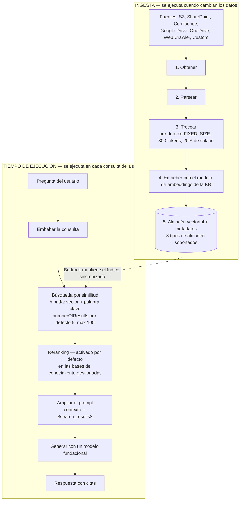
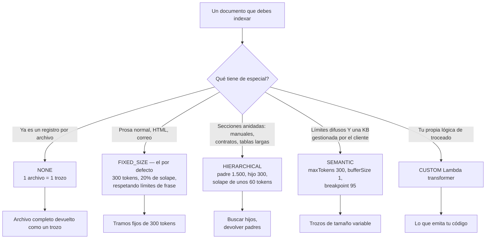
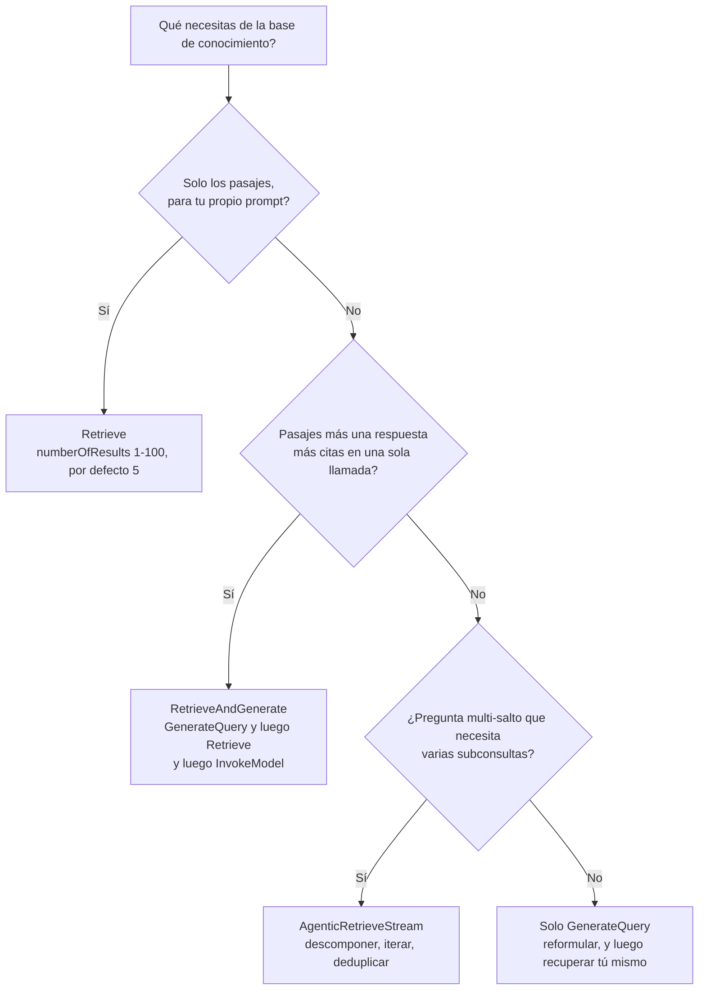
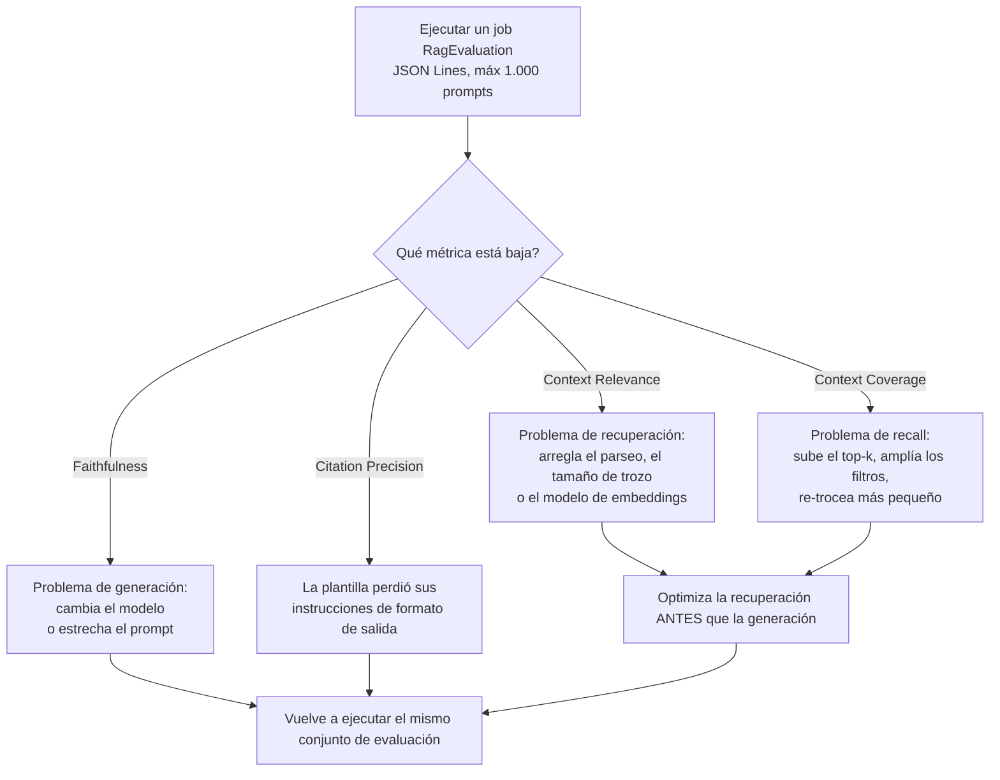
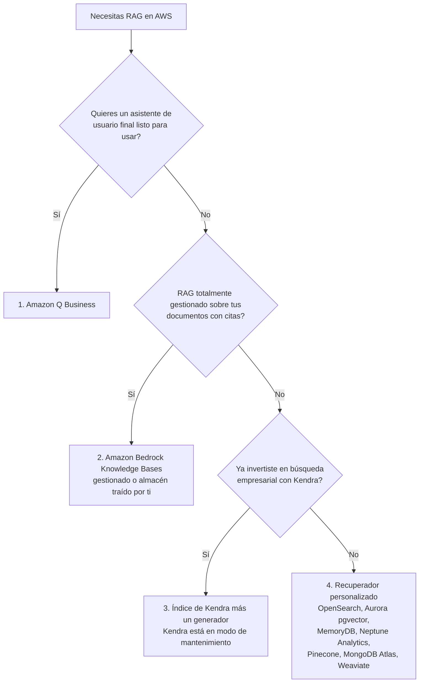
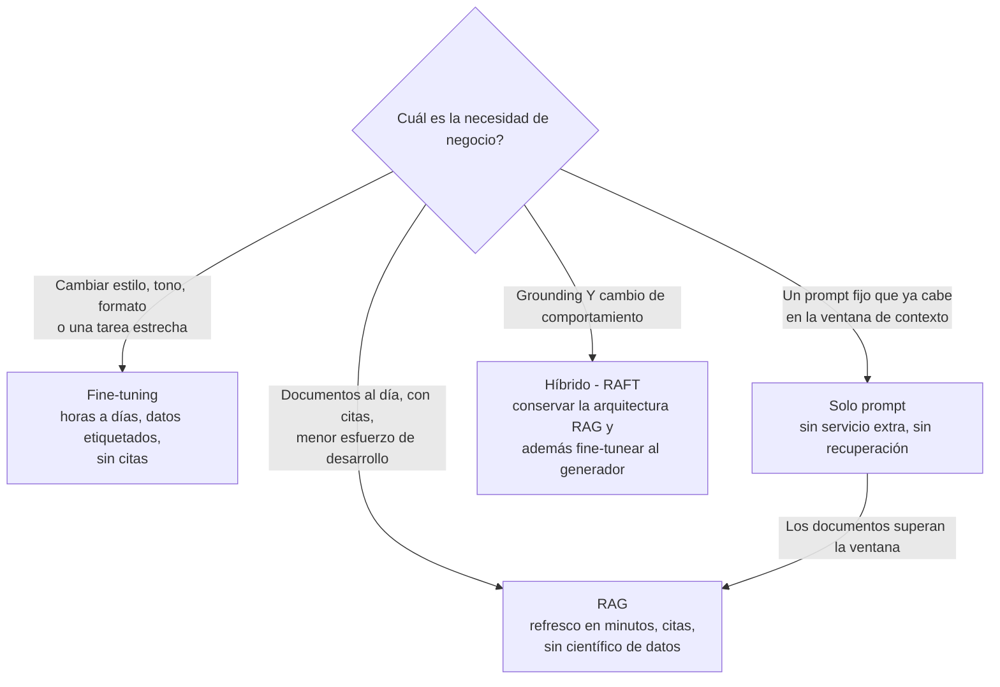

# RAG y Knowledge Bases en Amazon Bedrock: Troceado, embeddings, recuperación y evaluación

El retrieval-augmented generation es el tema de mayor frecuencia en el Dominio 3 del examen AIF-C01, y también es aquel donde la mayoría de los candidatos memoriza eslóganes en lugar de mecanismos. La guía del examen de AWS nombra RAG tres veces: *«Define RAG y sus aplicaciones de negocio (por ejemplo, Amazon Bedrock Knowledge Bases)»*, *«servicios que almacenan embeddings (OpenSearch, Aurora, Neptune, RDS for PostgreSQL)»* y *«grounding con RAG»*. Un eslogan como «RAG reduce las alucinaciones» no te va a servir, porque el examen pregunta qué pasa **cuando el tamaño de troceado por defecto es incorrecto, cuando top-k es demasiado grande, cuando un operador de filtro no es compatible, o cuando una métrica cae por debajo del umbral**. Esta lección enseña los mecanismos, y cada cifra de ella está anclada a una página de AWS de primera parte en **octubre de 2026**.

```text
====================================================================
 AMAZON BEDROCK KNOWLEDGE BASES DE UN VISTAZO      (Digesto: oct 2026)
====================================================================
  QUÉ ES RAG ..... la información de la fuente de datos mejora
                   la relevancia y la exactitud; tus datos se
                   buscan en el momento de la consulta y se
                   inyectan en el prompt
  DOS TIPOS DE KB . GESTIONADA (BMKB): AWS ejecuta la ingesta,
                    el indexado, el almacenamiento, la recuperación
                    y el reranking
                    GESTIONADA POR EL CLIENTE: tú eres dueño del
                    almacén vectorial y de cada configuración
  INGESTA ........ obtener -> parsear -> trocear -> embeber ->
                    almacén vectorial, cada trozo mapeado a su
                    documento de origen
  TIEMPO DE EJECUCIÓN . embeber la consulta -> búsqueda por
                    similitud -> ampliar el prompt -> generar con
                    citas
  TROCEADO POR DEFECTO  FIXED_SIZE, 300 tokens, 20% de solape,
                    respetando límites de frase
  ESTRATEGIAS .... FIXED_SIZE | NONE | HIERARCHICAL | SEMANTIC
  TOP-K .......... numberOfResults: mín 1, máx 100, por defecto 5
  EMBEDDINGS ..... Titan V2 1024 (también 512 / 256), Titan G1 1536,
                   Cohere Embed v3 1024, multimodal 1024
  ALMACENES (8) .. OPENSEARCH_SERVERLESS, OPENSEARCH_MANAGED_
                   CLUSTER, RDS, NEPTUNE_ANALYTICS,
                   REDIS_ENTERPRISE_CLOUD, PINECONE,
                   MONGO_DB_ATLAS, S3_VECTORS
  APIs ........... Retrieve | RetrieveAndGenerate |
                   GenerateQuery | AgenticRetrieveStream
  EVALUACIÓN ..... applicationType "RagEvaluation", LLM-as-a-judge,
                   JSON Lines, máx 1.000 prompts por job,
                   métricas puntuadas de 0 a 1
  KENDRA ......... modo de mantenimiento desde 2026-06-30; cerrada
                   a clientes nuevos tras 2026-07-30
====================================================================
```

> [!NOTE]
> **Cómo leer esta lección.** Las características de Knowledge Bases se publican más rápido de lo que se reescriben las guías del examen, así que aplican tres reglas de lectura. (1) **El valor por defecto publicado por la propia AWS vence a cualquier ejemplo de un blog**, una muestra que usa `numberOfResults: 10` no cambia el valor por defecto documentado de 5. (2) **Las diferencias de capacidad entre bases de conocimiento gestionadas y gestionadas por el cliente son oro de examen**, varias características existen en una y no en la otra. (3) **Todo lo que AWS no confirma de primera parte se muestra como no verificado**, nunca como material de memorización.

Al final de esta lección podrás:

- explicar las dos mitades de una base de conocimiento, **ingesta** y **recuperación en tiempo de ejecución**, y nombrar qué se rompe en cada etapa;
- elegir entre una base de conocimiento **gestionada** y una **gestionada por el cliente**, y nombrar los siete conectores gestionados;
- elegir la **estrategia de troceado** adecuada y defender los valores de parámetro que recomienda AWS;
- dimensionar un **modelo de embeddings** por dimensión, límite de entrada y coste;
- seleccionar uno de los **ocho almacenes vectoriales** para una restricción dada;
- escribir un **filtro de metadatos** que una base de conocimiento gestionada realmente acepte;
- elegir entre **Retrieve, RetrieveAndGenerate, GenerateQuery y AgenticRetrieveStream**, y arreglar un prompt que excede el límite de caracteres;
- diagnosticar un sistema RAG fallando leyendo **relevancia del contexto, cobertura y fidelidad** en el orden correcto;
- defender el **veredicto comparativo**: RAG frente a fine-tuning frente a solo prompt, y Bedrock Knowledge Bases frente a Amazon Kendra.

---

## 1. Qué es RAG y qué pregunta de verdad la guía del examen

### 1.1 La definición que usa AWS

AWS define el retrieval-augmented generation como el uso de **información de la fuente de datos para mejorar la relevancia y la exactitud** de la respuesta de un modelo fundacional. La cláusula decisiva es la segunda mitad: la base de conocimiento **busca tus datos en el momento de la consulta y amplía el prompt** con los pasajes que encuentra. No se escribe nada en el modelo. Los pesos no se mueven, no se ejecuta ningún job de entrenamiento, y el mismo modelo fundacional que respondía a la ligera sin tus documentos ahora responde con ellos.

Esa frase ya elimina tres distractors en cada pregunta de RAG:

- RAG **no** cambia el modelo, así que no puede confundirse con fine-tuning ni con preentrenamiento continuo;
- RAG **no** necesita datos etiquetados, así que no puede ser la respuesta de «el equipo no tiene científicos de datos»;
- RAG **puede** refrescarse en minutos, así que «los datos cambian semanalmente» apunta a RAG y no a un bucle de entrenamiento.

### 1.2 Las tres preguntas de la guía del examen que mapean a esta lección

| Línea de la guía del examen | Qué está probando de verdad | Dónde aterriza aquí |
|---|---|---|
| Define RAG y sus aplicaciones de negocio (p. ej., Bedrock Knowledge Bases) | Definición, frescura, citas, esfuerzo bajo | Secciones 1, 2 y 11 |
| Servicios que almacenan embeddings (OpenSearch, Aurora, Neptune, RDS for PostgreSQL) | El enum `StorageConfiguration.type` | Sección 6 |
| Compromisos de coste: preentrenamiento, fine-tuning, aprendizaje en contexto, RAG, destilación de modelos | RAG frente a fine-tuning frente a solo prompt | Sección 11 |
| Grounding con RAG | Métricas de fidelidad y de citas | Sección 9 |

El examen AIF-C01 son **65 preguntas en 90 minutos**, y el Dominio 3 (el Dominio 3 cubre en parte modelos fundacionales, despliegue y operaciones) tiene un peso del **28%**. RAG aparece dentro de ese peso como ítem de definición y como ítem de resolución de problemas: que es la razón por la que esta lección dedica tantas líneas a la evaluación como a la arquitectura.

### 1.3 En qué es débil RAG

AWS es explícita sobre la debilidad estructural de RAG: es **malo resumiendo un documento entero**, porque la recuperación devuelve *trozos*, no archivos completos. Si la necesidad de negocio es «lee las 400 páginas y dame los tres temas», RAG es la herramienta equivocada y el examen espera que lo sepas. Mantén esa limitación junto al beneficio: RAG compra **frescura y citas**, y paga con **contexto parcial**.

> **📚 ¿Sabías que…?** El orden de decisión oficial de AWS para RAG en AWS empieza con **Amazon Q Business**, después **Bedrock Knowledge Bases**, después **Kendra más un generador**, y después un **recuperador personalizado**: en ese orden, según *Choosing a RAG option* de Prescriptive Guidance. La mayoría de los candidatos se salta directamente a Bedrock y olvida que un asistente de usuario final listo para usar se sitúa un paso por encima en la propia lista de AWS. En el examen, «respuesta totalmente gestionada para usuarios de negocio» puede apuntar legítimamente a Amazon Q Business en lugar de a una base de conocimiento que montas tú mismo.

---

## 2. El pipeline de RAG: ingesta y tiempo de ejecución

Una base de conocimiento son dos pipelines que nunca se ejecutan a la vez. **La ingesta** se ejecuta cuando los datos cambian; **la recuperación** se ejecuta en cada consulta. Confundirlos es la causa raíz de la mayoría de los diagnósticos erróneos: una alucinación casi nunca es un problema de ingesta, y un documento que falta nunca es un problema de generación.

### 2.1 Ingesta: obtener, parsear, trocear, embeber, almacenar

AWS documenta la secuencia de ingesta como: **obtener** el documento → **parsearlo** → **trocearlo** → **embeber** cada trozo → escribir los vectores en un **almacén vectorial**, con cada trozo mapeado de vuelta a su documento de origen. Amazon Bedrock mantiene la base de datos vectorial sincronizada por ti, incluidas las eliminaciones y la reingesta, que es el significado práctico de «totalmente gestionado» aquí.

### 2.2 Tiempo de ejecución: embeber, buscar, ampliar, generar

En el momento de la consulta el flujo se invierte: **la consulta se embebe** con el mismo modelo de embeddings → una **búsqueda por similitud** devuelve los trozos más cercanos → los trozos **se inyectan en el prompt** → el modelo fundacional **genera** una respuesta que lleva citas de vuelta a los documentos de origen.



### 2.3 Qué se rompe en cada etapa

| Etapa | Fallo que introduces | Lo que ve el usuario | Qué métrica se mueve |
|---|---|---|---|
| Obtener | Prefijo incorrecto, archivo de más de 50 MB, permiso denegado | El documento simplemente no aparece en las respuestas | Context Coverage cae |
| Parsear | Tablas y columnas de PDF aplanadas en ruido | Respuestas fluidas sobre nada | Context Relevance cae |
| Trocear | Pregunta y respuesta partidas entre dos trozos | «No hay suficiente contexto» | Context Relevance cae |
| Embeber | Trozo más largo que el límite de entrada del modelo | Truncamiento silencioso, medio trozo indexado | Context Coverage cae |
| Buscar | top-k demasiado pequeño, filtro demasiado estricto | El documento correcto nunca se recupera | Context Coverage cae |
| Generar | La plantilla de prompt perdió sus instrucciones | Contradicción con el texto recuperado | Faithfulness cae |

**Ejemplo resuelto 1: dimensionado por defecto de la ingesta.** Si omites la configuración de troceado, Bedrock usa **troceado de tamaño fijo de 300 tokens con 20% de solape**. El solape es de 60 tokens, así que cada trozo avanza con un **stride de 240 tokens**. Un manual de empleado de **4.800 tokens** produce por tanto unos **4.800 ÷ 240 = 20 trozos**, cada uno recuperable por sí mismo. La propia regla práctica de AWS para estimar documentos: **1 KB de texto ≈ 1.000 caracteres ≈ 200 to 250 palabras**.

Coloca los pasos en tiempo de ejecución en la secuencia correcta:

```dragdrop
{
  "question": "Ordena los pasos en tiempo de ejecución de una consulta a una base de conocimiento de Bedrock, desde la entrada del usuario hasta la respuesta:",
  "items": [
    "Paso 4: el modelo fundacional genera la respuesta y devuelve citas a los pasajes de origen",
    "Paso 1: la consulta del usuario se embebe con el mismo modelo de embeddings usado en la ingesta",
    "Paso 2: una búsqueda por similitud devuelve los trozos más cercanos, con reranking por defecto en las bases de conocimiento gestionadas",
    "Paso 3: los trozos recuperados se inyectan en el prompt como $search_results$"
  ],
  "correctOrder": [
    "Paso 1: la consulta del usuario se embebe con el mismo modelo de embeddings usado en la ingesta",
    "Paso 2: una búsqueda por similitud devuelve los trozos más cercanos, con reranking por defecto en las bases de conocimiento gestionadas",
    "Paso 3: los trozos recuperados se inyectan en el prompt como $search_results$",
    "Paso 4: el modelo fundacional genera la respuesta y devuelve citas a los pasajes de origen"
  ],
  "explanation": "La recuperación siempre precede a la generación: embeber la consulta, buscar en el índice, ampliar el prompt y luego generar. El orden importa para el diagnóstico: si el documento correcto nunca llegó al prompt, cambiar el modelo o el prompt no puede arreglar la respuesta, que es exactamente la regla que la sección 9 convierte en un procedimiento de decisión."
}
```

> [!WARNING]
> **No diagnostiques un problema de generación en la ingesta.** Si los pasajes recuperados son correctos y la respuesta aún los contradice, el arreglo es el **modelo o el prompt**, no el tamaño de troceado. Si los pasajes recuperados son incorrectos o faltan, el arreglo es **el parseo, el troceado, el modelo de embeddings o el top-k**, no el modelo. La guía de evaluación de AWS enuncia la regla directamente: **optimiza la recuperación antes que la generación**.

---

## 3. Dos tipos de base de conocimiento: gestionada y gestionada por el cliente

### 3.1 Gestionada (BMKB) frente a gestionada por el cliente

| Dimensión | **Base de conocimiento gestionada** | **Base de conocimiento gestionada por el cliente** |
|---|---|---|
| Quién ejecuta ingesta, indexado, almacenamiento | **AWS** | Tú (y Bedrock, sobre tu configuración) |
| Quién es dueño del almacén vectorial | **AWS** | **Tú** |
| Embeddings + reranking | Gestionado, reranking **activado por defecto** | Configuras ambos |
| Modos de búsqueda | **Solo híbrido, siempre** | `HYBRID` o `SEMANTIC` vía `overrideSearchType` (solo OpenSearch Serverless) |
| Troceado semántico | **No soportado** | Soportado |
| Conectores | **7** (S3, SharePoint, Confluence, Google Drive, OneDrive, Web Crawler, Custom) | Tu configuración de fuente de datos |
| Filtros `startsWith` / `stringContains` | **No soportados** | Depende del almacén |

### 3.2 Los siete conectores gestionados

| # | Conector | Contenido típico |
|---|---|---|
| 1 | **Amazon S3** | Exportaciones, data lakes, conjuntos de documentos estáticos |
| 2 | **SharePoint** | Intranets corporativas |
| 3 | **Confluence** | Wikis de ingeniería y soporte |
| 4 | **Google Drive** | Docs, Sheets y Slides de un equipo |
| 5 | **OneDrive** | Archivos personales y de equipo |
| 6 | **Web Crawler** | Sitios públicos de producto y de ayuda |
| 7 | **Custom** | Tu propio conector a través de la integración documentada |

Nota la asimetría que las preguntas de examen explotan: una base de conocimiento **gestionada por el cliente** que usa Confluence, SharePoint o Salesforce como fuente **requiere OpenSearch Serverless** como almacén, mientras que una base de conocimiento gestionada te ofrece cuatro almacenes de creación rápida en consola.

### 3.3 Cuotas que vale la pena memorizar

| Límite | Valor |
|---|---|
| Tamaño del archivo de origen | **50 MB** |
| Archivo sidecar de metadatos | **10 KB** |
| Bases de conocimiento gestionadas por cuenta y Región | **10.000** |
| Fuentes de datos por base de conocimiento | **200** |
| Jobs de ingesta concurrentes | **50** |
| Almacenamiento en bruto (gestionado) | **10 TB** |
| Caracteres de entrada de consulta | **10.000** |
| Peticiones Retrieve por minuto | **600** (ráfaga de **25 por segundo**) |

> **📚 ¿Sabías que…?** El **tope de 50 MB para archivos de origen** y el **tope de 10 KB para metadatos** son límites distintos que la gente funde en una sola leyenda urbana de «límite de archivo de 10 MB». El conector de fuente de datos también expone `maxFileSizeInMegaBytes` con un valor por defecto documentado de **500**, más `inclusionPrefixes`, `exclusionPrefixes`, las expresiones regulares `inclusionPatterns` / `exclusionPatterns`, `metadataFilesPrefix` y `aclEnabled`: así que la mayoría de los tickets de «¿por qué falta este archivo?» son un problema de filtros, no de tamaño.

---

## 4. Troceado: las cuatro estrategias y sus parámetros

El troceado es donde la calidad de RAG se gana o se pierde, porque un sistema de recuperación solo puede devolver lo que la ingesta realmente creó. La API de AWS acepta exactamente cuatro valores para `chunkingStrategy`: **`FIXED_SIZE`, `NONE`, `HIERARCHICAL`, `SEMANTIC`**: nada más es válido.

### 4.1 El valor por defecto que obtienes si no configuras nada

Omitir la configuración de troceado da **troceado de tamaño fijo: 300 tokens con 20% de solape, respetando los límites de frase**. Respetar los límites de frase importa más de lo que suena: es la diferencia entre un trozo que termina a media cláusula y un trozo que termina en un punto, y el propio caso publicado de AWS muestra la relevancia del contexto moviéndose del **67% al 93%** puramente porque las preguntas y respuestas de FAQ dejaron de partirse.

### 4.2 Comparación de estrategias

| Estrategia | Valor de API | Parámetros | Recomendado por AWS | Mejor para | Notas |
|---|---|---|---|---|---|
| **Por defecto / fijo** | `FIXED_SIZE` (o omitido) | `maxTokens`, `overlapPercentage` | **300 tokens, 20% de solape** | La mayoría de los documentos | Respeta los límites de frase |
| **Ninguna** | `NONE` |: | 1 archivo = 1 trozo | Datos ya prepartidos, 1 SKU por archivo | Tú preprocesas aguas arriba |
| **Jerárquico** | `HIERARCHICAL` | padre, hijo, tokens de solape | Padre **1.500**, hijo **300**, solape **≈60** | Manuales, legal, tablas anidadas | Busca hijos, devuelve **padres** |
| **Semántico** | `SEMANTIC` | `maxTokens`, `bufferSize`, `breakpointPercentileThreshold` | **300**, buffer **1**, umbral **95** | Límites poco claros | **No disponible en KB gestionadas** |
| **Personalizado** | Lambda transformer | Tu código |: | Troceado específico de dominio | `vectorIngestionConfiguration` |



### 4.3 Troceado jerárquico

El troceado jerárquico crea un trozo **padre** (recomendado **1.500 tokens**, no embebido) y trozos **hijo** (recomendado **300 tokens**, embebidos), con un solape recomendado del **20% del tamaño del hijo ≈ 60 tokens**. La recuperación busca los hijos pero devuelve los **padres**, de modo que el modelo recibe contexto de nivel de sección en lugar de un fragmento.

**Ejemplo resuelto 2, dimensionado jerárquico.** Con padre 1.500, hijo 300 y solape 60, la propia muestra de AWS pidiendo `numberOfResults = 5` devolvió **3 trozos**, porque varios hijos mapeaban al mismo padre. `numberOfResults` es por tanto un **tope, no una promesa**, un hecho que el examen puede probar en cualquier dirección: «menos resultados de los pedidos» es normal, y «más resultados de los pedidos» no lo es.

### 4.4 Troceado semántico

El troceado semántico embebe frases adyacentes, compara su similitud y corta donde la similitud cae. Los rangos de parámetros son contractuales:

| Parámetro | Rango | Recomendado por AWS | Significado |
|---|---|---|---|
| `maxTokens` | 1 to 8.192 (el blog señala 20 to 8.192 según el embedder) | **300** | Techo duro para un trozo |
| `bufferSize` | 0 to 1 | **1** | Cuántas frases a cada lado se comparan |
| `breakpointPercentileThreshold` | 50 to 99 | **95** | Cortar solo en el N% de límites menos similares |

**Ejemplo resuelto 3, el ejemplo resuelto de la propia API de AWS.** Con un umbral de **90** sobre **101 frases**, Bedrock compara **100 pares** y corta en los **10 límites menos similares (10%)**, produciendo **11 trozos**, que se re-trocean si alguno excede `maxTokens`. Con `bufferSize = 1`, la frase 10 se embebe desde el contexto de las frases **9 + 10 + 11**. Cohere Embed v3 limita la entrada a **512 tokens**, así que los trozos construidos para él no pueden exceder eso aunque `maxTokens` sea mayor.

> [!WARNING]
> **El troceado semántico no está disponible en las bases de conocimiento gestionadas**, y nunca es el valor por defecto. Cualquier respuesta que afirme «lo que obtienes por defecto es troceado semántico con umbral 95» es incorrecta dos veces. Del mismo modo, `HIERARCHICAL` debe configurarse explícitamente: el valor por defecto es de tamaño fijo, no jerárquico.

Haz corresponder cada estrategia con la situación que resuelve:

```matching
{
  "question": "Haz corresponder cada estrategia de troceado con la situación para la que está diseñada:",
  "pairs": [
    {"left": "FIXED_SIZE (por defecto, 300 tokens, 20% de solape)", "right": "Prosa ordinaria y HTML donde los límites de frase son claros y no existe estructura especial"},
    {"left": "NONE", "right": "Datos que ya partes aguas arriba, como un SKU o un ticket por archivo"},
    {"left": "HIERARCHICAL (padre 1.500 / hijo 300)", "right": "Manuales anidados, contratos y tablas largas donde la respuesta necesita contexto de nivel de sección"},
    {"left": "SEMANTIC (buffer 1, breakpoint 95)", "right": "Documentos con límites difusos: no disponible en bases de conocimiento gestionadas"},
    {"left": "Lambda transformer personalizado", "right": "Reglas de troceado específicas de dominio que ninguna de las cuatro estrategias integradas expresa"}
  ],
  "explanation": "FIXED_SIZE es el valor por defecto documentado para la mayoría de los documentos; NONE asume que partes tú mismo aguas arriba; HIERARCHICAL busca hijos y devuelve padres, así que los recuentos pueden ser menores que numberOfResults; SEMANTIC adapta los puntos de corte a la similitud pero no se ofrece en bases de conocimiento gestionadas; un transformer personalizado es la vía de escape configurada a través de vectorIngestionConfiguration. La API acepta exactamente FIXED_SIZE, NONE, HIERARCHICAL y SEMANTIC."
}
```

---

## 5. Modelos de embeddings: dimensiones, límites y coste

### 5.1 Los modelos que acepta una base de conocimiento

| Proveedor | Modelo | ID del modelo | Dimensiones | Tipos | Límite de entrada |
|---|---|---|---|---|---|
| Amazon | Titan Embeddings G1: Text | `amazon.titan-embed-text-v1` | **1536** | float | 8.192 tokens |
| Amazon | **Titan Text Embeddings V2** | `amazon.titan-embed-text-v2:0` | **1024 por defecto, 512, 256** | float, binary | **8.192 tokens / 50.000 caracteres** |
| Cohere | Embed English v3 | `cohere.embed-english-v3` | **1024** | float, binary | **512 tokens ≈ 2.048 caracteres** |
| Cohere | Embed Multilingual v3 | `cohere.embed-multilingual-v3` | **1024** | float, binary | 512 tokens |
| Amazon | Titan Multimodal G1 |: | **1024** | float | multimodal |
| Cohere | Embed v3 (multimodal) |: | **1024** | float, binary | multimodal |
| Amazon | Nova Multimodal Embeddings |: | **1024** | float | multimodal |

### 5.2 El compromiso de dimensiones

| Dimensiones | Exactitud frente a 1024 | Almacenamiento frente a 1024 | Uso |
|---|---|---|---|
| **1024** (por defecto) | línea base | 1× | Máxima exactitud |
| **512** | **≈99%** | −50% | Equilibrado |
| **256** | **97%** | **−75%** | Coste y escala |

**Ejemplo resuelto 4, el presupuesto de dimensiones.** Un equipo con Amazon Titan Text Embeddings V2 que necesita aproximadamente un **75% menos de almacenamiento vectorial** manteniendo unos **97% de exactitud de recuperación** debe fijar la dimensión de salida en **256**. Con **512** conserva una exactitud del **≈99%** con la **mitad** de almacenamiento. Añadir `embeddingTypes: ["binary"]` reduce aún más el almacenamiento. El gasto en embeddings se mide en tokens: Titan V2 tiene un precio de **$0.02 por 1 millón de tokens**, frente a **$0.10** de V1, una reducción del 80% en la misma carga de trabajo.

> **📚 ¿Sabías que…?** Titan Text V2 acepta **8.192 tokens o 50.000 caracteres** y cubre **más de 100 idiomas**, mientras que Cohere Embed v3 acepta solo **512 tokens (unos 2.048 caracteres)**. Ese único hecho explica dos trampas de examen a la vez: elegir Cohere significa que tu techo efectivo de trozo baja a 512, y un trozo que «cabe en el 300 tokens por defecto» aún puede desbordar un embedder si subiste `maxTokens` para un modelo distinto. La dimensión y el límite de entrada son mandos independientes: 1024 dimensiones no dice nada sobre cuánto texto puedes enviar.

---

## 6. Almacenes vectoriales: ocho opciones, cuatro creaciones rápidas en consola

| Almacén | `type` de API | Creación rápida en consola | Notas y límites |
|---|---|---|---|
| **OpenSearch Serverless** | `OPENSEARCH_SERVERLESS` | Sí | Necesita un índice con motor **`faiss`** para los archivos de metadatos; el único almacén que permite `overrideSearchType: HYBRID`; **obligatorio** para fuentes Confluence/SharePoint/Salesforce |
| **OpenSearch Service (cluster gestionado)** | `OPENSEARCH_MANAGED_CLUSTER` |: | Híbrido más búsqueda de texto completo |
| **Aurora PostgreSQL + pgvector** | `RDS` | Sí (Serverless) | SQL más vectores, ACID; pgvector soporta hasta **2.000 dimensiones**, IVFFlat y HNSW |
| **Neptune Analytics** | `NEPTUNE_ANALYTICS` | Sí | **GraphRAG**: vectores más recorrido de grafo con openCypher |
| **Redis Enterprise Cloud** | `REDIS_ENTERPRISE_CLOUD` |: | En memoria, latencia ultra baja |
| **Pinecone** | `PINECONE` |: | Base de datos vectorial gestionada |
| **MongoDB Atlas** | `MONGO_DB_ATLAS` |: | APIs compatibles con Mongo |
| **Amazon S3 Vectors** | `S3_VECTORS` | Sí | El más barato: **hasta un 90%** menos de coste de almacenamiento, **2.000 millones de vectores por índice**; sin `startsWith` ni `stringContains` |

Shorthand de examen: **OpenSearch Serverless = por defecto y híbrido · Aurora pgvector = SQL más vector · Neptune = GraphRAG · Redis = menor latencia · S3 Vectors = más barato · Kendra = búsqueda empresarial, no un almacén de base de conocimiento.**

> **📚 ¿Sabías que…?** **Amazon S3 Vectors** es la entrada más reciente y la que con más probabilidad se plantee como pregunta de coste: Prescriptive Guidance de AWS la sitúa en un **hasta un 90% más barata en almacenamiento** que las bases de datos vectoriales tradicionales con **2.000 millones de vectores por índice**, con una latencia de consulta de unos **100 ms o más**. El inconveniente para el examen es funcional, no financiero: los índices de S3 Vector **no** soportan los operadores de filtro `startsWith` ni `stringContains`: así que el almacén más barato es también el que elimina los filtros de subcadena más cómodos.

> [!WARNING]
> **`Amazon EMR Serverless` no es un almacén vectorial de base de conocimiento.** Aparece en algún material de Prescriptive Guidance sobre procesamiento de datos a gran escala, pero está **ausente del enum `StorageConfiguration.type`**: `OPENSEARCH_SERVERLESS`, `OPENSEARCH_MANAGED_CLUSTER`, `RDS`, `NEPTUNE_ANALYTICS`, `REDIS_ENTERPRISE_CLOUD`, `PINECONE`, `MONGO_DB_ATLAS`, `S3_VECTORS`. Cualquier opción que ofrezca EMR Serverless como almacén vectorial de una base de conocimiento es incorrecta por construcción. Del mismo modo, **Amazon Kendra es un servicio de búsqueda, no un tipo de almacenamiento**: puede *alimentar* una base de conocimiento, pero no puede *ser* su almacén.

---

## 7. Metadatos: archivos sidecar y filtros de recuperación

### 7.1 El patrón sidecar

Junto a `articles.pdf` colocas `articles.pdf.metadata.json` en la **misma carpeta de S3**, con un tope de **10 KB**, que contiene valores de cadena, número o booleano. Poner `includeForEmbedding: true` en un campo concatena su clave y su valor en el texto que se embebe, que es como un valor como `genre: cooking` se convierte en parte de la representación buscable en lugar de solo un post-filtro. Una fuente de datos CSV puede en su lugar declarar una columna `contentFields`.

**Ejemplo resuelto 5: el ejemplo de filtro de AWS.** Dado `articles.pdf` más un sidecar que declara `genre`, `year` y `author`, el siguiente filtro recupera artículos de entretenimiento publicados después de 2018, o cualquier artículo de cocina o deporte cuyo autor empiece por «C»:

```json
{
  "orAll": [
    {
      "andAll": [
        { "equals": { "key": "genre", "value": "entertainment" } },
        { "greaterThan": { "key": "year", "value": 2018 } }
      ]
    },
    {
      "andAll": [
        { "in": { "key": "genre", "value": ["cooking", "sports"] } },
        { "startsWith": { "key": "author", "value": "C" } }
      ]
    }
  ]
}
```

### 7.2 El conjunto de operadores

`RetrievalFilter` es una **unión**: primitivas compuestas con `andAll` / `orAll`, cada uno de los cuales requiere **al menos 2 elementos**.

| Categoría | Operadores |
|---|---|
| Igualdad | `equals`, `notEquals` |
| Orden | `greaterThan`, `greaterThanOrEquals`, `lessThan`, `lessThanOrEquals` |
| Pertenencia | `in`, `notIn`, `listContains` |
| Cadenas | `startsWith`, `stringContains` |
| Composición | `andAll`, `orAll` (mínimo 2 elementos cada uno) |
| Clave integrada | `x-amz-bedrock-kb-source-uri`: filtra por prefijo de S3 sin archivo sidecar alguno |

**Ejemplo resuelto 6: el operador que falla.** Si el mismo filtro anterior se ejecuta contra una **base de conocimiento gestionada**, falla en `startsWith`. AWS documenta que **`startsWith` y `stringContains` no están soportados en las bases de conocimiento gestionadas ni en los índices de S3 Vector**. El arreglo es reestructurar la rama a `equals` o `in`: por ejemplo, una lista explícita de autores, o ejecutar la lógica de subcadena en la aplicación tras la recuperación. Nótese que `listContains` no es un sustituto: prueba la **pertenencia a un campo de lista**, no una subcadena de un campo de cadena.

> [!WARNING]
> **Tres trampas de filtro que restan puntos.** (1) `startsWith` y `stringContains` **no están soportados** en bases de conocimiento gestionadas ni en índices de S3 Vector. (2) `andAll` / `orAll` necesitan **dos o más** hijos: un único hijo es inválido. (3) Los archivos de metadatos tienen un tope de **10 KB**; los sidecars demasiado grandes son silenciosamente un problema de fuente de datos, no de recuperación. Distingue siempre «el operador es inválido» de «el operador es válido pero no está soportado aquí».

---

## 8. Recuperación: cuatro APIs, top-k y el presupuesto de tokens

### 8.1 Qué API llamar

| API | Qué hace | Úsala cuando |
|---|---|---|
| **`Retrieve`** | Devuelve solo pasajes ordenados | Eres dueño del prompt y del paso de generación |
| **`RetrieveAndGenerate`** | Recuperar → `InvokeModel` → citas en una sola llamada | Quieres una respuesta con fuentes, mínimo código |
| **`GenerateQuery`** | Reformula la pregunta del usuario | Orquestas el bucle tú mismo |
| **`AgenticRetrieveStream`** | El FM se decompone en subconsultas, itera y deduplica | Preguntas multi-salto sobre grandes corpus |

Bajo el capó, `RetrieveAndGenerate` ejecuta **GenerateQuery → Retrieve → InvokeModel**. Con la **descomposición de consultas** activada, `numberOfRerankedResults` puede alcanzar **5× `numberOfResults`**: el único lugar donde un recuento re-rankeado excede legítimamente el top-k pedido.



### 8.2 top-k y el presupuesto de tokens

`numberOfResults` es un entero con **mínimo 1, máximo 100 y por defecto 5**. Dimensiona directamente el marcador de posición `$search_results$` en el prompt de generación.

**Ejemplo resuelto 7: top-k frente a la ventana del prompt.** Con el trozo por defecto de **300 tokens**:

| `numberOfResults` | Tokens aproximados en `$search_results$` | Veredicto |
|---|---|---|
| **5** (por defecto) | **≈1.500** | Seguro para la mayoría de los modelos |
| 10 | ≈3.000 | La muestra de AWS para respuestas de «no hay suficiente contexto» |
| 100 (máximo de la API) | ≈30.000 | Casi con certeza por encima del límite del prompt |

Subir el top-k sube la recall y baja la alucinación, pero hace crecer el prompt linealmente. Cuando una llamada a `RetrieveAndGenerate` falla porque el prompt ampliado **excede el límite de caracteres del modelo**, AWS documenta exactamente tres remedios: **bajar `numberOfResults`**, **recrear la fuente de datos con trozos más pequeños**, o **acortar la plantilla de prompt o la consulta del usuario**. Incrementar `numberOfResults` empeora el error, que es la razón por la que aparece como distractor.

### 8.3 Contrato de la plantilla de prompt

Los prompts de generación **deben incluir `$search_results$`**. Los prompts de orquestación deben incluir `$conversation_history$` **y** `$output_format_instructions$`. La plantilla de muestra de AWS envuelve el contexto como `<context>$search_results$</context>` junto a `$query$`, y quitar `$output_format_instructions$` **elimina las citas** de la salida, lo que rompe silenciosamente el requisito de «respuestas fundamentadas con fuentes».

### 8.4 Modo de búsqueda

`overrideSearchType` acepta `HYBRID` o `SEMANTIC`, y se aplica **solo** a OpenSearch Serverless con un campo de texto filtrable. **Las bases de conocimiento gestionadas son siempre híbridas**: no hay ajuste que lo desactive, así que «configurar la base de conocimiento gestionada para búsqueda solo semántica» es un distractor.

> **📚 ¿Sabías que…?** Dos contadores corren en la misma petición y son fáciles de confundir: `numberOfResults` (top-k pedido, **1 to 100, por defecto 5**) y `numberOfRerankedResults` (lo que el reranking realmente devuelve tras filtrar y deduplicar). En las bases de conocimiento gestionadas el reranking está **activado por defecto**, y con la descomposición de consultas el recuento re-rankeado puede alcanzar **5× el top-k pedido**. El examen puede por tanto mostrar legítimamente una petición de 10 pasajes con más de 10 candidatos re-rankeados: mientras nunca muestra más de 100 resultados *pedidos*.

---

## 9. Evaluando una aplicación RAG

### 9.1 La forma del job

La evaluación RAG es una evaluación de Bedrock con `applicationType: "RagEvaluation"`, puntuada por un **LLM-as-a-judge**. Existen dos tipos de job, **solo recuperación** y **recuperación y generación**, y las métricas se puntúan de **0 a 1** y se promedian sobre los prompts. El dataset es **JSON Lines** con un máximo de **1.000 prompts por job**; el ground truth vive en `referenceContexts` (para la recuperación) y `referenceResponses` (para la generación).

### 9.2 Las familias de métricas

| Etapa | Métrica | Qué mide |
|---|---|---|
| Solo recuperación | **Context Relevance** | Precisión de los trozos recuperados |
| Solo recuperación | **Context Coverage** | Recall frente a los `referenceContexts` de ground truth |
| Recuperación + generación | **Correctness / Completeness / Helpfulness / Logical Coherence** | Respuestas exactas, completas, útiles y sin contradicciones |
| Recuperación + generación | **Faithfulness** | **Resistencia a alucinaciones frente a los trozos recuperados** |
| Recuperación + generación | **Citation Precision / Coverage** | Las citas son exactas / completas |
| Recuperación + generación | **Harmfulness, Stereotyping, Refusal** | Métricas de IA responsable |

### 9.3 La regla de diagnóstico

| Síntoma | Métrica a leer primero | Arreglo |
|---|---|---|
| Las respuestas ignoran los documentos disponibles | **Context Coverage** | Baja la estrictitud del filtro, sube el top-k, re-trocea más pequeño |
| Los trozos recuperados son irrelevantes | **Context Relevance** | Arregla el parseo, el tamaño de trozo o el modelo de embeddings |
| La respuesta contradice los pasajes | **Faithfulness** | Cambia el modelo o el prompt |
| Citas ausentes o incorrectas | **Citation Precision** | Restaura `$output_format_instructions$` en la plantilla |



**Ejemplo resuelto 8: el arreglo del 67% al 93%.** AWS publicó un caso en el que la relevancia del contexto estaba en el **67%** porque las preguntas de FAQ se partían de sus respuestas a media frase. Re-trocear para que cada pregunta y respuesta permanecieran juntas: alineadas a frase, **sin ningún cambio de prompt**: movió la relevancia del contexto al **93%** en las mismas 15 consultas y eliminó las alucinaciones. La lección no es la cifra; es que el arreglo cayó en la **ingesta**, aunque el síntoma apareciera en la **generación**.

> [!WARNING]
> **Lee las métricas en orden.** Una **relevancia del contexto** baja es un problema de indexado, parseo, tamaño de trozo o modelo de embeddings. Una **fidelidad** baja es un problema de generación, modelo o prompt. Los equipos que recurren a un modelo más grande mientras el recuperador devuelve los pasajes equivocados queman un ciclo completo de evaluación para confirmar lo que una métrica de recuperación ya decía. La guía de AWS es inequívoca: **optimiza la recuperación antes que la generación**.

---

## 10. Elegir una opción de RAG en AWS, y la transición de Kendra

### 10.1 El orden documentado por AWS

Prescriptive Guidance lista las opciones de RAG en un orden deliberado: **(1) Amazon Q Business → (2) Amazon Bedrock Knowledge Bases → (3) Amazon Kendra más un generador → (4) un recuperador personalizado** construido sobre OpenSearch, Aurora pgvector, MemoryDB, Neptune Analytics, Pinecone, MongoDB Atlas o Weaviate.



### 10.2 Kendra frente a Bedrock Knowledge Bases

| Dimensión | **Amazon Kendra** | **Base de conocimiento (gestionada) de Bedrock** |
|---|---|---|
| Estado | **Mantenimiento desde 2026-06-30; sin clientes nuevos tras 2026-07-30** | El destino de migración declarado por AWS |
| Conectores | Unos 30+ conectores empresariales | **7**: S3, SharePoint, Confluence, Google Drive, OneDrive, Web Crawler, Custom |
| Generación | Pasajes ordenados: aportas tu propio LLM | **`RetrieveAndGenerate`** nativo más **`AgenticRetrieveStream`** |
| Modos de búsqueda | Palabra clave / semántico / híbrido | **Solo híbrido** |
| Búsqueda empresarial | Facetas, sugerencias, sinónimos, corrector ortográfico, aprendizaje incremental | **Ausente: se requieren workarounds** |
| Máximo de recuperación | **100 pasajes × ≤200 tokens** | **100 resultados** (`numberOfResults`) |
| Reutilización | Un índice GenAI de Kendra **puede alimentar** una base de conocimiento de Bedrock |: |

**Ejemplo resuelto 9: la pregunta con forma de migración.** Una empresa quiere «RAG totalmente gestionado con generación nativa, citas y recuperación agéntica, como reemplazo recomendado para nuestra aplicación de Kendra». La respuesta es **Amazon Bedrock Managed Knowledge Base**: Kendra está en modo de mantenimiento y cerrada a clientes nuevos tras 2026-07-30, y AWS nombra a la base de conocimiento gestionada como el reemplazo. OpenSearch por sí solo no da generación ni citas; Amazon Q Developer es un asistente de programación; el preentrenamiento continuo no añade recuperación alguna.

> **📚 ¿Sabías que…?** Kendra no está simplemente obsoleta, es **reutilizable**: un índice GenAI de Kendra aún puede conectarse como **fuente de datos para una base de conocimiento de Bedrock**, de modo que una organización con años de ajustes de Kendra puede conservar su índice y mover solo la capa de generación. Ese es el camino de migración que AWS realmente documenta, y es la razón por la que «borrar Kendra y re-indexar todo» es un distractor. Nótese también que los recuentos de conectores provienen de lugares distintos: los **7 conectores gestionados** están confirmados en `docs.aws.amazon.com`, mientras que la cifra «30+» de Kendra circula por material de migración de AWS y no por una página reproducida aquí, trata el número exacto como aproximado.

### 10.3 Actualizaciones de 2025 to 2026

Todo lo de este subapartado se leyó en `docs.aws.amazon.com`, en una publicación What's New de AWS, en una publicación del AWS Machine Learning Blog o en la propia guía del examen AIF-C01: nada proviene de un rastreador de terceros, y las fechas que AWS no publica se marcan como no publicadas en lugar de rellenarse. Dos grupos de cambios importan para esta lección: lo que se publicó **dentro** de Knowledge Bases de Bedrock y sus almacenes vectoriales, y lo que AWS hizo con **Kendra, con Amazon Q Business y con el examen** a su alrededor.

Donde AWS no publica fecha, la fila lo dice: **no hay fecha de lanzamiento publicada** para el Bedrock Managed Knowledge Base y **no hay fecha de cierre publicada** para Amazon Q Business, y ninguna de las dos se ha inventado aquí.

| Cambio de base de conocimiento / almacén vectorial | Fecha (publicada por AWS) | Lo que el examen quiere que sepas |
|---|---|---|
| **Reranking, conectores personalizados, ingesta directa, evaluación RAG y perfiles de inferencia en `RetrieveAndGenerate`** | Historial de características de Bedrock User Guide, 2025 | El reranking está **activado por defecto** en las bases de conocimiento gestionadas; la evaluación es `applicationType: "RagEvaluation"` puntuada por un **LLM-as-a-judge**; un perfil de inferencia permite que una llamada a `RetrieveAndGenerate` elija la Región |
| **Amazon S3 Vectors se convierte en almacén de base de conocimiento** | re:Invent 2025 (**30 nov, 4 dic 2025**) | El octavo y más reciente valor de `StorageConfiguration.type`, el más barato en **hasta un 90% menos**, **2.000 millones de vectores por índice**, y el almacén que rechaza `startsWith` / `stringContains` |
| **Bedrock Managed Knowledge Base (BMKB): Smart Parsing más la API Agentic Retrieval** | Documentado como el reemplazo de Kendra; AWS **no ha publicado una fecha de lanzamiento** | AWS ejecuta la ingesta, el indexado, el almacenamiento, la recuperación y el reranking; `AgenticRetrieveStream` es la API de recuperación agéntica en streaming que está detrás del nivel gestionado |
| **Amazon Kendra entra en mantenimiento y luego cierra a clientes nuevos** | Mantenimiento **30 jun 2026**, cerrada a clientes nuevos **30 jul 2026** | AWS redirige las nuevas aplicaciones de búsqueda al **Bedrock Managed Knowledge Base**; los clientes existentes de Kendra siguen operando bajo la vocabulario de *mantenimiento* de AWS |
| **Amazon Q Business ya no está abierta a clientes nuevos** | La página de disponibilidad dice *«ya no está abierta a clientes nuevos»*: **AWS no publica fecha** | El paso 1 del propio orden de decisión de RAG ahora lleva una advertencia; el sucesor documentado es **Amazon Quick** (trae tu propia identidad), y Guardrails y User Store **no** se transfieren |
| **Amazon MemoryDB eliminado de la lista de alcance del AIF-C01** | Guía del examen v1.1, **30 abr 2026** | Prescriptive Guidance aún nombra MemoryDB en la cadena de recuperador personalizado de la sección 10.1, pero el servicio ya no está en el alcance de este examen |

| Cambio de la guía del examen (v1.1, publicada el 30 abr 2026) | Detalle para un candidato de RAG |
|---|---|
| Nuevo objetivo **5.1.5** | Detección de alucinaciones y grounding: **grounding con RAG**, validación de salida, puntuación de confianza: la razón por la que las métricas de la sección 9 son examinables en absoluto |
| Nuevo objetivo **2.1.5** | **Ingeniería de contexto**: cómo se ensambla el contexto recuperado en el prompt (`$search_results$`, contratos de plantilla, dimensionado de top-k) |
| Nuevo objetivo **2.1.6** | IA agéntica: patrones multi-agente, **MCP**, gestión de memoria, uso de herramientas, orquestación: la forma que `AgenticRetrieveStream` pone sobre una llamada de recuperación |
| Ejemplo modificado **3.4.2** | **LLM-as-a-judge**: el mecanismo de puntuación detrás de la evaluación RAG de Bedrock |
| Añadido / eliminado de la lista de alcance | **Amazon Aurora** añadido (el almacén `RDS` con pgvector); **Amazon MemoryDB** eliminado |
| Sin cambios | **65 preguntas (50 puntuadas + 15 sin puntuar)**, **90 minutos**, aprobado con **700/1000**, dominios ponderados **20 / 24 / 28 / 14 / 14** |

AWS afirma que las actualizaciones de la guía del examen llegan al examen activo aproximadamente **un mes después de su publicación**, así que los nuevos objetivos de v1.1 han sido materia válida desde aproximadamente **finales de mayo de 2026**. El orden de lectura práctico no cambia: las características de la primera tabla son lo que configuras, los objetivos de la segunda tabla es lo que AWS ahora pregunta sobre ellas.

**Ejemplo resuelto 11, qué significan los cambios de 2026 para un cliente existente de Kendra.** Una empresa lleva años ejecutando un índice GenAI de Kendra, con ajustes de sinónimos y de ranking que no quiere perder, y ahora quiere respuestas generativas con citas. El camino documentado por AWS **no** es re-indexar todo: un índice GenAI de Kendra aún puede conectarse como **fuente de datos para una base de conocimiento de Bedrock**, de modo que la configuración sobrevive y solo se mueve la capa de generación, mientras el propio índice de Kendra sigue sirviendo a sus usuarios existentes en **mantenimiento** (modo de entrada el **30 jun 2026**, cerrada a clientes nuevos tras el **30 jul 2026**). Para una aplicación *nueva* la respuesta es el **Bedrock Managed Knowledge Base**, y la tercera opción del orden de decisión de AWS, Amazon Q Business, ahora debe verificarse contra su propio estado de *«ya no está abierta a clientes nuevos»* antes de que nadie la ofrezca como respuesta del paso uno.

| Cambio de 2025 to 2026 | Qué sección de esta lección actualiza |
|---|---|
| Reranking activado por defecto, conectores personalizados, ingesta directa | Secciones 2 y 3 |
| Evaluación RAG puntuada por un LLM-as-a-judge | Sección 9 |
| Perfiles de inferencia utilizables dentro de `RetrieveAndGenerate` | Sección 8 |
| **Amazon S3 Vectors** como octavo tipo de almacén | Sección 6 |
| **Bedrock Managed Knowledge Base** + API Agentic Retrieval | Secciones 3 y 10 |
| Fechas de mantenimiento y cierre de Kendra | Sección 10 |
| Objetivos de la guía del examen v1.1 **5.1.5, 2.1.5, 2.1.6, 3.4.2** | Secciones 9, 8 y 1 |

> **📚 ¿Sabías que…?** La página de disponibilidad de Kendra nunca usa la palabra «obsoleta»: redirige las nuevas aplicaciones de búsqueda al **Amazon Bedrock Managed Knowledge Base**, cuyo Smart Parsing y **API Agentic Retrieval** AWS documenta como el reemplazo, mientras que la propia Kendra sigue sirviendo a los clientes existentes bajo la definición de **mantenimiento** de AWS (sin clientes nuevos, sin nuevas características, aún con soporte). Esa es la razón por la que *«Kendra se apagó»* y *«los clientes existentes de Kendra deben migrar de inmediato»* son ambos distractors, y por la que la respuesta correcta empareja **continuidad para los clientes existentes** con **un reemplazo documentado para los nuevos**.

---

## 11. Veredicto comparativo: RAG frente a fine-tuning frente a solo prompt, y Bedrock KB frente a Kendra

### 11.1 RAG frente a fine-tuning

| Dimensión | **RAG** | **Fine-tuning** |
|---|---|---|
| Qué cambia | Nada en el modelo; el conocimiento se inyecta en el momento de la consulta | Los **pesos** del modelo |
| Frescura | Documentos al día en **minutos** | **Horas a días** por ejecución |
| Citas de fuentes | **Sí** | **No** |
| Alucinación | **Reducida**: fundamentada en el contexto recuperado | **Aumentada** en cargas de trabajo de preguntas y respuestas |
| Habilidades y datos | **Sin científico de datos**; documentos en bruto | Puede necesitar un científico de datos (LoRA/PEFT); pares **etiquetados** |
| Disponibilidad | Cualquier modelo de Bedrock | **No disponible para todos los modelos** |
| Debilidad | **Malo resumiendo documentos completos** | Se vencea rápido, costoso, sin fundamentar |
| AWS dice que es mejor para | **Preguntas y respuestas sobre documentos: empieza aquí** | **Estilo, tono, formato; resumen y otras tareas** |
| Combinación |: | **Híbrido (RAFT)**: fine-tunear al generador *y* conservar RAG |

**Ejemplo resuelto 10, qué compró de verdad el híbrido.** En el caso de Amazon Nova publicado por AWS, RAG por sí solo y el fine-tuning por sí solo mejoraron cada uno la calidad puntuada por LLM-juez en unos **+30%**; combinarlos alcanzó **+83%**. La latencia se comportó distinto por palanca: el fine-tuning cortó la latencia en torno a un **50%** mientras que RAG la cortó en unos **30%**. El gasto en tokens se movió en direcciones opuestas, el fine-tuning redujo los tokens totales en **más de un 60%**, mientras que RAG **más que los duplicó** porque el contexto se pasa en cada llamada. Mismo problema, cuatro palancas distintas, cuatro facturas distintas.



### 11.2 Bedrock Knowledge Bases frente a Kendra

Elige **Bedrock Knowledge Bases** cuando lo que se pide es *RAG totalmente gestionado, documentos internos, citas, operaciones mínimas*, y elige **búsqueda empresarial estilo Kendra** solo cuando lo que se pide es *facetas, sinónimos, corrector ortográfico, pasajes ordenados sin un generador*. En 2026 la segunda respuesta es una de legado: Kendra está en modo de mantenimiento y cerrada a clientes nuevos.

> [!IMPORTANT]
> **Veredicto comparativo: RAG frente a fine-tuning frente a solo prompt, y Bedrock Knowledge Bases frente a Amazon Kendra**
> - **RAG** es la respuesta por defecto para **preguntas y respuestas sobre documentos**: los datos cambian a menudo, el negocio necesita **citas de fuentes**, la alucinación debe bajar, y no hay científico de datos disponible. AWS dice que **empieces aquí**. Los refrescos llegan en **minutos**; la debilidad es resumir documentos completos, porque la recuperación devuelve trozos.
> - **Fine-tuning** es la respuesta cuando el requisito es **estilo, tono, formato o una tarea estrecha repetitiva**: no para conocimiento fresco. Cambia **pesos**, lleva **horas a días**, necesita datos **etiquetados**, produce **sin citas** y **no está disponible para todos los modelos**. Elegirlo para «nuestros PDFs de políticas cambian semanalmente» es incorrecto en los cuatro aspectos.
> - **Solo prompt (aprendizaje en contexto)** es la respuesta cuando todo lo que el modelo necesita cabe en el prompt y no cambia. Es la vía más barata y rápida y no requiere servicio extra, y falla en cuanto el corpus supera la ventana de contexto o debe mantenerse al día.
> - **Híbrido (RAFT)** es la combinación autorizada por AWS: conservar la arquitectura RAG **y** fine-tunear al generador. AWS cita para ello el trabajo RAFT de UC Berkeley, y su propio caso de Nova midió **+30% de cada palanca y +83% combinados**.
> - **Bedrock Knowledge Bases** es la respuesta para *RAG totalmente gestionado sobre documentos internos con citas y operaciones mínimas*: **7 conectores gestionados, búsqueda siempre híbrida, reranking activado por defecto, `RetrieveAndGenerate` y `AgenticRetrieveStream` nativos**.
> - **Amazon Kendra** es la respuesta solo para *características de búsqueda empresarial*, facetas, sinónimos, corrector ortográfico, pasajes ordenados, y aun así está **en modo de mantenimiento desde 2026-06-30 y cerrada a clientes nuevos tras 2026-07-30**, con AWS nombrando a la base de conocimiento gestionada de Bedrock como el reemplazo.
> - **Heurística de examen:** *«RAG totalmente gestionado, docs internos, citas, operaciones mínimas»* → **Bedrock Knowledge Bases**. *«Estilo, tono, formato»* → **fine-tuning**. *«Facetas y sinónimos, sin generador»* → **Kendra**.

| Pregunta en el enunciado | Respuesta correcta |
|---|---|
| Docs que cambian semanalmente + citas + menor esfuerzo | **RAG / Bedrock Knowledge Bases** |
| Cambiar el tono y el formato del asistente | **Fine-tuning** |
| Todo cabe en un prompt, estático | **Solo prompt** |
| Grounding *y* cambio de comportamiento | **Híbrido (RAFT)** |
| RAG totalmente gestionado recomendado como reemplazo de Kendra | **Bedrock Managed Knowledge Base** |
| Facetas, sinónimos, corrector ortográfico, pasajes ordenados | **Kendra** (legado) |

---

## 12. Trampas de examen, límites y qué no memorizar

> [!WARNING]
> **Las trampas que restan puntos en este material exacto:**
> 1. **El troceado por defecto es de tamaño fijo a 300 tokens con 20% de solape**: nunca semántico, nunca jerárquico, y `NONE` solo si lo pides explícitamente.
> 2. **`numberOfResults`: por defecto 5, mín 1, máx 100.** «10» aparece en muestras de blogs de AWS y no es el valor por defecto; «100» es el máximo, no el valor por defecto.
> 3. **El troceado semántico no está soportado en las bases de conocimiento gestionadas**; las bases de conocimiento gestionadas son **siempre híbridas**, y el reranking está **activado por defecto**.
> 4. **`startsWith` y `stringContains` no están soportados** en bases de conocimiento gestionadas ni en índices de S3 Vector.
> 5. **El enum de almacenes tiene exactamente ocho valores**: `OPENSEARCH_SERVERLESS`, `OPENSEARCH_MANAGED_CLUSTER`, `RDS`, `NEPTUNE_ANALYTICS`, `REDIS_ENTERPRISE_CLOUD`, `PINECONE`, `MONGO_DB_ATLAS`, `S3_VECTORS`. EMR Serverless y Kendra no están entre ellos.
> 6. **Titan Text G1 es de 1536 dimensiones; Titan Text V2 es 1024 (también 512 y 256); Cohere v3 es 1024 con un tope de entrada de 512 tokens.**
> 7. **Arreglar «el prompt excede el límite de caracteres» significa bajar el top-k, re-trocear más pequeño o acortar la plantilla/consulta**: nunca subir `numberOfResults`.
> 8. **Context relevance baja → indexado. Faithfulness baja → generación.** Optimiza primero la recuperación.
> 9. **Los prompts de generación deben contener `$search_results$`; los prompts de orquestación deben contener `$conversation_history$` y `$output_format_instructions$`**: quitar el último elimina las citas.
> 10. **Kendra está en modo de mantenimiento (2026-06-30) y cerrada a clientes nuevos tras 2026-07-30.** Responder «Amazon Kendra» para una construcción nueva es incorrecto.

**Ítems que AWS no confirma de primera parte: no los conviertas en material de memorización:**

- **Recuentos de conectores de Kendra** («30+» o «32+»): los **7 conectores gestionados de Bedrock** están confirmados en `docs.aws.amazon.com`; la cifra de Kendra proviene de texto de migración de AWS transmitido a través de terceros.
- **Precios de Kendra y de las bases de conocimiento gestionadas**: rastreadores de terceros informan cifras como ~$230/mes para un nivel GenAI de Kendra o ~$5,00/GB/mes para bases de conocimiento gestionadas; estas **no se leyeron en páginas de precios de AWS**.
- **Límites por campo de S3 Vectors**: el tope documentado es el archivo de metadatos de **10 KB**; cualquier límite de recuento por campo está sin confirmar.
- **Cifras de latencia** («RAG añade 200 to 500 ms»): ejemplos de blogs de terceros, no SLAs de AWS.
- **Confusión en el precio de Titan V2**: una página del builder centre cita «$0.02 por 1.000 tokens» mientras que el AWS ML Blog dice **$0.02 por 1 millón de tokens**; usa la cifra del blog de AWS.
- **Afirmaciones sobre la composición del examen** («3 to 6 preguntas de RAG por convocatoria»): de sitios de preparación, no de AWS.
- **`Amazon EMR Serverless` como almacén vectorial**: aparece en una guía de Prescriptive Guidance pero **no** en el enum de `StorageConfiguration`; nunca respondas con él.

---

## Casos Reales

Las tablas de arriba te dicen qué aceptan las APIs; las historias de clientes publicadas por AWS te dicen **qué palanca movió de verdad una métrica**. Cada cifra de abajo se cita del caso de estudio de AWS o de la publicación del AWS Machine Learning Blog nombrados en su línea de Fuente. Todas son **afirmaciones del cliente o de AWS y no están auditadas**, y cuando una fuente dice «hasta», léelo como un techo y no como un plan.

Cada entrada nombra el mecanismo, los servicios que la propia AWS lista, las cifras que AWS publicó y dónde leerlas. Los cinco se eligieron porque entre ellos cubren cada mitad de esta lección:

- **Nippon India**: ingeniería de recuperación más Guardrails contra las alucinaciones (Sección 9);
- **Adobe**: el troceado y la elección de embeddings como palanca de exactitud (Secciones 4 y 5);
- **Alnylam**: RAG con citas dentro de un flujo de trabajo regulado (Secciones 1 y 11);
- **Bynder**: embeddings multimodales detrás de la misma forma embeber → buscar → ampliar (Sección 5);
- **Sun Finance**: selección del almacén vectorial y los límites de etapa a su alrededor (Sección 6).

### Caso 1, Nippon India: ingeniería de recuperación, no un modelo más grande

El asistente interno de Nippon India Mutual Fund se construyó con RAG ingenuo, y se degradó a medida que crecía el volumen de documentos, produciendo exactamente las alucinaciones que la sección 9 te enseña a medir. El conjunto de soluciones estuvo enteramente en el lado de la recuperación: **FM como parser**, **reformulación de consultas**, **RAG multi-consulta**, modelos **reranker**, **GraphRAG** y **filtrado por metadatos** en **Amazon Bedrock Knowledge Bases**, más **Amazon Bedrock Guardrails** y citas. Resultados informados: **exactitud +>95%**, **alucinación −90 to 95%**, y generación de informes cayendo de **2 días a unos 10 minutos**. Ángulo de examen: ni una sola palanca de esa lista toca el generador, y AWS publicó la entrada para señalar que son **características de producto disponibles generalmente (GA)**, no código escrito por el cliente, una queja de alucinación se resolvió arreglando primero la recuperación. Fuente: AWS Machine Learning Blog, 29 jul 2025, `aws.amazon.com/blogs/machine-learning/how-nippon-india-mutual-fund-improved-the-accuracy-of-ai-assistant-responses-using-advanced-rag-methods-on-amazon-bedrock`.

### Caso 2, Adobe: cuatro configuraciones de troceado, y ganó la más simple

La búsqueda de documentación para desarrolladores de Adobe estaba perdiendo exactitud para miles de desarrolladores. El equipo midió **cuatro configuraciones de troceado** en **Amazon Bedrock Knowledge Bases**: **400 tokens con 20% de solape**, **1.000 tokens**, **jerárquico** y **semántico**: embebidas con **Amazon Titan Text Embeddings V2**, almacenadas en **Amazon OpenSearch Service** y leídas de vuelta a través de la **API `Retrieve`**. Resultado informado: **+20% de exactitud de recuperación** frente al propio conjunto de pruebas de Adobe, con la configuración de **400 tokens / 20% de solape** como la más simple y la más exacta. Ángulo de examen, en dos partes: la elección de troceado movió la métrica mientras el modelo permanecía igual, y **400 tokens es un benchmark del cliente, no un cambio del valor por defecto documentado de 300 tokens de AWS**: una muestra publicada nunca anula un valor por defecto publicado. Fuente: AWS Machine Learning Blog, 11 jun 2025, `aws.amazon.com/blogs/machine-learning/adobe-enhances-developer-productivity-using-amazon-bedrock-knowledge-bases`.

### Caso 3, Alnylam: las citas como característica de cumplimiento

El triaje de quejas de Alnylam Pharmaceuticals llevaba **3 to 4 días**, y encontrar una respuesta interna llevaba **15+ minutos**. Usando **Amazon Bedrock**, **Amazon S3** y un asistente estilo RAG, el equipo entregó un prototipo de ingesta y triaje en **3 meses** bajo restricciones GxP, más **AskALNY**, un asistente de Slack al servicio de **2.000 empleados y 1.000 contratistas** que devuelve respuestas **con enlaces a las fuentes**. Resultados informados: triaje **3 to 4 días → horas**, búsqueda de información **15 minutos → 30 segundos**, con **250+ casos de uso** tras los dos primeros. Ángulo de examen: en un flujo de trabajo regulado **la cita es la pista de auditoría**, que es precisamente la razón por la que la sección 11 archiva las referencias a fuentes bajo la columna de RAG y «sin citas» bajo el fine-tuning. Fuente: `aws.amazon.com/solutions/case-studies/alnylam-case-study`.

### Caso 4, Bynder: el modelo de embeddings carga la modalidad

Bynder gestiona **175 millones de activos** en **18 petabytes** para **4.000 empresas**, y la búsqueda por palabra clave no puede expresar «búscame algo como esta imagen». Las imágenes y las consultas se vectorizan con **Amazon Titan Multimodal Embeddings en Amazon Bedrock** para búsqueda visual y contextual por similitud. Resultado informado: tiempo de búsqueda **−75%**, con unos **+50%** más de resultados utilizables por búsqueda. Ángulo de examen: el patrón de recuperación es el mismo pipeline que el RAG de texto, embeber, buscar, ampliar, pero el **modelo de embeddings** es el componente que decide qué modalidad puede buscarse en absoluto, que es la fila de la tabla de la sección 5 sobre la que pregunta de verdad un enunciado de examen. Fuente: `aws.amazon.com/solutions/case-studies/bynder-bedrock-case-study`.

### Caso 5, Sun Finance: la elección del almacén, y por qué falló el primer prototipo

Sun Finance (préstamos fintech en 9 países) tenía el **60% de las solicitudes de micropréstamo** necesitando revisión manual, cada una llevando **10 minutos a 20 horas**. Su primer intento: enviar fotos de documento de identidad directamente a **Claude Sonnet 4** para extracción JSON: puntuó **61,8%** en general y solo **43%** en números de documento de identidad, y fue **rechazado**. El pipeline publicado separa las etapas: **Amazon Textract** para OCR, **Amazon Rekognition** como respaldo y verificación facial, el modelo fundacional **solo para estructurar**, reglas de validación, y **Titan Multimodal Embeddings** escritos en **Amazon S3 Vectors** para búsqueda de similitud de fraude, evaluado en **585 imágenes**. Resultado informado: exactitud **79,73% → 90,80%**, coste por documento **−91%**, procesamiento **20 horas → menos de 5 segundos**. Ángulo de examen para esta lección: S3 Vectors aparece en el enum `StorageConfiguration.type` como el almacén **más barato**, y este caso lo muestra haciendo trabajo real de similitud: mientras que el primer intento rechazado muestra que un pipeline de recuperación o de extracción es solo tan bueno como las límites de etapa dibujadas dentro de él. Fuente: AWS Machine Learning Blog, 30 abr 2026, `aws.amazon.com/blogs/machine-learning/sun-finance-automates-id-extraction-and-fraud-detection-with-generative-ai-on-aws`.

| Caso | Dónde aterriza en esta lección | Servicios de AWS nombrados por AWS | Cifras clave | Fuente |
|---|---|---|---|---|
| **Nippon India** (servicios financieros, 2025) | Sección 9: optimiza la recuperación antes que la generación | Bedrock Knowledge Bases, Bedrock Guardrails, modelos reranker, GraphRAG | Exactitud **+>95%**, alucinación **−90 to 95%**, informes **2 días → ~10 minutos** | AWS ML Blog, 29 jul 2025 |
| **Adobe** (software, 2025) | Sección 4: el troceado decide la calidad de RAG | Bedrock Knowledge Bases, OpenSearch Service, Titan Text Embeddings V2, `Retrieve` | **+20%** de exactitud de recuperación; **400 tokens / 20% de solape** ganó el bake-off | AWS ML Blog, 11 jun 2025 |
| **Alnylam** (biotecnología, 2025) | Sección 11: las citas son la ventaja de RAG | Bedrock, Amazon S3, asistente RAG | Triaje **3 to 4 días → horas**, búsqueda **15 min → 30 s**, **3.000 usuarios** | Caso de estudio de AWS |
| **Bynder** (activos digitales, 2025) | Sección 5: los embeddings cargan la modalidad | Bedrock, Titan Multimodal Embeddings | Tiempo de búsqueda **−75%**, resultados **~+50%**, **175M de activos / 18 PB** | Caso de estudio de AWS |
| **Sun Finance** (fintech, 2026) | Sección 6: el almacén vectorial más barato en producción | Bedrock (Claude Sonnet 4), Textract, Rekognition, Titan Multimodal Embeddings, **S3 Vectors** | Exactitud **79,73% → 90,80%**, coste **−91%**, **20 h → <5 s**, n = **585** | AWS ML Blog, 30 abr 2026 |

Tres patrones se repiten en estas cinco historias, y cada uno es una sección de esta lección disfrazada:

1. **La recuperación movió la métrica, no el generador**: Nippon India y Adobe mejoraron las respuestas re-ingenierando trozos, reranking y filtros mientras el modelo se quedaba donde estaba (Secciones 4 y 9).
2. **La cita es el entregable**: los enlaces de fuente de Alnylam y las citas de Nippon son lo que hizo auditables las respuestas reguladas, que es toda la columna de RAG de la sección 11.
3. **El almacén y el modelo de embeddings se eligen por restricción**: la modalidad para Bynder, el coste y la carga de similitud para Sun Finance, la búsqueda híbrida y los filtros de metadatos para el resto (Secciones 5, 6 y 7).

> [!WARNING]
> **Cómo leer las cifras de clientes en este examen.**
> 1. **Son afirmaciones, no auditorías.** Cada porcentaje de arriba es una afirmación del cliente o de AWS; solo un par de casos de IA publicados por AWS revelan en absoluto una base de muestra (el pipeline de OCR de Sun Finance con **n = 585** imágenes, Adobe con su propio conjunto de pruebas).
> 2. **«Hasta» es un techo.** Una opción que restate un techo como resultado garantizado es incorrecta incluso cuando la cifra subyacente es real.
> 3. **Un benchmark no cambia un valor por defecto.** El ganador de **400 tokens** de Adobe no mueve el valor por defecto documentado de AWS de **300 tokens, 20% de solape**, exactamente como una muestra de AWS usando `numberOfResults: 10` no mueve el valor por defecto de **5**.
> 4. **La única tasa de resultados de proyecto publicada es el 65%**: el porcentaje de proyectos del Generative AI Innovation Center de AWS que alcanzó producción en 2025, de más de **1.000** implementaciones. Cualquier opción que afirme que AWS informa de que *todos* sus proyectos de IA generativa alcanzan producción está inventando una cifra.

> **📚 ¿Sabías que…?** La lista de soluciones de Nippon India, **FM como parser, reformulación de consultas, RAG multi-consulta, modelos reranker, GraphRAG y filtrado por metadatos**, se lee como una hoja de ruta de capacidades que AWS publica *dentro* de Bedrock Knowledge Bases en lugar de código que el cliente tuvo que escribir, y AWS publicó el caso en gran medida para hacer ese punto. Dos sorpresas en él: el equipo añadió **Bedrock Guardrails** junto a los cambios de recuperación en lugar de en su lugar, y la ganancia informada de **2 días → ~10 minutos** vino de una mejor recuperación mientras el generador se quedaba donde estaba.

---

## Preguntas de Práctica (Practice Questions)

```question
{
  "id": "aid-10-q1",
  "type": "multiple-choice",
  "question": "Los documentos de políticas en Amazon S3 cambian semanalmente. El asistente debe reflejar los últimos documentos, incluir citas de fuentes y usar el MENOR esfuerzo de desarrollo. ¿Qué enfoque debe elegir el equipo?",
  "options": [
    "Fine-tunear un modelo fundacional semanalmente sobre los documentos actualizados",
    "Usar Amazon Bedrock Knowledge Bases con una fuente de datos S3 y RetrieveAndGenerate",
    "Continuar el preentrenamiento del modelo mensualmente sobre el conjunto completo de documentos",
    "Pegar todos los documentos en el prompt en cada petición",
    "Ejecutar un job de entrenamiento de Amazon SageMaker y desplegar un modelo privado"
  ],
  "correct": 1,
  "explanation": "AWS afirma que RAG incorpora los documentos nuevos en minutos, devuelve referencias a las fuentes y no necesita científicos de datos. El fine-tuning y el preentrenamiento continuo llevan horas a días por ejecución y, para preguntas y respuestas, no producen citas y tienen mayor riesgo de alucinación. Pegar cada documento en el prompt explota la ventana de contexto a medida que crece el corpus, y un job de entrenamiento de SageMaker añade trabajo de infraestructura que el requisito de menor esfuerzo excluye."
}
```

```question
{
  "id": "aid-10-q2",
  "type": "multiple-choice",
  "question": "Se crea una fuente de datos en Amazon Bedrock Knowledge Bases sin especificar configuración de troceado. ¿Qué usa el servicio?",
  "options": [
    "Troceado semántico con un umbral percentil de breakpoint de 95",
    "Troceado jerárquico con padres de 1.500 tokens e hijos de 300 tokens",
    "Troceado de tamaño fijo de 300 tokens con 20% de solape, respetando los límites de frase",
    "Sin troceado: cada archivo se convierte en un único trozo",
    "Troceado personalizado implementado por un Lambda transformer gestionado por AWS"
  ],
  "correct": 2,
  "explanation": "El valor por defecto documentado es troceado de tamaño fijo de 300 tokens con 20% de solape que respeta los límites de frase. El troceado semántico nunca es el valor por defecto y no está soportado en bases de conocimiento gestionadas; el troceado jerárquico debe configurarse explícitamente con valores de padre, hijo y solape; un único trozo por archivo es lo que produce la estrategia explícita NONE; y la transformación personalizada requiere tu propio código en vectorIngestionConfiguration."
}
```

```question
{
  "id": "aid-10-q3",
  "type": "multiple-choice",
  "question": "Un equipo debe partir manuales técnicos largos y anidados para que la recuperación devuelva contexto exhaustivo de nivel de sección en lugar de fragmentos. ¿Qué estrategia de troceado encaja MEJOR?",
  "options": [
    "NONE",
    "FIXED_SIZE con un valor de maxTokens de 100",
    "SEMANTIC con un bufferSize de 1",
    "HIERARCHICAL con tamaños de trozo de padre e hijo",
    "FIXED_SIZE con un overlapPercentage de 0"
  ],
  "correct": 3,
  "explanation": "El troceado jerárquico apunta exactamente a este caso: busca trozos hijo embebidos y devuelve sus padres más grandes, dando al modelo contexto de nivel de sección. NONE mantiene un manual entero como un solo trozo, demasiado grueso para recuperar con precisión; un FIXED_SIZE de 100 tokens fragmenta las secciones aún más; SEMANTIC no está disponible en bases de conocimiento gestionadas; y un solape cero elimina la protección contra partir una frase a través de los límites de trozo."
}
```

```question
{
  "id": "aid-10-q4",
  "type": "multiple-choice",
  "question": "¿Qué afirmación sobre el troceado semántico en Amazon Bedrock Knowledge Bases es VERDADERA?",
  "options": [
    "Es la estrategia por defecto para toda base de conocimiento",
    "No está soportado para bases de conocimiento gestionadas",
    "Requiere una configuración de tamaño de trozo padre",
    "Trata cada archivo como un único trozo",
    "Requiere que numberOfResults se fije por encima de 10"
  ],
  "correct": 1,
  "explanation": "El troceado semántico solo está soportado en bases de conocimiento gestionadas por el cliente, nunca en las gestionadas. Nunca es el valor por defecto: el por defecto es de tamaño fijo a 300 tokens con 20% de solape: y toma maxTokens, bufferSize y breakpointPercentileThreshold en lugar de un tamaño de padre, que pertenece a HIERARCHICAL. Tratar un archivo como un solo trozo describe NONE, y el top-k no tiene relación con la estrategia de troceado."
}
```

```question
{
  "id": "aid-10-q5",
  "type": "multiple-choice",
  "question": "Una petición Retrieve omite numberOfResults. ¿Cuántos trozos de origen se piden por defecto?",
  "options": [
    "1",
    "5",
    "10",
    "100",
    "Depende de la estrategia de troceado usada en la ingesta"
  ],
  "correct": 1,
  "explanation": "numberOfResults tiene un mínimo documentado de 1, un máximo de 100 y un valor por defecto de 5. Diez es el valor usado en algunas muestras de blogs de AWS, no el valor por defecto; 100 es el máximo de la API; 1 es el mínimo; y la estrategia de troceado afecta al tamaño del trozo, nunca al top-k pedido."
}
```

```question
{
  "id": "aid-10-q6",
  "type": "multiple-choice",
  "question": "Un equipo usa Amazon Titan Text Embeddings V2 y quiere aproximadamente un 75% menos de almacenamiento vectorial manteniendo unos 97% de exactitud de recuperación. ¿Qué dimensión de salida debe configurar?",
  "options": [
    "1024",
    "512",
    "256",
    "1536",
    "2048"
  ],
  "correct": 2,
  "explanation": "AWS midió 256 dimensiones con un 97% de la exactitud de la línea base de 1024 dimensiones con una reducción de almacenamiento de unos 75%. 512 dimensiones conserva unos 99% de exactitud con la mitad de almacenamiento, 1024 es la línea base por defecto, 1536 es Titan Text Embeddings G1 y no V2, y 2048 no es una opción de salida para este modelo."
}
```

```question
{
  "id": "aid-10-q7",
  "type": "multiple-choice",
  "question": "Las respuestas de RAG son fluidas pero a veces contradicen los pasajes recuperados. ¿Qué métrica de evaluación RAG de Amazon Bedrock debe examinar el equipo PRIMERO?",
  "options": [
    "Builtin.ContextCoverage",
    "Builtin.Faithfulness",
    "Builtin.Harmfulness",
    "Builtin.Stereotyping",
    "Builtin.ContextRelevance"
  ],
  "correct": 1,
  "explanation": "Faithfulness mide si la respuesta generada permanece coherente con los trozos recuperados: es la métrica anti-alucinación. ContextCoverage es la recall de recuperación frente a referenceContexts y solo importa si los pasajes correctos nunca se recuperaron; ContextRelevance mide la precisión de la recuperación, no la contradicción en la respuesta; Harmfulness y Stereotyping son métricas de IA responsable que no dicen nada sobre el grounding."
}
```

```question
{
  "id": "aid-10-q8",
  "type": "multiple-choice",
  "question": "Una empresa quiere RAG totalmente gestionado con generación nativa, citas y recuperación agéntica como reemplazo recomendado para su aplicación de Kendra. ¿Qué servicio debe elegir?",
  "options": [
    "Amazon OpenSearch Service usado como almacén vectorial independiente",
    "Amazon Bedrock Managed Knowledge Base",
    "Amazon Q Developer",
    "Preentrenamiento continuo de un modelo fundacional",
    "Amazon Kendra GenAI Enterprise con un segundo índice"
  ],
  "correct": 1,
  "explanation": "AWS nombra a la base de conocimiento gestionada de Bedrock como el reemplazo de Kendra, que entró en modo de mantenimiento el 2026-06-30 y cerró a clientes nuevos tras 2026-07-30. OpenSearch por sí solo no ofrece ni generación ni citas, Amazon Q Developer es un asistente de programación, el preentrenamiento continuo no añade recuperación alguna, y añadir un segundo índice de Kendra extiende un servicio que AWS está desmantelando en lugar de reemplazarlo."
}
```

```question
{
  "id": "aid-10-q9",
  "type": "multiple-choice",
  "question": "Una llamada RetrieveAndGenerate falla porque el prompt ampliado excede el límite de caracteres del modelo. ¿Qué acción NO es un remedio documentado?",
  "options": [
    "Reducir el número máximo de resultados recuperados",
    "Recrear la fuente de datos usando trozos más pequeños",
    "Acortar la plantilla de prompt o la consulta del usuario",
    "Aumentar numberOfResults a 100",
    "Bajar numberOfResults por debajo del valor por defecto de 5"
  ],
  "correct": 3,
  "explanation": "Incrementar numberOfResults añade más trozos a $search_results$ y hace el prompt más grande, empeorando el error. AWS documenta tres arreglos: bajar numberOfResults, recrear la fuente de datos con trozos más pequeños, o acortar la plantilla de prompt o la consulta del usuario. Nótese que la última opción de esta lista: reducir el top-k por debajo del valor por defecto: es una instancia válida del primer arreglo documentado."
}
```

```question
{
  "id": "aid-10-q10",
  "type": "multiple-choice",
  "question": "Una base de conocimiento gestionada debe filtrar resultados por un campo de metadatos de autor. ¿Qué operador de filtro de recuperación está soportado?",
  "options": [
    "stringContains",
    "startsWith",
    "equals",
    "listContains",
    "Tanto stringContains como startsWith"
  ],
  "correct": 2,
  "explanation": "AWS documenta que startsWith y stringContains no están soportados en bases de conocimiento gestionadas ni en índices de S3 Vector. equals está totalmente soportado, al igual que notEquals, la familia greaterThan y lessThan, in, notIn y los combinadores andAll y orAll (cada uno necesita al menos dos hijos). listContains prueba la pertenencia de un valor dentro de un campo de lista, así que tampoco puede implementar una coincidencia de subcadena en un campo de cadena."
}
```

```question
{
  "id": "aid-10-q11",
  "type": "multiple-choice",
  "question": "Un asistente de servicios financieros construido con RAG ingenuo empezó a alucinar a medida que crecía el corpus de documentos. AWS publicó un caso de cliente en el qué conjunto de cambios redujo la alucinación un 90-95% mientras elevaba la exactitud más del 95%?",
  "options": [
    "Caché de prompts, inferencia por lotes, Provisioned Throughput e Intelligent Prompt Routing",
    "FM como parser, reformulación de consultas, RAG multi-consulta, modelos reranker, GraphRAG y filtrado por metadatos en Bedrock Knowledge Bases, más Bedrock Guardrails",
    "Fine-tunear al generador sobre el corpus y desactivar la recuperación por completo",
    "Subir numberOfResults al máximo de la API de 100 y quitar la plantilla de prompt",
    "Cambiar el almacén a S3 Vectors y reducir el tamaño de trozo a 50 tokens para que todo trozo se recupere"
  ],
  "correct": 1,
  "explanation": "El caso de Nippon India en el AWS Machine Learning Blog lista exactamente esas técnicas del lado de la recuperación en Amazon Bedrock Knowledge Bases junto con Guardrails y citas, con una exactitud informada de hasta más del 95% y una alucinación un 90-95% menor. Las demás opciones fallan en el mecanismo: la caché, batch, el enrutamiento y el throughput son palancas de coste y latencia que nunca tocan la recuperación; el fine-tuning elimina el grounding y no produce citas; subir el top-k a 100 es la forma documentada de reventar el límite de caracteres del prompt, y quitar la plantilla elimina $search_results$ por completo; un trozo de 50 tokens destruye los límites de frase y, en S3 Vectors, sigue sin poder usar startsWith ni stringContains."
}
```

```question
{
  "id": "aid-10-q12",
  "type": "multiple-choice",
  "question": "Un equipo de portal de desarrolladores mide el troceado en Amazon Bedrock Knowledge Bases con Titan Text Embeddings V2 y descubre que la configuración más simple es también la más exacta, mejorando la exactitud de recuperación un 20% en su propio conjunto de pruebas. ¿Qué configuración ganó, y qué significa para el valor por defecto documentado?",
  "options": [
    "Troceado SEMANTIC con maxTokens 300, bufferSize 1 y breakpointPercentileThreshold 95: y se convierte en el nuevo valor por defecto",
    "Troceado HIERARCHICAL con padres de 1.500 tokens e hijos de 300 tokens: y se convierte en el nuevo valor por defecto",
    "Troceado FIXED_SIZE de 400 tokens con 20% de solape: un benchmark del cliente que deja sin cambios el valor por defecto documentado de 300 tokens y 20% de solape",
    "NONE, con un trozo por página de documento: y se convierte en el nuevo valor por defecto",
    "El valor por defecto estándar de 300 tokens sin ajustes, que AWS informa que gana para todo cliente"
  ],
  "correct": 2,
  "explanation": "El caso publicado de Adobe midió cuatro configuraciones - 400 tokens con 20% de solape, 1.000 tokens, jerárquico y semántico: y la opción de 400 tokens / 20% de solape fue la más simple y la más exacta, con unos 20% de exactitud de recuperación en el propio conjunto de pruebas de Adobe. El valor por defecto documentado de AWS permanece en tamaño fijo a 300 tokens con 20% de solape independientemente de lo que informe un benchmark de cliente, al igual que una muestra de AWS con numberOfResults de 10 no cambia el valor por defecto de 5. El troceado semántico nunca gana por defecto (no está disponible en bases de conocimiento gestionadas), el jerárquico debe configurarse explícitamente, y NONE asume que partes tú mismo aguas arriba."
}
```

```matching
{
  "question": "Haz corresponder cada síntoma de RAG con el primer lugar donde AWS dice que lo arregles:",
  "pairs": [
    {"left": "Los pasajes recuperados son irrelevantes para la pregunta", "right": "Ingesta: parseo, tamaño de trozo o el modelo de embeddings (Context Relevance)"},
    {"left": "El documento correcto nunca aparece en los resultados", "right": "Ajustes de recuperación: sube el top-k, amplía los filtros, re-trocea más pequeño (Context Coverage)"},
    {"left": "La respuesta contradice los pasajes que se recuperaron", "right": "Generación: cambia el modelo o estrecha el prompt (Faithfulness)"},
    {"left": "La respuesta no tiene citas en absoluto", "right": "Plantilla de prompt: restaura $output_format_instructions$"},
    {"left": "El prompt excede el límite de caracteres del modelo", "right": "Baja numberOfResults, re-trocea más pequeño, o acorta plantilla y consulta"}
  ],
  "explanation": "La regla de AWS es optimizar la recuperación antes que la generación: una Context Relevance baja apunta al indexado, una Context Coverage baja apunta a los ajustes de recuperación, y solo entonces una puntuación baja de Faithfulness justifica tocar el modelo o el prompt. Las citas ausentes vienen de quitar $output_format_instructions$ del prompt de orquestación, y un prompt demasiado grande se arregla encogiendo lo que entra en $search_results$, nunca agrandándolo."
}
```

---

> [!WARNING]
> **Comprobaciones de última hora para esta lección:**
> - **Troceado por defecto = tamaño fijo, 300 tokens, 20% de solape**: alineado a frase; semántico nunca es el valor por defecto y no está disponible en bases de conocimiento gestionadas.
> - **`numberOfResults` = 5 (mín 1, máx 100)**; las bases de conocimiento gestionadas son **siempre híbridas** con **reranking activado por defecto**.
> - **Solo ocho tipos de almacén**: OpenSearch Serverless (híbrido + obligatorio para Confluence/SharePoint/Salesforce), Aurora pgvector (SQL + vector), Neptune Analytics (GraphRAG), Redis (latencia), S3 Vectors (más barato, sin filtros de subcadena).
> - **`startsWith` y `stringContains` fallan en bases de conocimiento gestionadas e índices de S3 Vector.**
> - **Titan V2 = 1024 / 512 / 256 dimensiones** (compromisos de exactitud del 99% y del 97%), **Titan G1 = 1536**, **Cohere v3 = 1024 con un tope de entrada de 512 tokens**.
> - **Diagnostica en orden: context relevance → indexado; faithfulness → generación.**
> - **Kendra: mantenimiento desde 2026-06-30, sin clientes nuevos tras 2026-07-30**; Bedrock Knowledge Bases es el reemplazo declarado.

> [!SUCCESS]
> **Conclusiones Clave (Key Takeaways):**
> 1. **RAG busca tus datos en el momento de la consulta y amplía el prompt**: no cambia ni pesos ni datos de entrenamiento, así que se refresca en **minutos**, devuelve **citas**, no necesita **científico de datos** y es débil en **resumir documentos completos**. Empieza aquí para preguntas y respuestas sobre documentos.
> 2. **Dos pipelines, dos dominios de fallo.** La ingesta es *obtener → parsear → trocear → embeber → almacén vectorial*; el tiempo de ejecución es *embeber la búsqueda → similitud → ampliar → generar*. **Optimiza la recuperación antes que la generación**: un context relevance bajo es un bug de indexado, un faithfulness bajo es un bug de generación.
> 3. **El troceado por defecto es de tamaño fijo a 300 tokens con 20% de solape**; las únicas estrategias válidas son `FIXED_SIZE`, `NONE`, `HIERARCHICAL` y `SEMANTIC`. El jerárquico usa padre **1.500** / hijo **300** / solape **≈60** y devuelve padres (así que los recuentos pueden caer por debajo de `numberOfResults`); el semántico usa **300 / buffer 1 / umbral 95** y **no está disponible en bases de conocimiento gestionadas**.
> 4. **`numberOfResults` por defecto es 5, rango 1 to 100**, y dimensiona directamente `$search_results$`: 5 ≈ 1.500 tokens, 100 ≈ 30.000. Arregla un prompt demasiado grande **bajando el top-k, re-troceando más pequeño o acortando la plantilla**, nunca subiéndolo.
> 5. **Embeddings:** Titan Text V2 = **1024 (512 / 256)** dimensiones a **$0.02 por 1M de tokens**, Titan G1 = **1536**, Cohere Embed v3 = **1024 con un tope de entrada de 512 tokens**; 256 dims conserva **97%** de exactitud con **75% menos** de almacenamiento.
> 6. **Ocho almacenes vectoriales, cuatro creaciones rápidas en consola** (OpenSearch Serverless, Aurora Serverless, Neptune Analytics, S3 Vectors); EMR Serverless y Kendra **no** son tipos de almacén, y S3 Vectors es el más barato pero carece de `startsWith` / `stringContains`.
> 7. **Las bases de conocimiento gestionadas son siempre híbridas con reranking activado por defecto, exponen 7 conectores y rechazan `startsWith` / `stringContains`**; los prompts de generación deben conservar `$search_results$` y los de orquestación deben conservar `$output_format_instructions$` o las citas desaparecen.
> 8. **Veredicto comparativo:** *docs al día + citas + menor esfuerzo* → **RAG**; *estilo, tono, formato* → **fine-tuning**; *cabe en el prompt* → **solo prompt**; *ambos* → **híbrido (RAFT)** (caso Nova: **+30% cada uno, +83% combinados**). Para RAG gestionado que reemplaza a Kendra → **Bedrock Managed Knowledge Base** (Kendra en mantenimiento desde **2026-06-30**, sin clientes nuevos tras **2026-07-30**).
