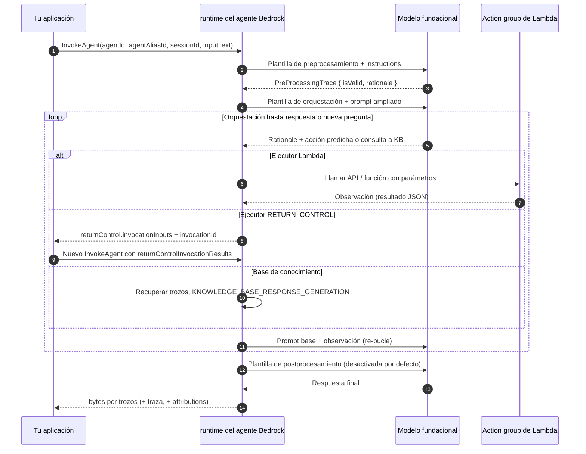
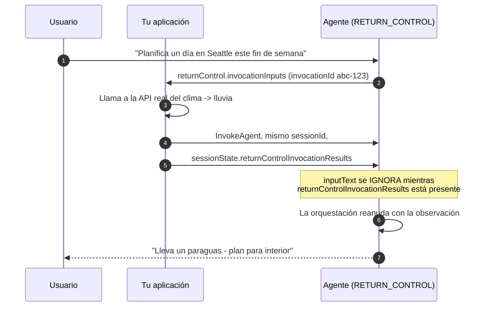
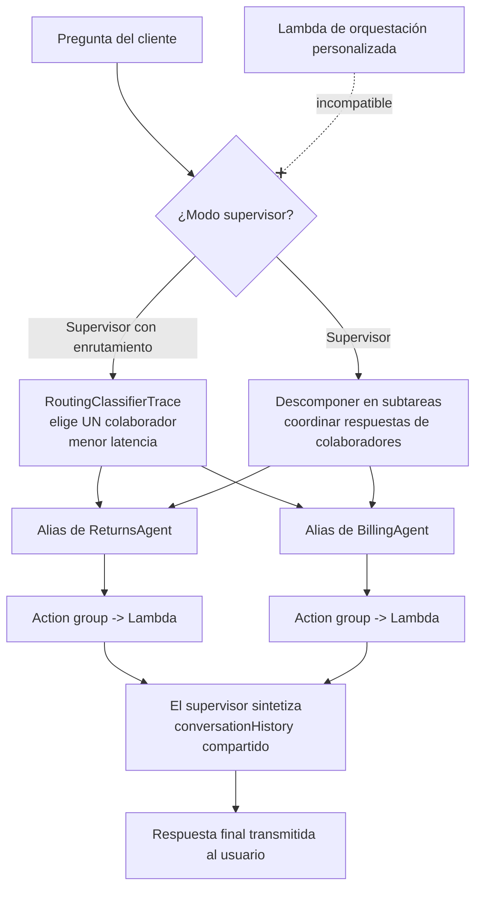
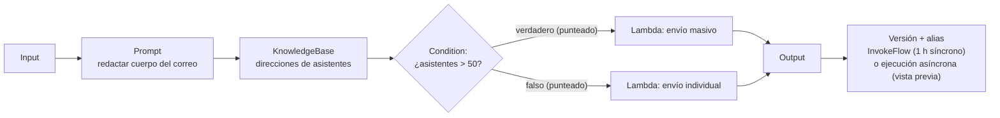
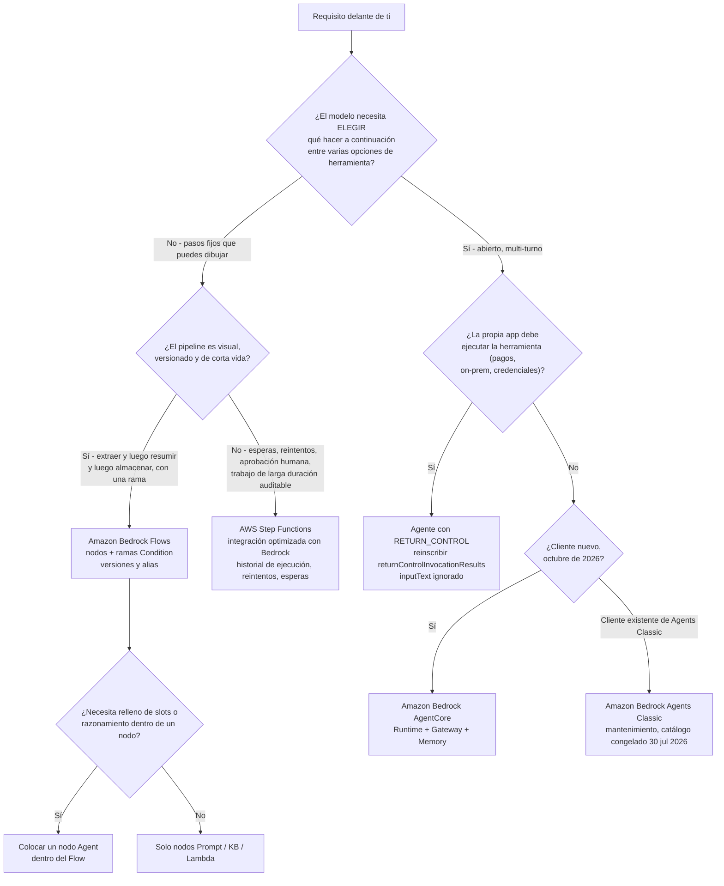

# Agentes, Flows y orquestación en Amazon Bedrock

Todo lo de este curso hasta ahora ha sido sobre **una sola llamada al modelo**: escribe un prompt, obtén una completion, evalúala. La IA en producción rara vez es una llamada. Es una *secuencia* — buscar algo, comprobar una condición, llamar a una API, hacer una pregunta de seguimiento al usuario, intentarlo de nuevo — y el examen tiene un vocabulario dedicado para quién es dueño de esa secuencia: **tú** (el código de tu aplicación), **el modelo** (un agente que elige acciones en tiempo de ejecución), **un grafo que dibujaste** (Amazon Bedrock Flows), o **una máquina de estados** (AWS Step Functions). La Lección 11 trata sobre esa decisión de propiedad, y sobre los servicios de AWS que implementan cada respuesta.

```text
====================================================================
 ¿QUIÉN ES DUEÑO DEL SIGUIENTE PASO?        (Digesto: 6 oct 2026)
====================================================================
  TU CÓDIGO .......... Converse + toolConfig (el modelo propone
                       JSON, tu app ejecuta la función)
  EL MODELO ........... agente de Amazon Bedrock: preprocesamiento
                       -> bucle de orquestación (fundamentación ->
                       acción -> observación) -> postprocesamiento
  EL GRAFO ............ Amazon Bedrock Flows (ex-«Prompt Flows»):
                       nodos Input/Prompt/KB/Condition/Lambda/Agent
  LA DEFINICIÓN ....... AWS Step Functions: máquina de estados
                       determinista, reintentos, esperas,
                       aprobación humana
--------------------------------------------------------------------
  NOMBRES QUE DEBES SABER
    Amazon Bedrock Agents Classic ... cerrado a clientes nuevos
                                       30 jul 2026 (mantenimiento)
    Amazon Bedrock AgentCore ......... sucesor (GA, 9 regiones)
    Amazon Bedrock Flows ............. GA 22 nov 2024 (ex-Prompt
                                       Flows), facturado por
                                       transición de nodo
    Amazon Bedrock Prompt Management . prompts guardados y
                                       versionados
====================================================================
```

> [!NOTE]
> **Cómo leer esta lección.** Tres reglas aplican durante todo el texto. (1) **La nomenclatura es examinable**: AWS renombró «Agents for Amazon Bedrock» a **Amazon Bedrock Agents Classic** y «Prompt Flows» a **Amazon Bedrock Flows**, y la lista de alcance del AIF-C01 ahora dice **Amazon Bedrock AgentCore**. (2) **Los mecanismos vencen a las listas memorizadas**: el bucle, la unión de ejecutores y el contrato `sessionState` cambian poco; el catálogo de modelos dentro de un agente está congelado. (3) **Todo lo que AWS no confirma de primera parte se señala**, nunca se enseña como material de memorización — las marcas se recogen al final de la lección.

Al final de esta lección podrás:

- nombrar los cuatro componentes de construcción que todo agente necesita y los opcionales que AWS lista a su lado;
- recorrer el bucle en tiempo de ejecución — preprocesamiento, orquestación, postprocesamiento — y decir cuál de las cuatro plantillas de prompt base es editable en cada fase;
- elegir entre un **esquema OpenAPI** y **function details**, y entre un **ejecutor Lambda** y **`RETURN_CONTROL`**;
- enunciar el contrato de `InvokeAgent`: parámetros obligatorios, el techo de 2.048 caracteres de `inputText`, los ámbitos de `sessionState` y qué pasa con `inputText` en una reinscripción de retorno de control;
- describir la memoria del agente (`SESSION_SUMMARY`, 1–365 días) y las cuotas de gestión de sesiones;
- configurar la **colaboración multi-agente** (≤ 10 alias de colaboradores, dos modos) y explicar por qué la orquestación personalizada es incompatible con ella;
- listar los **16 tipos de nodo de Flows**, los dos tipos de conexión y los límites de ejecución (1 h síncrono, 5 min/nodo y 24 h asíncrono en vista previa);
- defender el **veredicto comparativo**: agente frente a prompt simple frente a workflow frente a código.

---

## 1. Tres nombres, tres servicios: Agents Classic, AgentCore y Flows

### 1.1 Los renombramientos que deciden el examen

Dos renombramientos llevan más puntos que cualquier otro hecho de esta lección:

1. **«Amazon Bedrock Agents» / «Agents for Amazon Bedrock» → Amazon Bedrock Agents Classic.** AWS lo colocó bajo *Servicios que pasan a mantenimiento* en su **Actualización de Disponibilidad de Servicios del 30 de junio de 2026**: **cerrado a clientes nuevos desde el 30 de julio de 2026**, **sin características nuevas**, y un **catálogo de modelos fundacionales congelado el 30 de julio de 2026**. Los clientes existentes no se ven afectados, y los modelos de Amazon Bedrock, Knowledge Bases y Guardrails están explícitamente *no* afectados. No hay excepciones al corte de clientes nuevos.
2. **«Prompt Flows» → Amazon Bedrock Flows**, disponible generalmente el **22 de noviembre de 2024**, que añadió visibilidad de ejecución por paso y soporte de Guardrails en los nodos de prompt y de base de conocimiento. El nombre antiguo solo sobrevive en algunas listas de alcance de certificación.

El destino de migración documentado para Agents Classic es **Amazon Bedrock AgentCore** — un conjunto de seis componentes (Runtime, Gateway, Identity, Memory, Observability y Harness) que se vio en vista previa en **julio de 2025**, alcanzó GA en **nueve regiones** y siguió publicándose durante 2026 (**Managed Knowledge Base GA en junio de 2026**, **Agent Registry GA en agosto de 2026**).

| Característica (nombre oficial actual) | Estado en octubre de 2026 | Fecha clave |
|---|---|---|
| **Amazon Bedrock Agents Classic** | Mantenimiento — sin clientes nuevos, sin características nuevas, catálogo de FM congelado | 30 jul 2026 |
| **Amazon Bedrock AgentCore** | GA en nueve regiones, versiones mensuales | Vista previa jul 2025 |
| **Amazon Bedrock Flows** (ex-Prompt Flows) | GA; facturado por transición de nodo | 22 nov 2024 |
| Flows: **ejecuciones de flow asíncronas** | **Vista previa** — ≤ 5 min por nodo, ≤ 24 h por flow | 11 jul 2025 |
| Flows: **conversación multi-turno** | **Vista previa** — `INPUT_REQUIRED` → respuesta → `SUCCESS` | 2026 |
| **Colaboración multi-agente** | GA (vista previa el 3 dic 2024) | 2024–25 |
| **Retorno de control**; **memoria del agente** | GA | 2024–26 |
| **Amazon A2I** (Augmented AI) | Sin clientes nuevos, sin características nuevas; **eliminado de la lista de alcance del AIF-C01** | jun/jul 2026 |
| Nombre **«Prompt Flows»** | Sustituido por Amazon Bedrock Flows | 22 nov 2024 |

> [!WARNING]
> **No respondas una pregunta del AIF-C01 con un nombre sustituido.** Si una opción dice *«crear un Prompt Flow»* o *«añadir un modelo nuevo a mi agente de Bedrock»*, léelo como una trampa: Prompt Flows se convirtió en **Amazon Bedrock Flows** en noviembre de 2024, y un agente de **Agents Classic** no puede recibir modelos fundacionales nuevos después del **30 de julio de 2026**. La respuesta que aprueba describe el servicio *actual* — **Flows** para grafos, **AgentCore** para construcciones nuevas de agente — o reconoce explícitamente el estado de mantenimiento.

> **📚 ¿Sabías que…?** AgentCore no es un agente renombrado — es una descomposición. Sus seis componentes mapean a piezas que solían vivir dentro de un único agente: **Runtime** (el bucle de invocación), **Gateway** (exposición de herramientas/APIs), **Identity**, **Memory**, **Observability** (trazas y telemetría) y **Harness** (empaquetado). Esa es la razón por la que la guía de migración de AWS habla de mover *capacidades*, no de una actualización con un clic de un ID de agente existente.

### 1.2 Qué pregunta oficialmente el examen sobre agentes

La guía del examen AIF-C01 es la autoridad para el alcance, y su contenido agéntico se sitúa en dos lugares:

| Objetivo / peso | Qué dice AWS | Cobertura en la lección |
|---|---|---|
| **2.3.1** — Servicios GenAI | Bedrock, SageMaker AI, JumpStart, Amazon Q, Kiro, Strands Agents, **AgentCore** | §1, §7, §9 |
| **Conceptos agénticos del Dominio 2** | *Patrones multi-agente, MCP, gestión de memoria, uso de herramientas, orquestación de workflows* | §4, §5, §6, §7 |
| **3.1.6** | *«Define el papel de los agentes de IA y describe sus aplicaciones de negocio.»* | §8, §9 |
| Pesos de dominio | **20 / 24 / 28 / 14 / 14 %** (Dominios 1–5) | — |

Se publicaron dos cambios de alcance para esta versión del examen: **se añadieron AgentCore, Kiro, Strands Agents, Amazon Q, SageMaker JumpStart y AWS Transform**, y **se eliminó Amazon MemoryDB**. Amazon A2I, una vez listado en la guía del examen v1.4 (2024), ya no está en la lista de alcance actual.

---

## 2. Anatomía de un agente

### 2.1 El mínimo de construcción

La propia formulación de AWS sobre lo que está hecho un agente es precisa y merece memorizarse como una frase: un modelo fundacional, **instructions**, opcionalmente plantillas de prompt base o avanzadas, y **al menos uno de: action groups o knowledge bases**. La memoria, Guardrails, la interpretación de código y la colaboración multi-agente son todos complementos opcionales.

| Componente | Rol en construcción | Rol en tiempo de ejecución |
|---|---|---|
| **Modelo fundacional** | Elegido por agente (catálogo de Classic congelado el 30 jul 2026) | Fundamentación, predicción de acción, lectura de observaciones, respuesta final |
| **Instructions** | Descripción del puesto en lenguaje natural para el agente | Se inyectan en el prompt base ampliado en **cada** paso de orquestación |
| **Plantillas de prompt base/avanzadas** | **4** plantillas; puedes sobreescribir texto, parser o `overrideLambda` | Dirigen preprocesamiento, orquestación, generación de respuesta de KB y postprocesamiento |
| **Action group — esquema OpenAPI** | Documento OpenAPI alojado en S3 o en línea | El agente selecciona la ruta/verbo de la API; los parámetros van a un evento Lambda o al retorno de control |
| **Action group — function details** | Funciones con `name`, tipos de datos y flags `required` | El agente **primero solicita al usuario los parámetros requeridos que faltan** |
| **Ejecutor** | ARN de Lambda **o** `customControl: RETURN_CONTROL` | Ejecuta la acción, o devuelve la invocación a tu aplicación |
| **Asociación de base de conocimiento** | Adjuntar una KB existente | Recuperación dentro del bucle de orquestación → `KNOWLEDGE_BASE_RESPONSE_GENERATION` |
| **Memoria** | Habilitar + `storageDays` (**1–365**) | Carga resúmenes para un `memoryId`; resumido asíncrono tras el fin de la sesión |
| **Guardrails** | Adjuntar un guardrail | Produce `GuardrailTrace`; `applyGuardrailInterval` controla la cadencia de streaming |
| **Colaboración multi-agente** | Marcar agente como supervisor; adjuntar **alias** de colaboradores (≤ 10) | Planificar o enrutar; `conversationHistory` compartido entre agentes |
| **Versión / alias** | `PrepareAgent` → versión → **alias** | Solo puedes invocar con un `agentAliasId` |
| **Interpretación de código** | Habilitar | El código generado por el FM se ejecuta en un sandbox seguro |

Dos filas merecen énfasis propio. Primero, **alias**: `InvokeAgent` requiere `agentAliasId`, nunca un ID de agente desnudo — un agente en borrador que nunca has preparado y aliasado no puede llamarse. Segundo, **function details frente a OpenAPI**: son alternativas, no capas. Un action group usa exactamente **uno** de los dos esquemas, y la unión de ejecutores (`ARN de Lambda | RETURN_CONTROL`) aplica a ambos.

### 2.2 Ejemplo 1 — construir un agente de viajes (en construcción)

1. Crea el agente y dale **instructions**: *«Eres un agente de viajes. Reserva el vuelo más barato que cumpla la normativa. Nunca inventes precios; llama siempre a FlightsAPI.»*
2. Elige un **modelo fundacional** del catálogo disponible para Agents Classic en tu cuenta.
3. Añade un **action group** `FlightsAPI` con un **esquema OpenAPI** que describa `searchFlights` y `bookFlight`.
4. Fija el **ejecutor** a un **ARN de Lambda** (la Lambda valida IAM, llama a la API de la aerolínea y devuelve JSON).
5. Opcionalmente adjunta una **base de conocimiento** de políticas de viaje corporativas, un **guardrail** que bloquee números de tarjeta y **memoria** con `storageDays = 90`.
6. `PrepareAgent` → anota la **versión** → crea un **alias** (por ejemplo `T1`).
7. Entrega a la aplicación `agentId` + `agentAliasId` y llama a `InvokeAgent`.

Nada de lo anterior es autónomo todavía: la autonomía aparece solo en tiempo de ejecución, en el bucle que el modelo dirige.

---

## 3. Tiempo de ejecución: el bucle de orquestación

### 3.1 Las tres fases, en orden

Toda llamada a `InvokeAgent` pasa por el **preprocesamiento**, luego un **bucle de orquestación** que se repite hasta que existe una respuesta o se vuelve a preguntar al usuario, y luego el **postprocesamiento** (desactivado por defecto). El propio bucle tiene un ritmo interno fijo: el modelo produce una **fundamentación (rationale)**, predice una **llamada a un action group o una consulta a la base de conocimiento**, los parámetros van a Lambda *o* de vuelta a tu aplicación a través del retorno de control, el resultado regresa como una **observación**, la observación se añade al prompt base, y el bucle se repite.



Tres consecuencias se desprenden de ese diagrama y cada una ha sido probada:

- **El coste escala con las iteraciones, no con las peticiones.** Cada vuelta del bucle es otra invocación del modelo fundacional contra el prompt ampliado — que es la razón por la que un agente es más caro que un único prompt para la misma pregunta.
- **El retorno de control es una *segunda* llamada a `InvokeAgent`**, no un campo que puedes rellenar después en la misma petición. Tu aplicación ejecuta la herramienta y se reinscribe.
- **Las observaciones, no el historial de chat, dirigen los resultados de las herramientas.** El resultado de una acción se añade al prompt base para que el modelo pueda razonar sobre él en la siguiente iteración.

### 3.2 Las cuatro plantillas base editables

| Plantilla | Fase | `ModelInvocationInput.type` | Editable por ti |
|---|---|---|---|
| Preprocesamiento | antes del bucle | `PRE_PROCESSING` | Sí — texto, parser, `overrideLambda` |
| Orquestación | dentro del bucle | `ORCHESTRATION` | Sí — texto, parser, `overrideLambda` |
| Generación de respuesta de KB | cuando se consulta una KB | `KNOWLEDGE_BASE_RESPONSE_GENERATION` | Sí — texto |
| Postprocesamiento | después del bucle | `POST_PROCESSING` | Sí — y **desactivado por defecto** |

AWS documenta **cuatro** plantillas base como sobrescribibles. Los prompts avanzados te permiten reemplazar el texto por completo; `promptCreationMode` y `parserMode` en la traza te dicen si un valor vino de `DEFAULT` o de `OVERRIDDEN` — que es tu evidencia de auditoría de que una sobreescritura está activa.

### 3.3 Tipos de traza: siete objetos que responden siete preguntas

Con `enableTrace = true` el runtime transmite eventos de traza junto a los eventos `chunk`. Hay **7** tipos de objetos de traza:

| Objeto de traza | `type` | La pregunta que responde |
|---|---|---|
| `PreProcessingTrace` | `PRE_PROCESSING` | ¿Fue válida la petición? `isValid` + rationale |
| `OrchestrationTrace` | `ORCHESTRATION` | Rationale → `InvocationInput` (action group, verbo, `apiPath`, función, parámetros, `executionType`) → `Observation` |
| Generación de respuesta de KB | `KNOWLEDGE_BASE_RESPONSE_GENERATION` | Qué trozos se recuperaron, y qué se generó a partir de ellos |
| `PostProcessingTrace` | `POST_PROCESSING` | ¿Cómo se formateó la respuesta final? |
| `RoutingClassifierTrace` | `ROUTING_CLASSIFIER` | ¿A qué colaborador eligió el supervisor? |
| `CustomOrchestrationTrace` | — (impulsado por eventos) | ¿Qué orden aplicó *tu* Lambda orquestadora? |
| `GuardrailTrace` / `FailureTrace` | — | ¿Qué acción de guardrail se disparó / por qué falló la ejecución (`FailureTrace` no lleva `ModelInvocationInput`) |

### 3.4 Ejemplo 2 — una petición de reserva, traza por traza

1. La aplicación llama a `InvokeAgent` con `agentId`, `agentAliasId`, `sessionId = S1`, `inputText = "Reserva el vuelo más barato a Denver el viernes próximo"` (**≤ 2.048 caracteres**) y `enableTrace = true`.
2. El **preprocesamiento** valida la petición → `PreProcessingTrace { isValid: true, rationale }`.
3. **Orquestación, iteración 1**: rationale → predecir `FlightsAPI.searchFlights` → `InvocationInput { apiPath, parameters }` → Lambda ejecuta → `Observation` que contiene la lista JSON de vuelos.
4. **Iteración 2**: falta un parámetro requerido (`travelerId`) → la **Observación devuelta vuelve a preguntar al usuario**: *«¿Para qué viajero debo reservar?»* (AWS documenta este comportamiento explícitamente).
5. El usuario responde **en el mismo `sessionId`** → la acción se ejecuta → nueva `Observation`.
6. **Postprocesamiento** (si está habilitado) formatea la respuesta → la aplicación recibe `chunk.bytes` como *«Reservado UA 512…»*, más un objeto `attribution` si se usó una base de conocimiento. Las trazas se transmiten junto a los trozos.

```dragdrop
{
  "question": "Ordena las fases en tiempo de ejecución de una llamada a un agente de Bedrock como las documenta AWS:",
  "items": [
    "Paso 4 - bucle de orquestación: rationale, predecir acción o consulta a KB, invocar, recibir observación, re-bucle",
    "Paso 1 - InvokeAgent llega con agentAliasId, sessionId y un inputText de máximo 2.048 caracteres",
    "Paso 2 - el preprocesamiento valida la petición y emite PreProcessingTrace",
    "Paso 3 - el prompt base ampliado se construye a partir de instructions más el estado de conversación",
    "Paso 5 - el postprocesamiento formatea la respuesta final (desactivado por defecto) y los trozos se transmiten de vuelta"
  ],
  "correctOrder": [
    "Paso 1 - InvokeAgent llega con agentAliasId, sessionId y un inputText de máximo 2.048 caracteres",
    "Paso 2 - el preprocesamiento valida la petición y emite PreProcessingTrace",
    "Paso 3 - el prompt base ampliado se construye a partir de instructions más el estado de conversación",
    "Paso 4 - bucle de orquestación: rationale, predecir acción o consulta a KB, invocar, recibir observación, re-bucle",
    "Paso 5 - el postprocesamiento formatea la respuesta final (desactivado por defecto) y los trozos se transmiten de vuelta"
  ],
  "explanation": "El orden documentado es preprocesamiento, luego el bucle de orquestación (rationale -> acción predicha o consulta a KB -> invocación -> observación -> re-bucle) hasta que existe una respuesta o se vuelve a preguntar al usuario, y luego postprocesamiento, que está desactivado por defecto. El bucle es lo que hace autónomo a un agente: cada iteración es una llamada nueva al modelo fundacional contra el prompt ampliado, así que el coste y la latencia crecen con las iteraciones y no con las peticiones."
}
```

> **📚 ¿Sabías que…?** El `OrchestrationTrace` es donde puedes probar qué hizo realmente tu agente: `InvocationInput` registra el **action group, el verbo HTTP, el `apiPath` o nombre de función, los parámetros resueltos y el `executionType`**, y `Observation` registra lo que regresó. Cuando un stakeholder pregunta «¿por qué el agente llamó a la API de pago?», la traza — no CloudTrail — es el primer lugar donde mirar, porque CloudTrail ve la invocación de Lambda pero no la fundamentación del modelo para elegirla.

### 3.5 Leer una traza: síntoma → objeto de traza → arreglo

| Síntoma en producción | Objeto de traza a abrir | Qué te dice la traza | Arreglo típico |
|---|---|---|---|
| El agente responde disparates ante una petición mal formada | `PreProcessingTrace` | `isValid` y la fundamentación del modelo | Estrecha las instructions; la ejecución debería detenerse aquí |
| El agente llama a la API equivocada | `OrchestrationTrace` → `InvocationInput` | Action group, verbo, `apiPath`, parámetros resueltos, `executionType` | Estrecha las descripciones del action group; añade ejemplos a las instructions |
| La respuesta ignora el texto de política recuperado | Traza de generación de respuesta de KB | Trozos recuperados vs. respuesta generada | Arregla troceado/recuperación, no el prompt |
| El agente nunca formatea la respuesta final como se requiere | `PostProcessingTrace` | Si el postprocesamiento se ejecutó (está desactivado por defecto) | Habilita y edita la cuarta plantilla base |
| El supervisor eligió el colaborador equivocado | `RoutingClassifierTrace` | La decisión de enrutamiento | Renombra/describe los alias de colaboradores con más precisión |
| El orquestador personalizado ejecutó pasos en el orden equivocado | `CustomOrchestrationTrace` | El orden de pasos de tu Lambda orquestadora | Arregla el orquestador; esta traza existe solo para orquestación personalizada |
| La ejecución se detuvo sin input de modelo alguno | `FailureTrace` | Motivo del fallo; no lleva **ningún** `ModelInvocationInput` | Lee el motivo del fallo y vuelve a ejecutar |
| Un guardrail bloqueó una respuesta aparentemente válida | `GuardrailTrace` | Qué acción de guardrail se disparó | Ajusta el guardrail o `applyGuardrailInterval` |

---

## 4. Grupos de acción, retorno de control y uso crudo de herramientas

### 4.1 Dos estilos de esquema, dos ejecutores

Un action group se define con **exactamente un** estilo de esquema y **exactamente un** ejecutor:

| Herramienta / tipo de acción | Dónde se define | Ejecutor | Esquema | Nota clave |
|---|---|---|---|---|
| **Action group OpenAPI** | `apiSchema` (S3 o en línea) | Lambda **o** `RETURN_CONTROL` | Rutas, verbos y parámetros OpenAPI | El agente selecciona la operación de la API en tiempo de ejecución |
| **Function details** | `functionSchema` | Lambda **o** `RETURN_CONTROL` | Funciones + parámetros (`name`, tipo, `required`) | El agente **solicita primero los parámetros requeridos que faltan** |
| **Retorno de control** | `customControl: RETURN_CONTROL` | **Tu aplicación**, luego reinscribir | `invocationInputs` + `invocationId` | `inputText` se ignora en la reinscripción; `responseState` `FAILURE`/`REPROMPT`; `confirmationState` `CONFIRM`/`DENY` |
| **Base de conocimiento** | Asociación de KB | Recuperación gestionada por Bedrock | — | Emite la traza de generación de respuesta de KB |
| **`toolSpec` de `toolConfig` en Converse** | Tu app, **fuera** de agentes | Tu código | `{name, description, inputSchema.json}` | El modelo solo propone JSON (`stopReason = toolUse`) |
| **`systemTool` (integrado)** | Unión `toolConfig` de Converse | Gestionado por Bedrock | nombre de la herramienta | El soporte varía según el modelo |
| **Orquestación personalizada** | Lambda a nivel de agente | Tu Lambda ordena las acciones | contrato de eventos | `CustomOrchestrationTrace`; **incompatible con la colaboración multi-agente** |
| **Nodos de Flow como herramientas** | Definición del Flow | Lambda / Storage / Retrieval / KB / Agent / Lex | configuración del nodo | Flows solo llama a lo que tú conectaste |

Dos límites que vale la pena citar: la `description` de un action group va de **1 a 200 caracteres**, y un ejecutor es un **tipo unión** — un ARN de Lambda *o* `customControl: RETURN_CONTROL`, nunca ambos.

### 4.2 Ejemplo 3 — retorno de control, el escenario oficial del clima

Usa el retorno de control cuando **tu aplicación** deba ejecutar la llamada — un carril de pagos privado, un sistema on-premises, una credencial que Bedrock quizá no deba tener.

1. Crea el action group `WeatherAPIs` con la función `getWeather(location, date)` y el ejecutor `customControl = RETURN_CONTROL`.
2. El usuario dice *«Planifica un día en Seattle este fin de semana.»* → la orquestación predice `getWeather`.
3. La respuesta lleva `returnControl.invocationInputs` con `invocationId = abc-123` y los parámetros `{location: seattle, date: 2024-09-15}`.
4. **Tu aplicación** llama a la API real del clima → la respuesta es *lluvia*.
5. Llamas a `InvokeAgent` **otra vez con el mismo `sessionId`**, suministrando `sessionState.returnControlInvocationResults = [{ functionResult: { actionGroup, function, responseBody: { TEXT: { body: "{\"cond\":\"rain\"}" } } } }]` con el **`invocationId` correspondiente** — y **`inputText` se ignora** porque `returnControlInvocationResults` está presente.
6. La orquestación reanuda: *«Lleva un paraguas; aquí tienes un plan para interior…»*. Variantes: `responseState = REPROMPT` devuelve un resultado de herramienta fallido para un reintento; `responseState = FAILURE` falla la ejecución con un error de dependencia; `confirmationState = CONFIRM | DENY` implementa una verificación de **confirmación del usuario previa a la acción**.



### 4.3 Ejemplo 4 — relleno de slots con function details

1. La función es `BookHotel(HotelName/required, CheckinDate/required, NumberOfNights/optional, Email/required, AllowMarketingEmails/required)`.
2. El usuario dice *«Reserva el Hotel X para mañana»* → el agente rellena `HotelName` y `CheckinDate`.
3. Dos parámetros **required** son desconocidos → el agente **pregunta al usuario**: *«¿Cuál es tu correo electrónico? ¿Podemos enviarte promociones?»*
4. El usuario responde en dos turnos (los valores con ámbito de turno viven en `promptSessionAttributes`) → todos los parámetros requeridos están presentes → la acción se ejecuta → se devuelve una confirmación.

**La solicitud de slots es el discriminador canónico entre agente y prompt.** Un prompt simple no puede *esperar* a un parámetro requerido que falta, llamar a una API y luego reanudar — un agente hace exactamente eso, dirigido por la observación de que falta un parámetro.

### 4.4 Uso crudo de herramientas sin un agente

El function calling también existe **sin** ningún agente, en la API Converse: pasas `toolConfig.tools[].toolSpec { name, description, inputSchema.json }` (más `toolChoice`), el modelo devuelve JSON con `stopReason = toolUse`, **tu aplicación ejecuta la función**, y envías un `toolResult` de vuelta. El modelo **nunca ejecuta la función** — esa frontera es todo el punto, y es la forma más fiable de distinguir una pregunta de *herramienta* de una pregunta de *agente*.

| Señal de pregunta | Mecanismo correcto |
|---|---|
| «El modelo debe decidir cuál de mis funciones llamar, pero mi código las ejecuta» | Uso de herramientas con `toolConfig` de Converse |
| «El servicio debe planear, llamar herramientas a través de turnos y volver a preguntar por slots que faltan» | **Action group de agente** |
| «Mi aplicación debe ejecutar la llamada por razones de seguridad/cumplimiento» | Action group con `RETURN_CONTROL` |
| «El orden de pasos es fijo y auditable» | **Flows** o **Step Functions** |

> [!WARNING]
> **El contrato de reinscripción de retorno de control es exacto.** Debes reutilizar el **mismo `sessionId`**, el **mismo `invocationId`**, y los mismos nombres de `actionGroup`/`function`; debes enviar el resultado a través de `sessionState.returnControlInvocationResults`; y mientras ese campo esté presente, **`inputText` se ignora** — así que una reinscripción que además lleve una nueva pregunta de usuario descarta silenciosamente la pregunta. Las opciones que afirman que necesitas un `sessionId` nuevo, un `invocationId` nuevo, o que `inputText` debe repetir la petición original son todas incorrectas.

---

## 5. InvokeAgent, estado de sesión y memoria

### 5.1 El contrato de la petición

| Parámetro | Regla |
|---|---|
| `agentId` | El identificador del agente |
| `agentAliasId` | **Obligatorio y debe ser un alias** — nunca el ID desnudo del agente |
| `sessionId` | Clave de la conversación; las reinscripciones de retorno de control deben reutilizarlo |
| `inputText` | **≤ 2.048 caracteres** |
| `enableTrace` | Transmite los 7 tipos de objetos de traza junto a los trozos |
| `endSession` | Termina la sesión y, con la memoria activada, pliega la sesión en un `memoryId` |
| `memoryId` | Carga los resúmenes almacenados para memoria entre sesiones |
| `sessionState` | Atributos, historial de conversación, resultados de retorno de control, overrides de KB |
| `streamingConfigurations` | `streamFinalResponse`, `applyGuardrailInterval` |

La respuesta transmite **`chunk` + `trace` + `attributions` + `returnControl`**, y las cabeceras de la respuesta incluyen **`x-amz-bedrock-agent-session-id`** y, cuando se usa memoria, **`x-amz-bedrock-agent-memory-id`**.

```text
POST /agents/<agentId>/agentAliases/<agentAliasId>/invoke   <-- el alias es obligatorio
  headers: Authorization (SigV4), X-Amz-Target
{
  "inputText": "Reserva el vuelo más barato a Denver ...",   <-- MÁX 2048 caracteres
  "sessionId": "S1",                                        <-- reutilizar al reinscribir
  "enableTrace": true,
  "endSession": false,
  "memoryId": "M-user-42",                                  <-- opcional, entre sesiones
  "streamingConfigurations": {
      "streamFinalResponse": true,
      "applyGuardrailInterval": 5                           <-- cadencia del guardrail
  },
  "sessionState": {
      "sessionAttributes":          {"locale": "es-ES"},    <-- toda la sesión
      "promptSessionAttributes":    {"tier": "gold"},       <-- un solo turno
      "conversationHistory":        [...],                  <-- multi-agente
      "knowledgeBaseConfigurations":[...],                  <-- KB por petición
      "returnControlInvocationResults": [ { "functionResult": {
          "actionGroup": "WeatherAPIs",
          "function": "getWeather",
          "invocationId": "abc-123",
          "responseBody": {"TEXT": {"body": "{\"cond\":\"rain\"}"}}
      } } ]                      <-- si está presente, inputText se IGNORA
  }
}
Response: event stream
  -> chunk      (bytes de la respuesta)  -> attribution (fuentes de la KB)
  -> trace      (7 tipos de traza)       -> returnControl (invocationInputs)
  headers: x-amz-bedrock-agent-session-id, x-amz-bedrock-agent-memory-id
Nota: la CLI de AWS no puede consumir este event stream - usa un lector de SDK.
```

### 5.2 `sessionState`: cinco ámbitos, una regla de override

| Campo | Ámbito | Propósito |
|---|---|---|
| `sessionAttributes` | **Toda la sesión** | Hechos estables (locale, nivel de cuenta) que se transportan entre turnos |
| `promptSessionAttributes` | **Un turno** | Valores que deben expirar tras el turno actual |
| `conversationHistory` | Multi-agente | Historial compartido cuando el historial conversacional está activado |
| `returnControlInvocationResults` | Reinscripción | Resultados de herramientas; **cuando están presentes, `inputText` se ignora** |
| `knowledgeBaseConfigurations` | Por petición | Overrides de base de conocimiento por petición |

### 5.3 Ejemplo 5 — memoria entre sesiones

1. En la sesión `S1` el usuario dice *«Soy alérgico a los mariscos»*; la aplicación llama a `InvokeAgent` con `endSession = true`.
2. `S1` se pliega en **`memoryId = M-user-42`** y el resumido asíncrono escribe un resumen usando la plantilla de resumido (editable).
3. Después, `InvokeAgent(sessionId = S2, memoryId = M-user-42, inputText = "Sugiere un entrante")` carga los resúmenes almacenados → la respuesta **excluye los mariscos**; la cabecera de respuesta `x-amz-bedrock-agent-memory-id` confirma que se usó memoria.
4. `storageDays = 90` significa que los resúmenes más antiguos se purgan tras 90 días; **desactivar la memoria** devuelve el contexto de sesión única por defecto.

Los hechos sobre la memoria en un solo lugar: el **único** tipo de memoria es **`SESSION_SUMMARY`**, la retención es de **1–365 días** (`storageDays`), los desencadenantes del plegado son **`endSession = true` en el mismo `sessionId`** o el vencimiento del **`idleSessionTimeout`**, el resumido se ejecuta **de forma asíncrona** con una plantilla editable, y lees los resúmenes con **`GetAgentMemory`** (o la pestaña Memory de la consola).

### 5.4 Cuotas de gestión de sesiones (separadas de la memoria)

| Cuota | Valor |
|---|---|
| Pasos por sesión | **≤ 1.000** |
| Tamaño por paso | **≤ 50 MB** |
| Timeout por inactividad | **1 hora** |
| Eliminación automática | **30 días** |
| Integración con LangGraph | `BedrockSessionSaver` |

> **📚 ¿Sabías que…?** **La CLI de AWS no puede transmitir `InvokeAgent`.** Transmitir los eventos `chunk` y `trace` requiere un SDK con manejo de event-stream (por ejemplo boto3/Java/Node con el lector de stream de respuestas). Este es un percance operativo real — y un distractor favorito: *«habilita el streaming con `aws bedrock-agent-runtime invoke-agent --no-cli-pager`»* no existe. Usa `enableTrace = true` más un lector de stream del SDK, y lee la sesión de vuelta desde la cabecera de respuesta `x-amz-bedrock-agent-session-id`.

---

## 6. Colaboración multi-agente

### 6.1 Un supervisor, como máximo diez colaboradores, dos modos

| Elemento | Regla |
|---|---|
| Colaboradores | **≤ 10 alias de colaboradores** adjuntados a un supervisor |
| Modo **Supervisor** | El supervisor **coordina y sintetiza** las respuestas de los colaboradores (descompone en subtareas) |
| Modo **Supervisor con enrutamiento** | El supervisor **enruta a uno** de los colaboradores → **menor latencia** |
| Historial | `conversationHistory` se construye automáticamente cuando el historial conversacional está activado |
| Conflicto | **La orquestación personalizada no puede combinarse con la colaboración multi-agente** |
| Cronología | Vista previa **3 dic 2024**; GA anunciado en noticias de AWS durante 2025 |

### 6.2 Ejemplo 6 — un supervisor de triaje

1. Despliega los colaboradores `ReturnsAgent` y `BillingAgent` y crea un **alias** para cada uno.
2. Promueve `TriageAgent` a supervisor, elige el modo **Supervisor con enrutamiento** y adjunta ambos alias (nunca más de 10).
3. El cliente pregunta *«¿Por qué me cobraron dos veces en marzo?»* → **`RoutingClassifierTrace`** registra la decisión → el supervisor invoca `BillingAgent` con `sessionState.conversationHistory`.
4. El action group de `BillingAgent` llama a Lambda → la respuesta final se sintetiza y se transmite de vuelta.
5. Si el requisito hubiera sido *«investigar devoluciones **y** facturación, y luego resumir»*, el modo correcto habría sido **Supervisor** a secas, que descompone la petición y coordina las respuestas de los colaboradores en lugar de elegir uno.



---

## 7. Amazon Bedrock Flows (antes Prompt Flows)

### 7.1 Qué es un Flow

Un Flow es un **grafo visual y declarativo de nodos** que dibujas en el Flow builder e invocas a través de `CreateFlow` → `PrepareFlow` → `InvokeFlow` (con **versiones y alias**, exactamente como los agentes). El modelo no elige los pasos — **el grafo lo hace**. Flows llegó a GA el **22 de noviembre de 2024** como «Amazon Bedrock Flows, anteriormente conocido como Prompt Flows», añadiendo visibilidad de ejecución por paso más Guardrails en los nodos de prompt y de base de conocimiento.

### 7.2 Los 16 tipos de nodo

| Nodo | Propósito | Nodo | Propósito |
|---|---|---|---|
| **Input** | Punto de entrada del flow | **Output** | Punto de salida / resultado |
| **Prompt** | Ejecutar un prompt (opcionalmente un prompt guardado de Prompt Management) | **KnowledgeBase** | Recuperar de una KB adjunta |
| **Agent** | Llamar a un agente de Bedrock dentro del grafo | **Condition** | Ramificar sobre una expresión |
| **Lex** | Nodo de conversación de Amazon Lex | **LambdaFunction** | Llamar a tu Lambda |
| **Storage** | Leer/escribir almacenamiento de objetos | **Retrieval** | Nodo de recuperación personalizado |
| **Iterator** | Recorrer una lista | **Collector** | Recoger resultados |
| **InlineCode** | Ejecutar código en línea (estado según la doc. de AWS en oct 2026) | **Loop** | Bucles estilo do-while |
| **LoopInput** | Alimentar el bucle | **LoopController** | Controlar la salida del bucle |

Las conexiones vienen de dos tipos: **conexiones de datos (sólidas)** que siempre transportan valores, y **condicionales (punteadas)** que se disparan solo cuando un nodo `Condition` se evalúa como verdadera. Los Guardrails pueden adjuntarse a los nodos **prompt** y **knowledge-base** — que es como logras aplicación de políticas dentro de un grafo en lugar de a su alrededor.

### 7.3 Ejemplo 7 — un pipeline de invitaciones con una rama

1. `CreateFlow` con un nombre y un rol IAM; conecta los nodos: `Input → Prompt (redactar el cuerpo del correo) → KnowledgeBase (direcciones de asistentes) → Condition (¿asistentes > 50?)`.
2. Rama **Sí** → nodo `Lambda` de envío masivo; rama **No** → nodo `Lambda` de envío individual; ambos convergen en `Output`. Las conexiones de datos son sólidas; las dos ramas condicionales son punteadas.
3. `PrepareFlow` → prueba dentro del Flow builder, inspeccionando la **entrada/salida por nodo**.
4. Crea una **versión** y un **alias**; la aplicación llama a `InvokeFlow` (síncrono, techo de **1 hora**) o inicia una **ejecución de flow asíncrona** (vista previa: **≤ 5 minutos por nodo**, **≤ 24 horas por flow**, instantánea vía `GetExecutionFlowSnapshot`, errores como `ExecutionTimedOut`).
5. Lee los `FlowTraceEvent` para visibilidad por paso; cambia el nodo `Prompt` por un nodo **Agent** cuando se requiera razonamiento — la API de conversación multi-turno está en **vista previa** (`INPUT_REQUIRED` → tu respuesta → `SUCCESS`).



### 7.4 Qué cuesta un Flow, y qué no hace

Los Flows se facturan **por transición de nodo**, además del consumo del modelo fundacional, de Lambda y de la base de conocimiento dentro de los nodos. El propio recorrido de precios de AWS cuenta una ejecución como **2 + 10×2 + 3 = 25 transiciones**; se anunció una tarifa de **$0.035 por 1.000 transiciones** para el **1 de febrero de 2025**, y la tarifa actual debería confirmarse en la página de precios de Bedrock antes de citarla. Dos límites para memorizar: las ejecuciones síncronas de `InvokeFlow` vencen a **1 hora**, y el trabajo de larga duración pertenece a las **ejecuciones de flow** asíncronas (vista previa: 5 minutos por nodo, 24 horas en total) o a **Step Functions**.

**Ejemplo resuelto — contar transiciones de nodo.** El recorrido de precios de AWS cobra una ejecución como **2 + 10×2 + 3 = 25 transiciones**: 2 para entrar y ramificar, un cuerpo de bucle de 10 iteraciones × 2 nodos, y 3 más para converger y salir. La lección es que **las transiciones, no los nodos, son la unidad facturable**:

| Forma del grafo | Nodos en el lienzo | Transiciones por ejecución |
|---|---:|---:|
| Línea recta `Input → Prompt → Output` | 3 | 2 |
| Rama tomada una vez (`Input → Prompt → Condition → 1 de 2 → Output`) | 6 | 4 |
| El ejemplo de precios documentado por AWS | 6 | **25** (2 + 10×2 + 3) |
| Mismo grafo, el bucle corre 50× en vez de 10× | 6 | **105** (2 + 50×2 + 3) |

| Modo de ejecución | Techo | Estado |
|---|---|---|
| `InvokeFlow` (síncrono) | **1 hora** | GA |
| Ejecución de flow asíncrona | **≤ 5 min por nodo, ≤ 24 h por flow** | **Vista previa** (11 jul 2025) |
| Conversación multi-turno de Flows | `INPUT_REQUIRED` → respuesta → `SUCCESS` | **Vista previa** (2026) |
| Facturación | **por transición de nodo** | GA desde el 22 nov 2024 |

> **📚 ¿Sabías que…?** La aritmética del ejemplo de precios — **2 + 10×2 + 3 = 25 transiciones de nodo** — es un recordatorio de que *los bucles no son gratis en un grafo*: un nodo revisado diez veces se factura diez veces. Eso es lo contrario de un agente, donde las iteraciones se facturan como tokens del modelo fundacional, y lo contrario de Step Functions, donde las transiciones se facturan como transiciones de máquina de estados más los servicios que llamas. Tres orquestadores, tres unidades de coste distintas.

---

## 8. Elegir: prompt, agente, Flows o Step Functions

### 8.1 El árbol de decisión



### 8.2 La matriz de decisión

| Criterio | **Prompt simple** (Converse / Prompt Management) | **Agente de Bedrock** (Classic / AgentCore) | **Bedrock Flows** | **Step Functions + Bedrock** |
|---|---|---|---|---|
| Metáfora | Una llamada al modelo, entra y sale | Bucle autónomo que *elige* acciones | Grafo declarativo que tú dibujas | Máquina de estados determinista |
| ¿Quién elige el siguiente paso? | **Tu código** | **El FM en tiempo de ejecución** | **El grafo** (+ nodos `Condition`) | **La definición** |
| Elección de herramienta multi-paso | ❌ hard-coded | ✅ rationale → acción → observación | ⚠️ solo rutas pre-conectadas | ✅ solo explícitas |
| Llamadas externas | Después de la respuesta, en tu app | Action groups (Lambda / OpenAPI / retorno de control) | Nodos Lambda / Storage / Retrieval | Integraciones / Lambda |
| Ramificación y bucles | Código de la aplicación | Implícito en el bucle de orquestación | `Condition`, `Iterator`/`Collector`, `Loop*` | Choice / Wait / Map / Parallel |
| Determinismo y auditoría | Alto | Bajo–medio (usa **trazas**) | Alto (traza del flow + versiones) | **El más alto** (historial de ejecución) |
| Aprobación humana | Código de la aplicación | Retorno de control + `CONFIRM`/`DENY` | Vía Lambda o efectos secundarios del agente | Patrón nativo de pausa/aprobación |
| Constructor visual | ❌ | Agent builder (semi-visual) | ✅ Flow builder, versiones, alias | ✅ Workflow Studio |
| Mejor encaje | «Resume / clasifica / ¿qué es X?» | Tareas multi-turno abiertas que necesitan elección de herramienta | Pipelines fijos con ramas y guardrails | Larga duración, auditable, reintentos, esperas |
| Unidad de coste | Tokens del FM | Tokens del FM **por iteración de orquestación** + Lambda/KB | FM/Lambda/KB + **$ por 1.000 transiciones de nodo** | Transiciones + servicios |
| Clientes nuevos (oct 2026) | ✅ | Classic ❌ / AgentCore ✅ | ✅ | ✅ |

### 8.3 Ejemplo 8 — tres requisitos, tres respuestas

1. **Extracción determinista → condición → escritura, con rollback A/B** → **Amazon Bedrock Flows**: dibuja el grafo, publica la versión `v2`, el alias apunta a `v1`, haz rollback moviendo el alias. Un alias de versión de Flow es exactamente el mecanismo A/B que un agente no tiene.
2. **Tarea multi-turno abierta donde el FM decide qué llamar** → **un agente** (AgentCore para una construcción nueva en octubre de 2026). La solicitud de slots, las nuevas preguntas y las observaciones son las pistas.
3. *«Esperar 3 días a la aprobación, reintentar 5 veces, y luego notificar»* → **AWS Step Functions**, cuya integración optimizada con Bedrock (anunciada en noviembre de 2023) incluye `InvokeModel`, `CreateModelCustomizationJob .sync` y una muestra documentada de *«Realiza encadenamiento de prompts con Bedrock»*. Ni Flows (techo de 1 h síncrono) ni un agente (sin temporizadores nativos largos) encajan.

```matching
{
  "question": "Haz corresponder cada requisito con el mecanismo de orquestación que AWS documenta para él:",
  "pairs": [
    {"left": "Resumir, clasificar o explicar en una sola pasada", "right": "Prompt simple en la API Converse - tu código es dueño de cada paso"},
    {"left": "Tarea multi-turno abierta con elección de herramienta y relleno de slots", "right": "Agente de Amazon Bedrock - fundamentación, predicción de acción, observación, re-bucle"},
    {"left": "Pipeline fijo con una rama condicional y rollback A/B", "right": "Amazon Bedrock Flows - nodos Condition más versiones y alias"},
    {"left": "Esperar días, reintentar con backoff, aprobación humana, historial de auditoría completo", "right": "AWS Step Functions - historial de ejecución, reintentos, esperas, Map y Parallel"},
    {"left": "Tu aplicación debe ejecutar la herramienta por cumplimiento", "right": "Action group con RETURN_CONTROL - reinscribir returnControlInvocationResults, inputText ignorado"},
    {"left": "Construcción de agente nueva en octubre de 2026", "right": "Amazon Bedrock AgentCore - Agents Classic está cerrado a clientes nuevos desde el 30 jul 2026"}
  ],
  "explanation": "Cada mecanismo es dueño del siguiente paso de forma distinta: tu código (prompt simple), el modelo en tiempo de ejecución (agente), el grafo que dibujaste (Flows) o la definición de la máquina de estados (Step Functions). Las palabras clave del examinador mapean limpiamente - «multi-turno, qué herramienta ahora» significa agente; «determinista, versionado, con ramas» significa Flows; «esperar, reintentar, aprobar, auditar» significa Step Functions; y «ejecutarlo nosotros mismos» significa retorno de control."
}
```

---

## 9. Veredicto comparativo

> [!IMPORTANT]
> **Veredicto comparativo — agente frente a prompt simple frente a workflow frente a código**
> - **Prompt simple (API Converse, opcionalmente Prompt Management)** es la respuesta cuando la tarea es **una sola llamada al modelo, entra y sale**: resumir, clasificar, extraer, explicar. Es la opción más barata, más determinista y más auditable, y es donde todo caso de uso debe empezar. **El código de tu aplicación** es dueño de cada paso posterior — si la secuencia importa, la secuencia vive en tu repo.
> - **Un agente de Bedrock (Agents Classic hoy, AgentCore para construcciones nuevas)** es la respuesta cuando **el modelo fundacional debe elegir qué hacer a continuación**: elegir entre action groups o bases de conocimiento, reunir parámetros requeridos que faltan a lo largo de varios turnos, volver a preguntar al usuario, y buclear hasta que exista una respuesta. Renuncias al determinismo (recupéralo con `enableTrace`) y pagas **por iteración de orquestación**, a cambio de la autonomía que de otro modo programarías a mano.
> - **Un workflow — Amazon Bedrock Flows** es la respuesta cuando la secuencia se **conoce de antemano y debe ser visible**: un grafo dibujado de nodos `Prompt`, `KnowledgeBase`, `Condition`, `Lambda` y `Agent` con **versiones y alias** para rollback, facturado **por transición de nodo**. Conservas el determinismo y ganas un constructor visual; pierdes la libertad del modelo para elegir un paso que no está en el grafo.
> - **Código — tu aplicación con `toolConfig` de Converse (o Step Functions para trabajo de larga duración)** es la respuesta cuando necesitas **control explícito y testeable**: el modelo propone JSON (`stopReason = toolUse`) y **tu código ejecuta la función**; Step Functions añade reintentos, esperas, aprobación humana y un historial de ejecución cuando una ejecución debe sobrevivir horas o días. Ni un agente ni un Flow reemplazan la pista de auditoría de una máquina de estados.
> - **Regla práctica para el examen:** *el modelo decide qué herramienta →* **agente**. *Yo dibujé los pasos →* **Flows**. *Yo escribí los pasos →* **código** (herramientas de Converse para pasos dentro de la petición, Step Functions para pasos entre peticiones). *Una llamada, sin seguimiento →* **prompt simple**. Y en octubre de 2026, una construcción de agente **nueva** significa **AgentCore**, porque Agents Classic está cerrado a clientes nuevos.

| Si la pregunta dice… | Respuesta | Por qué fallan las demás |
|---|---|---|
| «…debe decidir por sí misma qué API llamar» | **Agente** | Flows solo llama a nodos conectados; el código no tiene elección en tiempo de ejecución |
| «…determinista, versionado, diseñado visualmente, rollback» | **Flows** | Los agentes dejan que el FM elija; Step Functions es definido por código, no visual en Bedrock |
| «…el modelo devuelve un objeto JSON y nuestro servicio lo ejecuta» | **`toolConfig` de Converse** | Eso es uso crudo de herramientas; los action groups pertenecen a los agentes |
| «…esperar 3 días, reintentar 5×, aprobación humana» | **Step Functions** | Flows vencen a 1 h (síncrono); los agentes no tienen temporizadores nativos |
| «…nuestra aplicación debe ejecutar la API de pagos» | **`RETURN_CONTROL`** | Un ejecutor Lambda lo ejecutaría dentro de Bedrock en su lugar |
| «…cuenta recién creada, construir un agente hoy» | **AgentCore** | Agents Classic cerró a clientes nuevos el 30 jul 2026 |

### 9.1 Revisión humana hoy

Amazon A2I está en mantenimiento: *«ya no está abierta a clientes nuevos… no planeamos introducir características nuevas»*, formó parte del lote de mantenimiento del **30 de junio de 2026**, y ha sido **eliminado de la lista de alcance actual del AIF-C01** (estaba presente en la guía del examen v1.4, 2024). Para **workflows**, el patrón documentado de intervención humana es **Step Functions** con su integración optimizada con Bedrock (2023). AWS no documenta ningún hook de A2I nativo del agente de Bedrock — así que una opción que describa «adjuntar A2I a un agente de Bedrock como paso de revisión humana» está probando si sabes que el servicio salió del alcance del examen.

---

## 10. Trampas de examen y los números que vale la pena memorizar

> [!WARNING]
> **Las trampas que restan puntos en este material exacto:**
> 1. **«Prompt Flows» es un nombre sustituido.** El servicio es **Amazon Bedrock Flows** (GA 22 nov 2024); la grafía antigua solo sobrevive en algunas listas de alcance de certificación.
> 2. **Agents Classic está cerrado a clientes nuevos desde el 30 de julio de 2026** y su catálogo de FM está congelado — pero el propio Bedrock, Knowledge Bases y Guardrails **no** están cerrados. Una opción que afirme «todo Bedrock está cerrado a clientes nuevos» es falsa.
> 3. **Mínimo de construcción = FM + instructions + al menos uno de action groups o bases de conocimiento.** No «FM + base de conocimiento + guardrail únicamente».
> 4. **Parámetro requerido que falta → el agente vuelve a preguntar al usuario a través de una Observation.** No falla, no inventa nulos y no descarta la acción en silencio.
> 5. **`returnControlInvocationResults` presente ⇒ `inputText` se ignora** — mismo `sessionId`, mismo `invocationId`, mismos nombres de action group y de función.
> 6. **Uso crudo de herramientas en Converse: el modelo nunca ejecuta la función.** Lo hace tu aplicación, y luego devuelve un `toolResult`.
> 7. **El tipo de memoria es solo `SESSION_SUMMARY`, retención 1–365 días**, plegado por `endSession = true` o `idleSessionTimeout` — no tipos de memoria arbitrarios, y no se requiere ninguna base de datos vectorial.
> 8. **Multi-agente: ≤ 10 alias de colaboradores, dos modos (Supervisor, Supervisor con enrutamiento), orquestación personalizada incompatible.** No «exactamente dos colaboradores».
> 9. **Un agente solo invoca con un `agentAliasId`**, y **`inputText` está limitado a 2.048 caracteres**.
> 10. **A2I está fuera del alcance del AIF-C01** y cerrado a clientes nuevos; la ruta documentada de humano-en-el-bucle para workflows es Step Functions.

| Número examinable | Valor |
|---|---|
| Cierre de Agents Classic a clientes nuevos / congelación del catálogo de FM | **30 jul 2026** |
| Máximo de agentes colaboradores por supervisor | **10** |
| Tipo de memoria del agente / retención | **`SESSION_SUMMARY`** / **1–365 días** |
| Desencadenantes del plegado de `memoryId` | `endSession = true` o `idleSessionTimeout` |
| Longitud máxima de `inputText` | **2.048 caracteres** |
| Longitud de la `description` del action group | **1–200 caracteres** |
| Cuotas de gestión de sesiones | **1.000 pasos · 50 MB/paso · 1 h de inactividad · retención de 30 días** |
| Timeout síncrono de `InvokeFlow` | **1 hora** |
| Ejecución de flow asíncrona (vista previa) | **≤ 5 min por nodo, ≤ 24 h en total** |
| Precio de transición de nodo de Flow | **$0.035 por 1.000** anunciado (1 feb 2025) — confirma la tarifa actual |
| Plantillas base de prompt editables | **4** |
| Tipos de objetos de traza | **7** |
| Tipos de nodo de Flow | **16** |
| Pesos de dominio del AIF-C01 | **20 / 24 / 28 / 14 / 14 %** |

Marcas sobre hechos que esta lección deliberadamente **no** afirmó como verificados: el precio actual por transición de Flow; la **fecha exacta de GA** de la colaboración multi-agente (los agregadores muestran artículos tanto del 3 dic 2024 como del 10 mar 2025); la **lista actual de modelos soportados** para multi-agente; el **nombre del campo `executionId`** usado para reanudar un flow multi-turno (los estados `INPUT_REQUIRED` / `SUCCESS` están documentados, el nombre del campo no se localizó); y el estado de vista previa frente a GA del nodo `InlineCode`.

### 10.1 Actualizaciones de 2025–2026

Todo lo de este subapartado se leyó en `docs.aws.amazon.com`, en una publicación What's New de AWS, en una publicación del AWS News Blog o en la propia guía del examen AIF-C01 — nada de aquí proviene de un rastreador de terceros. Dos grupos de cambios importan para esta lección: lo que se publicó **dentro de Amazon Bedrock AgentCore y Amazon Bedrock Flows**, y lo que AWS hizo con la **guía del examen y con los servicios que rodean a un agente**.

| Cambio en Agente / Flows | Fecha (publicada por AWS) | Lo que el examen quiere que sepas |
|---|---|---|
| **Vista previa de AgentCore** | 16 jul 2025 | El destino de migración documentado para Agents Classic llega como producto separado, no como renombramiento |
| **Nodo DoWhile y trazas de ejecución de Flows** | 26 sep 2025 | Control de bucles más visibilidad por paso dentro del grafo — la lista de nodos de la §7.2 gana una construcción de bucle documentada |
| **GA de AgentCore** — nueve regiones, VPC, PrivateLink, **A2A en Runtime**, **MCP en Gateway**, auth IAM | 13 oct 2025 | Una construcción de agente de nueva fecha tiene un objetivo GA desde esta fecha en adelante |
| Se anuncian **Policy, Evaluations y Memory** de AgentCore | 2 dic 2025 | La gobernanza y la evaluación se unen a Runtime, Gateway, Identity y Observability como componentes |
| **GA de Policy de AgentCore** — Cedar o lenguaje natural, interceptando llamadas a herramientas del Gateway **fuera** del bucle de razonamiento | 3 mar 2026 | Policy es un control de gateway, no una cuarta fase de orquestación dentro del bucle |
| **GA de Evaluations de AgentCore** — **13 evaluadores** | 31 mar 2026 | La calidad del agente se comprueba con un servicio gestionado en lugar de un script ad-hoc |
| Se bloquean registros de **Amazon Q Developer**; fin de soporte de IDE/de pago el 30 abr 2027 | 15 may 2026 | El destino documentado para usuarios nuevos es **Kiro** |
| **Amazon Kendra** en mantenimiento, luego cerrada a clientes nuevos | 30 jun → 30 jul 2026 | El reemplazo que AWS nombra para nuevas construcciones de búsqueda es **Amazon Bedrock Managed Knowledge Base** (Smart Parsing + **API Agentic Retrieval**) |
| **SageMaker Model Monitor, Clarify, Ground Truth y Amazon A2I** cerrados a clientes nuevos | 30 jul 2026 | El mismo lote de mantenimiento que Agents Classic: sin clientes nuevos, sin características nuevas, aún con soporte |

| Cambio de la guía del examen (v1.1, publicada el 30 abr 2026) | Detalle para un candidato de IA agéntica |
|---|---|
| Nuevo objetivo **2.1.6** | IA agéntica: patrones multi-agente, **MCP**, gestión de memoria, uso de herramientas, orquestación — el asunto de las §§3 a 6 |
| Nuevo objetivo **3.2.5** | Versionado de prompts a través de **Amazon Bedrock Prompt Management** (GA 7 nov 2024) |
| Nuevos objetivos **2.1.4** / **2.1.5** | Precios basados en tokens y su efecto en coste y rendimiento; **ingeniería de contexto** |
| Nuevo objetivo **5.1.5** | Detección de alucinaciones y grounding — grounding con RAG, validación de salida, puntuación de confianza |
| Añadido a la lista de alcance | **Amazon Bedrock AgentCore, Kiro, Strands Agents, Amazon Q, SageMaker JumpStart, AWS Transform, Amazon Aurora** |
| Eliminado de la lista de alcance | **Amazon MemoryDB** |
| Sin cambios | **65 preguntas (50 puntuadas + 15 sin puntuar)**, **90 minutos**, aprobado con **700/1000**, dominios **20 / 24 / 28 / 14 / 14** |

AWS afirma que las actualizaciones de la guía del examen llegan al examen activo aproximadamente **un mes después de su publicación**, así que los nuevos objetivos de v1.1 han sido materia válida desde aproximadamente **finales de mayo de 2026**. También dentro de esta ventana: **Bedrock Studio** independiente se fusionó en **SageMaker Unified Studio** (espacios de trabajo cerrados el 28 feb 2025, documentación mudada el 25 mar 2025), de modo que el Flow builder y las herramientas de prompts ahora se encuentran ahí en lugar de en un estudio separado.

> **📚 ¿Sabías que…?** El SDK de AgentCore superó **2 millones de descargas en sus primeros cinco meses** después del GA, y **AgentCore Evaluations** se entrega con **13 evaluadores** — la cifra de adopción que la propia AWS publicó para mostrar dónde se espera que aterrice el trabajo nuevo de agentes. También explica la forma de las preguntas del examen: los ítems de alcance preguntan por *capacidades* (Runtime, Gateway, Identity, Memory, Observability, Harness — ahora unidos por Policy y Evaluations) en lugar de por un único objeto «agente», porque AWS descompuso un servicio en componentes en lugar de renombrarlo.

---

## 11. Casos Reales

AWS publica pocas historias de clientes sobre *orquestación* como tal — un bucle interno rara vez es fotogénico — así que estos cuatro se eligieron porque cada uno nombra sus servicios, sus cifras y su fuente, y cada uno mapea a una rama distinta del árbol de decisión de la §8. Lee cada porcentaje como una cifra **afirmada por el cliente o por AWS, no auditada**, y lee «hasta» como un techo.

### 11.1 Las cuatro historias

**Epilot — una cola, no un agente, es dueña de la secuencia (software energético, Colonia, 2026).** Las cadenas de correo largas a través de **más de 170 clientes de servicios públicos** estaban drenando tiempo del personal. El pipeline publicado es una API → **Amazon SQS** → **AWS Lambda** → **Amazon Bedrock (Claude Sonnet)**, con el modelo elegido usando **Amazon Bedrock Evaluations** (valoraciones humanas entre versiones de prompt) antes de producción, y un agente posterior que escribe registros **con verificación humana**. Resultado informado: **−87%** en tiempo de manejo de correos, **55.000 resúmenes al mes** con una tasa de fallo despreciable, **80%** de usuarios diciendo que simplifica su trabajo, un MVP en **2 meses**, y los datos procesados mantenidos en una **Región de la UE**. Esta es la rama de la §8 de *«tu código es dueño de cada paso»* en producción, más dos hábitos que esta lección repite: evalúa el modelo antes de desplegar, y mantén a un humano al final de una escritura automatizada. Fuente: caso de estudio de AWS, `solutions/case-studies/epilot-genai-case-study` (2026).

**Prime Focus Technologies — agentes donde los pasos varían por activo (medios, 2025).** La localización (subtítulos, traducción, transcripciones) a través de **14 millones o más de activos** en CLEAR — Disney Star, CBS, Lionsgate — es intensiva en mano de obra, y el etiquetado de críquet en directo necesitaba baja latencia. La arquitectura publicada ejecuta agentes de **Amazon Bedrock + AWS Lambda** que automatizan y re-revisan esos flujos de trabajo. Resultado informado: coste de localización **−20–30%**, exactitud **+20–30%**, tiempo de respuesta **−30–40%**. La precaución dentro de la fuente es la parte examinable: el **primer intento usó APIs externas de LLM, cuya latencia era demasiado alta para el etiquetado en directo**, y la latencia «cayó drásticamente» una vez las llamadas se ejecutaron en AWS. Es la rama de la §8 de *«el modelo decide qué hacer a continuación»*, con la ubicación del modelo como requisito duro. Fuente: caso de estudio de AWS, `solutions/case-studies/prime-focus-case-study` (2025).

**Alnylam Pharmaceuticals — las citas como característica de cumplimiento (biotecnología, 2025).** El triaje de quejas llevaba **3–4 días** y la búsqueda interna de información **15+ minutos**. Desde junio de 2023 el equipo construyó un prototipo de ingesta/triaje sobre **Amazon Bedrock + Amazon S3** con RAG en unos **3 meses** bajo restricciones GxP, más **AskALNY**, un asistente de Slack en **Amazon Q Business** que devuelve **enlaces a las fuentes**. Resultado informado: triaje **3 días → horas**, búsqueda **15 min → 30 s**, **2.000 empleados + 1.000 contratistas** servidos, **250+ casos de uso** identificados. El mecanismo es una base de conocimiento debajo de lo que sea que sea dueño del bucle — y es la razón por la que la §3.3 trata las atribuciones de KB como de primera clase: en una respuesta regulada, la cita *es* la pista de auditoría. Fuente: caso de estudio de AWS, `solutions/case-studies/alnylam-case-study` (2025).

**Sun Finance — una máquina de estados, y un prototipo solo-LLM rechazado (préstamos fintech, 9 países, 2026).** El **60% de las solicitudes de micropréstamo** necesitaba revisión manual, llevando **10 minutos a 20 horas** cada una. El pipeline desplegado, construido con el AWS Generative AI Innovation Center, es OCR con **Amazon Textract** → respaldo y enmascarado facial con **Amazon Rekognition** → estructuración con **Claude Sonnet 4** → reglas de validación → **Titan Multimodal Embeddings** en **S3 Vectors** para similitud de fraude, coordinado con **AWS Step Functions** y **AWS Lambda**. Resultado informado: exactitud **79,73% → 90,80%**, coste por documento **−91%**, procesamiento **20 horas → menos de 5 segundos**, detección de fraude **81%**. Es la rama de máquina de estados de la §8 y la lección de la §4 leída al revés: los servicios deterministas extraen, el modelo estructura, y cada paso permanece auditable. Fuente: AWS Machine Learning Blog, `blogs/machine-learning/sun-finance-automates-id-extraction-and-fraud-detection-with-generative-ai-on-aws` (2026).

### 11.2 Servicios, cifras y fuentes de un vistazo

| Caso (año) | Servicios de AWS nombrados en la fuente | Cifras clave | Fuente |
|---|---|---|---|
| **Epilot** (2026) | **Amazon Bedrock** (Claude Sonnet), **Amazon SQS**, **AWS Lambda**, **Bedrock Evaluations** | **−87%** de tiempo de manejo; **55.000** resúmenes/mes; MVP en **2 meses**; **Región de la UE** | Caso `epilot-genai-case-study` |
| **Prime Focus** (2025) | **Amazon Bedrock**, **AWS Lambda** | **−20–30%** coste, **+20–30%** exactitud, **−30–40%** tiempo de respuesta; **14 M+ de activos** | Caso `prime-focus-case-study` |
| **Alnylam** (2025) | **Amazon Bedrock**, **Amazon S3**, **Amazon Q Business** | triaje **3 d → horas**; búsqueda **15 min → 30 s**; **3.000 usuarios**; **250+ casos de uso** | Caso `alnylam-case-study` |
| **Sun Finance** (2026) | **Textract**, **Rekognition**, **Bedrock** (Claude Sonnet 4), **Lambda**, **Step Functions**, **S3 Vectors** | **79,73 → 90,80%**; **−91%** coste/doc; **20 h → <5 s** | ML Blog `sun-finance-automates-id-extraction-…` |

### 11.3 Qué prueba cada caso contra esta lección

| Caso | El mecanismo de la §8/§9 que se desplegó | Sección de lección que prueba |
|---|---|---|
| Epilot | **Código** — SQS y Lambda son dueños de la secuencia; el modelo se llama, no manda | §8 — una cola es el orquestador más barato, y la evaluación precede a la producción |
| Prime Focus | **Agente** — agentes de Bedrock + Lambda eligen la siguiente acción por activo | §4/§8 — elección de herramienta en tiempo de ejecución, más la latencia como requisito de ubicación |
| Alnylam | **Base de conocimiento / RAG** con enlaces de fuente bajo GxP | §3 — el contexto recuperado y las atribuciones son el artefacto de cumplimiento |
| Sun Finance | **Step Functions** — pipeline determinista de OCR → validación | §8 — reintentos, esperas e historial de auditoría vencen a un bucle autónomo para extracción regulada |

> [!WARNING]
> **Cómo leer un caso de estudio de cliente.**
> - **Toda la cifra de arriba está afirmada por el cliente o por AWS y no está auditada.** Solo Sun Finance (**n = 585 imágenes**) y Adobe (su propio conjunto de pruebas) revelan una base de muestra, y el chip de año de la página se renderiza en el cliente — trata cualquier año como indicativo.
> - **«Hasta» es un techo, no una media.** Los rangos de coste y exactitud de Prime Focus son relativos al proveedor y no auditados; nunca cites un techo como resultado esperado en ninguna dirección.
> - **La única tasa de resultados publicada es el 65%**: AWS informa que el **65%** de los proyectos del Generative AI Innovation Center alcanzó producción en 2025, de **más de 1.000** implementaciones, algunas en tan solo **45 días**, usando el marco de las **cinco V** (**Value → Visualize → Validate → Verify → Venture**). AWS nunca afirma el 100%, y las cifras que circulan sin metodología — «el 88% de los pilotos de agentes se estancan», «el 95% de los pilotos de GenAI fallan» — **no** están publicadas por AWS y no son examinables.

> **📚 ¿Sabías que…?** El prototipo rechazado de Sun Finance es la lección más limpia de OCR frente a razonamiento del curso: el intento **1** — **solo Claude Sonnet 4** — alcanzó solo el **61,8% en general y 43% en números de documento de identidad** y fue descartado, porque las protecciones de privacidad del modelo bloquean la extracción directa de PII. El intento **2** (Textract + Claude) alcanzó el **85%**, y el pipeline desplegado con reglas de validación llegó al **90,80%** con un **−91%** de coste por documento. La conclusión coincide exactamente con la §4: deja que un servicio determinista haga la extracción, deja que el modelo haga la estructura, y deja que una máquina de estados guarde el recibo.

---

## Preguntas de Práctica (Practice Questions)

```question
{
  "id": "aid-11-q1",
  "type": "multiple-choice",
  "question": "En octubre de 2026 un desarrollador crea una cuenta de AWS completamente nueva e intenta construir un agente de Amazon Bedrock. ¿Qué pasa?",
  "options": [
    "Tiene éxito, porque las cuentas nuevas se listan automáticamente en la lista blanca de agentes",
    "Falla - Amazon Bedrock Agents Classic está cerrado a clientes nuevos desde el 30 de julio de 2026, y el camino documentado para construcciones nuevas es Amazon Bedrock AgentCore",
    "Tiene éxito solo después de habilitar la colaboración multi-agente en la cuenta",
    "Falla - todo Amazon Bedrock está cerrado a clientes nuevos",
    "Tiene éxito pero el agente no puede usar ninguna base de conocimiento"
  ],
  "correct": 1,
  "explanation": "AWS movió Bedrock Agents a modo de mantenimiento: cerrado a clientes nuevos desde el 30 de julio de 2026, sin características nuevas y un catálogo de modelos fundacionales congelado en la misma fecha, con Amazon Bedrock AgentCore documentado como el objetivo de migración. Los clientes existentes no se ven afectados, y los modelos, bases de conocimiento y Guardrails de Bedrock siguen abiertos - así que la opción que afirma que todo Bedrock está cerrado es falsa, y la colaboración multi-agente no tiene nada que ver con la elegibilidad de la cuenta."
}
```

```question
{
  "id": "aid-11-q2",
  "type": "multiple-choice",
  "question": "¿Qué conjunto coincide MEJOR con la configuración en construcción de un agente de Amazon Bedrock?",
  "options": [
    "Modelo fundacional, base de conocimiento, guardrail y un índice vectorial de S3 únicamente",
    "Modelo fundacional + instructions + al menos un action group o base de conocimiento, más memoria, guardrails, interpretación de código y colaboración multi-agente opcionales",
    "Imagen de contenedor, usuario IAM, endpoint de API Gateway y un alias de Lambda",
    "Máquina de estados de Step Functions, regla de EventBridge y una tarea programada",
    "Historial de chat, un ajuste de temperature y una plantilla de system prompt"
  ],
  "correct": 1,
  "explanation": "La documentación de agentes de AWS define la anatomía como un modelo fundacional, instructions, opcionalmente plantillas de prompt base o avanzadas, y al menos uno de action groups o bases de conocimiento, con memoria, guardrails, interpretación de código y colaboración multi-agente como añadidos opcionales. La base de conocimiento por sí sola no basta porque la condición de «al menos uno de» puede satisfacerse con un action group en su lugar, y ninguna de las opciones de infraestructura (contenedores, API Gateway, Step Functions) forma parte de la definición de un agente."
}
```

```question
{
  "id": "aid-11-q3",
  "type": "multiple-choice",
  "question": "Durante la orquestación un agente ha seleccionado un action group pero le falta un parámetro requerido. ¿Qué hace el agente?",
  "options": [
    "Emite un FailureTrace y termina la sesión",
    "Devuelve una Observation que vuelve a preguntar al usuario por la información que falta, y luego continúa el bucle",
    "Descarta la acción y responde desde el conocimiento paramétrico del modelo",
    "Invoca la acción con valores nulos y registra una advertencia",
    "Escribe la petición en una cola de cartas muertas para que la procese una persona"
  ],
  "correct": 1,
  "explanation": "Con los action groups de function details el agente solicita al usuario los parámetros requeridos que faltan: el slot que falta se convierte en una Observation que alimenta una nueva pregunta dentro del bucle de orquestación, y el bucle continúa una vez que el usuario responde en el mismo sessionId. No se produce ninguna traza de fallo, nunca se pasan nulos, y la acción no se descarta en silencio - la solicitud de slots es el comportamiento que separa a un agente de un prompt de un solo disparo."
}
```

```question
{
  "id": "aid-11-q4",
  "type": "multiple-choice",
  "question": "Un action group debe permitir que la propia aplicación ejecute una API de pagos y luego continúe la orquestación. ¿Qué configuración es correcta?",
  "options": [
    "actionGroupExecutor = { lambda: arn:aws:lambda:us-east-1:... } para que Bedrock llame a la función",
    "actionGroupExecutor = { customControl: \"RETURN_CONTROL\" }, luego un nuevo InvokeAgent con el mismo sessionId y sessionState.returnControlInvocationResults llevando el invocationId devuelto",
    "Poner enableTrace = true y leer el resultado de pago del evento chunk",
    "Almacenar el resultado de pago en promptSessionAttributes antes de la petición",
    "Añadir la API de pagos como fuente de datos de la base de conocimiento"
  ],
  "correct": 1,
  "explanation": "El retorno de control usa el valor de unión de ejecutores customControl: RETURN_CONTROL: el runtime devuelve invocationInputs más un invocationId, tu aplicación ejecuta la llamada, y un segundo InvokeAgent sobre el mismo sessionId se reinscribe con sessionState.returnControlInvocationResults con el invocationId y el action group correspondientes. Las trazas llevan diagnósticos en lugar de resultados de herramientas, promptSessionAttributes son valores con ámbito de turno y no un canal de resultados, y un ejecutor Lambda ejecutaría la llamada dentro de Bedrock en lugar de en tu aplicación."
}
```

```question
{
  "id": "aid-11-q5",
  "type": "multiple-choice",
  "question": "En la reinscripción de retorno de control descrita arriba, ¿qué afirmación es VERDADERA?",
  "options": [
    "inputText es obligatorio y debe repetir la pregunta original del usuario",
    "inputText se ignora siempre que returnControlInvocationResults está presente",
    "Se debe suministrar un sessionId completamente nuevo para la reinscripción",
    "El invocationId debe reemplazarse por un UUID generado recientemente",
    "El agentAliasId es opcional en las llamadas de retorno de control"
  ],
  "correct": 1,
  "explanation": "El contrato de sessionState es explícito: cuando sessionState.returnControlInvocationResults está presente, inputText se ignora, así que cualquier pregunta nueva llevada en ese campo se descarta en silencio. La reinscripción debe reutilizar el mismo sessionId y el mismo invocationId (con los mismos nombres de action group y de función), y agentAliasId sigue siendo obligatorio porque InvokeAgent siempre requiere un alias."
}
```

```question
{
  "id": "aid-11-q6",
  "type": "multiple-choice",
  "question": "Para el function calling crudo de la API Converse sin un agente, ¿cuál es la división correcta de responsabilidades?",
  "options": [
    "Adjuntar un action group al modelo y Bedrock ejecuta la función por ti",
    "Pasar toolConfig.tools[].toolSpec con name, description e inputSchema.json; el modelo devuelve JSON, tu aplicación ejecuta la función y devuelve un toolResult",
    "Poner el ARN de la función en el system prompt y Bedrock lo invoca automáticamente",
    "Usar stopSequences para desencadenar la ejecución de la función",
    "Habilitar la interpretación de código para que el modelo pueda ejecutar la función en un sandbox"
  ],
  "correct": 1,
  "explanation": "El uso de herramientas en la API Converse es un mecanismo de propuesta: el modelo devuelve una carga JSON con stopReason toolUse y nunca ejecuta nada. Tu aplicación ejecuta la función y envía un toolResult de vuelta. Los action groups pertenecen a los agentes y no a la API Converse, stopSequences solo detienen la generación, y la interpretación de código ejecuta código generado por el FM en un sandbox en lugar de tus funciones declaradas."
}
```

```question
{
  "id": "aid-11-q7",
  "type": "multiple-choice",
  "question": "¿Qué afirmación sobre la memoria del agente de Amazon Bedrock es correcta?",
  "options": [
    "Almacena transcripciones en bruto indefinidamente y admite tipos de memoria arbitrarios elegidos por el desarrollador",
    "Usa el tipo de memoria SESSION_SUMMARY con retención de 1 a 365 días, se indexa por el memoryId pasado a InvokeAgent, y resume de forma asíncrona tras el fin de la sesión",
    "Requiere Amazon OpenSearch Service como base de datos vectorial antes de poder habilitarse",
    "Solo funciona cuando la colaboración multi-agente está habilitada en el agente",
    "Pliega la sesión en cada llamada a InvokeAgent sin importar endSession"
  ],
  "correct": 1,
  "explanation": "AWS documenta exactamente un tipo de memoria, SESSION_SUMMARY, con retención storageDays entre 1 y 365 días. Una sesión se pliega en un memoryId cuando endSession = true en ese sessionId o cuando vence el idleSessionTimeout, el resumido se ejecuta de forma asíncrona con una plantilla editable, y los resúmenes se leen con GetAgentMemory - no interviene ninguna base de datos vectorial, la memoria es independiente de la colaboración multi-agente, y el plegado no es automático en cada llamada."
}
```

```question
{
  "id": "aid-11-q8",
  "type": "multiple-choice",
  "question": "Requisito: un pipeline determinista, versionado, diseñado visualmente (extracción de S3 -> prompt -> guardrail -> condición -> escritura en S3) con rollback A/B. ¿Cuál encaja MEJOR?",
  "options": [
    "Un agente de Bedrock con un único action group y un ejecutor Lambda",
    "Amazon Bedrock Flows con conexiones de datos y condicionales más versiones y alias",
    "Bucles humanos de Amazon Augmented AI para cada paso del pipeline",
    "Caché de prompts en la API Converse",
    "Colaboración multi-agente con un supervisor y dos colaboradores"
  ],
  "correct": 1,
  "explanation": "Flows te dan un grafo visual de nodos con conexiones de datos sólidas y condicionales punteadas, visibilidad por paso, Guardrails en los nodos de prompt y de base de conocimiento, y versiones más alias que convierten un rollback A/B en un cambio de alias de una línea. Un agente deja que el modelo fundacional elija sus pasos y por tanto no es determinista; A2I está en modo de mantenimiento y fuera del alcance del AIF-C01; la caché de prompts es una palanca de coste; y la colaboración multi-agente añade coordinación, no determinismo."
}
```

```question
{
  "id": "aid-11-q9",
  "type": "multiple-choice",
  "question": "¿Qué afirmación sobre el nombre «Prompt Flows» está ACTUALIZADA?",
  "options": [
    "Es un servicio separado de 2026 que coexiste con Amazon Bedrock Flows",
    "Se renombró Amazon Bedrock Flows, disponible generalmente el 22 de noviembre de 2024, y el nombre antiguo solo sobrevive en algunas listas de alcance de certificación",
    "Se obsoletó en favor de Amazon Bedrock Guardrails",
    "Existe solo dentro de Bedrock Studio y no tiene API",
    "Es el nombre interno del nodo de flow InlineCode"
  ],
  "correct": 1,
  "explanation": "El anuncio de GA indica que la capacidad es «anteriormente conocida como Prompt Flows»: el servicio es Amazon Bedrock Flows desde el 22 de noviembre de 2024, cuando se añadieron visibilidad de ejecución por paso y Guardrails en los nodos de prompt y de base de conocimiento. No es un servicio separado, no está relacionado con Guardrails como reemplazo, y CreateFlow/PrepareFlow/InvokeFlow son APIs reales con versiones y alias."
}
```

```question
{
  "id": "aid-11-q10",
  "type": "multiple-choice",
  "question": "¿Qué afirmación sobre la colaboración multi-agente es VERDADERA?",
  "options": [
    "Un supervisor puede adjuntar hasta 10 alias de colaboradores y ejecutarse en modo Supervisor o Supervisor con enrutamiento; la orquestación personalizada no puede combinarse con ella",
    "Se permiten exactamente dos colaboradores y el modo de enrutamiento no existe",
    "Los colaboradores deben usar un modelo fundacional distinto al del supervisor",
    "Los colaboradores solo pueden invocarse a través de Amazon EventBridge",
    "Supervisor con enrutamiento coordina respuestas paralelas de cada colaborador"
  ],
  "correct": 0,
  "explanation": "AWS documenta un límite de 10 alias de colaboradores por supervisor, dos modos - Supervisor, que coordina y sintetiza, y Supervisor con enrutamiento, que elige un único colaborador para menor latencia - y afirma que la orquestación personalizada no está soportada junto a la colaboración multi-agente. No hay requisito de desajuste de modelo, no hay restricción de EventBridge, y el modo de enrutamiento deliberadamente no ejecuta los colaboradores en paralelo."
}
```

```question
{
  "id": "aid-11-q11",
  "type": "multiple-choice",
  "question": "¿Qué cronología de Amazon Bedrock AgentCore es CORRECTA según se verificó en octubre de 2026?",
  "options": [
    "Vista previa 16 jul 2025, GA 13 oct 2025 en nueve regiones con A2A en Runtime y MCP en Gateway, Policy GA 3 mar 2026, Evaluations GA 31 mar 2026",
    "GA 22 nov 2024 junto a Amazon Bedrock Flows, con Policy y Evaluations ambas GA el 30 jul 2026",
    "Vista previa 3 dic 2024, GA 16 jul 2025, Evaluations GA 13 oct 2025, Policy GA 2 dic 2025",
    "GA 13 oct 2025, luego Evaluations GA 3 mar 2026 y Policy GA 31 mar 2026",
    "Vista previa 16 jul 2025, GA 30 abr 2026 con la guía del examen v1.1, Policy GA 15 may 2026"
  ],
  "correct": 0,
  "explanation": "AWS publicó AgentCore como vista previa el 16 de julio de 2025 y lo puso disponible generalmente el 13 de octubre de 2025 en nueve regiones con VPC, PrivateLink, A2A en Runtime, MCP en Gateway y auth IAM; Policy, Evaluations y Memory se anunciaron el 2 de diciembre de 2025, y las dos fechas de GA son Policy el 3 de marzo de 2026 (Cedar o lenguaje natural, bloqueando llamadas a herramientas del Gateway fuera del bucle de razonamiento) y Evaluations el 31 de marzo de 2026 con 13 evaluadores. El 22 de noviembre de 2024 es la fecha en que llegó a GA Amazon Bedrock Flows, no AgentCore; el 3 de diciembre de 2024 es la vista previa de colaboración multi-agente y Automated Reasoning; y el distractor que intercambia las fechas de Policy y Evaluations es el fallo más común, porque ambas cayeron con un mes de diferencia a inicios de 2026."
}
```

```question
{
  "id": "aid-11-q12",
  "type": "multiple-choice",
  "question": "Una empresa de software energético con más de 170 clientes de servicios públicos debe resumir hilos de correo largos de clientes, seleccionar el modelo a través de un paso de evaluación, mantener los datos procesados en una Región de la UE y mantener a personas aprobando lo que la IA escribe. ¿Qué caso publicado por AWS coincide?",
  "options": [
    "Alnylam Pharmaceuticals - Bedrock, Amazon S3 y Amazon Q Business, triaje reducido de 3 días a horas",
    "Prime Focus Technologies - Bedrock y agentes de Lambda sobre CLEAR, tiempo de respuesta reducido un 30-40%",
    "Epilot - API hacia Amazon SQS hacia AWS Lambda hacia Bedrock (Claude Sonnet), modelo elegido con Bedrock Evaluations, Región de la UE, 87% menos de tiempo de manejo de correos y 55.000 resúmenes al mes",
    "Sun Finance - Textract, Rekognition y Step Functions, 20 horas reducidas a menos de 5 segundos",
    "Bynder - Amazon Titan Multimodal Embeddings en Bedrock, tiempo de búsqueda reducido un 75%"
  ],
  "correct": 2,
  "explanation": "La arquitectura publicada de Epilot es una API que alimenta a Amazon SQS, que dispara a AWS Lambda, que llama a Amazon Bedrock con Claude Sonnet; el modelo se seleccionó con Amazon Bedrock Evaluations antes de producción, un agente posterior escribe registros con verificación humana, y los datos procesados permanecen en una Región de la UE, con un 87% menos de tiempo de manejo en 55.000 resúmenes al mes. Alnylam es un caso de triaje farmacéutico y asistente de Slack, Prime Focus es un caso de agente de localización mediática con una advertencia de latencia, Sun Finance es una máquina de estados fintech de OCR más validación, y Bynder es un caso de búsqueda con embeddings multimodales - ninguno coincide con un pipeline de resumen de correos en Región de la UE con una cola en su centro."
}
```

```dragdrop
{
  "question": "Ordena los pasos de la ejecución de una herramienta con retorno de control como los documenta AWS:",
  "items": [
    "Paso 3 - tu aplicación ejecuta la API real y captura el resultado",
    "Paso 1 - el bucle de orquestación predice una función en un action group cuyo ejecutor es RETURN_CONTROL",
    "Paso 2 - la respuesta lleva returnControl.invocationInputs con un invocationId",
    "Paso 4 - vuelves a llamar a InvokeAgent en el mismo sessionId con sessionState.returnControlInvocationResults y el mismo invocationId",
    "Paso 5 - la orquestación reanuda y transmite la respuesta final; inputText fue ignorado"
  ],
  "correctOrder": [
    "Paso 1 - el bucle de orquestación predice una función en un action group cuyo ejecutor es RETURN_CONTROL",
    "Paso 2 - la respuesta lleva returnControl.invocationInputs con un invocationId",
    "Paso 3 - tu aplicación ejecuta la API real y captura el resultado",
    "Paso 4 - vuelves a llamar a InvokeAgent en el mismo sessionId con sessionState.returnControlInvocationResults y el mismo invocationId",
    "Paso 5 - la orquestación reanuda y transmite la respuesta final; inputText fue ignorado"
  ],
  "explanation": "El retorno de control es un apretón de manos de cinco pasos: acción predicha, invocationInputs con un invocationId, ejecución en tu aplicación, reinscripción a través de returnControlInvocationResults en el mismo sessionId e invocationId, y luego reanudación del bucle. El último paso es donde los candidatos fallan dos veces - inputText se ignora mientras los resultados están presentes, y un sessionId o invocationId nuevo rompe la correspondencia que el runtime requiere."
}
```

---

> [!SUCCESS]
> **Conclusiones Clave (Key Takeaways):**
> 1. **Primero la nomenclatura:** «Agents for Amazon Bedrock» es ahora **Amazon Bedrock Agents Classic** — cerrado a clientes nuevos el **30 de julio de 2026**, modo de mantenimiento, catálogo de FM congelado — y el sucesor es **Amazon Bedrock AgentCore** (Runtime, Gateway, Identity, Memory, Observability, Harness); «Prompt Flows» es ahora **Amazon Bedrock Flows** (GA **22 nov 2024**).
> 2. **Anatomía del agente:** modelo fundacional + **instructions** + al menos uno de **action groups o bases de conocimiento**, más plantillas de prompt base/avanzadas opcionales (**4** editables), memoria, guardrails, interpretación de código y colaboración multi-agente; solo invocas con un **`agentAliasId`**.
> 3. **Bucle en tiempo de ejecución:** **preprocesamiento → orquestación (rationale → acción predicha/consulta a KB → invocar → observación → re-bucle) → postprocesamiento** (desactivado por defecto); **7 tipos de traza** con `enableTrace`, y **un parámetro requerido que falta produce una Observation que vuelve a preguntar al usuario**.
> 4. **Herramientas:** un action group usa **esquema OpenAPI *o* function details** con un ejecutor de **ARN de Lambda o `RETURN_CONTROL`**; en la reinscripción reutilizas el **mismo `sessionId` y `invocationId`** y **`inputText` se ignora**; el `toolConfig` crudo de Converse significa **el modelo propone JSON y tu código ejecuta la función**.
> 5. **Estado y memoria:** `inputText` ≤ **2.048 caracteres**; `sessionAttributes` abarcan la sesión mientras `promptSessionAttributes` abarcan un turno; la memoria es **solo `SESSION_SUMMARY`, 1–365 días**, plegada por `endSession = true` o `idleSessionTimeout`; la gestión de sesiones permite **1.000 pasos, 50 MB/paso, 1 h de inactividad, retención de 30 días**.
> 6. **Escala:** colaboración multi-agente = **≤ 10 alias de colaboradores**, **Supervisor** frente a **Supervisor con enrutamiento**, **orquestación personalizada incompatible**; **Flows** = **16 tipos de nodo**, conexiones de datos sólidas frente a condicionales punteadas, **1 h** síncrono (`InvokeFlow`), asíncrono en vista previa **5 min/nodo · 24 h**, facturado **por transición de nodo** (la ejecución de ejemplo de AWS = **25** transiciones).
> 7. **Veredicto comparativo:** el modelo elige el siguiente paso → **agente**; tú dibujaste los pasos → **Flows**; tú escribiste los pasos → **código** (herramientas de Converse dentro de la petición, Step Functions para esperas/reintentos/aprobaciones); una llamada, sin seguimiento → **prompt simple**. Y una construcción de agente **nueva** en octubre de 2026 significa **AgentCore**.
