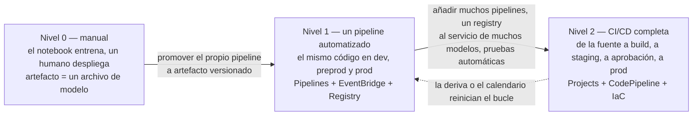
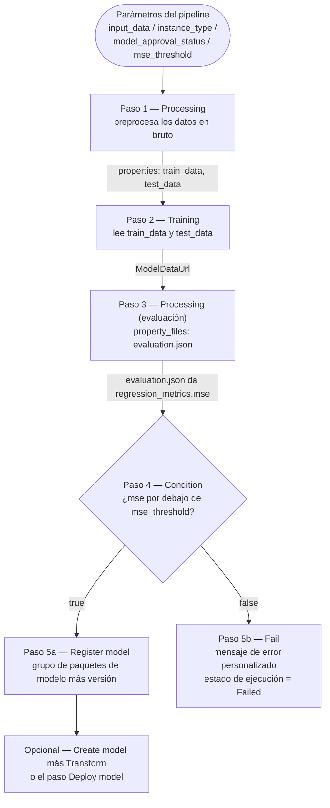
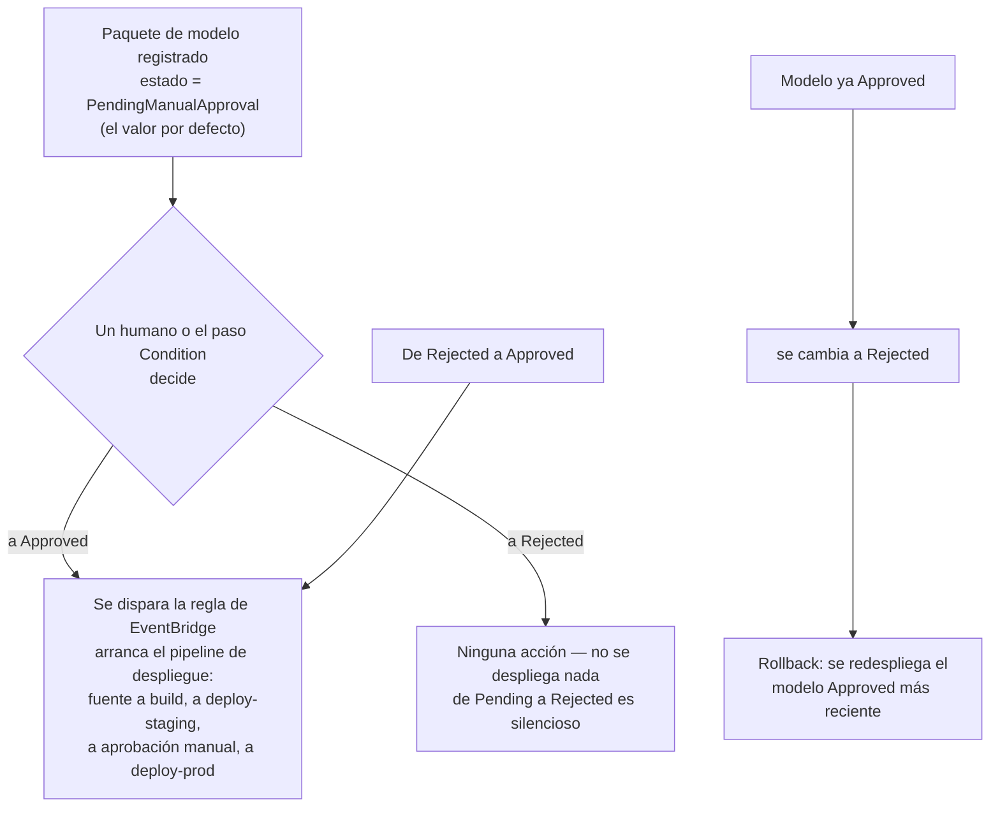
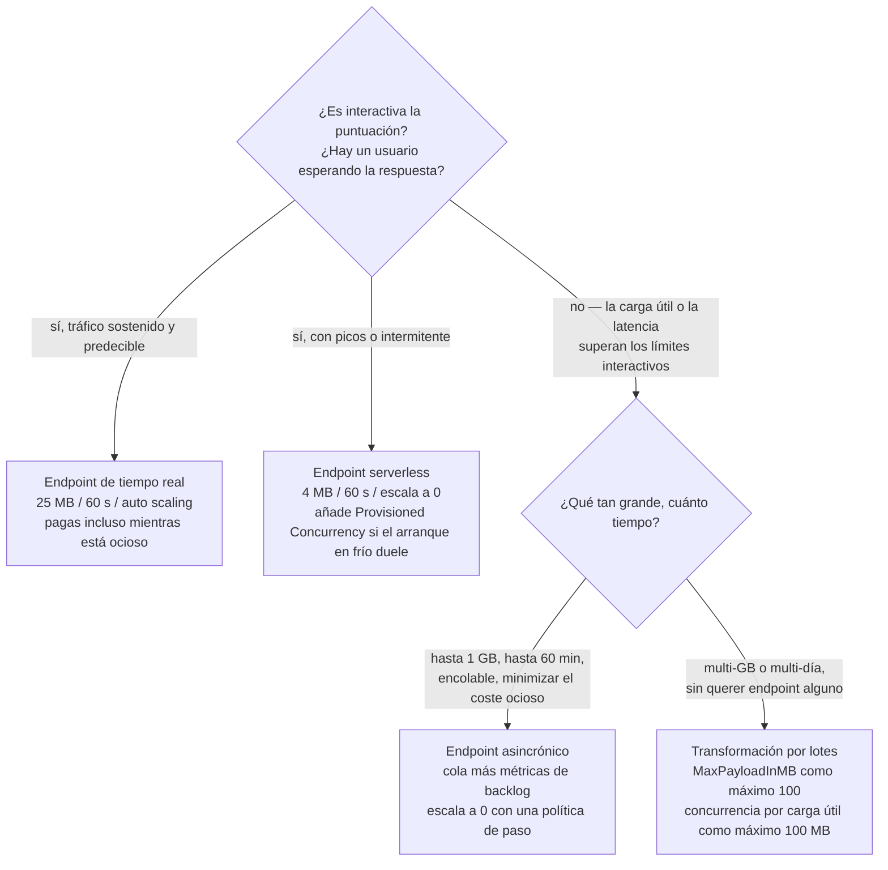
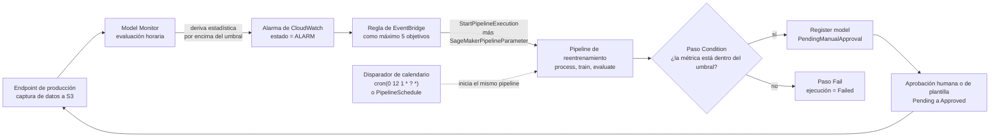

# MLOps y escalado en AWS

Un modelo que funciona en un notebook no es un sistema. En el momento en que un segundo ingeniero debe reproducir la ejecución de entrenamiento, en el momento en que el tráfico se duplica a las 09:00, y en el momento en que los datos de entrenamiento se desvían seis meses después, dejas de hacer machine learning y empiezas a hacer **operaciones** — y AWS te da dos familias distintas de herramientas para eso: una **capa de pipeline / registry / CI-CD** que decide *cómo llega un modelo a producción*, y una **capa de escalado** que decide *qué cómputo lo sirve*. El examen AIF-C01 prueba si puedes nombrar cada herramienta con precisión, citar sus límites y rechazar las opciones que suenan plausibles pero que están documentadas para otro servicio.

```text
====================================================================
 LECCIÓN 13 — MLOPS Y ESCALADO EN AWS
====================================================================
 MADUREZ (estándar AWS de tres niveles)
   L0 manual .......... notebooks + CreateModel / endpoint manual
   L1 pipeline ........ UN pipeline automatizado = el artefacto desplegado
   L2 CI/CD completa .. muchos pipelines + registry + pruebas automáticas
--------------------------------------------------------------------
 CAPA DE CONSTRUCCIÓN                  CAPA DE SERVICIO
   Pipelines = DAG JSON (16 tipos)    tiempo real .. <= 25 MB, 60 s
   Condition: if/else sobre eval.json serverless ... <= 4 MB, 60 s
   Fail: termina la ejecución como    asincrónica .. <= 1 GB, 60 min
   Failed                              batch ........ GB, días, sin EP
   Parallelism (por ejecución)
   Caché DESACTIVADA por defecto (PT1H) ESCALADO (App Auto Scaling)
   Registry: grupo -> versiones 1,2.. target tracking (objetivo 70)
   Aprobación: Approved / Rejected /  step scaling (+1 desde cero)
             PendingManualApproval    acciones programadas
   Projects: Service Catalog / CFN    métrica alta resolución = 10 s
   Git vía CodeConnections            cooldown por defecto 300 s
   Servidor de tracking MLflow (tu S3)
--------------------------------------------------------------------
 CAPA DE AUTOMATIZACIÓN
   SageMaker -> EventBridge (casi en tiempo real)
   Monitor horario -> alarma CloudWatch -> StartPipelineExecution
   <= 5 objetivos por regla / sin programación en buses custom o partner
====================================================================
```

> [!NOTE]
> **Cómo leer esta lección.** Tres reglas se aplican en todo momento. (1) **Los números son el examen**: techos de carga útil, cooldowns, valores objetivo, periodos de alarma y transiciones de aprobación son todos valores publicados, y son lo que se examina. (2) **AWS documenta dos mecanismos de escalado por una razón** — el target tracking *mantiene* un nivel de carga, el step scaling *despierta* un servicio, y solo su combinación escala un endpoint asincrónico desde cero. (3) **Todo lo que AWS no confirma en primera persona se marca**, nunca se enseña como material de memorización; las marcas se recopilan al final de la lección.

Al terminar esta lección podrás:

- situar una práctica de ML en el **modelo de madurez de tres niveles de AWS** (0, 1, 2) y separarlo de las variantes de Google, Azure y del blog de AWS del mismo marco;
- leer un **SageMaker Pipeline** como un DAG JSON y decir qué aristas llevan **datos** (`properties`) frente a **solo ordenación** (`DependsOn`);
- seleccionar el **tipo de paso** correcto para una tarea — incluidos **Condition**, **Fail**, **Callback**, **Lambda**, **ClarifyCheck** y **QualityCheck** — y citar cuántos tipos existen;
- configurar **`ParallelismConfiguration`** y la **caché de pasos** (`ExpireAfter` en ISO 8601, solo ejecuciones exitosas) correctamente;
- impulsar el despliegue a través del **Model Registry**: numeración de versiones, `ModelApprovalStatus` y las cuatro **transiciones de aprobación** que inician o no CI/CD;
- construir o adoptar un **SageMaker Project** con **CodePipeline / Jenkins**, explicar por qué las **plantillas de CodeCommit desaparecieron el 28 de octubre de 2024** y nombrar el tag y las acciones IAM de **CodeConnections** necesarias para GitHub;
- elegir entre **Experiments (Studio Classic)** y **MLflow on SageMaker AI**, y decir dónde viven físicamente los datos de tracking y los artefactos;
- configurar **target tracking**, **step scaling** y **acciones programadas** con el `ServiceNamespace`, `ResourceId` y `ScalableDimension` correctos, y hacer la aritmética de capacidad con **división hacia arriba**;
- despertar un endpoint **asincrónico** desde cero con una **política de paso más una alarma `HasBacklogWithoutCapacity`**;
- elegir la **opción de inferencia** correcta a partir de la carga útil, la latencia, la duración y los requisitos del endpoint, y defender la elección en términos de coste;
- conectar el **volante de MLOps**: Model Monitor → CloudWatch → EventBridge → `StartPipelineExecution`;
- defender el **Veredicto comparativo**: MLOps gestionado frente a scripts DIY frente a operaciones manuales.

---

## 1. Madurez de MLOps: nivel 0, nivel 1, nivel 2

### 1.1 El estándar AWS de tres niveles

AWS enmarca MLOps como un **modelo de madurez de tres niveles**, y el examen espera que reconozcas el nivel a partir de una descripción y que nombres las herramientas que te llevan allí. La pregunta distintiva nunca es «cuánto ML haces», sino **cuál es el artefacto desplegado**.

| Nivel | Nombre | Características (AWS) | Herramientas AWS |
|---|---|---|---|
| **0** | Flujo de trabajo de ML manual | Dirigido por el científico; entrenamiento y despliegue manuales; sin pipeline | Notebooks de SageMaker Studio; creación manual de `CreateModel` y de endpoints |
| **1** | Automatización del pipeline de ML (entrenamiento continuo) | **Un** pipeline automatizado se ejecuta recurrentemente, con la **misma implementación** en desarrollo, preproducción y producción; **el propio pipeline es el artefacto desplegado** | SageMaker Pipelines (DAG JSON, caché, paralelismo), EventBridge, Model Registry |
| **2** | Automatización completa de CI/CD | **Múltiples** pipelines, un **registry al servicio de muchos modelos**, pruebas automáticas y reentrenamiento y redespliegue horarios o diarios | SageMaker Projects + CodePipeline / CodeBuild / GitHub, Model Monitor → alarma → reentrenamiento, infraestructura como código |



> [!WARNING]
> **No importes la numeración de otro marco.** AWS, el blog de AWS ML y Google todos describen la madurez de MLOps, y **no** son intercambiables:
>
> | Marco | Escala | Hitos |
> |---|---|---|
> | **AWS (estándar del examen)** | **0, 1, 2** | L2 = registry + muchos modelos + CI/CD |
> | Blog de AWS ML (2022) | Inicial → Repetible → Fiable → Escalable | multi-cuenta, con plantillas, multi-equipo |
> | Google | 0, 1, 2 | misma forma que AWS |
> | Azure | **0–4** | 1 = DevOps sin MLOps · 2 = entrenamiento automatizado · 3 = despliegue automatizado · 4 = MLOps completo con reentrenamiento disparado por deriva |
>
> Una opción de examen que describa madurez de «nivel 3» o «nivel 4» está describiendo la escala de **Azure**, no la de AWS.

### 1.2 Dónde encaja esto en el examen

MLOps pertenece al **Dominio 1, Tarea 1.3** de la guía AIF-C01. El examen en sí es de **65 preguntas = 50 puntuadas + 15 sin puntuar**, **sin penalización por adivinar** y con pesos de dominio publicados de **20 / 24 / 28 / 14 / 14 %**. AWS publica solo los pesos de dominio — el número de preguntas por tarea no se publica —, así que trata cualquier dimensionamiento por tarea que leas en otra parte como orientación, no como presupuesto.

- **📚 ¿Sabías que…?** Las **15 preguntas sin puntuar** de un examen AIF-C01 son indistinguibles para ti mientras rindes el examen: se intercalan con las 50 puntuadas y se usan para recopilar estadísticas antes de que cualquier ítem sea puntuado. La consecuencia práctica es un punto de estrategia, no un dato curioso: **nunques saltes una pregunta pensando «esta podría no contar».** Cada pregunta consume el mismo tiempo, y solo las 50 puntuadas deciden tu resultado, así que el movimiento racional es responder las 65 con toda tu capacidad.

---

## 2. SageMaker Pipelines: el contrato del DAG

### 2.1 Qué es un pipeline

Un SageMaker Pipeline es un **grafo acíclico dirigido expresado en JSON**. Cada nodo es un **paso**, cada arista es una dependencia, y los ciclos se **rechazan** — un DAG con bucles no es un pipeline más lento, es una definición inválida. La definición sigue el *SageMaker AI Pipeline Definition JSON Schema* y puede ser producida por **cuatro** productores equivalentes: el **editor visual** en Studio, el **SageMaker SDK**, **boto3** y **AWS CloudFormation**. Las ejecuciones de pipeline se facturan como los jobs subyacentes (processing, training, transform) más el uso de Studio — la capa de orquestación en sí no es un SKU independiente y pesado.

Existen dos tipos de arista, y confundirlas es el error arquitectónico más común en esta zona:

| Tipo de arista | Se escribe como | Lleva | Ejemplo |
|---|---|---|---|
| **Arista de datos** | `step.properties.*`, resuelta desde la API `Describe*` correspondiente | artefactos reales (URIs de S3, datos de modelo, JSON de evaluación) | Train lee la salida `train_data` de Process |
| **Arista solo de ordenación** | `DependsOn` / `add_depends_on(...)` | nada más que «ejecutar después» | Train debe esperar a un segundo paso de preparación no relacionado |

La regla práctica: **si el valor fluye, es una referencia `properties`; si solo importa el timing, es `DependsOn`.** `ParallelismConfiguration` no es un mecanismo de ordenación en absoluto — limita cuántos pasos ya elegibles se ejecutan a la vez.

### 2.2 El DAG del pipeline

Esta es la forma canónica que describe el examen: preprocesar → entrenar → evaluar → registrar solo si la métrica pasa, y fallar en caso contrario con un mensaje.



### 2.3 Ejemplo resuelto 1 — la puerta del MSE, de principio a fin

Un pipeline de regresión para un modelo tabular tipo abulón, construido con el SageMaker SDK:

1. **Los parámetros** se declaran una vez y se reutilizan en todas partes: `processing_instance_count`, `instance_type`, `model_approval_status` (por defecto `PendingManualApproval`), `input_data`, `batch_data`, `mse_threshold`.
2. **`Process`** produce las salidas `train_data` y `test_data`. El paso de entrenamiento las consume con `step_process.properties.ProcessingOutputConfig.Outputs["train_data"].S3Output.S3Uri` — **esa cadena es la arista del DAG**, no un comentario.
3. **`Eval`** es un **paso Processing con `property_files`**, de modo que su salida `evaluation.json` (que contiene `regression_metrics.mse`) se expone a los pasos posteriores como una propiedad estructurada en lugar de como una ruta de S3 que tengas que analizar tú mismo.
4. **`MSECond`** es un **paso Condition**: `if_steps = [RegisterModel]`, `else_steps = [Fail]`. El paso Fail lleva un mensaje compuesto como `"MSE above threshold " + mse_threshold` y termina la ejecución con estado **Failed** — la ejecución no «termina con una advertencia».
5. **`.start()`** la ejecuta. Pasar `ModelApprovalStatus="Approved"` como valor de parámetro hace que el registro sea desplegable de inmediato (un atajo de desarrollo/pruebas), y `CacheConfig(enable_caching=True, expire_after="PT1H")` permite que los pasos sin cambios reutilicen sus salidas anteriores.

> [!NOTE]
> **¿Por qué un paso Fail en lugar de dejar que la condición sea falsa?** Un paso Condition con `else_steps` vacío no hace nada en silencio — la ejecución reporta **Succeeded** mientras no se registró ningún modelo. El paso **Fail** existe precisamente para que «la métrica fue mala» quede registrado como una **ejecución Failed con un mensaje personalizado**, que es lo que una regla de EventBridge o un sistema CI/CD necesita para abrir un incidente en lugar de celebrar una build verde.

---

## 3. Los 16 tipos de paso, y los dos que deciden resultados

### 3.1 El mapa completo de pasos

AWS documenta **16 tipos de paso**. Aprende la tabla por la columna de «gancho de examen»: el examen rara vez pregunta «qué hace un paso Training», pregunta *qué paso debe usarse para X*.

| Tipo de paso | Ejecuta | Configuración clave | Gancho de examen |
|---|---|---|---|
| **Processing** | preparación, **evaluación**, baseline | URIs de salida en S3, `property_files` | «¿qué paso evalúa el modelo?» → Processing |
| **Training** / **Tuning** / **AutoML** | entrenamiento / job HPO / job AutoML | hiperparámetros, canales de un paso previo, rangos de búsqueda, métrica objetivo | necesita datos de entrenamiento y de validación |
| **Model (Create model)** | `CreateModel` | imagen del contenedor, `ModelDataUrl` | prerrequisito para Transform / Deploy |
| **Register model** | **versión del paquete de modelo** | grupo, estado de aprobación, listas de instancias | versionado más aprobación |
| **Deploy model** | creación/actualización de endpoint | configuración del endpoint, variantes | blue/green = una **actualización** del endpoint |
| **Transform** | transformación por lotes | `MaxPayloadInMB`, `MaxConcurrentTransforms` | puntuación sin conexión, **sin endpoint** |
| **Condition** | bifurcación | `if_steps` / `else_steps` | puerta → registrar **o** Fail |
| **Fail** | detiene la ejecución como **Failed** | `error_message` personalizado | «terminar con un motivo» |
| **Callback** | espera un token de callback | token | aprobación externa o con Step Functions |
| **Lambda** | una función Lambda | ARN / ayuda del SDK | **como máximo 10 min, por defecto 2 min**; hooks de despliegue ligeros |
| **ClarifyCheck** / **QualityCheck** | sesgo y explicabilidad, calidad de datos y de modelo | estadísticas y restricciones de baseline, `skip_check`, `register_new_baseline` | puerta de deriva más baseline |
| **EMR** / **Notebook Job** | paso EMR / notebook programado | clúster y argumentos / cómputo y cron | preparación de big data / analítica programada |

### 3.2 Condition y Fail como puerta de evaluación

El patrón documentado es mecánico y vale la pena memorizarlo:

1. El paso Processing de evaluación declara `property_files=["evaluation.json"]`.
2. El paso Condition lee `evaluation.json` y compara un escalar — por ejemplo `regression_metrics.mse` contra el parámetro del pipeline `mse_threshold`.
3. **Rama true → Register model** (opcionalmente precedido por `Create model`, y seguido de un paso `Transform` para una pasada de cordura por lotes).
4. **Rama false → Fail** con un `error_message` compuesto mediante `Join(...)`, produciendo un estado de ejecución de **Failed**.

Una segunda variante igual de común coloca un paso **QualityCheck** o **ClarifyCheck** delante del registro: el baseline se produce con `register_new_baseline=true` y `skip_check=true` en la primera ejecución, y las ejecuciones posteriores comparan contra ese baseline. Misma forma — una puerta cuya rama falsa es un paso Fail.

- **📚 ¿Sabías que…?** El paso **Fail** no es un fallo del sistema — es una terminación *controlada*. El paso en sí termina haciendo bien su trabajo, y lo que acaba como `Failed` es la **ejecución del pipeline**, con tu mensaje adjunto. Esa distinción importa cuando construyes una regla de EventBridge: reaccionas al estado de la ejecución, no a una excepción lanzada en tu código Python, de modo que un paso Fail te da una señal limpia y estable en su esquema que no da un `exit 1` de un script de shell.

---

## 4. Paralelismo y caché: las dos perillas que cambian el coste de ejecución

### 4.1 El paralelismo es por ejecución, no por pipeline

Los pasos independientes se ejecutan **en paralelo** por defecto: lo que esté elegible se ejecuta. Tú limitas eso con **`ParallelismConfiguration(MaxParallelExecutionSteps)`**. Dos propiedades de este ajuste importan para el examen:

- se aplica **por ejecución** — el ejemplo documentado de **50** significa que una ejecución ejecuta como máximo 50 pasos a la vez, y **dos ejecuciones concurrentes pueden por tanto ejecutar 100** pasos a la vez;
- se puede **sobreescribir al iniciar, reintentar y actualizar**, de modo que es un valor por defecto de política, no una propiedad inmutable del pipeline.

El paralelismo **no** es un mecanismo de dependencia. Poner `MaxParallelExecutionSteps = 2` no hace que el paso B espere al paso A; solo limita cuántos pasos listos se ejecutan simultáneamente.

### 4.2 La caché es optativa, en ISO 8601 y solo para ejecuciones exitosas

| Propiedad | Comportamiento verificado |
|---|---|
| Por defecto | **Desactivada** — cada ejecución re-ejecuta cada paso |
| Activación | `CacheConfig { Enabled, ExpireAfter }` en el paso |
| Formato de `ExpireAfter` | **duración ISO 8601**, por ejemplo **`PT1H`** — no un timestamp Unix |
| Qué ejecuciones se reutilizan | Solo las **exitosas**; una ejecución fallida nunca es fuente de caché |
| Resolución de coincidencia | gana la ejecución exitosa coincidente **más reciente** |
| Qué invalida | los atributos que afectan a la **salida**: ubicación de los datos, hiperparámetros y el **código** local (el SDK convierte el código local en un hash en S3) |
| Qué puede seguir acertando | cambios en atributos que **no** afectan a la salida — `instance_type` puede seguir acertando |

El uso práctico es un bucle de desarrollo: re-ejecutas un pipeline de cinco pasos tras tocar solo el informe, y `PT1H` permite que Process, Train y Eval devuelvan sus artefactos anteriores en segundos mientras el paso modificado se ejecuta de verdad.

> [!WARNING]
> **La caché desactivada por defecto es la trampa, no la característica.** Un candidato que asuma que «los pipelines omiten el trabajo sin cambios automáticamente» leerá mal cada pregunta de coste sobre ejecuciones repetidas. No se cachea nada hasta que configuras `CacheConfig`, la entrada debe haber **terminado bien** y debe estar **sin caducar**. A la inversa, un candidato que asuma que «la caché significa modelos obsoletos» se equivoca por la razón opuesta: los cambios de datos, de hiperparámetros y de código **fallan (miss)** por diseño.

---

## 5. Model Registry: versiones y la aprobación que impulsa el despliegue

### 5.1 Estructura del registry

El registry organiza los modelos en **grupos de modelos**, y un grupo contiene **paquetes/versiones**. Las versiones son sencillas y estrictamente ordenadas: **comienzan en 1** y **aumentan en 1** por cada paquete añadido al grupo. Un paquete versionado **debe** pertenecer a un grupo, y su ARN lleva las coordenadas: `…:model-package-group/name/version`.

### 5.2 ModelApprovalStatus

Cada paquete de modelo lleva un estado tomado de exactamente tres valores:

```text
ModelApprovalStatus = Approved | Rejected | PendingManualApproval
```

**Un modelo versionado debe estar en `Approved` para ser desplegado.** El estado puede configurarse mediante `update_model_package`, mediante Studio, mediante un **paso Condition** dentro de un pipeline, o pasarse como un **parámetro del pipeline** cuyo valor por defecto es `PendingManualApproval`.

### 5.3 Las cuatro transiciones de aprobación

Esta es la tabla de mayor rendimiento de la lección, porque el examen pregunta «¿qué acción inicia el despliegue?»:

| Transición | Efecto en una plantilla de SageMaker Project |
|---|---|
| `PendingManualApproval` → **`Approved`** | **Inicia CI/CD** — el pipeline de despliegue arranca |
| `PendingManualApproval` → `Rejected` | **Ninguna acción** |
| `Rejected` → **`Approved`** | **Inicia CI/CD** |
| `Approved` → `Rejected` | **Redespliega el modelo `Approved` más reciente** (semántica de rollback) |



### 5.4 Ejemplo resuelto 2 — de la aprobación a producción

1. Se crea un **SageMaker Project** desde la plantilla *«Model building, training, and deployment with third-party Git repositories using CodePipeline»*, con **dos repositorios de GitHub** y un **ARN de CodeConnections con tag `sagemaker=true`**.
2. Un commit al repositorio de construcción del modelo dispara la acción de origen (`DetectChanges`), que ejecuta **`source → build`**: CodeBuild crea o actualiza el SageMaker Pipeline y lo inicia.
3. El pipeline registra la **versión 7** con `ModelApprovalStatus = PendingManualApproval`.
4. Un revisor cambia la v7 a **`Approved`** (Studio, CLI o un paso Condition alimentado por un parámetro de aprobación).
5. La **regla de EventBridge** de la plantilla inicia el pipeline de despliegue: **`source → build → deploy-staging`** (pila de CloudFormation) → **aprobación manual** → **`deploy-prod`**.
6. Si en staging aparece un defecto y la v7 se cambia de **`Approved` a `Rejected`**, se redespliega el paquete aún `Approved` más reciente — ese es tu rollback documentado. En un bucle puro de dev/test saltas los pasos 4–5 pasando `ModelApprovalStatus="Approved"` como parámetro del pipeline.

---

## 6. SageMaker Projects, Git y CI/CD

### 6.1 Qué es realmente un Project

Los SageMaker Projects son **productos de AWS Service Catalog respaldados por CloudFormation**. Crear uno aprovisiona, como una sola unidad: **repositorios Git, un SageMaker Pipeline, CodePipeline o Jenkins, un grupo de modelos, un bucket de S3, un registro de ECR y reglas de EventBridge**. Existen dos formas canónicas:

| Forma del Project | Ruta del pipeline |
|---|---|
| **Build** | `source → build` |
| **Deploy** | `source → build → deploy-staging → aprobación manual → deploy-prod` |

Las familias de plantillas proporcionadas cubren **build/train/deploy con Git de terceros** (CodePipeline **o** Jenkins), **Model Monitor** y **construcción de imágenes** (ECR + CodeBuild + EventBridge).

### 6.2 El cambio del 28 de octubre de 2024 en CodeCommit

> [!WARNING]
> **Las plantillas de proyecto basadas en CodeCommit se eliminaron el 28 de octubre de 2024.** Cualquier opción de examen que afirme que puedes iniciar un SageMaker Project nuevo desde una plantilla de CodeCommit «hoy por hoy» es incorrecta. La ruta soportada es **GitHub / GitHub Enterprise / GitLab / Bitbucket**, y las plantillas personalizadas se construyen como **CloudFormation en Service Catalog** o — recomendado por AWS — **plantillas alojadas en S3** consumidas a través de `CfnTemplateProvider`.

La mecánica de la acción de origen de GitHub merece citarse con precisión:

- la acción de CodePipeline es **`CodeStarSourceConnection`**;
- la conexión debe ser una conexión de **CodeConnections** con el **tag `sagemaker=true`**;
- el rol del pipeline necesita **ambas** `codestar-connections:UseConnection` **y** `codeconnections:UseConnection`;
- la detección de cambios es `DetectChanges` en el commit, de modo que la build arranca sin un disparador manual;
- el CloudFormation de una plantilla personalizada debe declarar **`SageMakerProjectName`** y **`SageMakerProjectId`**.

- **📚 ¿Sabías que…?** «CodeStar» sobrevive en el **nombre de la acción** (`CodeStarSourceConnection`) mucho después de que el producto fuera reemplazado por **CodeConnections**. Por eso la política IAM necesita *dos* acciones casi idénticas — una para el espacio de nombres heredado y otra para el servicio actual. Los candidatos que memorizan solo una de las dos suspenden sistemáticamente este ítem, y los propios recorridos de AWS listan ambas.

---

## 7. Experiments y MLflow: dónde vive ahora el tracking de ejecuciones

### 7.1 La migración

La API de SageMaker Experiments — `CreateExperiment`, **Trials** como *grupos* de ejecución, **trial components** como *ejecuciones* individuales — está documentada como **disponible solo en Studio Classic**. Para la experiencia nueva de Studio, AWS recomienda **MLflow on SageMaker AI**. En términos de examen: una opción que describa Trials y trial components como la forma actual y recomendada de rastrear ejecuciones está describiendo una superficie **heredada**.

| | SageMaker Experiments (SDK) | **MLflow on SageMaker AI** |
|---|---|---|
| Estado | Solo Studio **Classic** | Recomendación actual (GA) |
| Tracking URI | API de Experiments | `mlflow.set_tracking_uri(<ARN del servidor de tracking>)` |
| Credenciales | Rol de ejecución de SageMaker | plugin de AWS, firma **SigV4** |
| Almacén de backend | almacén de metadatos de Experiments | en la **cuenta de servicio de SageMaker** |
| Almacén de artefactos | gestionado por SageMaker | **tu propio bucket de S3** |
| Tamaños / límites | — | **Small / Medium / Large**, creados en **como máximo 25 minutos** |
| Auditoría | CloudTrail sobre las APIs de SageMaker | CloudTrail bajo **`CallMlflowApp`** para `AWS::SageMaker::MlflowApp` |

La división es el punto del examen: **el cómputo y el almacén de backend se ejecutan en la cuenta de servicio de SageMaker, pero los artefactos viven en un S3 que tú posees y pagas** — que es exactamente lo que un revisor de cumplimiento quiere oír sobre reproducibilidad.

---

## 8. Autoescalado de endpoints: target tracking, step scaling, acciones programadas

### 8.1 Los identificadores

El escalado de endpoints se ejecuta a través de **Application Auto Scaling** (`RegisterScalableTarget` más `PutScalingPolicy`) o a través del asistente de la consola. Cita las coordenadas exactamente:

| Campo | Valor |
|---|---|
| `ServiceNamespace` | **`sagemaker`** |
| `ResourceId` | **`endpoint/{endpoint-name}/variant/{variant-name}`** |
| `ScalableDimension` | **`sagemaker:variant:DesiredInstanceCount`** |
| Métrica del asistente de consola | fija a **`SageMakerVariantInvocationsPerInstance`** |

AWS ofrece tres estrategias — **target tracking (recomendado)**, **step scaling** y **acciones programadas** (CLI/API) — y, para el target tracking, **AWS gestiona las alarmas por ti**.

### 8.2 Las métricas

| Métrica | Tipo | Objetivo | Periodo |
|---|---|---|---|
| `SageMakerVariantInvocationsPerInstance` | **Predefinida** (valor por defecto recomendado) | **70** invocaciones/instancia/min | 1 min |
| `ConcurrentRequestsPerModelHighResolution` | personalizada de alta resolución | **5** peticiones concurrentes/modelo | **10 s** |
| `InferenceComponentConcurrentRequestsPerCopyHighResolution` | alta resolución (componentes de inferencia) | **5** | **10 s** |
| `CPUUtilization`, `ExplanationsPerInstance` | personalizada | a tu elección (por ejemplo 50) | 1 min |
| `ApproximateBacklogSizePerInstance` | asincrónica | **5** | 1 min |

### 8.3 Ejemplo resuelto 3 — aritmética de capacidad con target tracking

La capacidad siempre **redondea hacia arriba** — ese es el comportamiento de ajuste documentado, y es aritmética examinable:

1. La prueba de carga muestra **210 invocaciones/min**, objetivo **70** → 210 / 70 = **3 instancias**.
2. El tráfico sube a **351/min** → 351 / 70 = 5,01, redondeado hacia arriba → **6 instancias** (nunca 5).
3. Registra el objetivo:
   `register_scalable_target(ServiceNamespace="sagemaker", ResourceId="endpoint/prod/variant/AllTraffic", ScalableDimension="sagemaker:variant:DesiredInstanceCount", MinCapacity=1, MaxCapacity=10)`.
4. Adjunta la política:
   `put_scaling_policy(PolicyType="TargetTrackingScaling", {"TargetValue": 70.0, "PredefinedMetricSpecification": {"PredefinedMetricType": "SageMakerVariantInvocationsPerInstance"}, "ScaleInCooldown": 600, "ScaleOutCooldown": 300})`.
5. Efecto: scale-out en unos **un minuto**; el cooldown de scale-in de **600 s** suprime el vaivén tras una ráfaga, y el cooldown de scale-out de **300 s** evita el sobreaprovisionamiento durante un tren de picos.

### 8.4 Ejemplo resuelto 4 — aritmética de concurrencia de alta resolución

1. Con `ConcurrentRequestsPerModelHighResolution` en el objetivo **5**, una carga de **18 peticiones concurrentes** → 18 / 5 = 3,6, redondeado hacia arriba → **4 instancias**.
2. La métrica emite cada **10 segundos** en lugar de cada **1 minuto** — detección aproximadamente **6× más rápida** para el **scale-out**; el timing del scale-in no cambia.
3. ¿Usas componentes de inferencia? La métrica pasa a ser `InferenceComponentConcurrentRequestsPerCopyHighResolution`.
4. Varias políticas de target tracking pueden compartir **un** objetivo escalable: añade una segunda política sobre `CPUUtilization` con `TargetValue = 50`, y ambas mantienen sus propios objetivos contra el mismo `DesiredInstanceCount`.

### 8.5 La comparación de estrategias de escalado

| Dimensión | **Target tracking** (recomendado) | **Step scaling** | **Acciones programadas** | **Serverless (totalmente gestionado)** |
|---|---|---|---|---|
| Disparador | métrica vs objetivo | alarma vulnerada | cron/fecha | el propio tráfico |
| Métricas | predefinida `InvocationsPerInstance`, alta resolución `ConcurrentRequestsPer*`, personalizada `CPUUtilization` / `ExplanationsPerInstance`, asincrónica `ApproximateBacklogSizePerInstance` | cualquier métrica de alarma | — | — |
| Granularidad | 1 min, o **10 s** de alta resolución | el periodo de tu alarma | horas fijas | automática |
| Ajuste | mantenida en el objetivo, **redondea hacia arriba** | exacto (por ejemplo **+1**) | absoluto o porcentaje | opaco |
| Cooldowns | `ScaleInCooldown` / `ScaleOutCooldown` (por defecto en SageMaker **300 s**) | `Cooldown` (ejemplo 300) | — | — |
| Escalado a 0 | no para variantes de tiempo real; asincrónica solo **con** una política de paso y una alarma extra | ✅ el mecanismo desde cero | ✅ si `MinCapacity = 0` | ✅ siempre |
| Mejor para | carga sostenida | ráfagas precisas, cero despertones | picos conocidos | tráfico intermitente |

> [!IMPORTANT]
> **Los cooldowns están en segundos y se aplican en ambas direcciones.** `ScaleInCooldown` y `ScaleOutCooldown` son valores separados (el ejemplo documentado usa **600** y **300**), el valor por defecto de la variante SageMaker es de **300 segundos**, y los ajustes **redondean hacia arriba** — de modo que una política de target tracking nunca escala a una fracción de instancia y nunca escala hacia dentro más rápido de lo que permite su cooldown. Una pregunta que ponga los cooldowns en minutos, o que afirme que el scale-in y el scale-out comparten un solo valor, es incorrecta.

---

## 9. Inferencia asincrónica: escalado desde cero

### 9.1 Por qué la asincrónica es especial

Los endpoints asincrónicos tienen una **cola** delante, lo que significa que el backlog — no la tasa de peticiones — es la señal que importa. AWS documenta estas métricas de cola:

| Métrica | Significado | Uso típico |
|---|---|---|
| `ApproximateBacklogSizePerInstance` | peticiones encoladas divididas por instancias | **target tracking**, objetivo **5** |
| `ApproximateBacklogSize` | profundidad absoluta de la cola | alarmas personalizadas |
| `ApproximateAgeOfOldestRequest` | latencia de la cola | SLO de frescura |
| **`HasBacklogWithoutCapacity`** | **1** cuando la cola no está vacía **y** instancias = 0 | **la alarma de escalado desde cero** |

### 9.2 El diseño de escalado desde cero

> [!WARNING]
> **El target tracking no puede despertar un servicio que tiene capacidad cero.** Con `MinCapacity = 0`, una política de target tracking no tiene instancias sobre las que calcular una métrica `…PerInstance`, así que no escalará hacia fuera desde cero. La respuesta documentada de AWS es una **combinación**: una **política de step scaling** con `ScalingAdjustment = +1` y un **cooldown de 300 segundos**, impulsada por una alarma sobre **`HasBacklogWithoutCapacity`** con **umbral 1**, **EvaluationPeriods = 2** (DatapointsToAlarm 2) y **Period 60 s**. El target tracking toma el relevo una vez que existe capacidad.

### 9.3 Ejemplo resuelto 5 — aritmética de la cola y el despertar

1. Configura `MinCapacity=0, MaxCapacity=5` y una política de target tracking sobre `ApproximateBacklogSizePerInstance` con `TargetValue = 5`.
2. Una ráfaga encola **27 peticiones** con 1 instancia en ejecución → 27 / 5 = 5,4, redondeado hacia arriba → 6 → **limitado a `MaxCapacity` = 5**.
3. El tráfico se detiene; el scale-in devuelve el endpoint a **0 instancias** y el gasto ocioso va a **cero**. Las peticiones que llegan mientras tanto se **encolan, no se pierden** — `ApproximateAgeOfOldestRequest` informa de cuánto ha esperado la más antigua.
4. La siguiente petición tras el reposo: `HasBacklogWithoutCapacity` cambia a **1**, se sostiene durante **2 periodos de evaluación de 60 s**, dispara la alarma, la política de paso añade **+1** instancia tras el cooldown de **300 s**, y el target tracking se reanuda.

---

## 10. Elegir la opción de inferencia

### 10.1 Las cuatro opciones y sus límites duros

| | **Tiempo real** | **Serverless** | **Asincrónica** | **Transformación por lotes** |
|---|---|---|---|---|
| Endpoint | REST persistente | gestionado, escala a **0** | **cola** persistente, escala a **0** | **ninguno** (solo el job) |
| Límite de carga útil | **25 MB** | **4 MB** | **1 GB** | datasets de escala GB |
| Tiempo de procesamiento | **60 s** (8 min con streaming) | **60 s** | **60 minutos** | **días** |
| Control de escalado | políticas de auto scaling (sección 8) | totalmente gestionado (+ **Provisioned Concurrency** opcional) | métricas de backlog más step scaling desde 0 | `MaxConcurrentTransforms`, número de instancias |
| Forma de coste | pagas por las instancias aprovisionadas **incluida la ociosidad** | pagas por duración de la petición y datos | pagas mientras procesa, **0 de ociosidad** | pagas por hora-instancia del job |
| Mejor encaje | sostenido, de baja latencia, predecible | tráfico con picos o intermitente tolerante a arranques en frío | cargas útiles grandes, encolables, sensibles al coste | puntuación masiva sin conexión |
| Monitorización | Model Monitor más captura de datos ✅ | **ninguna de las dos soportada** ❌ | éxito/error de SNS → S3 | `BatchTransformInput` |

**Detalles de la transformación por lotes:** `MaxPayloadInMB` como máximo **100**, y `MaxConcurrentTransforms × MaxPayloadInMB` como máximo **100 MB**.

**Exclusiones de serverless (memoriza la lista):** sin **GPUs**; sin imágenes de Marketplace ni registros privados; sin **endpoints multi-modelo**; sin configuración **VPC**; sin **captura de datos**; sin **Model Monitor**; sin **múltiples variantes**; sin **pipelines de inferencia**; imagen del contenedor como máximo **10 GB**; convertir un **endpoint de tiempo real existente a serverless se rechaza**; **Provisioned Concurrency** es opcional.

### 10.2 La decisión



### 10.3 Ejemplo resuelto 6 — 40 GB, cada noche, sin usuarios

Un equipo de fraude pide «un endpoint de tiempo real para nuestro trabajo nocturno de puntuación de 40 GB». La respuesta correcta es **transformación por lotes**:

1. **Sin tráfico interactivo** → la única ventaja del tiempo real (la latencia) no tiene valor, y su forma de coste — pagar por instancias aprovisionadas **incluidas las horas ociosas** — es un desperdicio puro para un trabajo que se ejecuta una vez al día.
2. **40 GB se sale del techo de 4 MB** de serverless y del techo de 1 GB de la asincrónica; es territorio claramente de «datos de escala GB durante días».
3. La transformación por lotes ejecuta **instancias solo para el job**: `MaxPayloadInMB ≤ 100` y `MaxConcurrentTransforms × MaxPayloadInMB ≤ 100 MB` mantienen cada petición dentro de los límites, `S3Output` recoge los registros puntuados, y **no existe endpoint** entre ejecuciones — así que nada se factura a las 03:00.
4. La monitorización usa `BatchTransformInput` en lugar de Model Monitor; si el equipo quiere más adelante detección de deriva, eso es una decisión separada sobre un endpoint de tiempo real o asincrónico.

- **📚 ¿Sabías que…?** La guía de optimización de costes de AWS para inferencia se reduce a una frase: **ajusta la elección a la forma del tráfico**. La asincrónica se dimensiona para una *tasa de procesamiento óptima* **más escalado a cero**; serverless es *por petición*; el tiempo real es *capacidad aprovisionada*; y en todos ellos pueden comprarse **SageMaker Savings Plans** de **1 o 3 años** que se aplican sobre Studio, procesamiento, entrenamiento, inferencia de tiempo real y transformación por lotes. Comprar un Savings Plan para un trabajo que se ejecuta 20 minutos cada noche es el desajuste clásico — el plan descuenta el uso *comprometido*, y un batch nocturno casi no tiene.

---

## 11. EventBridge y el volante de MLOps

### 11.1 Qué envía AWS, y a qué

SageMaker emite eventos a **EventBridge casi en tiempo real** para **jobs, endpoints, paquetes de modelo, ejecuciones de pipeline y pasos de pipeline, y cambios de imagen**. Los objetivos incluyen **Lambda, Step Functions, Kinesis y SNS** — y, de forma crítica, **el propio SageMaker Pipelines es un objetivo**:

| Ajuste | Valor |
|---|---|
| Objetivo | SageMaker Pipeline |
| Acción del rol | **`SageMaker::StartPipelineExecution`** |
| Mapeo de parámetros | **`SageMakerPipelineParameter`** |
| Máximo de objetivos por regla | **5** |
| Programaciones en **buses custom / partner** | **no soportadas** |
| Programación programática | SDK **`PipelineSchedule`** (`rate` / `cron`) |
| Disparadores de reentrenamiento (lista completa) | **programación** (`rate` / `cron`, `PipelineSchedule`) y **evento** (alarma de CloudWatch, `ModelPackageStateChange`, S3 `ObjectCreated`) |

### 11.2 El volante



### 11.3 Ejemplo resuelto 7 — monitorizar, alarmar, reentrenar, aprobar, desplegar

1. Activa la **captura de datos** en el endpoint de producción para que las peticiones y respuestas aterricen en S3, y programa **Model Monitor de forma horaria** (`CronExpressionGenerator.hourly()`).
2. Produce el baseline con un **paso `QualityCheck`** usando `register_new_baseline=true` y `skip_check=true` en la primera ejecución; las ejecuciones posteriores comparan contra él.
3. Cuando la deriva supera la restricción, la alarma de CloudWatch entra en **ALARM** → la **regla de EventBridge** se dispara → objetivo = **SageMaker Pipeline**, invocando **`StartPipelineExecution`** con un `SageMakerPipelineParameter` mapeado.
4. El pipeline reentrena, evalúa, supera el paso **Condition**, registra una nueva versión como **`PendingManualApproval`** → la aprobación la cambia a **`Approved`** → la regla de la plantilla de despliegue actualiza el endpoint.
5. Ejecuta el **disparador de calendario junto** al disparador de deriva: `cron(0 12 1 * ? *)` reentrena el día 1 de cada mes a las 12:00 UTC, o usa `PipelineSchedule(name, cron="15 10 ? * 6L 2022-2023")` para una programación acotada. Recuerda **como máximo 5 objetivos por regla** y **sin programación en buses de eventos custom o partner**.

### 11.4 Infraestructura como código para toda la pila

Todo en esta lección es describible como código, y la guía de AWS apunta a CloudFormation directamente o a través de la **AWS CDK**: `cdk synth` emite una plantilla de CloudFormation por pila, y los constructos L1 `Cfn*` cubren la superficie — `sagemaker.CfnEndpointConfig` (incluido `AsyncInferenceConfig`), `sagemaker.CfnPipeline`, más los nativos `AWS::SageMaker::Domain`, `AWS::SageMaker::UserProfile` y `AWS::SageMaker::Pipeline`.

Codifica, como mínimo: VPC, KMS, el bucket de S3, el rol de ejecución del pipeline, el **Model Package Group**, CodePipeline + CodeBuild + CodeConnections, las reglas de EventBridge y el objetivo escalable con sus políticas. Para plantillas de proyecto AWS prefiere **plantillas alojadas en S3 vía `CfnTemplateProvider`** a los portafolios de Service Catalog, y una plantilla personalizada debe exponer **`SageMakerProjectName`** y **`SageMakerProjectId`**. Dividir la pila en `DevStack` y `ProdStack` te permite testear la infraestructura por unidad antes de que toque producción.

### 11.5 Actualizaciones de 2025–2026

Tres cambios verificados de 2025–2026 tocan el material de las secciones 8 a 13, y AWS ahora los anuncia mediante **vocabulario de ciclo de vida** en lugar de mediante retiras silenciosas. Los tres están documentados, fechados y son examinables.

**1. El nombre del producto cambió.** AWS documenta que «el Amazon SageMaker actual ha sido renombrado a **Amazon SageMaker AI**» (3 de diciembre de 2024), junto a una generación separada de *SageMaker de nueva generación* (Unified Studio, Catalog, Lakehouse, zero-ETL). Una opción de examen que diga **SageMaker AI** es actual, no exótica — y los identificadores que citas de la sección 8 **no** cambiaron con el renombrado: `ServiceNamespace = sagemaker`, `ResourceId = endpoint/…/variant/…`, `SageMakerVariantInvocationsPerInstance` y la acción del rol `SageMaker::StartPipelineExecution` siguen escribiéndose a la manera antigua.

**2. Model Monitor y Clarify están en mantenimiento.** El End of Support Notice de SageMaker AI lista **Model Monitor** y **Clarify** — junto con Ground Truth, A2I, Studio Lab, Debugger, Role Manager, Geospatial y Mechanical Turk — como **«ya no abiertos a nuevos clientes a partir del 30 de julio de 2026»**. Lee esa frase con precisión: el estado es **mantenimiento** = sin clientes nuevos, sin funciones nuevas, **los clientes existentes siguen usándolos**. **No** es un cierre total, y **no** es un rebranding hacia Bedrock Model Evaluations. El volante de deriva de 11.2 sigue funcionando por tanto para los clientes existentes; para trabajo nuevo AWS apunta a **métricas de CloudWatch y detección de anomalías, CloudWatch Evidently, EventBridge + Lambda, SHAP** y, en el lado generativo, **Bedrock Model Evaluations** — que es exactamente por lo que el ejemplo 4.2.2 de la guía del examen ahora dice «Clarify **más** Bedrock Model Evaluations».

**3. La guía del examen se movió.** El historial de cambios de AWS lista **v1.0 publicada el 26 de marzo de 2026** y **v1.1 publicada el 30 de abril de 2026**, y afirma que las actualizaciones aparecen en el examen **aproximadamente un mes después de la publicación** (trata la **v1.1** como el ancla fiable; la fecha de la v1.0 es una republicación de documentación). Ejemplos cambiados que tocan esta lección: **1.1.3 (inferencia asincrónica y serverless)**, **1.3.4 (Bedrock, Amazon Quick, Kiro, SageMaker AI)** y **4.2.2 (Clarify más Bedrock Model Evaluations)**. Sin cambios, y por tanto seguro seguir citando: **65 preguntas (50 puntuadas + 15 sin puntuar)**, **90 minutos**, **aprobación 700 / 1000**, **validez de 3 años**, dominios **20 / 24 / 28 / 14 / 14 %**.

| Fecha (verificada) | Cambio | Qué significa en el examen |
|---|---|---|
| 3 dic 2024 | Amazon SageMaker renombrado **Amazon SageMaker AI** | el nombre nuevo es el actual; los identificadores de servicio, métrica y API no cambian |
| 26 mar 2026 | guía del examen **v1.0** listada en el historial de cambios | línea base para el conjunto de contenido de 2026 |
| 30 abr 2026 | guía del examen **v1.1** publicada | en vigor en el examen desde alrededor de **finales de mayo de 2026**; ejemplos cambiados 1.1.3, 1.3.4, 4.2.2 |
| 30 jun 2026 | **fin de soporte** de Ground Truth Plus; Amazon Kendra entra en **mantenimiento** | fechas de distractores, no respuestas de MLOps |
| **30 jul 2026** | **Model Monitor, Clarify, Ground Truth, A2I, Studio Lab, Debugger, Role Manager, Geospatial, Mechanical Turk** y **Kendra** cerrados a nuevos clientes | **mantenimiento ≠ cierre total ≠ rebranding** — cita el estado, no un rumor |
| 30 sep 2026 | **fin de soporte** de Mechanical Turk (la entrada de What's New dice 29 sep — el resumen señala el conflicto) | no cites el día |
| 24 sep 2026 | publicada la referencia AWS Service Lifecycle | usa el vocabulario de tres palabras de abajo |

**Vocabulario de ciclo de vida (AWS General Reference):** **Maintenance** = sin clientes nuevos, sin funciones nuevas, aún soportado · **Sunset** = fin de operaciones planificado, normalmente unos 12 meses · **Full Shutdown** = eliminado del portafolio.

- **📚 ¿Sabías que…?** AWS declara que los cambios en la guía del examen aparecen en el examen en vivo **aproximadamente un mes después de la publicación** — así que el material de la **v1.1 (30 de abril de 2026)** fue examinable desde alrededor de **finales de mayo de 2026**. El corolario corre en ambas direcciones: una función anunciada *después* de la versión de tu guía no es automáticamente evaluable, mientras que un **ejemplo cambiado** como **4.2.2 → Clarify más Bedrock Model Evaluations** es evaluable mucho antes de que cualquier fecha de retiro importe. Lee el historial de cambios, no el blog de lanzamientos.

---

## 12. Veredicto comparativo: MLOps gestionado frente a scripts DIY frente a operaciones manuales

> [!IMPORTANT]
> **Veredicto comparativo — MLOps gestionado (SageMaker Pipelines / Registry / Projects) frente a scripts DIY (código pegamento en CodeBuild) frente a operaciones manuales (notebooks y clics en la consola)**
> - **Operaciones manuales.** Un científico entrena en un notebook, exporta un archivo de modelo, y una segunda persona hace clic para crear el endpoint. Es **rápido para una persona y un modelo**, no necesita diseño de IAM ni rol de pipeline — y falla en cada pregunta auditable: sin versionado (las versiones del registry empiezan en **1** y no hay paso 2), sin registro de aprobación (`ModelApprovalStatus` nunca existió), sin reproducibilidad (los datos, los hiperparámetros y el código son lo que fuera el estado del notebook), y sin camino hacia la madurez de Nivel 1. Úsalo solo para exploración.
> - **Scripts DIY.** Código pegamento de shell o Python en CodeBuild que llama a `training.py`, `evaluate.py`, `upload_model.py`. Es **totalmente personalizable y portátil** — puedes acoplar cualquier sistema de CI y cualquier framework de pruebas, y ninguna limitación de servicio te constriñe. Sus modos de fallo **son los que ahora debes inventarte tú**: ordenación de pasos (el DAG lo construyes a mano), caché (escribes tu propia reutilización de artefactos), semántica de fallo (una métrica mala debe convertirse en una build *fallida* con un mensaje), puertas de aprobación (implementas la máquina de estados), límites de paralelismo, reintentos y la estela de evidencia de CloudTrail. Estás reimplementando 16 tipos de paso, y la clave de respuestas del examen es la gestionada.
> - **MLOps gestionado.** SageMaker Pipelines da un **DAG JSON con 16 tipos de paso**, puertas **Condition** y **Fail**, **paralelismo por ejecución** y **caché optativa**; el Model Registry da **grupos, versiones desde 1, y las transiciones de aprobación que inician CI/CD**; los Projects dan aprovisionamiento con **CloudFormation / Service Catalog** de repos, pipeline, grupo de modelo, bucket, ECR y reglas de EventBridge; EventBridge da el bucle de reentrenamiento **casi en tiempo real** con **como máximo 5 objetivos por regla**. Sus límites: todo tiene forma de SageMaker (un job de entrenamiento no SageMaker necesita un paso custom o Lambda), la elección de plantillas es finita (**plantillas de CodeCommit eliminadas el 28 oct 2024**) y **el tracking de experimentos se ha movido a MLflow**, con Studio Classic como superficie heredada.
> - **Regla práctica para el examen:** *la pregunta trata de cómo llega un modelo a producción, con versionado, una puerta de aprobación y una estela de auditoría →* **MLOps gestionado (Pipelines + Registry + Projects)**. *La pregunta pide una herramienta a medida o un sistema de CI no AWS existente →* **scripts DIY, pero mantén el registry como punto de entrega**. *La pregunta describe a un científico solo iterando sobre un prototipo →* **lo manual es aceptable, y solo entonces** — y si la opción menciona reentrenamiento disparado por deriva, la respuesta es el bucle **EventBridge → `StartPipelineExecution`**, no un script cron.

| Señal de decisión | Manual | Scripts DIY | **MLOps gestionado** |
|---|---|---|---|
| Definición de ejecución reproducible | No | Solo si la escribes | **Sí** (DAG JSON, verificado por esquema) |
| Semántica de fallo a nivel de paso | No | DIY | **Sí** (paso Fail más mensaje personalizado) |
| Registry de modelos versionado | No | DIY | **Sí** (grupos, versiones desde **1**) |
| Aprobación que inicia el despliegue | No | DIY | **Sí** (`Pending → Approved` inicia CI/CD) |
| Límite de paralelismo por ejecución | n/a | DIY | **Sí** (`ParallelismConfiguration`) |
| Caché de resultados de pasos | No | DIY | **Sí** (optativa, `PT1H`, solo ejecuciones exitosas) |
| Aprovisionado por infraestructura como código | No | Sí | **Sí** (Projects = Service Catalog / CloudFormation) |
| Reentrenamiento disparado por deriva | No | DIY | **Sí** (Monitor → alarma → EventBridge → pipeline) |
| Funciona fuera de SageMaker | n/a | **Sí** | Parcialmente (pasos custom y Lambda) |
| Evidencia de auditoría | historial del notebook | tus logs | CloudTrail más registry más historial de ejecuciones del pipeline |

---

## 13. Trampas del examen y los números que merecen memorizarse

> [!WARNING]
> **Las trampas que cuestan puntos en este material exacto:**
> 1. **«El SDK de Experiments es la forma actual de rastrear ejecuciones.»** Es **solo Studio Classic**; AWS recomienda **MLflow on SageMaker AI** para la experiencia nueva de Studio.
> 2. **«Iniciar un SageMaker Project desde una plantilla de CodeCommit.»** Esas plantillas se **eliminaron el 28 de octubre de 2024** — usa GitHub, GitLab o Bitbucket a través de **CodeConnections** (`CodeStarSourceConnection`, con tag `sagemaker=true`).
> 3. **«Configurar `ALBRequestCountPerTarget` en un endpoint de SageMaker.»** Esa es una métrica **genérica** de Application Auto Scaling que necesita un **`ResourceLabel`** de ALB; la métrica de SageMaker es **`SageMakerVariantInvocationsPerInstance`**.
> 4. **«`PendingManualApproval → Rejected` despliega el modelo anterior.»** No hace **ninguna acción**; solo **`Approved → Rejected`** redespliega el paquete `Approved` más reciente.
> 5. **«El target tracking por sí solo escala la asincrónica desde cero.»** No puede — necesitas una **política de paso (+1, cooldown 300)** más una alarma **`HasBacklogWithoutCapacity`** (umbral **1**, **2 × 60 s**).
> 6. **«`ExpireAfter` es un timestamp Unix, y las ejecuciones cacheadas incluyen fallos.»** Es **ISO 8601** (`PT1H`) y solo se reutilizan ejecuciones **exitosas**.
> 7. **«El paralelismo fuerza el orden.»** `MaxParallelExecutionSteps` limita la concurrencia **por ejecución**; el orden es `properties` (datos) o `DependsOn` (timing).
> 8. **«Serverless soporta VPC, Model Monitor y endpoints multi-modelo.»** No soporta **ninguno** de ellos, limita las cargas útiles a **4 MB** y las imágenes a **10 GB**, y las GPU no están disponibles.
> 9. **«Los cron pueden adjuntarse a cualquier bus de eventos.»** **Sin programaciones en buses custom o partner**, y una regla tiene **como máximo 5 objetivos**.
> 10. **«Un modelo versionado puede desplegarse en cualquier estado de aprobación.»** Debe estar en **`Approved`**.

| Número examinable | Valor |
|---|---|
| Tipos de paso del pipeline | **16** (incl. Fail, Condition, Lambda, Callback, ClarifyCheck, QualityCheck) |
| Ejemplo de `ParallelismConfiguration` | **50**, **por ejecución** (2 ejecuciones ⇒ 100) |
| Caché de pasos | **desactivada por defecto** · `ExpireAfter` ISO 8601 (`PT1H`) · solo ejecuciones exitosas |
| Versiones del paquete de modelo | empiezan en **1**, +1 por paquete en el grupo |
| `ModelApprovalStatus` | `Approved` / `Rejected` / `PendingManualApproval` |
| Transiciones de aprobación que inician CI/CD | `Pending → Approved`, `Rejected → Approved` |
| Objetivos de EventBridge por regla | **5** máx. |
| Objetivos de target / concurrencia / backlog | **70** inv/instancia/min · **5** concurrentes/modelo · **5** backlog/instancia |
| Periodo de métrica | estándar **1 min** vs alta resolución **10 s** |
| Alarma `HasBacklogWithoutCapacity` | umbral **1** · Evaluation y Datapoints **2** · Period **60 s** · paso **+1** · Cooldown **300** |
| Cooldowns | `ScaleIn` 600 / `ScaleOut` 300 (ejemplo); por defecto en SageMaker **300 s**; los ajustes **redondean hacia arriba** |
| Techos de carga útil | tiempo real **25 MB** · serverless **4 MB** · asincrónica **1 GB** |
| Tiempos de procesamiento | tiempo real **60 s** (8 min streaming) · serverless **60 s** · asincrónica **60 min** · batch días |
| Carga útil de transformación por lotes | `MaxPayloadInMB` ≤ **100**; `MaxConcurrentTransforms × MaxPayloadInMB` ≤ **100 MB** |
| Tamaño de imagen serverless | ≤ **10 GB** |
| Tamaños / creación del servidor MLflow | Small, Medium, Large · ≤ **25 min** |
| Plantillas de CodeCommit eliminadas | **28 oct 2024** |
| Timeout del paso Lambda | ≤ **10 min**, por defecto **2 min** |
| Preguntas AIF-C01 / dominios | **65** (50 puntuadas + 15 sin puntuar) · **20 / 24 / 28 / 14 / 14 %** |

**Marcado como no verificado en esta lección** (no lo afirmes en el examen): la frase **«requests per target»** tal como aparece en algunos dumps de estudio — se mapea al `ALBRequestCountPerTarget` genérico, que **no** está documentado para endpoints de SageMaker, así que trátalo como `InvocationsPerInstance` salvo que haya un ALB en la arquitectura; el **recuento exacto de plantillas de proyecto proporcionadas** (AWS enumera familias, no una lista numerada); la **hoja de ruta del endpoint multi-modelo** (docs vivos y sin deprecar en octubre de 2026, pero sin página pública de roadmap); el **peso por pregunta de MLOps específicamente** (solo se publican pesos de dominio); cualquier **fecha de fin de soporte de Experiments en Studio Classic**; **precios del servidor de MLflow**; los **tamaños de memoria y la concurrencia máxima de los endpoints serverless**; **cuotas de endpoint** (instancias por variante, variantes por endpoint); el **valor numérico por defecto de `MaxParallelExecutionSteps`** (los docs muestran cómo configurarlo, ejemplo 50, pero no publican un valor por defecto); y **GitHub Actions como respuesta de examen** — aparece solo en un blog y en una plantilla personalizada de `aws-samples`, mientras que las respuestas seguras son **CodePipeline / CodeBuild** y **Jenkins**.

- **📚 ¿Sabías que…?** El **paso Lambda** de SageMaker tiene por defecto un timeout de **2 minutos** y permite hasta **10 minutos** — un techo deliberadamente pequeño, porque el paso existe para trabajo de orquestación ligero (cambiar una aprobación, llamar a una API, mover un archivo), no para ejecutar un job de entrenamiento. Si tu «paso» necesita una hora, es un paso Processing disfrazado.

---

## 14. Casos Reales

AWS publica historias de clientes porque cada una es una versión documentada de una decisión que esta lección enseñó en abstracto. Los cinco de abajo son los casos **relevantes para MLOps, pipelines e inferencia**, citados con los servicios AWS exactos, las cifras impresas exactas y la página de origen — un porcentaje sin fuente es marketing, y un porcentaje sin «antes» es peor.

> [!WARNING]
> **Cómo citar un caso de estudio en una respuesta de examen.** Cada cifra de esta sección es **afirmación de cliente o de AWS y está sin auditar**; solo **Sun Finance** revela una base muestral (**585 imágenes**) y solo **Adobe** revela su propio conjunto de pruebas. Lee **«hasta»** como un **techo**, nunca como una media. AWS publica exactamente **una** tasa de resultado de proyectos — **65 %** de los proyectos del Generative AI Innovation Center llegaron a producción en 2025, de **más de 1.000** implementaciones —, de modo que una opción que afirme que «todos» o «la mayoría» de los proyectos de IA de AWS se entregan es incorrecta, y la trampa inversa (afirmar una tasa de fallo publicada) también lo es. **No** cites las cifras no recuperadas que circulan: las tasas de estancamiento de pilotos de agentes y las afirmaciones de terceros de que «el 95 % de los pilotos de GenAI fallan» no están documentadas por AWS.

### 14.1 Forethought — la inferencia es una decisión de pipeline con una factura pegada

- **Servicios:** **endpoints multi-modelo** de SageMaker, **Serverless Inference** y Model Deployment, reemplazando **Amazon EKS** autoadministrado.
- **Cifras:** **−66 %** de coste de inferencia con endpoints multi-modelo *y mejor latencia*; **≈ −80 %** con Serverless Inference (titular **hasta −80 %**); **más del 80 % de la inferencia con GPU** se ejecuta ahora en SageMaker; **30 M de interacciones/año**; un equipo de **3 personas** que ya no podía ejecutar los modelos *y* Kubernetes (excepciones de memoria, caídas).
- **Fuente:** `aws.amazon.com/solutions/case-studies/forethought-technologies-case-study` (la página no lleva chip de año — trata la fecha como no declarada).
- **Ángulo de examen:** esta es la sección 10 con una factura adjunta. Capacidad GPU compartida → **endpoints multi-modelo**; pequeños clasificadores con picos → **serverless**. El coste que eliminaron fue el **impuesto DIY de servir** — la columna de «scripts DIY» del Veredicto comparativo, aplicada a la inferencia en lugar de a CI/CD.

### 14.2 HAYAT HOLDING — entrenamiento y ajuste gestionados en lugar de entornos construidos a mano

- **Servicios:** **AWS IoT Greengrass** (SiteWise Edge Gateway) → **Model Training** + **Automatic Model Tuning** + **Model Deployment** de SageMaker, con **SageMaker Edge Manager** sirviendo el modelo en el dispositivo.
- **Cifras:** **194 sensores** transmitidos por OPC-UA; los entornos de ML construidos a mano eran «laboriosos y engorrosos»; resultado documentado: **300.000 USD al año** ahorrados más mayor calidad de panel.
- **Fuente:** `aws.amazon.com/blogs/machine-learning/hayat-holding-uses-amazon-sagemaker-to-increase-product-quality-and-optimize-manufacturing-output-saving-300000-annually` (2023).
- **Ángulo de examen:** esto es **madurez de Nivel 1** en una fábrica — un pipeline automatizado desde el sensor hasta el modelo ajustado, con **Automatic Model Tuning** reemplazando el barrido manual de hiperparámetros con 104 entras... con 194 entradas y **Edge Manager** poseyendo el camino de despliegue en el dispositivo.

### 14.3 RareJob — el entrenamiento Spot arregló un problema de cola, no un problema de modelo

- **Servicios:** entrenamiento en **SageMaker** sobre **spot gestionado**, alimentado por **AWS Glue** y **Amazon Athena**, reemplazando un PC local y después una configuración EC2/ECS con cuello de botella.
- **Cifras:** **−25 %** de tiempo de entrenamiento, **más de 10×** de eficiencia de desarrollo, **100 horas al mes** ahorradas, resultados de puntuación en **2–3 minutos**; un modelo por desarrollador era el techo antes del cambio.
- **Fuente:** `aws.amazon.com/solutions/case-studies/rare-job-case-study` (2020).
- **Ángulo de examen:** el cuello de botella era el **rendimiento de los experimentos**, no la exactitud. Los trabajos Spot paralelos son la palanca de coste documentada para entrenar — y la misma lógica de «pagar capacidad interrumpida con un descuento» que convierte a un Savings Plan o a una estrategia Spot en una respuesta del Dominio 4 (coste).

### 14.4 Chronomics — cuatro meses de DIY frente a tres semanas de AutoML gestionado

- **Servicios:** **Amazon Rekognition Custom Labels** (AutoML), puntuado con `DetectCustomLabels`.
- **Cifras:** **4 meses** de visión por computador personalizada interna **nunca alcanzó el objetivo**; Custom Labels se entregó en **3–4 semanas** con **96,5 % de exactitud / F1 97,9 %**. Subir el umbral de confianza a **0,99** da una precisión de **99,6 %** mientras se **descartan el 5 %** de las predicciones; **0,999** da **99,87 %** descartando el **27 %**.
- **Fuente:** `aws.amazon.com/blogs/machine-learning/chronomics-detects-covid-19-test-results-with-amazon-rekognition-custom-labels` (2022).
- **Ángulo de examen:** dos lecciones. Primero, para una **tarea de visión estrecha**, la capa gestionada gana a una construcción interna — el patrón de fallo documentado es CV hecho a mano. Segundo, cada umbral que subes crea una **cola descartada** que necesita un camino humano (la razón por la que existe A2I), de modo que una pregunta de precisión es siempre también una pregunta de *cobertura*.

### 14.5 Sun Finance — un pipeline multi-paso donde el primer prototipo fue rechazado

- **Servicios:** **Amazon Textract** (OCR) → **Amazon Rekognition** (respaldo y comprobaciones faciales) → **Claude Sonnet 4** (solo estructuración) → reglas de validación → **Amazon Titan Multimodal Embeddings** en **S3 Vectors** para similitud de fraude; construido con el AWS Generative AI Innovation Center, evaluado en **585 imágenes**.
- **Cifras:** exactitud **79,73 % → 90,80 %** (número de ID **74,32 → 89,40 %**, tipo de documento **78,43 → 96,40 %**), **−91 %** de coste por documento, **20 horas → menos de 5 segundos**, detección de fraude **81 %**. **Intento 1 — solo Claude Sonnet 4 — obtuvo 61,8 % en general y 43 % en el número de ID y fue rechazado.**
- **Fuente:** `aws.amazon.com/blogs/machine-learning/sun-finance-automates-id-extraction-and-fraud-detection-with-generative-ai-on-aws` (2026).
- **Ángulo de examen:** esto es una **mentalidad de paso Condition en forma de producción**: construir la baseline, medir, rechazar el intento fallido, re-arquitectar (separar el **OCR** del **razonamiento**), volver a medir. La evaluación es una fase, no una casilla — y la extracción de PII solo con LLM es el prototipo fallido documentado.

**Tabla 14-A — Antes / después, exactamente como AWS los imprimió**

| Caso | Métrica | Antes | Después | Movimiento |
|---|---|---|---|---|
| Sun Finance | exactitud global del documento | 79,73 % | **90,80 %** | **+11,07 pp** |
| Sun Finance | coste por documento · tiempo de manejo | baseline · hasta 20 h | **−91 %** · **< 5 s** | ~1000× más rápido |
| Sun Finance | *primer intento, solo LLM* | — | *61,8 % (número de ID 43 %)* | **rechazado** |
| Chronomics | tiempo hasta un modelo funcional | **4 meses** DIY, objetivo fallido | **3–4 semanas** | ~4× más rápido |
| Chronomics | exactitud / F1 | objetivo nunca alcanzado | **96,5 % / 97,9 %** | entregado |
| RareJob | tiempo de entrenamiento · eficiencia del desarrollador | baseline · 1 modelo/desarrollador | **−25 %** · **> 10×** | +100 h/mes |
| HAYAT | coste anual de infraestructura | entornos de ML construidos a mano | **300.000 USD/año** ahorrados | 194 sensores |
| Forethought | coste de inferencia | Amazon EKS autoadministrado | **−66 %** MME · **≈ −80 %** serverless | >80 % de la inferencia con GPU |

**Tabla 14-B — Elegir la capa: prefabricado → ML gestionado a medida → generativo**

| Capa | Cuándo AWS dice usarla | Casos y cifras | Servicios |
|---|---|---|---|
| **Servicio de IA prefabricado** | tarea estrecha y estructurada; «sin experiencia de ML» | Anthem automatizó el **80 %** del flujo de trabajo de reclamaciones (objetivo **90 %+**, 20 min/reclamación antes); Chronomics **96,5 %** en **3–4 semanas** | Amazon Textract, Rekognition Custom Labels |
| **ML gestionado a medida** | tus datos y tu modelo, pero te niegas a poseer la infraestructura | HAYAT **300 k USD/año**; RareJob **10×** de eficiencia; Forethought **−66 % / −80 %** | entrenamiento de SageMaker, spot gestionado, Automatic Model Tuning, endpoints multi-modelo, Serverless Inference, Edge Manager |
| **IA generativa + RAG** | razonamiento, resumen y recuperación sobre documentos | Sun Finance **90,8 %**; Nippon India **> 95 %** de exactitud con alucinación bajando **90–95 %**; Adobe **+ 20 %** de exactitud de recuperación; Bynder **− 75 %** de tiempo de búsqueda | Amazon Bedrock, Knowledge Bases, Guardrails, embeddings en S3 Vectors |

- **📚 ¿Sabías que…?** AWS publica exactamente una cifra de tasa de producción para su propio trabajo de IA generativa: el **65 %** de los proyectos del Generative AI Innovation Center llegaron a producción en **2025**, de **más de 1.000** implementaciones, con el más rápido en **45 días** — y AWS enmarca el método como las **Five V's**: **Value → Visualize → Validate → Verify → Venture**. El número que vale la pena interiorizar es el otro **35 %**: AWS espera que planifiques para proyectos que se estancan, y es por lo que *baseline antes de construir* y *evaluación como fase* aparecen en cada caso de arriba.

---

## Preguntas de Práctica (Practice Questions)

```question
{
  "id": "aid-13-q1",
  "type": "multiple-choice",
  "question": "Un pipeline debe preprocesar datos, entrenar un modelo, evaluarlo, registrar el modelo solo cuando el MSE de la evaluación esté por debajo de un umbral y, en caso contrario, terminar la ejecución con un mensaje personalizado. ¿Qué conjunto de pasos es correcto?",
  "options": [
    "Processing, Training, Processing (evaluación), Condition, Register model o Fail",
    "Training, Tuning, Deploy model, Callback",
    "Processing, AutoML, QualityCheck, Transform",
    "Lambda, Condition, EMR, Deploy model"
  ],
  "correct": 0,
  "explanation": "El patrón documentado es un paso Processing para el preprocesamiento, un paso Training, un segundo paso Processing declarado con property_files para producir evaluation.json, un paso Condition que se bifurca sobre el MSE, un paso Register model en la rama true y un paso Fail con un mensaje de error personalizado en la rama false. Tuning, AutoML, Callback y EMR no forman parte de esta puerta, y un paso QualityCheck compara contra un baseline almacenado en lugar de contra un umbral del pipeline."
}
```

```question
{
  "id": "aid-13-q2",
  "type": "multiple-choice",
  "question": "¿Qué afirmación sobre la caché de pasos en SageMaker Pipelines es VERDADERA?",
  "options": [
    "La caché está activada por defecto y reutiliza la última ejecución independientemente de su resultado",
    "La caché es optativa mediante CacheConfig con Enabled y ExpireAfter expresado en ISO 8601 como PT1H, reutiliza solo ejecuciones exitosas e ignora los atributos que no afectan a la salida del paso",
    "Las ejecuciones fallidas se reutilizan siempre que sus entradas coincidan con la ejecución actual",
    "ExpireAfter es un timestamp Unix expresado en segundos"
  ],
  "correct": 1,
  "explanation": "La caché está desactivada por defecto, ExpireAfter es una duración ISO 8601 como PT1H, y solo las ejecuciones exitosas son elegibles como fuente de caché, ganando la coincidencia más reciente. Las claves son relevantes para la salida: cambiar datos, hiperparámetros o el código local (convertido en hash en S3 por el SDK) causa un miss, mientras que un atributo como instance_type puede seguir acertando."
}
```

```question
{
  "id": "aid-13-q3",
  "type": "multiple-choice",
  "question": "Un paso de entrenamiento debe consumir la salida del paso 1 como datos, pero también debe esperar al paso 2, que no produce nada de lo que el entrenador necesite. ¿Cuál es el enfoque correcto?",
  "options": [
    "Pasar las salidas de ambos pasos al paso de entrenamiento como dos canales de datos",
    "Referenciar las properties del paso 1 para el canal de datos y llamar a add_depends_on con el paso 2 solo para ordenación",
    "Poner ParallelismConfiguration a 2 para que ambos pasos terminen primero",
    "Envolver los dos pasos de procesamiento dentro de un paso Condition"
  ],
  "correct": 1,
  "explanation": "Una arista de datos se expresa como una referencia step.properties que lleva el artefacto, mientras que las dependencias solo de ordenación usan DependsOn o add_depends_on. ParallelismConfiguration limita los pasos concurrentes por ejecución y no tiene efecto sobre el orden, y un paso Condition bifurca el flujo de control en lugar de secuenciar pasos independientes."
}
```

```question
{
  "id": "aid-13-q4",
  "type": "multiple-choice",
  "question": "En una plantilla de SageMaker Project, ¿qué transición de aprobación inicia el despliegue de CI/CD?",
  "options": [
    "De PendingManualApproval a Rejected",
    "De Approved a PendingManualApproval",
    "De PendingManualApproval a Approved",
    "De Rejected a PendingManualApproval"
  ],
  "correct": 2,
  "explanation": "De PendingManualApproval a Approved inicia CI/CD, y lo mismo hace de Rejected a Approved. De PendingManualApproval a Rejected no hace ninguna acción, mientras que de Approved a Rejected redespliega el modelo Approved más reciente como rollback. De Approved a PendingManualApproval y de Rejected a PendingManualApproval no forman parte del conjunto de transiciones documentado."
}
```

```question
{
  "id": "aid-13-q5",
  "type": "multiple-choice",
  "question": "Un paquete de modelo que es la versión 7 en un grupo de paquetes de modelo debe desplegarse en un endpoint de producción. ¿Qué afirmación es correcta?",
  "options": [
    "Cualquier ModelApprovalStatus puede desplegarse porque la aprobación es solo informativa",
    "El ModelApprovalStatus debe ser Approved antes de que el modelo versionado pueda desplegarse",
    "El número de versión debe restablecerse a 1 antes del despliegue",
    "El modelo debe re-registrarse como un paquete sin versión para saltarse la aprobación"
  ],
  "correct": 1,
  "explanation": "Los modelos versionados deben llevar ModelApprovalStatus = Approved para desplegarse, y el estado toma uno de exactamente tres valores: Approved, Rejected o PendingManualApproval. Las versiones empiezan en 1 y aumentan en 1 por paquete dentro de un grupo, y un paquete versionado debe pertenecer a un grupo, de modo que ni restablecer la versión ni eliminar el versionado es posible."
}
```

```question
{
  "id": "aid-13-q6",
  "type": "multiple-choice",
  "question": "Un endpoint de tiempo real debe mantener las invocaciones medias cerca de 70 por instancia por minuto. ¿Qué configuración consigue esto?",
  "options": [
    "Step scaling sobre CPUUtilization combinado con una acción de escalado programada",
    "Target tracking sobre SageMakerVariantInvocationsPerInstance con TargetValue 70",
    "Target tracking sobre ALBRequestCountPerTarget usando el nombre del endpoint como ResourceLabel",
    "Una función Lambda que llama a UpdateEndpoint cada cinco minutos"
  ],
  "correct": 1,
  "explanation": "El target tracking es la estrategia recomendada, y la métrica predefinida SageMakerVariantInvocationsPerInstance con un objetivo de 70 es la forma documentada de mantener esa media. ALBRequestCountPerTarget es una métrica genérica de Application Auto Scaling que necesita un ResourceLabel de ALB y no es una métrica de SageMaker, CPUUtilization mide la carga del host en lugar de la tasa de peticiones, y actualizar un endpoint repetidamente no es un mecanismo de escalado."
}
```

```question
{
  "id": "aid-13-q7",
  "type": "multiple-choice",
  "question": "Un endpoint asincrónico ve ráfagas separadas por largos periodos ociosos. Requisitos: coste ocioso cero y un despertar rápido en la primera petición tras el reposo. ¿Qué diseño es correcto?",
  "options": [
    "Solo target tracking con MinCapacity puesto a 0",
    "Target tracking sobre ApproximateBacklogSizePerInstance con un objetivo de 5, más una política de paso que añade una instancia con un cooldown de 300 segundos impulsada por una alarma HasBacklogWithoutCapacity",
    "Acciones de escalado programadas a cada minuto del día, porque las ráfagas son impredecibles",
    "Un endpoint serverless con Provisioned Concurrency puesto a 0"
  ],
  "correct": 1,
  "explanation": "El target tracking no puede escalar una variante desde cero porque no hay instancia sobre la que calcular una métrica por instancia. AWS documenta la combinación: una política de step scaling de +1 con un cooldown de 300 segundos, disparada por una alarma sobre HasBacklogWithoutCapacity con umbral 1 evaluada sobre dos periodos de 60 segundos. MinCapacity 0 mantiene entonces el coste ocioso en cero mientras las peticiones se encolan en lugar de perderse."
}
```

```question
{
  "id": "aid-13-q8",
  "type": "multiple-choice",
  "question": "¿Qué afirmación sobre las métricas de escalado de endpoints de SageMaker es correcta?",
  "options": [
    "ConcurrentRequestsPerModel es una métrica estándar de un minuto con un objetivo de 70",
    "Las variantes de alta resolución ConcurrentRequestsPerModel e InferenceComponentConcurrentRequestsPerCopy emiten cada 10 segundos en lugar de cada 1 minuto, de modo que el scale-out reacciona más rápido, con un objetivo de 5",
    "ExplanationsPerInstance es utilizable solo con jobs de transformación por lotes",
    "SageMakerVariantInvocationsPerInstance no puede usarse con endpoints multi-modelo"
  ],
  "correct": 1,
  "explanation": "Las variantes de alta resolución emiten cada 10 segundos en lugar de cada minuto, lo que acelera la detección del scale-out dejando el scale-in sin cambios, y su objetivo documentado es de 5 peticiones concurrentes. La métrica predefinida de invocaciones es de un minuto con un objetivo de 70, ExplanationsPerInstance es una métrica personalizada de endpoint, y nada en la documentación restringe las métricas de invocación a endpoints que no sean multi-modelo."
}
```

```question
{
  "id": "aid-13-q9",
  "type": "multiple-choice",
  "question": "Un equipo debe puntuar un dataset de 40 GB cada noche. No hay tráfico interactivo y ningún usuario espera una respuesta. ¿Qué opción es la MEJOR?",
  "options": [
    "Un endpoint de tiempo real con auto scaling, porque ofrece la menor latencia",
    "Transformación por lotes, porque las instancias se ejecutan solo para el job y no se crea ningún endpoint",
    "Un endpoint serverless, porque se soportan cargas útiles de más de 1 GB",
    "Un endpoint asincrónico con MinCapacity 0, porque siempre escala a cero"
  ],
  "correct": 1,
  "explanation": "La puntuación masiva sin conexión y sin requisito de endpoint es exactamente para lo que existe la transformación por lotes: el job aprovisiona instancias, ejecuta MaxConcurrentTransforms con MaxPayloadInMB como máximo 100 (y su producto como máximo 100 MB), escribe los resultados en S3 y termina. El tiempo real limita las cargas útiles a 25 MB y factura capacidad ociosa, serverless limita las cargas útiles a 4 MB, y la asincrónica las limita a 1 GB."
}
```

```question
{
  "id": "aid-13-q10",
  "type": "multiple-choice",
  "question": "¿Qué par de afirmaciones sobre las plantillas preconstruidas de SageMaker Projects es correcto?",
  "options": [
    "Las plantillas basadas en CodeCommit se ofrecen todavía para proyectos nuevos, y el pipeline de despliegue no tiene etapa de aprobación",
    "Las plantillas son productos de Service Catalog respaldados por CloudFormation que aprovisionan repositorios Git, un pipeline, CodePipeline o Jenkins y un grupo de modelos, mientras que el pipeline de despliegue tiene una aprobación manual entre staging y producción",
    "Los orígenes GitHub usan un token OAuth llano, y las plantillas de CodeCommit siguen siendo el valor por defecto recomendado",
    "Las plantillas personalizadas se escriben solo en Terraform, y el pipeline de despliegue se salta CloudFormation"
  ],
  "correct": 1,
  "explanation": "SageMaker Projects son productos de Service Catalog respaldados por CloudFormation que aprovisionan repos Git, un SageMaker Pipeline, CodePipeline o Jenkins, un grupo de modelos, un bucket, ECR y reglas de EventBridge, y la ruta de despliegue es source → build → deploy-staging → aprobación manual → deploy-prod. Las plantillas de CodeCommit se eliminaron el 28 de octubre de 2024, GitHub usa una conexión de CodeConnections con tag sagemaker=true, y las plantillas personalizadas son CloudFormation (Service Catalog o alojadas en S3 vía CfnTemplateProvider)."
}
```

```question
{
  "id": "aid-13-q11",
  "type": "multiple-choice",
  "question": "Un ingeniero quiere que la deriva de Model Monitor dispare automáticamente un pipeline de reentrenamiento. ¿Qué arquitectura es correcta?",
  "options": [
    "Programar una regla cron de EventBridge directamente en un bus de eventos custom que invoque el pipeline cada hora",
    "Activar la captura de datos, ejecutar Model Monitor de forma horaria, lanzar una alarma de CloudWatch sobre la deriva y usar una regla de EventBridge cuyo objetivo sea el SageMaker Pipeline a través de StartPipelineExecution con un SageMakerPipelineParameter",
    "Guardar las métricas de deriva en S3 y que una función Lambda actualice el estado de aprobación del paquete de modelo a Approved",
    "Usar una acción de escalado programada en el endpoint para reiniciar el entrenamiento siempre que el tráfico baje"
  ],
  "correct": 1,
  "explanation": "El volante documentado es captura de datos a S3, evaluación horaria de Model Monitor contra un baseline, una alarma de CloudWatch y una regla de EventBridge con objetivo StartPipelineExecution con mapeos de SageMakerPipelineParameter. No se soportan programaciones en buses de eventos custom o partner, una regla soporta como máximo 5 objetivos, y los cambios de estado de aprobación nunca inician el entrenamiento."
}
```

```question
{
  "id": "aid-13-q12",
  "type": "multiple-choice",
  "question": "¿Qué configuración de endpoint de inferencia serverless es válida?",
  "options": [
    "Una instancia GPU adjunta al endpoint gestionado con configuración VPC y Model Monitor activado",
    "Un endpoint multi-modelo con captura de datos activada para detección de deriva",
    "Una imagen de contenedor de 9 GB usando un pipeline de inferencia con dos variantes",
    "Una imagen de contenedor de 9 GB sin configuración VPC, sin captura de datos y sin Model Monitor, usando Provisioned Concurrency para reducir los arranques en frío"
  ],
  "correct": 3,
  "explanation": "Los endpoints serverless excluyen GPUs, imágenes de Marketplace y de registros privados, endpoints multi-modelo, configuración VPC, captura de datos, Model Monitor, múltiples variantes y pipelines de inferencia, y limitan la imagen del contenedor a 10 GB. Provisioned Concurrency es una función opcional para mitigar los arranques en frío, y convertir un endpoint de tiempo real existente a serverless se rechaza."
}
```

```question
{
  "id": "aid-13-q13",
  "type": "multiple-choice",
  "question": "A 30 de julio de 2026, ¿cuál es el estado documentado de SageMaker Model Monitor y SageMaker Clarify?",
  "options": [
    "Ambos están en cierre total e indisponibles para todos los clientes",
    "Ambos están cerrados a clientes nuevos y en mantenimiento: los clientes existentes siguen usándolos, no hay funciones nuevas planificadas y ninguno de los dos ha sido renombrado como Amazon Bedrock Model Evaluations",
    "Ambos siguen abiertos por completo a clientes nuevos con funciones nuevas planificadas para 2027",
    "Ambos fueron renombrados Amazon Bedrock Model Evaluations y sus APIs se eliminaron"
  ],
  "correct": 1,
  "explanation": "El End of Support Notice de SageMaker AI lista Model Monitor y Clarify, con Ground Truth, A2I, Studio Lab, Debugger, Role Manager, Geospatial y Mechanical Turk, como ya no abiertos a nuevos clientes a partir del 30 de julio de 2026. El estado es mantenimiento, lo que significa sin clientes nuevos y sin funciones nuevas mientras los clientes existentes siguen usando el servicio. No es ni un cierre total ni un rebranding, y las rutas documentadas de AWS para trabajo nuevo son métricas de CloudWatch y detección de anomalías, CloudWatch Evidently, EventBridge más Lambda, SHAP y Bedrock Model Evaluations en el lado generativo."
}
```

```question
{
  "id": "aid-13-q14",
  "type": "multiple-choice",
  "question": "Un equipo de soporte SaaS de tres personas autoadministra actualmente la inferencia con GPU en Amazon EKS, con excepciones de memoria y caídas, sirviendo 30 millones de interacciones al año con varios modelos por cliente. ¿Qué resultado coincide con el caso de estudio publicado por AWS?",
  "options": [
    "Los endpoints multi-modelo recortaron el coste de inferencia un 66 por ciento con mejor latencia y Serverless Inference lo recortó unos 80 por ciento, con más del 80 por ciento de la inferencia con GPU moviéndose a SageMaker",
    "La transformación por lotes recortó el coste por documento un 91 por ciento y eliminó todos los endpoints",
    "Los endpoints de tiempo real con target tracking mantenido en 70 invocaciones por instancia recortaron el tiempo de búsqueda un 75 por ciento",
    "Amazon Bedrock Knowledge Bases recortó el coste de inferencia un 66 por ciento mientras mejoraba la exactitud de recuperación un 20 por ciento"
  ],
  "correct": 0,
  "explanation": "El caso de estudio de Forethought informa de un ahorro de 66 por ciento con los endpoints multimodelo de SageMaker con mejor latencia, unos 80 por ciento con Serverless Inference con un titular de hasta 80 por ciento, y más del 80 por ciento de la inferencia con GPU ejecutándose en SageMaker, todo ello entregado por un equipo de tres personas que abandonó su propia infraestructura de EKS. La cifra del 91 por ciento pertenece al coste de documentos de Sun Finance, la del 75 por ciento al tiempo de búsqueda de Bynder, y ni Knowledge Bases ni el target tracking a 70 forman parte del resultado publicado de Forethought."
}
```

```fillblank
{
  "question": "Completa las cifras verificadas de los casos de estudio y las actualizaciones de 2026 de esta lección:",
  "template": "Forethought redujo el coste de inferencia un {{1}} con endpoints multimodelo y aproximadamente un {{2}} con Serverless Inference. Chronomics entregó un modelo de Rekognition Custom Labels en {{3}} semanas con un 96,5 por ciento de exactitud. SageMaker Model Monitor y SageMaker Clarify se cerraron a clientes nuevos el {{4}} de 2026.",
  "answers": {
    "1": "66%",
    "2": "80%",
    "3": "3-4",
    "4": "30 de julio"
  },
  "distractors": ["25%", "91%", "8", "30 de junio", "28 de octubre de 2024"],
  "explanation": "Forethought publicó 66 por ciento con endpoints multimodelo y unos 80 por ciento con Serverless Inference; el 25 por ciento de RareJob es una cifra de tiempo de entrenamiento y el 91 por ciento de Sun Finance es coste por documento. Chronomics pasó de cuatro meses de DIY a un modelo en 3-4 semanas con 96,5 por ciento de exactitud y F1 97,9 por ciento. Model Monitor y Clarify se listaron como ya no abiertos a nuevos clientes a partir del 30 de julio de 2026, que es mantenimiento en lugar de cierre; el 30 de junio de 2026 es el fin de soporte de Ground Truth Plus y el 28 de octubre de 2024 es la fecha de eliminación de las plantillas de CodeCommit."
}
```

```matching
{
  "question": "Haz coincidir cada concepto de MLOps o de escalado con su valor AWS verificado:",
  "pairs": [
    {"left": "Tipos de paso del pipeline", "right": "16 tipos documentados, incluidos Processing, Training, Tuning, AutoML, Model, Register, Deploy, Transform, Condition, Callback, Lambda, ClarifyCheck, QualityCheck, EMR, Notebook Job y Fail"},
    {"left": "Versiones del paquete de modelo", "right": "Empiezan en 1 y aumentan en 1 por paquete dentro de un grupo de paquetes de modelo; un paquete versionado debe pertenecer a un grupo"},
    {"left": "Objetivo de invocaciones del target tracking", "right": "SageMakerVariantInvocationsPerInstance mantenido en 70 invocaciones por instancia por minuto, con la capacidad redondeada hacia arriba"},
    {"left": "Alarma de escalado desde cero", "right": "HasBacklogWithoutCapacity con umbral 1 sobre dos periodos de 60 segundos, impulsando una política de paso de +1 con un cooldown de 300 segundos"},
    {"left": "Techos de carga útil asincrónica y serverless", "right": "La asincrónica acepta hasta 1 GB con una ventana de procesamiento de 60 minutos; serverless acepta hasta 4 MB con una ventana de 60 segundos"},
    {"left": "Objetivos de EventBridge por regla", "right": "Como máximo 5 objetivos, sin programaciones en buses de eventos custom o partner, y Pipelines como objetivo vía StartPipelineExecution"}
  ],
  "explanation": "Cada uno de estos es un número publicado: 16 tipos de paso, versiones desde 1, un objetivo de 70 para invocaciones y 5 para concurrencia o backlog, un periodo de alta resolución de 10 segundos, techos de carga útil de 25 MB, 4 MB y 1 GB, y 5 objetivos de EventBridge por regla. Confundirlos es la forma en que los candidatos pierden puntos de lo contrario fáciles en el Dominio 1."
}
```

```dragdrop
{
  "question": "Ordena los pasos del volante de reentrenamiento disparado por deriva, desde el tráfico de producción hasta un modelo redesplegado:",
  "items": [
    "El endpoint de producción captura peticiones y respuestas en S3",
    "Model Monitor evalúa los datos capturados de forma horaria contra el baseline",
    "La alarma de CloudWatch entra en ALARM cuando la deriva supera la restricción",
    "La regla de EventBridge invoca StartPipelineExecution en el pipeline de reentrenamiento",
    "El pipeline reentrena, evalúa, supera el paso Condition y registra una nueva versión como PendingManualApproval",
    "La aprobación cambia la versión a Approved y la plantilla de despliegue actualiza el endpoint"
  ],
  "correctOrder": [
    "El endpoint de producción captura peticiones y respuestas en S3",
    "Model Monitor evalúa los datos capturados de forma horaria contra el baseline",
    "La alarma de CloudWatch entra en ALARM cuando la deriva supera la restricción",
    "La regla de EventBridge invoca StartPipelineExecution en el pipeline de reentrenamiento",
    "El pipeline reentrena, evalúa, supera el paso Condition y registra una nueva versión como PendingManualApproval",
    "La aprobación cambia la versión a Approved y la plantilla de despliegue actualiza el endpoint"
  ],
  "explanation": "El orden es causal: la captura precede a la monitorización, la monitorización precede a la alarma, la alarma precede a la invocación de EventBridge, el pipeline debe registrar antes de que nada pueda aprobarse, y solo un paquete de modelo Approved llega a la etapa de despliegue. Invertir cualquier dos enlaces produce una arquitectura que o entrena con datos obsoletos o despliega una versión no aprobada."
}
```

---

> [!WARNING]
> **Trampas de la lección a revisar antes de continuar:**
> - **El SDK de Experiments es solo Studio Classic** — la guía actual es **MLflow on SageMaker AI**, con los artefactos en **tu** S3;
> - **Las plantillas de proyecto de CodeCommit se eliminaron el 28 de octubre de 2024** — los flujos de GitHub usan **CodeConnections**, la acción `CodeStarSourceConnection`, el tag `sagemaker=true` y **ambas** acciones IAM;
> - **El target tracking es recomendado, pero no puede escalar desde cero** — el despertar asincrónico necesita una **política de paso (+1, cooldown 300)** más una alarma **`HasBacklogWithoutCapacity`**;
> - **la aprobación impulsa CI/CD**: `PendingManualApproval → Approved` y `Rejected → Approved` inician el pipeline de despliegue, `Pending → Rejected` no hace nada, y `Approved → Rejected` redespliega el modelo Approved más reciente;
> - **los modelos versionados deben estar en `Approved`**, las versiones empiezan en **1**, y un paquete versionado debe estar en un grupo;
> - **la caché está desactivada por defecto**, `ExpireAfter` es ISO 8601 (`PT1H`), y solo se reutilizan ejecuciones **exitosas**;
> - **el paralelismo es por ejecución** y nunca establece ordenación;
> - **los techos de carga útil son 25 MB / 4 MB / 1 GB** para tiempo real / serverless / asincrónica, y **la transformación por lotes no tiene endpoint alguno**;
> - **una regla de EventBridge admite como máximo 5 objetivos** y **no puede llevar una programación en un bus custom o partner**.

> [!SUCCESS]
> **Conclusiones Clave (Key Takeaways):**
> 1. **Madurez:** AWS usa un modelo de **tres niveles** — L0 manual, L1 **un pipeline automatizado** (el pipeline es el artefacto desplegado), L2 **CI/CD completa** con un registry al servicio de muchos modelos y pruebas automáticas —, y no es la escala 0–4 de Azure ni el encuadre Inicial→Repetible→Fiable→Escalable del blog de AWS; MLOps se mapea a la **Tarea 1.3 del Dominio 1** de un examen de **65 preguntas (50 puntuadas + 15 sin puntuar)** con pesos **20 / 24 / 28 / 14 / 14 %**.
> 2. **Pipelines:** un SageMaker Pipeline es un **DAG JSON** (verificado por esquema, ciclos rechazados) producido por el editor visual, el SDK, boto3 o CloudFormation, con **16 tipos de paso**; **las aristas de datos usan `properties`**, las aristas solo de ordenación usan **`DependsOn`**, **`ParallelismConfiguration`** limita la concurrencia **por ejecución** (ejemplo **50**), y **la caché es optativa** vía `CacheConfig` con `ExpireAfter` ISO 8601 (`PT1H`) para **solo ejecuciones exitosas**.
> 3. **Puertas y aprobación:** un paso **Condition** se bifurca sobre `evaluation.json` mediante `property_files` hacia **Register model**, y el paso **Fail** termina la ejecución como **Failed** con un mensaje personalizado; en el registry, las versiones **empiezan en 1**, `ModelApprovalStatus` ∈ {`Approved`, `Rejected`, `PendingManualApproval`}, **solo `Approved` despliega**, `Pending → Approved` y `Rejected → Approved` **inician CI/CD**, `Pending → Rejected` es silencioso, y `Approved → Rejected` **redespliega el modelo Approved más reciente**.
> 4. **Projects y Git:** los SageMaker Projects son productos de **Service Catalog / CloudFormation** que aprovisionan repos, pipeline, CodePipeline o Jenkins, grupo de modelo, bucket, ECR y reglas de EventBridge; **las plantillas de CodeCommit se eliminaron el 28 oct 2024**, de modo que GitHub usa **CodeConnections** (`CodeStarSourceConnection`, tag `sagemaker=true`, IAM `codestar-connections:UseConnection` **y** `codeconnections:UseConnection`), y las plantillas personalizadas necesitan `SageMakerProjectName` / `SageMakerProjectId`.
> 5. **Escalado:** usa **target tracking** (recomendado) sobre `ServiceNamespace=sagemaker`, `ResourceId=endpoint/{name}/variant/{variant}`, `ScalableDimension=sagemaker:variant:DesiredInstanceCount`, con **`SageMakerVariantInvocationsPerInstance` a 70** o métricas de concurrencia de alta resolución **emitiendo cada 10 s con un objetivo de 5**; los ajustes **redondean hacia arriba**, los cooldowns están en **segundos** (por defecto **300**, ejemplo **600 / 300**), y el **escalado asincrónico desde cero = política de paso +1 con cooldown de 300 s impulsada por `HasBacklogWithoutCapacity` con umbral 1 sobre 2 × 60 s**.
> 6. **Elecciones de servicio:** tiempo real **25 MB / 60 s (8 min streaming)**, serverless **4 MB / 60 s** sin GPU, VPC, captura de datos, Model Monitor, MME, múltiples variantes ni pipelines de inferencia, e imágenes ≤ **10 GB**; asincrónica **1 GB / 60 min** escalando a 0; batch **de escala GB durante días sin endpoint** (`MaxPayloadInMB` ≤ 100 y concurrencia × carga útil ≤ **100 MB**) — elige por **forma del tráfico** y precifícalo con **SageMaker Savings Plans de 1 o 3 años** donde el uso es estable.
> 7. **El volante:** **Model Monitor horario → alarma de CloudWatch → EventBridge → `StartPipelineExecution`** (acción del rol `SageMaker::StartPipelineExecution`, parámetros vía `SageMakerPipelineParameter`, **≤ 5 objetivos por regla**, **sin programaciones en buses custom/partner**, SDK `PipelineSchedule`, ejemplo de calendario `cron(0 12 1 * ? *)`), con **CDK/CloudFormation** codificando toda la pila — y **el MLOps gestionado gana a los scripts DIY y a los clics manuales** siempre que se requieran versionado, una puerta de aprobación y una estela de auditoría.
