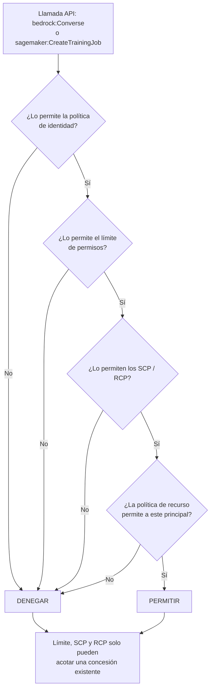
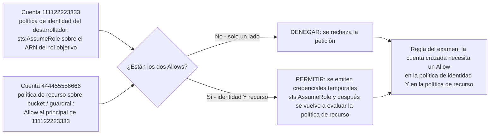
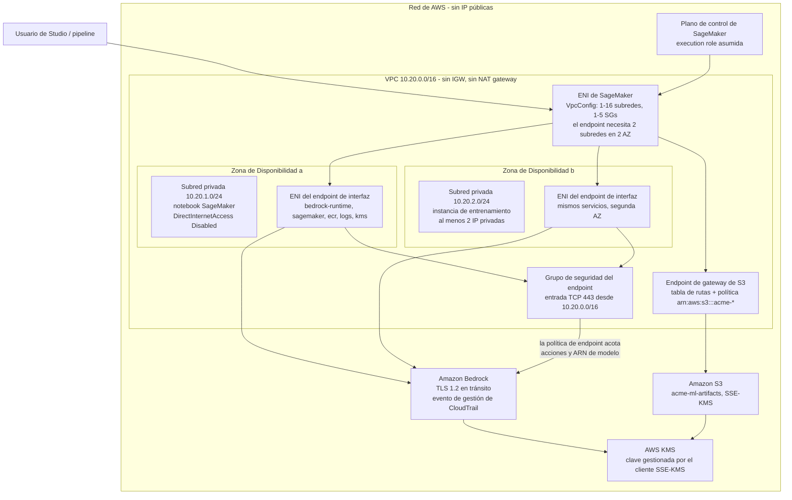
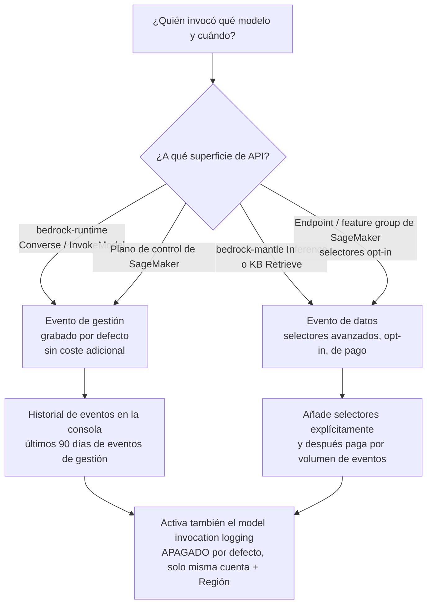
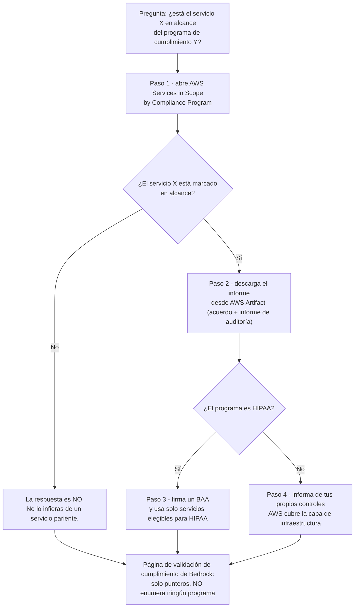

# Seguridad, IAM y cumplimiento para cargas de trabajo de IA

Seguridad es el segundo dominio con más peso en el examen AIF-C01: **el Dominio 2 «Security, Compliance, and Governance» supone el 24 %** de la puntuación, dentro de un examen de **65 preguntas** (50 puntuadas + 15 sin puntuar) sin penalización por responder a ciegas. Lo que lo dificulta no es el vocabulario: es que AWS enuncia el *mismo* requisito en cuatro sitios distintos, y el examen te recompensa por saber cuál de esos sitios es el autoritativo. «¿Es Bedrock compatible con HIPAA?» tiene una respuesta correcta diferente según leas una página de marketing, la documentación propia del servicio o la tabla AWS Services in Scope.

```text
====================================================================
 MAPA DE DECISIONES DE SEGURIDAD PARA IA/ML EN AWS      (resumen 6 oct 2026)
====================================================================
 QUIÉN PUEDE HACER QUÉ ..... política de identidad IAM + política de recurso
                          + límite de permisos + SCP/RCP
                          -> los CUATRO acotan; NINGUNO concede
 QUIÉN ASUME EL ROLE ... SageMaker execution / pipeline /
                          service / service-linked (Studio Classic)
                          Bedrock service role (+ aws:SourceAccount)
 DÓNDE VIVEN LOS DATOS .. VPC: 1-16 subredes, 1-5 security groups,
                          >=2 subredes en >=2 AZ para un endpoint
                          7 servicios Bedrock PrivateLink, TCP 443
                          S3 gateway endpoint = gratis
 CÓMO SE CIFRA .......... en tránsito: TLS 1.2 mínimo
                          en reposo: SSE-S3 por defecto, SSE-KMS con CMK
                          S3 entre cuentas -> TU clave de cliente
 CÓMO SE REGISTRA ....... CloudTrail eventos de gestión = defecto/gratis
                          eventos de datos = opt-in, de pago
                          model invocation logging = APAGADO por defecto
 ¿ES CUMPLIMIENTO? ...... AWS Services in Scope + AWS Artifact
                          servicio elegible para HIPAA + BAA (nunca "certified")
                          Bedrock: ISO, SOC, CSA STAR L2, GDPR,
                          HIPAA eligible, FedRAMP High (GovCloud US-West)
====================================================================
```

> [!NOTE]
> **Cómo leer esta lección.** Tres reglas se aplican en todo momento. (1) **Los números son examinables**: `1–16` subredes, `1–5` grupos de seguridad, **7** servicios de PrivateLink, **90 días** de historial de eventos de CloudTrail, cuerpo de registro de invocaciones de **100 KB**, **≤30 días** de retención para `aws_review`, **50 %** de confianza de Rekognition. (2) **La redacción es examinable**: «HIPAA-eligible» nunca es «HIPAA certified», y una página que *apunta* a programas de cumplimiento no es una página que *los enumera*. (3) **Todo lo que AWS no confirma en primera persona se marca**, nunca se enseña como material de memorización: las marcas se recopilan al final de la lección.

Al terminar esta lección podrás:

- nombrar cada tipo de rol de IAM que una carga de trabajo de IA puede usar y decir quién lo asume;
- escribir una execution role de SageMaker con mínimo privilegio y explicar por qué `AmazonSageMakerFullAccess` todavía necesita una segunda declaración de S3;
- aplicar bien la regla de cuentas cruzadas: se requiere un Allow **tanto en la política de identidad como en la política de recurso**;
- elegir entre **SSE-S3** y **SSE-KMS** (y saber cuándo solo una de las dos es posible);
- diseñar una VPC privada de ML: endpoint de gateway frente a endpoint de interfaz frente a NAT, y por qué los endpoints de SageMaker necesitan **dos subredes en dos Zonas de Disponibilidad**;
- separar los eventos de **gestión** de CloudTrail de los eventos de **datos** para `bedrock-runtime`, `bedrock-mantle` y SageMaker;
- demostrar una afirmación de cumplimiento a la manera de AWS: Services in Scope → **AWS Artifact** → BAA para servicios elegibles para HIPAA;
- defender el **Veredicto comparativo**: roles de IAM frente a claves compartidas, endpoint de VPC frente a NAT, SSE-KMS frente a SSE-S3.

---

## 1. Responsabilidad compartida, y qué añade la seguridad de IA

### 1.1 La frase que AWS publica de verdad

La documentación de seguridad de Amazon Bedrock no te entrega una lista de verificación. Dice que la responsabilidad *"está determinada por la sensibilidad de tus datos, los objetivos de cumplimiento de tu empresa y las leyes y regulaciones aplicables"*. Esa frase es toda la filosofía: AWS asegura la infraestructura y el servicio, tú aseguras **lo que metes en él y a quién permites tocarlo**, y la sensibilidad de una carga de trabajo de IA (prompts, embeddings, datos de fine-tuning, salidas del modelo) es la variable que el examen no deja de evaluar.

### 1.2 La división, capa por capa

| Capa | AWS es responsable de | Tú eres responsable de | Gancho de examen |
|---|---|---|---|
| **Física / host** | Regiones, disponibilidad, hardware | Colocación y elección de Región | La residencia de datos empieza aquí |
| **Identidad** | El propio servicio IAM | Políticas de confianza de roles, mínimo privilegio, `iam:PassRole`, límites, SCP | «Los cuatro acotan, ninguno concede» |
| **Red** | Fontanería de VPC, tejido de PrivateLink | Subredes, tablas de rutas, grupos de seguridad, políticas de endpoint | Sin internet ⇒ endpoints, no NAT |
| **Datos en reposo** | Servicio KMS, servicio S3 | Elección de clave (SSE-S3 frente a SSE-KMS), políticas de clave, grants | Cuenta cruzada ⇒ **tu** CMK |
| **Datos en tránsito** | Terminación TLS en los servicios de AWS | TLS 1.2 mínimo en tu cliente y en las rutas de la VPC | «1.2» es el número |
| **Contenido de IA** | Comportamiento del servicio Bedrock | Guardrails, filtros de PII, moderación, selección de modelo | Moderación en **ambas** direcciones |
| **Auditoría** | CloudTrail, Config, GuardDuty | Activarlos, selectores, retención, destinos de registro | El registro de invocaciones está **apagado** por defecto |
| **Cumplimiento** | Informes, alcance, Artifact | Qué servicios usas y tus propios controles | La evidencia vive en **AWS Artifact** |

- **📚 ¿Sabías que…?** AWS publica **143 ofertas de cumplimiento** en sus servicios. La cifra es una distracción deliberada: el examen nunca pregunta el total, pregunta si *este servicio en concreto* está *en el alcance de este programa en concreto*, y la única respuesta autoritativa es la tabla **AWS Services in Scope by Compliance Program**, no la página de marketing de un servicio.

### 1.3 La primera trampa: «HIPAA certified» no existe

**No existe una certificación HIPAA** para AWS, para Amazon Bedrock, para SageMaker ni para ningún proveedor de servicios en la nube. La redacción correcta, y la que usa el examen, es:

1. firmar un **Business Associate Agreement (BAA)** con AWS, y
2. usar solo **servicios elegibles para HIPAA** para almacenar o procesar información de salud protegida (PHI).

AWS además mapea la HIPAA Security Rule a **FedRAMP** y **NIST SP 800-53** (cuya guía es SP 800-66), y por eso esos dos nombres aparecen juntos en cada opción correcta sobre HIPAA.

---

## 2. Identidad: los roles detrás de cada trabajo de IA

### 2.1 Los tipos de role, en una tabla

SageMaker por sí solo documenta cuatro tipos de role, y Bedrock añade dos más. Aprende quién *asume* cada uno: eso es lo que la pregunta evalúa siempre.

| Tipo de role | Asumido por | Principal de confianza | Permisos clave |
|---|---|---|---|
| **Execution role de SageMaker (job)** | SageMaker en tiempo de ejecución del job | `sagemaker.amazonaws.com` | S3 entrada/salida, pull de ECR, registros de CloudWatch, KMS |
| **Role de domain / space / user** | SageMaker para una identidad de Studio | `sagemaker.amazonaws.com` | por persona vía Role Manager (**3 personas**) |
| **Execution role de pipeline** | Pipelines → cada paso | `sagemaker.amazonaws.com` | APIs del paso + S3 `JsonGet`; quien lo crea necesita `iam:PassRole` |
| **Service-linked role** | SageMaker automáticamente | gestionado por AWS | estrecho, fijo: **solo Studio Classic** |
| **Bedrock service role** (customization, agents, KB, Flows, evals) | `bedrock.amazonaws.com` | `bedrock.amazonaws.com` + `aws:SourceAccount` | tus buckets de S3 + KMS |
| **Role de cuenta cruzada** | otras cuentas vía `sts:AssumeRole` | otra cuenta / `AWS:PrincipalArn` | acotado por la política de identidad **y** la de recurso |
| **Role con límite adjunto** | como role base | sin cambios | **acotado** por el límite |
| **Bedrock project / bearer token** | app que usa una API key |: | `bedrock-mantle:*` limitado a un ARN de proyecto |

Dos detalles que vale la pena memorizar:

- **`ExecutionRoleSessionNameMode = USER_IDENTITY`** mete en CloudTrail al *usuario final* (no un nombre de job compartido): el ajuste que convierte «lo hizo el job» en «lo hizo la credencial de Priya».
- Las personas del **Role Manager** son **Data scientist**, **MLOps** y **SageMaker AI compute**: tres roles, no una lista de texto libre.

### 2.2 Ejemplo 1: una execution role de SageMaker con mínimo privilegio

```json
{"Version":"2012-10-17","Statement":[
 {"Effect":"Allow","Principal":{"Service":"sagemaker.amazonaws.com"},"Action":"sts:AssumeRole"},
 {"Effect":"Allow","Action":["sagemaker:CreateTrainingJob","sagemaker:DescribeTrainingJob",
  "sagemaker:CreateModel","sagemaker:CreateEndpoint","sagemaker:InvokeEndpoint"],
  "Resource":"arn:aws:sagemaker:us-east-1:111122223333:*"},
 {"Effect":"Allow","Action":["s3:GetObject","s3:PutObject","s3:ListBucket"],
  "Resource":["arn:aws:s3:::acme-ml-artifacts","arn:aws:s3:::acme-ml-artifacts/*"]},
 {"Effect":"Allow","Action":["logs:CreateLogGroup","logs:PutLogEvents"],
  "Resource":"arn:aws:logs:us-east-1:111122223333:log-group:/aws/sagemaker/*"}]}
```

Cuatro declaraciones, una cuenta (`111122223333`), un bucket (`acme-ml-artifacts`), una Región (`us-east-1`). Compara esto con la política gestionada de la siguiente subsección: la diferencia *es* la respuesta del examen.

### 2.3 La advertencia de S3 de `AmazonSageMakerFullAccess`

AWS documenta una restricción concreta dentro de `AmazonSageMakerFullAccess`: **ciertas acciones de S3 se conceden solo en buckets y objetos cuyos nombres contengan `SageMaker`, `Sagemaker`, `sagemaker` o `aws-glue`**, más una lista corta de acciones que aplican a cualquier recurso de S3. Consecuencias:

- un bucket llamado `acme-ml-artifacts` **no** está cubierto: debes adjuntar una segunda política, exactamente como en el Ejemplo 1;
- una opción que afirma «FullAccess concede `s3:*` en cada bucket de la cuenta» es **falsa**;
- una opción que afirma «FullAccess no concede permisos de S3» es igualmente falsa.

La lección práctica va más allá de S3: **una política gestionada es un punto de partida, no un diseño**. El examen recompensa una y otra vez al candidato que dice «política gestionada por el cliente limitada al ARN del recurso».

### 2.4 Ejemplo 2: permitir una familia de modelos y denegar otra

```json
{"Version":"2012-10-17","Statement":[
 {"Sid":"Allow","Effect":"Allow",
  "Action":["bedrock:InvokeModel","bedrock:InvokeModelWithResponseStream",
            "bedrock:Converse","bedrock:ConverseStream"],
  "Resource":["arn:aws:bedrock:us-east-1::foundation-model/anthropic.claude-*",
              "arn:aws:bedrock:us-east-1:111122223333:inference-profile/us.*"]},
 {"Sid":"Deny","Effect":"Deny",
  "Action":["bedrock:InvokeModel","bedrock:InvokeModelWithResponseStream"],
  "Resource":"arn:aws:bedrock:*::foundation-model/meta.*"}]}
```

Observa el acoplamiento: denegar `InvokeModel` **más** `InvokeModelWithResponseStream` también deniega `Converse`/`ConverseStream`, porque estos últimos se construyen sobre los primeros. Para imponerlo en toda la organización sales del límite de la cuenta y escribes un **SCP** sobre `bedrock:Invoke*`, `bedrock:Converse*` y `sagemaker:InvokeEndpoint*`.

### 2.5 Ejemplo 3: una Bedrock service role de customization que resiste al confused deputy

```json
{"Version":"2012-10-17","Statement":[
 {"Sid":"AllowBedrockServicePrincipalUnderConditions","Effect":"Allow",
  "Principal":{"Service":"bedrock.amazonaws.com"},"Action":"sts:AssumeRole",
  "Condition":{"StringEquals":{"aws:SourceAccount":"111122223333"}}},
 {"Effect":"Allow","Action":["s3:GetObject","s3:ListBucket"],
  "Resource":["arn:aws:s3:::acme-train","arn:aws:s3:::acme-train/*"]},
 {"Effect":"Allow","Action":["s3:PutObject"],"Resource":"arn:aws:s3:::acme-metrics/*"},
 {"Effect":"Allow","Action":["kms:Decrypt","kms:GenerateDataKey"],
  "Resource":"arn:aws:kms:us-east-1:111122223333:key/1234-abcd"}]}
```

Esta política empaqueta tres hábitos:

1. **`aws:SourceAccount`** en la política de confianza: la protección contra confused deputy que AWS recomienda para todo Bedrock service role (customization, import, batch, agents, knowledge bases, Flows, evaluations);
2. **`aws:SourceArn`** encima, para acotar al nivel del job;
3. para Bedrock en concreto, **`iam:PassedToService = bedrock.amazonaws.com`** cuando quien llama pasa un role, y una declaración de **política de clave** a juego para que KMS realmente permita el job.

### 2.6 Cómo se evalúa una petición: todo acota, nada concede



La regla que el examen no deja de reformular: **un límite de permisos (permissions boundary), una service control policy (SCP) y una resource control policy (RCP) acotan todas los permisos máximos posibles: ninguna de las tres concede nada.** Un límite sin política de identidad adjunta da a un usuario *cero* permisos efectivos, no los permisos del límite.

### 2.7 Ejemplo 4: un límite de permisos acotando a un desarrollador de ML

```json
{"Version":"2012-10-17","Statement":[
 {"Effect":"Allow","Action":["sagemaker:*","s3:*","logs:*","ecr:*"],"Resource":"*"},
 {"Effect":"Deny","Action":["sagemaker:DeleteModel","sagemaker:DeleteEndpoint"],"Resource":"*"}]}
```

Permiso efectivo = política de identidad **∩** límite. El desarrollador conserva lo que su política de identidad permite, pero nunca puede superar esos cuatro servicios, y nunca puede borrar un modelo o un endpoint aunque su política de identidad diga `sagemaker:*`.

**Ordena los pasos para construir ese role:**

```dragdrop
{
  "question": "Ordena los pasos para construir una execution role de SageMaker con mínimo privilegio, tal como AWS los documenta:",
  "items": [
    "Paso 3: adjuntar la política gestionada por el cliente que limita S3 a arn:aws:s3:acme-ml-artifacts",
    "Paso 1: crear el rol de IAM con Principal en la política de confianza sagemaker.amazonaws.com y sts:AssumeRole",
    "Paso 2: decidir las necesidades reales del job: qué APIs de SageMaker, qué bucket, qué grupo de registros, qué clave KMS",
    "Paso 4: adjuntar opcionalmente un límite de permisos que acote el rol a sagemaker, s3, logs y ecr",
    "Paso 5: pasar el rol al job con iam:PassRole y verificar el nombre de sesión en CloudTrail"
  ],
  "correctOrder": [
    "Paso 1: crear el rol de IAM con Principal en la política de confianza sagemaker.amazonaws.com y sts:AssumeRole",
    "Paso 2: decidir las necesidades reales del job: qué APIs de SageMaker, qué bucket, qué grupo de registros, qué clave KMS",
    "Paso 3: adjuntar la política gestionada por el cliente que limita S3 a arn:aws:s3:acme-ml-artifacts",
    "Paso 4: adjuntar opcionalmente un límite de permisos que acote el rol a sagemaker, s3, logs y ecr",
    "Paso 5: pasar el rol al job con iam:PassRole y verificar el nombre de sesión en CloudTrail"
  ],
  "explanation": "Primero viene la confianza, luego el inventario honesto de lo que el job necesita, luego la política acotada, luego el límite opcional y al final el paso real del role. Los candidatos que empiezan con AmazonSageMakerFullAccess suspenden el paso 3: esa política gestionada no cubre un bucket llamado acme-ml-artifacts, así que una segunda declaración de S3 es obligatoria."
}
```

---

## 3. Identidad en Bedrock: políticas gestionadas, políticas de recurso y cuentas cruzadas

### 3.1 Siete políticas gestionadas, y sus fechas

Amazon Bedrock incluye **7 políticas gestionadas de AWS**, y al examen le gusta la cronología:

| Política gestionada | Rol | GA / nota |
|---|---|---|
| `AmazonBedrockFullAccess` | acceso amplio a Bedrock | acota `iam:PassRole` + `iam:PassedToService` |
| `AmazonBedrockReadOnly` | solo lectura | auditorías y revisores |
| `AmazonBedrockLimitedAccess` | línea base de actividad principal | **GA 13 jun 2025** |
| `AmazonBedrockMarketplaceAccess` | modelos del marketplace | **GA 13 jun 2025** |
| `AmazonBedrockMantle*` (×3) | acceso a proyectos `bedrock-mantle` | **GA 3 dic 2025** |

### 3.2 Basadas en identidad y basadas en recurso, y por qué los guardrails necesitan ambas

Bedrock acepta **políticas basadas en identidad** (quién eres) *y* **políticas basadas en recurso** (qué objeto se toca). **Los guardrails y los perfiles de inferencia usan políticas de recurso**, y AWS declara que una política de recurso es **obligatoria** para el cumplimiento a nivel de organización: para impedir que toda una organización invoque un modelo sin un guardrail adjunto, adjuntas una política de recurso evaluada con `bedrock:GuardrailIdentifier` y la respaldas con un SCP. Una política de identidad por sí sola no puede expresar «este guardrail debe estar presente».

### 3.3 Cuentas cruzadas: el Allow debe existir en los dos lados



En concreto, para un **bucket de S3 compartido y** un guardrail compartido:

1. La cuenta B (`444455556666`) crea `role/CrossAccountBedrock` que confía en `{"AWS":"arn:aws:iam::111122223333:root"}` **y** pone una política de recurso en el bucket/guardrail que permite a la cuenta A;
2. La cuenta A adjunta una política de identidad con `{"Action":"sts:AssumeRole","Resource":"arn:aws:iam::444455556666:role/CrossAccountBedrock"}`;
3. los dos Allows son obligatorios: para KMS debes usar **tu propia CMK**, porque la política de clave de un S3 gestionado por AWS no se puede compartir de esa manera.

**Ejemplo 5: la mitad que falta: la política de recurso sobre el bucket de la cuenta B.**

```json
{"Version":"2012-10-17","Statement":[
 {"Sid":"AllowAccountAIdentity","Effect":"Allow",
  "Principal":{"AWS":"arn:aws:iam::111122223333:root"},
  "Action":["s3:GetObject","s3:ListBucket"],
  "Resource":["arn:aws:s3:::acme-shared","arn:aws:s3:::acme-shared/*"],
  "Condition":{"StringEquals":{"aws:PrincipalOrgID":"o-a1b2c3d4e5","s3:ExistingObjectTag/classification":"internal"}}},
 {"Sid":"DenyUnencryptedTransport","Effect":"Deny",
  "Principal":"*","Action":"s3:*",
  "Resource":["arn:aws:s3:::acme-shared","arn:aws:s3:::acme-shared/*"],
  "Condition":{"Bool":{"aws:SecureTransport":"false"}}}]}
```

La cuenta `111122223333` (identidad) más esta declaración en `444455556666` (recurso) = los dos Allows que exige la regla; la segunda declaración además impone TLS en tránsito en el bucket.

### 3.4 Límites de permisos, SCP y RCP comparados

| Control | Se adjunta a | Se aplica a | Efecto | ¿Concede algo? |
|---|---|---|---|---|
| **Permissions boundary** | un role/identidad de IAM | esa identidad | permisos máximos posibles | **No** |
| **SCP (OU/cuenta)** | la estructura organizativa | los principales de la cuenta | permisos máximos posibles | **No** |
| **RCP** | recursos de la organización | las peticiones entrantes a esos recursos | permisos máximos posibles | **No** |
| **Política de identidad** | una identidad de IAM | esa identidad | la concesión real | **Sí** |
| **Política de recurso** | un recurso (bucket, guardrail, clave) | los principales que lo alcanzan | concesión + condiciones | **Sí** |

- **📚 ¿Sabías que…?** La función **Role Manager** y la vía de la **service-linked role** están ambas ligadas a **Studio Classic**. En Studio (la experiencia actual) asignas **roles de domain, space y user** por persona, y por eso una opción que describe «dejar que SageMaker cree el rol automáticamente» es una respuesta de Studio Classic, y una opción que describe tres personas es una respuesta de Role Manager.

---

## 4. Cifrado: en reposo y en tránsito

### 4.1 En tránsito: TLS 1.2 es el número

AWS declara **TLS 1.2** como mínimo en tránsito para estos servicios. En CloudTrail puedes verificar la versión negociada mediante `tlsDetails.tlsVersion`. Cualquier opción que ofrezca «TLS 1.0 o superior», «SSL» o «solo TLS 1.3» es errónea en direcciones opuestas.

### 4.2 En reposo: valores por defecto, opciones y las dos excepciones

| Recurso | En reposo: por defecto | Opción del cliente | En tránsito |
|---|---|---|---|
| Notebooks, artefactos y salida de jobs de SageMaker | **SSE-S3** | **SSE-KMS CMK** | TLS |
| Volúmenes de almacenamiento ML de SageMaker | **clave transitoria, descartada tras cifrar** | `VolumeKmsKeyId` | n/a |
| Volúmenes del SO de la instancia | **clave KMS gestionada por AWS** | no seleccionable | n/a |
| Modelos personalizados / importados de Bedrock | **claves propiedad de AWS** | **CMK** (`GenerateDataKey`) | **TLS 1.2** |
| Registros de invocación de Bedrock | n/a hasta que los actives | tu S3/CloudWatch + CMK | TLS 1.2 |
| Datos de entrenamiento / validación de Bedrock | tu S3 por defecto | CMK + grant en la política de clave | TLS 1.2 |
| Salida de SageMaker en **S3 Express One Zone** | **solo SSE-S3** | **SSE-KMS no admitido** | TLS |
| Cargas útiles de inferencia entre Regiones | según la política de retención |: | **cifradas entre Regiones** |

Dos excepciones concentran una ponderación desproporcionada en el examen:

1. **Un volumen de SageMaker sin clave recibe una clave transitoria que se descarta tras cifrar**: así que «los volúmenes de SageMaker no están cifrados» es falso, y «debes proporcionar una clave KMS» también es falso.
2. **El acceso a S3 entre cuentas necesita *tu* CMK.** Si la cuenta A lee el bucket de la cuenta B, la política de clave gestionada por AWS por defecto de la cuenta B no cooperará; la cuenta A debe proporcionar y controlar una clave gestionada por el cliente.

### 4.3 Elegir entre SSE-KMS y SSE-S3 en una frase

**SSE-S3** es el valor por defecto, no tiene sobrecarga de gestión de claves ni cargos por peticiones a KMS; **SSE-KMS** te da una clave gestionada por el cliente con rastro de auditoría en CloudTrail, políticas de clave y grants, y rotación por clave, y es la única forma de satisfacer un requisito entre cuentas o una política que exige CMK. Reglas de AWS Config como `sagemaker-endpoint-config-kms-key-required` y `sagemaker-featuregroup-encryption-at-rest` existen precisamente para *detectar* cuándo te quedaste con el valor por defecto.

---

## 5. Aislamiento de red: VPC, endpoints de gateway y PrivateLink

### 5.1 El contrato de `VpcConfig`

El `VpcConfig` de SageMaker acepta **1 to 16 subredes** y **1 to 5 grupos de seguridad**, y SageMaker crea **interfaces de red elásticas (ENI)** en cada subred. La regla dura que los candidatos se saltan:

> **Un endpoint de SageMaker necesita al menos 2 subredes en al menos 2 Zonas de Disponibilidad, aunque lances una sola instancia.**

Los jobs de entrenamiento necesitan **al menos 2 IP privadas** por instancia (**al menos 5 con EFA**), y el grupo de seguridad debe permitir **TCP 443 de entrada** en la ruta de la ENI.

### 5.2 Los siete servicios Bedrock PrivateLink

| # | Servicio de endpoint de VPC |
|---|---|
| 1 | `com.amazonaws.<region>.bedrock` |
| 2 | `com.amazonaws.<region>.bedrock-runtime` |
| 3 | `com.amazonaws.<region>.bedrock-agent` |
| 4 | `com.amazonaws.<region>.bedrock-agent-runtime` |
| 5 | `com.amazonaws.<region>.bedrock-fips` |
| 6 | `com.amazonaws.<region>.bedrock-runtime-fips` |
| 7 | `com.amazonaws.<region>.bedrock-mantle` |

Con PrivateLink obtienes: **sin internet gateway, sin NAT, sin requisito de VPN o Direct Connect y sin IP públicas**. DNS privado **habilitado** significa que tu código no cambia; DNS privado **deshabilitado** significa que reescribes las llamadas a `{vpce-id}.bedrock-runtime.{region}.vpce.amazonaws.com`. El grupo de seguridad del endpoint debe permitir **443 de entrada**, y puedes adjuntar una **política de endpoint personalizada** para acotar qué acciones o ARN de modelo son alcanzables.

### 5.3 Cuatro patrones de VPC y lo que cuestan

| Patrón | Componentes | Úsalo cuando | Nota de coste |
|---|---|---|---|
| **A: Subredes privadas + endpoint de gateway de S3** | ≥2 AZ, endpoint de gateway + política, SG 443, sin IGW/NAT | solo S3 + APIs de AWS | el endpoint de gateway es **gratuito**; los endpoints de interfaz, por hora + por GB |
| **B: + endpoints de interfaz (PrivateLink)** | `bedrock`, `bedrock-runtime`, `sagemaker`, `ecr`, `logs`, `kms` por subred | Bedrock/SageMaker sin internet | por hora + procesamiento; **reemplaza al NAT** |
| **C: + subredes públicas y NAT gateway** | IGW, subredes públicas, **NAT gateway** + Elastic IP | una dependencia **sin endpoint de interfaz**, destinos que no son de AWS | NAT por hora + por GB + EIP |
| **D: totalmente sin internet** | A o B, mirror de paquetes privado / ECR, sin IGW | cargas reguladas / con residencia de datos | elimina el coste de NAT + IGW |
| **Cumplimiento** | `sagemaker:VpcSubnets`; Config `…-instance-inside-vpc`, `…-no-direct-internet-access` | todo lo anterior |: |

### 5.4 Ejemplo 6: un diseño privado que funciona de Bedrock + SageMaker (Patrón B)

1. `10.20.0.0/16` con la privada `10.20.1.0/24` (AZ-a) y `10.20.2.0/24` (AZ-b); **sin ruta a IGW, sin NAT**;
2. **endpoint de gateway de S3** adjunto a las dos tablas de rutas, con una política de endpoint limitada a `arn:aws:s3:::acme-*`;
3. **endpoints de interfaz** en las dos subredes para `bedrock-runtime`, `bedrock`, `sagemaker`, `sagemaker.api`, `sagemaker.runtime`, `ecr.api`, `ecr.dkr`, `logs` y `kms`; grupo de seguridad del endpoint **con 443 de entrada desde `10.20.0.0/16`**;
4. `VpcConfig = {Subnets:[a,b], SecurityGroupIds:[sg-ml]}`; salida de `sg-ml` limitada a 443 hacia el grupo de seguridad del endpoint; notebook con `DirectInternetAccess = Disabled`;
5. **flujo**: usuario de Studio → ENI de SageMaker → ENI del endpoint → runtime de Bedrock sobre la red de AWS con TLS 1.2. CloudTrail registra la llamada como un evento de **gestión** en la Región de origen, y GuardDuty AI Protection lo lee a través de su canal vinculado al servicio. **Respaldo** (Patrón C) añade un IGW, subredes públicas y un **NAT gateway** solo cuando una dependencia no tiene endpoint de interfaz.

### 5.5 La arquitectura segura de VPC / ML



> [!WARNING]
> **Dos trampas de red que cuestan puntos en cada convocatoria.**
> 1. **Un endpoint necesita ≥2 subredes en ≥2 AZ aunque sea para una instancia.** Una opción que ofrezca «una subred basta para un endpoint de una sola instancia» es siempre errónea: el requisito de AZ está en el contrato de la API, no en una mejor práctica.
> 2. **«Usa un NAT gateway para mantener el tráfico privado» está al revés.** Un NAT gateway enruta el tráfico hacia internet a través de AWS; un diseño sin internet usa **endpoints de gateway (S3, gratuitos)** y **endpoints de interfaz / PrivateLink**, con el NAT solo como **respaldo** para dependencias que no exponen endpoint de interfaz. La entrada de grupo de seguridad en la ruta de la ENI es **443**, no 80.

---

## 6. Auditoría: CloudTrail, registro de invocaciones, GuardDuty y Config

### 6.1 Eventos de gestión frente a datos: la línea de gratis/de pago

| Llamada | Tipo de evento de CloudTrail | Coste |
|---|---|---|
| APIs del plano de control de SageMaker (por defecto) | **gestión** | incluido |
| Eventos de datos de SageMaker opt-in (`AWS::SageMaker::Endpoint`, `FeatureGroup`, …) | **datos** | opt-in, **de pago** |
| `bedrock-runtime` → `Converse`, `InvokeModel` | **gestión** | **gratis** |
| `bedrock-mantle` → `Inference` | **datos** | opt-in, **de pago** |
| `Retrieve` de la base de conocimiento | **datos** | opt-in, **de pago** |



**Los eventos de gestión son gratuitos y están activos por defecto; los eventos de datos son opt-in y de pago.** El **historial de eventos** de CloudTrail conserva **90 días** de eventos de gestión en la consola.

### 6.2 El registro de invocaciones de modelos es un interruptor aparte, y está apagado

El **model invocation logging de Bedrock está apagado por defecto**. Cuando lo activas:

- los destinos son **CloudWatch Logs y/o S3**, y deben estar en **la misma cuenta y la misma Región**;
- un cuerpo de prompt/completion en línea de **≤100 KB** se guarda en línea: los cuerpos más grandes van a un prefijo de S3 bajo `data/`;
- el registro *no* es CloudTrail: CloudTrail te dice *quién llamó a qué*, el registro de invocaciones te dice *qué se dijo*.

### 6.3 GuardDuty AI Protection

El **AI Protection** de GuardDuty lee los **eventos de datos** de Bedrock, AgentCore y SageMaker además de los eventos de gestión, a través de **un canal de CloudTrail vinculado al servicio que GuardDuty crea por ti**. Hallazgos notables:

| Hallazgo / comportamiento | Significado |
|---|---|
| `Impact:IAMUser/AnomalousModelInvocation` | patrón inusual de llamadas a modelos |
| `…/CostHarvesting` | recurso agotado para coste de tokens |
| `Impact:IAMUser/PromptInjection.Direct` | un guardrail intervino sobre una entrada |
| MITRE ATLAS **AML.T0040** | la técnica mapeada |
| Plan Foundational | marca la eliminación de guardrails, cambios en la fuente de datos de entrenamiento, **registro de invocaciones desactivado**, creación anómala de notebooks/jobs, credenciales EC2 exfiltradas |
| Lambda Protection | cubre los **agents** de Bedrock |

Esto son **hallazgos y alertas**, no bloqueos: GuardDuty te dice que un guardrail intervino; solo el propio guardrail bloquea el contenido.

### 6.4 AWS Config: reglas y packs para IA

Las reglas de Config con el prefijo `sagemaker-` incluyen:

- `sagemaker-notebook-no-direct-internet-access`
- `sagemaker-notebook-instance-inside-vpc`
- `sagemaker-endpoint-config-kms-key-required`
- `sagemaker-featuregroup-encryption-at-rest`

Y hay tres conformance packs orientados a la IA: **Best Practices for Amazon Bedrock**, **Best Practices for Amazon SageMaker AI** y **Best Practices for AI/ML Supporting Infrastructure**. El control **3.1.1** de NIST SP 800-171 se mapea a `sagemaker-notebook-no-direct-internet-access`, y AWS declara que las plantillas de ejemplo **no garantizan superar** una auditoría de cumplimiento.

- **📚 ¿Sabías que…?** La **eliminación de un Guardrail** y el **cambio del registro de invocaciones de modelos a desactivado** se tratan ambos como eventos de seguridad por el plan Foundational de GuardDuty. Es inusual, la mayoría de la «deriva de configuración» solo es visible en Config, y es una pista fuerte de que el examen considera «apagar en silencio tu red de seguridad» un ataque, no una tarea de administración.

### 6.5 Panel de estado (octubre de 2026)

| Control / función | Estado | Nota |
|---|---|---|
| **AI Protection** de GuardDuty | GA | eventos de datos de Bedrock + AgentCore + SageMaker |
| Pack Config *Best Practices for Amazon Bedrock* | GA | despliega junto al pack de infraestructura |
| Endpoints PrivateLink de Bedrock | GA | incluido `bedrock-mantle` |
| Modos de retención de Bedrock + claves de condición | GA (API/SDK) | **sin interfaz de consola en el lanzamiento** |
| `AmazonBedrockLimitedAccess` | GA **13 jun 2025** | línea base de actividad principal |
| Políticas `AmazonBedrockMantle*` | GA **3 dic 2025** | 3 políticas |
| **FedRAMP High** de Bedrock | Autorizado: **GovCloud (US-West)** | la matriz por modelo se sigue por separado |
| **HIPAA eligible** de Bedrock | Elegible | se necesita BAA; «eligible» ≠ «certified» |
| Alcance **PCI DSS** de Bedrock | **no está declarado en las propias páginas de Bedrock** | no lo afirmes |
| Salida de SageMaker en S3 Express One Zone | **solo SSE-S3** | SSE-KMS no admitido |

---

## 7. Cumplimiento: HIPAA, AWS Artifact y lo que Bedrock publica de verdad

### 7.1 La única cadena autoritativa



De ese diagrama salen tres reglas:

1. **AWS Services in Scope** es la única tabla autoritativa de «¿está cubierto»: ✓ significa en alcance en los informes actuales;
2. **AWS Artifact** es donde viven los informes reales de SOC / ISO / FedRAMP: nunca una página de servicio, nunca un enlace de consola etiquetado «Compliance»;
3. para HIPAA necesitas un **BAA** más **servicios elegibles para HIPAA**; AWS mapea la Security Rule a **FedRAMP + NIST 800-53**.

### 7.2 Lo que Amazon Bedrock publica

El conjunto de cumplimiento publicado de Amazon Bedrock es: **ISO**, **SOC**, **CSA STAR Level 2**, **GDPR**, **HIPAA eligible** y **FedRAMP High en AWS GovCloud (US-West)**: más una **matriz FedRAMP por modelo (publicada el 18 sep 2026)** que cubre modelos Clase C/D e **IL4/IL5**.

> [!WARNING]
> **La trampa de la página de cumplimiento.** El `compliance-validation.html` de Bedrock **no enumera ningún programa de cumplimiento**, contiene solo *punteros* a la tabla AWS Services in Scope y a **AWS Artifact**. Una opción que afirme «la página de cumplimiento de Bedrock enumera cada programa en el que el servicio está en alcance» está comprobando si realmente abriste la página. Asimismo, **PCI DSS no aparece en ninguna parte de la propia página de seguridad y cumplimiento de Bedrock**, una presentación de conferencia de 2024 y la página de *AgentCore* mencionan PCI, y ninguna de las dos demuestra el alcance de Bedrock. **No lo afirmes.**

### 7.3 Números que merece la pena llevarse al examen

| Elemento | Valor |
|---|---|
| Ofertas de cumplimiento de AWS | **143** |
| Programas publicados por Bedrock | **ISO · SOC · CSA STAR Level 2 · GDPR · HIPAA eligible · FedRAMP High (GovCloud US-West)** |
| Matriz FedRAMP por modelo | publicada el **18 sep 2026** (Clase C/D, IL4/IL5) |
| Certificación HIPAA para cualquier CSP | **no existe** |
| Mapeo de HIPAA | Security Rule → **FedRAMP + NIST 800-53** (SP 800-66) |
| Dónde viven los informes | **AWS Artifact** |
| Historial de eventos de CloudTrail | **90 días** de eventos de gestión |
| Peso del Dominio 2 en AIF-C01 | **24 %** de **65** preguntas |

- **📚 ¿Sabías que…?** La frase «in scope» (en alcance) tiene un significado preciso: dice que el *servicio* fue incluido en el informe del auditor para ese periodo: no que *tu carga de trabajo* sea conforme. Por eso toda opción de cumplimiento que diga «activar GuardDuty logra el cumplimiento de HIPAA» es falsa: puedes estar en alcance y aun así incumplir tus propias obligaciones bajo el modelo de responsabilidad compartida.

---

## 8. Gobernanza de datos: retención, residencia y moderación de contenido

### 8.1 Modos de retención de Bedrock

Los modos de retención son `none`, `default`, `aws_review`, `provider_data_share` e `inherit`, con un alcance que fluye **proyecto → cuenta → valor por defecto del modelo**, **por Región, sin propagación entre Regiones**. Los hechos examinables:

- **`aws_review` mantiene los datos dentro del límite de AWS durante ≤30 días** y **nunca se los da al proveedor del modelo**;
- las claves de condición del plano de control son `bedrock:DataRetentionMode` / `bedrock-mantle:DataRetentionMode`, aplicables con SCP e IAM;
- **los datos de fine-tuning se usan solo para fine-tuning**, nunca para entrenar los modelos Titan base, y **no se guarda nada después del job**, pero el modelo ajustado aún puede hacer *replay* de ellos, así que filtra o borra las filas sensibles antes de empezar;
- en el lanzamiento **no hay interfaz de consola** para los modos de retención: solo API/SDK.

### 8.2 Ejemplo 7: imponer cero retención de datos en toda la organización (SCP)

```json
{"Version":"2012-10-17","Statement":[
 {"Effect":"Deny","Action":["bedrock-mantle:PutAccountDataRetention",
 "bedrock-mantle:CreateProject","bedrock-mantle:UpdateProject"],
 "Resource":"*","Condition":{"StringNotEquals":{"bedrock-mantle:DataRetentionMode":"none"}}}]}
```

Efecto: solo puede configurarse `none`; un modelo que *requiera* `aws_review` devuelve entonces `ValidationException` / `status: unavailable`. La variante del plano de control sustituye `bedrock-mantle:PutAccountDataRetention` por `bedrock:PutAccountDataRetention` y `bedrock-mantle:DataRetentionMode` por `bedrock:DataRetentionMode`.

### 8.3 Inferencia entre Regiones: Geographic frente a Global

| Modo | Dónde se ejecuta el procesamiento | Precio | Requisito |
|---|---|---|---|
| Inferencia entre Regiones **Geographic** | se queda dentro de la geografía (US / EU / APAC) | estándar | la respuesta de residencia de datos |
| Inferencia entre Regiones **Global** | cualquier Región comercial del mundo | **~10 % más barata** en tokens | el SCP debe permitir `aws:RequestedRegion = "unspecified"` |

CloudTrail registra la llamada en la **Región de origen**. Ninguno de los dos modos añade un recargo de enrutamiento, y ninguno admite Provisioned Throughput.

### 8.4 Moderación de contenido: la caja de herramientas completa

| Mecanismo | Alcance | Acción |
|---|---|---|
| **Filtros de contenido de Guardrails** | texto **e** imágenes; texto de usuario, sistema y modelo | `BLOCK` o `NONE`; intensidades `NONE/LOW/MEDIUM/HIGH` |
| **Temas denegados / filtros de palabras** | entradas + salidas | bloquear |
| **Filtro de información sensible (PII)** | entradas + salidas | **bloquear o enmascarar**; entidades predefinidas o **regex personalizada** |
| **Contextual grounding check** | respuestas frente a fuente | bloquear o marcar respuestas sin fundamento |
| **`DetectModerationLabels` de Rekognition** | solo **imágenes** JPEG/PNG | etiquetas + confianza (`MinConfidence` por defecto **50 %**), revisión con A2I |
| **`Start/GetContentModeration` de Rekognition** | **videos** almacenados | moderación asincrónica |
| **`…PromptInjection.Direct` de GuardDuty** | intervención de guardrail sobre entradas | **hallazgo/alerta**, no un bloqueo |

Detalles de Guardrails del resumen: **6 categorías de filtro**, Hate, Insults, Sexual, Violence, Misconduct y **Prompt Attack**, más el nivel `CLASSIC|STANDARD` y mensajes de respuesta bloqueada de **1 to 500 caracteres**. La detección de PII es **ML probabilística**, y exactamente por eso puedes elegir **enmascarar** en lugar de **bloquear**.

### 8.5 Límites de moderación de Rekognition

`DetectModerationLabels` acepta **solo JPEG y PNG**, usa una **taxonomía de 3 niveles** con `MinConfidence` por defecto en **50 %**, y funciona con Amazon A2I para revisión humana. El límite duro que AWS declara por escrito: las APIs **no detectan contenido ilegal como CSAM**: ningún umbral de confianza lo arregla, y ninguna opción del examen debería afirmar lo contrario.

- **📚 ¿Sabías que…?** La propia guía de guardrails de AWS dice: *"Desactiva los Invocation Logs si no quieres que el contenido bloqueado aparezca como texto plano en los registros."* En otras palabras, el registro que activas para auditar puede convertirse en el lugar donde se guarda literalmente el contenido que acabas de bloquear: un dilema de diseño genuino, y un caso raro en el que AWS recomienda explícitamente apagar una función de registro.

---

## 9. Veredicto comparativo

> [!IMPORTANT]
> **Veredicto comparativo: roles de IAM frente a claves compartidas de larga duración, endpoint de VPC frente a NAT gateway, SSE-KMS frente a SSE-S3**
> - **Rol de IAM (credenciales STS temporales) frente a claves de acceso de larga duración / credenciales compartidas.** El rol es siempre la respuesta para las cargas de trabajo de IA: una execution role es *asumida por el servicio* con una política de confianza, su sesión puede nombrarse (`ExecutionRoleSessionNameMode = USER_IDENTITY`) para que CloudTrail muestre al usuario final, y las credenciales caducan solas. Las claves de larga duración se filtran a través de notebooks, historial de git y registros de CI, no se pueden acotar con una política de confianza, no pueden expresar la protección contra confused deputy de `aws:SourceAccount`, y le dan al atacante una credencial sin sesión que revocar. Si una opción propone «darle una clave de acceso al científico para que el job de entrenamiento alcance S3», ha fallado en todos los ejes que AWS documenta.
> - **Endpoint de VPC (gateway para S3, interfaz/PrivateLink para Bedrock y SageMaker) frente a NAT gateway.** El endpoint mantiene el tráfico **dentro de la red de AWS sin IP públicas, sin IGW y sin NAT**; el **endpoint de gateway de S3 es gratuito**, los endpoints de interfaz cuestan por hora más procesamiento y *reemplazan* al NAT para esos servicios. Un NAT gateway es un **respaldo** para dependencias que no exponen endpoint de interfaz: cobra por hora, por GB y por Elastic IP, y aun así envía el tráfico hacia internet. Para un diseño sin internet y con residencia de datos, los endpoints son la arquitectura; el NAT es la excepción que documentas, no la meta a la que apuntas.
> - **SSE-KMS (clave gestionada por el cliente) frente a SSE-S3 (SSE-S3 por defecto).** SSE-S3 es el valor por defecto de SageMaker para notebooks, artefactos y salida de jobs: cero gestión de claves, sin cargos por peticiones a KMS, totalmente cifrado. SSE-KMS añade una CMK que controlas, políticas de clave, grants, rotación y auditoría en CloudTrail por clave, y se vuelve **obligatorio** cuando necesitas **acceso entre cuentas** (una política de clave gestionada por AWS no se puede compartir), cuando una regla de Config como `sagemaker-endpoint-config-kms-key-required` lo impone, o cuando tu política exige cifrado gestionado por el cliente. Observa las dos excepciones documentadas donde la elección desaparece: **la salida de S3 Express One Zone admite solo SSE-S3**, y **los volúmenes de almacenamiento ML de SageMaker usan una clave transitoria que se descarta tras cifrar** salvo que fijes `VolumeKmsKeyId`.

| Si la pregunta dice… | Respuesta | Por qué fallan las demás |
|---|---|---|
| «…el job debe leer exactamente un bucket de S3» | **Execution role gestionada por el cliente limitada al ARN del bucket** | `AmazonSageMakerFullAccess` está limitado por patrón de nombres; las service-linked roles son solo de Studio Classic |
| «…las credenciales se filtraron desde un notebook» | **Rol + STS, borra la clave** | un límite o un SCP no revoca un secreto filtrado |
| «…ningún prompt puede salir de la geografía de la UE» | **Inferencia entre Regiones Geographic** | el modo Global enruta por todo el mundo (~10 % más barata) |
| «…el tráfico nunca debe tocar internet» | **Gateway de S3 + endpoints de interfaz de Bedrock/SageMaker** | el NAT gateway va hacia internet; un endpoint de gateway por sí solo no llega a Bedrock |
| «…lectura de un bucket entre cuentas para datos de entrenamiento» | **Tu propia CMK de SSE-KMS + los dos Allows** | SSE-S3 no se puede compartir; una política de un solo lado falla |
| «…probar quién invocó Claude, sin coste» | **CloudTrail en `bedrock-runtime` (eventos de gestión)** | la inferencia de `bedrock-mantle` es un evento de datos de pago |
| «…encontrar el informe SOC de Bedrock» | **AWS Artifact** | la página de cumplimiento de Bedrock no enumera programas |
| «…almacenar PHI con Bedrock» | **BAA + servicios elegibles para HIPAA** | «HIPAA certified» no existe para ningún CSP |

---

## 10. Trampas del examen y los números que merecen memorizarse

> [!WARNING]
> **Las trampas que cuestan puntos exactamente en este material:**
> 1. **«HIPAA certified» no existe**: ni para AWS ni para ningún proveedor en la nube. La pareja correcta es **BAA + servicio elegible para HIPAA**, y AWS mapea la Security Rule a **FedRAMP + NIST 800-53**.
> 2. **El `compliance-validation.html` de Bedrock no enumera ningún programa**: solo punteros a *Services in Scope* y a **AWS Artifact**. PCI DSS **no** está declarado en las propias páginas de Bedrock; no lo afirmes.
> 3. **`Converse` / `InvokeModel` en `bedrock-runtime` son eventos de GESTIÓN de CloudTrail (gratis)**; el **`bedrock-mantle` Inference es un evento de DATOS (opt-in, de pago)**: decide la superficie, no el verbo.
> 4. **El registro de invocaciones de modelos está APAGADO por defecto**, y no es CloudTrail. Los destinos deben estar en **la misma cuenta y Región**; los cuerpos en línea son de **≤100 KB**.
> 5. **La cuenta cruzada necesita un Allow en LA POLÍTICA DE IDENTIDAD Y EN LA DE RECURSO.** Un solo lado es siempre una denegación.
> 6. **Los endpoints de SageMaker necesitan ≥2 subredes en ≥2 AZ**, aunque sea para una sola instancia; `VpcConfig` acepta **1 to 16 subredes** y **1 to 5 grupos de seguridad**.
> 7. **Los límites, los SCP y los RCP acotan: nunca conceden.** Un límite solo produce cero permisos.
> 8. **`AmazonSageMakerFullAccess` no alcanza buckets arbitrarios**: solo nombres que contengan `SageMaker`/`Sagemaker`/`sagemaker`/`aws-glue`, más una lista corta de cualquier recurso.
> 9. **El NAT es un respaldo, no una meta de diseño**; la respuesta sin internet es gateway + endpoints de interfaz, con **TCP 443** de entrada en el grupo de seguridad del endpoint.
> 10. **GuardDuty AI Protection crea su propio canal de CloudTrail vinculado al servicio**, tú no configuras ninguno, y `PromptInjection.Direct` es un **hallazgo**, no un bloqueo.

### 10.1 Los números que se evalúan

| Métrica | Valor |
|---|---|
| `VpcConfig` | subredes **1 to 16**, grupos de seguridad **1 to 5** |
| AZ del endpoint / IP privadas de entrenamiento | **≥2 AZ** / **≥2** (**≥5 con EFA**) |
| Servicios PrivateLink de Bedrock / SG de la ENI | **7** / **TCP 443** |
| Cuerpo en línea del registro de invocaciones | **≤100 KB** (si no, S3 `data/`) |
| Registro de invocaciones de modelos | **apagado por defecto** |
| Historial de eventos de CloudTrail | **90 días** de eventos de gestión |
| Inferencia en `bedrock-runtime` / `bedrock-mantle` | **gestión, gratis** / **datos, de pago** |
| Ventana de retención `aws_review` | **≤30 días** dentro del límite de AWS |
| `MinConfidence` por defecto de Rekognition | **50 %** |
| Ofertas de cumplimiento de AWS | **143** |
| Políticas gestionadas de Bedrock / personas de Role Manager | **7** / **3** |
| Preguntas de AIF-C01 / peso del Dominio 2 | **65** / **24 %** |
| Mínimo en tránsito | **TLS 1.2** |
| Ahorro de la inferencia entre Regiones Global | **~10 %** |

### 10.2 Marcado como no verificado en esta lección

Para que una laguna de investigación no se convierta en una respuesta errónea: **el alcance de PCI DSS para Amazon Bedrock** (ausente de las propias páginas de Bedrock); **la elegibilidad de HIPAA de SageMaker** (no se recuperó la HIPAA Eligible Services Reference); **la disponibilidad por Región de GuardDuty AI Protection**; **el contenido regla a regla de los tres conformance packs de IA**; **los precios exactos** de NAT gateway, endpoints de interfaz, PrivateLink y GuardDuty AI Protection (las afirmaciones de coste aquí son direccionales); **los pesos por tema de AIF-C01** (solo se publican los pesos por dominio 20/24/28/14/14); y **la disponibilidad de Role Manager para clientes nuevos**. Trata cada uno de ellos como «consulta la página de origen antes de afirmarlo».

---

## Casos Reales

Cinco historias de clientes publicadas por AWS, recuperadas para este curso el 6 de octubre de 2026, ejercitan los controles del Dominio 2 en producción. Léelas como **evidencia, no como marketing**: cada porcentaje de abajo es una cifra **afirmada por el cliente/AWS y no auditada**, y solo Sun Finance (**n = 585** imágenes) y Adobe (su propio conjunto de pruebas) revelan una base muestral. El examen no te pedirá que recuerdes estos números: te pide que reconozcas qué **control** demuestra cada uno.

### Evidencia de los casos de estudio para el Dominio 2

| # | Caso (fuente) | Control del Dominio 2 ejercitado | Servicios de AWS | Resultado documentado |
|---|---|---|---|---|
| 1 | **Epilot** (software energético, Colonia): `aws.amazon.com/solutions/case-studies/epilot-genai-case-study` | **residencia de datos** + aprobación humana en el bucle | Bedrock (Claude Sonnet), AWS Lambda, Amazon SQS, Bedrock Evaluations | **−87 %** en tiempo de gestión de correos; **55.000** resúmenes/mes; MVP en **2 meses**; los datos procesados se mantienen en una **Región de la UE** |
| 2 | **Alnylam Pharmaceuticals** (biotecnología): `aws.amazon.com/solutions/case-studies/alnylam-case-study` | **auditabilidad GxP**: cada respuesta lleva enlaces de fuente | Bedrock, Amazon S3, Amazon Q Business | triaje de **3 días → horas**; búsqueda de **15 min → 30 s**; **2.000 empleados + 1.000 contratistas**; **más de 250** casos de uso |
| 3 | **Nippon India Mutual Fund** (servicios financieros): ML Blog `blogs/machine-learning/how-nippon-india-mutual-fund-improved-the-accuracy-of-ai-assistant-responses-using-advanced-rag-methods-on-amazon-bedrock` | **Guardrails + grounding** como control de alucinación | Bedrock Knowledge Bases, Bedrock Guardrails, Claude 3 Sonnet, reranker | precisión **+>95 %**; alucinación **−90 to 95 %**; informes de **2 días → ~10 minutos** |
| 4 | **Sun Finance** (préstamos fintech, 9 países): ML Blog `blogs/machine-learning/sun-finance-automates-id-extraction-and-fraud-detection-with-generative-ai-on-aws` | **la PII no es trabajo de un LLM**: OCR y razonamiento se separan | Amazon Textract, Amazon Rekognition, Bedrock (Claude Sonnet 4), Lambda, Step Functions, S3 Vectors | precisión **79,73 → 90,80 %**; **−91 %** de coste por documento; **20 h → <5 s**; fraude **81 %** |
| 5 | **Chronomics** (health-tech): ML Blog `blogs/machine-learning/chronomics-detects-covid-19-test-results-with-amazon-rekognition-custom-labels` | **camino humano para salidas de baja confianza** (A2I) | Amazon Rekognition Custom Labels | **4 meses → 3 to 4 semanas**; precisión **96,5 %** / **F1 97,9 %**; el umbral **0,99** descarta **5 %** de las predicciones |

### Lo que demuestran realmente los casos

| Pregunta de control | Evidencia del caso | El número o ajuste que la responde |
|---|---|---|
| **¿Dónde viven los datos?** | Epilot | una **Región de la UE**, bajo la postura de cero retención por defecto de Bedrock: la residencia es una decisión de arquitectura, no un añadido de cumplimiento |
| **¿Quién tiene permiso para escribir?** | Epilot | un agente posterior escribe registros **solo después de que los humanos verifiquen**: la opción «el agente actúa sin supervisión» es errónea |
| **¿Es auditable la respuesta?** | Alnylam | **enlaces de fuente en cada respuesta**; GxP quiere un playbook, no una caja negra |
| **¿La recuperación + los guardrails arreglan la alucinación?** | Nippon India | **−90 to 95 %** de alucinación, gracias a la *ingeniería de recuperación* en lugar de a un modelo más grande |
| **¿Puede un modelo fundacional leer PII directamente?** | Sun Finance | **No.** El primer intento solo con LLM puntuó **61,8 %** en total (**43 %** en el número de documento) y fue **rechazado**; Textract + Rekognition + Claude alcanzó el **90,80 %** |
| **¿Qué pasa con la salida de baja confianza?** | Chronomics | se descarta el **5 %** de las predicciones en el umbral **0,99** (27 % en 0,999): alguien debe asumir esa cola: **Amazon A2I** o un camino humano equivalente |

Los patrones de fracaso son tan examinables como los éxitos: **inferencia DIY** (Forethought abandonó su propia pila de Amazon EKS por los endpoints multimodelo de SageMaker con **−66 %** y la inferencia serverless con **≈−80 %**), **OCR solo con LLM** (Sun Finance, arriba) y **visión por computadora propia a medida** (Chronomics, cuatro meses frente a tres o cuatro semanas). Cada uno es una pregunta sobre *elegir el nivel adecuado*, que eso es Dominio 1, pero cada uno también tiene una cola del Dominio 2: quién es el dueño de las credenciales, dónde se asientan los datos y qué evidencia puedes producir después.

- **📚 ¿Sabías que…?** AWS publica exactamente **una** tasa de resultado de proyectos: el **65 %** de los proyectos del Generative AI Innovation Center llegó a producción en 2025 (algunos en solo **45 días**), a partir de **más de 1.000** implementaciones y organizados en torno al marco de las **Five V's**: *Value → Visualize → Validate → Verify → Venture*. El otro **35 %** no se lanzó. Cualquier opción que afirme «todos los pilotos de IA generativa de AWS tienen éxito» contradice el propio blog de AWS.

```fillblank
{
  "question": "Completa la declaración de gobernanza que respaldan los cinco casos:",
  "template": "El intercambio entre cuentas necesita un Allow en la política de {{1}} Y en la política de {{2}}; la residencia se elige con la inferencia entre Region de tipo {{3}}; y la salida del modelo con baja confianza debe enviarse a un camino humano como {{4}}.",
  "answers": {
    "1": "identidad",
    "2": "recurso",
    "3": "Geográfica",
    "4": "Amazon A2I"
  },
  "distractors": ["límite de permisos", "SCP", "Global", "AWS Artifact"],
  "explanation": "La regla de cuentas cruzadas siempre necesita un Allow tanto en la política de identidad como en la de recurso; la residencia de datos dentro de la geografía de la UE, EE. UU. o APAC es tarea de la inferencia entre Regiones Geographic (el modo Global enruta por todo el mundo por unos 10 % menos); y la cola de baja confianza descartada que Chronomics midió es exactamente lo que Amazon A2I existe para absorber. Un límite de permisos y un SCP solo acotan permisos: nunca conceden: y AWS Artifact es donde viven los informes de auditoría, no un mecanismo de revisión humana."
}
```

---

## Regulación y cambios en los servicios de AWS

### Actualizaciones de 2026 (en octubre de 2026)

Todo lo que sigue fue verificado para este curso el 6 de octubre de 2026 y procede de fuentes de primera persona: la página del marco regulatorio de la Comisión Europea, los propios avisos de certificación y disponibilidad de servicios de AWS, y las páginas de producto de AWS. Las fechas están **escalonadas**, y colapsarlas es la manera clásica de perder este punto.

| Fecha | Cambio (fuente) | Por qué le importa al Dominio 2 |
|---|---|---|
| **1 feb 2024 → 1 ago 2024** | El EU AI Act (Reg. (UE) 2024/1689) **entra en vigor** | arranca el reloj; las obligaciones se escalonan durante 2025 to 2028 |
| **2 feb 2025** | aplican las obligaciones de **prácticas prohibidas + alfabetización en IA** | el cribado de usos prohibidos se convierte en un deber de gobernanza activo |
| **10 jul 2025** | final (voluntario) del **GPAI Code of Practice** de la UE | la buena práctica de referencia para los modelos de propósito general |
| **2 ago 2025** | aplican las **obligaciones GPAI + estructura de gobernanza + sanciones**; umbral de riesgo sistémico **10²⁵ FLOP** | los deberes recaen en los *proveedores de modelos*, no en cada cliente |
| **13 oct 2025** | **GA de Amazon Bedrock AgentCore** (9 Regiones, VPC, PrivateLink, autenticación IAM) | una nueva superficie de identidad y auditoría para agents |
| **2 dic 2025** | se anuncian **Policy / Evaluations / Memory** de AgentCore | Policy intercepta las llamadas a herramientas de Gateway con **Cedar** o lenguaje natural, *fuera* del bucle de razonamiento |
| **3 mar 2026 / 31 mar 2026** | **GA de AgentCore Policy** / **GA de Evaluations** (13 evaluadores) | política de agents aplicable y calidad medible |
| **30 abr 2026** | publicada la **guía del examen AIF-C01 v1.1** (la v1.0 fue el 26 mar 2026); AWS declara que el contenido nuevo aparece en el examen **~1 mes después** | añade IA agéntica, **MCP**, ingeniería de contexto, precios basados en tokens y grounding; añade AgentCore, Kiro, Strands Agents; **elimina Amazon MemoryDB** |
| **27 jul 2026** | **Digital Omnibus**, Reg. (UE) 2026/1744, en vigor (DOE 24 jul 2026) | enmienda el calendario del AI Act; aplaza la fecha del Anexo III de alto riesgo |
| **30 jul 2026** | SageMaker **Model Monitor, Clarify, Ground Truth, A2I, Debugger, Role Manager, Geospatial, Studio Lab** cerrados a clientes nuevos (**mantenimiento**); **Amazon Kendra** cerrado, → **Bedrock Managed Knowledge Base** | **Role Manager** se enseña en la §2.1 de esta lección; Clarify queda superado para el trabajo nuevo por **Bedrock Model Evaluations** |
| **2 ago 2026** | **aplicación general** de la UE: obligaciones de transparencia del Art. 50 + empieza la **multa GPAI de la AI Office** | la transparencia y la aplicación son ya activas |
| **2 dic 2026** | plazo del **marcado** del Art. 50(2) para sistemas ya en el mercado | el contenido generado con IA debe ser identificable |
| **2 dic 2027 / 2 ago 2028** | obligaciones de alto riesgo del **Anexo III** / del **Anexo I** | aplazadas por el Digital Omnibus: no el 2 ago 2026 |

**Techos de multa bajo el EU AI Act:**

| Infracción | Multa máxima |
|---|---|
| Prácticas prohibidas (Art. 5) | **35 M € o 7 %** de la facturación anual mundial, lo que sea mayor |
| Casi todas las demás infracciones (incl. GPAI Art. 101) | **15 M € o 3 %** |
| Facilitar información engañosa a la AI Office | **7,5 M € o 1 %** |

Dos marcos de gobernanza están detrás de esas fechas y siguen siendo voluntarios: el **NIST AI Risk Management Framework** (AI 100-1, ene 2023: **Govern, Map, Measure, Manage**, **19 categorías / 72 subcategorías**) con su **Generative AI Profile NIST AI 600-1** (jul 2024, **12 riesgos**), y **ISO/IEC 42001:2023** (dic 2023), el **primer Sistema de Gestión de IA certificable**. La posición de AWS no cambia con nada de esto: la evidencia de cumplimiento procede de **AWS Services in Scope** y **AWS Artifact**, y HIPAA sigue significando **BAA + servicios elegibles para HIPAA**.

- **📚 ¿Sabías que…?** AWS define un ciclo de vida de servicios de tres palabras que aparece en las opciones del examen: **Maintenance** (sin clientes nuevos, sin funciones nuevas, sigue soportado), **Sunset** (fin de operaciones planificado, normalmente 12 meses) y **Full Shutdown** (eliminado del portafolio). El **30 de julio de 2026** un bloque grande de funciones de SageMaker, incluido **Role Manager**, pasó a *maintenance*, y por eso las notas de estudio antiguas que lo describen como «la vía actual para una carga de trabajo nueva» ya están equivocadas.

> [!WARNING]
> **Dos cambios de 2026 que invalidan notas de estudio antiguas.**
> 1. **SageMaker Model Monitor, Clarify, Ground Truth, A2I, Debugger, Role Manager, Geospatial, Studio Lab y Mechanical Turk se cerraron a clientes nuevos el 30 de julio de 2026.** El estado es **maintenance**, no es un cierre, no es un rebranding: los clientes existentes los conservan y no se prevén funciones nuevas. Una opción que proponga «activar SageMaker Clarify para una carga de trabajo de Bedrock totalmente nueva» es una respuesta caducada; las vías actuales son **Bedrock Model Evaluations** y **Bedrock Guardrails**. Asimismo, **Amazon Kendra** (maintenance el 30 jun 2026, cerrado a clientes nuevos el 30 jul 2026) enruta las nuevas cargas de búsqueda a **Bedrock Managed Knowledge Base**. Observa la trampa en la dirección opuesta: **Ground Truth Plus** termina su soporte el **30 jun 2026** y Mechanical Turk el **30 sep 2026**, «maintenance» y «end of support» son palabras distintas para cosas distintas.
> 2. **Las fechas del EU AI Act están escalonadas, no las colapses.** Prohibiciones el **2 feb 2025**; GPAI + sanciones el **2 ago 2025**; transparencia del Artículo 50 + aplicación el **2 ago 2026**; alto riesgo del Anexo III el **2 dic 2027**; alto riesgo del Anexo I el **2 ago 2028**. «El AI Act se aplicó por completo el 1 de agosto de 2024» y «los deberes de alto riesgo empezaron el 2 de agosto de 2026» son ambos erróneos, y recuerda que el Digital Omnibus (Reg. (UE) 2026/1744, en vigor el **27 jul 2026**) es la razón por la que se movió la fecha del Anexo III.

---

## Preguntas de Práctica (Practice Questions)

```question
{
  "id": "aid-14-q1",
  "type": "multiple-choice",
  "question": "Una científica de datos debe ejecutar jobs de entrenamiento de SageMaker que lean de exactamente un bucket de S3 llamado acme-ml-artifacts. ¿Cuál es el MEJOR enfoque?",
  "options": [
    "Adjuntar AmazonSageMakerFullAccess, porque ya acota S3 correctamente",
    "Crear una execution role gestionada por el cliente cuya política permita solo las acciones que el job necesita y esté limitada al ARN de ese bucket, confiando en sagemaker.amazonaws.com",
    "Usar una service-linked role de SageMaker asumida por la científica",
    "Adjuntar un límite de permisos sin ninguna política de identidad adjunta"
  ],
  "correct": 1,
  "explanation": "El mínimo privilegio significa una política gestionada por el cliente limitada a arn:aws:s3:::acme-ml-artifacts. AmazonSageMakerFullAccess restringe muchas acciones de S3 a buckets u objetos llamados SageMaker, Sagemaker, sagemaker o aws-glue, así que acme-ml-artifacts quedaría sin cubrir; las service-linked roles son una vía de Studio Classic, no el role de un trabajo de científica; y un límite de permisos por sí solo no concede nada."
}
```

```question
{
  "id": "aid-14-q2",
  "type": "multiple-choice",
  "question": "¿Qué afirmación sobre AmazonSageMakerFullAccess y Amazon S3 es VERDADERA?",
  "options": [
    "Concede s3:* en cada bucket de la cuenta",
    "Concede ciertas acciones de S3 solo en buckets u objetos llamados SageMaker, Sagemaker, sagemaker o aws-glue, más una lista corta de acciones sobre cualquier recurso",
    "No concede ningún permiso de S3 en absoluto",
    "Concede acceso a S3 solo a través de una política de endpoint de gateway"
  ],
  "correct": 1,
  "explanation": "Esta es literalmente la advertencia documentada de AWS: las declaraciones de S3 de la política gestionada están limitadas por patrón de nombres, así que cualquier bucket fuera de esos patrones necesita una segunda declaración gestionada por el cliente. Sí concede algunos permisos de S3 (por eso «ningún permiso de S3» es falso), no concede s3:* en todas partes, y las políticas de endpoint son un control de red, no el mecanismo detrás de la política gestionada."
}
```

```question
{
  "id": "aid-14-q3",
  "type": "multiple-choice",
  "question": "¿Qué pareja de afirmaciones sobre HIPAA en AWS es correcta?",
  "options": [
    "AWS está certificado para HIPAA, así que cualquier servicio de AWS puede procesar PHI",
    "No existe ninguna certificación HIPAA de ningún proveedor en la nube; firmas un BAA y usas solo servicios elegibles para HIPAA, y AWS mapea la HIPAA Security Rule a FedRAMP y NIST SP 800-53",
    "Activar GuardDuty hace que la cuenta cumpla HIPAA",
    "La elegibilidad HIPAA se aplica a cuentas enteras en lugar de a servicios individuales"
  ],
  "correct": 1,
  "explanation": "No existe certificación HIPAA para AWS ni para ningún CSP. El constructo correcto es un Business Associate Agreement más servicios elegibles para HIPAA, con la Security Rule mapeada a FedRAMP y NIST SP 800-53 (guía SP 800-66). GuardDuty es un control detective que respalda tus propias obligaciones pero nunca confiere cumplimiento, y la elegibilidad se concede por servicio, no por cuenta."
}
```

```question
{
  "id": "aid-14-q4",
  "type": "multiple-choice",
  "question": "¿Dónde descargas el informe de auditoría SOC o ISO que cubre Amazon Bedrock?",
  "options": [
    "La consola de Amazon Bedrock, en la pestaña Compliance",
    "La página de documentación de validación de cumplimiento de Bedrock",
    "AWS Artifact",
    "La página de marketing de AWS Compliance Programs"
  ],
  "correct": 2,
  "explanation": "AWS Artifact es el repositorio de acuerdos de cumplimiento e informes de auditoría (SOC, ISO, FedRAMP y otros). La página de validación de cumplimiento de Bedrock no enumera ningún programa: solo apunta a la tabla Services in Scope y a Artifact: y la consola no tiene pestaña de informes de cumplimiento, mientras que la página de marketing enumera programas de manera genérica sin informes."
}
```

```question
{
  "id": "aid-14-q5",
  "type": "multiple-choice",
  "question": "Una carga de trabajo nunca debe enviar prompts fuera de la geografía de la UE. ¿Qué ajuste debe usarse y cuál es el compromiso?",
  "options": [
    "Inferencia entre Regiones Global: la opción más barata, pero enruta por todo el mundo",
    "Inferencia entre Regiones Geographic: el procesamiento se queda dentro de la geografía; Global ahorraría en cambio unos 10 % en los precios de los tokens",
    "Un perfil de inferencia de aplicación con aws:RequestedRegion fijado a unspecified",
    "Model invocation logging hacia un bucket de S3 en eu-west-1"
  ],
  "correct": 1,
  "explanation": "La inferencia entre Regiones Geographic mantiene el procesamiento dentro de la geografía (EE. UU., UE o APAC), que es la respuesta de residencia de datos. El modo Global es unas un 10 % más barato pero puede llamar a cualquier Región comercial, y es el modo que requiere un SCP que permita aws:RequestedRegion = unspecified. Registrar en S3 deja constancia de los datos, no restringe dónde se ejecuta la inferencia."
}
```

```question
{
  "id": "aid-14-q6",
  "type": "multiple-choice",
  "question": "Necesitas demostrar quién invocó qué modelo y cuándo, usando bedrock-runtime, sin coste adicional de CloudTrail. ¿Qué afirmación hace posible esto?",
  "options": [
    "Converse e InvokeModel en bedrock-runtime se graban como eventos de gestión por defecto, sin coste adicional",
    "La inferencia de bedrock-runtime es un evento de datos que requiere selectores avanzados de eventos",
    "No se registra nada salvo que el model invocation logging esté activado",
    "Amazon Bedrock no se integra con AWS CloudTrail"
  ],
  "correct": 0,
  "explanation": "En bedrock-runtime, Converse e InvokeModel son eventos de gestión de CloudTrail: se graban por defecto y son gratuitos, y el historial de eventos de la consola conserva 90 días de ellos. Los selectores avanzados de datos es lo que necesita el Inference de bedrock-mantle (y el Retrieve de la base de conocimiento) - esos son opt-in y de pago. El model invocation logging es una función aparte, apagada por defecto, que captura el contenido del prompt en lugar de la identidad, y Bedrock sí se integra con CloudTrail."
}
```

```question
{
  "id": "aid-14-q7",
  "type": "multiple-choice",
  "question": "¿Qué control impide que un notebook de SageMaker alcance internet y cómo se verifica?",
  "options": [
    "Una política de endpoint de VPC, verificada por GuardDuty S3 Protection",
    "DirectInternetAccess = Disabled dentro de una subred privada, verificado por la regla de Config sagemaker-notebook-no-direct-internet-access",
    "Un Deny sobre s3:GetObject desde 0.0.0.0/0",
    "Eventos de datos de CloudTrail para AWS::SageMaker::NotebookInstance"
  ],
  "correct": 1,
  "explanation": "El ajuste del notebook es DirectInternetAccess = Disabled y debe ejecutarse en una subred privada sin ruta a internet gateway; la regla de Config sagemaker-notebook-no-direct-internet-access es la comprobación de cumplimiento documentada (y se mapea al control 3.1.1 de NIST SP 800-171). Las políticas de endpoint restringen qué recursos de AWS son alcanzables, no la salida a internet; un Deny de S3 aborda un solo bucket; y los eventos de datos de CloudTrail auditan llamadas en lugar de bloquear rutas de red."
}
```

```question
{
  "id": "aid-14-q8",
  "type": "multiple-choice",
  "question": "¿Qué afirmación es VERDADERA sobre la historia de auditoría de Amazon Bedrock?",
  "options": [
    "El model invocation logging está activado por defecto en cada cuenta",
    "El model invocation logging está apagado por defecto y su destino en CloudWatch o S3 debe estar en la misma cuenta y Región; GuardDuty AI Protection usa un canal de CloudTrail vinculado al servicio que GuardDuty crea por ti",
    "Los eventos de datos de CloudTrail para la inferencia de Bedrock son siempre gratuitos",
    "La página de validación de cumplimiento de Bedrock enumera cada programa en el que el servicio está en alcance"
  ],
  "correct": 1,
  "explanation": "El registro de invocaciones está apagado por defecto, los destinos deben coincidir en cuenta y Región, y los cuerpos en línea se limitan a 100 KB (las cargas más grandes van a un prefijo data/ de S3). GuardDuty AI Protection crea su propio canal de CloudTrail vinculado al servicio, así que tú no configuras ninguno. Los eventos de datos son de pago (no gratuitos), y la página de validación no enumera ningún programa: solo apunta a Services in Scope y a AWS Artifact."
}
```

```question
{
  "id": "aid-14-q9",
  "type": "multiple-choice",
  "question": "Un asistente de centro de llamadas debe eliminar los SSN y los números de teléfono de LOS PROMPTS Y LAS RESPUESTAS DEL MODELO. ¿Qué configuración es correcta?",
  "options": [
    "Filtro de información sensible (PII) de Guardrails puesto a enmascarar en entrada y salida, con el registro de invocaciones desactivado para que el contenido bloqueado no se guarde como texto plano",
    "DetectModerationLabels de Rekognition aplicado a la transcripción",
    "Un hallazgo de GuardDuty AI Protection con severidad 7 o superior",
    "La regla de Config sagemaker-endpoint-config-kms-key-required"
  ],
  "correct": 0,
  "explanation": "El filtro de información sensible se ejecuta en entradas y salidas y puede tanto bloquear como enmascarar, con entidades predefinidas o regex personalizada: el enmascaramiento elimina el SSN mientras deja continuar la conversación. La moderación de Rekognition maneja imágenes JPEG/PNG y video, no transcripciones de texto; GuardDuty informa de eventos de prompt inyectado como hallazgos en lugar de redactar contenido; y la regla de Config de KMS es una comprobación de cifrado."
}
```

```question
{
  "id": "aid-14-q10",
  "type": "multiple-choice",
  "question": "¿Qué afirmación describe MEJOR el estado de cumplimiento publicado de Amazon Bedrock?",
  "options": [
    "FedRAMP High autorizado en AWS GovCloud (US-West), y HIPAA eligible con ISO, SOC y CSA STAR Level 2 en alcance",
    "Posee una certificación HIPAA general y está certificado para PCI DSS según su página de cumplimiento",
    "La certificación HIPAA aplica porque GuardDuty y Config están activados en la cuenta",
    "Su página de validación de cumplimiento enumera 143 programas incluido PCI DSS"
  ],
  "correct": 0,
  "explanation": "El conjunto publicado de Bedrock es ISO, SOC, CSA STAR Level 2, GDPR, HIPAA eligible y FedRAMP High en AWS GovCloud (US-West), complementado por una matriz FedRAMP por modelo publicada el 18 de septiembre de 2026. Ningún CSP posee una certificación HIPAA, PCI DSS no está declarado en las propias páginas de Bedrock (por eso no debe afirmarse), y 143 es el recuento de las ofertas de cumplimiento de AWS en todos los servicios: no los programas listados en la página de un solo servicio."
}
```

```question
{
  "id": "aid-14-q11",
  "type": "multiple-choice",
  "question": "Un equipo está empezando una carga de trabajo NUEVA en octubre de 2026 y planea usar SageMaker Clarify para sesgos y SageMaker Model Monitor para deriva, porque sus notas de 2024 recomiendan ambas. ¿Cuál es la orientación correcta para 2026?",
  "options": [
    "Ambas siguen totalmente abiertas a clientes nuevos, con funciones nuevas previstas",
    "Ambas están en cierre total e inaccesibles para todo el mundo",
    "Ambas se cerraron a clientes nuevos el 30 de julio de 2026: el estado es maintenance, no cierre: así que una carga de trabajo nueva debe usar Bedrock Model Evaluations y Bedrock Guardrails",
    "Ambas simplemente se renombraron como Bedrock Model Evaluations, así que los nombres antiguos siguen funcionando"
  ],
  "correct": 2,
  "explanation": "El aviso de disponibilidad de AWS lista Model Monitor, Clarify, Ground Truth, A2I, Debugger, Role Manager, Geospatial, Studio Lab y Mechanical Turk como ya no abiertos a clientes nuevos desde el 30 de julio de 2026. Maintenance significa que los clientes existentes los conservan sin funciones nuevas: no es ni un cierre ni un cambio de nombre: así que para una carga de trabajo nueva AWS apunta a Bedrock Model Evaluations y Bedrock Guardrails. Relacionado: Amazon Kendra se cerró a clientes nuevos el mismo día y dirige las nuevas cargas de búsqueda a Bedrock Managed Knowledge Base."
}
```

```question
{
  "id": "aid-14-q12",
  "type": "multiple-choice",
  "question": "Bajo el EU AI Act tal como lo enmienda el Digital Omnibus (Reg. (UE) 2026/1744), ¿cuándo aplican las obligaciones de transparencia del Artículo 50 y cuál es el techo de multa para las prácticas prohibidas?",
  "options": [
    "2 de febrero de 2025; 7,5 millones de euros o el 1 % de la facturación anual mundial",
    "2 de agosto de 2026, con plazo de marcado el 2 de diciembre de 2026 para los sistemas ya en el mercado; 35 millones de euros o el 7 % de la facturación anual mundial",
    "2 de diciembre de 2027; 15 millones de euros o el 3 % de la facturación anual mundial",
    "2 de agosto de 2025; 35 millones de euros o el 7 % de la facturación anual mundial"
  ],
  "correct": 1,
  "explanation": "La ley entró en vigor el 1 de agosto de 2024 y se escalona: prohibiciones y alfabetización en IA el 2 feb 2025, obligaciones GPAI y sanciones el 2 ago 2025, aplicación general con las obligaciones de transparencia del Artículo 50 y la multa GPAI de la AI Office el 2 ago 2026 (plazo de marcado el 2 dic 2026 para los sistemas ya en el mercado), alto riesgo del Anexo III el 2 dic 2027 y alto riesgo del Anexo I el 2 ago 2028. El Digital Omnibus solo aplazó las fechas de alto riesgo. Las prácticas prohibidas llevan el nivel más alto - 35 millones de euros o el 7 % de la facturación anual mundial: mientras que casi todas las demás infracciones son 15 millones de euros o el 3 % y la información engañosa a la AI Office es 7,5 millones de euros o el 1 %."
}
```

```matching
{
  "question": "Relaciona cada control de seguridad con la capa que protege y su número documentado:",
  "pairs": [
    {"left": "Permissions boundary / SCP / RCP", "right": "Capa de identidad: acota los permisos máximos, no concede nada"},
    {"left": "Endpoint de gateway de S3 + endpoints de interfaz PrivateLink", "right": "Capa de red - 7 servicios endpoint de Bedrock, entrada TCP 443, endpoint de gateway gratuito"},
    {"left": "Clave gestionada por el cliente SSE-KMS", "right": "Capa de datos en reposo: obligatoria para S3 entre cuentas, SSE-S3 no admitido en S3 Express One Zone"},
    {"left": "TLS 1.2", "right": "Capa de datos en tránsito: mínimo de AWS, visible como tlsDetails.tlsVersion en CloudTrail"},
    {"left": "Eventos de gestión de CloudTrail", "right": "Capa de auditoría: activos por defecto, 90 días de historial de eventos, la inferencia de bedrock-runtime es gratuita"},
    {"left": "GuardDuty AI Protection", "right": "Capa detective: canal de CloudTrail vinculado al servicio, MITRE ATLAS AML.T0040, hallazgos y no bloqueos"}
  ],
  "explanation": "Cada control se sitúa en una capa distinta de la división de responsabilidad compartida, y el examen evalúa si sabes colocarlo: los límites y los SCP acotan la identidad, los endpoints eliminan la dependencia de internet, SSE-KMS te da una clave de cliente compartible, TLS 1.2 es el suelo en tránsito, los eventos de gestión son el valor por defecto y gratuito en CloudTrail, y GuardDuty AI Protection es un servicio detective que crea su propio canal de CloudTrail."
}
```

---

> [!WARNING]
> **Trampas de esta lección:**
> - **«HIPAA certified» nunca existe**: la respuesta es siempre **BAA + servicios elegibles para HIPAA**, respaldados por FedRAMP y NIST 800-53;
> - **AWS Artifact es donde vive la evidencia**, nunca una página de servicio, y el `compliance-validation.html` de Bedrock **no enumera ningún programa**, solo punteros;
> - **la inferencia en `bedrock-runtime` = eventos de gestión (gratis)**; **el Inference de `bedrock-mantle` = eventos de datos (opt-in, de pago)**;
> - **el model invocation logging está apagado por defecto** y no es CloudTrail: misma cuenta, misma Región, cuerpo en línea **≤100 KB**;
> - **la cuenta cruzada requiere un Allow en los dos lados**, política de identidad **y** política de recurso, más **tu propia CMK** para KMS;
> - **un endpoint necesita ≥2 subredes en ≥2 AZ aunque sea para una instancia**; `VpcConfig` = **1 to 16 subredes, 1 to 5 grupos de seguridad**, ENI con entrada **443**;
> - **los límites, los SCP y los RCP acotan, nunca conceden**, y `AmazonSageMakerFullAccess` aún se deja fuera los buckets que no siguen los patrones de nombre `SageMaker`/`aws-glue`;
> - **el NAT es un respaldo**, no el diseño privado: gateway + endpoints de interfaz son la respuesta sin internet;
> - **el filtro de PII se ejecuta en entradas *y* salidas** (bloquear o enmascarar), la moderación de Rekognition es **solo JPEG/PNG** con **50 %** de confianza por defecto, y la señal de prompt injection de GuardDuty es un **hallazgo**, no un bloqueo.

> [!SUCCESS]
> **Conclusiones Clave (Key Takeaways):**
> 1. **Primero la identidad:** las cargas de trabajo de IA usan roles de SageMaker **execution**, **domain/space/user**, **pipeline**, **service-linked (Studio Classic)**, **Bedrock service roles** (con `aws:SourceAccount` + `aws:SourceArn`) y roles de cuenta cruzada; **Role Manager** ofrece **3 personas**, y `ExecutionRoleSessionNameMode = USER_IDENTITY` mete al usuario final en CloudTrail.
> 2. **El mínimo privilegio es la respuesta por defecto:** acota las políticas a ARNs (bucket `acme-ml-artifacts`, grupo de registros `/aws/sagemaker/*`, cuenta `111122223333`), recuerda **la advertencia de patrón de nombres en S3 de `AmazonSageMakerFullAccess`**, y sabe que **los límites, los SCP y los RCP acotan: ninguno de los tres concede**.
> 3. **Cuentas cruzadas e identidad en Bedrock:** se requiere un Allow en **la política de identidad y la de recurso**; Bedrock incluye **7 políticas gestionadas** (`LimitedAccess` y `MarketplaceAccess` el **13 jun 2025**, tres políticas `Mantle*` el **3 dic 2025**), y **los guardrails y perfiles de inferencia usan políticas de recurso, obligatorias para el cumplimiento a nivel de organización**.
> 4. **Cifrado:** en tránsito **TLS 1.2** mínimo; en reposo **SSE-S3** es el valor por defecto de SageMaker y **SSE-KMS CMK** es la opción entre cuentas e impuesta por Config: con dos excepciones: **la salida de S3 Express One Zone es solo SSE-S3**, y un volumen ML sin clave recibe una **clave transitoria descartada tras cifrar**.
> 5. **Red:** `VpcConfig` = **1 to 16 subredes, 1 to 5 SG**; los endpoints necesitan **≥2 subredes en ≥2 AZ**; el entrenamiento necesita **≥2 IP privadas (≥5 con EFA)**; Bedrock expone **7 servicios PrivateLink**; el **endpoint de gateway de S3 es gratuito**, los endpoints de interfaz **reemplazan al NAT**, y el NAT es solo un respaldo.
> 6. **Auditoría:** CloudTrail **tiene los eventos de gestión activos y gratuitos por defecto** (90 días de historial), **los eventos de datos son opt-in y de pago** (Inference de `bedrock-mantle`, `Retrieve` de KB, selectores de endpoint/feature group de SageMaker); **el model invocation logging está apagado por defecto** (misma cuenta + Región, **≤100 KB** en línea); **GuardDuty AI Protection** crea su propio canal vinculado y marca la eliminación de guardrails, la desactivación del registro y `PromptInjection.Direct`.
> 7. **Cumplimiento:** la evidencia procede de **AWS Services in Scope + AWS Artifact**; **HIPAA = BAA + servicios elegibles para HIPAA** (nunca «certified»), mapeado a FedRAMP + NIST 800-53; Bedrock publica **ISO, SOC, CSA STAR Level 2, GDPR, HIPAA eligible y FedRAMP High en GovCloud (US-West)**, y **PCI DSS no está declarado**, así que no lo afirmes.
> 8. **Veredicto comparativo:** roles de IAM por encima de claves compartidas; **endpoints de VPC por encima del NAT** para diseños sin internet; **SSE-KMS cuando el intercambio o el cumplimiento lo exigen, SSE-S3 cuando basta el valor por defecto**, y comprueba siempre cuál de las dos excepciones documentadas aplica.
