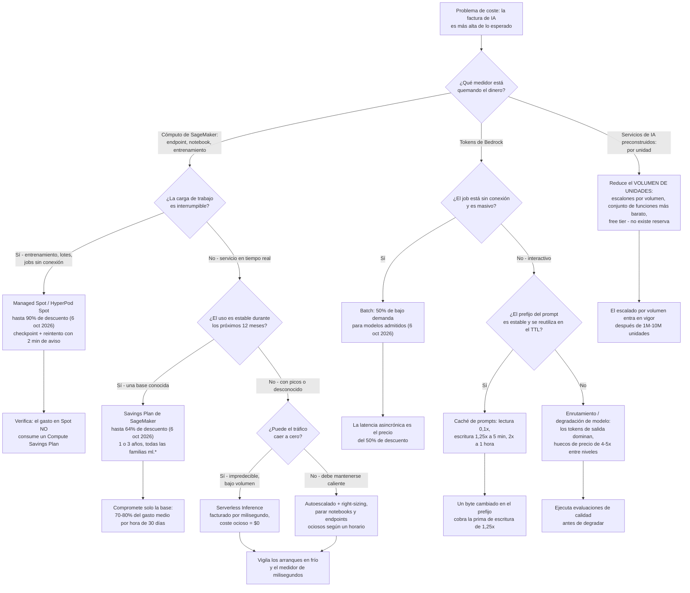
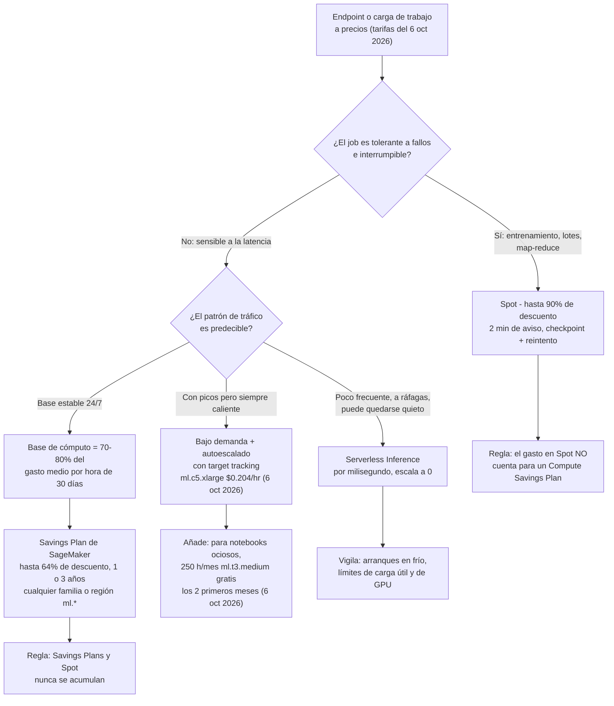
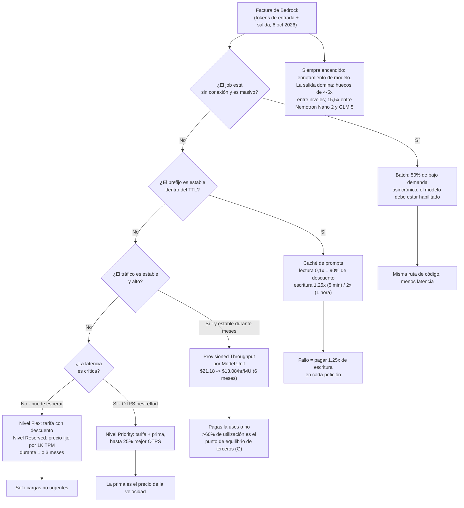
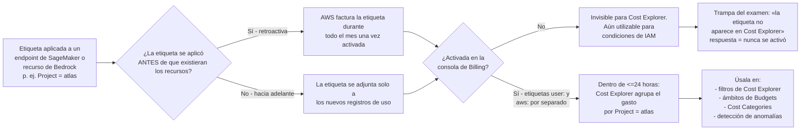
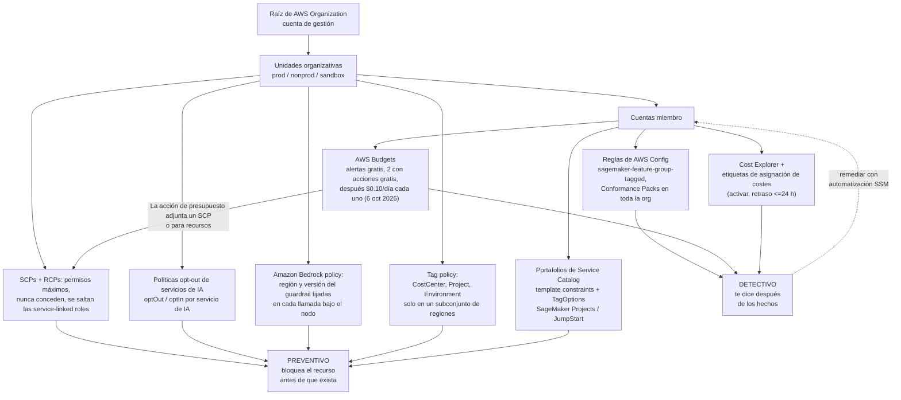

# Optimización de costes y gobernanza para cargas de trabajo de IA

Los costes son donde el examen AIF-C01 deja de ser abstracto. Cualquier otro dominio se puede responder con una definición; este te pide **calcular** y después elegir el control que **impide** el gasto excesivo en lugar del que solo lo informa. La buena noticia es que la aritmética es simple, multiplicación y porcentajes, y las trampas son pocas, afiladas y se evalúan repetidamente.

```text
====================================================================
 MAPA DE COSTES PARA IA/ML EN AWS                  (resumen 6 oct 2026)
====================================================================
 SAGEMAKER AI ........... por instance-hour (por segundo en la mayoría
                          de regiones) + EBS GB-month
                          ml.c5.xlarge    $0.204 /hr
                          ml.m5.4xlarge   $0.922 /hr
                          ml.g5.24xlarge  $10.18 /hr
                          EBS gp           $0.14 /GB-mes
                          desde 07 oct 2026: ml.p6-b300.48xlarge
                          $148.54 /hr, ml.p5en.48xlarge $72.63 /hr
 BEDROCK ................ por 1M de tokens de entrada + por 1M de
                          tokens de salida; Batch = 50% de bajo demanda;
                          lectura de caché = 0,1x, escritura = 1,25x
                          (TTL de 5 min) o 2x (TTL de 1 hora)
 SERVICIOS DE IA ......... Rekognition imagen/minuto, Textract página,
                          Comprehend unidad de 100 caracteres, Transcribe
                          minuto, Polly 1M de caracteres, Lex petición
 PALANCAS ................ Spot <=90% | EC2 SP <=72% |
                          Compute SP <=66% | SageMaker SP <=64% |
                          Batch 50% | lectura de caché 90% | Database SP <=35%
 GOBERNANZA ............. SCP/RCP/opt-out/tag policy/Bedrock policy
                          (prevenir, gratis) | Service Catalog |
                          AWS Config (detectar) | Budgets (alertas gratis,
                          2 presupuestos con acciones gratis, después
                          $0,10/día cada uno) | Cost Explorer
====================================================================
```

> [!NOTE]
> **Las cinco trampas principales de esta lección.** (1) **Los SCP nunca conceden**: acotan permisos y **se saltan las service-linked roles**. (2) Una **etiqueta de asignación de costes debe activarse** en la consola de Billing (hasta **24 horas** en aparecer) para que Cost Explorer pueda agrupar por ella. (3) **Spot ofrece hasta un 90 % de descuento con dos minutos de aviso**, y **el gasto en Spot no cuenta para el compromiso de un Compute Savings Plan**. (4) **Las alertas de presupuesto son gratuitas; las *acciones* de presupuesto son gratuitas solo para los dos primeros presupuestos con acciones habilitadas**, después **$0,10/día por cada extra** (6 oct 2026). (5) **Bedrock factura entrada y salida por separado**, y los tokens de salida suelen costar **4 to 5× el precio de los tokens de entrada**, así que `max_tokens` es un control de coste, no solo de latencia.

Al terminar esta lección podrás:

- leer las **tres familias de medidores** que AWS usa para IA (instance-hours, tokens, unidades de petición) y decir cuál de ellas factura una pregunta;
- calcular el coste mensual de un endpoint, una carga de trabajo de tokens o un pipeline de procesamiento de documentos **con precios fechados**;
- elegir entre **bajo demanda, Spot, Savings Plans y Serverless Inference** usando los techos publicados (≤90 %, ≤72 %, ≤66 %, ≤64 %);
- aplicar las **palancas propias de Bedrock**: Batch (50 %), caché de prompts (lecturas 0,1×), Provisioned Throughput, niveles de servicio y enrutamiento de modelos;
- convertir **los cupos del free tier en dólares** para poder dimensionar una prueba de concepto;
- distinguir los **controles preventivos** (SCP, RCP, opt-out, Bedrock policy, tag policy, Service Catalog, acciones de Budgets) de los **detectivos** (Cost Explorer, AWS Config, etiquetas de asignación de costes);
- evitar toda trampa de precio fechado y de compromiso por la que este dominio es conocido.

---

## 1. Las tres familias de medidores: lo que realmente se te factura

### 1.1 Familia de medidores 1, SageMaker AI: instance-hours más almacenamiento

SageMaker AI factura **por instance-hour** (por segundo en la mayoría de las regiones) por entrenamiento, procesamiento, notebooks y endpoints alojados, más **gigabyte-meses de EBS**. Bajo demanda no lleva **mínimo ni compromiso inicial** (aws.amazon.com/sagemaker/ai/pricing, verificado 6 oct 2026).

| Instancia (SageMaker) | Bajo demanda $/hora | Verificado |
|---|---|---|
| `ml.c5.xlarge` | **$0.204** | 6 oct 2026 |
| `ml.m5.4xlarge` | **$0.922** | 6 oct 2026 |
| `ml.g5.24xlarge` | **$10.18** | 6 oct 2026 |
| EBS General Purpose SSD | **$0.14 / GB-mes** | 6 oct 2026 |
| `ml.p5.4xlarge` | **$6.86** | lista de precios del 7 oct 2026 |
| `ml.p5en.48xlarge` | **$72.63** | lista de precios del 7 oct 2026 |
| `ml.p6-b300.48xlarge` | **$148.54** | lista de precios del 7 oct 2026 |

> [!WARNING]
> **La fila del acelerador cambia la aritmética en un orden de magnitud.** Desde el **7 de octubre de 2026** AWS lista `ml.p6-b300.48xlarge` a **$148.54/hora** y `ml.p6-b200.48xlarge` a **$130.71/hora**: frente a `ml.p5.4xlarge` a **$6.86/hora**. Un día de un `ml.p6-b300.48xlarge` dejado encendido (**24 × $148.54 = $3,564.96**, lista de precios del 7 oct 2026) cuesta más que un mes completo de dos endpoints `ml.c5.xlarge`. Las preguntas del examen comprueban rutinariamente si notas que **la familia de instancias, no la lista de funciones, domina la factura**.

### 1.2 Familia de medidores 2, Amazon Bedrock: tokens de entrada y tokens de salida

Bedrock bajo demanda cobra **por token de entrada y por token de salida por separado** (aws.amazon.com/bedrock/pricing, verificado 6 oct 2026). Como la salida se genera un token a la vez, las tarifas de salida rondan **4 to 5× las de entrada** en los modelos de pesos abiertos, y mucho más en los modelos premium.

| Modelo (Amazon Bedrock) | Entrada $/1M tokens | Salida $/1M tokens | Nota de Región | Verificado |
|---|---|---|---|---|
| NVIDIA Nemotron Nano 2 / 3 Nano 30B A3B | **$0.06 / $0.06** | **$0.23 / $0.24** |: | 6 oct 2026 |
| NVIDIA Nemotron 3 Super 120B A12B / Nano 2 VL | **$0.15 / $0.20** | **$0.65 / $0.60** |: | 6 oct 2026 |
| OpenAI `gpt-oss-safeguard-20b` / `120b` | **$0.07 / $0.15** | **$0.20 / $0.60** | us-east-1/2, us-west-2 | 6 oct 2026 |
| OpenAI `gpt-oss-20b` / `120b` | **$0.1262 / $0.2704** | **$0.5408 / $1.0815** | GovCloud (US) | 6 oct 2026 |
| Z AI GLM 5 | **$1.00** | **$3.20** | us-east-1/2, us-west-2 | 6 oct 2026 |
| Fine-tune de Llama 2 13B | **$1.49 / 1M entrenados** + almacenamiento **$1.95/mes** | inferencia, sin compromiso: **$23.50/hora/MU** |: | 6 oct 2026 |
| Llama 2 13B Provisioned Throughput | **$21.18/hora/MU** (1 mes) | **$13.08/hora/MU** (6 meses) | −38,3 % frente a 1 mes | 6 oct 2026 |

**Palancas de Bedrock que no son de tokens** (todas verificadas el 6 oct 2026 salvo indicación): **Batch = 50 % del precio de tokens bajo demanda** para los modelos fundacionales admitidos · lectura de caché **= 0,1×**, escritura de caché **= 1,25×** (TTL de 5 minutos) o **2×** (TTL de 1 hora) · Bedrock Guardrails en las páginas europeas de precios de AWS a **€0.2587283 por 1.000 unidades de texto** (filtros de contenido, temas denegados) y **€0.1724855 por 1.000** (información sensible, contextual grounding), con las regex y los filtros de palabras **gratuitos** (lista aws.eu, 7 ago 2026: el equivalente en USD no se recuperó, así que trátalo como **(G)**).

### 1.3 Familia de medidores 3, servicios de IA preconstruidos: una unidad por petición

Rekognition, Textract, Comprehend, Transcribe, Polly y Lex facturan **por unidad de petición**, con **escalado por volumen** tras los primeros 1 to 10 millones de unidades (aws.amazon.com/*/pricing, verificado 6 oct 2026).

| Servicio | Unidad de facturación | Precio (primer escalón) | Verificado |
|---|---|---|---|
| Imágenes de Rekognition | imagen | **$0.0010** primeros 1M/mes, **$0.0008** siguientes 1,5M | 6 oct 2026 |
| Vídeo almacenado de Rekognition (etiquetas, moderación, texto, caras, celebridades, búsqueda facial) | minuto | **$0.10** | 6 oct 2026 |
| Planos/pistas técnicas de Rekognition; almacenamiento de metadatos faciales | minuto; cara/mes | **$0.05**; **$0.00001** | 6 oct 2026 |
| Textract `DetectDocumentText` | página | **$0.0015** primeros 1M/mes, **$0.0006** después (us-west-2) | 6 oct 2026 |
| Textract `AnalyzeDocument` Tables / Forms / Tables+Forms+Queries | página | **$0.015 / $0.05 / $0.070** primeros 1M (**$0.010 / $0.040 / $0.055** después) | 6 oct 2026 |
| NLP estándar de Comprehend | unidad de 100 caracteres (mínimo 300) | **$0.0001** primeros 10M/mes, **$0.00005** 10 to 50M, **$0.000025** por encima de 50M | 6 oct 2026 |
| Transcribe por lotes / streaming | minuto | **$0.006** / **$0.01** | 6 oct 2026 |
| Redacción de contenido de Transcribe | minuto | **$0.0024** T1 (250K), **$0.0015** T2 (750K), **$0.00102** T3 (4M) | 6 oct 2026 |
| Polly Standard / Neural / Generative / Long-Form | 1 millón de caracteres | **$4.00 / $16.00 / $30.00 / $100.00** | 6 oct 2026 |
| Lex entrada de voz / entrada de texto | petición | **$0.004** / **$0.00075** | 6 oct 2026 |
| Entrenamiento de diseñador de chatbots de Lex | minuto | **$0.50** | 6 oct 2026 |
| Revisión humana de Augmented AI | página | **$0.03** primeros 100K, **$0.02** siguientes 100K | 6 oct 2026 |

### 1.4 Ejemplo resuelto 1: dos endpoints ociosos, 1.488 horas

Dos endpoints de tiempo real `ml.c5.xlarge` funcionan 24×7 durante un mes de 31 días a **$0.204/hora** (6 oct 2026):

$$
2 \times 24 \times 31 = 1{,}488 \text{ hours}, \qquad 1{,}488 \times \$0.204 = \$303.55/\text{month}
$$

**$303.55 al mes, el tráfico que sea.** Tres formas de cambiarlo:

| Palanca aplicada | Horas facturadas | Coste mensual | Ahorro frente a la base |
|---|---|---|---|
| Nada (2 instancias, siempre encendidas) | 1.488 | **$303.55** |: |
| (a) Autoescalado a una media de 1 instancia | 744 | **$151.78** | **−50,0 %** |
| (b) Parar 8 horas al día (2 instancias) | 960 | **$195.84** | **−35,5 %** |
| (c) Ambas (1 instancia, parada 8 h/día) | 480 | **$97.92** | **−67,7 %** |

La lección no son los porcentajes: es que **un endpoint ocioso factura igual que uno ocupado**. Nada en el medidor sabe si alguien envió una petición.

- **📚 ¿Sabías que…?** La página de precios de AWS para SageMaker factura **por segundo** en la mayoría de las regiones con un **mínimo de un minuto**, de modo que un pico de inferencia de 90 segundos cuesta un minuto, no una hora, pero un *notebook* o un *endpoint* se factura durante todo el tiempo que existe, desde su creación hasta su eliminación. Esa asimetría es la razón por la que las preguntas de «opción más barata» del examen casi siempre tienen «páralo según un horario» o «usa serverless» como respuesta.

---

## 2. El marco de decisión de palancas de coste

### 2.1 La matriz de impacto de palancas

No todas las palancas son iguales, y algunas se sobrevenden con frecuencia. AWS publica los porcentajes de abajo; donde AWS no publica nada, esta lección lo dice.

| # | Palanca | Aplica a | Impacto publicado | Compromiso | Impuesto / observado por |
|---|---|---|---|---|---|
| 1 | **Right-sizing** | endpoints, notebooks | sin porcentaje publicado por AWS → **(G)** | riesgo de latencia; usa Inference Recommender | Cost Explorer + CloudWatch |
| 2 | **Autoescalado** | endpoints de tiempo real | elimina el sobreaprovisionamiento | cooldownes de scale-in, capacidad fría | Application Auto Scaling (target tracking) |
| 3 | **Escalado a cero / serverless** | tráfico impredecible | coste ocioso → **$0** | arranques en frío, límites de carga útil y de GPU | SageMaker Serverless Inference |
| 4 | **Parar endpoints / notebooks ociosos** | cualquier recurso siempre encendido | hasta el **100 % de la parte ociosa** | indisponibilidad del servicio | Acciones de Budgets / EventBridge |
| 5 | **Spot** | entrenamiento y lotes tolerantes a fallos | **hasta un 90 %** | interrupción en 2 minutos → checkpoint y reintento | Managed Spot Training |
| 6 | **SageMaker Savings Plans** | uso estable de `ml.*` | **hasta un 64 %** | $/hora comprometidos durante 1 o 3 años | Recomendaciones de Cost Explorer |
| 7 | **Compute Savings Plans** | EC2 / Fargate / Lambda estables | **hasta un 66 %** | dependencia; **excluye el gasto en Spot** | Cost Explorer |
| 8 | **Bedrock Batch** | inferencia masiva sin conexión | **50 %** | latencia asincrónica; el modelo debe admitir batch | Bedrock Batch |
| 9 | **Caché de prompts de Bedrock** | prompts y documentos repetidos | **~90 % en la entrada cacheada** | las escrituras cuestan **1,25×**; un prefijo inestable lo mata | Registros de uso de Bedrock |
| 10 | **Degradación / enrutamiento de modelo** | cargas generativas | la salida domina; huecos de **4 to 5×** entre niveles | se requieren evaluaciones de calidad | Model evaluation de Bedrock |
| 11 | **Nivel Flex de Bedrock** | cargas no urgentes | tarifa estándar con descuento | latencia más alta | configuración de niveles de servicio |
| 12 | **Nivel Reserved de Bedrock** | tokens garantizados por minuto | precio fijo por 1K TPM | compromiso de 1 o 3 meses | niveles de servicio |

> [!IMPORTANT]
> **Cuidado con el folclore de que «el right-saving ahorra un 30 to 60 %».** No existe ninguna cifra publicada por AWS sobre el ahorro por right-sizing: ese número circula solo en blogs de terceros, y es una afirmación **(G)** (no verificada). En el examen, una opción que cite un porcentaje preciso de right-sizing está comprobando si sabes que AWS no publica ninguno. Los techos **publicados** que puedes citar son: Spot **≤90 %**, EC2 Instance Savings Plans **≤72 %**, Compute Savings Plans **≤66 %**, SageMaker AI Savings Plans **≤64 %**, Bedrock Batch **50 %**, lecturas de caché de Bedrock **90 %**, Provisioned Throughput de 6 meses de Bedrock **38,3 %** en la unidad de modelo Llama 2 13B (todo en aws.amazon.com / docs.aws.amazon.com, verificado 6 oct 2026).

### 2.2 El flujo de decisión de palancas de coste

Este es el diagrama que el examen te pide realmente recorrer. Empieza por **qué está quemando dinero** y después por **qué tolera la carga de trabajo**.



### 2.3 Lo que cada palanca no puede hacer

Tres hechos de «no puede» son oro en el examen:

1. **Los Savings Plans no se acumulan sobre Spot, y el gasto en Spot no consume un compromiso de Compute Savings Plan** (docs.aws.amazon.com, 2026). Una pregunta que ofrezca «cubrir el uso de Spot con un Savings Plan» es errónea en las dos mitades de la frase.
2. **Los servicios de IA preconstruidos no tienen ninguna opción publicada de reserva ni de Savings Plan**: se optimizan reduciendo el **volumen de unidades** (elige OCR antes que Forms, transcripción simple antes que redacción) y usando el free tier, no comprometiéndote.
3. **Una acción de presupuesto no es un control en tiempo real.** Las alertas pueden basarse en previsión o en valores reales, pero la ejecución se retrasa, así que el gasto excesivo sigue siendo posible entre el umbral y la acción.

```matching
{
  "question": "Relaciona cada palanca de coste con su techo o regla publicada por AWS (todo verificado el 6 oct 2026):",
  "pairs": [
    {"left": "Spot de EC2 / SageMaker", "right": "Hasta 90% de descuento con 2 minutos de aviso de interrupción; frecuencia media histórica de interrupciones por debajo del 5%"},
    {"left": "EC2 Instance Savings Plans", "right": "Hasta 72% de descuento, pero atado a una familia de instancias en una región durante 1 o 3 años"},
    {"left": "Compute Savings Plans", "right": "Hasta 66% de descuento en EC2 de cualquier familia/región/SO más Fargate y Lambda; excluye el gasto en Spot"},
    {"left": "SageMaker AI Savings Plans", "right": "Hasta 64% de descuento, flexible en todas las familias, tamaños, regiones y componentes ml.* durante 1 o 3 años"},
    {"left": "Database Savings Plans", "right": "Hasta 35% de descuento, solo a 1 año"},
    {"left": "Amazon Bedrock Batch", "right": "50% del precio de tokens bajo demanda para modelos admitidos, solo asincrónico"},
    {"left": "Lectura de la caché de prompts de Amazon Bedrock", "right": "0,1x el precio de entrada: un 90% de descuento dentro del TTL cuando el prefijo coincide"}
  ],
  "explanation": "Cada número pertenece a una forma de compromiso distinta: Spot es interrumpible y no tiene compromiso, los EC2 Instance SP compran profundidad pero pierden flexibilidad, los Compute SP compran amplitud, los SageMaker SP compran flexibilidad ml.*, los Database SP son solo de 1 año, y las palancas de Bedrock tienen forma de carga de trabajo y no de cómputo. Confundirlos: por ejemplo citar 66% para SageMaker o 64% para EC2: es la distracción clásica."
}
```

---

## 3. SageMaker AI: bajo demanda frente a Spot frente a Savings Plans frente a serverless

### 3.1 Bajo demanda: el valor por defecto sin compromiso

Bajo demanda es **por instance-hour, sin mínimo y sin inicial** (aws.amazon.com/sagemaker/ai/pricing, verificado 6 oct 2026). Es la respuesta correcta cuando el examen dice *prototipo*, *de corta vida*, *impredecible* o *los dos primeros meses* (el free tier de SageMaker da **250 horas/mes de notebooks `ml.t3.medium` durante los dos primeros meses**, verificado 6 oct 2026).

### 3.2 Spot: hasta un 90 % de descuento, dos minutos de aviso

EC2 Spot, y por tanto SageMaker Spot y SageMaker HyperPod Spot, se anuncia con **hasta un 90 % de descuento** sobre bajo demanda, con **dos minutos de aviso de interrupción** y una **frecuencia media histórica de interrupciones por debajo del 5 %** (aws.amazon.com/ec2/spot, 2025 to 26). El **HyperPod Spot de SageMaker suele tener hasta un 90 % de descuento** sobre HyperPod bajo demanda, con precio de EC2 y sin inicial (aws.amazon.com/sagemaker/ai/pricing, 6 oct 2026).

Spot solo es correcto cuando el job **puede interrumpirse**: entrenamiento con checkpoints, batch transform, procesamiento sin conexión. El patrón de respuesta del examen es siempre la misma pareja: *Spot* más *checkpoint y reintento*.

### 3.3 Savings Plans: tres descuentos distintos

| Savings Plan | Techo publicado | Alcance | Plazo | Verificado |
|---|---|---|---|---|
| **EC2 Instance Savings Plans** | **hasta un 72 %** | una **familia** de instancias, una **región** | 1 o 3 años | 6 oct 2026 |
| **Compute Savings Plans** | **hasta un 66 %** | EC2 de **cualquier** familia, región, SO + Fargate + Lambda | 1 o 3 años | 6 oct 2026 |
| **SageMaker AI Savings Plans** | **hasta un 64 %** | **todas las familias, tamaños, regiones y componentes `ml.*`** (notebook, entrenamiento, procesamiento, inferencia) | 1 o 3 años, $/hora | 6 oct 2026 |
| **Database Savings Plans** | **hasta un 35 %** | cargas de base de datos | **solo 1 año** | 6 oct 2026 |

Los SageMaker Savings Plans son los flexibles: como abarcan **cada familia de instancias `ml.*` en cada región**, puedes pasar de `ml.c5.xlarge` a `ml.g5.24xlarge` y conservar el descuento. Cost Explorer muestra la recomendación; el compromiso debe cubrir solo tu **base, el 70 to 80 % de tu gasto medio por hora de 30 días**, no tu pico.

### 3.4 Serverless Inference: el medidor que llega a cero

SageMaker **Serverless Inference escala a cero** cuando está ocioso, de modo que solo pagas el cómputo que usas, **facturado por milisegundo**, más los datos procesados. La **Provisioned Concurrency** opcional se factura por memoria, duración y concurrencia (docs.aws.amazon.com/sagemaker/latest/dg/serverless-endpoints.html, 2026). Es la respuesta correcta siempre que el tráfico sea **impredecible y bajo**: un prototipo que recibe unas pocas peticiones al día, o ninguna durante una semana.

> [!WARNING]
> **Serverless no es «gratis cuando está ocioso» por casualidad, es un contrato de diseño.** Cambias la factura de siempre encendido por **arranques en frío**, límites de carga útil y restricciones de GPU. Y observa que páginas de terceros citan tarifas de serverless (por ejemplo **$0.0000667/segundo por GB** más **$0.20/1M de peticiones**, arranque en frío de 1 to 5 segundos, máximo 6 GB) que **no se confirmaron en la página de precios de AWS** al 6 de octubre de 2026, trata esas cifras como **(G)**. En una opción de examen, una tarifa de serverless sin atribución suele ser una distracción; el *comportamiento* (escala a cero, facturación por milisegundo) es lo que se evalúa.

### 3.5 Ejemplos resueltos: aritmética de SageMaker

**Ejemplo resuelto 2: una flota de GPU siempre encendida (ejemplo resuelto de AWS).**
Cuatro instancias `ml.g5.24xlarge` a **$10.18/hora** (6 oct 2026) funcionan 720 horas en un mes, con 100 GB de EBS cada una a **$0.14/GB-mes** (6 oct 2026):

$$
4 \times 720 \times \$10.18 = \$29{,}318.40, \qquad 4 \times 100 \times \$0.14 = \$56.00
$$

**$29,318.40 + $56.00 = $29,374.40 al mes.** Con un **30 % de utilización** la flota puede bajar a unas **1,2 instancias ≈ $8,812/mes**, ahorrando unos **$20,560/mes**, y *después* un SageMaker Savings Plan (≤64 %, 6 oct 2026) se aplica sobre la huella ya reducida. Primero el right-sizing, después el compromiso; al revés, te comprometes con una base inflada durante tres años.

**Ejemplo resuelto 3: el consumo del endpoint personalizado ocioso.**
Un endpoint NLP personalizado a **$0.0005 por inference-unit-second** (tarifa de terceros, cloudzero.com, 4 may 2026: **(G)**) consume:

$$
\$0.0005 \times 60 = \$0.03/\text{min} \;\Rightarrow\; \$1.80/\text{hour} \;\Rightarrow\; \$43.20/\text{day} \;\Rightarrow\; \$1{,}296/30\text{ days}
$$

Se factura **desde la creación del endpoint hasta su eliminación, aunque el tráfico sea cero**. Solución: prográmalo con EventBridge para encenderlo y apagarlo, o usa asincrónico/serverless para que el medidor se detenga.

**Ejemplo resuelto 4: el techo del Savings Plan del 64 %.**
Una instancia de clase `ml.m5.xlarge` a **$0.23/hora** (tarifa usada para este ejemplo, 6 oct 2026) durante 730 horas:

| Escenario | Tarifa | Mensual | Anual | 3 años |
|---|---|---|---|---|
| Bajo demanda | $0.23 × 730 h | **$167.90** | $2,014.80 | $6,044.40 |
| SageMaker SP con 64 % de descuento (6 oct 2026) | $0.0828 × 730 h | **$60.44** | $725.28 | $2,175.84 |
| **Ahorro** | | **$107.46/mes** | **$1,289.52/año** | **$3,868,56 / 3 años** |

- **📚 ¿Sabías que…?** El descuento del SageMaker Savings Plan de AWS de **hasta un 64 %** (6 oct 2026) es *menor* que el techo del EC2 Instance Savings Plan de **hasta un 72 %** (6 oct 2026); sin embargo, el plan de SageMaker suele ser la mejor compra para los equipos de IA, porque el plan de EC2 está atado a **una familia de instancias en una región**, mientras que el plan de SageMaker te sigue a través de **cada familia, tamaño, región y componente `ml.*`**. Una diferencia de 8 puntos de descuento suele valer menos que la libertad de pasar de CPU a GPU sin recomprar un compromiso.

### 3.6 Decisión del modelo de precios para un endpoint



### 3.7 Veredicto comparativo

> [!IMPORTANT]
> **Veredicto comparativo: bajo demanda frente a Spot frente a Savings Plans frente a serverless**
> - **Bajo demanda** (por instance-hour, sin mínimo, sin inicial: p. ej. `ml.c5.xlarge` a **$0.204/hora**, 6 oct 2026) es la respuesta para **prototipos, experimentos de corta vida y los dos primeros meses de notebooks** (250 h/mes de `ml.t3.medium`, 6 oct 2026) y para cualquier cosa cuya forma aún no conoces. Su modo de fallo es **facturación por tiempo de capacidad ociosa**: $303.55 al mes por dos endpoints que quizá nunca reciban una petición.
> - **Spot** (hasta un **90 % de descuento**, aviso de interrupción de **2 minutos**, frecuencia media histórica de interrupciones **por debajo del 5 %**: aws.amazon.com/ec2/spot, 2025 to 26) es la respuesta para **entrenamiento, batch transform y jobs sin conexión que hacen checkpoint**. Su modo de fallo es **la interrupción**: el servicio en tiempo real sensible a la latencia sobre Spot es siempre erróneo, y el gasto en Spot **no** descuenta un compromiso de Compute Savings Plan (docs.aws.amazon.com, 2026). Úsalo para la capa de *ráfagas*, nunca para la capa de *siempre caliente*.
> - **Savings Plans** (Compute **≤66 %**, EC2 Instance **≤72 %**, SageMaker AI **≤64 %**, 1 o 3 años: 6 oct 2026) son la respuesta para una **base conocida y estable que no vas a abandonar**. Los SageMaker AI Savings Plans son la elección nativa de IA porque se mantienen en **todas las familias, tamaños, regiones y componentes `ml.*`**; los Compute Savings Plans son la elección correcta cuando la base incluye también EC2, Fargate o Lambda. Su modo de fallo es **sobrecomprometer**: compromete el 70 to 80 % de tu gasto medio por hora de 30 días, nunca tu pico, y recuerda que **no se acumulan con Spot**.
> - **Serverless Inference** (cómputo por milisegundo, **escala a 0**, Provisioned Concurrency opcional facturada por memoria, duración y concurrencia, docs.aws.amazon.com, 2026) es la respuesta para **tráfico impredecible y de bajo volumen** donde un día ocioso debe costar **$0**. Su modo de fallo es **arranques en frío más límites de capacidad**, y observa que las tarifas por segundo publicadas que circulan en internet (**$0.0000667/segundo por GB** + **$0.20/1M de peticiones**, páginas de terceros del 6 oct 2026) son **(G)**, no confirmadas en la página de precios de AWS.
> - **Regla práctica para el examen:** *tolerante a fallos e interrumpible* → **Spot**; *base estable de 1 to 3 años* → **Savings Plan** (SageMaker SP para `ml.*`, Compute SP para un parque mixto); *impredecible y disperso* → **serverless**; *todo lo demás, o cualquier cosa que aún no hayas medido* → **bajo demanda más autoescalado y parada programada**. La distracción es siempre la opción que compromete dinero con una carga de trabajo que la pregunta describe como experimental.

---

## 4. Amazon Bedrock: tokens, Batch, caché, throughput y niveles

### 4.1 Ejemplo resuelto 5: la factura de tokens, y por qué elegir modelo vence al volumen

Una carga de trabajo envía **300M de tokens de entrada** y produce **60M de tokens de salida** al mes.

| Modelo (tarifas verificadas el 6 oct 2026) | Coste de entrada | Coste de salida | Total mensual |
|---|---|---|---|
| Nemotron Nano 2 to $0.06 / $0.23 por 1M | 300 × $0.06 = **$18.00** | 60 × $0.23 = **$13.80** | **$31.80** |
| Z AI GLM 5 to $1.00 / $3.20 por 1M | 300 × $1.00 = **$300.00** | 60 × $3.20 = **$192.00** | **$492.00** |

El **mismo volumen de tokens** cuesta **15,5× más** en GLM 5. La selección de modelo, no la reducción de uso, es la palanca dominante en las cargas generativas, y es la razón por la que toda pregunta de «reducir coste» que ofrezca «cambiar a un modelo más pequeño» suele estar bien **con tal de que** se mencionen evaluaciones de calidad.

Observa también que la salida es **~4× la entrada** por token en Nemotron Nano 2 ($0.23 frente a $0.06, 6 oct 2026): limitar `max_tokens`, pedir respuestas concisas y devolver salida estructurada en lugar de prosa recortan todas la mitad cara del medidor.

### 4.2 Ejemplo resuelto 6, Batch: 50 % de descuento para trabajo asincrónico

Un job nocturno de clasificación de documentos cuesta **$800/mes** en Bedrock bajo demanda; el modelo admite batch y nadie lee los resultados antes de la mañana.

$$
\$800 \times 50\% = \$400/\text{month} \quad\Rightarrow\quad \$400/\text{month saved} = \$4{,}800/\text{year}
$$

**Bedrock Batch = 50 % del precio de tokens bajo demanda** para los modelos admitidos (aws.amazon.com/bedrock/pricing, 6 oct 2026). El precio del descuento es **latencia asincrónica**, y el modelo debe admitir batch en absoluto.

### 4.3 Ejemplo resuelto 7, caché de prompts: ~90 % de descuento, con una prima de escritura

Esta es la aritmística de mayor rendimiento del dominio. Usando las tarifas publicadas en una publicación del AWS Builder Center para Sonnet 4.6 en Bedrock, **$3.00 por 1M de tokens de entrada, $3.75 de escritura en caché, $0.30 de lectura de caché** (2026; *no* confirmado en la página oficial de precios, véase la sección 10), un system prompt estable de **33.000 tokens** enviado **1.000 veces al día** durante 30 días:

**Sin caché:**

$$
33{,}000 \times 1{,}000 = 33\text{ MTok/day} \times \$3.00 = \$99/\text{day} \;\Rightarrow\; \$2{,}970/\text{month}
$$

**Con caché (TTL de 5 minutos: escritura 1,25×, lectura 0,1×):**

| Componente | Tokens | Tarifa | Coste diario |
|---|---|---|---|
| 1 escritura en caché al día | 33.000 × 1,25 = **41.250** | $3.75/MTok | **$0.155** |
| 999 lecturas de caché al día | 33.000 × 999 = 32,967 MTok | $0.30/MTok | **$9.89** |
| **Total** | | | **$10.05/día → $301.42/mes** |

**Ahorro ≈ $2,668/mes (≈ 89,9 %).** El mecanismo (toda la documentación de caché de Bedrock, 2026): las **lecturas de caché cuestan 0,1×** el precio de entrada (**90 % de descuento**), las **escrituras de caché cuestan 1,25×** con el TTL por defecto de **5 minutos** y **2×** con el TTL opt-in de **1 hora**, el TTL por defecto es de **5 minutos**, el TTL de 1 hora es opt-in por checkpoint de caché, mínimo de **512 to 4.096 tokens por modelo** y máximo de **4 checkpoints**.

> [!WARNING]
> **Un solo byte cambiado en el prefijo destruye la caché.** Si el system prompt difiere entre peticiones, una marca de tiempo, un ID de petición, una variable de entorno de CI, un salto de línea final, cada llamada falla y pagas la **prima de escritura de 1,25× en cada petición** en lugar de una escritura más 999 lecturas baratas. Este es el fallo clásico de los bucles de CI sin cabeza, y exactamente lo que el examen evalúa con la opción *«el prefijo del prompt debe coincidir byte a byte dentro del TTL»*. Los modelos GPT-5.6 en Bedrock añaden caché implícita por defecto para un prefijo estable de **≥1.024 tokens** con un **TTL de 30 minutos**, lecturas con **90 % de descuento** y escrituras a **1,25×** (AWS ML blog, 30 jul 2026).

### 4.4 Provisioned Throughput y niveles de servicio

| Mecanismo de Bedrock | Cómo factura | Compromiso | Notas (verificado 6 oct 2026) |
|---|---|---|---|
| **Bajo demanda** | por 1M de tokens de entrada + por 1M de salida | ninguno | por defecto; con picos o bajo volumen |
| **Batch** | **50 %** del precio de tokens bajo demanda | ninguno | asincrónico; el modelo debe admitir batch |
| **Provisioned Throughput** | por hora y por **Model Unit (MU)** | **ninguno / 1 mes / 6 meses** | más largo = más barato; **los modelos personalizados lo requieren**; las MU se piden vía AWS Support |
| **Nivel Priority** | tarifa bajo demanda **+ prima**, hasta un **25 %** mejor de tokens-por-segundo bajo demanda | ninguno | latencia primero |
| **Nivel Standard** | tarifa bajo demanda | ninguno | por defecto |
| **Nivel Flex** | tarifa estándar con descuento | ninguno | cargas no urgentes, latencia más alta |
| **Nivel Reserved** | precio fijo por **1K tokens-por-minuto**, facturado mensualmente | **1 o 3 meses** | TPM garantizada |

Cifras concretas de Provisioned Throughput para Llama 2 13B (6 oct 2026): **$21.18/hora/MU** con compromiso de 1 mes frente a **$13.08/hora/MU** con compromiso de 6 meses, una **reducción del 38,3 %**, mientras que la inferencia sin compromiso es de **$23.50/hora/MU**. La trampa: **pagas la MU la uses o no**, así que Provisioned Throughput solo es correcto por encima de aproximadamente un 60 % de utilización (una cifra de equilibrio de terceros, **(G)**, no publicada por AWS).

### 4.5 El consumo de cuota no es el recuento de tokens

El consumo de cuota de Bedrock es **ponderado**, y los pesos dependen del modelo (docs.aws.amazon.com, 2026):

| Familia de modelo | Peso de tokens de salida contra la cuota |
|---|---|
| Claude v4.8 | la salida consume **15×** |
| Familia Claude 5, GPT-5.6 Sol / Terra / Luna | la salida consume **10×** |
| Claude ≤ v4.7 | la salida consume **5×** |
| Todo lo demás | **1:1** |

Así que «¿por qué me limitan si mi recuento de tokens se ve bien?» se responde con **salidas largas en un modelo de 15×**, no con el volumen de entrada.

### 4.6 El mapa de palancas de coste de Bedrock



- **📚 ¿Sabías que…?** Bedrock **no tiene ninguna tabla de free tier publicada por AWS** (6 oct 2026): una afirmación que encontrarás en blogs de proveedores diciendo «no hay free tier» o citando un «descuento del 30 to 50 % en Provisioned Throughput» es **(G)**, porque AWS no publica ninguno de los dos. Lo que AWS *sí* publica es un **descuento del 50 % en Batch**, un **90 % de descuento en lecturas de caché** y el **techo del 64 % del SageMaker SP**; esos son los números que puedes citar en el examen.

---

## 5. Servicios de IA preconstruidos: unidades, escalones y free tier

### 5.1 Cómo optimizar un medidor por unidad

No hay reserva para Rekognition, Textract, Comprehend, Transcribe, Polly ni Lex. Las tres palancas son:

1. **El conjunto de funciones más barato que devuelve lo que lees**: Textract `DetectDocumentText` a **$0.0015/página** (6 oct 2026) frente a `AnalyzeDocument` Forms a **$0.05/página** (6 oct 2026) es una **prima del 33×** por la estructura. Lee OCR primero; invoca Forms solo cuando necesites los pares clave-valor.
2. **Escalado por volumen**: Comprehend baja de **$0.0001** a **$0.00005** (10 to 50M de unidades) y a **$0.000025** (por encima de 50M) por unidad de 100 caracteres (6 oct 2026); Textract `DetectDocumentText` baja de **$0.0015** a **$0.0006** tras el primer millón de páginas en un mes (6 oct 2026).
3. **Free tier**: de 3 a 12 meses de cupos, convertidos a dólares en la sección 5.4.

### 5.2 Ejemplo resuelto 8: aritmética de escalones de Textract

| Volumen | Cálculo | Total | Precio unitario mezclado |
|---|---|---|---|
| 100.000 páginas `DetectDocumentText` | 100.000 × $0.0015 | **$150/mes** | $0.0015 (tarifas del 6 oct 2026) |
| 2.000.000 páginas `DetectDocumentText` | 1M × $0.0015 + 1M × $0.0006 | **$2,100** | **$0.00105 (−30 %)** |
| 5.000 páginas Forms + Tables | 5.000 × $0.015 + 5.000 × $0.05 | **$325** | $0.065/página |

Misma API, tres facturas. La tercera fila es la que sorprende a los equipos: **la elección de funciones pesa más que el volumen**.

### 5.3 Ejemplo resuelto 9, Transcribe: por lotes, no streaming, y la redacción como complemento

Dos millones de minutos de audio al mes (tarifas verificadas el 6 oct 2026):

| Modo | Tarifa | Mensual |
|---|---|---|
| Streaming | $0.01/min | **$20.000** (ejemplo de AWS) |
| Por lotes | $0.006/min | **$12.000** |
| **Ahorro al elegir por lotes** | | **$8.000/mes (40 %)** |

Y si el mismo job añade **redacción de contenido** sobre 2M de minutos (por escalones: 250K a $0.0024, 750K a $0.0015, 1M a $0.00102):

$$
(250{,}000 \times 0.0024) + (750{,}000 \times 0.0015) + (1{,}000{,}000 \times 0.00102) = 600 + 1{,}125 + 1{,}020 = +\$2{,}745/\text{month}
$$

La redacción es un **medidor opt-in**, facturado además del minuto de transcripción: las preguntas de «pipeline preciso más barato» del examen se sostienen en notar eso.

### 5.4 El free tier de IA, convertido en dólares

| Producto | Cupo gratuito | Duración | Valor de pago del cupo | Verificado |
|---|---|---|---|---|
| Créditos del plan AWS Free | **$100 al instante + hasta $100 más = $200** | **6 meses** (desde el 15 jul 2025) | $200 | 6 oct 2026 |
| Notebooks / Studio de SageMaker | **250 h/mes de `ml.t3.medium`** | los 2 primeros meses |: | 6 oct 2026 |
| Reglas integradas de SageMaker Model Monitor | **30 horas de monitorización gratis** | continuo |: | 6 oct 2026 |
| SageMaker Catalog | **4.000 peticiones + 20 MB + 0,2 unidades de cómputo/mes** | mensual |: | 6 oct 2026 |
| Textract `DetectDocumentText` | **1.000 páginas/mes** | los 3 primeros meses | **$1.50** | 6 oct 2026 |
| Textract Forms / Tables / Layout, Expense, ID | **100 páginas/mes cada uno** | los 3 primeros meses | $0.05 to $0.10 cada uno (tarifas del 6 oct 2026) | 6 oct 2026 |
| Textract Analyze Lending | **2.000 páginas/mes** | los 3 primeros meses |: | 6 oct 2026 |
| Comprehend (cada API NLP) | **50.000 unidades (5M de caracteres)/mes** + 5 jobs de topic modeling ≤ 1 MB | los 12 primeros meses | **$5.00** | 6 oct 2026 |
| Transcribe | **60 minutos/mes** | los 12 primeros meses | **$0.36 por lotes / $0.60 streaming** | 6 oct 2026 |
| Polly Standard / Neural / Long-Form / Generative | **5M / 1M / 500K / 100K caracteres por mes** | los 12 primeros meses | **$20.00 / $16.00 / $5.00 / $3.00** (tarifas del 6 oct 2026) | 6 oct 2026 |
| Amazon Kendra / Amazon Personalize | **750 h en los primeros 30 días** / prueba de 2 meses | 30 días / 2 meses |: | 6 oct 2026 |

**Ejemplo resuelto 10: el techo del free tier para un piloto.**
Polly Standard 5M de caracteres = **$20.00** más Neural 1M de caracteres = **$16.00** (tarifas del 6 oct 2026) → **$36/mes durante 12 meses** de salida de voz; Comprehend 50K de unidades = **$5.00 por API por mes** (6 oct 2026); Textract 1.000 páginas = **$1.50** (6 oct 2026); Transcribe 60 minutos = **$0.60** en streaming (6 oct 2026). Un piloto de seis meses de voz + extracción de entidades puede, por tanto, funcionar con **$0 de cómputo**: *con tal de que* te mantengas dentro del cupo, porque el free tier no te avisa antes de dejar de funcionar.

- **📚 ¿Sabías que…?** El **plan AWS Free** introducido el **15 de julio de 2025** concede hasta **$200 en créditos ($100 al instante más hasta $100 más) durante 6 meses** (aws.amazon.com/free, 6 oct 2026): que es distinto de los free tier de *servicio*, que duran 3, 12 o 24 meses. Las opciones del examen suelen confundir «créditos gratuitos» con «free tier»; los créditos caducan según un **calendario**, los free tier caducan por **uso**.

---

## 6. Visibilidad de costes: Cost Explorer, etiquetas de asignación de costes y presupuestos

La visibilidad es **detectiva**, no preventiva, pero sin ella no puedes fijar un umbral, y sin umbral una acción de presupuesto nunca se dispara.

### 6.1 Cost Explorer

| Capacidad | Precio / comportamiento | Verificado |
|---|---|---|
| Consola e informes por defecto | **Gratuito** | 6 oct 2026 |
| **API** de Cost Explorer | **$0.01 por petición** | 6 oct 2026 |
| **Granularidad horaria** (14 días de histórico) | ≈ **$0.01 por 1.000 registros de uso al mes** | 6 oct 2026 |
| Recomendaciones | recomendaciones de Savings Plans e instancias reservadas, filtros de etiqueta, previsiones | 6 oct 2026 |
| Retraso de datos | hasta **24 horas** | 6 oct 2026 |

> [!WARNING]
> **`$0.01/petición` es la tarifa de la API de Cost Explorer, no un precio de presupuesto.** El monitoreo y las alertas de presupuesto son **gratuitos** (aws.amazon.com/aws-cost-management/aws-budgets/pricing, 6 oct 2026). Una pregunta que empareje «$0.01 por petición» con AWS Budgets está evaluando exactamente esa confusión.

### 6.2 Las etiquetas de asignación de costes deben activarse

Las etiquetas de asignación de costes vienen en dos sabores y se **activan por separado** en la consola de Billing para que Cost Explorer pueda agrupar por ellas (docs.aws.amazon.com, 2026):

| Tipo de etiqueta | Prefijo | Activación | Aparece en Cost Explorer |
|---|---|---|---|
| **Generadas por AWS** | `aws:` | activar en la consola de Billing | dentro de **≤24 horas** |
| **Definidas por el usuario** | `user:` | **activar por separado** de las generadas por AWS | dentro de **≤24 horas** |
| Cualquier otra etiqueta |: | no activada | **nunca** (solo es una etiqueta de recurso) |



**El síntoma clásico:** un ingeniero aplica una etiqueta `CostCenter` a todos los recursos ayer y aun así no aparece en Cost Explorer. La causa casi nunca es «las etiquetas no funcionan con los servicios de IA» o «la clave debe empezar por `aws:`»: es que **la etiqueta de asignación de costes definida por el usuario no se ha activado** (y puede tardar hasta **24 horas** en aparecer).

### 6.3 AWS Budgets: alertas gratuitas y después $0.10/día por cada acción extra

| Función de Budgets | Precio (verificado 6 oct 2026) |
|---|---|
| Monitoreo y notificaciones (alertas) | **Gratuito** |
| Los primeros **dos** presupuestos con acciones habilitadas por cuenta | **Gratuito al mes** |
| Cada presupuesto adicional con acciones habilitadas | **$0.10/día** (≈ **$3.00/mes**) | 
| Disparadores | umbrales basados en previsión o en valores reales |

**Ejemplo resuelto 11: la puerta del presupuesto.** Un equipo fija un presupuesto de **$5.000/mes** con alertas al **80 %** y al **100 %** más acciones automáticas (adjuntar un SCP, parar instancias de no producción):

- monitoreo y alertas: **$0**;
- acciones en los **dos primeros** presupuestos con acciones habilitadas: **$0**;
- un **tercer** presupuesto con acciones habilitadas: **$0.10/día ≈ $3.00/mes** (6 oct 2026).

La respuesta de «coste mínimo de funciones» del examen es, por tanto: **alertas gratis, dos presupuestos con acciones gratis, después $0.10/día cada uno**, y recuerda que una acción de presupuesto se aplica **después** del umbral, así que es un freno, no un muro.

- **📚 ¿Sabías que…?** AWS Budgets admite **acciones de presupuesto que adjuntan un SCP o una política de IAM, o que paran recursos**, lo que lo convierte en la única herramienta de coste que *hace* algo preventivo, pero solo después de cruzar el umbral y ejecutarse la acción. Por eso el examen lo empareja con SCP: el presupuesto detecta, el SCP impone.

---

## 7. Gobernanza: impedir el gasto en lugar de informarlo

### 7.1 La pila preventiva en AWS Organizations

| Control | Impone | Ámbito | Prevenir / detectar | Coste | Trampa clave (docs.aws.amazon.com, 2026) |
|---|---|---|---|---|---|
| **SCP** | permisos máximos: denegar APIs de IA o Regiones fuera de una lista permitida | root / OU / cuenta | **Prevenir** | gratis | **nunca concede**; **se salta las service-linked roles**; una lista de denegación aún necesita una política de permitir adjunta |
| **RCP** | permisos máximos sobre los **recursos**, independientemente de quién llama | org / OU / cuenta | Prevenir | gratis | la cara del recurso de la misma intersección |
| **Política opt-out de servicios de IA** | `optOut` / `optIn` por servicio de IA en toda la organización para el uso de datos | por servicio | Prevenir (uso de datos) | gratis | **no** elimina el acceso a las funciones |
| **Amazon Bedrock policy** | aplica un **Guardrail fijado por región y versión** a cada llamada de Bedrock bajo el nodo | por región | Prevenir | gratis | el guardrail debe existir **en esa región**; sin políticas de razonamiento automatizado |
| **Tag policy** | estandariza las claves de etiqueta (`CostCenter`, `Project`, `Environment`) | org / OU | Prevenir | gratis | admitida solo en un **subconjunto de regiones** |
| **Service Catalog** | solo se lanzan productos aprobados; **template constraints** limitan Región/tipo de instancia; **TagOptions** etiquetan automáticamente | portafolio → producto → usuario | Prevenir (aprovisionamiento) | servicio gratis; los recursos se facturan | SageMaker Projects y JumpStart **dependen de él** |
| **AWS Config** | conformidad: `sagemaker-*-tagged`, cifrado, registro; **Conformance Packs** en toda la org | cuenta / región | **Detectar** (+ remediación con SSM) | reglas gratis; los config items se facturan | solo detecta salvo que se remedie; las claves de etiqueta distinguen **mayúsculas** y no pueden usar el prefijo `aws:` |

**Crecimiento de las reglas de AWS Config:** AWS añadió **75 reglas nuevas en nov 2025** y **191 más en jul 2026** (AWS news, 2025 to 26), y los Conformance Packs despliegan grupos de reglas en toda una organización: la respuesta siempre que una pregunta pregunte cómo *detectar* deriva a escala.

### 7.2 Ejemplo resuelto 12: el control correcto para cada requisito

| Requisito | Control correcto | Por qué fallan los demás |
|---|---|---|
| «Los usuarios no deben crear endpoints de SageMaker fuera de `us-east-1` y `us-west-2`» | **SCP en la OU que deniega esas APIs/Regiones fuera de la lista permitida** | Config solo **detecta después**; Service Catalog gobierna solo lo que se lanza a través de él; las acciones de Budget se activan por coste |
| «Los ingenieros solo pueden lanzar pilas de inferencia preaprobadas de una lista pequeña de instancias permitidas» | **Producto de AWS Service Catalog con template constraints** | Las etiquetas no se imponen al lanzar; Config informa en lugar de impedir; un SCP no puede enumerar plantillas aprobadas |
| «Cada llamada de Bedrock bajo el nodo de la org debe usar la versión X del Guardrail en eu-west-1» | **Amazon Bedrock policy en Organizations** | Los SCP no llevan versiones de guardrail; Config solo detectaría un guardrail ausente |
| «`CostCenter` debe aparecer automáticamente en todos los recursos de IA» | **TagOptions de Service Catalog** + **tag policy** | Una etiqueta de recurso simple no es automáticamente una etiqueta de **asignación de costes**; aun así debe activarse (sección 6.2) |
| «Detén la hemorragia cuando el gasto supere los $5.000» | **AWS Budgets con una acción de presupuesto** | Cost Explorer nunca actúa; Config nunca actúa sobre el gasto |

### 7.3 Service Catalog frente a SageMaker Catalog: no los confundas

| | **AWS Service Catalog** | **SageMaker Catalog** |
|---|---|---|
| Qué gobierna | **productos** aprobados (portafolios de CloudFormation) | **activos de datos y de IA** aprobados, lineage y permisos |
| Imposición | **template constraints** sobre parámetros, etiquetado automático con **TagOptions** | control de acceso sobre los activos del catálogo |
| Precios (6 oct 2026) | el propio servicio es gratis; los recursos lanzados se facturan | **$10 por 100K peticiones**, **$0.40/GB**, **$1.776/unidad de cómputo**; recomendaciones **$0.015/1K tokens de entrada + $0.075/1K de salida** |
| Cupo gratuito (6 oct 2026) |: | **4.000 peticiones, 20 MB, 0,2 unidades de cómputo/mes** |
| Dependencia | SageMaker **Projects y JumpStart se aprovisionan a través de él** | producto distinto; **no** es el mismo servicio |

### 7.4 Diagrama de la capa de gobernanza



> [!WARNING]
> **El «SCP que solo permite us-east-1» no funciona como la gente cree.** Un SCP **nunca concede**: solo fija los permisos *máximos* que los usuarios y roles de IAM (incluido root) de las cuentas miembro pueden llegar a tener, y **no afecta a las service-linked roles** (docs.aws.amazon.com, 2026). Así que (a) un SCP de lista de denegación aún necesita una política de **permitir** adjunta al mismo elemento para que algo funcione en absoluto, y (b) una service-linked role seguirá pudiendo actuar dentro de sus propios permisos de servicio aunque «bloquees» la cuenta. En el examen, siempre que una opción diga que un SCP «concede acceso a SageMaker», es errónea.

---

## 8. Savings Plans, Spot y TCO: los números que puedes citar

### 8.1 Porcentajes de ahorro publicados (todos oficiales, verificados 6 oct 2026)

| Palanca | Afirmación de AWS | Condición / riesgo |
|---|---|---|
| **Spot** de EC2 y SageMaker | **hasta un 90 %** | aviso de 2 minutos; interrupciones medias históricas **< 5 %** |
| **EC2 Instance Savings Plans** | **hasta un 72 %** | 1 o 3 años, **una familia + una región** |
| **Compute Savings Plans** | **hasta un 66 %** | 1 o 3 años, EC2 / Fargate / Lambda, cualquier región |
| **SageMaker AI Savings Plans** | **hasta un 64 %** | 1 o 3 años, todas las familias y regiones `ml.*` |
| **Database Savings Plans** | **hasta un 35 %** | **solo 1 año** |
| **Bedrock Batch** | **50 %** de descuento sobre el precio de tokens | asincrónico; el modelo debe admitir batch |
| **Lectura de caché de Bedrock** | **90 %** de descuento sobre el precio de entrada | prefijo idéntico dentro del TTL |
| **Provisioned Throughput de 6 meses de Bedrock** | MU de Llama 2 13B **$21.18 → $13.08 = 38,3 %** | pagas la uses o no |
| **TCO de 3 años de SageMaker** | **≥ 54 % menor** que EC2/EKS autogestionado | incluye infraestructura, operaciones y mano de obra de seguridad |

### 8.2 TCO de SageMaker: la cifra de toda la organización

La comparación de TCO publicada por AWS (AWS ML blog y resumen ejecutivo de TCO, 2020, aún citada en 2026) afirma que el TCO a 3 años de SageMaker es **≥ 54 % menor** que el de EC2 o EKS autogestionados, y lo desglosa por tamaño del equipo: **5 científicos de datos −90 %**, **15 científicos de datos −87 % / −85 %**, **50 científicos de datos −79 % / −65 %**, **250 científicos de datos −77 % / −54 %** (EC2 / EKS respectivamente). El punto de la tabla es que **la mano de obra, la seguridad y la carga operativa dominan** en los equipos pequeños, mientras que la infraestructura domina a medida que el equipo crece.

> [!WARNING]
> **Nunca importes un porcentaje de Savings Plan de la región de China.** Exist afirman ahorros de **81 %, 84 %** en planes de ahorro solo para las regiones de AWS China; las respuestas del examen son siempre los techos de las regiones comerciales: **90 / 72 / 66 / 64 / 35 %** (6 oct 2026). Asimismo, «el right-sizing ahorra un 30 to 60 %» **no tiene ninguna fuente publicada por AWS**, trátalo como **(G)**.

### 8.3 Reglas de seguridad de los compromisos

1. **Compromete la base, no el pico:** 70 to 80 % del gasto medio por hora de 30 días.
2. **Nunca te comprometas con Spot:** los Savings Plans no se acumulan sobre Spot, y el gasto en Spot no consume un compromiso de Compute Savings Plan (docs.aws.amazon.com, 2026).
3. **Prefiere el plan flexible cuando tu parque mezcle CPU y GPU:** el SageMaker AI Savings Plan abarca todas las familias, tamaños, regiones y componentes `ml.*` (6 oct 2026).
4. **Reevalúa antes de renovar:** un Compute Savings Plan de 1 año sobre una carga de trabajo que pasa a serverless en el mes 6 es dinero quemado.
5. **Provisioned Throughput es una apuesta por el volumen:** pagas por Model Unit por hora la uses o no: supera aproximadamente el **60 % de utilización** (cifra de terceros, **(G)**) antes de comprometerte, y recuerda que los modelos personalizados *requieren* Provisioned Throughput en absoluto.

```text
ESCALERA DE COMPROMISOS (lo que puedes citar, todo verificado 6 oct 2026)
------------------------------------------------------------------
 sin compromiso
   bajo demanda ...... ml.c5.xlarge $0.204/hr  (riesgo de siempre encendido)
   serverless ........ por milisegundo, escala a 0
   Bedrock bajo demanda . por 1M entrada + por 1M salida de tokens
   Bedrock Batch ..... 50% de bajo demanda (asincrónico)
   Bedrock Flex ...... con descuento, no urgente
------------------------------------------------------------------
 compromiso corto
   Database SP ....... hasta 35%, solo 1 año
   Bedrock Reserved .. precio fijo por 1K TPM, 1 o 3 meses
   Bedrock PT 1-mes .. $21.18/hr/MU (Llama 2 13B)
------------------------------------------------------------------
 compromiso largo
   SageMaker SP ...... hasta 64%, 1 o 3 años, todos los ml.*
   Compute SP ........ hasta 66%, EC2 + Fargate + Lambda
   EC2 Instance SP ... hasta 72%, una familia, una región
   Bedrock PT 6-mes .. $13.08/hr/MU (-38,3%)
------------------------------------------------------------------
 interrumpible (nunca un compromiso)
   Spot .............. hasta 90%, 2 min de aviso, <5% de interrupciones medias
------------------------------------------------------------------
```

```fillblank
{
  "question": "Completa los techos de descuento publicados por AWS (todo verificado el 6 oct 2026):",
  "template": "Spot tiene hasta {{1}}% de descuento, Compute Savings Plans hasta {{2}}%, SageMaker AI Savings Plans hasta {{3}}%, Database Savings Plans hasta {{4}}% (solo a 1 año), y Amazon Bedrock Batch factura el {{5}}% del precio de tokens bajo demanda.",
  "answers": {
    "1": "90",
    "2": "66",
    "3": "64",
    "4": "35",
    "5": "50"
  },
  "distractors": ["72", "60", "40", "25", "80"],
  "explanation": "Spot 90%, Compute Savings Plans 66%, SageMaker AI Savings Plans 64%, Database Savings Plans 35% y Bedrock Batch 50% son las cifras que publica AWS (aws.amazon.com y docs.aws.amazon.com, verificado 6 oct 2026). El 72% es un techo real pero pertenece a los EC2 Instance Savings Plans, no a ninguna de estas cinco palancas, y 60/40/25/80 no son en absoluto techos publicados por AWS: son los porcentajes de folclore contra los que esta lección advierte."
}
```

---

## 9. Gobernanza y costes en un solo ritmo operativo

Júntalo todo en el bucle que el examen espera que describas:

1. **Primero las etiquetas**: aplica `Project`, `Environment`, `CostCenter`; **activa** por separado las etiquetas de asignación de costes definidas por el usuario *y* generadas por AWS (≤24 h).
2. **Mide**: Cost Explorer (consola gratis, API **$0.01/petición**, granularidad horaria ≈ **$0.01/1.000 registros/mes**, 6 oct 2026).
3. **Umbral**: alertas de AWS Budgets (gratis) al 80 %/100 %, por previsión o por valor real.
4. **Actúa**: acciones de presupuesto (los dos primeros presupuestos con acciones gratis, después **$0.10/día**, 6 oct 2026): adjunta un SCP o para recursos de no producción.
5. **Previene**: SCP/RCP para listas permitidas de Región y API, template constraints de Service Catalog + TagOptions para imponerlo al lanzar, políticas de Bedrock para guardrails fijados, tag policies para estandarizar claves.
6. **Detecta**: reglas de AWS Config y Conformance Packs (`sagemaker-feature-group-tagged`, cifrado, registro) con remediación mediante SSM.
7. **Optimiza continuamente**: haz right-sizing, para lo ocioso, añade Spot para el trabajo tolerante a fallos, añade un Savings Plan solo para la base medida y aplica las palancas propias de Bedrock (Batch, caché, enrutamiento, niveles).

- **📚 ¿Sabías que…?** `sagemaker-feature-group-tagged` es una regla gestionada real de AWS Config, y las claves de etiqueta en Config distinguen **mayúsculas** y **no pueden usar el prefijo `aws:`**. Una regla escrita para `Project` no se disparará en `project`, y un intento de registrar una etiqueta de usuario que empiece por `aws:` se rechaza. Ese solo detalle explica todo un género de incidentes de «la regla muestra conforme pero el gasto no está atribuido».

---

## 10. Qué está verificado, qué es de terceros y qué entra en conflicto

El examen recompensa los **números fechados y con fuente**. Esto es exactamente lo que esta lección no afirmará sin una fecha:

| Afirmación que puedes encontrar | Estado al 6 oct 2026 |
|---|---|
| Tarifas de Claude en Bedrock (Opus 4.6 **$15/$75**, Sonnet 4.6 **$3/$15**, Haiku 4.5 **$0.80/$4** por 1M) | **Terceros**: costbench.com (3 ago 2026); Sonnet 4.6 **$3.00 / $3.75 escritura / $0.30 lectura** también en una publicación del AWS Builder Center, **no** en `aws.amazon.com/bedrock/pricing` |
| Amazon Nova Micro **$0.035/$0.14** frente a **$0.04/$0.14** | Fuentes de **terceros en conflicto** (6 oct 2026) |
| Provisioned Throughput «30 to 50 % de descuento», «punto de equilibrio por encima del 60 % de utilización», «Bedrock sin free tier» | **Solo blogs de proveedores** (mar 2026): AWS no publica ninguno de ellos |
| Serverless Inference **$0.0000667/seg por GB** + **$0.20/1M de peticiones**, arranque en frío de 1 to 5 s, máx. 6 GB | **Terceros** (15 mar 2026), no confirmado en la página de AWS |
| Escalones 3 to 4 de Rekognition (**$0.0006** >5M, **$0.0004** >35M) y free tier de 5.000 imágenes + 1.000 ID faciales/12 meses | **Terceros** (31 ago 2026); la página de AWS confirma solo **$0.0010** primeros 1M y **$0.0008** siguientes 1,5M (6 oct 2026) |
| Free tier de Amazon Lex (10K texto + 5K voz/mes, 2 meses) | **Sin confirmar** en las páginas de AWS de 2026 |
| Comprehend **$3.00/hora** de entrenamiento y **$0.0005/IU-segundo** | **Terceros** (4 may 2026) |
| Bedrock Guardrails **€0.2587283 / €0.1724855 por 1.000 unidades de texto** | Oficial pero en **EUR** (aws.eu, 7 ago 2026); el equivalente en USD no se recuperó → **(G)** |
| Promo de GPT-5.6 Sol **$4/$20 por 1M** hasta el 21 nov 2026 | **Agregador**, no AWS (22 ago 2026) |
| «El right-sizing ahorra un 30 to 60 %» | **No existe ninguna cifra publicada por AWS** |

---

## 11. Actualizaciones de 2025 to 2026

Los precios y las herramientas detrás de este dominio no se quedaron quietos entre mediados de 2025 y finales de 2026. Cada cambio de abajo lleva una fecha, porque un número sin fecha es inutilizable en este examen, y porque varias filas retiran herramientas que las guías de estudio antiguas aún recomiendan pagar.

**Tabla A: cambios de precios, herramientas de coste y disponibilidad, cada uno con su fecha (investigado el 6 oct 2026):**

| Fecha | Cambio | Relevancia de coste / gobernanza |
|---|---|---|
| **16 jul 2025** → **13 oct 2025** | **Amazon Bedrock AgentCore** en preview → **GA** (9 Regiones, VPC, PrivateLink, MCP en Gateway, IAM) | un runtime de agents medido: con precio por uso y **sin compromiso de capacidad**, lo contrario de Provisioned Throughput (aws.amazon.com/about-aws/whats-new/2025/10/amazon-bedrock-agentcore-available/, 13 oct 2025) |
| **09 oct 2025** | **Amazon QuickSight → Amazon Quick Suite** | el asiento Author Pro bajó de **$50 a $40** (aws.amazon.com/blogs/aws/reimagine-the-way-you-work-with-ai-agents-in-amazon-quick-suite/, 9 oct 2025) |
| **02 dic 2025** | **GA de Nova 2 Sonic** (`amazon.nova-2-sonic-v1:0`, 7 idiomas) y **Nova 2 Omni en preview** | nuevos medidores de generación de voz y multimodal entran en la palanca de elección de modelo (AWS What's New, 2 dic 2025) |
| **01 feb 2026** | Seis modelos de pesos abiertos en Bedrock, **DeepSeek V3.2, MiniMax M2.1, GLM 4.7 / 4.7 Flash, Kimi K2.5, Qwen3 Coder Next**, en **Project Mantle** | más destinos baratos de enrutamiento y degradación para la palanca de «degradar con evaluaciones» (aws.amazon.com/about-aws/whats-new/2026/02/amazon-bedrock-adds-support-six-open-weights-models/, 1 feb 2026) |
| **17 feb 2026** | **Claude Sonnet 4.6** en Bedrock (contexto de 1M, salida de 64K) | una nueva tarifa de tokens con la que fechar tu aritmética: nunca la cites sin fecha (ficha de modelo de docs.aws.amazon.com, 17 feb 2026) |
| **30 abr 2026** | Publicada la **guía del examen v1.1** (la v1.0 fue el 26 mar 2026) | añade el objetivo **2.1.4: el modelo de precios basado en tokens y su efecto en el coste y el rendimiento de la inferencia**; AWS dice que las actualizaciones de la guía aparecen en el examen aproximadamente **un mes** después de publicarse (docs.aws.amazon.com/aws-certification/latest/ai-practitioner-01/, 30 abr 2026) |
| **15 may 2026** | **Cerrados los registros de Amazon Q Developer**; los niveles IDE y de pago **terminan su soporte el 30 abr 2027** | una herramienta facturable en sunset: no construyas un modelo de coste plurianual sobre ella (aws.amazon.com/blogs/devops/amazon-q-developer-end-of-support-announcement/, 15 may 2026) |
| **30 jun 2026** | **Amazon Kendra** entra en modo de mantenimiento; **Ground Truth Plus** termina su soporte | los presupuestos de búsqueda empresarial y de etiquetado migran a sus sucesores (docs.aws.amazon.com/kendra/latest/dg/kendra-availability-change.html, 30 jun 2026) |
| **30 jul 2026** | **SageMaker Model Monitor, Clarify, Ground Truth, A2I, Debugger, Role Manager, Geospatial, Studio Lab** y **Amazon Kendra** cerrados a clientes nuevos | los planes de coste de monitorización y búsqueda deben apuntar a **métricas de CloudWatch y detección de anomalías**, **Bedrock Model Evaluations** y **Bedrock Managed Knowledge Base** (docs.aws.amazon.com, 30 jul 2026) |
| **07 sep 2026** | **Política de ciclo de vida de modelos de Bedrock**: Active → Legacy → EOL, la mayoría de modelos obtiene una ventana de **Legacy de 6 meses** | Legacy bloquea a clientes nuevos **y a Provisioned Throughput nuevo**: un compromiso de 1 o 3 años puede sobrevivir al modelo para el que se compró (docs.aws.amazon.com/bedrock/latest/userguide/model-lifecycle.html, 7 sep 2026) |
| **08 sep 2026** / **05 oct 2026** | **OpenAI GPT-6 Astra GA** / **Z.ai GLM 5.3 GA** (753B en total, 40B activos) en Bedrock | nuevas tarifas de tokens de nivel premium: vuelve a comprobar el hueco salida frente a entrada antes de enrutar tráfico |
| **15 oct 2026** | Retirados los idiomas **italiano y alemán** del AIF-C01 | solo un cambio de administración del examen; sigue siendo AIF-C01, **65 preguntas**, **90 minutos**, aprobación **700/1000** (aws.amazon.com/certification, 6 oct 2026) |

**Tabla B: las tarifas de palancas de coste de Bedrock que puedes citar para 2025 to 2026 (aws.amazon.com/bedrock/pricing y blogs de AWS, verificadas el 6 oct 2026):**

| Palanca | Tarifa o regla publicada | Fecha |
|---|---|---|
| **Lectura** de caché de prompts (clase Claude / GPT) | **−90 %** del precio de entrada | 6 oct 2026 |
| **Lectura** de caché de prompts (clase Nova) | **−75 %** | 6 oct 2026 |
| **Escritura** de caché de prompts | **+25 % (1,25×)** con TTL de 5 minutos, **+100 % (2×)** con TTL de 1 hora; el TTL se refresca **gratis por acierto** | 6 oct 2026 |
| **Inferencia Batch** | **−50 %** de bajo demanda, y **nunca combinable con la caché de prompts** | 6 oct 2026 |
| **Intelligent Prompt Routing** | **$1.00 por 1.000 peticiones** (facturado por petición, no por token), hasta un **30 %** más barato | 6 oct 2026 |
| **Simple Prompt Optimizer** | **$0.03 por 1.000 tokens** | 6 oct 2026 |
| **Model Distillation** | **75 % más barato**, «500 % más rápido», **≤ 2 % de pérdida de precisión** | 6 oct 2026 |
| Nova Micro / Nova Lite / Nova Pro | **$0.035 / $0.14**, **$0.06 / $0.24**, **$0.80 / $3.20** por 1M de tokens de entrada / salida | 6 oct 2026 |
| Asiento Author Pro de Quick Suite | **$50 → $40** | 9 oct 2025 |

> [!WARNING]
> **«Cerrado a clientes nuevos» no es «apagado», ni es un rebranding.** El vocabulario de ciclo de vida de servicios de AWS (docs.aws.amazon.com/general/latest/gr/service-lifecycle.html, 24 sep 2026) es exacto: **Maintenance** = sin clientes nuevos, sin funciones nuevas, sigue soportado; **Sunset** = fin de operaciones planificado, normalmente a unos 12 meses; **Full Shutdown** = eliminado del portafolio. El **30 de julio de 2026** el **Model Monitor** y **Clarify** de SageMaker entraron en *maintenance*, los clientes existentes los conservan y no se borra nada, mientras que **Amazon Kendra** se cerró a clientes nuevos el mismo día y apunta a **Bedrock Managed Knowledge Base**. Las opciones del examen que afirman que esas herramientas «se renombraron como Bedrock Model Evaluations» o «se deshabilitaron para todos» son erróneas; la respuesta correcta es *sigue siendo utilizable por los clientes existentes, sin funciones nuevas previstas*.

- **📚 ¿Sabías que…?** La **guía del examen AIF-C01 v1.1**, publicada el **30 de abril de 2026**, añadió siete objetivos, entre ellos **2.1.4 (precios basados en tokens y su efecto en coste y rendimiento)**, **2.1.5 (ingeniería de contexto)** y **2.1.6 (IA agéntica: MCP, gestión de memoria, uso de herramientas, orquestación)**, mientras que **Amazon MemoryDB** se eliminó del alcance (docs.aws.amazon.com/aws-certification/latest/ai-practitioner-01/, 30 abr 2026). Así que la aritmética de costes que has estado practicando en esta lección no es un tema heredado: AWS la escribió en la propia guía del examen, aproximadamente un mes antes de que esos objetivos empezaran a aparecer en preguntas en vivo.

---

## Casos Reales

Una página de precios es una abstracción; estos son las mismas palancas con el nombre de un cliente pegado. Todas las cifras de abajo son **afirmadas por el cliente o por AWS y no auditadas**, solo Sun Finance (n = 585 imágenes) y Adobe (propio conjunto de pruebas) revelan una base muestral, y «**hasta**» es siempre un **techo**, nunca un promedio.

| Caso (fuente, año) | Servicios de AWS | Resultado de coste / eficiencia |
|---|---|---|
| **Forethought**, soporte al cliente SaaS, 30M de interacciones/año, equipo de 3 personas (aws.amazon.com/solutions/case-studies/forethought-technologies-case-study; **sin año en la página → (G)**) | **Endpoints multimodelo de SageMaker**, **Serverless Inference**, Model Deployment, migró **fuera de su Amazon EKS autogestionado** | **−66 %** con endpoints multimodelo, **≈−80 %** con Serverless (titular **hasta −80 %**); **>80 %** de la inferencia GPU en SageMaker |
| **Sun Finance**: préstamos fintech, 9 países (aws.amazon.com/blogs/machine-learning/sun-finance-automates-id-extraction-and-fraud-detection-with-generative-ai-on-aws, 30 abr 2026) | OCR con **Textract** → respaldo con **Rekognition** → estructuración con **Claude Sonnet 4** → **Titan Multimodal Embeddings** en **S3 Vectors** | **−91 %** de coste por documento; precisión **79,73 % → 90,80 %**; **20 h → <5 s**; detección de fraude **81 %** |
| **HAYAT HOLDING**: fabricación de paneles MDF, 194 sensores (aws.amazon.com/blogs/machine-learning/hayat-holding-uses-amazon-sagemaker-to-increase-product-quality-and-optimize-manufacturing-output-saving-300000-annually, 2023) | **AWS IoT Greengrass** (SiteWise Edge Gateway) + entrenamiento con **SageMaker**, **Automatic Model Tuning**, despliegue, **Edge Manager** | **$300.000 al año** ahorrados |
| **RareJob**: puntuación de exámenes de habla en EdTech (aws.amazon.com/solutions/case-studies/rare-job-case-study, 2020) | **Managed Spot Training de SageMaker** + **AWS Glue** + **Amazon Athena** | **−25 %** de tiempo de entrenamiento, **>10×** de eficiencia de los desarrolladores, **100 horas/mes** ahorradas, puntuaciones en 2 to 3 minutos |
| **Prime Focus Technologies**: localización de medios, más de 14M de activos (aws.amazon.com/solutions/case-studies/prime-focus-case-study, 2025) | **Amazon Bedrock** + agentes de **AWS Lambda** | coste de localización **−20 to 30 %**, precisión **+20 to 30 %**, tiempo de respuesta **−30 to 40 %** |

**Forethought, el impuesto DIY.** Un equipo de tres personas ejecutaba modelos *y* Kubernetes; salir de su propio Amazon EKS hacia los **endpoints multimodelo** consolidó la capacidad de GPU (**−66 %** *con mejor latencia*), y **Serverless Inference** llevó la factura del endpoint ocioso a aproximadamente **−80 %** para los clasificadores pequeños. Esas son exactamente las dos palancas de las secciones 3.4 y 2.1, consolidación y después escalado a cero. Observa lo que el caso **no** publica: ninguna cifra de Spot, ninguna cifra de Savings Plan. No importes los techos del 90 %/64 % de esta lección a un caso que nunca los afirmó.

**Sun Finance: paga a cada medidor por el trabajo en el que mejor es.** Textract factura **por página** ($0.0015 to $0.070 por página, 6 oct 2026) mientras Claude factura **por token**; separar OCR de estructuración recortó el coste por documento en un **91 %** y elevó la precisión del **79,73 % al 90,80 %** en un conjunto de evaluación de **585 imágenes**. El primer intento documentado: solo Claude Sonnet 4: puntuó un **61,8 %** en general y un **43 %** en números de documento y fue **rechazado**, porque las protecciones de privacidad de AWS bloquean la extracción directa de PII. La extracción solo con LLM no es la opción barata; es un prototipo fallido con una factura de tokens pegada.

**HAYAT HOLDING, lo gestionado vence a lo construido a mano.** Los entornos de ML construidos a mano, «costosos y engorrosos», dieron paso a **Automatic Model Tuning** sobre 194 flujos de sensores OPC-UA con **SageMaker Edge Manager** ejecutando modelos en el dispositivo, para un ahorro publicado de **$300.000 al año** (2023). La palanca aquí no es un porcentaje de descuento en absoluto, es **eliminar la mano de obra** que la tabla de TCO de la sección 8.2 dice que domina en los equipos pequeños.

**RareJob, primero el right-sizing y el servicio gestionado, después el descuento.** El equipo pasó de PC local → EC2/ECS (todavía demasiado caro) → **Managed Spot Training de SageMaker** alimentado por Glue y Athena: **−25 %** de tiempo de entrenamiento, **>10×** de eficiencia de los desarrolladores y **100 horas al mes** de vuelta (2020). El techo publicado de Spot es **hasta un 90 % de descuento con dos minutos de aviso** (6 oct 2026), pero las propias cifras del caso son rendimiento y mano de obra, no precio por hora, cítalas así.

**Tabla: las cifras de palancas de Bedrock publicadas por AWS detrás de estos resultados (AWS News Blog, 2024; AWS Cloud Financial Management, 2025; todo reverificado el 6 oct 2026):**

| Palanca | Cifra publicada por AWS |
|---|---|
| **Caché de prompts** | **−90 %** de coste, **−85 %** de latencia |
| **Enrutamiento inteligente de prompts** | **−30 %** |
| **Destilación de modelos** | **−75 %** con **≤ 2 % de pérdida de precisión** |
| **Inferencia Batch** | **−50 %** |
| **Provisioned Throughput** (con right-sizing) | **40 to 60 %** |

- **📚 ¿Sabías que…?** AWS publica exactamente **una** tasa de producción en todo su corpus de casos de IA generativa: el **65 %** de los proyectos del Generative AI Innovation Center llegó a producción en 2025, algunos en solo **45 días**, de **más de 1.000** implementaciones, usando el marco de las **Five V's** (Value → Visualize → Validate → Verify → Venture) (aws.amazon.com/blogs/machine-learning/beyond-pilots-a-proven-framework-for-scaling-ai-to-production, 2025). El otro **35 %** implícito es la parte que las páginas de historias de clientes omiten, y AWS en sí nunca afirma una cifra más alta.

> [!WARNING]
> **Tres trampas dentro de los números de los casos de estudio.** (1) Las etiquetas de año de `aws.amazon.com/solutions/case-studies/*` se renderizan en el cliente, así que varias páginas (Forethought, Bynder, Prime Focus, Alnylam) muestran **sin año** en el HTML → **(G)**, cita el caso, no un año que no puedes ver. (2) Cada porcentaje es **afirmado por el cliente/AWS y no auditado**; solo Sun Finance (n = 585) y Adobe (propio conjunto de pruebas) revelan una base muestral. (3) «**Hasta**» es un techo: el titular de Forethought es *hasta* un **−80 %**, no *un promedio de* **−80 %**, y una opción de examen que convierta un techo de caso de estudio en una garantía es errónea aunque el número en sí sea real.

---

## Preguntas de Práctica (Practice Questions)

```question
{
  "id": "aid-15-q1",
  "type": "multiple-choice",
  "question": "Dos endpoints de tiempo real ml.c5.xlarge funcionan 24 horas al día durante un mes de 31 días a $0.204 por hora (tarifa verificada el 6 oct 2026). ¿Cuál es el coste mensual de cómputo?",
  "options": [
    "$151.78",
    "$303.55",
    "$607.10",
    "$1,214.21"
  ],
  "correct": 1,
  "explanation": "2 x 24 x 31 = 1.488 instance-hours, y 1.488 x $0.204 = $303.55 al mes (ejemplo resuelto de AWS, tarifa verificada el 6 oct 2026). $151.78 es una instancia, y $607.10 / $1,214.21 duplican o cuadruplican la tarifa en lugar del número de instancias ni las horas."
}
```

```question
{
  "id": "aid-15-q2",
  "type": "multiple-choice",
  "question": "Una aplicación usa 100 millones de tokens de entrada y 20 millones de tokens de salida al mes en un modelo con precio de $0.06 por 1M de tokens de entrada y $0.23 por 1M de tokens de salida (Amazon Bedrock, verificado el 6 oct 2026). ¿Cuál es la carga mensual?",
  "options": [
    "$8.20",
    "$10.60",
    "$29.00",
    "$1.06"
  ],
  "correct": 1,
  "explanation": "(100 x $0.06) + (20 x $0.23) = $6.00 + $4.60 = $10.60 al mes (6 oct 2026). Bedrock factura entrada y salida por separado, y en este modelo la salida cuesta unas 4 veces la entrada por token, que es por qué limitar max_tokens es un control de coste. $29.00 es lo que obtienes si facturas erróneamente 100M a la tarifa de salida."
}
```

```question
{
  "id": "aid-15-q3",
  "type": "multiple-choice",
  "question": "Un job de clasificación nocturno cuesta $800 al mes en Bedrock bajo demanda. No tiene requisito de latencia y el modelo admite batch. ¿Cuál es el coste en batch y el ahorro?",
  "options": [
    "$800 y 0%",
    "$400 y 50%",
    "$480 y 40%",
    "$720 y 10%"
  ],
  "correct": 1,
  "explanation": "Amazon Bedrock Batch se pricea al 50% del precio de tokens bajo demanda para los modelos fundacionales admitidos (aws.amazon.com/bedrock/pricing, verificado el 6 oct 2026), así que $800 se convierte en $400 y ahorra $400 al mes ($4.800 al año). El compromiso es la latencia asincrónica y el requisito de que el modelo admita batch."
}
```

```question
{
  "id": "aid-15-q4",
  "type": "multiple-choice",
  "question": "Uso estable de SageMaker de $0.23 por hora durante un mes de 730 horas. Usando el techo publicado del SageMaker AI Savings Plan del 64% de descuento (verificado el 6 oct 2026), ¿cuál es el AHORRO MENSUAL aproximado?",
  "options": [
    "$10.74",
    "$107.46",
    "$167.90",
    "$1,074.60"
  ],
  "correct": 1,
  "explanation": "Bajo demanda es $0.23 x 730 = $167.90/mes. Con un 64% de descuento la tarifa pasa a $0.0828, así que $0.0828 x 730 = $60.44/mes, dando un ahorro de unos $107.46 al mes ($1.289.52 al año, $3.868,56 en tres años). $167.90 es la factura completa bajo demanda, y $1,074.60 confunde las cifras anuales y mensuales."
}
```

```question
{
  "id": "aid-15-q5",
  "type": "multiple-choice",
  "question": "Debes impedir que los usuarios de la cuenta creen endpoints de SageMaker fuera de us-east-1 y us-west-2. ¿Qué control es el MÁS directo?",
  "options": [
    "Un conformance pack de AWS Config",
    "Una template constraint de Service Catalog",
    "Un SCP en la unidad organizativa que deniega esas APIs y Regiones fuera de la lista permitida",
    "Una acción de AWS Budget"
  ],
  "correct": 2,
  "explanation": "Los SCP fijan los permisos máximos de todos los principales de las cuentas miembro, incluido root, y son preventivos y de toda la organización (docs.aws.amazon.com, 2026). AWS Config solo detecta la deriva después de los hechos, Service Catalog gobierna solo lo que se lanza a través de él, y las acciones de presupuesto se disparan por umbrales de coste y no por la elección de Región. Recuerda las dos advertencias de los SCP: nunca conceden y no afectan a las service-linked roles."
}
```

```question
{
  "id": "aid-15-q6",
  "type": "multiple-choice",
  "question": "Los ingenieros solo deben lanzar pilas de inferencia preaprobadas cuyos tipos de instancia provengan de una lista pequeña permitida. ¿Qué mecanismo impone esto AL MOMENTO DEL LANZAMIENTO?",
  "options": [
    "Etiquetas de asignación de costes",
    "Una regla de AWS Config",
    "Un producto de AWS Service Catalog con template constraints",
    "Una Amazon Bedrock policy en AWS Organizations"
  ],
  "correct": 2,
  "explanation": "Las template constraints de Service Catalog restringen los parámetros de CloudFormation como la Región y el tipo de instancia en el aprovisionamiento, y TagOptions etiquetan automáticamente el recurso lanzado (aws.amazon.com/servicecatalog/faqs, 2025-26). Las etiquetas de asignación de costes son etiquetas, AWS Config informa después en lugar de impedir, y una Bedrock policy impone guardrails sobre las llamadas a modelos, no sobre el aprovisionamiento de instancias."
}
```

```question
{
  "id": "aid-15-q7",
  "type": "multiple-choice",
  "question": "Se aplicó una etiqueta CostCenter a todos los recursos ayer pero no aparece en Cost Explorer. ¿Cuál es la causa MÁS probable?",
  "options": [
    "Cost Explorer solo muestra las etiquetas de Amazon EC2",
    "La clave de etiqueta debe empezar por aws:",
    "La etiqueta de asignación de costes definida por el usuario no se ha activado en la consola de Billing, y la activación puede tardar hasta 24 horas",
    "Las etiquetas son incompatibles con servicios de IA como SageMaker y Bedrock"
  ],
  "correct": 2,
  "explanation": "Las etiquetas de asignación de costes generadas por AWS (aws:) y definidas por el usuario (user:) se activan por separado en la consola de Billing, y las etiquetas activadas tardan hasta 24 horas en aparecer en Cost Explorer (docs.aws.amazon.com, 2026). Nada restringe Cost Explorer a EC2, el prefijo aws: está reservado para las etiquetas generadas por AWS en lugar de ser obligatorio, y los servicios de IA sí admiten etiquetas."
}
```

```question
{
  "id": "aid-15-q8",
  "type": "multiple-choice",
  "question": "Un responsable de FinOps quiere alertas de coste más el adjuntado automático de un SCP cuando se incumple un umbral, con el coste mínimo de funciones. ¿Qué afirmación es correcta?",
  "options": [
    "Cada presupuesto con acciones habilitadas cuesta $0.10 al día",
    "El monitoreo de presupuestos cuesta $0.01 por petición",
    "El monitoreo y las alertas son gratuitos, los dos primeros presupuestos con acciones habilitadas son gratuitos al mes, y cada presupuesto adicional con acciones habilitadas cuesta $0.10 al día",
    "Las acciones de presupuesto son gratuitas y las alertas cuestan $1 cada una"
  ],
  "correct": 2,
  "explanation": "El monitoreo y las notificaciones de AWS Budgets son gratuitos, los dos primeros presupuestos con acciones habilitadas por cuenta son gratuitos al mes, y cada presupuesto adicional con acciones habilitadas cuesta $0.10 al día (unos $3.00 al mes), verificado el 6 oct 2026. La cifra de $0.01 por petición es la tarifa de la API de Cost Explorer, no un precio de presupuesto."
}
```

```question
{
  "id": "aid-15-q9",
  "type": "multiple-choice",
  "question": "Un endpoint de prototipo recibe unas pocas peticiones impredecibles al día y a veces ninguna durante una semana. ¿Qué opción es la MÁS BARATA?",
  "options": [
    "Un endpoint de tiempo real ml.m5.xlarge 24/7 a $0.922 por hora (verificado el 6 oct 2026)",
    "Una instancia Spot mantenida abierta para el endpoint",
    "Un job de batch transform programado",
    "SageMaker Serverless Inference"
  ],
  "correct": 3,
  "explanation": "Serverless Inference escala a cero cuando está ocioso y factura por milisegundo (docs.aws.amazon.com, 2026), así que los días ociosos no cuestan nada, mientras que un endpoint bajo demanda factura cada hora que existe (1.488 horas x $0.204 = $303.55/mes para dos instancias pequeñas). Spot encaja con jobs interrumpibles tolerantes a fallos en lugar de con un servicio con requisitos de latencia, y un batch transform programado aún requiere programar el job y que los datos esperen."
}
```

```question
{
  "id": "aid-15-q10",
  "type": "multiple-choice",
  "question": "Un system prompt de 33.000 tokens cuesta $99 al día sin caché. Con caché de prompts (lecturas a 0,1×, una escritura al 1,25× al día, tarifas clase Sonnet de $3.00 por 1M de entrada, $3.75 por 1M de escritura en caché y $0.30 por 1M de lectura en caché según una publicación de AWS Builder Center de 2026), ¿cuál es el nuevo coste diario y cuál es el requisito?",
  "options": [
    "$99: no cambia nada",
    "Unos $10 al día: el prefijo del prompt debe coincidir byte a byte dentro del TTL",
    "$0: la entrada en caché pasa a ser gratuita",
    "Unos $9.90: pero solo cuando el modo Batch también está habilitado"
  ],
  "correct": 1,
  "explanation": "33.000 x 999 = 32,967 MTok de lecturas x $0.30 = $9.89, más una escritura de 41.250 tokens (33.000 x 1,25) x $3.75/MTok = $0.15, lo que da unos $10.05 al día: una reducción de aproximadamente el 90 % frente a $99 (tarifas de una publicación de AWS Builder Center de 2026; la mecánica oficial de la caché de Bedrock de lectura 0,1×, escritura 1,25× a 5 minutos y 2× a 1 hora está documentada para 2026). La entrada en caché se bonifica, no es gratuita; un prefijo cambiado factura la prima de escritura de 1,25× en cada petición, y la caché es independiente del modo Batch."
}
```

```question
{
  "id": "aid-15-q11",
  "type": "multiple-choice",
  "question": "Un job semanal sin conexión envía 100 millones de tokens de entrada a Amazon Nova Pro a $0.80 por 1M de tokens de entrada (aws.amazon.com/bedrock/pricing, verificado el 6 oct 2026). El modelo admite Amazon Bedrock Batch al 50 % del precio de tokens bajo demanda. ¿Cuál es el AHORRO ANUAL al pasar el job a Batch?",
  "options": [
    "$2,080",
    "$1,040",
    "$80",
    "$4,160"
  ],
  "correct": 0,
  "explanation": "100M de tokens de entrada x $0.80 por 1M = $80.00 por semana bajo demanda; Bedrock Batch factura el 50 % del precio de tokens bajo demanda para modelos admitidos (aws.amazon.com/bedrock/pricing, verificado el 6 oct 2026), así que el job cuesta $40.00 por semana. El ahorro semanal de $40.00 x 52 semanas = $2,080.00 al año. $1,040 es solo la mitad de eso (un año de 26 semanas), $80 es una semana de la factura bajo demanda sin aplicar descuento, y $4,160 duplica el cálculo al descontar el ahorro otra vez. El precio del descuento es la latencia asincrónica, y la caché de prompts no se puede apilar sobre Batch."
}
```

```question
{
  "id": "aid-15-q12",
  "type": "multiple-choice",
  "question": "Forethought, un equipo de soporte SaaS de tres personas que procesa 30 millones de interacciones al año, migró fuera de su pila de inferencia autoalojada en Amazon EKS. ¿Qué par de resultados documentados coincide con el caso de éxito de AWS?",
  "options": [
    "66% menos coste con endpoints multimodelo de SageMaker y aproximadamente 80% menos coste con Serverless Inference",
    "90% menos coste por entrenamiento Spot y 64% menos coste con un Savings Plan de SageMaker",
    "50% menos coste con Bedrock Batch y 90% menos coste con la caché de prompts",
    "72% menos coste con un EC2 Instance Savings Plan y 66% menos coste con un Compute Savings Plan"
  ],
  "correct": 0,
  "explanation": "El caso de éxito de AWS informa de −66 % con endpoints multimodelo de SageMaker (y con mejor latencia) y de aproximadamente −80 % (titular de hasta −80 %) con Serverless Inference, con más del 80 % de la inferencia GPU ejecutándose en SageMaker (aws.amazon.com/solutions/case-studies/forethought-technologies-case-study). Las demás opciones citan techos reales de AWS - Spot 90 %, SageMaker SP 64 %, Batch 50 %, lecturas de caché 90 %, EC2 Instance SP 72 %, Compute SP 66 % (todo verificado el 6 oct 2026) - pero este caso no publica ninguno de ellos: una opción de examen que adjunte una cifra de descuento genérica a un resultado de cliente que nunca la afirmó es errónea."
}
```

```matching
{
  "question": "Relaciona cada control de AWS con si PREVIEDE o DETECTA, y con su trampa clave (verificado el 6 oct 2026):",
  "pairs": [
    {"left": "Service Control Policy (SCP)", "right": "PREVENE: establece permisos máximos, nunca concede, y no afecta a los service-linked roles"},
    {"left": "Restricción de plantilla de Service Catalog", "right": "PREVENE: restringe parámetros de CloudFormation en el lanzamiento, con autoetiquetado TagOptions"},
    {"left": "Política de Amazon Bedrock en Organizations", "right": "PREVENE: fija una región y una versión de guardrail en cada llamada a Bedrock por debajo del nodo"},
    {"left": "Conformance pack de AWS Config", "right": "DETECTA: informa de desviaciones en toda la organización salvo que se combine con remediación de SSM"},
    {"left": "Acción de AWS Budgets", "right": "ACTÚA DESPUÉS DEL UMBRAL: alertas gratis, los dos primeros presupuestos con acciones habilitadas gratis, después $0.10/día"},
    {"left": "Etiquetas de asignación de costes", "right": "DETECTA: deben activarse por separado (aws: y user:) y tardan hasta 24 horas en aparecer"}
  ],
  "explanation": "El examen clasifica los controles en preventivos (SCPs, RCPs, opt-out de servicios de IA, políticas de Bedrock, políticas de etiquetas, Service Catalog) y detectives (AWS Config, Cost Explorer, etiquetas de asignación de costes), con AWS Budgets como híbrido que solo actúa tras un umbral. Meter la categoría mal: por ejemplo llamar detective a un SCP o esperar que Config detenga un lanzamiento que no cumple: es el fallo más común de este dominio."
}
```

---

> [!WARNING]
> **Trampas de esta lección:**
> - **Los SCP nunca conceden**: acotan los permisos de usuarios y roles de IAM (incluida la raíz) y **se saltan los service-linked roles**; un SCP de lista de denegaciones aún necesita adjunta una política de **permitir** (docs.aws.amazon.com, 2026);
> - **Las etiquetas de asignación de costes deben activarse**: las generadas por AWS (`aws:`) y las definidas por el usuario (`user:`) se activan **por separado** y tardan **hasta 24 horas** en llegar a Cost Explorer;
> - **Spot y Savings Plans no se acumulan**: el gasto en Spot **no consume** el compromiso de un Compute Savings Plan (docs.aws.amazon.com, 2026);
> - **Las alertas de presupuesto son gratuitas; las acciones solo son gratuitas para los dos primeros presupuestos con acciones habilitadas**, después **$0.10/día cada uno** (6 oct 2026), y **$0.01/petición es la tarifa de la API de Cost Explorer**, no un precio de presupuesto;
> - **Bedrock factura entrada y salida por separado**, la salida corre **4 to 5× la entrada** en los modelos de pesos abiertos, y la quema de cuota es **ponderada** (15× para Claude v4.8, 10× para Claude 5 y GPT-5.6 Sol/Terra/Luna, 5× para Claude ≤ v4.7);
> - **Las lecturas de caché son 0,1× pero las escrituras cuestan 1,25× (5 min) o 2× (1 hora)**: un solo byte cambiado en el prefijo y pagas la prima de escritura en cada llamada;
> - **Service Catalog ≠ SageMaker Catalog**: el primero gobierna *productos* en el lanzamiento, el segundo gobierna *activos de datos e IA* y factura **$10/100K peticiones, $0.40/GB, $1.776/unidad de cómputo** (6 oct 2026);
> - **«El right-sizing ahorra un 30 to 60 %» no tiene fuente de AWS**, y las afirmaciones de Savings Plans de la región China del 81 %: 84 % no se aplican nunca a las regiones comerciales;
> - **Las tarifas publicadas llevan fecha por una razón**: `ml.p6-b300.48xlarge` es de **$148.54/hora desde el 7 oct 2026**: cita la fecha junto al número.

> [!SUCCESS]
> **Conclusiones Clave (Key Takeaways):**
> 1. **Tres familias de medidores:** SageMaker factura **instance-hours + EBS GB-mes** (`ml.c5.xlarge` **$0.204/hora**, `ml.g5.24xlarge` **$10.18/hora**, EBS **$0.14/GB-mes**, todo el 6 oct 2026); Bedrock factura **por 1M de tokens de entrada y por 1M de tokens de salida**; los servicios de IA preconstruidos facturan **por unidad** (imagen, página, unidad de 100 caracteres, minuto, 1M de caracteres, petición): identifica siempre el medidor antes de calcular.
> 2. **Los techos publicados que puedes citar (6 oct 2026):** Spot **≤90 %** con aviso de **2 minutos** e interrupciones medias **<5 %**, EC2 Instance Savings Plans **≤72 %**, Compute Savings Plans **≤66 %**, SageMaker AI Savings Plans **≤64 %**, Database Savings Plans **≤35 %**, Bedrock Batch **50 %**, lecturas de caché de Bedrock **90 %**, Provisioned Throughput de Bedrock a 6 meses **38,3 %**; el right-sizing **no tiene porcentaje publicado por AWS**.
> 3. **Elige por la forma de la carga de trabajo:** interrumpible → **Spot**; base estable de 1 to 3 años → **Savings Plan** (SageMaker SP para `ml.*`, Compute SP para un parque mixto, compromete solo el 70 to 80 % de tu media de 30 días); impredecible y dispersa → **Serverless Inference (escala a cero, facturación por milisegundo)**; desconocida → **bajo demanda más autoescalado y parada programada**, y recuerda que **Spot nunca se acumula con un Savings Plan**.
> 4. **Las palancas propias de Bedrock:** Batch **50 %** para trabajo masivo sin conexión; caché de prompts **lectura 0,1× / escritura 1,25× (5 min) o 2× (1 hora)** con un prefijo idéntico dentro del TTL; Provisioned Throughput por Model Unit de **$21.18 → $13.08/hora/MU** para 1 → 6 meses en Llama 2 13B (6 oct 2026), con **los modelos personalizados obligados a usarlo**; niveles Priority (con prima, hasta un 25 % mejor OTPS) / Standard / Flex / Reserved (1 o 3 meses).
> 5. **La elección de modelo domina al volumen:** los mismos 300M de tokens de entrada + 60M de salida cuestan **$31.80** en Nemotron Nano 2 y **$492.00** en GLM 5 (6 oct 2026), una diferencia de **15,5×**, así que enruta y degrada con evaluaciones antes de optimizar cualquier otra cosa.
> 6. **El free tier en dólares:** créditos del plan AWS Free de **$200 en 6 meses** (desde el 15 jul 2025); SageMaker **250 h/mes de `ml.t3.medium` durante 2 meses**; Textract **1.000 páginas = $1.50**, Comprehend **50K unidades = $5.00**, Transcribe **60 min = $0.60**, Polly **5M estándar = $20.00 + 1M neural = $16.00** (todo el 6 oct 2026).
> 7. **La visibilidad es detective y las acciones se retrasan:** Cost Explorer gratuito en consola y **$0.01/petición** en API, ingesta horaria ≈ **$0.01/1,000 registros/mes**; las etiquetas necesitan **activación separada** con un retraso de **≤24 h**; alertas de Budgets gratuitas, **los dos primeros presupuestos con acciones habilitadas gratuitos y después $0.10/día** (6 oct 2026).
> 8. **La gobernanza se divide en preventiva y detective:** preventiva = **SCPs, RCPs, AI services opt-out, políticas de Bedrock (guardrail fijado), políticas de etiquetas, restricciones de plantilla de Service Catalog + TagOptions**; detective = **reglas de AWS Config y Conformance Packs** (`sagemaker-feature-group-tagged`, 75 reglas en nov 2025 + 191 en jul 2026); y la regla de una frase para el examen: **los SCP nunca conceden y se saltan los service-linked roles**.
