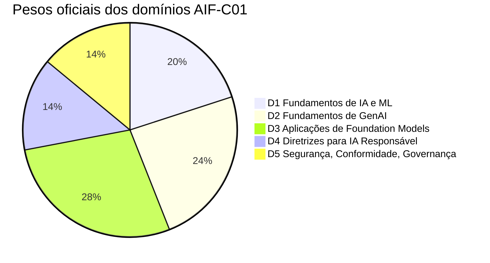
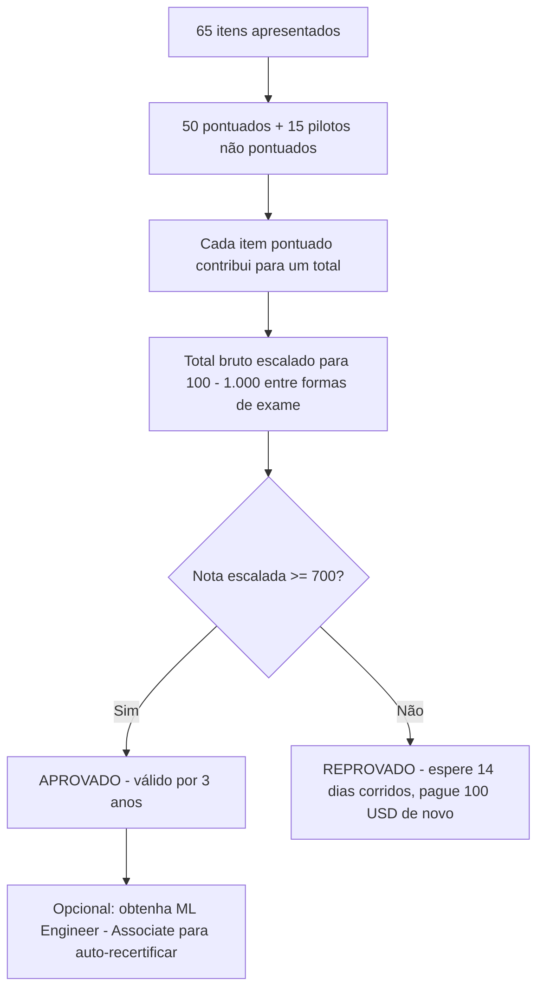
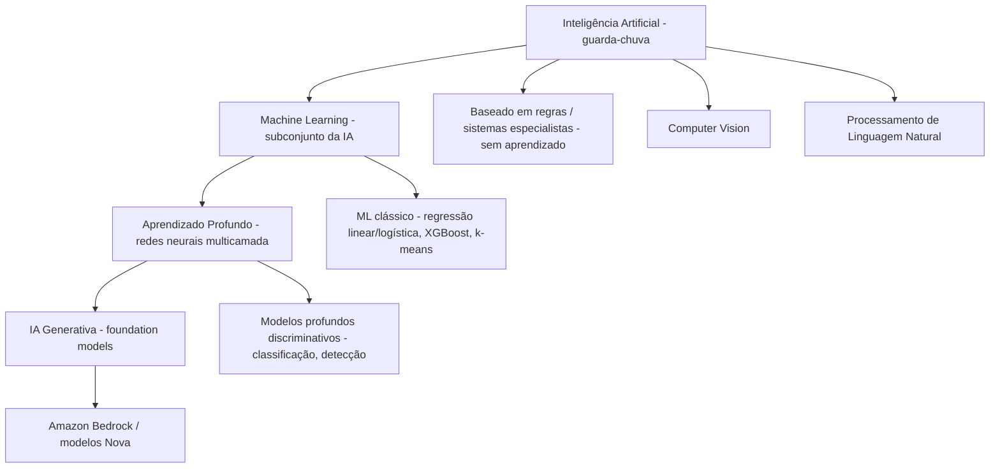
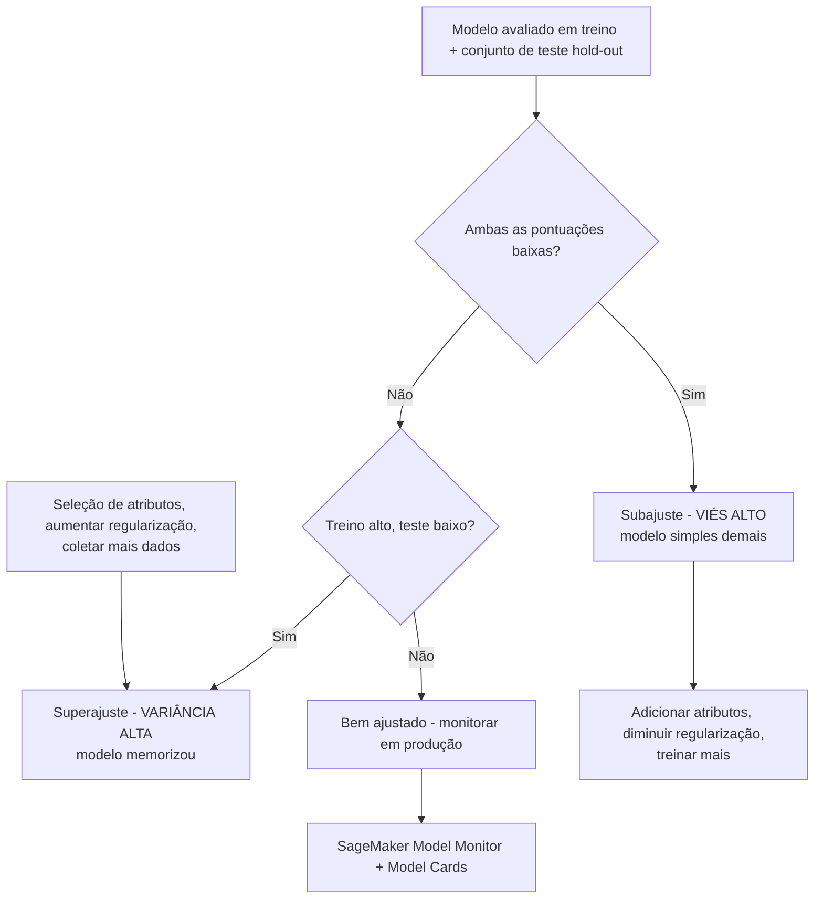
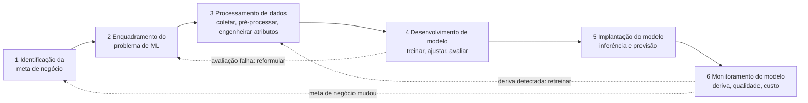

# Guia do Exame AIF-C01 e Fundamentos de IA/ML

Toda certificação AWS começa com um documento: o **guia oficial do exame**. Para o AIF-C01, esse documento faz dois trabalhos ao mesmo tempo: diz exatamente *como* o exame é construído (códigos, minutos, questões, nota de corte, pesos) e define o *vocabulário conceitual* que você deve comandar no Domínio 1 (Fundamentos de IA e ML, 20% da nota). Alunos que pulam o guia e vão direto para flashcards costumam reprovar pelas mesmas três razões: erram o orçamento de tempo, confundem viés estatístico com viés de equidade e não conseguem dizer quando a IA é a *resposta errada* para um problema de negócios.

```text
=====================================================================
 AIF-C01 — AWS CERTIFIED AI PRACTITIONER (FOUNDATIONAL)
=====================================================================
  Código ............. AIF-C01          Nível ..... Foundational
  Duração ............ 90 minutos       Questões . 65 apresentadas
  Itens pontuados .... 50               Não pontuados ... 15 (pilotos)
  Escala ............. 100 - 1.000      Nota de corte .. 700
  Pontuação .......... compensatória (somente geral, sem aprovação por domínio)
  Custo .............. 100 USD          Validade ... 3 anos
  Aplicação .......... centro Pearson VUE ou online proctored
  Idiomas ............ 12 (IT e DE se aposentam após 15 out 2026)
---------------------------------------------------------------------
  DOMÍNIO                                      PESO   ITENS (50 x w)
  1. Fundamentos de IA e ML                     20%          10
  2. Fundamentos de GenAI                       24%          12
  3. Aplicações de Foundation Models            28%          14
  4. Diretrizes para IA Responsável             14%           7
  5. Segurança, Conformidade, Governança        14%           7
                                              ------         -----
                                              100%           50
---------------------------------------------------------------------
  TIPOS DE QUESTÃO: múltipla escolha | múltipla resposta | ordenação |
                  associação   (sem penalidade por chute; em branco = errada)
=====================================================================
```

> [!NOTE]
> **O guia é o contrato.** Qualquer coisa fora do guia de exame, não importa quão popular seja em posts de blog, não tem garantia de aparecer. A AWS rotula explicitamente suas listas de serviços como **"não exaustivas e sujeitas a alterações"**, então trate o guia como o piso do que você precisa saber, não o teto.

Nesta lição você vai:

- ler o guia de exame como um redator de exames lê: código, tempo, custo, pontuação, idiomas;
- converter **pesos dos domínios** em um orçamento concreto de horas de estudo;
- dominar os **quatro tipos de questão** e o modelo de pontuação compensatória;
- separar **IA, ML, aprendizado profundo e IA generativa** usando as definições da própria AWS;
- escolher entre aprendizado **supervisionado, não supervisionado, por reforço e semissupervisionado**;
- fixar o vocabulário: modelo, algoritmo, treinamento, inferência, época, lote, atributo, rótulo;
- diagnosticar **subajuste e superajuste** pela lente viés/variança;
- calcular e interpretar **acurácia, precisão, recall e F1**;
- mapear as **seis fases do ciclo de vida de ML** para serviços AWS reais;
- absorver as **atualizações do guia de exame de 2025 to 2026** (objetivos da v1.1) e separar alegações verificadas de não verificadas;
- aplicar as **essências de estratégia de exame**: ritmo, eliminação e as famílias de armadilhas recorrentes;
- estudar **estudos de caso reais da AWS**: serviços, números e fontes;
- praticar com **12 questões no estilo do exame** mais verificações interativas.

---

## 1. O que o AIF-C01 realmente mede

### 1.1 O candidato alvo

O guia de exame define o candidato alvo em uma única frase, e essa frase é material examinável por si só: um candidato tem **até 6 meses de exposição a tecnologias de IA/ML na AWS** e **usa, mas não necessariamente constrói, soluções de IA/ML**. Esta é uma credencial de *praticante*, não de engenheiro. Você está sendo testado em julgamento, vocabulário, seleção de serviços e governança: não em escrever código de treinamento.

| Atributo do candidato | O que o guia diz | O que significa para o seu preparo |
|---|---|---|
| Janela de experiência | Até 6 meses de exposição a IA/ML na AWS | Não se espera que você tenha colocado modelos em produção |
| Ênfase de papel | Usa, mas não necessariamente constrói, soluções de IA/ML | Seleção de serviços e raciocínio de trade-off dominam |
| Certificação pré-requisito | Nenhuma | AIF-C01 pode ser sua primeira certificação AWS |
| Codificação de modelos de IA/ML | **Fora do escopo** | Sem gradiente descendente, sem PyTorch, sem engenharia de atributos |
| Ajuste de hiperparâmetros | **Fora do escopo** | Saiba *que* o ajuste existe, não *como* ajustar |
| Análise matemática/estatística | **Fora do escopo** | Aritmética em métricas é justa; derivações não são |
| Desenvolvimento de framework de governança | **Fora do escopo** | Você deve *aplicar* diretrizes, não redigi-las |

### 1.2 No escopo e explicitamente fora do escopo

O guia traça uma linha rígida em torno do escopo. A lista fora do escopo não é enfeite: itens dela apareceram como distratores no conjunto oficial de questões de prática, porque um distrator que soa como "trabalho real de ML" é a resposta errada mais tentadora de todas.

**Explicitamente fora do escopo (guia de exame):**

- codificação de modelos de IA/ML;
- engenharia de dados e engenharia de atributos;
- ajuste de hiperparâmetros;
- construção de pipelines de ML;
- análise matemática e estatística;
- implementação de protocolos de segurança e conformidade;
- desenvolvimento de frameworks de governança.

**Explicitamente no escopo (conhecimento AWS recomendado):**

- serviços de nuvem principais: **Amazon EC2, Amazon S3, AWS Lambda**;
- serviços de IA: **Amazon Bedrock, Amazon SageMaker AI**;
- modelo de responsabilidade compartilhada e **AWS Identity and Access Management (IAM)**;
- fundamentos de precificação e gestão de custos da AWS.

> [!WARNING]
> **A armadilha clássica: "construir" versus "usar".** Se uma questão pede para você *implementar* um algoritmo, *ajustar* um hiperparâmetro ou *construir* um pipeline de dados, quase certamente está testando se você reconhece uma tarefa fora do escopo. A resposta correta no exame é a que fala sobre **seleção, avaliação, governança e uso responsável**: nunca a que fala sobre escrever o modelo.

### 1.3 A superfície de serviços AWS que você deve reconhecer

O guia publica uma lista não exaustiva de serviços, agrupados por categoria. Não é necessário conhecer cada caminho do console; é necessário saber **para que cada serviço serve e quando escolhê-lo**.

| Categoria | Serviços listados no guia |
|---|---|
| Machine learning e IA | Amazon Bedrock, Bedrock AgentCore, Comprehend, Lex, Nova, Personalize, Polly, Rekognition, SageMaker AI, JumpStart, Textract, Transcribe, Translate, AWS Transform |
| Analytics | Data Exchange, EMR, Glue, Glue DataBrew, Lake Formation, OpenSearch, QuickSight, Redshift |
| Compute | EC2, Lambda, ECS, EKS |
| Gestão e governança | CloudTrail, CloudWatch, AWS Config, Trusted Advisor, AWS Well-Architected Tool |
| Segurança | AWS Artifact, IAM, Inspector, KMS, Macie, Secrets Manager |
| Armazenamento, rede, custo | S3, S3 Glacier, CloudFront, VPC, AWS Budgets, Cost Explorer |

- **📚 Você sabia?** O exame AIF-C01 foi **anunciado em junho de 2024** e sua **beta abriu em 13 de agosto de 2024** com **85 questões, 170 minutos e taxa de 75 USD** em inglês e japonês. O exame padrão foi **GA em outubro de 2024** a **100 USD** com 65 questões e 90 minutos, então, se você encontrar um guia de estudo antigo descrevendo um exame de 170 minutos, está lendo material da era beta.

---

## 2. Logística do exame: os números que mudam sua estratégia

### 2.1 A tabela de logística

Cada linha abaixo foi verificada contra a página de certificação da AWS, o guia de exame ou a loja Pearson VUE, com o ano de verificação mostrado.

| Atributo | Valor | Fonte | Ano |
|---|---|---|---|
| Código / nível | AIF-C01 / Foundational | Página de certificação | 2026 |
| Duração | 90 minutos | Página de certificação, Visão geral do exame | 2026 |
| Questões apresentadas | 65 | Página de certificação + Guia de Exame | 2026 |
| Pontuadas / não pontuadas | 50 / 15 | Guia de Exame | 2026 |
| Nota de aprovação | 700 em escala 100 to 1.000 | Guia de Exame §Resultados | 2026 |
| Modelo de pontuação | Compensatória (somente geral) | Guia de Exame §Resultados | 2026 |
| Política de chute | Sem penalidade; não respondida = incorreta | Guia de Exame §Tipos de questão | 2026 |
| Tipos de questão | Múltipla escolha, múltipla resposta, ordenação, associação | Guia de Exame §Tipos de questão | 2026 |
| Custo | 100 USD | Página de certificação; Loja Pearson VUE | 2026 |
| Validade | 3 anos | Página de certificação; política de recertificação | 2025 to 26 |
| Aplicação | centro de teste Pearson VUE ou online proctored | Página de certificação | 2026 |
| Idiomas | 12 (italiano e alemão se aposentam após 15 out 2026) | Página de certificação §Idiomas | 2026 |
| Beta (histórica) | 85 questões / 170 minutos / 75 USD, EN + JA, a partir de 13 ago 2024 | Blog AWS Training & Certification | 2024 |
| GA padrão | outubro de 2024, 100 USD, 5 idiomas no lançamento | Blog AWS Training & Certification | 2024 |

### 2.2 Exemplo E1, o orçamento de tempo por questão

O número mais útil de todo o guia é uma aritmética que ninguém publica:

$$
t = \frac{90 \times 60}{65} = \frac{5{,}400}{65} \approx 83 \text{ segundos por questão}
$$

Se você reserva **10 minutos** para revisão, o orçamento real é $80 \times 60 / 65 \approx$ **73,8 segundos** por item. Compare com a beta de 2024: $170 \times 60 / 85 = 120$ segundos por item, o exame padrão é aproximadamente **31% mais apertado por questão**. Itens de ordenação e associação legitimamente consomem mais que a média; itens de múltipla escolha devem ser terminados em menos de um minuto para que o excedente pague por eles.

### 2.3 Exemplo E5: custo da reprovação

| Iteração do exame | Taxa | Itens | Custo por item | Notas |
|---|---|---|---|---|
| Beta (ago 2024) | 75 USD | 85 | **0,88 USD** | somente inglês + japonês |
| Padrão (atual) | 100 USD | 65 | **1,54 USD** | 12 idiomas |

Uma tentativa reprovada custa **mais 100 USD** mais uma espera obrigatória de **14 dias corridos** antes de poder refazer. Não há limite de tentativas e a taxa total se aplica cada vez; inversamente, você **não pode refazer um exame que passou por 2 anos**. Uma promoção limitada de "Foundational Retake" terminou em **15 de fevereiro de 2025**, então orce para uma chance só.

- **📚 Você sabia?** Você não precisa "passar em todos os domínios". Como a pontuação é **compensatória**, um Domínio 3 forte (28%) pode carregar um Domínio 4 fraco (14%): a AWS afirma que você precisa de uma nota de aprovação **somente no exame como um todo**, e o relatório de nota ainda pode mostrar feedback por seção para guiar sua nova tentativa.

---

## 3. Domínios, pesos e declarações de tarefa

### 3.1 Pesos oficiais e o orçamento de questões derivado

| Domínio | Peso oficial | Itens pontuados derivados (50 × peso) |
|---|---|---|
| 1. Fundamentos de IA e ML | **20%** | 10 |
| 2. Fundamentos de GenAI | **24%** | 12 |
| 3. Aplicações de Foundation Models | **28%** | 14 |
| 4. Diretrizes para IA Responsável | **14%** | 7 |
| 5. Segurança, Conformidade e Governança para Soluções de IA | **14%** | 7 |
| **Total** | **100%** | **50** |

> [!IMPORTANT]
> Os **pesos são oficiais** (guia de exame, 2026). As **contagens de itens são aritmética**, 50 × peso, e **não são publicadas pela AWS**. As contagens de questões por domínio são desconhecidas e, como 15 dos 65 itens são pilotos não pontuados, a sua forma real de exame não vai bater exatamente com esta grade. Use a grade para *alocar tempo de estudo*, nunca para prever um número fixo de questões.



### 3.2 O que cada domínio realmente testa

| Domínio | Declarações de tarefa | Foco do exame comprimido |
|---|---|---|
| **1: Fundamentos de IA e ML (20%)** | 1.1 Conceitos e terminologias básicas de IA · 1.2 Casos de uso práticos para IA · 1.3 Ciclo de vida de desenvolvimento de IA/ML | IA/ML/DL/redes neurais/CV/NLP; treinamento vs inferência; viés e equidade; rotulados vs não rotulados, tabular, séries temporais, imagem, texto; supervisionado/não supervisionado/por reforço; quando a IA *não* é apropriada; inferência em lote, tempo real, assíncrona e serverless; serviços gerenciados (SageMaker AI, Transcribe, Translate, Comprehend, Lex, Polly); estágios de pipeline e MLOps; acurácia/precisão/recall/F1 versus métricas de negócio |
| **2: Fundamentos de GenAI (24%)** | 2.1 Conceitos básicos de GenAI · 2.2 Capacidades e limitações para negócios · 2.3 Infraestrutura e tecnologias AWS para GenAI | Tokens, chunking, embeddings, vetores, engenharia de prompt, LLMs transformer, foundation models, modelos multimodais e de difusão; ciclo de vida de FM; **precificação baseada em tokens e seu efeito no custo/desempenho de inferência**; engenharia de contexto; IA agêntica (MCP, padrões multi-agente, memória, ferramentas, orquestração); prós vs contras (alucinações, interpretabilidade, imprecisão, não determinismo); seleção de modelo por custo, latência, conformidade, complexidade; Bedrock, SageMaker AI, JumpStart, Amazon Q, Kiro, Strands Agents, Bedrock AgentCore |
| **3: Aplicações de Foundation Models (28%)** | 3.1 Considerações de design para apps de FM · 3.2 Engenharia de prompt · 3.3 Treinamento e fine-tuning de FMs · 3.4 Avaliar desempenho de FM | Critérios de seleção de FM; parâmetros de inferência como **temperatura** e comprimentos de saída; **RAG**; bancos de dados vetoriais (OpenSearch, Aurora, Neptune, RDS para PostgreSQL); escada de custo de customização (pré-treinamento, fine-tuning, aprendizado em contexto, RAG, destilação); agentes de IA; gestão de prompts; preparação de dados de fine-tuning (curadoria, governança, tamanho, rotulagem, **RLHF**); avaliação com humanos no loop e benchmark; **Bedrock Model Evaluation**; ROUGE, BLEU, BERTScore, LLM-as-a-judge |
| **4: Diretrizes para IA Responsável (14%)** | 4.1 Desenvolvimento de sistemas de IA responsáveis · 4.2 Modelos transparentes e explicáveis | Viés, equidade, inclusividade, robustez, segurança, veracidade; **Bedrock Guardrails**; sustentabilidade; riscos legais (reivindicações de IP, saídas enviesadas, confiança perdida, alucinações); **efeitos de viés e variança (superajuste, subajuste)**; análise de qualidade de rótulos, auditorias humanas, análise de subgrupos; modelos transparentes vs opacos; **SageMaker Model Cards**; trade-offs entre segurança vs transparência |
| **5: Segurança, Conformidade, Governança (14%)** | 5.1 Métodos para proteger sistemas de IA · 5.2 Governança e regulamentações de conformidade | IAM, criptografia, **Macie, PrivateLink, responsabilidade compartilhada, AgentCore Identity/Policy, Bedrock Guardrails**; linhagem e catalogação de dados; tecnologias de aprimoramento de privacidade; **AWS Config, Inspector, AWS Artifact, CloudTrail, Trusted Advisor**; ciclos de vida de dados, logging, residência, retenção; **Generative AI Security Scoping Matrix** |

### 3.3 Convertendo pesos em um plano de estudo

Suponha que você tenha **40 horas** até o dia do exame. Os pesos convertem diretamente em horas:

```text
Domínio   peso   horas (40 h)   principais recursos a consumir
D1        20%        8,0 h       páginas what-is da AWS, ciclo de vida ML Lens
D2        24%        9,6 h       docs do Bedrock, conceitos de GenAI, precificação por tokens
D3        28%       11,2 h       prompting, RAG, fine-tuning, avaliação
D4        14%        5,6 h       princípios de IA Responsável, Guardrails, Model Cards
D5        14%        5,6 h       responsabilidade compartilhada, IAM, Artifact, Macie
                                              -------------------------
                                              40,0 h
```

Os domínios 2 + 3 somam **52% da nota**: mais da metade do exame é trabalho de IA generativa. Um candidato que gasta 80% do tempo de estudo em ML clássico já alocou a maioria do seu esforço de forma errada.

---

## 4. Tipos de questão e mecânica de pontuação

### 4.1 Os quatro tipos de questão

| Tipo | Estrutura | Regra de crédito |
|---|---|---|
| **Múltipla escolha** | 1 opção correta + 3 distratores | Selecione a única melhor resposta |
| **Múltipla resposta** | 2+ corretas entre 5+ opções | **Todas** as respostas corretas são necessárias para crédito |
| **Ordenação** | 3 to 5 respostas colocadas em sequência | A sequência completa deve estar correta |
| **Associação** | Associe itens a **3 to 7 prompts** | **Todos** os pares devem estar corretos |

Não há **tipo de estudo de caso** listado no guia atual. Um PDF legado de 2024 (v1.4, 31 de julho de 2024) contém redação de estudo de caso, e a AWS não declara qual série de numeração rege o dia do exame: veja as ressalvas na Seção 11.3.

### 4.2 Pontuação compensatória

**Compensatória** significa uma coisa: apenas o resultado **geral** precisa passar de 700. Você **não** precisa atingir 700 dentro de cada domínio individual. Um candidato que pontua o equivalente a 650 no Domínio 4, mas o equivalente a 800 geral nos Domínios 1 to 3, ainda pode passar, e vice-versa: dominar o Domínio 3 não resgata uma nota geral abaixo da corte.



### 4.3 Exemplo E2: escalada, não uma porcentagem bruta

700 de 1.000 *parece* 70%, e a conversão ingênua $0.70 \times 50 = 35$ respostas corretas é aritmeticamente limpa, e **errada como fato de exame**. A AWS escala notas *"across multiple exam forms that might have slightly different difficulty levels"*, então o número bruto de respostas corretas necessário para 700 **não é fixado em 35** e não é publicado. A única regra determinística em que você pode confiar é comportamental: **itens não respondidos são pontuados como incorretos**, então você deve responder todas as 65.

> [!WARNING]
> **Nunca deixe um item em branco "para garantir".** **Não há penalidade por chute**: um chute errado não custa nada além do ponto que você perderia pulando, enquanto um em branco garante zero. Estratégia: elimine, comprometa-se, marque para revisão, siga em frente. Com ~83 segundos por questão, uma questão pulada à qual você pretendia voltar é o hábito mais caro deste exame.

---

## 5. Inteligência artificial, machine learning, aprendizado profundo e IA generativa

### 5.1 O mapa de quatro camadas, nas palavras da própria AWS

| Dimensão | Inteligência Artificial | Machine Learning | Aprendizado Profundo | IA Generativa |
|---|---|---|---|---|
| Definição AWS | Máquinas executando *"human-like problem-solving tasks"* | *"The science of developing algorithms and statistical models to correlate data"* | Método de IA processando dados *"inspired by the human brain"* usando redes neurais multicamada | *"AI systems that create new content and artifacts such as images, videos, text, and audio from simple text prompts"* |
| Escopo | Campo guarda-chuva (ML, DL, NLP, CV) | **Subconjunto de IA**: *"one among many other branches"* | Subconjunto de ML (*"takes machine learning one step further"*) | Subconjunto/extensão do aprendizado profundo |
| Saída | Decisões, recomendações, planos | Previsões: rótulos, pontuações, clusters, previsões | Reconhecimento rico de padrões em dados não estruturados | **Novo** texto, imagem, áudio, vídeo, código |
| Dados e computação | Regras ou dados | Dados históricos rotulados ou não rotulados | Dados muito grandes + computação pesada | Dados massivos + foundation models |
| Estilo de treinamento | Baseado em regras ou aprendido | Supervisionado / não supervisionado / semissupervisionado / por reforço | Treinamento de redes neurais em camadas | Pré-treinamento + fine-tuning ou RAG |
| Exemplo AWS | Roteamento de intenção Lex; moderação Rekognition | Predição de churn XGBoost no SageMaker | Classificação Rekognition; Transcribe fala-para-texto | Geração Bedrock; Amazon Q |
| Citação AWS | *"Not all AI activities are machine learning and deep learning"* | *"One among many other branches of artificial intelligence"* | *"Takes machine learning one step further"* | *"A very advanced form of deep learning"* |



> [!NOTE]
> **Aninhados, não adjacentes.** Toda IA generativa é aprendizado profundo; nem todo aprendizado profundo é generativo; todo aprendizado profundo é machine learning; nem todo machine learning é IA (sistemas baseados em regras também são IA). Questões no Domínio 1 rotineiramente testam esse aninhamento perguntando qual declaração é *falsa*: fique atento a opções que o invertem, como *"all AI uses machine learning."*

### 5.2 Quando IA/ML é a resposta errada

O Domínio 1 testa explicitamente **análise de custo-benefício** e **a decisão de não usar IA**. As duas razões canônicas para recusar um projeto de IA:

1. **Você precisa de um resultado específico e determinístico**: se o requisito é "aplicar exatamente estas 12 regras de negócio", um motor de regras dá a mesma resposta toda vez, é auditável linha a linha e não custa nada para treinar.
2. **O custo-benefício não fecha**: coleta, rotulagem, avaliação e monitoramento de dados podem exceder o valor da previsão, especialmente onde uma planilha ou uma revisão humana já atinge a acurácia alvo.

- **📚 Você sabia?** A própria página "what is overfitting" da AWS usa uma definição que surpreende as pessoas: *"Underfit models experience high bias, they give inaccurate results for both the training data and test set."* **Viés no Domínio 1 é um termo estatístico** (viés alto = simples demais) *e* o Domínio 4 usa **viés como termo de equidade** (distorção demográfica). O exame testa ambos os sentidos, geralmente em domínios diferentes.

---

## 6. Paradigmas de aprendizado: supervisionado, não supervisionado, por reforço, semissupervisionado

### 6.1 A tabela de decisão

| Aspecto | Supervisionado | Não supervisionado | Por reforço | Semissupervisionado |
|---|---|---|---|---|
| Dados | Rotulados (entrada + alvo conhecido) | Não rotulados | Ambiente + sinal de recompensa | Poucos rotulados + muitos não rotulados |
| Objetivo | Aprender o mapeamento X → Y | Descobrir estrutura e padrões | Maximizar recompensa cumulativa | Aprendizado de bootstrap a partir de rótulos parciais |
| Tipos de problema | Classificação, regressão | Clustering, PCA, detecção de anomalias | Decisões sequenciais, controle | Misto, tarefas caras de rotulagem |
| Técnicas (AWS) | Regressão linear/logística, árvore de decisão, random forest, XGBoost | k-means, clustering espectral, Random Cut Forest, Apriori | Frameworks SageMaker RL; Amazon DeepRacer | Classificação de documentos eficiente em rótulos |
| Exemplo AWS | Predizer falha de máquina a partir de logs; diagnóstico médico binário | Agrupar artigos de notícias por tópico; padrões de compra "pão com manteiga" | Jogos, robótica; exploração vs exploração | Corpora gigantes onde apenas algumas linhas são rotuladas |

A AWS documenta os três paradigmas com precisão: aprendizado **supervisionado** usa *atributos mais valores alvo conhecidos* (alvo categórico → classificação; alvo contínuo → regressão); aprendizado **não supervisionado** *não tem rótulos* e descobre agrupamentos (PCA, clustering); aprendizado **por reforço** tem um *agente aprendendo por tentativa e erro para maximizar a recompensa de longo prazo*, equilibrando exploração contra exploração.

```matching
{
  "question": "Associe cada paradigma de aprendizado à sua característica definidora no exame AIF-C01:",
  "pairs": [
    {"left": "Aprendizado supervisionado", "right": "Atributos mais valores alvo conhecidos: alvo categórico significa classificação, alvo contínuo significa regressão"},
    {"left": "Aprendizado não supervisionado", "right": "Sem rótulos nenhum: o algoritmo descobre agrupamentos, clusters ou padrões como k-means e PCA"},
    {"left": "Aprendizado por reforço", "right": "Um agente aprende por tentativa e erro em um ambiente para maximizar a recompensa de longo prazo"},
    {"left": "Aprendizado semissupervisionado", "right": "Um pequeno conjunto rotulado combinado com um grande conjunto não rotulado para reduzir o custo de rotulagem"},
    {"left": "Subajuste (viés alto)", "right": "Impreciso em AMBOS os dados de treinamento e o conjunto de teste: o modelo é simples demais"},
    {"left": "Superajuste (variança alta)", "right": "Preciso nos dados de treinamento mas impreciso em dados não vistos: o modelo memoriza"}
  ],
  "explanation": "Os paradigmas são distinguidos pelo que os dados contêm (rótulos, recompensas ou nada). Problemas de ajuste são distinguidos por onde o erro aparece: ambos os conjuntos significa subajuste, apenas o conjunto de teste significa superajuste."
}
```

### 6.2 Escolhendo o paradigma a partir do enunciado

```text
"temos resultados históricos e queremos PREVER um valor conhecido"  -> supervisionado
   |-> o alvo é uma categoria (churn: sim/não)      -> classificação
   |-> o alvo é um número (preço, demanda)          -> regressão
"temos dados mas SEM alvo, queremos AGRUPAR ou REDUZIR"             -> não supervisionado
   |-> grupos de clientes / artigos                -> clustering
   |-> menos colunas, descoberta de estrutura      -> PCA / redução de dimensionalidade
"um AGENTE age, recebe feedback, melhora ao LONGO DO TEMPO"        -> por reforço
"rótulos são caros mas EXISTEM ALGUNS"                              -> semissupervisionado
```

> [!WARNING]
> **"Não supervisionado" não significa "implantação não supervisionada".** Um distrator comum descreve um modelo que pontua novos dados sem revisão humana e chama isso de aprendizado não supervisionado. Não supervisionado refere-se à **ausência de rótulos nos dados de treinamento**, não à ausência de humanos no momento da inferência.

---

## 7. Terminologia central: o vocabulário do Domínio 1

### 7.1 Termos com definições de origem AWS

| Termo | Definição usada no exame | Fonte AWS |
|---|---|---|
| **Modelo** | Artefato produzido por padrões de aprendizado a partir de dados; usado para prever em dados futuros | Amazon ML Developer Guide §Concepts |
| **Algoritmo** | Procedimento de aprendizado que consome dados de treinamento e *"will output a model that captures these relationships"* | Amazon ML Developer Guide |
| **Treinamento** | Ajuste do modelo: fonte de dados de entrada + atributo alvo + transformações + parâmetros de treinamento | Amazon ML Developer Guide §Training |
| **Inferência** | Usar um modelo **treinado** em novos dados; testado por modo: lote, tempo real, assíncrono, serverless | Docs SageMaker; Guia de Exame T1.1 |
| **Época** | *"How many times the model goes through the entire training dataset"* | SageMaker Autopilot `epochCount` |
| **Lote / tamanho de lote** | *"The number of data samples used in each iteration of training"*; lotes maiores aumentam o risco de estouro de memória | SageMaker Autopilot `batchSize` |
| **Atributo** | *"The attributes or properties models use during training and inference to make predictions"* | SageMaker Feature Store |
| **Rótulo** | Alvo/resposta adicionado a dados brutos durante a rotulagem por anotadores humanos ou rotuladores automatizados | SageMaker Ground Truth |
| **Dados de treino vs avaliação** | Dados de avaliação hold-out detectam superajuste; divisão padrão legada **70% / 30%** | Amazon ML Developer Guide |

### 7.2 Exemplo E6: uma época, um lote, 1.000 linhas

Pegue 1.000 linhas com **tamanho de lote de 100**: uma época = 10 iterações de treinamento, cada uma consumindo 100 amostras. Dez épocas = 100 iterações no total, e o modelo já viu cada linha dez vezes. Mais épocas não são automaticamente melhores: elas reduzem o viés até um ponto e então começam a elevar a variança (memorização). A orientação da AWS para tamanho de lote é incomumente prática: **comece em 1** e aumente até atingir um erro de estouro de memória, porque lotes maiores elevam o risco de OOM na instância de treinamento.

### 7.3 Modos de inferência

| Modo | Quando usar | Forma da carga de trabalho |
|---|---|---|
| **Tempo real** | Requisições interativas de baixa latência | Endpoint síncrono, cobrança por requisição |
| **Lote** | Grandes volumes, latência aceitável (minutos a horas) | Jobs sobre arquivos no S3, sem custo de endpoint ocioso |
| **Assíncrono** | Requisições de longa duração que excedem os limites de tempo real | Envie, consulte ou receba um callback |
| **Serverless** | Tráfego variável, evitar provisionamento | Escala para zero, pague por invocação |

### 7.4 Tipos de dados que você deve reconhecer

- **Rotulados** vs **não rotulados**: determina o paradigma antes de qualquer outra coisa;
- **Estruturados/tabulares**: linhas e colunas; território do ML clássico (XGBoost no SageMaker);
- **Séries temporais**: observações ordenadas; tarefas de previsão;
- **Imagens**: pixels; computer vision (Rekognition);
- **Texto**: tokens não estruturados; NLP (Comprehend) e IA generativa;
- **Estruturado vs não estruturado**, o exame usa este par para decidir entre jobs tabulares do SageMaker e Bedrock/Comprehend/Rekognition.

```fillblank
{
  "question": "Complete as declarações de vocabulário do Domínio 1 com os termos corretos de origem AWS:",
  "template": "O número de vezes que um modelo percorre o conjunto inteiro de dados de treinamento é chamado de {{1}}. O número de amostras usadas em cada iteração de treinamento é o {{2}}. Atributos usados para fazer previsões são {{3}}, enquanto a resposta conhecida anotada durante a anotação é o {{4}}. Usar um modelo treinado em novos dados é chamado de {{5}}.",
  "answers": {
    "1": "época",
    "2": "tamanho de lote",
    "3": "atributos",
    "4": "rótulo",
    "5": "inferência"
  },
  "distractors": ["gradiente", "cluster", "centroide", "token", "embedding", "hiperparâmetro"],
  "explanation": "Época e tamanho de lote vêm da documentação do SageMaker Autopilot, atributos do SageMaker Feature Store, rótulos do SageMaker Ground Truth, e inferência é o termo do guia de exame para aplicar um modelo treinado: distinguido de treinamento em todo o Domínio 1."
}
```

---

## 8. Ajuste do modelo: subajuste, superajuste, viés e variança

### 8.1 A tabela de diagnóstico

| Sinal | Subajuste (viés alto) | Superajuste (variança alta) |
|---|---|---|
| Desempenho de treinamento | Pior | Excelente |
| Desempenho de avaliação/teste | Pior | Pior |
| Causa raiz | Modelo simples demais para capturar X → Y | Modelo memoriza dados de treinamento, não generaliza |
| Redação AWS | *"Inaccurate results for both the training data and test set"* | *"Accurate predictions for training data but not for new data"* |
| Correção | Adicionar atributos, **diminuir** regularização | **Seleção de atributos**, **aumentar** regularização |
| Efeito de mais treinamento | Reduz o viés | Pode elevar a variança ainda mais |

### 8.2 Exemplo E3: uma divisão de 1.000 linhas

Divisão padrão legada: **700 treino / 300 avaliação** linhas.

| Cenário | Acurácia treino | Acurácia avaliação | Lacuna | Diagnóstico | Correção |
|---|---|---|---|---|---|
| A | 99% | 72% | **27 pontos** | **Superajuste** (variança alta) | Seleção de atributos, aumentar regularização |
| B | 55% | 53% | 2 pontos, ambos baixos | **Subajuste** (viés alto) | Adicionar atributos, diminuir regularização |
| C | 88% | 87% | 1 ponto, ambos saudáveis | Bem ajustado | Monitorar após implantação |

A lacuna diz o diagnóstico; o **nível absoluto** diz em que direção mover. O cenário B é o que os alunos perdem: uma lacuna *pequena* não é automaticamente boa notícia quando os dois números são ruins.



### 8.3 Viés e variança em dois sentidos diferentes

A declaração de tarefa 4.1 do guia de exame lista *"effects of bias and variance (e.g., effects on demographic groups, inaccuracy, overfitting, underfitting)"*: deliberadamente unindo os dois sentidos:

- **Sentido estatístico (Domínios 1 e 3):** viés alto = subajuste, variança alta = superajuste; mais treinamento reduz o viés mas pode aumentar a variança.
- **Sentido de equidade (Domínio 4):** viés como distorção contra grupos demográficos, abordada por análise de qualidade de rótulos, auditorias humanas e análise de subgrupos, com **SageMaker Model Cards** documentando o uso pretendido e as limitações do modelo.

> [!NOTE]
> **Leia o número do domínio para saber qual "viés" é pretendido.** Nos Domínios 1 e 3, o viés fica ao lado da variança e da regularização. No Domínio 4, o viés fica ao lado da equidade, inclusividade e guardrails. A palavra é idêntica; as correções são completamente diferentes.

---

## 9. Métricas de avaliação: acurácia, precisão, recall e F1

### 9.1 O conjunto de métricas

| Métrica | Definição (redação AWS) | Fraqueza que expõe |
|---|---|---|
| **Acurácia** | % de rótulos previstos com precisão = corretos ÷ total de amostras de teste | Enganosa em dados desbalanceados |
| **Precisão** | Retornou *"substantially more relevant results than irrelevant ones"* | Falsos positivos |
| **Recall** | Retornou *"most of the relevant results"* (completude) | Falsos negativos |
| **F1** | Média harmônica de precisão e recall; *"highest score is 1, worst is 0"* | Recompensa equilíbrio, pune desequilíbrio |
| **Macro-F1** | Média não ponderada de F1 entre classes | Trata cada classe igualmente independentemente do tamanho |

$$
F1 = 2 \cdot \frac{P \times R}{P + R}
$$

### 9.2 Exemplo E4: por que F1 é uma média harmônica

Com precisão $P = 0.80$ e recall $R = 0.50$:

$$
F1 = \frac{2 \times 0.80 \times 0.50}{0.80 + 0.50} = \frac{0.80}{1.30} \approx 0.615
$$

A média aritmética seria $(0.80 + 0.50)/2 = 0.650$. O F1 cai **mais baixo (0.615)** precisamente porque a média harmônica é puxada para a métrica mais fraca: esse é o ponto da métrica. Um modelo que encontra apenas metade dos itens relevantes não deve ser avaliado como "maiormente ok".

| P | R | Média aritmética | F1 ( harmônica) | Leitura |
|---|---|---|---|---|
| 0,80 | 0,50 | 0,650 | **0,615** | Metade dos resultados relevantes perdida |
| 0,90 | 0,90 | 0,900 | **0,900** | Equilibrado e forte |
| 0,95 | 0,30 | 0,625 | **0,456** | Precisão alta, recall despenca |
| 0,50 | 0,50 | 0,500 | **0,500** | Desempenho de cara ou coroa |

### 9.3 Métricas de modelo versus métricas de negócio

O Domínio 1 exige que você mantenha dois livros separados:

| Métricas de modelo (ciência de dados) | Métricas de negócio (tomadores de decisão) |
|---|---|
| Acurácia, precisão, recall, F1, AUC | Custo por usuário, custos de desenvolvimento, ROI, lift de receita |
| Resposta: "O modelo está correto?" | Resposta: "O projeto vale a pena?" |
| Otimizadas por cientistas de dados | Otimizadas por produto e finanças |
| Podem ser altas enquanto o projeto perde dinheiro | Podem ser positivas com um modelo medíocre |

Um modelo de fraude com 99% de acurácia que bloqueia 5% dos pagamentos legítimos pode destruir mais valor do que economiza, o exame espera que você diga isso.

- **📚 Você sabia?** F1 é uma média **harmônica** e não aritmética por uma razão que aparece em opções do exame: com P = 0,95 e R = 0,30 a média aritmética diz 0,625 (passável) enquanto o F1 diz **0,456** (reprovado). A média harmônica se recusa a deixar um número excelente esconder um quebrado: a AWS documenta o intervalo como **0 (pior) a 1 (maior)**.

---

## 10. O ciclo de vida de desenvolvimento de IA/ML

### 10.1 As seis fases (AWS Well-Architected ML Lens)

O ML Lens define seis fases, e avisa que elas são **"not necessarily sequential"**, com loops de feedback correndo em ambas as direções:



### 10.2 Mapa fase → serviço

| Fase | O que acontece | Serviços AWS |
|---|---|---|
| 1. Identificação da meta de negócio | Definir o resultado e a métrica de sucesso | AWS Well-Architected Tool, Cost Explorer |
| 2. Enquadramento do problema de ML | Classificação? regressão? clustering? ou nada de ML? | Workshop de enquadramento de problemas, expertise de domínio |
| 3. Processamento de dados | Coleta, pré-processamento, engenharia de atributos, rotulagem | S3, Glue, Glue DataBrew, Lake Formation, SageMaker Ground Truth |
| 4. Desenvolvimento de modelo | Treinamento, ajuste, avaliação | SageMaker AI, JumpStart, SageMaker Clarify |
| 5. Implantação de modelo | Inferência e previsão | Endpoints SageMaker, batch transform, Bedrock API |
| 6. Monitoramento de modelo | Deriva, qualidade, custo, documentação | CloudWatch, SageMaker Model Monitor, SageMaker Model Cards |

### 10.3 Exemplo E7: da meta de negócio ao endpoint monitorado

Uma equipe de varejo quer reduzir o gasto com suporte em 15%. Mapeando isso para o ciclo de vida:

1. **Meta de negócio:** reduzir custo de suporte em 15%: medido em dólares, não em acurácia.
2. **Enquadramento do problema:** prever auto-resolução de tickets (classificação binária): ou decidir que um resumidor do Bedrock é mais barato que um classificador.
3. **Dados:** 2 anos de tickets no S3, limpos com Glue DataBrew, rotulados por 3 anotadores no Ground Truth (alvo: ≥90% de concordância entre anotadores).
4. **Desenvolvimento:** treinar no SageMaker AI, avaliar F1 = 0,74 em uma divisão hold-out de 30%.
5. **Implantação:** endpoint em tempo real do SageMaker para o console do agente; Bedrock API para resumo.
6. **Monitoramento:** alarmes CloudWatch sobre latência e alertas do Model Monitor sobre deriva de atributos; Model Card registra uso pretendido e limites conhecidos.

```dragdrop
{
  "question": "Ordene as seis fases do ciclo de vida de ML do Well-Architected ML Lens:",
  "items": [
    "Identificação da meta de negócio",
    "Enquadramento do problema de ML",
    "Processamento de dados",
    "Desenvolvimento de modelo",
    "Implantação de modelo",
    "Monitoramento de modelo"
  ],
  "correctOrder": [
    "Identificação da meta de negócio",
    "Enquadramento do problema de ML",
    "Processamento de dados",
    "Desenvolvimento de modelo",
    "Implantação de modelo",
    "Monitoramento de modelo"
  ],
  "explanation": "O ML Lens começa pela meta de negócio, depois enquadra o problema de ML, processa dados, desenvolve o modelo, implanta para inferência e finalmente monitora. A AWS observa que as fases não são estritamente sequenciais e contêm loops de feedback: mas nenhuma equipe deve começar pelo desenvolvimento de modelo antes que a meta de negócio exista."
}
```

---

## 11. Roteiro de preparação, recursos e ressalvas

### 11.1 Recursos oficiais do Skill Builder

| Recurso | Conteúdo | Acesso | Fonte / data |
|---|---|---|---|
| Exam Prep Plan AIF-C01 | **19 treinamentos, 22 h 50 m**, >**175 questões no estilo do exame**, labs, **65 flashcards** | Parcialmente por assinatura | skillbuilder.aws, atual. 23 jun 2025 |
| Official Practice Question Set | **20 questões**, 1 h 30 m, feedback por resposta, refazível | **Gratuito** | skillbuilder.aws, atual. 17 jul 2026 |
| Official Pretest | **65 questões, limite de 90 minutos** | Assinatura | skillbuilder.aws, 2026 |
| Official Practice Exam | **65 questões, limite de 90 minutos** | Assinatura | skillbuilder.aws, 2026 |
| AI Practitioner Learning Plan | **8 treinamentos, 8 h 0 m** | Conteúdo free-tier | skillbuilder.aws, 2026 |
| Domain Review D1: D5 | ~1 h 30 m cada | Gratuito | skillbuilder.aws, 2026 |
| Exam Prep (sala de aula ILT) | **1 dia**, intermediário | Pago | d1.awsstatic.com, 2025 |

### 11.2 O plano oficial de quatro etapas

A AWS publica um plano de preparação de quatro etapas, e a ordem importa: é diagnóstico antes de instrucional:

1. **Conheça o exame**: leia o guia de exame e esta lição; entenda tipos, pesos e pontuação.
2. **Atualize conhecimentos e habilidades AWS**: EC2, S3, Lambda, IAM, Bedrock, SageMaker AI, responsabilidade compartilhada, precificação.
3. **Revise e pratique**: bancos de questões, vídeos de revisão por domínio, flashcards.
4. **Avalie a prontidão**: pré-teste oficial cronometrado ou exame de prática com 65 questões / 90 minutos.

| Marco | Alvo | Racional |
|---|---|---|
| Primeiro conjunto cronometrado | ≥60% geral | Baseline antes de mergulhos por domínio |
| Conjunto intermediário | ≥75% geral | Domínio mais fraco no máximo 10 pontos abaixo da média |
| Conjunto de prontidão | ≥85% geral, 2 sessões | Deixa margem para pontuação escalada entre formas |
| Checagem de tempo | Terminar 65 itens com ≥10 min restantes | Confirma que você está abaixo da média de ~83 s |

### 11.3 Recertificação, refações e alegações não verificadas

- **Validade:** 3 anos. Recertifique-se **reaprovando no AIF-C01** ou obtendo **AWS Certified Machine Learning Engineer: Associate**, que auto-recertifica.
- **Refação:** reprovou → espera de **14 dias corridos**, tentativas ilimitadas, **100 USD** completos cada vez; um exame aprovado não pode ser refazido por **2 anos**.
- **Próximas certificações:** Solutions Architect: Associate (caminho de nuvem) ou Data Engineer: Associate / ML Engineer: Associate (caminho de dados e IA).

> [!WARNING]
> **O que esta pesquisa NÃO PODEU verificar: não trate como fatos de exame:**
> - **Contagens de questões por domínio não são publicadas**: a grade 10/12/14/7/7 é aritmética sobre 50 itens pontuados;
> - **O número bruto exato de respostas corretas necessário para 700**: pontuação escalada entre formas; "≈70%" é apenas uma aproximação;
> - **Uma taxa de aprovação oficial**: a AWS não publica nenhuma; números de terceiros como "taxa de aprovação de 80%" não têm fonte;
> - **Se itens de estudo de caso ainda aparecem**, o PDF legado de 2024 os menciona; o guia atual lista quatro tipos;
> - **Qual versão do guia rege o dia do exame**: a série atual v1.0 (26 mar 2026) e v1.1 (30 abr 2026) coexistem com um PDF legado "v1.4, 31 jul 2024";
> - **Nomeação do Domínio 2**: "Fundamentals of GenAI" (atual) vs "Fundamentals of Generative AI" (PDF de 2024); nenhuma prevalece sobre a outra na material da AWS;
> - **Aplicabilidade da acomodação ESL +30 minutos** ao AIF-C01 especificamente, e **preços/impostos não em USD**: apenas 100 USD foi verificado;
> - **Distribuição de tipos de questão**: nenhuma fonte AWS declara quantos itens de ordenação vs associação aparecem.

- **📚 Você sabia?** O histórico de alterações do guia de exame e a lista de idiomas da página de certificação são ambos alvos móveis: a série atual do guia mostra **v1.0 em 26 de março de 2026** e **v1.1 em 30 de abril de 2026**, enquanto **italiano e alemão se aposentam após 15 de outubro de 2026**, deixando o exame em **12 idiomas**. Verifique a data da versão do guia em qualquer PDF que baixar: PDFs sem data ou datados de 2024 circulam amplamente.

### 11.4 Atualizações de 2025 to 2026

O guia de exame é um documento vivo, e os últimos dois anos o mudaram duas vezes em um mês: **v1.0 foi publicada em 26 de março de 2026** e **v1.1 em 30 de abril de 2026**. A AWS afirma que atualizações do guia aparecem no exame **cerca de um mês após a publicação**, então todo objetivo v1.1 abaixo é elegível para o exame desde o final de maio de 2026. Tudo nesta subseção marcado como **verificado** foi checado contra o histórico de alterações do guia de exame da AWS (docs v1.1) em 6 de outubro de 2026; qualquer coisa não assim marcada é rotulada como não verificada.

**Os sete novos objetivos na v1.1 (verificados):**

| Novo objetivo | Domínio | O que agora testa |
|---|---|---|
| 1.2.6 ML tradicional vs foundation models | 1 | restrições regulatórias, de interpretabilidade e operacionais como fatores decisores |
| 2.1.4 Precificação baseada em tokens | 2 | efeito da precificação por tokens no **custo e desempenho** de inferência |
| 2.1.5 Engenharia de contexto | 2 | o que é colocado na janela de contexto e o que isso custa |
| 2.1.6 IA agêntica | 2 | padrões multi-agente, **MCP**, gestão de memória, uso de ferramentas, orquestração |
| 3.2.5 Versionamento de prompts | 3 | **Bedrock Prompt Management** como um fluxo de prompts versionado |
| 3.4.5 Métricas de alinhamento de negócio | 3 | métricas que amarram qualidade do modelo a resultados de negócio |
| 5.1.5 Detecção de alucinação e grounding | 5 | grounding RAG, validação de saída, pontuação de confiança |

**Outras mudanças v1.1 verificadas:**

- **Lista de serviços:** adicionados **Amazon Aurora, Bedrock AgentCore, Kiro, Strands Agents, Amazon Q, SageMaker JumpStart, AWS Transform**; **removido Amazon MemoryDB**;
- **Exemplos alterados:** 1.1.3 adiciona inferência assíncrona e serverless; 1.1.1 diz "agentic AI"; 1.3.4 nomeia **Bedrock, Amazon Quick, Kiro, SageMaker AI**; 1.3.6 mantém acurácia/precisão/recall/F1 e **remove AUC**; 3.1.5 adiciona **destilação**; 3.4.2 adiciona **LLM-as-a-judge**; 4.2.2 nomeia **Clarify + Bedrock Model Evaluations**; 5.1.4 adiciona prevenção de vazamento de dados, validação de saída, trilhas de auditoria e toxicidade;
- **Inalterado:** 65 questões (50 pontuadas + 15 não pontuadas), 90 minutos, 100 USD, nota de corte 700/1.000, validade de 3 anos, nível Foundational, os quatro tipos de questão e os pesos **20 / 24 / 28 / 14 / 14**;
- **Status de serviços que você pode encontrar como distrator:** **SageMaker Model Monitor e SageMaker Clarify fecharam para novos clientes em 30 de julho de 2026**, o status é *manutenção*, **não** um encerramento e **não** um rebranding, então clientes existentes os mantêm sem novas funcionalidades; **Amazon Kendra** entrou em manutenção em 30 de junho de 2026, fechou para novos clientes em 30 de julho de 2026, com **Bedrock Managed Knowledge Base** como substituição direcionada pela AWS; o vocabulário de ciclo de vida é **Maintenance → Sunset → Full Shutdown**.

**Não verificado, não memorize como fatos de exame:** **datas de lançamento da série Claude 5** em circulação (catálogo de terceiros, não um post da AWS); a **data de encerramento do Q Business** (docs da AWS dizem apenas "no longer open to new customers"); datas de lançamento de primeira geração de **Nova Sonic** e **Bedrock Managed Knowledge Base**; **precificação conflitante do Claude Opus 4.6** ($5.00/$25.00 vs $15.00/$75.00); a alegação de que **economias de batch e prompt-caching se multiplicam** (a redação da AWS diz que caching *não* é suportado com batch); o dia exato de **end-of-support do Mechanical Turk** (General Reference 30 set 2026 vs What's New 29 set 2026); e qualquer sucessor **AIF-C02**, nenhum foi anunciado.

- **📚 Você sabia?** O Bedrock Guardrails agora carrega **seis políticas**, moderação de conteúdo, detecção de prompt attack, tópicos negados, filtros de PII/informações sensíveis, contextual grounding e **Automated Reasoning checks** (preview em 3 de dezembro de 2024), e a AWS publica **até 88%** de bloqueio de conteúdo prejudicial mais **até 99%** de acurácia para Automated Reasoning, cujo trabalho é *validar, corrigir e explicar* respostas com lógica formal em vez de apenas bloqueá-las.

### 11.5 Essências de Estratégia de Exame

Logística só ganha marcas quando se torna comportamento. Estas são as táticas de maior rendimento do próprio material de preparação de exame da AWS, mais as famílias de armadilhas que recorrem em todos os quatro tipos de questão.

**Plano de ritmo (90 minutos, 65 itens):**

| Segmento | Itens | Relógio | Regra |
|---|---|---|---|
| S1 Aquecimento | 1 to 10 | 0:00 → 0:12 | Leia por completo, decida rápido; **marque** qualquer coisa acima de 90 s |
| S2 Núcleo | 11 to 30 | 0:12 → 0:37 | **60 s por item**; elimine duas opções antes de escolher |
| S3 Esforço | 31 to 50 | 0:37 → 1:02 | Associação e ordenação vivem aqui: faça-as **por inteiro** |
| S4 Cauda longa | 51 to 65 | 1:02 → 1:17 | Enunciados mais lentos; marque em vez de travar |
| S5 Varredura de marcados | apenas marcados | 1:17 → 1:27 | Relia o enunciado, rode a eliminação uma vez |
| S6 Buffer |: | 1:27 → 1:30 | Confirme **zero em branco**, envie |

**Famílias de armadilhas e o hábito defensivo:**

| Família de armadilha | Como o distrator o isca | Hábito defensivo |
|---|---|---|
| Seleção de serviço | um serviço *plausível* (Rekognition para sentimento, Textract para tradução) | pergunte "qual é o **trabalho principal** deste serviço?" e mapeie verbo → serviço |
| Unidades de precificação | mistura por-token, por-hora, por-GB, por-1.000-unidades-de-texto | escreva a **unidade** ao lado de cada opção de custo antes de comparar |
| Direção de parâmetro | reverte um efeito ("aumentar temperatura para consistência") | **baixa temperatura = determinístico**; aumentá-la adiciona variança, nunca conhecimento |
| RAG vs fine-tuning | fine-tuning oferecido para fatos frescos e citados | fatos/citações/frescor → **RAG**; comportamento/estilo/tarefa → **fine-tune** |
| Palavras absolutas | "sempre", "nunca", "somente", "garante", "100%" | trate como bandeira vermelha: a menos que a regra realmente seja absoluta ("nunca deixe em branco") |
| Isca de complexidade | um pipeline customizado onde existe uma feature gerenciada | prefira **gerenciado, menos overhead operacional, não superengenheirado** |

Três regras a mais valem a pena memorizar: **nunca carregue duas opções empatadas além de 90 segundos**, marque, varra, comprometa-se; **múltipla resposta, ordenação e associação são tudo-ou-nada**, então um par errado zera o item; e o exame quer a **melhor** resposta, não a resposta de truque, a AWS recompensa a opção gerenciada, prática e consciente de custos. Com aproximadamente 83 segundos por item, três minutos travados em uma questão são **duas questões perdidas**.

- **📚 Você sabia?** Detalhes administrativos que pertencem ao seu calendário: seu relatório de nota é publicado na Conta de Certificação AWS **dentro de 5 dias úteis**, você pode reagendar **até 24 horas** antes do agendamento com um máximo de **2 reagendamentos**, e um no-show ou uma mudança dentro de 24 horas **anula a taxa**: enquanto o proctoring em inglês para aplicação online roda **24×7**.

---

## 12. Casos Reais

Os domínios 1 e 3 são ensinados com abstrações, mas a AWS publica como os mesmos padrões aparecem em produção. Cada número abaixo é **afirmação do cliente ou da AWS e não auditado**, e a fonte é nomeada para que você possa checar, o ponto examinável é o *padrão* (qual camada de IA foi escolhida, qual serviço fez o trabalho, qual número se moveu), não o marketing.

### 12.1 Caso × serviços × resultado

| Cliente (indústria, ano) | Serviços AWS usados | Resultado principal | Fonte |
|---|---|---|---|
| **Anthem** (seguros de saúde, 2021) | **Amazon Textract** | **80%** do fluxo de trabalho de sinistros automatizado (meta 90%+), antes **20 min por sinistro** | aws.amazon.com/solutions/case-studies/anthem |
| **Sun Finance** (fintech, 2026) | Textract, Rekognition, Bedrock (Claude Sonnet 4), Lambda, Step Functions, S3 Vectors | acurácia **79,73% → 90,80%**, custo por documento **−91%**, **20 h → <5 s** | AWS ML Blog, 30 abr 2026 |
| **Nippon India** (serviços financeiros, 2025) | **Bedrock Knowledge Bases + Bedrock Guardrails** | acurácia **+>95%**, alucinação **−90 to 95%**, relatórios **2 dias → ~10 min** | AWS ML Blog, 29 jul 2025 |
| **Chronomics** (health-tech, 2022) | **Rekognition Custom Labels** | **96,5% de acurácia / 97,9% F1 em 3 to 4 semanas** após 4 meses de CV caseiro sem sucesso | AWS ML Blog, 13 dez 2022 |
| **Forethought** (suporte SaaS) | SageMaker multi-model endpoints, **Serverless Inference** | **−66%** (MME) e **até −80%** (serverless) no custo de inferência após sair de EKS auto-gerenciado | aws.amazon.com/solutions/case-studies/forethought-technologies-case-study |
| **Bynder** (gestão de ativos digitais, 2025) | Bedrock + **Amazon Titan Multimodal Embeddings** | tempo de busca **−75%**, ~**+50%** de resultados em **175 M de ativos** | aws.amazon.com/solutions/case-studies/bynder-bedrock-case-study |
| **Epilot** (SaaS de energia, 2026) | SQS → Lambda → Bedrock (Claude Sonnet), **Bedrock Evaluations** | tempo de tratamento de e-mail **−87%**, **55.000** resumos/mês, MVP em **2 meses** | aws.amazon.com/solutions/case-studies/epilot-genai-case-study |

### 12.2 Três casos que valem a pena conhecer em detalhe

**Caso A: Sun Finance: o protótipo só com LLM que falhou.** Uma instituição de crédito em 9 países revisava **60%** das solicitações de microcrédito manualmente, a **10 minutos a 20 horas** por arquivo. A primeira tentativa enviou fotos de documento de identidade **direto ao Claude Sonnet 4** para extração de JSON: em um conjunto de teste de **585 imagens** pontuou **61,8% no geral e apenas 43% no número do documento**, e a AWS o rejeitou porque as proteções de privacidade do modelo bloqueiam extração direta de PII. O pipeline funcional **separa OCR de raciocínio**: **Textract** para OCR, **Rekognition** como fallback e mascaramento de rosto, o LLM apenas para estruturação, depois regras de validação mais **Titan Multimodal Embeddings** em **S3 Vectors** para similaridade de fraude. Resultado: acurácia **79,73% → 90,80%** (número do documento **74,32% → 89,40%**), **−91%** de custo por documento, **20 h → <5 s**. *Lição do exame:* extração de documentos é um trabalho de **serviço pronto primeiro**; um LLM geral é a camada de estruturação, não a camada de OCR.

**Caso B: Nippon India: engenharia de recuperação, não um modelo maior.** RAG ingênuo se degradava conforme o volume de documentos crescia e produzia alucinações. A correção adicionou **parsing com FM-as-parser, reformulação de consulta, multi-query RAG, modelos reranker, GraphRAG e filtragem de metadados** em **Bedrock Knowledge Bases**, mais **Guardrails** e citações. Resultado: acurácia **+>95%**, alucinação **−90 to 95%**, geração de relatórios **2 dias → ~10 minutos**. A AWS sinaliza estes como **recursos de produto geralmente disponíveis**, não código exclusivo de clientes. *Lição do exame:* quando a qualidade do RAG é o problema, ajuste a **recuperação** antes de trocar o modelo.

**Caso C, Chronomics: AutoML gerenciado vence quatro meses de DIY.** Uma equipe de health-tech gastou **4 meses** construindo um modelo customizado de computer vision para ler resultados de testes de COVID e nunca atingiu o alvo. **Rekognition Custom Labels** entrou em produção em **3 to 4 semanas** com **96,5% de acurácia / 97,9% F1**. Elevar o limiar de confiança para **0,99** elevou a acurácia para **99,6%** mas **descartou 5% das previsões** (0,999 → 99,87% com **27% descartados**), então a equipe teve de decidir o que acontece com a cauda descartada, o caminho de revisão humana que a AWS documenta exatamente para este caso. *Lição do exame:* escolha a camada deliberadamente e sempre responda "quem revisa a saída de baixa confiança?" (Amazon A2I).

### 12.3 O que os números têm em comum

| Padrão de valor | Casos que o mostram | Evidência |
|---|---|---|
| Colapso do tempo-para-resposta | Sun Finance, Nippon India, Alnylam, Anthem | 10× a ~1.000× mais rápido (20 h → <5 s; 2 d → 10 min) |
| Redução de custo unitário | Sun Finance, Forethought, HAYAT, Prime Focus | −66% a −91% por documento/interação |
| Elevação de acurácia ou qualidade | Sun Finance, Nippon India, Adobe, Chronomics | +11 a +>95 pontos |
| Mão de obra manual removida | Anthem, RareJob, Alnylam | até 80% do fluxo de trabalho automatizado |
| Gerenciado vence DIY | Chronomics, Forethought, RareJob | 4 meses → 3 to 4 semanas; −66% de custo de inferência |

> [!WARNING]
> **Como ler números de estudo de caso no dia do exame:** (1) porcentagens são **afirmações do cliente e não auditadas**, e "**up to**" é um **teto**, nunca uma média; (2) a AWS publica **uma** taxa de resultado de projeto, **65% dos projetos do Generative AI Innovation Center chegaram à produção em 2025** de **mais de 1.000** implementações, então "projetos de IA sempre dão certo" é contradito pelo próprio texto da AWS; (3) um caso nunca licencia uma resposta fora do escopo, é pedido que você **selecione e avalie** a abordagem (Textract vs um modelo customizado, RAG vs fine-tuning), nunca que a implemente.

- **📚 Você sabia?** Os casos de **falha** documentados são a parte mais examinável desta pesquisa: a tentativa de OCR só com LLM do **Sun Finance** (61,8%), a construção de visão computacional customizada de **quatro meses da Chronomics** (3 to 4 semanas com Rekognition Custom Labels em vez disso) e a inferência Kubernetes auto-gerenciada do **Forethought** (movida para SageMaker por −66%). A AWS também publica a regra de pré-produção atrás deles: **valor primeiro, salvaguardas antes do lançamento**, entregue através do Well-Architected Framework e do AWS Cloud Adoption Framework para IA/ML/IA Generativa.

---

## Perguntas de Prática (Practice Questions)

```question
{
  "id": "aid-01-q1",
  "type": "multiple-choice",
  "question": "Um analista de negócios pergunta se o AIF-C01 mede prontidão para CONSTRUIR pipelines de machine learning na AWS. Qual declaração MELHOR descreve o candidato alvo?",
  "options": [
    "Dois ou mais anos treinando e ajustando modelos no Amazon SageMaker AI",
    "Até 6 meses de exposição a tecnologias de IA/ML na AWS; usa mas não necessariamente constrói soluções de IA/ML",
    "O candidato já deve possuir AWS Certified Solutions Architect - Associate",
    "O candidato deve ser capaz de implementar ajuste de hiperparâmetros e otimização de modelos"
  ],
  "correct": 1,
  "explanation": "O guia de exame define o candidato alvo como tendo até 6 meses de exposição a tecnologias de IA/ML na AWS, usando mas não necessariamente construindo soluções. Construir pipelines, codificar modelos e ajuste de hiperparâmetros estão explicitamente fora do escopo, e não há certificação pré-requisito."
}
```

```question
{
  "id": "aid-01-q2",
  "type": "multiple-choice",
  "question": "Qual conjunto lista exatamente os quatro tipos de questão documentados no guia de exame AIF-C01 atual?",
  "options": [
    "Múltipla escolha, múltipla resposta, estudo de caso, ordenação",
    "Múltipla escolha, múltipla resposta, ordenação, associação",
    "Múltipla escolha, arrastar-e-soltar, estudo de caso, associação",
    "Múltipla resposta, ordenação, associação, dissertação"
  ],
  "correct": 1,
  "explanation": "O guia atual lista quatro tipos: múltipla escolha (1 correta de 4), múltipla resposta (todas corretas de 5+), ordenação (3-5 itens sequenciados) e associação (3-7 prompts). Estudo de caso aparece apenas no PDF legado de 2024, e dissertação e arrastar-e-soltar não são listados."
}
```

```question
{
  "id": "aid-01-q3",
  "type": "multiple-choice",
  "question": "O exame AIF-C01 usa um modelo de pontuação compensatória. O que isso significa para um candidato?",
  "options": [
    "Você deve atingir uma nota de 700 em cada domínio individual",
    "Você precisa de uma nota de aprovação somente no exame geral; seções individuais não precisam passar",
    "Seu resultado é a média das suas duas maiores notas de domínio",
    "Somente os Domínios 1 e 2 contam para o seu resultado"
  ],
  "correct": 1,
  "explanation": "Pontuação compensatória significa que somente o exame geral deve passar da nota de corte 700 na escala 100-1.000. A AWS afirma que você não precisa atingir uma nota de aprovação em cada seção, então um domínio fraco pode ser compensado por um forte."
}
```

```question
{
  "id": "aid-01-q4",
  "type": "multiple-choice",
  "question": "Um modelo pontua 96% nos dados de treinamento e 97% nos dados de avaliação, mas ambos os resultados estão muito abaixo do que o negócio precisa. Qual é o MELHOR diagnóstico?",
  "options": [
    "Superajuste: o modelo memorizou os dados de treinamento",
    "Subajuste: o modelo é simples demais para capturar a relação entrada-alvo",
    "Variança alta causada por excesso de dados de treinamento",
    "Vazamento de dados no conjunto de avaliação"
  ],
  "correct": 1,
  "explanation": "Desempenho pior em AMBOS os dados de treinamento e de avaliação é a assinatura do subajuste, também chamado de viés alto. Superajuste mostraria acurácia de treinamento forte com acurácia de avaliação fraca. O remédio é adicionar atributos e diminuir a regularização."
}
```

```question
{
  "id": "aid-01-q5",
  "type": "multiple-choice",
  "question": "Um classificador reporta precisão = 0,80 e recall = 0,50, dando F1 = 0,615. Qual é a MELHOR interpretação?",
  "options": [
    "O modelo retorna majoritariamente resultados irrelevantes",
    "O modelo perde muitos resultados relevantes (recall baixo), e a média harmônica reflete esse desequilíbrio",
    "O modelo tem recall alta e precisão baixa",
    "F1 é inválido porque F1 deve ser igual à média aritmética de 0,650"
  ],
  "correct": 1,
  "explanation": "Recall de 0,50 significa que metade dos itens relevantes foi perdida, enquanto precisão de 0,80 significa que os resultados retornados foram majoritariamente relevantes. A média harmônica (0,615) é puxada para baixo da média aritmética (0,650) em direção à métrica mais fraca: exatamente por que o F1 existe."
}
```

```question
{
  "id": "aid-01-q6",
  "type": "multiple-choice",
  "question": "Uma equipe quer estimar o custo de INFERÊNCIA para um aplicativo de IA generativa no Amazon Bedrock. Qual conceito do guia de exame está MAIS diretamente ligado a esse custo?",
  "options": [
    "O número de épocas usado durante o pré-treinamento",
    "O modelo de precificação baseado em tokens e a contagem de tokens de entrada/saída",
    "O tamanho de lote usado nos jobs de treinamento do SageMaker",
    "O F1 macro-média do modelo"
  ],
  "correct": 1,
  "explanation": "A Tarefa 2.1 do Domínio 2 exige explicitamente entender o modelo de precificação baseado em tokens e seu efeito no custo e desempenho para inferência. Épocas e tamanho de lote são conceitos de treinamento, e macro-F1 é uma métrica de avaliação: nenhum deles determina o gasto de inferência do Bedrock."
}
```

```question
{
  "id": "aid-01-q7",
  "type": "multiple-choice",
  "question": "Um modelo em produção está superajustando (99% de acurácia de treinamento, 72% de acurácia de avaliação). Qual par de ações a orientação da AWS recomenda?",
  "options": [
    "Aumentar a quantidade de regularização e realizar seleção de atributos (menos combinações de atributos, n-grams menores)",
    "Adicionar novos atributos específicos de domínio e diminuir a quantidade de regularização",
    "Adicionar produtos cartesianos de atributos e treinar por mais épocas",
    "Diminuir a quantidade de regularização e parar de dividir os dados"
  ],
  "correct": 0,
  "explanation": "A AWS lista exatamente dois remédios para superajuste: seleção de atributos (menos combinações de atributos, n-grams menores) e aumentar regularização: ambos reduzem a flexibilidade do modelo para que ele pare de memorizar. Adicionar atributos, produtos cartesianos ou mais épocas, e diminuir regularização são remédios de subajuste (ou pioram o superajuste)."
}
```

```question
{
  "id": "aid-01-q8",
  "type": "multiple-choice",
  "question": "Qual declaração sobre o exame AIF-C01 está correta?",
  "options": [
    "65 questões pontuadas e nota de aprovação de 750",
    "50 questões pontuadas mais 15 não pontuadas, limite de 90 minutos, e nota mínima de aprovação de 700 em escala 100-1.000",
    "85 questões pontuadas e limite de 170 minutos",
    "Questões não respondidas são excluídas da pontuação mas reduzem a nota máxima atingível"
  ],
  "correct": 1,
  "explanation": "50 pontuadas + 15 não pontuadas = 65 apresentadas, 90 minutos, nota de corte 700 em escala 100-1.000. A opção A inventa uma nota de corte de 750; a opção C descreve o exame beta aposentado de agosto de 2024; a opção D está errada porque itens não respondidos são pontuados como INCORRETOS, não excluídos."
}
```

```question
{
  "id": "aid-01-q9",
  "type": "multiple-choice",
  "question": "Um interessado propõe codificar 40 regras de negócio em vez de construir um modelo, porque o resultado necessário é exato e auditável. Qual justificativa para essa decisão é consistente com o guia de exame?",
  "options": [
    "Sistemas baseados em regras sempre superam o machine learning em acurácia",
    "Quando um resultado determinístico específico é necessário, IA/ML não é apropriada: a decisão é uma chamada de custo-benefício e adequação ao propósito, não uma competição de tecnologia",
    "Machine learning não pode processar dados estruturados tabulares",
    "Motores de regras são a única abordagem permitida sob as diretrizes de IA responsável da AWS"
  ],
  "correct": 1,
  "explanation": "O Domínio 1 testa quando IA/ML NÃO é apropriada, incluindo precisar de um resultado específico em vez de uma previsão e análise de custo-benefício. Regras são determinísticas, auditáveis e gratuitas para treinar: mas não 'sempre superam' o ML, o ML certamente lida com dados tabulares, e a orientação de IA responsável não exige motores de regras."
}
```

```question
{
  "id": "aid-01-q10",
  "type": "multiple-choice",
  "question": "Usando o AWS Well-Architected Machine Learning Lens, qual sequência ordena corretamente as seis fases do ciclo de vida de ML?",
  "options": [
    "Identificação da meta de negócio, enquadramento do problema de ML, processamento de dados, desenvolvimento de modelo, implantação de modelo, monitoramento de modelo",
    "Enquadramento do problema de ML, identificação da meta de negócio, desenvolvimento de modelo, processamento de dados, monitoramento de modelo, implantação de modelo",
    "Processamento de dados, desenvolvimento de modelo, implantação de modelo, identificação da meta de negócio, enquadramento do problema de ML, monitoramento de modelo",
    "Identificação da meta de negócio, desenvolvimento de modelo, processamento de dados, enquadramento do problema de ML, implantação de modelo, monitoramento de modelo"
  ],
  "correct": 0,
  "explanation": "A ordem do ML Lens é: identificação da meta de negócio, enquadramento do problema de ML, processamento de dados (coleta, pré-processamento, engenharia de atributos), desenvolvimento de modelo (treinamento, ajuste, avaliação), implantação de modelo (inferência) e monitoramento de modelo. A AWS observa que as fases não são estritamente sequenciais e contêm loops de feedback, mas a sequência sempre começa pela meta de negócio."
}
```

```question
{
  "id": "aid-01-q11",
  "type": "multiple-choice",
  "question": "Com 90 minutos para 65 questões e 10 minutos reservados para revisão, qual é o tempo médio realista por item?",
  "options": [
    "Cerca de 120 segundos, correspondendo ao exame beta de 2024",
    "Cerca de 74 segundos",
    "Cerca de 90 segundos",
    "Cerca de 46 segundos"
  ],
  "correct": 1,
  "explanation": "80 minutos = 4.800 segundos; 4.800 / 65 = cerca de 73,8 segundos por item. A média do exame completo é 5.400 / 65 = cerca de 83 segundos, e a beta de 2024 permitia 170 x 60 / 85 = 120 segundos: então a opção A descreve o beta aposentado, não este exame."
}
```

```question
{
  "id": "aid-01-q12",
  "type": "multiple-choice",
  "question": "O guia de exame AIF-C01 foi revisado para a v1.1 em 30 de abril de 2026. Qual dos seguintes é um dos sete objetivos que a AWS adicionou nessa revisão?",
  "options": [
    "Ajuste de hiperparâmetros de jobs de treinamento do Amazon SageMaker AI",
    "Engenharia de contexto para aplicações de foundation model",
    "Derivação matemática da função de atenção do transformer",
    "Implementação de rotação de chaves de criptografia com AWS KMS"
  ],
  "correct": 1,
  "explanation": "A v1.1 adicionou os objetivos 1.2.6 (ML tradicional vs foundation models), 2.1.4 (precificação baseada em tokens), 2.1.5 (engenharia de contexto), 2.1.6 (IA agêntica, MCP, memória), 3.2.5 (versionamento de prompts), 3.4.5 (métricas de alinhamento de negócio) e 5.1.5 (detecção de alucinação e grounding). Ajuste de hiperparâmetros, matemática e implementação de protocolos de segurança estão todos explicitamente fora do escopo deste exame de praticante."
}
```

```question
{
  "id": "aid-01-q13",
  "type": "multiple-choice",
  "question": "Um protótipo fintech envia fotos de cartões de documento de identidade diretamente para um grande modelo de linguagem para extração de JSON; em um conjunto de teste de 585 imagens pontua 61,8% no geral e 43% no número do documento, então a equipe o rejeita. Qual correção corresponde ao resultado documentado pela AWS para este cliente?",
  "options": [
    "Aumentar o máximo de tokens de saída do modelo para que o número completo do documento caiba em uma resposta",
    "Usar Amazon Textract para OCR, Rekognition como fallback e mascaramento de rosto, o LLM apenas para estruturação, depois regras de validação: documentado com 90,80% de acurácia",
    "Abaixar o limiar de confiança para que toda extração seja aceita automaticamente",
    "Fine-tune do LLM em dez imagens até ele memorizar o layout do documento"
  ],
  "correct": 1,
  "explanation": "A progressão documentada do Sun Finance foi de 61,8% (somente LLM) para 85% (Textract + Claude) para 90,80% (pipeline completo), com custo por documento reduzido em 91%. A razão confirmada pela AWS de a tentativa só com LLM falhar é que as proteções de privacidade do modelo bloqueiam extração direta de PII, então o OCR deve ser separado da estruturação. Limites de tokens, limiares mais baixos e fine-tunes minúsculos não abordam essa causa raiz."
}
```

---

> [!IMPORTANT]
> **Veredito Comparativo: quando escolher qual abordagem no exame**
> - **Vs. ML clássico (modelos supervisionados do SageMaker):** ML clássico prevê um **alvo conhecido** de histórico rotulado (churn sim/não, regressão de preço) e é julgado por acurácia/precisão/recall/F1; foundation models **geram** conteúdo em aberto e são julgados por relevância, fidelidade e custo por token. Se a questão nomeia uma variável alvo fixa, alcance o ML clássico; se nomeia saída em aberto, alcance o Bedrock.
> - **Vs. sistemas baseados em regras:** regras dão uma resposta **determinística, auditável, de treinamento zero** que é ideal quando o resultado necessário é exato e a lógica é estável; ML dá uma **previsão probabilística** que é superior quando padrões são complexos demais para codificar à mão ou mudam ao longo do tempo. Escolha regras quando um resultado específico é necessário, escolha ML quando uma previsão é necessária: nunca escolha ML simplesmente porque é mais novo.
> - **Vs. um processo manual:** revisão humana oferece **contexto, exceções e responsabilidade** mas escala linearmente com o quadro de pessoal e varia por revisor; automação escala quase plana e é consistente, ainda que herde e possa amplificar viés de rótulo. A resposta padrão do exame é **humano no loop** para saídas de alto risco ou ambíguas (avaliação no Domínio 3, auditorias de equidade no Domínio 4) e automação para trabalho de alto volume e baixo risco.
> - **Vs. construir você mesmo:** o escopo AIF-C01 traça a linha: você é testado em **selecionar, avaliar, proteger e governar** soluções, não em codificar modelos, ajustar hiperparâmetros ou engenharia de pipelines. Quando uma opção descreve implementar um algoritmo, trate-a como um distrator fora do escopo.

> [!WARNING]
> **Armadilhas de dia de exame para esta lição:**
> - **65 apresentadas ≠ 65 pontuadas**: 50 itens pontuados mais 15 pilotos não pontuados; você não consegue identificar os pilotos, então trate todo item como pontuado;
> - **700/1.000 é uma nota escalada, não 35 respostas brutas corretas**, o corte bruto não é publicado e varia com a dificuldade da forma;
> - **Em branco = incorreto**: não há penalidade por chute, então responda todos os 65 itens;
> - **Viés significa duas coisas diferentes**: estatístico (viés alto = subajuste) nos Domínios 1/3, equidade (distorção demográfica) no Domínio 4;
> - **Correções de superajuste e subajuste são opostas**: superajuste → seleção de atributos + *mais* regularização; subajuste → adicionar atributos + *menos* regularização;
> - **Pesos são oficiais, contagens de itens não são**: 10/12/14/7/7 é aritmética que você pode usar para planejar, nunca uma previsão;
> - **Números beta estão mortos**: 85 questões, 170 minutos e 75 USD descrevem a beta de agosto de 2024, não o exame atual;
> - **Fora do escopo significa fora do escopo**: codificar modelos, engenharia de atributos, ajuste e construção de pipelines aparecem apenas como distratores.

> [!SUCCESS]
> **Pontos Principais (Key Takeaways):**
> 1. AIF-C01 é um exame **Foundational, de 90 minutos, 65 questões (50 pontuadas + 15 não pontuadas), 100 USD**, com **nota de corte escalada de 700/1.000**, pontuação **compensatória**, **sem penalidade por chute**, **12 idiomas** e **validade de 3 anos**;
> 2. O candidato alvo tem **até 6 meses** de exposição a IA/ML na AWS e **usa em vez de constrói** soluções: codificar modelos, engenharia de atributos, ajuste de hiperparâmetros e construção de pipelines estão **fora do escopo**;
> 3. Os pesos dos domínios são **20 / 24 / 28 / 14 / 14**, então **Domínios 2 + 3 são 52% do exame**: aloque tempo de estudo por peso (40 h → 8 / 9,6 / 11,2 / 5,6 / 5,6 h);
> 4. **IA ⊃ ML ⊃ DL ⊃ GenAI**: IA é o guarda-chuva, ML é um subconjunto que correlaciona dados, aprendizado profundo usa redes multicamada inspiradas no cérebro, e IA generativa cria **novo** texto, imagem, áudio e vídeo a partir de prompts;
> 5. Paradigmas são escolhidos pelos dados: **rotulados → supervisionado** (classificação/regressão), **não rotulados → não supervisionado** (clustering/PCA), **recompensa → por reforço**, **rótulos parciais → semissupervisionado**;
> 6. **Subajuste = viés alto** (pior em treino *e* teste → adicionar atributos, diminuir regularização); **superajuste = variança alta** (ótimo em treino, pior em teste → seleção de atributos, aumentar regularização); a divisão legada é **70% treino / 30% avaliação**;
> 7. **F1 é a média harmônica** de precisão e recall: P = 0,80 e R = 0,50 dá **F1 = 0,615**, abaixo da média aritmética de 0,650, porque a métrica mais fraca deve dominar;
> 8. O **ciclo de vida de seis fases do ML Lens** (meta de negócio → enquadramento do problema → processamento de dados → desenvolvimento → implantação → monitoramento) mapeia para **Well-Architected Tool/Cost Explorer → S3/Glue/DataBrew/Ground Truth → SageMaker AI/JumpStart/Clarify → endpoints/Bedrock → CloudWatch/Model Monitor/Model Cards**, e prontidão significa pontuar **≥85%** em um exame de prática cronometrado de 65 questões com 10 minutos sobrando;
> 9. **Guia v1.1 (30 abr 2026)** adicionou sete objetivos, ML tradicional vs FM, precificação por tokens, engenharia de contexto, IA agêntica/MCP, versionamento de prompts, métricas de alinhamento de negócio e grounding de alucinação, então ritme a ~60 s por item com uma varredura de marcados, desconfie de **palavras absolutas e unidades de precificação misturadas**, e leia números de estudo de caso como **tetos não auditados** (65% dos projetos do GenAI Innovation Center chegaram à produção; a tentativa só com LLM do Sun Finance pontuou **61,8%** antes de o Textract separar OCR de raciocínio).
