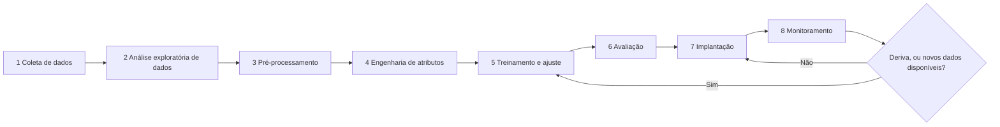
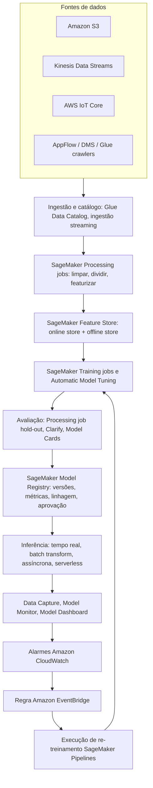
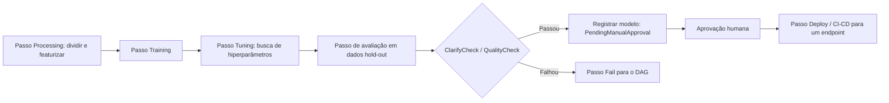
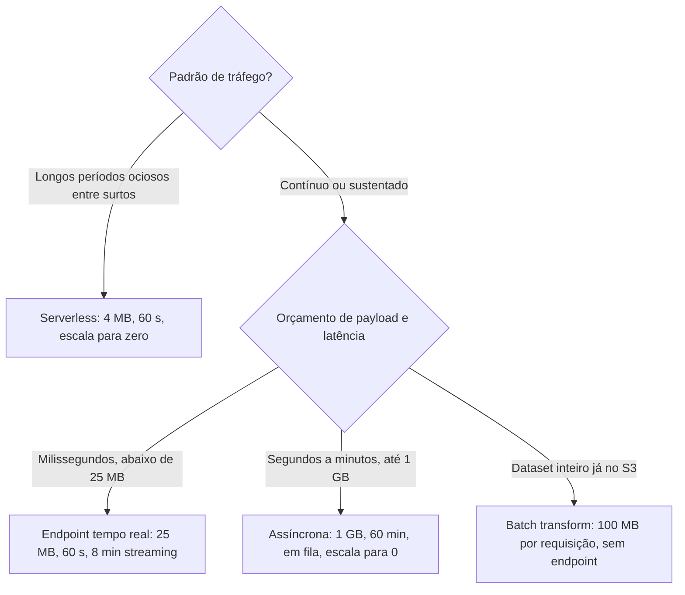
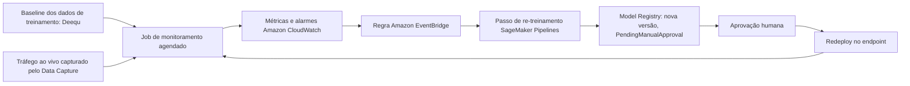
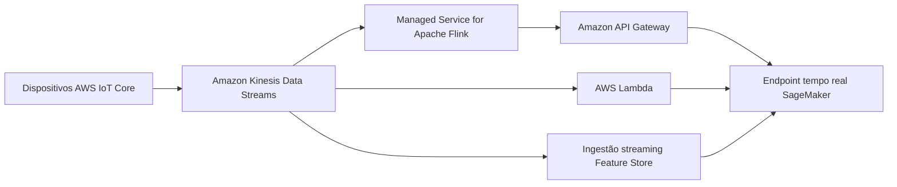

# Ciclo de Vida de ML Extremo a Extremo na AWS

Projetos de machine learning raramente falham porque um modelo não pode ser treinado. Eles falham porque ninguém decidiu *qual* estágio do ciclo de vida é dono de *qual* serviço, porque um protótipo de notebook foi colocado em produção como um endpoint permanente, ou porque ninguém percebeu que os dados de entrada mudaram seis meses após o lançamento. O exame AIF-C01 é construído exatamente em torno dessa lacuna: a Tarefa 1.3 pede que você posicione **coleta de dados, EDA, pré-processamento, engenharia de atributos, treinamento, ajuste de hiperparâmetros, avaliação, implantação e monitoramento** contra serviços AWS, e a Tarefa 1.1 pede que você distinga **inferência em lote, tempo real, assíncrona e serverless**.

```text
=====================================================================
 O CICLO DE VIDA DE ML NA AWS — NOVE ESTÁGIOS (AIF-C01 Task 1.3)
=====================================================================
  1 COLETAR ..... S3 · Kinesis Data Streams · IoT Core · AppFlow
                  DMS · API Gateway · Glue crawlers
  2 EDA ......... SageMaker Studio · Athena · Glue · EMR
                  Data Wrangler (dentro do SageMaker Canvas)
  3 PRÉ-PROCESS . SageMaker Processing jobs · Glue · DataBrew
  4 ATRIBUTOS ... Feature Store (online + offline) · export Wrangler
  5 TREINAR ..... Training jobs · Automatic Model Tuning · AutoML API
                  JumpStart · HyperPod · Managed Spot Training
  6 AVALIAR ..... Processing em dados hold-out · Clarify* · Model Cards
  7 IMPLANTAR ... tempo real | batch transform | assíncrono
                  | serverless  (as quatro opções de inferência)
  8 MONITORAR ... Model Monitor* · Model Dashboard · Data Capture
  9 RETREINAR ... Pipelines DAG · estágios de aprovação do Registry ·
                  EventBridge (deriva ou agendamento) · CodePipeline
---------------------------------------------------------------------
  * Clarify, Model Monitor, Ground Truth, A2I, Debugger, GeoSpatial,
    Role Manager e Studio Lab estão FECHADOS para novos clientes
    (30 jun 2026; docs dizem 7/30/26) — veja a seção 10.
  Camada MLOps testada pelo exame: experimentação · processos
  repetíveis · sistemas escaláveis · dívida técnica · prontidão
  de produção · monitoramento · re-treinamento.
=====================================================================
```

> [!NOTE]
> **Leia esta lição como um manual operacional, não um catálogo de serviços.** Cada número neste arquivo é um limite publicado pela AWS tirado do guia de desenvolvedor do SageMaker ou da referência da API do SageMaker. Onde a AWS publica dois números conflitantes, ambos aparecem e o preferido é sinalizado: veja a seção 13.

Ao final desta lição você será capaz de:

- posicionar cada um dos **nove estágios do ciclo de vida** contra a feature do SageMaker e o serviço não-SageMaker que o suporta;
- aplicar o **framework de seleção de três perguntas** da AWS (construir vs. customizar vs. chamar uma API, modalidade, controle) antes de escrever qualquer código;
- configurar os **online store e offline store do Feature Store** e explicar por que um modelo de fraude precisa dos dois;
- dimensionar um **endpoint serverless**, calcular a **concorrência do batch transform** e conhecer o teto exato de cada uma das **quatro opções de inferência**;
- construir o loop **deriva → CloudWatch → EventBridge → Pipelines retrain** e explicar qual monitor detecta qual deriva;
- defender um **veredito comparativo**: SageMaker vs. construir em EC2, vs. plataformas não-AWS, vs. um processo manual;
- identificar as **armadilhas de manutenção e sunset** (Ground Truth, Model Monitor, Clarify, Studio Lab, Mechanical Turk) que aparecem em itens de exame de 2026;
- responder **dez questões no estilo do exame** escritas na voz oficial de questões de prática.

---

## 1. Os nove estágios do ciclo de vida de ML na AWS

### 1.1 Mapa de serviços estágio a estágio

Esta tabela é o artefato mais examinável da Tarefa 1.3. A coluna esquerda é o próprio vocabulário do guia de exame; as colunas do meio são os serviços que você deve ser capaz de nomear sob pressão.

| Estágio | Feature SageMaker AI | Outros serviços AWS | Nota verificada |
|---|---|---|---|
| 1. Enquadramento do problema | Canvas, JumpStart, Model Cards (uso pretendido + classificação de risco) | Amazon Bedrock (caminho de foundation model), Amazon Q, Prescriptive Guidance | Valores de classificação de risco: low / medium / high / unknown |
| 2. Ingestão de dados | Ground Truth **[manutenção]**, ingestão streaming do Feature Store | S3, Kinesis Data Streams, IoT Core, DMS, AppFlow, API Gateway, Glue crawlers | Ground Truth fechado para novos clientes 7/30/26; Mechanical Turk terminou set 2026 |
| 3. Processamento e EDA | Processing jobs, Data Wrangler (dentro do Canvas), notebooks Studio | Glue (ETL + Data Catalog), EMR (Spark/Hadoop/Trino), Athena, DataBrew, MWAA | Glue Data Catalog é compatível com Hive |
| 4. Engenharia de atributos | Feature Store (online/offline), export Data Wrangler | Glue, DataBrew, Redshift | Offline store é Parquet append-only no S3 |
| 5. Treinamento de modelo | Training jobs, Automatic Model Tuning, AutoML API, JumpStart, HyperPod, Managed Spot | EC2 (P/G/Trn/Inf), ECS/EKS (auto-gerenciado), Lambda (cargas leves) | Economias Spot publicadas como 80% (API) e 90% (FAQ): veja a seção 13 |
| 6. Avaliação | Clarify **[manutenção]**, Processing em dados hold-out, Model Cards | Amazon Bedrock Evaluations, CloudWatch, SHAP / fmeval | Bedrock Evaluations é o caminho gerenciado para foundation models |
| 7. Implantação | Quatro opções de inferência, Model Registry + CI/CD, inference components | Bedrock (API serverless), ECS/EKS (DIY), Lambda + API Gateway | Tetos na seção 7.2 |
| 8. Monitoramento | Model Monitor / Clarify **[manutenção]**, Model Dashboard, Data Capture | CloudWatch, EventBridge + SNS, Lambda, Athena + QuickSight, MLflow + Evidently | Quatro tipos de monitor: qualidade de dados, qualidade do modelo, deriva de viés, deriva de atribuição de atributos |
| 9. Re-treinamento / MLOps | Pipelines DAG, estágios de aprovação do Registry, tracking MLflow | Step Functions, EventBridge (agendamento/deriva), CodeBuild/CodePipeline, versionamento S3 | Deriva → EventBridge → re-execução do pipeline é o loop canônico |

### 1.2 Os conceitos de MLOps que o exame testa

A Tarefa 1.3 não para nos estágios. Ela também nomeia sete fundamentos de MLOps: cada um mapeia para um mecanismo AWS concreto:

| Conceito MLOps | O que o exame espera que você diga | Mecanismo AWS |
|---|---|---|
| Experimentação | Cada execução é rastreada e comparável | Experiments (Classic, somente Studio Classic) ou apps MLflow gerenciados com artefatos no seu S3 |
| Processos repetíveis | Mesmo código, mesmos dados, mesmo resultado | SageMaker Pipelines (um DAG JSON) + Processing/Training jobs em containers |
| Sistemas escaláveis | O sistema cresce com o tráfego e os dados | Auto scaling em endpoints tempo real, fila assíncrona, online store do Feature Store |
| Dívida técnica | Notebooks não rastreados e endpoints ajustados à mão apodrecem | Versões do Model Registry, status de aprovação, Model Cards, jobs containerizados |
| Prontidão de produção | Nada implanta sem evidência | `ModelApprovalStatus=PendingManualApproval` no pipeline, métricas de avaliação anexadas |
| Monitoramento | Tráfego ao vivo é comparado a uma baseline | Data Capture + Model Monitor (baselines Deequ) + alarmes CloudWatch |
| Re-treinamento | Deriva ou agendamento dispara uma nova execução | Regra EventBridge em um alarme CloudWatch → execução Pipelines |

### 1.3 O ciclo de vida é um loop, não uma linha



A seta que retorna de **Monitoramento** para **Treinamento** é o ponto todo de MLOps. Uma equipe que implanta e nunca retorna ao estágio 5 tem um *projeto*, não um *sistema*, e essa é exatamente a linguagem de "dívida técnica" e "prontidão de produção" que o exame usa.

**Ordene o ciclo de vida antes de memorizar os serviços:**

```dragdrop
{
  "question": "Coloque os estágios do ciclo de vida de ML na ordem em que a AWS os documenta para o exame AIF-C01:",
  "items": [
    "Coleta de dados do S3, Kinesis, IoT Core ou AppFlow",
    "Análise exploratória de dados no Studio, Athena ou Glue",
    "Pré-processamento em um SageMaker Processing job",
    "Engenharia de atributos gravada no Feature Store",
    "Treinamento e ajuste de hiperparâmetros",
    "Avaliação em dados hold-out",
    "Implantação em uma das quatro opções de inferência",
    "Monitoramento para deriva de dados, qualidade, viés e atribuição",
    "Re-treinamento disparado por deriva ou agendamento"
  ],
  "correctOrder": [
    "Coleta de dados do S3, Kinesis, IoT Core ou AppFlow",
    "Análise exploratória de dados no Studio, Athena ou Glue",
    "Pré-processamento em um SageMaker Processing job",
    "Engenharia de atributos gravada no Feature Store",
    "Treinamento e ajuste de hiperparâmetros",
    "Avaliação em dados hold-out",
    "Implantação em uma das quatro opções de inferência",
    "Monitoramento para deriva de dados, qualidade, viés e atribuição",
    "Re-treinamento disparado por deriva ou agendamento"
  ],
  "explanation": "O exame espera exatamente esta sequência: coletar, analisar, pré-processar, engenheirar atributos, treinar, ajustar, avaliar, implantar, monitorar, re-treinar. Engenharia de atributos vem antes do treinamento porque atributos são uma entrada do training job; avaliação vem depois do treinamento mas antes da implantação porque a prontidão de produção depende de métricas hold-out; monitoramento só existe uma vez que algo é implantado."
}
```

---

## 2. Escolhendo o caminho AWS: o framework de três perguntas

Antes de escolher um serviço, a AWS quer que você responda a três perguntas em ordem. Pular direto para "SageMaker" é o anti-padrão arquitetural mais comum no exame.

### 2.1 Pergunta 1: chamar uma API, customizar um foundation model ou construir o seu?

| Caminho | Escolha quando | Serviço | Modelo de precificação |
|---|---|---|---|
| API gerenciada pré-treinada | Uma API gerenciada já resolve a tarefa (sentimento, rótulos, transcrição) | Amazon Comprehend, Rekognition, Transcribe, Polly, Translate, Lex, Forecast, Personalize | Por requisição / por unidade de uso |
| Foundation model, infraestrutura mínima | Prompting, RAG, agentes ou fine-tuning são suficientes; você não quer servidores | Amazon Bedrock | Baseado em tokens |
| ML custom / clássico com controle total | Dados proprietários, algoritmo específico, controle de latência ou conformidade | Amazon SageMaker AI (Canvas → Autopilot → Studio) | Por hora-de-instância + duração do job |

> [!WARNING]
> **Armadilha clássica de exame:** construir um modelo SageMaker customizado para análise de sentimento em inglês é um **anti-padrão**. Sentimento em texto é uma capacidade resolvida e pré-treinada do **Amazon Comprehend**. O exame recompensa o serviço correto mais barato, não o mais impressionante.

### 2.2 Pergunta 2: qual é a modalidade dos dados?

| Modalidade de dados | Serviço gerenciado | Formulação típica de exame |
|---|---|---|
| Texto | Amazon Comprehend (NLP), Amazon Translate, Amazon Lex | "detectar o idioma / extrair entidades / intenção" |
| Imagem e vídeo | Amazon Rekognition | "rotular objetos, rostos, EPI, conteúdo inseguro" |
| Fala e voz | Amazon Transcribe (STT), Amazon Polly (TTS) | "gerar legendas", "ler o alerta em voz alta" |
| Estruturado / séries temporais | Amazon Forecast, Amazon Personalize | "previsão de demanda", "clientes que compraram" |
| Documentos (formulários, documento de identidade, tabelas) | Amazon Textract | "extrair campos de faturas" |
| Código e chat | Amazon Q, Amazon Bedrock | "responder perguntas internas de uma base de conhecimento" |

### 2.3 Pergunta 3: quanto controle você precisa?

A AWS documenta uma **escada de controle** que sobe de zero-código para código completo:

```text
  SageMaker Canvas  ....  preparação de dados e construção de modelo no/low-code
        |                  (Data Wrangler e a UI do Autopilot vivem aqui)
        v
  Autopilot (AutoML API) .. seleção automática de algoritmo, HPO,
        |                   explicabilidade — API está no ar, UI mudou
        |                   para o Canvas em 30 nov 2023
        v
  Amazon Bedrock ........... customização serverless de FM:
        |                   prompts, guardrails, bases de conhecimento,
        |                   fine-tuning, avaliações
        v
  SageMaker Studio ......... controle total: Code Editor (Code-OSS),
                             JupyterLab, RStudio, Studio Classic,
                             Amazon Q Developer, training jobs,
                             endpoints dedicados, HyperPod
```

A AWS também avisa em sua própria orientação que **Studio é o ponto de partida errado para uma equipe sem experiência em ML: comece com o Canvas**.

### 2.4 Arquitetura de referência: uma conta, extremo a extremo



**📚 Você sabia?** Os SageMaker Pipelines são literalmente um **DAG JSON**. Os tipos de passo documentados são Processing, Training, Tuning, AutoML, RegisterModel, DeployModel, Transform, Condition, Callback, Lambda, ClarifyCheck, QualityCheck, EMR, Notebook Job e Fail, e as saídas dos passos alimentam as entradas dos passos a jusante, o que é o que torna o loop no diagrama acima automático.

---

## 3. Ingestão de dados, armazenamento e o Feature Store

### 3.1 De onde vêm os dados

| Padrão de ingestão | Serviços AWS | Números que valem a pena memorizar |
|---|---|---|
| Armazenamento de objetos / lake | Amazon S3 (+ Glue crawlers para o catálogo) | S3 é a fonte de verdade para atributos offline e payloads capturados |
| Streaming | Kinesis Data Streams, frequentemente alimentado por AWS IoT Core | Padrão típico: Kinesis → Managed Service for Apache Flink → API Gateway → endpoint SageMaker, ou Lambda invocando o endpoint |
| Replicação de banco de dados | AWS Database Migration Service (DMS) | Replicação contínua para S3 / Glue |
| SaaS e APIs | Amazon AppFlow, API Gateway | Puxe dados Salesforce/Zendesk sem código |
| Atributos streaming | Ingestão streaming do Feature Store | Atributos chegam ao online store para decisões quase em tempo real |

### 3.2 Feature Store: online vs. offline

| Propriedade | Online store | Offline store |
|---|---|---|
| O que mantém | **Apenas o registro mais recente** por cada feature group | **Histórico completo**, somente-append |
| API / acesso | `GetRecord`, `PutRecord` | Parquet no S3, consultável com Amazon Athena |
| Latência | **Single-digit milliseconds** | Minutos a horas (velocidade de analytics) |
| Uso principal | Lookups de inferência tempo real | Treinamento, joins point-in-time, batch transform |
| Durabilidade da gravação | Imediata em `PutRecord` | Bufferizada, chega ao S3 em **≤ 15 minutos** |
| Identidade de um registro | **identifier + event time** | identifier + event time + `write_time`, `api_invocation_time`, `is_deleted` |
| Regra de conflito | Um **event time mais antigo nunca sobrescreve** um registro online mais recente | Somente-append; nada é sobrescrito |

### 3.3 Camadas do online store e semântica de gravação

A AWS documenta duas camadas online:

- **Standard**: a configuração padrão do online store;
- **InMemory**: suportado por Amazon ElastiCache (Redis OSS) para as leituras mais rápidas. É **somente online** (sem replicação online↔offline) e **não** suporta chaves KMS gerenciadas pelo cliente.

No caminho de gravação, `PutRecord.TargetStores` aceita `{OnlineStore, OfflineStore}` com um **máximo de 2 entradas**, então uma única chamada pode atualizar ambos os stores, mas somente se um grupo tiver ambos habilitados.

**Exemplo 5, frescor de atributos com números reais.** Um modelo de fraude chama `GetRecord` e recebe uma resposta em **single-digit milliseconds**. O offline store do mesmo feature group mantém cada versão histórica como Parquet no S3, que o Athena pode consultar para um conjunto de treinamento point-in-time correto. Um `PutRecord` emitido às **14:00** chega ao S3 **não mais tarde que 14:15** (bufferização de 15 minutos). O treinamento, portanto, vê um snapshot ligeiramente atrasado enquanto a inferência vê a linha mais nova, o que é exatamente por que o exame pede **ambos os stores habilitados em um feature group**.

```matching
{
  "question": "Associe cada conceito de Feature Store ou ingestão ao que ele realmente faz:",
  "pairs": [
    {"left": "Online store", "right": "Mantém apenas o registro mais recente, serve GetRecord em single-digit milliseconds"},
    {"left": "Offline store", "right": "Mantém histórico completo somente-append como Parquet no S3 para treinamento e batch"},
    {"left": "Camada InMemory", "right": "Camada somente online suportada por ElastiCache sem replicação online-to-offline"},
    {"left": "Ingestão streaming", "right": "Grava eventos ao vivo no feature group para que a inferência possa usar dados quase em tempo real"}
  ],
  "explanation": "O online store responde a inferência, o offline store responde ao treinamento, InMemory troca replicação por velocidade, e a ingestão streaming fecha a lacuna entre o evento e o atributo. Um modelo de fraude em produção precisa de todos eles: milissegundos no momento do score e correção point-in-time no momento do treino."
}
```

**📚 Você sabia?** A identidade do Feature Store não é apenas uma chave primária: um registro é unicamente identificado pelo **identificador do atributo mais o event time**, e o offline store adicionalmente grava `write_time`, `api_invocation_time` e um indicador `is_deleted`. É isso que torna joins point-in-time possíveis: uma consulta de treinamento às 09:00 só pode ver atributos cujo event time é anterior a 09:00, mesmo que tenham sido gravados depois.

---

## 4. Processamento de dados, EDA e engenharia de atributos

### 4.1 Qual serviço processa qual carga de trabalho

| Opção | Tipo | Melhor para | Código | Detalhe verificado |
|---|---|---|---|---|
| SageMaker Processing | Jobs gerenciados | Preparação e avaliação reproduzíveis dentro do pipeline de ML | Scripts ou contêiner BYOC | Computação é **liberada na conclusão**: você para de pagar |
| Data Wrangler (dentro do Canvas) | Visual no/low-code | Limpeza, EDA, geração de atributos, export para Feature Store | Pouco ou nenhum código | Conecta a S3, Athena, Redshift, Snowflake, EMR |
| AWS Glue | ETL serverless + Data Catalog | Crawlers e ETL alimentando tabelas de treinamento | PySpark ou visual | Spark ou Ray; catálogo compatível com Hive |
| Amazon EMR | Clusters gerenciados | Spark, Hadoop, Trino, Flink em escala petabyte | Controle total | EMR ≥ 5.8.0 pode usar o Glue Data Catalog |
| Amazon Athena | SQL serverless | EDA ad-hoc sobre S3 | ANSI SQL | Pague por consulta e por dados escaneados |
| Glue DataBrew | Visual sem código | 250+ transforms pré-construídos dirigidos por recipe jobs | Nenhum | Blog da AWS afirma preparação de dados até **80% mais rápida** |
| Studio + EMR | Interativo | EDA e depuração de jobs EMR Spark | Código notebook | Monitore e depure EMR Spark a partir do Studio |

### 4.2 O contrato do Processing job

Um SageMaker Processing job tem um contrato de quatro etapas que o exame gosta de testar:

```text
  S3 input  -->  contêiner gerenciado (built-in ou sua própria imagem)
                       |
                       |  pré-processamento / engenharia de atributos /
                       |  pós-processamento / avaliação em dados hold-out
                       v
                 computação é LIBERADA  -->  S3 output

  Cobrança: apenas enquanto o job roda. Sem endpoint, sem custo ocioso.
  Instância típica nos exemplos da AWS: ml.m5.xlarge, ProcessingInstanceCount = 1
```

A propriedade "computação é liberada" é por que os Processing jobs superam uma instância de notebook permanentemente anexada para qualquer coisa agendada.

### 4.3 Onde as ferramentas sem código vivem agora

Duas migrações importam para o exame de 2026:

- **O Data Wrangler está integrado ao SageMaker Canvas**: não é mais uma experiência separada na barra lateral do Studio;
- **A UI do Autopilot mudou para o Canvas em 30 de novembro de 2023**: a AutoML API permanece documentada e invocável, mas a experiência visual de AutoML é o Canvas.

**📚 Você sabia?** O Amazon Athena cobra **por consulta e por gigabyte escaneado**, então a EDA mais barata é uma tabela Parquet particionada mais um filtro `WHERE dt = '…'`. Uma varredura de tabela inteira de um CSV de 1 TB custa aproximadamente 100× mais do que a mesma consulta sobre Parquet particionado, o exame não pede o preço, mas pergunta se o Athena é "serverless SQL over S3".

---

## 5. Treinamento, ajuste de hiperparâmetros e orquestração

### 5.1 Training jobs e o teto de custo

| Controle | Valor | Por que importa |
|---|---|---|
| Padrão de `StoppingCondition.MaxRuntimeInSeconds` | **1 dia** | O padrão para rapidamente um job desgarrado |
| Máximo de `StoppingCondition.MaxRuntimeInSeconds` | **28 dias** | Teto rígido para um job |
| Duração total do job (execução + espera) | **30 dias** | Teto absoluto da vida do job |
| `MaxWaitTimeInSeconds` para Managed Spot | **≥ MaxRuntimeInSeconds** | Obrigatório, caso contrário Spot não pode ser usado |
| Parada graciosa | SageMaker envia **`SIGTERM`, depois espera 120 s** | Seu código deve fazer checkpoint dentro dessa janela |
| Instância de exemplo típica | `ml.m5.xlarge` | Usada em todos os exemplos de pipeline da AWS |

### 5.2 Formas de treinar sem escrever o loop você mesmo

| Abordagem | O que automatiza | Notas |
|---|---|---|
| Training job | Treinamento containerizado em computação gerenciada | Seu algoritmo ou um built-in |
| Automatic Model Tuning (HPO) | Busca faixas de hiperparâmetros | Métrica objetivo + faixas; roda muitos training jobs |
| AutoML API | Seleção de algoritmo, HPO, explicabilidade | UI vive no Canvas desde nov 2023 |
| JumpStart | Hub de modelos: modelos implantáveis e soluções pré-construídas | Caminho mais rápido até um baseline funcional |
| HyperPod | Clusters gerenciados EKS/Slurm para grande treinamento e inferência | Alegações do decision-guide da AWS (fonte única): treinamento −40%, governança −40%, goodput ≥ 95% |
| Managed Spot Training | Capacidade interrompível | Economias publicadas como **até 90%** (FAQ) e **até 80%** (API): veja a seção 13 |
| Instancias EC2 P/G/Trn/Inf | Controle mais profundo de hardware | Você é dono de SO, drivers, frameworks, serving stack |

### 5.3 Pipelines: a espinha dorsal da orquestração

Um SageMaker Pipeline é um **DAG JSON** cujos passos trocam saídas como entradas. Os tipos de passo documentados são: Processing, Training, Tuning, AutoML, Register/Deploy model, Transform, Condition, Callback, Lambda, ClarifyCheck, QualityCheck, EMR, Notebook Job e Fail.

| Feature de pipeline | Comportamento verificado |
|---|---|
| Saídas de passo | Alimentam entradas de passos a jusante automaticamente |
| Cache | `CacheConfig { Enabled, ExpireAfter: "30d" }`: passos inalterados podem ser pulados por até 30 dias |
| Computação típica nos exemplos | `ml.m5.xlarge`, `ProcessingInstanceCount=1` |
| Portão de implantação | `ModelApprovalStatus=PendingManualApproval` até um humano aprovar |
| Cobrança | Você paga pelo Studio mais os jobs que o pipeline orquestra |
| Passo de falha | Um nó `Fail` permite que o DAG pare explicitamente em um portão de qualidade |



### 5.4 Model Registry

O Model Registry é a resposta de nível de produção para "qual modelo está no ar?". Ele armazena **Model Package Groups** versionados, e cada Model Package carrega métricas, **linhagem**, um estágio de **staging**, um **status de aprovação**, e ganchos para **implantação CI/CD** e compartilhamento entre contas. Qualquer coisa que não esteja no Registry é, em termos de exame, um experimento não rastreado.

---

## 6. Avaliação, documentação e governança

### 6.1 Amazon SageMaker Clarify: três análises diferentes

| Análise | Entradas | Saída |
|---|---|---|
| Viés pré-treinamento | **Somente dataset** (sem modelo) | Métricas de viés JSON para os dados de treinamento em si |
| Viés pós-treinamento | **Dataset + previsões do modelo** | Métricas de viés computadas sobre resultados de inferência |
| Atribuições de atributos (SHAP) | Modelo treinado | Atribuições SHAP globais, importância por atributo |
| Dependência parcial (PDP) | Modelo treinado | Efeito marginal de um atributo na previsão |

O Clarify grava métricas de viés JSON, atribuições globais e um relatório visual no **S3**, e pode executar contra um endpoint ao vivo **ou** contra um **endpoint shadow temporário** que o Clarify cria e então apaga.

> [!WARNING]
> **Aviso de disponibilidade (2026).** O Amazon SageMaker Clarify está em **manutenção e fechado para novos clientes** (página de manutenção da AWS: 30 jun 2026; a documentação de mudança de disponibilidade declara data efetiva de **7/30/26**). Clientes existentes mantêm o acesso mas não recebem novas funcionalidades. Para avaliação de foundation models a AWS aponta para **Amazon Bedrock Evaluations**, e para trabalho novo de viés/SHAP a AWS aponta para **SHAP mais métricas de viés padronizadas mais MLflow**.

### 6.2 Model Cards e Model Dashboard

| Artefato | O que é | Campos-chave | Status (2026) |
|---|---|---|---|
| **Model Cards** | Um registro de documentação **imutável** para um modelo | Usos pretendidos, **classificação de risco**, detalhes de treinamento, resultados de avaliação; status padrão `DRAFT`; export PDF | Ativo |
| **Model Dashboard** | Um portal em todo o seu estate | Modelos, monitores, linhagem, cards, classificação de risco em {low, medium, high, unknown} | Ativo |
| **Data Capture** | Registra payloads de requisição/resposta ao vivo | Alimenta monitores e análise shadow | Ativo |
| Role Manager | Papéis IAM de ML baseados em persona |: | **Fechado para novos clientes** |

Se o exame diz "the model owner must *record* intended uses, risk rating, training details and evaluation results", a resposta é **Model Cards**: não o Dashboard (que agrega) e não o Model Monitor (que apenas rastreia deriva).

---

## 7. Implantação: as quatro opções de inferência

Este é o tópico central de seleção de serviço de toda a lição. O SageMaker AI documenta exatamente **quatro** opções de inferência, e cada uma tem um teto rígido que você deve ser capaz de relembrar.

### 7.1 Lote vs. tempo real vs. assíncrona vs. serverless

| Dimensão | Tempo real | Batch transform | Assíncrona | Serverless |
|---|---|---|---|---|
| Gatilho | `InvokeEndpoint`, síncrono | Um job sobre um dataset S3 | `InvokeEndpointAsync` (S3 in/out + notificação de conclusão) | Síncrono por requisição |
| Latência | Milissegundos / interativo | Horas a dias (offline) | Quase tempo real: segundos a minutos | Segundos; cold start possível |
| Teto de payload / processamento | **25 MB / 60 s** (até 8 min com streaming de resposta) | **≤ 100 MB por requisição**, dias de processamento | **1 GB / 60 min** | **4 MB / 60 s** |
| Capacidade e cobrança | Instância cobrada continuamente enquanto o endpoint existe | Apenas duração do job | Enquanto processa; autoscaling pode escalar instâncias para **0** | Auto **scale-to-zero** |
| Fila | Não | Não aplicável | **Sim**: requisições entram na fila enquanto a capacidade é zero | Não |
| Carga de trabalho típica | Score de fraude, API de recomendador, chatbot | Score de risco noturno, backfill de lake, tagging de imagens | Processamento de vídeo/documento, payloads grandes | Tráfego espinhoso e imprevisível com períodos ociosos |

### 7.2 Os tetos numéricos em um lugar só

| Item | Número | Fonte |
|---|---|---|
| Payload / processamento tempo real | **25 MB / 60 s** (8 min com streaming) | `deploy-model-options`, `hosting-faqs` |
| Payload / processamento serverless | **4 MB / 60 s** | `serverless-endpoints` |
| Payload / processamento assíncrono | **1 GB / 60 min** | `hosting-faqs` |
| Payload batch por requisição | **100 MB**; concorrência × payload ≤ 100 MB | `batch-transform` |
| Faixa de memória serverless | **1024 to 6144 MB** em passos de 1024; vCPUs escalam com memória | `serverless-endpoints` |
| `MaxConcurrency` serverless / tamanho da imagem | **1 to 200** / **≤ 10 GB** | `serverless-endpoints` + API |
| Provisioned Concurrency em serverless | Responde "within milliseconds"; funciona com Application Auto Scaling | `serverless-endpoints` |
| Streaming bidirecional | HTTP/2 **porta 8443**, sessão **≤ 30 min** | `realtime-endpoints-test-endpoints` |
| `MaxRuntime` de treinamento padrão / máx / total do job | **1 dia / 28 dias / 30 dias** | `API_StoppingCondition` |
| Graça de `SIGTERM` antes de uma parada de treinamento | **120 s** | `API_StoppingCondition` |
| Gravação offline Feature Store no S3 | **≤ 15 min** bufferizada; leitura online **single-digit ms** | `feature-store-offline` |
| Alerta automático de deriva de atribuição | **NDCG < 0,90** | `clarify-model-monitor-feature-attribution-drift` |

**Verifique os tetos antes de escolher uma opção, o payload decide, não a preferência de latência:**

```fillblank
{
  "question": "Complete os tetos de inferência publicados no guia de desenvolvedor do SageMaker:",
  "template": "Um endpoint tempo real aceita um payload de {{1}} MB processado dentro de {{2}} segundos, o Serverless Inference aceita {{3}} MB, e o Inference assíncrono aceita até {{4}} GB por {{5}} minutos.",
  "answers": {
    "1": "25",
    "2": "60",
    "3": "4",
    "4": "1",
    "5": "60"
  },
  "distractors": ["6", "100", "15", "8", "30"],
  "explanation": "O guia de desenvolvedor publica 25 MB / 60 s para tempo real (até 8 minutos com streaming de resposta), 4 MB / 60 s para serverless e 1 GB / 60 min para assíncrona. Batch transform é a opção com o teto de 100 MB por requisição, e 6 MB é o número conflitante da FAQ que você deve ignorar: veja a seção 13."
}
```

### 7.3 Endpoints tempo real em detalhe

- Endpoint HTTPS persistente invocado com **`InvokeEndpoint`**; streaming de resposta usa **`InvokeEndpointWithResponseStream`**.
- **HTTP/2 bidirecional na porta 8443**, sessões limitadas a **30 minutos**.
- Vários modelos podem compartilhar um endpoint através de **inference components**: a resposta do exame quando ele pede hospedar múltiplos modelos sem pagar por múltiplos endpoints.

### 7.4 Serverless Inference em detalhe

Você escolhe a **memória**; a AWS atribui vCPUs proporcionalmente. O tempo de cold start é impulsionado por **tamanho do modelo + download do modelo + início do contêiner**, o que é por que a memória deve ser **pelo menos do tamanho do seu modelo**.

Serverless tem **exclusões** documentadas: sem **GPUs**, sem pacotes do **AWS Marketplace**, sem **registries privados**, sem **multi-model endpoints**, sem **configuração VPC**, sem **data capture**, sem **Model Monitor**, e sem **inference pipelines**. E a conversão é em uma direção: converter um endpoint tempo real existente para serverless falha com um **`ValidationError`**, enquanto a conversão reversa é permitida e em uma direção.

### 7.5 Asynchronous Inference em detalhe

`InvokeEndpointAsync` pega sua entrada do **S3**, grava saída no **S3**, e envia uma **notificação de conclusão**. Requisições **entram na fila enquanto a capacidade é zero**, e o autoscaling pode escalar a contagem de instâncias para **0**: essa combinação (fila + escala para zero) é o que torna a assíncrona a resposta certa para payloads grandes e lentos.

### 7.6 Batch transform em detalhe

- `SplitType=Line` divide o arquivo de entrada em mini-lotes;
- `BatchStrategy=MultiRecord|SingleRecord` com `MaxPayloadInMB`;
- CSV com novas linhas embutidas **não é suportado**;
- `MaxPayloadInMB=0` significa streaming em chunk (não para algoritmos built-in);
- o nome de saída padrão é `input1.csv.out`;
- o `MaxConcurrentTransforms` ideal iguala o número de workers paralelos que você quer.

### 7.7 Escolhendo entre as quatro



**Exemplo 1: escolha de opção por payload.** Uma API de fraude recebe payloads de **3 KB** e deve responder em menos de **200 ms** → **tempo real** (tetos 25 MB / 60 s). Mais tarde o mesmo modelo é pedido para pontuar **vídeos de 800 MB que levam 10 minutos** → isso excede o teto tempo real de 25 MB mas cabe na **assíncrona** (≤ 1 GB, ≤ 60 min), então você troca de opção e mantém o scale-to-zero.

**Exemplo 2: dimensionamento serverless.** Um modelo de **3,5 GB** precisa de `MemorySizeInMB=4096` (memória deve ser ≥ tamanho do modelo; a faixa permitida é 1024…6144). Defina `MaxConcurrency=50` (permitido 1 to 200) com `ProvisionedConcurrency=10` (deve ser ≤ `MaxConcurrency`) para pré-aquecer parte do tráfego, e mantenha a imagem do contêiner **≤ 10 GB**.

**Exemplo 3: matemática de concorrência batch.** Com `MaxPayloadInMB=25`, o `MaxConcurrentTransforms` máximo legal é **4**, porque 4 × 25 = 100 ≤ 100 MB. Definir **5** quebraria a regra documentada (5 × 25 = 125 > 100).

> [!WARNING]
> **Não memorize os números da FAQ para tempo real.** O guia de desenvolvedor diz **25 MB**, enquanto a FAQ pública tem circulado **6 MB** (e um número assíncrono de 15 min em vez de 60 min). Prefira os números do guia de desenvolvedor e verifique-os novamente antes do dia do exame: veja a seção 13.

---

## 8. Monitoramento, deriva e o loop de re-treinamento

### 8.1 Os quatro tipos de monitor

| Monitor | O que compara | Mecanismo |
|---|---|---|
| **Qualidade de dados** | Distribuição de entrada ao vivo vs. a baseline de treinamento | Baseline computada com **Deequ**; violações → CloudWatch |
| **Qualidade do modelo** | Previsões ao vivo vs. **rótulos Ground Truth** armazenados no S3 (ex.: MSE) | Previsões capturadas mescladas com rótulos em um agendamento |
| **Deriva de viés** | Métricas de viés ao longo do tempo | Estatísticas de viés agendadas estilo Clarify |
| **Deriva de atribuição de atributos** | Rank da importância do atributo vs. baseline | Ranqueado por **NDCG**; alerta automático quando **NDCG < 0,90** (um ranking totalmente invertido pontua 0,69) |

Todos os monitores emitem métricas e violações para o **Amazon CloudWatch**, que é a resposta do exame sempre que ele menciona "raise an alarm on thresholds". Note também que o **contêiner de monitoramento pré-construído suporta somente dados tabulares**: modelos NLP e de computer vision precisam de um contêiner traga-o-proprio.

### 8.2 Do alarme ao modelo retreinado

**Exemplo 6, o loop deriva → re-treinar com números reais.** Uma baseline Deequ é computada a partir dos dados de treinamento. Um job de monitoramento agendado compara tráfego ao vivo contra ela. O monitoramento de atribuição de atributos levanta um alerta automático quando **NDCG cai abaixo de 0,90**. Um exemplo de viés usa uma **faixa DPPL de (−0,1, 0,1) avaliada ao longo de 2 dias** com intervalos de confiança bootstrap. O alarme vai para o **CloudWatch**, o CloudWatch dispara uma regra **EventBridge**, e o EventBridge inicia uma execução de re-treinamento do **SageMaker Pipelines** cuja nova versão chega ao Model Registry como `PendingManualApproval`.



### 8.3 O que a AWS agora recomenda em vez disso

Porque Model Monitor e Clarify estão fechados para novos clientes, a própria documentação de mudança de disponibilidade da AWS aponta para uma stack de substituição:

| Capacidade aposentada | Substituição recomendada pela AWS |
|---|---|
| SageMaker Model Monitor | Monitoramento open-source com **MLflow + Evidently AI**, mais **QuickSight** e **CloudWatch** |
| SageMaker Clarify | **SHAP** + métricas de viés padronizadas + **MLflow** |
| Avaliação de foundation model | **Amazon Bedrock Evaluations** |
| Experiments (Classic) | Novo SageMaker Studio + **MLflow 3.0 gerenciado** (Apps preferidos, artefatos no seu S3) |
| Studio Lab | **SageMaker Studio** |

**📚 Você sabia?** O Experiments **Classic** está disponível somente no **Studio Classic**, e a AWS agora recomenda **MLflow 3.0** gerenciado com Studio Apps: os artefatos do experimento são armazenados no *seu* bucket S3, então os dados de tracking sobrevivem ao notebook. O MLflow também é a espinha dorsal da substituição recomendada para o Model Monitor.

---

## 9. Veredito comparativo: SageMaker vs. as alternativas

### 9.1 SageMaker vs. serviços individuais

| Opção | Escolha quando | Você gerencia | Modelo de precificação |
|---|---|---|---|
| **SageMaker AI** | Ciclo de vida completo mais controle sobre containers, instâncias e latência | Código do modelo, containers, HPO, scaling, trade-offs custo/latência | Por hora-de-instância + jobs; Savings Plans até **64%** |
| **Amazon Bedrock** | Uso serverless de FM (RAG, agentes, fine-tuning) sem infraestrutura | Prompts, guardrails, bases de conhecimento, avaliações | Baseado em tokens |
| **Amazon EC2** | Controle mais profundo de hardware, instâncias aceleradas especializadas | SO, drivers, frameworks, serving stack | Por hora + Savings Plans |
| **Amazon ECS** | Containers como unidade de implantação, orquestração nativa AWS | Imagens, definições de tarefa, scaling de serviço | Por instância ou AWS Fargate |
| **Amazon EKS** | Portabilidade Kubernetes, stacks custom (vLLM/Triton), HyperPod | Cluster, node groups, charts, autoscalers | Taxa de cluster + EC2 |
| **AWS Lambda** | Cola de eventos: invocar um endpoint a partir de um stream, gravar atributos | Código da função, memória e timeout | Requisições + duração |
| **APIs de IA gerenciadas** | Uma API pré-treinada já resolve | Dados + chamadas de API | Por requisição / uso |

Os critérios de decisão da própria AWS são: gestão de infraestrutura, compromissos de computação, preferência de precificação, suporte à arquitetura do modelo, e controle sobre motor, configuração e infraestrutura.

> [!IMPORTANT]
> **Veredito Comparativo: quando escolher cada caminho de implantação**
> - **SageMaker vs. construir o seu próprio em EC2:** ambos executam o seu container, mas o EC2 faz *você* ser dono do SO, drivers, GPU stack, framework de serving, lógica de scaling, patching, e cada segundo ocioso que você paga. Escolha EC2 somente quando você precisa de hardware ou controle de driver que o SageMaker não pode expor (instâncias especializadas P/G/Trn/Inf, ajuste em nível de kernel). Caso contrário, os endpoints gerenciados, Processing/Training jobs, Pipelines e Model Registry do SageMaker são a diferença entre um *sistema* e um *hobby*. Custo também não é o fator decisório: o EC2 cobra por hora assim como o SageMaker, e o SageMaker oferece Savings Plans até 64%.
> - **SageMaker vs. plataformas não-AWS** (outras nuvens, fornecedores de ML gerenciado, stacks MLOps auto-hospedados): a portabilidade é real, containers, MLflow e Kubernetes viajam, mas o quadro do exame é integração nativa AWS: IAM, S3, Glue, Kinesis, EventBridge, CloudWatch, Bedrock e créditos free-tier todos se amarram ao SageMaker sem código de cola. Se o requisito é "executar em qualquer lugar", um stack Kubernetes (EKS ou outro orquestrador) com tracking MLflow é defensável; se o requisito é "entregar rápido, governado, na AWS", não é. Note também que modelos SageMaker podem ser importados para o Bedrock, então os dois não são mutuamente exclusivos.
> - **SageMaker vs. um processo manual** (o notebook de um cientista de dados, planilhas, scripts ad-hoc, CSVs copiados à mão): o processo manual sempre vence a primeira semana e sempre perde depois. Ele não consegue provar repetibilidade (sem DAG Pipelines), não consegue provar qual versão serviu uma dada previsão (sem linhagem do Registry), não consegue detectar deriva (sem baseline, sem alarme CloudWatch), e não pode ser re-executado por ninguém mais. A AWS enquadra essa falha exata como **dívida técnica** e **prontidão de produção** na Tarefa 1.3. O veredito é categórico: um processo manual é aceitável somente para o estágio de experimentação, nunca para implantação.

### 9.2 Amazon Bedrock vs. Amazon SageMaker: a linha oficial

| Dimensão | Amazon Bedrock | Amazon SageMaker AI |
|---|---|---|
| Família de modelos | Foundation models de múltiplos provedores | ML clássico **e** deep learning custom |
| Interação | Serverless, baseada em API | Training jobs, endpoints dedicados, clusters HyperPod |
| Infraestrutura que você gerencia | Efetivamente nenhuma | Containers, tipos de instância, políticas de scaling |
| Melhor ajuste | Prompting, RAG, agentes, guardrails, fine-tuning, avaliações | Controle total sobre treinamento e serving |
| Interoperabilidade |: | **Modelos SageMaker podem ser importados para o Bedrock** |

### 9.3 Arquitetura de inferência streaming

O padrão que a AWS documenta em seus blogs de arquitetura:



---

## 10. Disponibilidade, manutenção e armadilhas de sunset

O exame de 2026 testa ativamente disponibilidade. Responder corretamente significa saber o que um aviso de **manutenção** significa e o que um **sunset** significa.

### 10.1 Instantâneo de disponibilidade (SageMaker, 2026)

| Status | Features |
|---|---|
| **Manutenção, fechado para novos clientes** (30 jun 2026) | A2I, Clarify, Debugger, GeoSpatial, Ground Truth, Model Monitor, Role Manager, Studio Lab |
| Data de encerramento declarada nos docs | Ground Truth, Model Monitor: **efetivo 7/30/26** |
| **Fim do suporte** | Amazon Mechanical Turk: **29 set 2026** (docs Ground Truth: encerramento permanente 30 set 2026) |
| Entrou em sunset, datas não recuperadas | SageMaker Profiler, Ground Truth Plus: veja a seção 13 |
| **Ativo** (sem aviso encontrado) | Studio, Pipelines, Processing, Training, Model Registry, as quatro opções de inferência, Feature Store, Model Cards, Model Dashboard, Canvas, JumpStart, HyperPod, MLflow gerenciado |

A redação padrão de manutenção é: *"Customers can't on-board… AWS will continue to operate and support these services… but won't enhance or add functionality."* Clientes existentes mantêm o acesso; simplesmente não há novas features.

### 10.2 Mapa de features do SageMaker e status

| Feature | Propósito | Status (2026) |
|---|---|---|
| Studio | IDE: Code Editor (Code-OSS), JupyterLab, RStudio, Studio Classic + Amazon Q Developer | Ativo |
| Studio Lab | JupyterLab 4 gratuito, sem conta ou cartão AWS | **Fechado para novos clientes** |
| Processing | Pré/pós-processamento, engenharia de atributos, avaliação | Ativo |
| Training + Tuning | Treinamento gerenciado, HPO, Managed Spot | Ativo |
| Pipelines | Orquestração DAG, MLOps e re-treinamento repetíveis | Ativo |
| Model Registry | Catálogo versionado, aprovação, staging, CI/CD | Ativo |
| Endpoints ×4 | Tempo real / batch / assíncrono / serverless | Ativo |
| Experiments Classic / MLflow | Tracking de execuções | Classic: somente Studio Classic → migre para MLflow gerenciado |
| Feature Store | Grupos online/offline, dados de treinamento point-in-time | Ativo |
| Clarify | Viés pré/pós-treinamento, SHAP, PDP, avaliação FM | **Fechado para novos clientes** |
| Ground Truth | Rotulagem humana (forças de trabalho privada, de fornecedor e MTurk) | **Fechado**; MTurk terminou |
| Model Monitor | Qualidade de dados, qualidade do modelo, deriva de viés, deriva de atribuição | **Fechado para novos clientes** |
| Data Wrangler | Preparação visual e geração de atributos → Feature Store | Integrado ao Canvas |
| Autopilot | AutoML: seleção de algoritmo, HPO, explicabilidade | UI → Canvas (30 nov 2023); API no ar |
| Canvas | Preparação de dados sem código + construção de modelo | Ativo |
| Model Cards / Dashboard | Registro de documentação / portal sobre modelos e risco | Ativo |
| Role Manager | Papéis IAM de ML baseados em persona | **Fechado para novos clientes** |
| JumpStart | Hub de modelos, soluções pré-construídas, modelos implantáveis | Ativo |
| HyperPod | Clusters gerenciados EKS/Slurm para treinamento e inferência | Ativo |
| A2I / Debugger / GeoSpatial | Human loops / debug de treinamento / ML geoespacial | **Fechado para novos clientes** |

> [!WARNING]
> **A questão Ground Truth, respondida.** Se um cliente **totalmente novo** pede um job de rotulagem de imagem SageMaker Ground Truth, a resposta correta é: **Ground Truth está fechado para novos clientes a partir de 30 de julho de 2026, então uma abordagem de rotulagem diferente é necessária**: não "it works with Mechanical Turk" (Mechanical Turk terminou o suporte em **29 set 2026**) e não "crie um endpoint primeiro" (rotulagem nunca precisou de um).

**📚 Você sabia?** O Studio Lab, o ambiente JupyterLab 4 gratuito que exigia **conta AWS e nenhum cartão de crédito**, tinha limites publicados de apenas **12 GB de RAM e 15 GB de armazenamento**, e agora está fechado para novos clientes com **SageMaker Studio** como substituição. É por isso que "use Studio Lab for free" é um distrator em material de 2026.

### 10.3 Atualizações de 2025 to 2026

Entre dezembro de 2024 e outubro de 2026, o ecossistema SageMaker foi renomeado, aparado e redirecionado várias vezes. Cada linha abaixo vem de um anúncio da AWS, de uma página de mudança de disponibilidade da AWS ou do histórico de mudanças de certificação da AWS: nada aqui é de terceiros, e datas que a própria AWS não publica são deliberadamente omitidas (veja a seção 13).

| Mudança | Data (publicada pela AWS) | O que o exame quer que você saiba |
|---|---|---|
| **Amazon SageMaker renomeado Amazon SageMaker AI** | 3 dez 2024 | "SageMaker" em uma questão significa SageMaker AI; o SageMaker de próxima geração (Unified Studio, Catalog, Lakehouse, zero-ETL) é a plataforma de analytics adjacente, não um tópico diferente de exame |
| **Bedrock Studio incorporado ao SageMaker Unified Studio** | workspaces fechados 28 fev 2025 (docs atualizados 25 mar 2025) | O Bedrock Studio standalone acabou: Bedrock agora vive dentro do SageMaker Unified Studio ou no Bedrock IDE |
| **Amazon Forecast fechado para novos clientes** | 29 jul 2024 | Questões estilo Forecast agora apontam para **SageMaker Canvas** |
| **Amazon Kendra em manutenção, depois fechado para novos clientes** | 30 jun → 30 jul 2026 | Busca corporativa gerenciada e QA generativo → **Amazon Bedrock Managed Knowledge Base** (Smart Parsing mais a Agentic Retrieval API) |
| **Inscrições Amazon Q Developer bloqueadas; IDE/pago fim do suporte** | 15 mai 2026; EOS 30 abr 2027 | A AWS documenta **Kiro** como o sucessor para essas cargas de trabalho |
| **Amazon QuickSight → Amazon Quick Suite** | 9 out 2025 | Distratores de BI podem nomear Quick Suite em vez de QuickSight |
| **AWS Chatbot renomeado Amazon Q Developer** | 26 fev 2025 | O nome antigo ainda aparece em material AWS mais antigo |
| **Model Monitor, Clarify, Ground Truth, A2I, Debugger, Role Manager, GeoSpatial, Studio Lab, Mechanical Turk, Profiler fechados para novos clientes** | 30 jul 2026 (docs disponibilidade: 7/30/26) | Manutenção, **não** encerramento e **não** rebranding: clientes existentes mantêm acesso, sem novas features (veja 10.1) |
| **Guia de exame AIF-C01 v1.0 → v1.1** | 26 mar → 30 abr 2026 | Sete novos objetivos (IA agêntica com MCP, engenharia de contexto, precificação baseada em tokens, grounding de alucinação); **SageMaker JumpStart** adicionado à lista no escopo e Amazon MemoryDB removido |

Dois fatos de vocabulário completam o quadro:

- **Manutenção** = sem novos clientes, sem novas features, ainda suportado · **sunset** = fim planejado de operações, tipicamente anunciado com cerca de um ano de antecedência · **encerramento total** = removido do portfólio da AWS. A referência de Ciclo de Vida de Serviços da AWS define todos os três, e cada linha acima está nos dois primeiros estados.
- Atualizações do guia de exame chegam ao teste cerca de **um mês** após a publicação, então qualquer coisa que a AWS publicou na v1.1 (30 abr 2026) já está em jogo: incluindo SageMaker JumpStart, Bedrock AgentCore, Kiro e Strands Agents na lista no escopo.

**📚 Você sabia?** A página de disponibilidade do Kendra não diz "deprecated": ela redireciona novas aplicações de busca para o **Amazon Bedrock Managed Knowledge Base**, cujo Smart Parsing e **Agentic Retrieval API** são documentados como a substituição do Kendra. "Kendra was shut down" é, portanto, um distrator: Kendra está em *manutenção*, o que sob o próprio vocabulário da AWS significa que continua rodando para clientes existentes.

---

## 11. Custo, free tier e os números que você pode memorizar com segurança

### 11.1 Free tier do SageMaker (a cada mês, nos primeiros 2 meses)

| Capacidade | Uso gratuito por mês |
|---|---|
| Notebooks Studio + instâncias de notebook | **250 horas** de `ml.t3.medium` |
| RStudio no SageMaker | **250 h** de RSession `ml.t3.medium` + RStudioServerPro gratuito |
| Data Wrangler | **25 horas** de `ml.m5.4xlarge` |
| Feature Store | **10 M** unidades de escrita, **10 M** unidades de leitura, **25 GB** de armazenamento |
| Treinamento | **50 horas** de `m4.xlarge` ou `m5.xlarge` |
| SageMaker com TensorBoard | **300 horas** de `ml.r5.large` |
| Real-Time Inference | **125 horas** de `m4.xlarge` ou `m5.xlarge` |
| Serverless Inference | **150.000 segundos** de duração de inferência on-demand |
| Canvas / HyperPod | **160 h** de tempo de sessão / **50 h** de `m5.xlarge` |

### 11.2 Padrão de custo trabalhado

O exemplo trabalhado da própria AWS totaliza **$2,38**: 2 horas de `ml.m4.4xlarge` a **$0,96** cada mais 2 horas de `ml.m5.xlarge` a **$0,23** cada, com regras built-in de Debugger cobradas a **$0**. Aprenda o *padrão* (horas-de-instância × tarifa + taxas de job), nunca a tarifa: preços `ml.*` são dependentes de região e data.

### 11.3 Cotas

Contagens de endpoints, cotas de pipeline, limites de jobs concorrentes e concorrência serverless vivem em **Service Quotas**. Nunca adivinhe uma cota numérica em uma resposta de exame ou revisão de design: procure-a.

---

## 12. Exemplos AWS trabalhados com números

**Exemplo 1: escolha de opção por payload (seção 7.7).** API de fraude: payloads de **3 KB**, **< 200 ms** → tempo real (tetos 25 MB / 60 s). Mesmo modelo pontuando vídeos de **800 MB** que levam **10 minutos** → excede 25 MB mas cabe na assíncrona (≤ 1 GB, ≤ 60 min). Troque de opção; mantenha o scale-to-zero.

**Exemplo 2: dimensionamento serverless (seção 7.4).** Modelo de **3,5 GB** → `MemorySizeInMB=4096`; `MaxConcurrency=50` (faixa 1 to 200); `ProvisionedConcurrency=10` (≤ 50) para pré-aquecer; imagem do contêiner **≤ 10 GB**.

**Exemplo 3: matemática de concorrência batch (seção 7.6).** `MaxPayloadInMB=25` → máximo `MaxConcurrentTransforms=4` porque 4 × 25 = 100 ≤ 100 MB. Cinco workers violariam a regra documentada.

**Exemplo 4: orçamento free tier.** 250 horas de notebook ≈ **8,3 dias-de-instância**; 50 horas de treinamento ≈ **seis execuções de 8 horas**; 125 horas tempo real ≈ **4,2 dias** de hosting; 150.000 segundos serverless ≈ **41,7 horas cobráveis**. Exceder 250 horas de notebook no mês 1 inicia cobrança medida.

**Exemplo 5: frescor de atributos (seção 3.2).** `GetRecord` online responde em **single-digit milliseconds**; o offline store mantém cada versão como Parquet no S3 (consultável com Athena) para joins point-in-time; um `PutRecord` de **14:00** chega ao S3 até **14:15** no máximo.

**Exemplo 6: loop deriva → re-treinar (seção 8.2).** Baseline Deequ dos dados de treinamento; monitoramento agendado de tráfego ao vivo; alerta automático de deriva de atribuição abaixo de **NDCG 0,90**; exemplo de viés usa **DPPL ∈ (−0,1, 0,1) ao longo de 2 dias** com intervalos de confiança bootstrap → CloudWatch → EventBridge → re-treinamento Pipelines.

**Exemplo 7: teto de custo de treinamento (seção 5.1).** Um training job com o padrão `MaxRuntimeInSeconds` para após **1 dia**; o máximo rígido é **28 dias**, e um job não pode exceder **30 dias** no total. Ao parar, o SageMaker envia **`SIGTERM`** e espera **120 segundos** para o seu código de checkpoint terminar.

---

## 13. Fatos conflitantes, não verificados e não examináveis

Bons candidatos a exame separam o que a AWS *documenta* do que a AWS *anuncia*. Mantenha esta lista fora do seu conjunto de memorização, exceto onde sinalizado.

| Alegação | O que as fontes dizem | Como lidar |
|---|---|---|
| Payload tempo real | Guia de desenvolvedor **25 MB** vs. FAQ pública **6 MB** (assíncrono 15 min vs. 60 min) | Prefira o guia de desenvolvedor; verifique antes do dia do exame |
| Economias Spot | **Até 90%** (FAQ/blogs) vs. **até 80%** (CreateTrainingJob API) | Ambos são publicados pela AWS; espere "até 80 to 90%" |
| Savings Plans | Até **64%** no SageMaker | Número único da página de preços da AWS |
| Preços | Apenas o exemplo trabalhado da AWS ($0,96, $0,23, total **$2,38**) é citado aqui | Não memorize tarifas `ml.*` |
| Cold start serverless 10 to 60 s, percentis de latência, pontos de equilíbrio de custo, "economias de 60 to 80% auto-hospedando em EKS" | **Somente terceiros** (devopsity.com) | Não examinável |
| Sunset do Ground Truth Plus (30 jun 2026) e do SageMaker Profiler | Listados pela AWS como entrando em sunset; **datas não recuperadas** | Não declare uma data |
| Status do Experiments (Classic) | Docs dizem somente Studio Classic e recomendam MLflow; **nenhuma página de mudança de disponibilidade encontrada** | Status para novos clientes não confirmado |
| Canvas / Autopilot / JumpStart / Feature Store / Pipelines | **Nenhum aviso de manutenção encontrado** | Ausência de aviso não é garantia: verifique em `docs.aws.amazon.com` |
| Cotas de conta | Vivem em Service Quotas, não recuperadas | Nunca adivinhe uma cota numérica |
| Alegações HyperPod (treinamento −40%, governança −40%, goodput ≥ 95%, latência de inferência −40%) | Afirmação de **marketing** de fonte única em um decision guide | Trate como direcional, não factual |
| Artigos AWS re:Post | Hospedados pela AWS mas conteúdo de **perspectiva** | Não é documentação normativa |
| Detalhes Studio Lab além de 12 GB RAM / 15 GB armazenamento; casos de borda de região do free-tier | Resumidos da página de preços, não testados | Verifique antes de citar |

Fontes primárias para esta lição: o **Guia de Exame** AIF-C01; páginas do **guia de desenvolvedor** do SageMaker `deploy-model-options`, `hosting-faqs`, `serverless-endpoints`, `batch-transform`, `processing-job`, `pipelines-overview`, `define-pipeline`, `model-registry`, `clarify-configure-processing-jobs`, `model-monitor`, `feature-store*`, `model-cards`, `model-dashboard`, `data-wrangler`, `autopilot-automate-model-development`, `mlflow`; a **referência de API** do SageMaker (`API_StoppingCondition`, `API_feature_store_PutRecord`); os **decision guides** `bedrock-or-sagemaker.html` e `genai-guide.html`; a página geral de **serviços em manutenção**; e a página de **preços** do SageMaker.

---

## Casos Reais

A AWS publica estes casos em `aws.amazon.com/solutions/case-studies/` e `aws.amazon.com/blogs/machine-learning/`. Eles pertencem a esta lição porque cada um mapeia um **estágio do ciclo de vida** para uma **escolha de serviço** com um número anexado: que é exatamente como as questões da Tarefa 1.3 são formuladas.

### Caso 1, HAYAT HOLDING: o loop inteiro treinar → implantar → monitorar no chão de fábrica

Ambientes de ML construídos internamente eram "time-consuming and cumbersome" neste fabricante de painéis de MDF. O pipeline publicado: **194 sensores** via OPC-UA → SiteWise Edge Gateway em **AWS IoT Greengrass** → **SageMaker Model Training** + **Automatic Model Tuning** + **Model Deployment**, com **SageMaker Edge Manager** executando o modelo no dispositivo. Resultado: **$300.000 por ano** economizados mais qualidade de painel superior. *Lição do ciclo de vida:* estágios 5 to 8 executam totalmente gerenciados, e o Automatic Model Tuning substitui um sweep manual de hiperparâmetros em 194 entradas. Fonte: `aws.amazon.com/blogs/machine-learning/hayat-holding-uses-amazon-sagemaker-to-increase-product-quality-and-optimize-manufacturing-output-saving-300000-annually` (2023).

### Caso 2, Forethought: inferência DIY é um imposto oculto

Uma equipe de **3 pessoas** suportando **30 milhões de interações por ano** estava executando modelos *e* Kubernetes no seu próprio **Amazon EKS**, incluindo exceções de memória e interrupções. Eles migraram para **multi-model endpoints do SageMaker** e **Serverless Inference**: **−66%** de custo em multi-model endpoints (com latência *melhor*), **≈ −80%** em serverless, e **mais de 80% da inferência GPU** agora roda no SageMaker. *Lição do ciclo de vida:* estágio 7, endpoints compartilhados e scale-to-zero superam um cluster auto-gerenciado que você tem de babar. Fonte: `aws.amazon.com/solutions/case-studies/forethought-technologies-case-study`.

### Caso 3, RareJob: o gargalo era orquestração, não qualidade do modelo

Treinar em um PC local permitia **um modelo por desenvolvedor**; a tentativa EC2/ECS que se seguiu ainda custava caro demais. **AWS Glue** e **Amazon Athena** alimentam jobs paralelos de **SageMaker Managed Spot Training**. Resultado: **−25%** de tempo de treinamento, **> 10×** de eficiência de desenvolvedor, **100 horas por mês** economizadas, e escores de teste de fala retornados em **2 to 3 minutos**. *Lição do ciclo de vida:* estágios 1 to 3 (coletar → EDA → pré-processar) pertencem ao Glue e Athena; a fila, não o algoritmo, era a restrição. Fonte: `aws.amazon.com/solutions/case-studies/rare-job-case-study` (2020).

### Caso 4, Chronomics: quando a construção interna falha, vá para AutoML

**Quatro meses** de modelagem customizada de computer vision interna nunca atingiram o alvo. **Amazon Rekognition Custom Labels** entrou em produção em **3 to 4 semanas** com **96,5% de acurácia / 97,9% F1**. Elevar o limiar de decisão para **0,99** produziu **99,6%** de precisão mas descartou **5%** das previsões; **0,999** deu **99,87%** enquanto descartava **27%**. *Lição do ciclo de vida:* estágio 6: avaliação é o que diz para parar de construir, e a cauda descartada precisa de um caminho de revisão humana. Fonte: `aws.amazon.com/blogs/machine-learning/chronomics-detects-covid-19-test-results-with-amazon-rekognition-custom-labels` (2022).

### Caso 5, Sun Finance: separe OCR de raciocínio

A primeira tentativa enviou fotos de documento de identidade direto ao **Claude Sonnet 4** e pontuou **61,8%** no geral (**43%** nos números do documento): a AWS o rejeitou. O pipeline reconstruído: OCR **Amazon Textract** → fallback e mascaramento de rosto **Amazon Rekognition** → estruturação **Claude Sonnet 4** → regras de validação, com **Amazon Titan Multimodal Embeddings** em **S3 Vectors** para similaridade de fraude, avaliado em **585 imagens**. Resultado: acurácia **79,73% → 90,80%**, custo por documento **−91%**, tempo de processamento **20 horas → menos de 5 segundos**, detecção de fraude **81%**. *Lição do ciclo de vida:* avaliação (estágio 6) matou o protótipo elegante, e o serviço pronto: não o modelo: é dono da extração. Fonte: `aws.amazon.com/blogs/machine-learning/sun-finance-automates-id-extraction-and-fraud-detection-with-generative-ai-on-aws` (2026).

### Caso 6, Anthem: pronto primeiro, humanos na cauda

Extração manual de formulários de sinistro levava **20 minutos por sinistro**. Um pipeline **Amazon Textract** (OCR mais indexação/classificação de ML atrás do portal de sinistros) automatizou **80%** do fluxo de trabalho com meta de **90%+**, em milhares de sinistros por dia. *Lição do ciclo de vida:* estágios 1 to 2: chame uma API gerenciada antes de treinar qualquer coisa custom, e projete o caminho de exceção humana para os 10 to 20% restantes. Fonte: `aws.amazon.com/solutions/case-studies/anthem` (2021).

### Todos os seis casos em uma tabela

| Caso (indústria, ano) | Estágios do ciclo de vida exercitados | Serviços AWS (exatos) | Números verificados | Fonte |
|---|---|---|---|---|
| **HAYAT HOLDING** (manufatura, 2023) | 5 to 8: treinar → ajustar → implantar → monitorar na borda | SageMaker Training, Automatic Model Tuning, Deployment, Edge Manager; AWS IoT Greengrass | **194 sensores**; **$300.000/ano** | ML blog `hayat-holding-…` |
| **Forethought** (suporte SaaS) | 7: escolha da opção de implantação | SageMaker multi-model endpoints, Serverless Inference (migrou do Amazon EKS) | **−66%** MME, **≈ −80%** serverless, **> 80%** da inferência GPU; **30 M** interações/ano; equipe de **3 pessoas** | case study `forethought-technologies` |
| **RareJob** (EdTech, 2020) | 1 to 5: ingestão, EDA, processar, treinar | AWS Glue, Amazon Athena, SageMaker Managed Spot Training | **−25%** tempo de treinamento, **> 10×** eficiência, **100 h/mês**, escores em **2 to 3 min** | case study `rare-job` |
| **Chronomics** (health-tech, 2022) | 6: avaliação e a decisão construir-vs-comprar | Amazon Rekognition Custom Labels (AutoML) | **3 to 4 sem** vs **4 meses**, **96,5%** acurácia / **97,9%** F1; limiar **0,99 → 99,6%** descarta **5%** | ML blog `chronomics-detects-covid-19…` |
| **Sun Finance** (fintech, 2026) | 3, 6, 7: pré-processamento, avaliação, implantação | Textract, Rekognition, Claude Sonnet 4, Titan Multimodal Embeddings, S3 Vectors, Lambda, Step Functions | **79,73 → 90,80%**, **−91%** custo/doc, **20 h → < 5 s**, n = **585**; primeira tentativa só com LLM **61,8%** rejeitada | ML blog `sun-finance-automates-id-extraction…` |
| **Anthem** (seguros de saúde, 2021) | 1 to 2: chamar uma API pronta em vez de treinar | Amazon Textract | **20 min/sinistro** manual → **80%** automatizado, meta **90%+** | case study `anthem` |

> [!WARNING]
> **Números de estudo de caso são afirmações do cliente ou da AWS e não auditados.** "Até" é um teto, não uma previsão, e apenas dois destes casos divulgam uma base amostral (Sun Finance: **585 imagens**; Chronomics: seu próprio conjunto de teste rotulado). Sempre carregue o número "antes" com o número "depois", e não repita estatísticas de adoção que a AWS nunca publicou: a única taxa de produção que a AWS declara é o número **65%** abaixo.

**Cinco regras que recorrem em todos os seis casos:**

1. **Escolha a camada deliberadamente**: serviço pronto (Anthem, Chronomics) → ML custom gerenciado (HAYAT, RareJob, Forethought) → IA generativa (Sun Finance). O exame recompensa a *camada mais barata que funciona*.
2. **Baseline antes de construir**: uma porcentagem sem um "antes" é marketing, não métrica.
3. **Separe responsabilidades**: OCR não é raciocínio (Sun Finance), e recuperação não é geração.
4. **Avaliação é uma fase, não um checkbox**: as primeiras tentativas do Sun Finance e do Chronomics falharam *no estágio 6*.
5. **Mantenha um humano na cauda**: os 5% descartados e os 10 to 20% não automatizados ainda precisam de alguém.

**📚 Você sabia?** A única taxa de produção que a AWS publica para o seu próprio Generative AI Innovation Center é **65%** dos projetos chegando à produção em 2025, alguns em apenas **45 dias**, de **mais de 1.000** implementações, usando o framework **Five V's** da AWS: **Value → Visualize → Validate → Verify → Venture**. A AWS nunca afirmou que todos os pilotos dão certo, então qualquer opção dizendo "100%" está errada de cara.

---

## 14. Perguntas de Prática (Practice Questions)

```question
{
  "id": "aid-02-q1",
  "type": "multiple-choice",
  "question": "Uma equipe de ciência de dados quer mais variáveis em seu dataset de treinamento para que o algoritmo possa aprender padrões mais ricos. Qual etapa do pipeline de ML atende ao requisito?",
  "options": [
    "Ajuste de hiperparâmetros",
    "Engenharia de atributos",
    "Avaliação de modelo",
    "Monitoramento de modelo",
    "Coleta de dados"
  ],
  "correct": 1,
  "explanation": "Engenharia de atributos é o estágio que cria, transforma e adiciona variáveis (atributos) ao dataset de treinamento. O ajuste de hiperparâmetros muda as configurações do algoritmo, não os dados; avaliação apenas mede o modelo resultante; monitoramento observa tráfego ao vivo; e coleta de dados apenas traz registros brutos para o lake."
}
```

```question
{
  "id": "aid-02-q2",
  "type": "multiple-choice",
  "question": "Proprietários de modelo devem registrar usos pretendidos, uma classificação de risco, detalhes de treinamento e resultados de avaliação em um documento imutável para cada modelo. Qual feature do SageMaker fornece isso?",
  "options": [
    "Role Manager",
    "Model Cards",
    "Model Dashboard",
    "Model Monitor"
  ],
  "correct": 1,
  "explanation": "Model Cards é o registro imutável por modelo de usos pretendidos, classificação de risco, detalhes de treinamento e resultados de avaliação, com status padrão DRAFT e export PDF. O Model Dashboard agrega modelos, monitores e linhagem; Role Manager gerencia papéis IAM baseados em persona; Model Monitor apenas rastreia deriva."
}
```

```question
{
  "id": "aid-02-q3",
  "type": "multiple-choice",
  "question": "O tráfego para um modelo é imprevisível com longos períodos ociosos, a equipe não quer gerenciar instâncias ou políticas de scaling, e cold starts são aceitáveis. Qual opção de inferência se ajusta melhor?",
  "options": [
    "Endpoint tempo real",
    "Batch transform",
    "Serverless Inference",
    "Inference assíncrono"
  ],
  "correct": 2,
  "explanation": "A AWS documenta o Serverless Inference para cargas de trabalho com períodos ociosos entre surtos de tráfego: ele escala para zero, cobra apenas pelo uso, e não exige gestão de instância ou scaling. Endpoints tempo real cobram continuamente enquanto existem, batch transform é para datasets offline, e a assíncrona é escolhida para payloads grandes, não para tráfego espinhoso."
}
```

```question
{
  "id": "aid-02-q4",
  "type": "multiple-choice",
  "question": "Um aplicativo envia arquivos de vídeo de 800 MB que levam vários minutos para processar, e latência quase tempo real (segundos a minutos) é aceitável. Qual opção de inferência deveria ser usada?",
  "options": [
    "Endpoint tempo real",
    "Serverless Inference",
    "Inference assíncrono",
    "Batch transform"
  ],
  "correct": 2,
  "explanation": "O Inference assíncrono suporta payloads de até 1 GB e tempo de processamento de até 60 minutos, põe requisições em fila enquanto a capacidade é zero, e pode escalar instâncias para 0. O tempo real é limitado a 25 MB, o serverless a 4 MB, e o batch transform não é adequado porque estes arquivos chegam interativamente, não como um único dataset bulk no S3."
}
```

```question
{
  "id": "aid-02-q5",
  "type": "multiple-choice",
  "question": "Cinco terabytes de arquivos de log no Amazon S3 devem ser pontuados toda noite. Não há chamadores interativos nem necessidade de um endpoint persistente. Qual opção de inferência deveria ser usada?",
  "options": [
    "Endpoint tempo real com auto scaling",
    "Batch transform",
    "Serverless Inference com Provisioned Concurrency",
    "Inference assíncrono"
  ],
  "correct": 1,
  "explanation": "O batch transform é projetado para grandes lotes de dados disponíveis de uma vez no S3 sem endpoint persistente: você envia um job de transformação, ele roda durante a duração do job, e você paga apenas enquanto roda. Tempo real e serverless mantêm um caminho de invocação aberto para tráfego interativo, e a assíncrona é para requisições individuais em fila, não para um job bulk noturno."
}
```

```question
{
  "id": "aid-02-q6",
  "type": "multiple-choice",
  "question": "Após a implantação, uma equipe deve detectar divergência entre entradas ao vivo e os dados de treinamento e levantar alarmes Amazon CloudWatch quando limiares são violados. Qual capacidade fornece isso?",
  "options": [
    "Status de aprovação do Model Registry",
    "Monitoramento de qualidade de dados do Model Monitor",
    "SageMaker Experiments",
    "Autopilot"
  ],
  "correct": 1,
  "explanation": "O Model Monitor compara tráfego ao vivo a uma baseline computada a partir dos dados de treinamento (usando Deequ) e publica métricas e violações no CloudWatch, que então dispara o alarme. O Model Registry armazena versões e status de aprovação, Experiments rastreia execuções de treinamento, e AutoML constrói modelos: nenhum deles observa entradas de produção."
}
```

```question
{
  "id": "aid-02-q7",
  "type": "multiple-choice",
  "question": "Um cliente totalmente novo da AWS quer executar um job de rotulagem de imagens com Amazon SageMaker Ground Truth. O que o arquiteto deve esperar?",
  "options": [
    "Funciona imediatamente usando a força de trabalho pública Amazon Mechanical Turk",
    "Ground Truth está fechado para novos clientes a partir de 30 de julho de 2026, então uma abordagem de rotulagem alternativa é necessária",
    "Exige que um endpoint tempo real SageMaker seja criado primeiro",
    "Suporta apenas rotulagem de vídeo, não de imagens"
  ],
  "correct": 1,
  "explanation": "A AWS lista o Ground Truth em manutenção e fechado para novos clientes, com a documentação de mudança de disponibilidade declarando data efetiva de 7/30/26. O Amazon Mechanical Turk, a opção de força de trabalho pública, atingiu o fim do suporte em 29 de setembro de 2026. O Ground Truth nunca exigiu um endpoint tempo real, e suporta rotulagem de imagens assim como de vídeo."
}
```

```question
{
  "id": "aid-02-q8",
  "type": "multiple-choice",
  "question": "Analistas de negócios sem experiência em engenharia de ML devem construir e avaliar modelos custom usando uma interface visual. Onde eles deveriam começar?",
  "options": [
    "SageMaker Studio com o Python SDK",
    "Autopilot no Studio Classic",
    "SageMaker Canvas",
    "Amazon EC2 com uma AMI de deep learning"
  ],
  "correct": 2,
  "explanation": "A AWS atribui preparação de dados sem código e construção de modelo ao SageMaker Canvas, que também agora hospeda o Data Wrangler e a UI do Autopilot (movidos para lá em 30 de novembro de 2023). Studio com SDK e EC2 ambos exigem habilidades de engenharia, e a UI standalone do Autopilot no Studio Classic não existe mais."
}
```

```question
{
  "id": "aid-02-q9",
  "type": "multiple-choice",
  "question": "Uma equipe quer análise de sentimento gerenciada e pré-treinada para texto em inglês em vez de construir um modelo custom. Qual serviço deveria usar?",
  "options": [
    "Amazon Rekognition",
    "Amazon Comprehend",
    "Amazon Polly",
    "Amazon Personalize"
  ],
  "correct": 1,
  "explanation": "Amazon Comprehend é o serviço NLP gerenciado cobrindo sentimento, entidades e detecção de idioma. Rekognition lida com imagens e vídeo, Polly converte texto em fala, e Personalize produz recomendações para dados de interação estruturados."
}
```

```question
{
  "id": "aid-02-q10",
  "type": "multiple-choice",
  "question": "Um modelo de fraude precisa de lookups de atributos em milissegundos no momento da inferência mais um dataset de treinamento histórico e point-in-time correto. Como o SageMaker Feature Store deveria ser configurado?",
  "options": [
    "Somente online store",
    "Somente offline store, consultado no momento da inferência",
    "Um feature group com tanto o online store quanto o offline store habilitados",
    "Offline store mais um CSV mantido manualmente para inferência"
  ],
  "correct": 2,
  "explanation": "O online store mantém apenas o registro mais recente por identidade de atributo e responde GetRecord em single-digit milliseconds para inferência, enquanto o offline store mantém o histórico completo somente-append em Parquet no S3 para joins de treinamento point-in-time. Somente-online perde o histórico de treinamento; somente-offline não pode servir lookups em milissegundos; um CSV manual reintroduz dívida técnica."
}
```

```question
{
  "id": "aid-02-q11",
  "type": "multiple-choice",
  "question": "Uma equipe quer hospedar dois modelos atrás de um único endpoint SageMaker em vez de pagar por dois endpoints separados. Qual feature torna isso possível?",
  "options": [
    "Inference components",
    "Provisioned Concurrency",
    "SplitType=Line",
    "CacheConfig"
  ],
  "correct": 0,
  "explanation": "Endpoints tempo real podem hospedar vários modelos através de inference components, que é a forma documentada de reduzir a proliferação de endpoints. Provisioned Concurrency pertence ao Serverless Inference, SplitType é uma opção de batch transform para dividir arquivos de entrada em mini-lotes, e CacheConfig é uma configuração do SageMaker Pipelines."
}
```

```question
{
  "id": "aid-02-q12",
  "type": "multiple-choice",
  "question": "Qual par de passos do SageMaker Pipeline você usaria para adicionar mais variáveis aos dados de treinamento e para mudar o comportamento do algoritmo?",
  "options": [
    "Um passo Processing para engenharia de atributos e um passo Tuning para busca de hiperparâmetros",
    "Um passo Evaluation e um passo Monitoring",
    "Um passo Callback e um passo Lambda",
    "Um passo RegisterModel e um passo Deploy"
  ],
  "correct": 0,
  "explanation": "Adicionar variáveis é engenharia de atributos, implementada como um passo Processing, e mudar o comportamento do algoritmo é ajuste de hiperparâmetros, implementado como um passo Tuning. Avaliação e monitoramento apenas observam resultados, Callback e Lambda são primitivas de orquestração, e Register/Deploy tratam do release."
}
```

```question
{
  "id": "aid-02-q13",
  "type": "multiple-choice",
  "question": "Uma equipe de três pessoas que lida com 30 milhões de interações de clientes por ano está pagando por um cluster de inferência Amazon EKS auto-gerenciado que não para de falhar. Qual migração corresponde ao resultado que a AWS publicou para este cliente?",
  "options": [
    "Mover os modelos para instâncias GPU Amazon EC2 e manter Kubernetes para orquestração",
    "Multi-model endpoints do SageMaker mais Serverless Inference: cerca de 66% e até 80% de custo de inferência menor, com mais de 80% da inferência GPU rodando no SageMaker",
    "Throughput provisionado Amazon Bedrock para cada classificador, independentemente do tamanho",
    "Um job de batch transform do SageMaker invocado para cada requisição ao vivo"
  ],
  "correct": 1,
  "explanation": "O estudo de caso Forethought da AWS relata migrar de um cluster EKS auto-gerenciado para multi-model endpoints do SageMaker (−66% com latência melhor) e Serverless Inference (≈ −80%, título até −80%), com mais de 80% da inferência GPU no SageMaker. Manter EC2 mais Kubernetes preserva exatamente o fardo que o cliente removeu, throughput provisionado é um controle de custo do Bedrock, não uma migração de plataforma de inferência, e batch transform não tem caminho de invocação para tráfego interativo ao vivo."
}
```

```question
{
  "id": "aid-02-q14",
  "type": "multiple-choice",
  "question": "Qual declaração corresponde ao registro publicado pela AWS de mudanças no ecossistema SageMaker entre 2024 e 2026?",
  "options": [
    "Amazon SageMaker foi renomeado Amazon SageMaker AI em 3 de dezembro de 2024, e novas aplicações de busca corporativa são direcionadas ao Amazon Bedrock Managed Knowledge Base",
    "SageMaker foi totalmente encerrado e suas cargas de trabalho migraram para o Amazon Bedrock",
    "Amazon Forecast permanece aberto para novos clientes, com Amazon Kendra como sua substituição",
    "Amazon Kendra foi totalmente removido do portfólio da AWS sem substituição documentada"
  ],
  "correct": 0,
  "explanation": "A AWS anunciou a renomeação de Amazon SageMaker para Amazon SageMaker AI em 3 de dezembro de 2024, e a página de mudança de disponibilidade do Amazon Kendra envia novas aplicações de busca para o Amazon Bedrock Managed Knowledge Base (Kendra entrou em manutenção em 30 de junho de 2026 e fechou para novos clientes em 30 de julho de 2026). O próprio SageMaker está ativo, não encerrado; Amazon Forecast fechou para novos clientes em 29 de julho de 2024 com SageMaker Canvas como alvo de migração; e o vocabulário de ciclo de vida da AWS distingue manutenção, sunset e encerramento total: Kendra está em manutenção, não em remoção."
}
```

> [!SUCCESS]
> **Pontos Principais (Key Takeaways):**
> 1. **Nove estágios, um loop.** Coletar → EDA → pré-processar → engenheirar atributos → treinar → ajustar → avaliar → implantar → monitorar, e o monitoramento realimenta o treinamento. Cada estágio tem uma feature nomeada do SageMaker *e* um serviço não-SageMaker nomeado.
> 2. **Quatro opções de inferência, quatro tetos.** Tempo real 25 MB / 60 s (8 min streaming), serverless 4 MB / 60 s, assíncrona 1 GB / 60 min, batch transform ≤ 100 MB por requisição sem endpoint persistente. Combine a opção ao padrão de tráfego primeiro, depois ao payload.
> 3. **Feature Store precisa dos dois stores.** Online = apenas o registro mais recente, `GetRecord` em single-digit milliseconds; offline = histórico completo somente-append Parquet no S3, alcançável em até 15 minutos: é assim que você obtém inferência em milissegundos *e* treinamento point-in-time correto.
> 4. **Monitoramento é quatro monitores, um barramento de alarmes.** Qualidade de dados, qualidade do modelo, deriva de viés e deriva de atribuição de atributos (alerta automático abaixo de NDCG 0,90) todos publicam no CloudWatch, e o EventBridge transforma um alarme em um re-treinamento Pipelines.
> 5. **Disponibilidade é examinável em 2026.** Ground Truth, Model Monitor, Clarify, A2I, Debugger, GeoSpatial, Role Manager e Studio Lab estão fechados para novos clientes (30 jun 2026 / docs 7/30/26); Mechanical Turk terminou em 29 set 2026; substituições são MLflow + Evidently + QuickSight + CloudWatch e Amazon Bedrock Evaluations.
> 6. **Veredito comparativo:** SageMaker supera construir em EC2 em governança e operações, supera stacks não-AWS ou DIY em integração nativa AWS e entrada free-tier, e supera qualquer processo manual de notebook em repetibilidade, linhagem, detecção de deriva e prontidão de produção.
