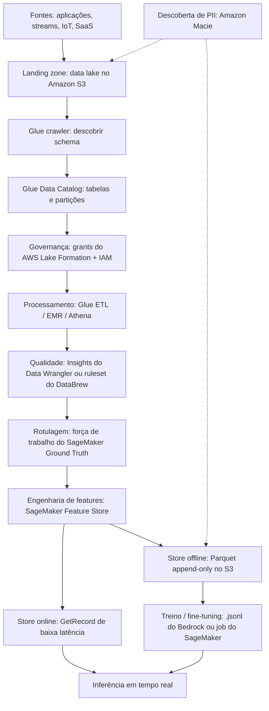
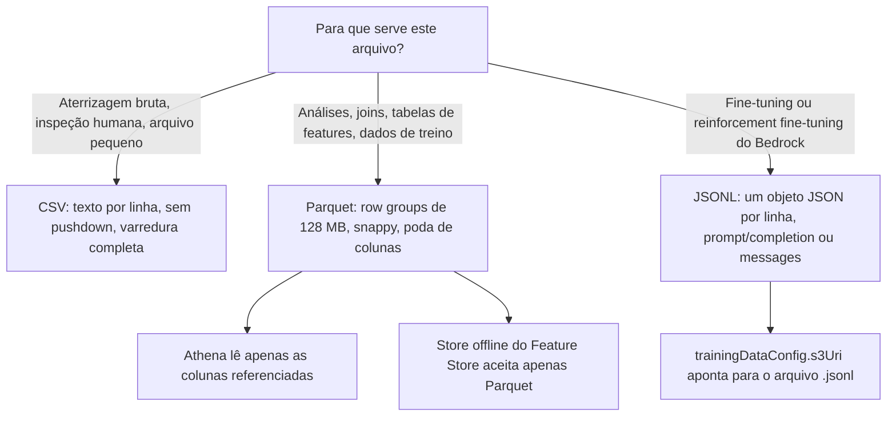
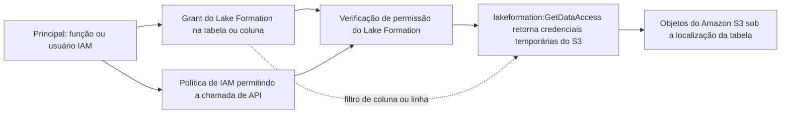
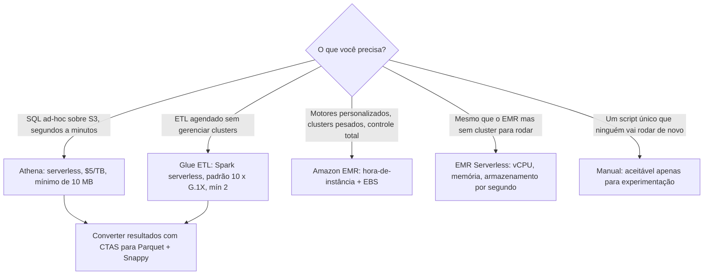
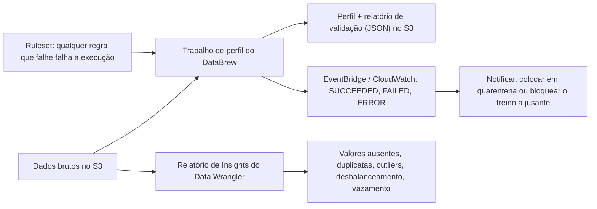
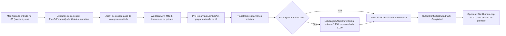
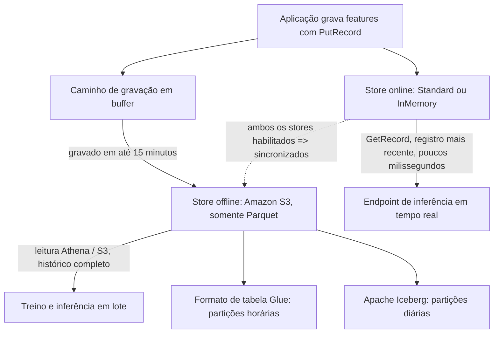
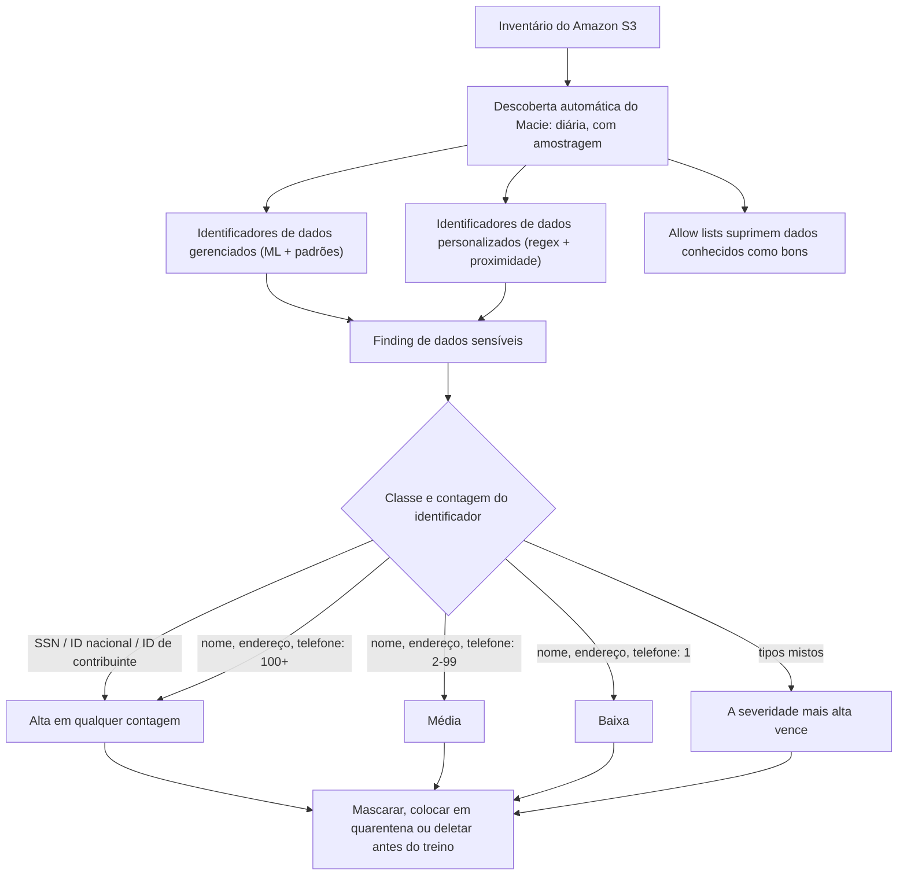

# Engenharia de Dados para IA na AWS

Modelos não falham no treinamento. Eles falham porque a tabela em que foram treinados tinha uma coluna que vazava o alvo, porque um CSV de 3 TB foi escaneado em vez de 0,25 TB de Parquet, porque um trabalho de rotulagem saiu para o Mechanical Turk sem declarar que as imagens estavam livres de informações pessoais identificáveis, ou porque um feature group atendia leituras online em milissegundos enquanto a cópia offline ainda estava gravando em buffer no Amazon S3. Engenharia de dados é o estágio em que todos esses quatro erros são baratos de corrigir, e o exame AIF-C01 sabe disso: **Domínio 1 (Fundamentos de IA/ML) tem peso de 20%, Domínio 2 (IA Generativa) 24%, Domínio 3 (Aplicações de Foundation Models) 28%, Domínio 4 (IA Responsável) 14% e Domínio 5 (Segurança, Conformidade e Governança) 14%**, e esta lição fica na interseção da Tarefa 1.3 (ciclo de vida de ML), da Tarefa 3.3 (fine-tuning) e das afirmações de engenharia de dados segura do Domínio 5.

```text
=====================================================================
 ENGENHARIA DE DADOS PARA IA — AS CINCO COISAS QUE O EXAME REALMENTE PERGUNTA
=====================================================================
  A. PARA ONDE VÃO OS DADOS?
     S3 -> Glue crawlers -> Glue Data Catalog -> Athena / EMR / Glue
     governado pelo AWS Lake Formation (grants + IAM, duas camadas)

  B. QUAL MOTOR?
     Glue ....... ETL serverless, padrão 10 workers x G.1X, mín 2
     EMR ......... hora-de-instância + EBS; Serverless = vCPU/mem/segundo
     Athena ...... $5 por TB escaneado, mínimo de 10 MB por consulta
     manual ...... sempre a opção perdedora numa resposta de exame

  C. OS DADOS ESTÃO BONS?
     Data Wrangler (no SageMaker Canvas): 300+ transformações,
        Relatório de Insights sinaliza vazamento, desbalanceamento, outliers
     DataBrew: trabalho de perfil + ruleset -> relatório de validação JSON

  D. ESTÃO ROTULADOS?
     Ground Truth: manifest -> categoria de rótulo -> força de trabalho ->
        Lambda de pré-anotação -> Lambda de consolidação -> saída
     Entrada do MTurk DEVE declarar FreeOfPersonallyIdentifiableInformation
     rotulagem automatizada: mínimo 1.250 objetos, recomendado 5.000

  E. ESTÁ PRIVADO, GOVERNADO E PRONTO PARA FINE-TUNING?
     Macie: identificadores de dados gerenciados + personalizados, descoberta diária
     Feature Store: online (GetRecord) + offline (Parquet no S3)
     Bedrock: .jsonl, um objeto JSON por linha, URI S3
=====================================================================
```

> [!NOTE]
> **Leia esta lição como um manual de decisões.** Cada número abaixo vem de um documento publicado pela AWS (guia do desenvolvedor do SageMaker, guias do Glue e do Athena, guias do Lake Formation e do Macie, guia do usuário do Bedrock, páginas de preços da AWS). Onde um valor é derivado em vez de publicado, ele é marcado como derivado. Onde uma afirmação não é verificada, ela aparece na seção 11: nunca no conjunto de memorização.

Ao final desta lição você será capaz de:

- desenhar o **pipeline de dados de ponta a ponta** de um projeto de IA e nomear o serviço da AWS em cada salto;
- escolher entre **CSV, Parquet e JSONL** e prever a consequência de custo dessa escolha no Athena;
- escolher o motor de processamento certo, **Glue vs. EMR vs. Athena vs. um script manual**, e defendê-lo;
- aplicar o modelo de **autorização de duas camadas do Lake Formation** e nomear a permissão que o acesso subjacente ao S3 exige adicionalmente;
- configurar um **trabalho de rotulagem do Ground Truth** de ponta a ponta, incluindo a declaração de PII que faz ou quebra o trabalho;
- dimensionar uma execução de **rotulagem automatizada** (piso de 1.250, recomendação de 5.000, divisão de validação 20%/10%);
- explicar os **stores online e offline do Feature Store**, suas regras de particionamento e o buffer de gravação de 15 minutos;
- usar o **Macie** para descobrir PII no S3 e prever a severidade de uma finding;
- preparar um **conjunto de dados `.jsonl`** de fine-tuning para o Amazon Bedrock e conferi-lo contra os tetos publicados por modelo;
- responder **dez perguntas no estilo do exame** na voz oficial das questões de prática.

---

## 1. Onde esta lição se situa no exame

### 1.1 As afirmações de tarefa para as quais você estuda

O Exam Guide do AIF-C01 é o contrato. Três afirmações tornam esta lição examinável:

| Afirmação do guia | O que você deve ser capaz de fazer | Seção aqui |
|---|---|---|
| Tarefa 1.3: "Descrever componentes de um pipeline de ML (coleta de dados, EDA, pré-processamento de dados, engenharia de features…)" | Nomear o componente e o serviço da AWS para cada estágio | 2, 5, 6 |
| Tarefa 1.3: "Identificar serviços AWS relevantes … para cada estágio de um pipeline de ML (por exemplo, SageMaker, Amazon SageMaker Data Wrangler, Amazon SageMaker Feature Store, Amazon SageMaker Model Monitor)" | Combinar estágio → serviço sob pressão de tempo | 1.2 |
| Tarefa 3.3: "Descrever como preparar dados para fine-tune um FM (curadoria de dados, governança, tamanho, rotulagem, representatividade, RLHF)" | Curar, governar, dimensionar, rotular e equilibrar um conjunto de dados de fine-tuning | 10 |
| Domínio 5: "melhores práticas para engenharia de dados segura (avaliar qualidade de dados, tecnologias de aprimoramento de privacidade, controle de acesso a dados, integridade de dados)" mais linhagem de dados, catalogação de dados e Model Cards | Qualidade, privacidade, controle de acesso, integridade, linhagem, catálogo | 4, 6, 9 |

### 1.2 A matriz ferramenta-por-tarefa

Esta tabela é o artefato mais reutilizável da lição. Aprenda a coluna esquerda (a tarefa) e a coluna do meio (a ferramenta principal); a coluna direita é onde vivem os distratores do exame.

| Tarefa | Ferramenta AWS principal | Alternativa | Config-chave / pegadinha |
|---|---|---|---|
| Descoberta de schema e catalogação | AWS Glue crawlers → Glue Data Catalog | DDL do Athena, Lake Formation | também detecta Iceberg, Hudi e Delta Lake |
| ETL em lote / Spark em escala | AWS Glue ETL (PySpark ou Scala) | EMR / EMR Serverless | serverless; padrão 10 × G.1X, mínimo de 2 workers |
| Clusters pesados ou personalizados de big data | Amazon EMR | EMR Serverless | hora-de-instância vs. cobrança por vCPU-segundo |
| Analítica SQL serverless | Amazon Athena | Redshift Serverless | $5/TB; CTAS grava Parquet ou ORC |
| Acesso fine-grained e governado ao lake | AWS Lake Formation | só IAM (`Super` → `IAMAllowedPrincipals`) | grants do LF **e** IAM; `lakeformation:GetDataAccess` |
| Preparação visual / low-code de dados de ML | SageMaker Data Wrangler (no Canvas) | Canvas chat-for-data-prep | 300+ transformações; roda em m5.4xlarge |
| Perfis e rulesets de DQ, sem código | AWS Glue DataBrew | + EventBridge | trabalho de perfil + ruleset → relatório JSON no S3 |
| Análise de vazamento-alvo e desbalanceamento | Relatório de Insights do Data Wrangler | SageMaker Clarify (viés pré-treino) | relatório sinaliza vazamento e desbalanceamento |
| Rotulagem humana | SageMaker Ground Truth | fluxo personalizado / força de trabalho privada | MTurk ⇒ declaração de PII é obrigatória |
| Revisão humana de previsões do modelo | Amazon A2I | trabalhos de verificação do Ground Truth | **sem consolidação** no A2I |
| Serving de features em tempo real | **Store online** do Feature Store | DynamoDB | `GetRecord`; apenas o registro mais recente |
| Armazenamento de features para treino / batch | **Store offline** do Feature Store | S3 + Athena | somente Parquet; Glue = horário, Iceberg = diário |
| Descoberta de PII no S3 | Amazon Macie | Amazon Comprehend PII (texto) | identificadores gerenciados + personalizados + listas de permissão |
| Arquivos de conjunto de dados de fine-tuning GenAI | JSONL do Bedrock no S3 |: | `.jsonl`, um objeto JSON por linha |

- **📚 Você sabia?** O Glue Data Catalog é **compatível com Hive**, e é por isso que Athena, EMR e a tabela Glue do Feature Store podem ler a mesma definição de tabela. O próprio blog de Big Data da AWS (2024) documenta que os Glue crawlers detectam schemas em **Apache Iceberg, Apache Hudi e Apache Delta Lake**, então "qual formato de tabela" é agora uma decisão de governança, não uma limitação de catalogação.

---

## 2. O pipeline de dados de ponta a ponta

### 2.1 Um fluxograma, onze saltos



### 2.2 Por que a ordem importa

Cada salto existe para remover uma classe de falha:

| Salto | Pergunta que responde | Falha se pulado |
|---|---|---|
| Landing zone (S3) | Onde está a fonte da verdade? | O treino lê uma cópia que ninguém consegue versionar |
| Crawler → Catalog | Qual é o schema, e onde estão as partições? | Toda consulta é um `read_csv` sob medida com colunas escritas à mão |
| Lake Formation | Quem pode ler qual coluna, e qual linha? | `s3:GetObject` de bucket inteiro para todo analista |
| Processing | Como arquivos brutos se tornam tabelas prontas para análise? | Notebooks fazem ETL de produção |
| Quality | Há nulos, duplicatas, outliers, desbalanceamento, vazamento? | Uma lacuna de 99% treino / 71% validação descoberta depois do lançamento |
| Labeling | Os alvos estão corretos e consistentes? | Rótulos ruidosos limitam a acurácia do modelo independentemente da arquitetura |
| Feature Store | Inferência e treino podem ler as *mesmas* features? | Train/serve skew, o bug silencioso clássico |
| Macie | Há PII ou uma credencial naquele bucket? | Dados protegidos em um corpus de treinamento |

```dragdrop
{
  "question": "Ordene os saltos do pipeline de dados na sequência em que um arquiteto AIF-C01 os construiria:",
  "items": [
    "Aterrissar arquivos brutos em um data lake no Amazon S3",
    "Executar um Glue crawler para popular o Glue Data Catalog",
    "Aplicar grants do AWS Lake Formation por cima das permissões de IAM",
    "Processar os dados brutos com Glue, EMR ou Athena",
    "Perfilar o resultado com Data Wrangler ou um ruleset do DataBrew",
    "Rotular os objetos de treinamento com SageMaker Ground Truth",
    "Gravar as features no SageMaker Feature Store",
    "Treinar ou fine-tunar no conjunto de dados curado"
  ],
  "correctOrder": [
    "Aterrissar arquivos brutos em um data lake no Amazon S3",
    "Executar um Glue crawler para popular o Glue Data Catalog",
    "Aplicar grants do AWS Lake Formation por cima das permissões de IAM",
    "Processar os dados brutos com Glue, EMR ou Athena",
    "Perfilar o resultado com Data Wrangler ou um ruleset do DataBrew",
    "Rotular os objetos de treinamento com SageMaker Ground Truth",
    "Gravar as features no SageMaker Feature Store",
    "Treinar ou fine-tunar no conjunto de dados curado"
  ],
  "explanation": "O armazenamento precede a catalogação porque um crawler precisa de objetos para ler; a catalogação precede a governança porque os grants do Lake Formation se conectam a tabelas catalogadas e suas colunas; a governança precede o processamento porque toda consulta roda como uma identidade; as verificações de qualidade seguem o processamento porque regras avaliam os dados transformados; a rotulagem segue a qualidade porque um schema quebrado produz anotações quebradas; as features são registradas depois que os rótulos existem; e o treinamento é o último porque consome tudo acima."
}
```

> [!WARNING]
> **Não confunda o catálogo com a camada de permissão.** O Glue Data Catalog armazena *metadados* (schema, partições, localização da tabela). O AWS Lake Formation armazena *permissões* sobre esses metadados **e** sobre a localização dos dados subjacentes. Um crawler nunca concede acesso, e uma política de IAM sozinha não é o modelo do Lake Formation: veja a seção 4.

---

## 3. Armazenamento e formatos de dados: CSV vs. Parquet vs. JSONL

### 3.1 A comparação que decide sua fatura do Athena

| Propriedade | CSV | Apache Parquet | JSONL (`.jsonl`) |
|---|---|---|---|
| Layout | texto orientado a linhas | colunar, blocos de row-group | um objeto JSON por linha |
| Schema | nenhum no arquivo (crawler ou header) | schema autodescritivo no footer | implícito por registro |
| Compressão | ruim (só arquivo inteiro) | por coluna; padrão do Glue **snappy** | ruim |
| Pushdown de coluna / predicado | não | sim | não |
| Divisível para leitura paralela | sim | sim | sim |
| Padrão de bloco / stripe | n/a | Parquet **128 MB** / ORC **64 MB** | n/a |
| Consumidor AWS | aterrizagem bruta, fonte do CTAS | Athena, Glue, Redshift, store offline do Feature Store | fine-tuning e reinforcement fine-tuning do Bedrock |
| Efeito no custo do Athena | varredura do arquivo inteiro | apenas colunas referenciadas | varredura do arquivo inteiro |
| Tipos complexos | flat | array / map / struct (Athena lê a linha inteira do Parquet → prefira ORC) | JSON aninhado |
| Use quando | intercâmbio legível por humanos, arquivos minúsculos | tabelas de análise e de treino de ML | registros de treino e validação GenAI |

### 3.2 Os números atrás dos padrões

| Configuração | Valor | Fonte |
|---|---|---|
| Row group / tamanho de bloco do Parquet no Athena | **128 MB** | guia do Athena, "Optimize your tables" |
| Tamanho de stripe do ORC no Athena | **64 MB** | guia do Athena |
| Stripe do ORC lido inteiro se menor que | **8 MB** (`hive.orc.max_buffer_size`) | guia do Athena |
| Máximo de partições do `INSERT INTO` | **100** | CTAS/INSERT INTO ETL do Athena |
| `compression` padrão do escritor Parquet do Glue | **snappy** (também uncompressed, gzip, lzo) | guia do desenvolvedor do Glue, página Parquet |
| `blockSize` padrão do escritor Parquet do Glue | **134217728 bytes = 128 MB** | guia do desenvolvedor do Glue, página Parquet |
| Agrupamento de arquivos pequenos do Glue (`groupFiles`) | ligado por padrão quando a entrada tem **> 50.000 arquivos** | guia do desenvolvedor do Glue, conexões S3 |

**Exemplo 1, a decisão de formato, com os números da própria AWS.** Tome uma tabela de texto não comprimida de **3 TB** com quatro colunas no S3. Uma consulta que lê **uma** coluna escaneia os 3 TB: 3 TB × $5/TB = **$15,00**. Aplique **GZIP em 3:1** e a mesma tabela vira 1 TB → **$5,00**. Converta para **Parquet** e a consulta lê apenas a coluna referenciada: 1 TB ÷ 4 = 0,25 TB × $5/TB = **$1,25**. Isso é **12× mais barato** que a linha de base, 3× da compressão e 4× da poda de colunas. A AWS publica esse exemplo exato em sua página de preços do Athena.



- **📚 Você sabia?** O agrupamento `groupFiles` do Glue só se liga automaticamente quando a entrada excede **50.000 arquivos**. Abaixo desse limite você precisa definir `"groupFiles": "inPartition"` você mesmo: caso contrário, um diretório de arquivos pequenos vira um diretório de *muitos* arquivos Parquet minúsculos, que é exatamente o problema de arquivos pequenos que o Athena cobra para ler.

---

## 4. Catálogo e governança: Glue Data Catalog e Lake Formation

### 4.1 Duas famílias de permissão, não uma

O AWS Lake Formation documenta duas famílias de permissão: permissões sobre o **Data Catalog** (bancos de dados e tabelas) e permissões sobre os **dados e localizações de dados subjacentes** (prefixos S3). Três regras decorrem disso, e as três são examináveis:

1. um principal precisa **tanto** de grants do Lake Formation **quanto** de permissões de IAM;
2. acesso de leitura/gravação subjacente exige adicionalmente **`lakeformation:GetDataAccess`**;
3. uma configuração só-IAM existe exclusivamente concedendo **`Super`** a **`IAMAllowedPrincipals`**.

### 4.2 Permissões de tabela

| Permissão | Escopo | Capacidade notável |
|---|---|---|
| `SELECT` | tabela | suporta **filtros de coluna** e **filtros de dados em nível de linha/célula** (`DataCellsFilter`) |
| `INSERT` | tabela | gravar novas linhas |
| `DELETE` | tabela | remover linhas |
| `ALTER` | tabela | mudanças de schema e partição |
| `DROP` | tabela | remover a tabela |
| `DESCRIBE` | tabela | ler schema/metadados |
| `Super` | banco de dados, tabela ou principal | tudo; a ponte usada por `IAMAllowedPrincipals` |



### 4.3 O que substituiu as Governed Tables

> [!WARNING]
> **As Lake Formation Governed Tables estão obsoletas, com efeito em 31 de dezembro de 2024.** O blog de Big Data da AWS (2 de outubro de 2024) afirma que as APIs somente-leitura começaram a falhar depois de **17 de fevereiro de 2025**, e a AWS direciona os clientes para **Apache Iceberg, Apache Hudi ou Apache Delta Lake** como os formatos de tabela abertos que fornecem transações e governança comparáveis. Se uma resposta de exame menciona Governed Tables como um serviço atual, trate-a como uma armadilha: prefira a formulação Iceberg/Hudi/Delta.

**Exemplo 2, filtragem de coluna e linha na prática.** Uma tabela de analítica de RH tem colunas `employee_id`, `department`, `salary_band` e `ssn`. Um grant de `SELECT` do Lake Formation com um **filtro de coluna** pode excluir `ssn` inteiramente para o papel do analista, enquanto um **filtro de linha** (`DataCellsFilter`) pode restringir as linhas a `department = 'Ops'`. Nenhum dos dois é possível com um grant simples de prefixo S3, que é exatamente a linguagem de "controle de acesso a dados" e "integridade de dados" do Domínio 5.

- **📚 Você sabia?** A permissão `SELECT` do Lake Formation é a única permissão de tabela documentada a suportar **filtros de dados em nível de linha e célula**. Todo o resto da lista de permissões de tabela (`INSERT`, `DELETE`, `ALTER`, `DROP`, `DESCRIBE`) é tudo-ou-nada no nível da tabela ou da coluna.

---

## 5. Motores de processamento: Glue, EMR e Athena

### 5.1 Fatos de cobrança e escala

| Serviço | Unidade de cobrança | Padrão | Piso |
|---|---|---|---|
| Job Spark do Glue | DPU-hours (workers) | **10 workers × G.1X** | **2 workers** |
| Shell Python do Glue | DPU (1 DPU = 16 GB) | **0,0625 DPU = 1 GB** (padrão do console) | **0,0625 DPU** |
| Amazon EMR | por **hora-de-instância** + armazenamento EBS | cluster gerenciado pelo cliente | 1 nó |
| EMR Serverless | vCPU + memória + armazenamento por **segundo** | aprovisionado automaticamente | mínimo de 1 minuto |
| Athena (SQL) | **$5 por TB escaneado** |: | **10 MB por consulta** |
| Data Wrangler (Studio Classic) | EC2 enquanto roda | **m5.4xlarge** |: |
| Widget Insights do Wrangler | linhas analisadas | **primeiras 10.000 linhas** | 10.000 |

### 5.2 Tamanhos de worker do Glue

| Tipo de worker | vCPU | Memória | Disco | Executors |
|---|---|---|---|---|
| Standard | 4 | 16 GB | 50 GB | 2 |
| G.1X | 4 | 16 GB | 64 GB | 1 |
| G.2X | 8 | 32 GB | 128 GB | 1 |
| Python shell |: | 1 DPU = 16 GB (ou 0,0625 DPU = 1 GB) |: |: |

**Exemplo 3: right-sizing do Glue.** O padrão de conversão Parquet da Prescriptive Guidance da AWS roda **2 workers**, o mínimo documentado: em vez do padrão do console **10 × G.1X**, o que é **5× menos** DPUs alocadas para o mesmo trabalho de conversão. Um trabalho de Python shell configurado em **0,0625 DPU (1 GB)** em vez de 1 DPU (16 GB) usa **16× menos** memória e cobra proporcionalmente. O exame recompensa o padrão "comece no mínimo, escale com evidência", não o padrão do console.

### 5.3 Regras de preços do Athena

| Regla | Valor |
|---|---|
| Preço por TB escaneado | **$5**, arredondado para o MB mais próximo |
| Mínimo cobrado por consulta | **10 MB** |
| Instruções DDL | **gratuitas** |
| Consultas com falha | **gratuitas** |
| Consultas canceladas | **cobradas** |
| Economia documentada com compressão + particionamento + formato colunar | **30% to 90%** |
| Benchmark CTAS na documentação do Athena | CSV → Parquet + Snappy particionado por ano aterrissando em **1,2 GB**, com a mesma consulta mais rápida e mais barata |

**Exemplo 4, o loop de conversão CTAS.** Um time mantém uma tabela CSV bruta, roda **CTAS** (`CREATE TABLE … AS SELECT`) para gravar **Parquet com compressão Snappy particionado por ano**, aterrissa em **1,2 GB** e aponta o dashboard a jusante para a nova tabela. A consulta escaneia apenas as colunas referenciadas de uma partição: mais barata *e* mais rápida, sem mudança de aplicação. A AWS documenta isso como o padrão ETL padrão (`CTAS/INSERT INTO`).

### 5.4 Escolhendo o motor



> [!IMPORTANT]
> **Veredito Comparativo: Glue vs. EMR vs. Athena vs. processo manual**
> - **AWS Glue** é a resposta padrão para *ETL em lote serverless e catalogação*. Você escreve PySpark ou Scala, a AWS roda (workers padrão 10 × G.1X, mínimo documentado 2) e você é cobrado em DPU-hours apenas enquanto o job roda. Escolha Glue quando o job tem formato Spark, o agendamento é conhecido e ninguém quer ser dono de um cluster. A pegadinha é o custo-por-padrão: deixar 10 workers alocados quando 2 bastam é um excesso de 5× que o padrão prescritivo da própria AWS evita.
> - **Amazon EMR** é a resposta quando você precisa de *escolha de motor, controle do cluster ou escala que o Glue não expressa*: Hadoop, Trino, Flink, AMIs personalizadas, famílias de instância específicas. A cobrança é **por hora-de-instância mais EBS**, então um cluster ocioso é dinheiro queimado. **EMR Serverless** elimina o cluster e cobra **por vCPU, memória e armazenamento por segundo**, com auto-scaling e isolamento no nível do job; é o caminho do meio quando você quer os motores do EMR sem as operações do EMR.
> - **Amazon Athena** é *consulta, não transformação*: SQL ANSI serverless sobre S3 a **$5 por TB escaneado** com **piso de 10 MB por consulta**, DDL gratuita e consultas com falha gratuitas (consultas canceladas ainda são cobradas). É a forma mais barata de explorar e a forma errada de rodar um ETL noturno multi-tenant, mas combinado com **CTAS** ele *se torna* uma transformação, gravando Parquet ou ORC para a próxima passada.
> - **Um processo manual** (um script em notebook, um notebook rodado à mão, um CSV copiado) vence a primeira semana e perde depois: não consegue provar qual versão dos dados produziu um determinado modelo, não consegue aplicar filtros de coluna ou linha, não pode ser re-executado por mais ninguém, e reintroduz silenciosamente o custo de varredura de arquivo inteiro que o Parquet e o particionamento deveriam ter eliminado. O Domínio 5 enquadra isso como falhas de **integridade de dados, controle de acesso a dados e linhagem de dados**. O veredito é categórico: manual é aceitável para exploração, nunca para o pipeline que alimenta um modelo.

---

## 6. Qualidade e preparação de dados: Data Wrangler e DataBrew

### 6.1 SageMaker Data Wrangler (agora dentro do SageMaker Canvas)

| Capacidade | Detalhe |
|---|---|
| Fontes | Amazon S3, Athena, Redshift, Snowflake, Databricks |
| Interface | Data Flow |
| Transformações | **300+** |
| Insights / Relatório de Qualidade detecta | valores ausentes, duplicatas, outliers, desbalanceamento de classes e **vazamento de dados** |
| Exportações | S3, SageMaker Pipelines, Feature Store, um script Python, um notebook |
| Instância de análise do Studio Classic | **m5.4xlarge** |
| Linhas analisadas pelo widget | **primeiras 10.000 linhas**, a menos que todas as linhas sejam selecionadas |

**Exemplo 5, a pegada do vazamento.** Um classificador pontua **99% nos dados de treino e 71% na validação separada**. O relatório de Insights do Data Wrangler sinaliza uma coluna derivada da variável alvo. O diagnóstico é **vazamento-alvo mais overfitting**: remova ou derive com segurança a coluna vazada, depois reduza o overfitting com regularização ou dados mais representativos. Treinar mais tempo piora o problema, e deletar o conjunto de validação apenas o esconde, os distratores do exame propõem exatamente esses dois movimentos errados.

### 6.2 Rulesets e trabalhos de perfil do AWS Glue DataBrew

| Conceito | Comportamento |
|---|---|
| Ruleset | **falha se qualquer regra falhar** (avaliação tudo-ou-nada) |
| Anexação | rulesets se anexam a **trabalhos de perfil** |
| Saída | um perfil mais um relatório de validação (**JSON**) gravado no **S3** |
| Regras de coluna | permitidas apenas para **tipos simples**: string, number, boolean |
| Eventos | resultados emitem eventos EventBridge/CloudWatch com `SUCCEEDED`, `FAILED` ou `ERROR` |



**A distinção que o exame testa:** **DataBrew** é a resposta de *regras e perfis* (um ruleset, um trabalho de perfil, um relatório JSON, um evento), enquanto **Data Wrangler** é a resposta de *fluxo visual e transformação* (300+ transformações, um Relatório de Insights que sinaliza vazamento, exportações para o Feature Store). Ambos são gerenciados: nenhum pede que você provisione um cluster Spark você mesmo.

- **📚 Você sabia?** As regras de coluna do DataBrew rejeitam tipos complexos: você pode escrever uma regra para uma coluna `string`, `number` ou `boolean`, mas não para um `struct` aninhado. É por isso que a validação profunda de JSON pertence a um job do Glue ou a um fluxo do Data Wrangler, e é por isso que o documento do ruleset é deliberadamente raso por design.

---

## 7. Rotulagem humana: Ground Truth e A2I

### 7.1 O fluxo de rotulagem de doze etapas

| # | Etapa | Objeto / parâmetro | Falha se pulado |
|---|---|---|---|
| 1 | Carregar dados de entrada | manifesto S3 (`ManifestS3Uri`) | não consegue enumerar objetos |
| 2 | Declarar atributos de conteúdo | `FreeOfPersonallyIdentifiableInformation`, `FreeOfAdultContent` | **o trabalho falha** no Mechanical Turk |
| 3 | Definir rótulos | `LabelCategoryConfigS3Uri` (JSON); ≥ 2 categorias para classificação | nenhum rótulo é renderizado |
| 4 | Escolher força de trabalho | `WorkteamArn` (MTurk / fornecedor / OIDC privado) | tarefas expiram sem reclamação |
| 5 | Configurar tarefa humana | `NumberOfHumanWorkersPerDataObject`, `TaskTimeLimitInSeconds`, `MaxConcurrentTaskCount` (padrão **1.000**) | throughput ou qualidade mal configurados |
| 6 | Lambda de pré-anotação | `PreHumanTaskLambdaArn` (fornecido pela AWS) | a entrada nunca chega à UI |
| 7 | UI do worker | HTML/Liquid ou um template embutido | instruções erradas → ruído de rótulo |
| 8 | Consolidação de anotação | `AnnotationConsolidationLambdaArn` | votos conflitantes, sem consenso |
| 9 | Rotulagem automatizada opcional | `LabelingJobAlgorithmsConfig`; mínimo **1.250**, recomendado **5.000** | abaixo do mínimo → rejeitado |
| 10 | Verificação / ajuste opcional | re-executar com os rótulos existentes exibidos | nenhuma passada de QA |
| 11 | Saída | `OutputConfig.S3OutputPath`; `In progress` → `Completed` | sem rótulos para treino |
| 12 | Revisão de previsão opcional | `CreateFlowDefinition` do A2I + `StartHumanLoop` | saídas não revisadas em produção |

### 7.2 Os números

| Parâmetro | Valor |
|---|---|
| Mínimo de rotulagem automatizada (active learning) | **1.250 objetos** |
| Forte recomendação da AWS | **5.000 objetos** |
| Divisão de validação quando < 5.000 objetos | **20%** |
| Divisão de validação quando > 5.000 objetos | **10%** |
| Tarefas automatizadas suportadas | classificação de imagem, bounding box, segmentação semântica, classificação de texto |
| Padrão de `MaxConcurrentTaskCount` | **1.000** (elevável a **5.000** via AWS Support) |
| Consolidação | Lambda pós-anotação; **não disponível para o Amazon A2I** |
| Padrão de ARN do Mechanical Turk | `arn:aws:sagemaker:<region>:394669845002:workteam/public-crowd/default` |

**Exemplo 6: a matemática da divisão de validação do active learning.** **4.000** objetos (< 5.000) → validação = 20% = **800** objetos, restando **3.200** no loop. **20.000** objetos → validação = 10% = **2.000**. Um trabalho com **800** objetos é rejeitado de imediato (abaixo do piso de 1.250); **5.000** é o piso fortemente recomendado. Note o que a aritmética *não* diz: 4.000 objetos é legal mas deixa apenas 3.200 para aprendizado, enquanto 5.000 custa 500 objetos de validação e ainda limpa o piso com folga.

**Exemplo 7, o orçamento do bounding box.** No notebook oficial de detecção de objetos da AWS, um rótulo de bounding box humano custa **$0,08 + 5 × $0,036 = $0,26**, e um rótulo automático custa **$0,08**. Então **100 imagens** rotuladas por humanos custam cerca de **$26**, enquanto **1.000 imagens** com rotulagem automática chegam perto de **$200** de ponta a ponta em cerca de **6 horas** de tempo de execução total (cerca de 167 imagens/hora, um valor derivado de uma demonstração que também inclui overhead de treino e inferência, não um SLA da AWS). Trate os preços por objeto por faixa que você possa ter visto como **históricos**: a AWS agora comercializa o Ground Truth+ sem uma tabela pública por objeto.

### 7.3 Diagrama do fluxo



> [!WARNING]
> **Duas armadilhas do Ground Truth que falham trabalhos, não apenas questões.**
> (1) Na força de trabalho do Amazon Mechanical Turk, o classificador `FreeOfPersonallyIdentifiableInformation` **deve** ser declarado: sem ele, a AWS afirma que o trabalho de rotulagem falhará. O atributo opcional `FreeOfAdultContent` segue o mesmo mecanismo de declaração.
> (2) O Mechanical Turk **não** suporta trabalhos de rotulagem de **frames de vídeo** ou **nuvem de pontos 3D**; esses exigem uma força de trabalho diferente. E lembre do contexto de disponibilidade estabelecido na Lição 2: o Ground Truth está em manutenção e fechado para novos clientes (30 de junho de 2026; os documentos de mudança de disponibilidade afirmam 30/06/26) e o Amazon Mechanical Turk atingiu o fim do suporte em **30 de setembro de 2026**, então uma pergunta de *novo* cliente aponta para uma abordagem de rotulagem alternativa, enquanto a mecânica acima permanece como vocabulário examinável.

**A distinção do A2I:** O Amazon A2I serve para **revisão humana de previsões do modelo**, criado com `CreateFlowDefinition` e `StartHumanLoop`. Ele **não tem consolidação de anotação**, então não pode ser usado para mesclar votos de múltiplos workers em um rótulo de consenso: essa capacidade pertence ao `AnnotationConsolidationLambdaArn` do Ground Truth.

---

## 8. SageMaker Feature Store: online e offline

### 8.1 Os dois stores

| Aspecto | Store online | Store offline |
|---|---|---|
| Propósito | consulta para inferência em tempo real | exploração, treino, inferência em lote |
| API | `GetRecord` | consulta Athena / leitura S3 |
| Latência | baixa, milissegundos | não limitada por latência |
| Retenção | **registro mais recente** por identificador | **append-only**, histórico completo |
| Armazenamento | gerenciado; `Standard` ou `InMemory` (ElastiCache Redis OSS) | Amazon S3, **somente Parquet** |
| Caminho de gravação | quasi-tempo-real | em buffer, gravado no S3 **em até 15 minutos** |
| Particionamento | n/a | tabela Glue → **por hora**; Apache Iceberg → **diário** |
| Formato de tabela | n/a | `Glue` (padrão) ou `Apache Iceberg` |
| Sincronização | ambos habilitados ⇒ stores sincronizados (evita train/serve skew) | mesmo |
| Notas | `InMemory` é somente-online, sem chave KMS gerenciada pelo cliente, provisionamento de **~10 to 15 min** | Iceberg habilita compactação de arquivos pequenos |

### 8.2 Semântica de gravação e modos de capacidade

- Os dados de `PutRecord` são **mantidos em buffer, agrupados e gravados no Amazon S3 em até 15 minutos**;
- tiers online: **Standard** (padrão) e **InMemory** ("powered by Amazon ElastiCache (Redis OSS)"), ambos **somente-online**: sem replicação online→offline e **sem chave KMS gerenciada pelo cliente** para o `InMemory`;
- modos de capacidade: **`ON_DEMAND`** e **`PROVISIONED`** (exceder a capacidade provisionada faz throttle); um grupo pode ser alterado para on-demand **uma vez a cada 24 horas**, e o `PROVISIONED` é permitido apenas para grupos somente-offline ou `Standard`;
- o `InMemory` leva cerca de **10 to 15 minutos** para provisionar.

**Exemplo 8, a matemática da ingestão do Feature Store.** A escala do exemplo da AWS é "lotes grandes (**1 milhão de linhas** de dados ou mais)". Como a saída de `PutRecord` é gravada no S3 **em até 15 minutos**, um trabalho de treino iniciado imediatamente após a ingestão pode esperar até 15 minutos pela cópia offline, enquanto o `GetRecord` atende a cópia online mais cedo. Em um dia, um store offline em formato Glue aterrissa **24 partições horárias**, enquanto um store em formato Iceberg aterrissa **1 partição diária**, nenhum dos dois é configurável.



> [!WARNING]
> **O store offline aceita somente Parquet.** Gravar CSV no store offline do Feature Store não é uma opção, o formato documentado é Parquet no S3, particionado por hora sob o formato de tabela Glue padrão ou diário sob o Apache Iceberg. E o tier **`InMemory` é somente-online**: se uma questão oferecer "`InMemory` mais histórico offline completo", a resposta está errada nos dois pontos (sem replicação, e sem chave KMS gerenciada pelo cliente).

---

## 9. Privacidade, PII e engenharia de dados segura com Amazon Macie

### 9.1 Como o Macie encontra dados sensíveis

| Mecanismo | O que é | Exemplos |
|---|---|---|
| **Identificadores de dados gerenciados** | detecção baseada em ML combinada com pattern matching | `USA_SOCIAL_SECURITY_NUMBER`, `CREDIT_CARD_NUMBER`, `AWS_CREDENTIALS` |
| **Identificadores de dados personalizados** | sua expressão regular mais regras de proximidade | IDs internos de funcionários com prefixo da empresa |
| **Allow lists** | dados conhecidos como bons excluídos das findings | fixtures de teste que parecem SSNs falsas |
| Descoberta automática | avalia o inventário do S3 **diariamente** com amostragem | cobertura contínua sem um job de varredura |
| Retenção de findings | findings de dados sensíveis armazenadas por **90 dias** | planeje exportações se precisar de histórico maior |

### 9.2 Severidade: a tabela que você deve ser capaz de prever

| Tipo de dado | 1 ocorrência | 2 to 99 | 100+ |
|---|---|---|---|
| Maioria da PII (data de nascimento, CNH, nome, endereço, telefone, cookie HTTP) | Baixa | Média | Alta |
| Coordenadas GPS | Baixa | Média | Média |
| Número de passaporte | Média | Alta | Alta |
| VIN | Baixa | Baixa | Média |
| **SSN, ID nacional, NINO, residência permanente, lista eleitoral, ID de contribuinte** | **Alta** | **Alta** | **Alta** |

Findings multi-tipo levam a severidade **mais alta** entre os tipos detectados.

**Exemplo 9: a fila de triagem do Macie.** Um objeto com **1** nome completo → **Baixa**; **50** nomes → **Média**; **150** nomes → **Alta**. Um objeto separado com **1 SSN** → **Alta** imediatamente, porque identificadores do tipo SSN são Altos em qualquer contagem. Um objeto contendo **10 nomes (Média)** *e* **5 números de passaporte (Alta)** → a severidade da finding é **Alta**, porque findings multi-tipo levam a severidade mais alta. As filas são, portanto, priorizadas por *sensibilidade do identificador*, não por volume bruto.



**O pareamento do Domínio 5:** O Amazon Macie é o serviço nomeado pela AWS para **descoberta de PII/PHI/credenciais no S3** e aparece na lista de serviços do Domínio 5 do AIF-C01. Pareie-o com o **Amazon Comprehend para PII detectada dentro do texto em tempo de inferência**, e com os **filtros de coluna e linha do Lake Formation** (seção 4) para controle de acesso. O Macie descobre *o que existe lá*; o Lake Formation decide *quem pode vê-lo*; o KMS decide *como é criptografado*.

- **📚 Você sabia?** A descoberta automática do Macie não varre cada objeto continuamente: ela avalia o **inventário do S3 diariamente com amostragem**, e as findings de dados sensíveis são retidas por **90 dias**. Se seu caso de conformidade precisa de um histórico forense completo, exporte as findings para o S3 ou o Security Hub; não assuma que elas vivem no Macie para sempre.

---

## 10. Preparando dados de treino para fine-tuning de foundation models

### 10.1 O formato não é negociável

O Amazon Bedrock afirma diretamente: *"You create `.jsonl` files, where each line is a JSON object corresponding to a record."* Registros não conversacionais carregam `prompt` e `completion`; registros conversacionais carregam um array `messages` com turnos alternados de `user` e `assistant`. A AWS também publica uma regra de estimativa: *"Use approximately **6 characters per token** to estimate … dataset size."* Os arquivos vivem no S3 e são referenciados por `trainingDataConfig.s3Uri` e `validationDataConfig.s3Uri` no `CreateModelCustomizationJob`.

### 10.2 Limites publicados de conjuntos de dados

| Modelo | Mín. registros | Máx. registros | Máx. tokens | Máx. arquivo treino/val |
|---|---|---|---|---|
| Titan Text G1 Express / Lite (fine-tuning) |, |, | **4.096** (batch 1) | **1 GB** / **100 MB** |
| Anthropic Claude 3 Haiku (fine-tuning) | **32** | **10.000** treino / **1.000** val | **32.000** | **10 GB** / **1 GB** |
| Meta Llama 3.1 / 3.3 (fine-tuning) | **100** | **10.000** (cotas) | **16.000** in+out |: |
| Cohere Command (fine-tuning) |, | **10.000** treino / **1.000** val | **4.096** in / **2.048** out |, |
| Amazon Nova Understanding (fine-tuning) | **8** | **20.000** | contexto de **32k** |: |
| Amazon Nova reinforcement fine-tuning | **100** | **100 to 20.000** |, |, |
| Titan Multimodal Embeddings G1 (fine-tuning) | **1.000** | **500.000** |, |, |
| Titan Image Generator G1 (fine-tuning) | **5** | **10.000** |, |, |

Um traço significa *não publicado naquela tabela*: nunca adivinhe um valor que a AWS não publicou.

### 10.3 Especificidades do Amazon Nova

- **Fine-tuning de Understanding:** **8 to 20k** amostras, contexto de **32k**, até **10 imagens por amostra** (cada uma ≤ **10 MB**), até **1 vídeo por amostra** ≤ **90 segundos** e ≤ **50 MB**.
- **Reinforcement fine-tuning:** JSONL no formato de chat-completion da OpenAI com um array `messages` mais `reference_answer`, **mínimo de 100 registros**, um prompt por linha, e o Bedrock **valida automaticamente** o formato.

**Exemplo 10: dimensionando um conjunto de dados Claude 3 Haiku.** O piso é **32 registros**, o teto é **10.000** registros de treino (mais **1.000** de validação), o teto de tokens é **32.000**, e o teto do arquivo de treino é **10 GB**. Usando a regra da AWS de **~6 caracteres por token**, uma amostra de 4.096 tokens tem cerca de **24.576 caracteres** (derivado), então o teto de ~1 GB prende muito depois do teto de registros para prompts curtos. O Llama 3.1/3.3 prende mais cedo: **100 to 10.000** registros e **16.000** tokens in+out. A tokenização varia, então trate o valor de 6 caracteres por token como um estimador, não uma garantia.

**Exemplo 11: curadoria, governança e representatividade.** A formulação do guia do exame para a Tarefa 3.3 é específica: os conjuntos de dados devem demonstrar **inclusividade, diversidade, fontes de dados curadas e conjuntos equilibrados**, e a preparação inclui **curadoria de dados, governança, tamanho, rotulagem, representatividade e RLHF**. Concretamente: deduplique antes de contar registros (um arquivo de 10.000 linhas com 3.000 duplicatas tem 7.000 registros efetivos, não 10.000); equilibre as classes antes de dividir; retenha um arquivo de validação dentro dos tetos de **1.000 registros** acima; e remova PII com o Macie **antes** que o arquivo chegue ao `trainingDataConfig.s3Uri`.

```matching
{
  "question": "Combine cada formato de dados ou serviço com o trabalho para o qual foi feito:",
  "pairs": [
    {"left": "Apache Parquet", "right": "Analítica colunar e armazenamento offline do Feature Store, com poda de colunas do Athena"},
    {"left": "JSONL (.jsonl)", "right": "Fine-tuning do Amazon Bedrock: um objeto JSON por linha em um URI S3"},
    {"left": "CSV", "right": "Aterrizagem bruta e intercâmbio legível por humanos, escaneado por completo pelo Athena"},
    {"left": "AWS Glue crawler", "right": "Descobre o schema e popula o Glue Data Catalog"},
    {"left": "Amazon Macie", "right": "Descobre PII e credenciais no S3 com identificadores gerenciados e personalizados"},
    {"left": "Amazon Athena", "right": "SQL serverless sobre S3 a $5 por TB escaneado, mínimo de 10 MB por consulta"}
  ],
  "explanation": "O Parquet existe para cortar bytes escaneados (o exemplo da própria AWS vai de $15,00 para $1,25 por consulta), o JSONL existe porque o Bedrock lê um objeto JSON por linha, o CSV é o formato de aterrizagem barato com um caminho de leitura caro, o crawler é como o catálogo aprende um schema, o Macie é a resposta do Domínio 5 para descoberta de PII, e o Athena é a resposta de SQL serverless com preço por terabyte."
}
```

---

## 11. Fatos conflitantes, não verificados e não examináveis

Mantenha isso fora do seu conjunto de memorização. Nada aqui deve aparecer como uma resposta confiante de exame.

| Afirmação | O que as fontes dizem | Como lidar |
|---|---|---|
| Faixas de preço por objeto do Ground Truth ($0,08 / $0,04 / $0,02) | Um deck de slides da AWS de 2018; a página de preços atual comercializa "Ground Truth+" sem tabela pública por objeto | Trate as faixas como **históricas**; o valor de $0,26 vem de um notebook de exemplo da AWS, não de uma tabela de preços |
| Throughput de rotulagem automática (~167 imagens/hora) | **Derivado** de uma demonstração que inclui overhead de treino e inferência | Uma ilustração, não um SLA da AWS |
| Preços de armazenamento S3, DPU-hour do Glue, hora-de-instância do EMR, Macie por GB, Feature Store online, sessão do DataBrew | Não recuperados para esta lição | Nunca invente um preço |
| Se o AIF-C01 ainda testa Governed Tables | Obsoleto em **31/12/2024**; não nomeado no guia do exame | Prefira respostas Iceberg / Hudi / Delta |
| "Escala de petabytes" do Data Wrangler | Linguagem de marketing; nenhum limite documentado de tamanho de fluxo | Apenas direcional |
| Matemática de caracteres por token | Apenas a regra da AWS de "~6 caracteres por token"; a tokenização varia | Use como estimador |
| Limite de 100 partições do `INSERT INTO` do Athena e limites de bucket/partição do CTAS | Sensíveis ao serviço e à versão | Reconfira antes de citar |
| "Sem chaves KMS gerenciadas pelo cliente" do tier `InMemory` | Texto de documentação atual; pode mudar | Verifique em `docs.aws.amazon.com` |
| Nomenclatura do Data Wrangler: "Canvas" vs. o antigo nome standalone | A AWS documenta o Data Wrangler como um recurso do **SageMaker Canvas**; "Amazon SageMaker Data Wrangler" continua sendo vocabulário de exame válido | Qualquer nome é aceitável |
| Razões de divisão treino/validação (60/20/20, 70/15/15, 80/10/10) | Convenção, **não** um mandato da AWS | O exame testa o *propósito* de cada divisão |

Fontes primárias para esta lição: o **Exam Guide** do AIF-C01; as páginas do guia do desenvolvedor do SageMaker `feature-store`, `feature-store-offline`, `feature-store-storage-configurations-online-store`, `sms`, `sms-create-labeling-job-api`, `sms-automated-labeling`, `data-wrangler`, `data-wrangler-transform`; a referência de API do SageMaker `API_CreateFeatureGroup`, `API_HumanTaskConfig`; as páginas do guia do desenvolvedor do Glue sobre Parquet e conexões S3; o guia do usuário do Athena `columnar-storage`, `ctas-insert-into-etl`; a visão geral e a referência de permissões do Lake Formation; o guia do usuário do Macie `data-classification`, `managed-data-identifiers`, `findings-severity`; o guia do usuário do Bedrock `model-customization-prepare`, `model-customization-submit`, `rft-prepare-data`; o guia do usuário do Nova `fine-tune-prepare-data-understanding`; e as páginas de preços da AWS para Athena mais a comparação EMR vs. EMR Serverless.

---

## 12. Veredito comparativo e tabelas de resumo

### 12.1 Qualidade, rotulagem e governança num relance

| Preocupação | Serviço | O número para lembrar |
|---|---|---|
| Preparação visual de dados e detecção de vazamento | SageMaker Data Wrangler (no Canvas) | **300+** transformações; o widget de Insights lê as **primeiras 10.000 linhas**; análise roda em **m5.4xlarge** |
| Perfis e regras sem código | AWS Glue DataBrew | ruleset falha se **qualquer** regra falhar; relatório JSON no S3 |
| Rotulagem humana | SageMaker Ground Truth | piso automatizado **1.250**, recomendado **5.000**; validação **20% / 10%** |
| Revisão humana de previsões | Amazon A2I | **sem** consolidação de anotação |
| Features em tempo real | Store online do Feature Store | `GetRecord`, apenas o registro mais recente |
| Features de treino | Store offline do Feature Store | somente Parquet; buffer de gravação de **15 minutos**; partições **horárias / diárias** |
| Descoberta de PII no S3 | Amazon Macie | descoberta diária no inventário; findings mantidas por **90 dias** |
| Controle de acesso ao lake | AWS Lake Formation | grants do LF **+** IAM, mais `lakeformation:GetDataAccess` |
| Formato de arquivo de fine-tuning | Amazon Bedrock | `.jsonl`, **~6 caracteres por token** |

### 12.2 Os cinco "padrões" examináveis

| Se a questão diz… | O padrão que você deve nomear |
|---|---|
| "ETL serverless" | AWS Glue, **10 workers × G.1X**, mínimo **2** |
| "SQL serverless sobre S3" | Amazon Athena, **$5/TB**, mínimo de **10 MB** por consulta |
| "tabela de análise colunar" | Parquet, row groups de **128 MB**, escritor do Glue padrão **snappy** |
| "serving de features para um endpoint em tempo real" | Store **online** do Feature Store, com o store offline habilitado também |
| "encontrar PII no meu bucket S3" | Amazon Macie, identificadores de dados gerenciados + personalizados |

- **📚 Você sabia?** O piso de cobrança do Athena é **10 MB por consulta**, arredondado para o MB mais próximo. Instruções DDL e consultas com falha são gratuitas, mas consultas **canceladas** são cobradas, então "executar, observar e bater cancelar" não é uma estratégia gratuita. O hábito seguro mais barato é `LIMIT` mais um filtro de partição antes de se comprometer com uma varredura completa.

### 12.3 Atualizações de 2025 to 2026

O conjunto de mudanças verificadas de 2025 to 2026 toca esta lição em exatamente três lugares: os serviços de qualidade e rotulagem do SageMaker foram para manutenção, a busca corporativa foi para o Bedrock, e o próprio guia do exame foi revisado. Nada aqui é especulação: cada linha carrega o documento da AWS de onde veio.

**Vocabulário de ciclo de vida (AWS General Reference, "Service lifecycle", 24/09/2026):** **Maintenance** = sem novos clientes, sem novos recursos, ainda suportado · **Sunset** = fim planejado das operações, tipicamente um horizonte de 12 meses · **Full Shutdown** = removido do portfólio. A maioria dos distratores do exame erra isso transformando "maintenance" em "descontinuado", o serviço ainda roda para clientes existentes.

| Mudança | Data | Status para engenharia de dados | Direção para novos clientes | Fonte |
|---|---|---|---|---|
| Amazon SageMaker renomeado **Amazon SageMaker AI**, com SageMaker de próxima geração ao lado | 3/12/2024 | apenas renomeação: os mesmos serviços | use **SageMaker AI** nas respostas | blog da AWS, "next generation of Amazon SageMaker" |
| Fim do suporte do **Ground Truth Plus** | 30/06/2026 | sunset | trabalhos de rotulagem padrão do Ground Truth | AWS What's New, disponibilidade de serviços |
| **Model Monitor, Clarify, Ground Truth, A2I, Studio Lab, Debugger, Role Manager, Geospatial, Profiler** não abertos a novos clientes | **30/07/2026** | **maintenance**: clientes existentes mantêm, sem novos recursos | **Bedrock Model Evaluations** para avaliação; métricas do CloudWatch e detecção de anomalias, Evidently, EventBridge + Lambda e SHAP para monitoramento | avisos de mudança de disponibilidade do SageMaker (`model-monitor-availability-change`, `clarify-availability-change`) |
| Fim do suporte do **Amazon Mechanical Turk** | **30/09/2026** (post do What's New datado de 29/09) | sunset | Ground Truth com fornecedor ou força de trabalho privada, ou outro serviço de rotulagem | ciclo de vida de serviços do AWS General Reference |
| **Exam Guide v1.1** do AIF-C01 | 30/04/2026 | adiciona o objetivo **5.1.4** (prevenção de vazamento de dados, validação de saída, trilhas de auditoria, toxicidade), **4.2.2** (SageMaker Clarify **mais Bedrock Model Evaluations**) e a lista de serviços da **1.3.4** (Bedrock, Amazon Quick, Kiro, SageMaker AI); **Amazon MemoryDB removido** do escopo | estude a formulação do v1.1 | histórico de mudanças do exam guide da AWS Certification (v1.0 = 26/03/2026) |

**O que *não* mudou:** nada no conjunto de atualizações verificadas de 2025 to 2026 altera os números do Glue, Athena, Lake Formation, Feature Store ou Macie memorizados nesta lição, o padrão do Glue de **10 workers × G.1X** (mínimo documentado **2**), o **$5 por TB** do Athena com piso de **10 MB**, o buffer de gravação de **15 minutos** do Feature Store, a retenção de findings de **90 dias** do Macie e o modelo de duas camadas do Lake Formation continuam como escritos. A única primitiva de armazenamento genuinamente nova que vale a pena conhecer é o **Amazon S3 Vectors**, lançado no re:Invent 2025: a Sun Finance armazena seus embeddings de similaridade de fraude lá (seção 13), e as Knowledge Bases do Bedrock agora o aceitam como vector store.

- **📚 Você sabia?** A AWS afirma que atualizações do exam guide aparecem no exame cerca de **um mês** após a publicação. O exam guide v1.0 saiu em **26/03/2026** e o v1.1 em **30/04/2026**, então os sete novos objetivos (IA agêntica e MCP, engenharia de contexto, preços baseados em tokens, versionamento de prompts, detecção de alucinação e grounding, métricas de alinhamento de negócio, ML tradicional vs. FMs) estavam valendo a partir de meados de maio de 2026, e o exame ainda se chama **AIF-C01**.

---

## 13. Casos Reais

As seções 1 to 12 tiram seus números da documentação da AWS. Esta seção adiciona a outra metade da evidência: o que os *clientes* da AWS publicaram sobre executar esses mesmos serviços em produção. Cada número abaixo é uma afirmação de cliente publicada pela AWS (não auditada, e números "até" são tetos), recuperada em 6 de outubro de 2026 de `aws.amazon.com/solutions/case-studies/*` e `aws.amazon.com/blogs/machine-learning/*`.

### 13.1 Cinco pipelines de produção: serviços, números, fontes

| # | Cliente (indústria, ano) | Serviços AWS no pipeline | Resultado documentado | Fonte |
|---|---|---|---|---|
| 1 | **Anthem** (seguro de saúde, 2021) | **Amazon Textract**: OCR mais detecção de tabelas e formulários | digitação manual de **20 min por claim** → **80%** do fluxo automatizado, meta de **90%+**, milhares de claims/dia | `aws.amazon.com/solutions/case-studies/anthem` |
| 2 | **RareJob** (EdTech, 2020) | **AWS Glue** + **Amazon Athena** alimentando treino **managed spot** do SageMaker | tempo de treino **−25%**, eficiência de desenvolvedor **>10×**, **100 h/mês** economizadas, notas retornadas em **2 to 3 min** | `aws.amazon.com/solutions/case-studies/rare-job-case-study` |
| 3 | **Sun Finance** (fintech, 2026) | **Textract** → **Rekognition** → **Bedrock (Claude Sonnet 4)** → regras de validação → **Titan Multimodal Embeddings no S3 Vectors** | acurácia de **79,73% → 90,80%**, custo por documento **−91%**, **20 h → <5 s**, fraudes pegues em **81%** | AWS ML Blog, 30/04/2026 |
| 4 | **Chronomics** (health-tech, 2022) | **Rekognition Custom Labels** (rotulagem AutoML) | construção interna travada em **4 meses** → **3 to 4 semanas**, acurácia de **96,5%** / F1 de **97,9%** | AWS ML Blog, 13/12/2022 |
| 5 | **Bynder** (gestão de ativos digitais, 2025) | **Amazon Bedrock** + **Amazon Titan Multimodal Embeddings** sobre **175 M de ativos / 18 PB** | tempo de busca **−75%**, opções utilizáveis **~+50%** em **4.000 clientes** | `aws.amazon.com/solutions/case-studies/bynder-bedrock-case-study` |

**Caso 1: Anthem: OCR pré-construído primeiro, humanos na cauda.** Formulários de claim chegavam como digitalizações e imagens, e digitá-los à mão levava **20 minutos por claim** a um custo que a AWS descreve na casa dos milhões. A Anthem escolheu o tier *pré-construído* que a seção 1.2 chama de padrão: o **Amazon Textract** realiza o OCR mais a extração de tabelas e formulários, e um passo de classificação roteia cada resultado. O resultado publicado é **80%** do fluxo automatizado com **90%+** como meta em milhares de claims por dia. A consequência relevante para o exame é a cauda: os **10 to 20%** restantes ainda precisam de um caminho de exceção humano, que é exatamente o problema que o **Amazon A2I** (seção 7) existe para resolver.

**Caso 2, RareJob: o único cliente que executa o stack de catálogo desta lição.** O avaliador do teste de fala PROGOS primeiro treinou no PC local de um desenvolvedor (um modelo por desenvolvedor) e depois em EC2 e ECS, e ambos esbarraram em filas em vez de na qualidade do modelo. A arquitetura entregue coloca **AWS Glue** e **Amazon Athena** na frente do **treino managed spot do SageMaker**: preparação de dados e SQL exploratório rodam nos serviços gerenciados enquanto jobs spot paralelos substituem a fila. O resultado publicado é **−25%** no tempo de treino, **>10×** na eficiência de desenvolvedor, **100 horas por mês** recuperadas e notas retornadas em **2 to 3 minutos**. Este é o Veredito Comparativo da seção 5 observado em produção, Glue e Athena são a camada de alimentação, nunca o modelo.

**Caso 3: Sun Finance: o protótipo com falha documentado.** **60%** das solicitações de microcrédito precisavam de revisão manual, levando de **10 minutos a 20 horas** cada. A primeira tentativa: enviar fotos de documentos de identidade direto para o **Claude Sonnet 4** para extração em JSON: pontuou apenas **61,8%** no geral e **43%** em números de ID em um conjunto de avaliação de **585 imagens**, e a AWS a rejeitou porque as proteções de privacidade do modelo bloqueiam a extração direta de PII. O pipeline entregue separa as preocupações que esta lição mantém separadas: **Textract** para OCR, **Rekognition** como fallback e tratamento de rosto, o LLM apenas para *estruturar* o texto já extraído, regras explícitas de validação, e **Titan Multimodal Embeddings no Amazon S3 Vectors** para busca por similaridade de fraude. A acurácia subiu de **79,73% → 90,80%** (número de ID **74,32% → 89,40%**, tipo de documento **78,43% → 96,40%**), o custo por documento caiu **91%**, e o processamento foi de **20 horas para menos de 5 segundos**.

### 13.2 Antes e depois, lado a lado

| Cliente | Métrica | Antes | Depois | Mudança |
|---|---|---|---|---|
| Sun Finance | acurácia de extração geral | 79,73% | **90,80%** | **+11,07 pp** |
| Sun Finance | acurácia de número de ID / tipo de documento | 74,32% / 78,43% | **89,40% / 96,40%** | +15 pp / +18 pp |
| Sun Finance | *primeira tentativa, OCR só com LLM* |: | *61,8% (número de ID 43%)* | **rejeitado pela AWS** |
| Nippon India | acurácia do assistente · alucinação | linha de base RAG ingênua | **+>95%** · **−90 to 95%** | o ganho veio de engenharia de recuperação, não de um modelo maior |
| Chronomics | tempo de construção do modelo | 4 meses in-house | **3 to 4 semanas** com AutoML | **~4× mais rápido** |
| Alnylam | triagem de reclamações · busca de informação | 3 to 4 dias · 15 min | **horas · 30 s** | ~10× · 30× mais rápido |
| RareJob | tempo de treino · eficiência de desenvolvedor | PC local e EC2/ECS | **−25%** · **>10×** | **100 h/mês** recuperadas |

```plot
{
  "type": "bar",
  "title": "Acurácia de documentos de ID do Sun Finance por pipeline (n = 585 imagens)",
  "data": [
    {"Pipeline": "Attempt 1: LLM only", "Accuracy": 61.8},
    {"Pipeline": "Attempt 2: Textract + Claude", "Accuracy": 85.0},
    {"Pipeline": "Shipped: + Rekognition + validation", "Accuracy": 90.8}
  ],
  "xKey": "Pipeline",
  "yKey": "Accuracy",
  "xLabel": "Versão do pipeline",
  "yLabel": "Acurácia (%)"
}
```

- **📚 Você sabia?** O Generative AI Innovation Center da AWS publica a única taxa de resultado de projeto de todo o seu corpus de casos: **65%** dos projetos de IA generativa chegaram à produção em 2025 (alguns em apenas **45 dias**), de **mais de 1.000** implementações, avaliadas com o framework **Five V's** da AWS: **Value → Visualize → Validate → Verify → Venture**. Os outros **35%** não entraram em produção, então planeje para iteração, não para uma linha reta do piloto à produção.

> [!WARNING]
> **Números de estudo de caso são evidência de marketing, não constantes de exame, e cada um deles tem uma linha de base.** São afirmações de cliente/AWS não auditadas, números "até" são tetos em vez de médias, e apenas o Sun Finance (**n = 585**) e a Adobe (próprio conjunto de teste) divulgam uma base amostral. Os padrões de falha documentados são a lição real: inferência faça-você-mesmo (a Forethought abandonou seu próprio Amazon EKS por endpoints multi-modelo do SageMaker, **−66%**, e Serverless Inference, **≈ −80%**), OCR só com LLM (a primeira tentativa do Sun Finance, **61,8%**) e quatro meses de visão computacional customizada in-house (Chronomics, antes do Rekognition Custom Labels entregar **96,5%** em 3 to 4 semanas). Nunque cite uma porcentagem sem o seu "antes", e nunca cite um teto como uma média.

---

## 14. Perguntas de Prática (Practice Questions)

```question
{
  "id": "aid-03-q1",
  "type": "multiple-choice",
  "question": "Um engenheiro precisa servir a pontuação mais recente de segmentação de clientes a um endpoint em tempo real com leituras de poucos milissegundos e, ao mesmo tempo, manter o histórico completo de features para treinamento. Qual projeto atende a ambos os requisitos?",
  "options": [
    "Gravar features apenas em um prefixo S3 e consultar com Athena em tempo de inferência",
    "Configurar um Feature Group do SageMaker com store online e store offline",
    "Armazenar features no Amazon DynamoDB e exportar para o S3 manualmente uma vez por mês",
    "Usar trabalhos de perfil do AWS Glue DataBrew como camada de serving"
  ],
  "correct": 1,
  "explanation": "O store online responde GetRecord com o registro mais recente em poucos milissegundos enquanto o store offline mantém o histórico completo append-only como Parquet no S3, e a AWS sincroniza os dois quando ambos estão habilitados para evitar train/serve skew. Um prefixo S3 consultado pelo Athena não atende latência de poucos milissegundos, uma exportação mensal do DynamoDB deixa a cópia offline velha e reintroduz um passo manual, e trabalhos de perfil do DataBrew não têm API de serving."
}
```

```question
{
  "id": "aid-03-q2",
  "type": "multiple-choice",
  "question": "Um trabalho do SageMaker Ground Truth enviado para a força de trabalho do Amazon Mechanical Turk falha imediatamente. O manifesto e a função de IAM estão corretos. Qual é a causa mais provável?",
  "options": [
    "O manifesto não está em formato Parquet",
    "O classificador FreeOfPersonallyIdentifiableInformation não foi declarado",
    "A configuração de rótulos contém mais de dois rótulos",
    "MaxConcurrentTaskCount foi deixado no padrão de 1.000"
  ],
  "correct": 1,
  "explanation": "A AWS documenta que as entradas do Mechanical Turk devem declarar FreeOfPersonallyIdentifiableInformation e que um trabalho sem isso falha. Manifestos do Ground Truth são JSON e não Parquet, ter mais de dois rótulos é normal em trabalho multiclasse, e um MaxConcurrentTaskCount de 1.000 é exatamente o padrão documentado."
}
```

```question
{
  "id": "aid-03-q3",
  "type": "multiple-choice",
  "question": "Qual afirmação sobre o store offline do SageMaker Feature Store é verdadeira?",
  "options": [
    "Ele armazena CSV e atualiza apenas sob demanda",
    "Ele armazena Parquet, é append-only, e chega ao Amazon S3 em até 15 minutos após PutRecord",
    "Ele retém apenas o registro com o event time mais recente",
    "Ele exige o tipo de armazenamento InMemory"
  ],
  "correct": 1,
  "explanation": "O store offline é Parquet append-only no S3 e a saída de PutRecord fica em buffer e é gravada em até 15 minutos. Retener apenas o registro mais recente descreve o store online, InMemory é um tier somente-online com ElastiCache por trás, e CSV não é um formato offline aceito."
}
```

```question
{
  "id": "aid-03-q4",
  "type": "multiple-choice",
  "question": "Usando o exemplo publicado da AWS, quanto custa uma consulta do Athena de uma coluna em uma tabela de 3 TB com quatro colunas depois de compressão GZIP 3:1 mais conversão para Parquet, quando a consulta lê uma das quatro colunas?",
  "options": ["$15.00", "$5.00", "$1.25", "$0.00"]
  ,
  "correct": 2,
  "explanation": "3 TB divididos por 3 pela compressão GZIP dão 1 TB, e ler uma das quatro colunas em Parquet escaneia 0,25 TB; a $5 por TB isso dá $1,25. $15,00 é a linha de base não comprimida, $5,00 é compressão sem poda de colunas, e $0,00 está errado porque uma consulta bem-sucedida sempre cobra pelos bytes escaneados acima do mínimo de 10 MB."
}
```

```question
{
  "id": "aid-03-q5",
  "type": "multiple-choice",
  "question": "Qual combinação melhor detecta e mitiga PII como números de segurança social e números de passaporte no Amazon S3 antes que esses dados sejam usados como entrada de treinamento?",
  "options": [
    "Amazon Macie para descobrir PII, depois mascarar ou colocar em quarentena os objetos afetados",
    "Amazon Rekognition custom labels para detectar PII",
    "Amazon SageMaker Clarify para detectar PII",
    "Apenas regras do AWS Config"
  ],
  "correct": 0,
  "explanation": "O Amazon Macie oferece identificadores de dados gerenciados, identificadores personalizados e allow lists que descobrem PII, PHI e credenciais no S3, que é exatamente a resposta de engenharia de dados segura do Domínio 5. Rekognition rotula imagens, Clarify analisa viés e atribuição de features, e AWS Config avalia configuração de recursos e não conteúdo de objetos."
}
```

```question
{
  "id": "aid-03-q6",
  "type": "multiple-choice",
  "question": "Qual par distingue corretamente o AWS Glue DataBrew do Amazon SageMaker Data Wrangler?",
  "options": [
    "DataBrew é só SQL, enquanto Data Wrangler não tem relatório de qualidade",
    "DataBrew roda trabalhos de perfil com relatórios de validação de ruleset, enquanto Data Wrangler oferece fluxos visuais, 300+ transformações e um Relatório de Insights que sinaliza vazamento-alvo",
    "Ambos exigem que você provisione e ajuste clusters Spark você mesmo",
    "Data Wrangler grava apenas no Amazon DynamoDB"
  ],
  "correct": 1,
  "explanation": "Os trabalhos de perfil do DataBrew mais rulesets produzem um relatório de validação JSON no S3, e o Data Wrangler oferece Data Flow, mais de 300 transformações e um Relatório de Insights que detecta valores ausentes, duplicatas, outliers, desbalanceamento de classes e vazamento de dados. Ambos são serviços gerenciados, e o Data Wrangler exporta para S3, Pipelines, Feature Store, um script Python e um notebook."
}
```

```question
{
  "id": "aid-03-q7",
  "type": "multiple-choice",
  "question": "Qual tamanho de entrada satisfaz o mínimo documentado do Ground Truth para rotulagem automatizada (active learning) e está mais próximo da forte recomendação da AWS?",
  "options": ["500 objetos", "1.250 objetos", "5.000 objetos", "50.000 objetos"]
  ,
  "correct": 2,
  "explanation": "O mínimo documentado é de 1.250 objetos, mas a AWS sugere fortemente um mínimo de 5.000 objetos, então 5.000 tanto limpa o piso quanto corresponde à recomendação. 500 objetos está abaixo do mínimo e seria rejeitado, 1.250 é legal mas no piso exato, e 50.000 está muito além do que a questão pede."
}
```

```question
{
  "id": "aid-03-q8",
  "type": "multiple-choice",
  "question": "Qual modelo de permissão descreve corretamente o AWS Lake Formation?",
  "options": [
    "Políticas de IAM sozinhas são sempre suficientes e os grants do Lake Formation são ignorados",
    "Principais precisam de permissões do Lake Formation e de IAM, mais lakeformation:GetDataAccess para leituras e gravações subjuntas no S3",
    "Apenas a permissão Super existe, e apenas para contas externas",
    "Lake Formation substitui a criptografia KMS dos dados no S3"
  ],
  "correct": 1,
  "explanation": "A AWS documenta autorização de duas camadas: grants do Lake Formation mais permissões de IAM, com lakeformation:GetDataAccess exigido para acesso a dados subjacentes. Super é concedível internamente incluindo a IAMAllowedPrincipals para configurações só-IAM, e a criptografia KMS é um controle separado que o Lake Formation não substitui."
}
```

```question
{
  "id": "aid-03-q9",
  "type": "multiple-choice",
  "question": "Qual formato de dados um trabalho de fine-tuning supervisionado do Amazon Bedrock para um modelo texto-a-texto exige?",
  "options": [
    "CSV com uma linha de cabeçalho",
    "Um arquivo .jsonl onde cada linha é um objeto JSON com prompt e completion, ou um array messages",
    "Um único arquivo JSON array formatado",
    "ORC com uma partição de tabela Glue"
  ],
  "correct": 1,
  "explanation": "O Bedrock exige .jsonl com um objeto JSON por linha, referenciado por um URI S3 via trainingDataConfig.s3Uri. CSV, um único array JSON formatado e ORC são todos inválidos para esse propósito; ORC e Parquet são formatos de análise, não entradas de fine-tuning do Bedrock."
}
```

```question
{
  "id": "aid-03-q10",
  "type": "multiple-choice",
  "question": "Um classificador pontua 99% nos dados de treino mas 71% na validação separada, e o relatório de Insights do Data Wrangler sinaliza uma coluna derivada do alvo. Qual par de ações melhor aborda isso?",
  "options": [
    "Treinar por mais épocas e remover a divisão de validação",
    "Remover ou derivar com segurança a coluna vazada, depois reduzir o overfitting com regularização ou dados mais representativos",
    "Aumentar a taxa de aprendizado e embaralhar apenas os dados de treino",
    "Deletar 50% do conjunto de validação para as métricas alinharem"
  ],
  "correct": 1,
  "explanation": "Uma grande lacuna treino/validação combinada com uma coluna derivada do alvo é a assinatura de vazamento mais overfitting, então a correção é remover a fonte vazada e depois regularizar ou enriquecer os dados. Mais épocas pioram o overfitting, aumentar a taxa de aprendizado pode desestabilizar o treino, e deletar dados de validação esconde o problema em vez de resolvê-lo."
}
```

```question
{
  "id": "aid-03-q11",
  "type": "multiple-choice",
  "question": "Uma equipe de análises quer SQL ANSI serverless sobre dados já no Amazon S3 sem provisionar clusters, e quer o menor custo para uma consulta que lê uma coluna de uma tabela grande. Qual abordagem está correta?",
  "options": [
    "Amazon Athena sobre uma tabela Parquet particionada por data, para que apenas colunas e partições referenciadas sejam escaneadas",
    "Amazon Athena sobre uma tabela CSV não particionada, já que Athena cobra por consulta e não por byte",
    "Amazon EMR com um cluster de longa duração, já que EMR é sempre mais barato que Athena",
    "ETL visual do AWS Glue executado interativamente para cada pergunta ad-hoc"
  ],
  "correct": 0,
  "explanation": "O Athena cobra $5 por TB escaneado com mínimo de 10 MB, então Parquet colunar mais poda de partições minimiza bytes escaneados e a AWS documenta economias de 30% a 90% com compressão, particionamento e armazenamento colunar. Athena cobra por byte escaneado e não uma taxa fixa por consulta, EMR cobra por hora-de-instância mais EBS e não é intrinsecamente mais barato, e rodar um trabalho de ETL para cada pergunta ad-hoc não é nem serverless nem rápido."
}
```

```question
{
  "id": "aid-03-q12",
  "type": "multiple-choice",
  "question": "Um engenheiro de dados deve converter uma tabela CSV bruta em uma tabela colunar compacta para que consultas e trabalhos de treino a jusante leiam muito menos bytes. Qual padrão AWS a documentação recomenda?",
  "options": [
    "Usar CTAS do Athena para gravar Parquet com compressão Snappy e particionar o resultado por uma coluna de data",
    "Copiar o CSV para um segundo prefixo S3 e adicionar um README descrevendo o schema",
    "Habilitar apenas Glue crawlers, já que um crawler converte formatos de arquivo automaticamente",
    "Armazenar os dados no store online do Feature Store e consultá-los com GetRecord"
  ],
  "correct": 0,
  "explanation": "CTAS e INSERT INTO são o padrão ETL documentado para gravar Parquet ou ORC, e o próprio benchmark da AWS converteu uma tabela CSV em Parquet com Snappy particionado por ano, aterrissando em 1,2 GB com uma consulta mais rápida e mais barata. Um crawler apenas descobre schema, copiar CSV não muda nada no volume de varredura, e o store online atende buscas de registros individuais e não varreduras analíticas."
}
```

```question
{
  "id": "aid-03-q13",
  "type": "multiple-choice",
  "question": "Um protótipo de fintech envia fotografias de documentos de identidade direto para um grande modelo de linguagem que retorna campos em JSON. Em um conjunto de avaliação de 585 imagens ele pontua 61,8% no geral e 43% em números de ID, e as proteções de privacidade do modelo bloqueiam a extração direta de PII. Qual pipeline corresponde ao resultado que a AWS publicou para este cliente?",
  "options": [
    "Aumentar o limite máximo de tokens e re-executar o mesmo prompt, já que limites de tokens explicam a deficiência",
    "Textract para OCR, Rekognition como fallback e para tratamento de rosto, o LLM apenas para estruturar, mais regras explícitas de validação",
    "Fine-tunar o modelo de linguagem em 20 imagens e baixar o limiar de confiança para que todo campo seja aceito",
    "Gravar as imagens no store offline do Feature Store e consultá-las com Athena"
  ],
  "correct": 1,
  "explanation": "O pipeline entregue pelo Sun Finance separa OCR de raciocínio: Textract extrai, Rekognition cobre fallback e tratamento de rosto, Claude Sonnet 4 apenas estrutura o texto já extraído, e regras de validação verificam o resultado: elevando a acurácia de 79,73% para 90,80% enquanto corta o custo por documento em 91% e o processamento de 20 horas para menos de 5 segundos. A tentativa só com LLM pontuou 61,8% (43% em números de ID) e foi rejeitada, então mais tokens e um limiar mais baixo não corrigem uma divisão de trabalho errada; o Feature Store guarda features Parquet para treino e serving, não imagens brutas."
}
```

```question
{
  "id": "aid-03-q14",
  "type": "multiple-choice",
  "question": "Em 30 de julho de 2026, qual afirmação sobre os serviços de qualidade de dados e rotulagem humana do SageMaker está correta?",
  "options": [
    "SageMaker Clarify, Model Monitor, Ground Truth e A2I estão desligados para todo cliente e rebrandados como Bedrock Model Evaluations",
    "Todos os quatro permanecem abertos a novos clientes com novos recursos planejados até 2027",
    "Eles não estão mais abertos a novos clientes e não recebem novos recursos enquanto clientes existentes continuam usando; Amazon Mechanical Turk separadamente atingiu o fim do suporte em 30 de setembro de 2026",
    "Apenas o Ground Truth foi afetado, porque Clarify e Model Monitor nunca fizeram parte da mudança de disponibilidade"
  ],
  "correct": 2,
  "explanation": "Os avisos de mudança de disponibilidade do SageMaker listam Mechanical Turk, Ground Truth, Augmented AI (A2I), Model Monitor, Clarify, Debugger, Role Manager, Geospatial, Studio Lab e Profiler como não abertos a novos clientes a partir de 30 de julho de 2026; isso é maintenance, não shutdown e não rebrand, e a AWS aponta novas cargas de avaliação para o Bedrock Model Evaluations. O Mechanical Turk atingiu o fim do suporte em 30 de setembro de 2026 (um post do What's New datado de 29 de setembro), e o Ground Truth Plus terminou antes, em 30 de junho de 2026."
}
```

> [!SUCCESS]
> **Pontos Principais (Key Takeaways):**
> 1. **Um pipeline, serviços nomeados.** Aterrissagem no S3 → Glue crawler → Glue Data Catalog → grants do Lake Formation + IAM → processamento Glue/EMR/Athena → qualidade com Data Wrangler ou DataBrew → rotulagem Ground Truth → Feature Store → treino ou fine-tuning. Cada salto remove uma classe de falha: schema desconhecido, acesso não controlado, dados sujos, rótulos ruidosos, train/serve skew.
> 2. **Formato é decisão de custo.** CSV escaneia arquivos inteiros, Parquet poda colunas (row groups de 128 MB, snappy padrão do Glue) e JSONL alimenta o Bedrock. O exemplo da própria AWS transforma uma consulta de **$15,00** em **$1,25**: 3× da compressão e 4× da poda de colunas.
> 3. **Três motores, três modelos de cobrança.** Glue é DPU-hours serverless (padrão 10 × G.1X, mínimo 2), EMR é hora-de-instância + EBS (EMR Serverless é vCPU/memória/armazenamento por segundo), Athena é **$5 por TB escaneado** com piso de **10 MB**. Um script manual é a resposta apenas para exploração.
> 4. **Rotulagem tem pisos rígidos.** Rotulagem automatizada precisa de **1.250** objetos no mínimo e a AWS recomenda **5.000**; a divisão de validação é **20%** abaixo de 5.000 objetos e **10%** acima; MaxConcurrentTaskCount tem padrão **1.000**; o Mechanical Turk exige a declaração FreeOfPersonallyIdentifiableInformation ou o trabalho falha; consolidação não existe no A2I.
> 5. **Feature Store significa ambos os stores.** Online = `GetRecord`, registro mais recente, poucos milissegundos, `Standard` ou `InMemory`; offline = **Parquet** append-only no S3, gravado em buffer **em até 15 minutos**, particionado **por hora** (Glue) ou **diário** (Iceberg). Somente-online perde histórico; somente-offline não atende latência.
> 6. **Governança é de duas camadas e a descoberta de PII é Macie.** Lake Formation precisa de grants do LF **e** IAM mais `lakeformation:GetDataAccess`, com filtros de coluna e linha no `SELECT`; Governed Tables estão obsoletas (31/12/2024). Macie descobre PII diariamente com identificadores gerenciados e personalizados, mantém findings por **90 dias** e classifica identificadores do tipo SSN como **Altos em qualquer contagem**.
> 7. **Veredito comparativo:** Glue vence um script ETL manual em repetibilidade e integração com o catálogo; EMR vence o Glue quando você precisa de controle de motor ou de cluster; Athena vence ambos para leituras ad-hoc e perde para eles em transformações agendadas, a menos que pareado com CTAS; e nenhum processo manual consegue provar linhagem de dados, controle de acesso em nível de coluna ou entradas de treinamento reproduzíveis: que é exatamente como o Domínio 5 enquadra engenharia de dados segura.
