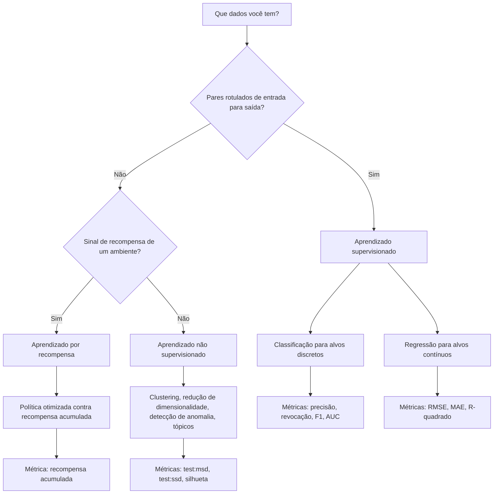
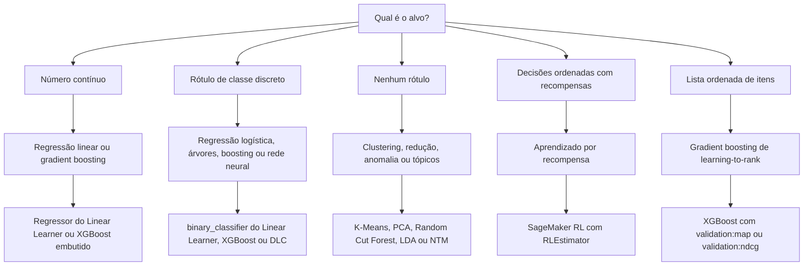
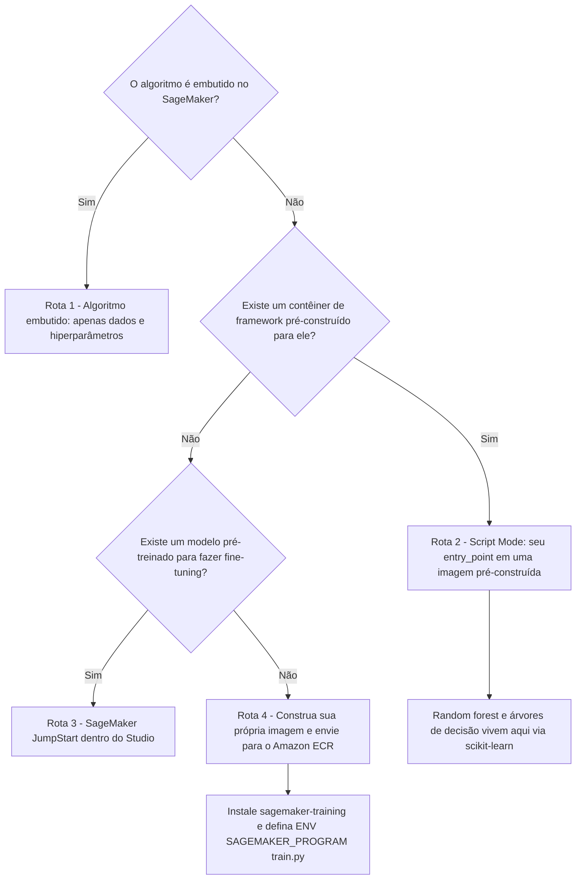
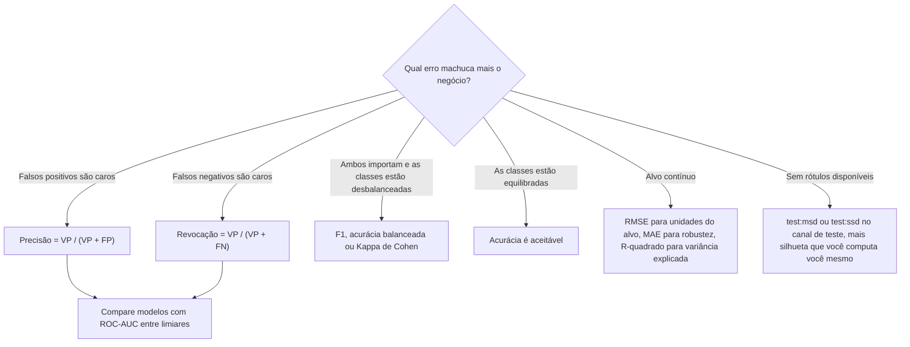
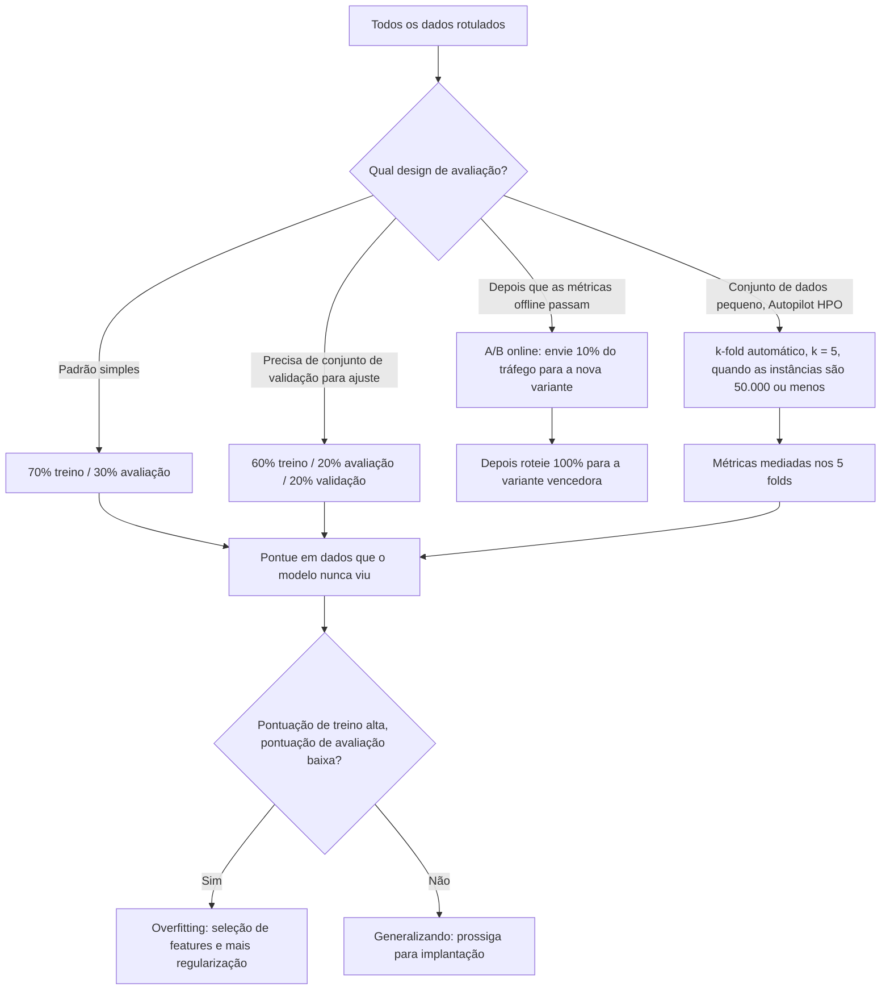

# Algoritmos de ML e Avaliação de Modelos na AWS

Um algoritmo é fácil de nomear e difícil de justificar. O exame AIF-C01 quase nunca pergunta *"qual algoritmo existe"*: ele pergunta *"o negócio precisa de X, os rótulos se parecem com Y, e a AWS dá a você Z; justifique o par e defenda a métrica."* A Tarefa 2.1 pede que você **selecione técnicas de ML apropriadas para casos de uso específicos** (regressão, classificação, clustering), a Tarefa 2.2 pede que você **descreva aprendizado supervisionado, não supervisionado e por recompensa**, e a Tarefa 1.4 pede que você **descreva métricas de desempenho do modelo** (acurácia, AUC, F1) **e métricas de negócio** (custo por usuário, custo de desenvolvimento, retorno do cliente, ROI). Esta lição transforma essas três frases em um sistema de decisão operável.

```text
=====================================================================
 ALGORITMOS E AVALIAÇÃO NA AWS — AS TRÊS PERGUNTAS DO EXAME
=====================================================================
  QUAL PARADIGMA? ....... supervisionado | não supervisionado | recompensa
                          (Tarefa 2.2 — rótulos? recompensa? nenhum?)
  QUAL ALGORITMO? ....... linear | árvore | boosting | k-NN | neural
                          | k-means | PCA | deep learning
                          (Tarefa 2.1 — regressão / classificação /
                           clustering)
  QUAL ROTA AWS? ........ embutido | script mode | JumpStart | BYOC
  QUAL MÉTRICA? ......... acurácia | precisão | revocação | F1 | AUC
                          | RMSE | MAE | R-quadrado | test:msd
  QUAL DIVISÃO? ......... 70/30 | 60/20/20 | holdout 20-30%
                          | k-fold k = 5-10 | A/B 10% depois 100%
---------------------------------------------------------------------
  A ARMADILHA ATRÁS DE CADA ITEM:
    uma alta acurácia pode ser produzida por um modelo que prevê
    apenas a classe majoritária. O exame recompensa o candidato
    que confere a matriz de confusão antes de comemorar.
=====================================================================
```

> [!NOTE]
> **Como ler esta lição.** As seções 1 a 5 respondem *"qual algoritmo e qual ferramenta da AWS"*; as seções 6 a 10 respondem *"como eu prove que funciona"*; as seções 11 a 13 são o veredito, a aritmética e as armadilhas. Cada número aqui vem de uma página publicada pela AWS (guia do desenvolvedor do SageMaker ou de machine learning, documentação do Clarify, blogs de ML da AWS ou o guia do exame AIF-C01), e afirmações não verificadas estão isoladas na seção 13.

Ao final desta lição você será capaz de:

- escolher entre **aprendizado supervisionado, não supervisionado e por recompensa** apenas a partir do formato dos dados;
- mapear **dezesseis famílias de algoritmos** para seu caso de uso, sua rota AWS e seu hiperparâmetro-chave;
- afirmar quais algoritmos são **embutidos no SageMaker**, e qual deles famosamente **não** é;
- computar **acurácia, precisão, revocação, F1, MAE, MSE, RMSE e R²** a partir de uma matriz de confusão ou um conjunto de resíduos sem usar calculadora;
- escolher a **divisão** certa (70/30, 60/20/20, holdout 20 to 30%, k-fold 5 to 10) e defendê-la;
- diagnosticar **underfitting vs. overfitting** e aplicar o remédio prescrito pela AWS na direção correta;
- atacar **desbalanceamento de classes** com as três alavancas documentadas pela AWS (reposicionamento de pesos, reamostragem, troca de métrica);
- responder **dez perguntas no estilo do exame** escritas na voz oficial.

---

## 1. Os três paradigmas de aprendizado e como a AWS os implementa

### 1.1 Guia de seleção: leia os dados, não o jargão

O exame decide o paradigma para você com uma pista: **o que os dados de treinamento contêm?** Pares rotulados de entrada/saída apontam para aprendizado supervisionado; features sem respostas apontam para não supervisionado; um sinal de recompensa voltando de um ambiente aponta para aprendizado por recompensa.

| Pergunta que você faz aos dados | Escolha | Por quê (formulação da AWS) | Implementação AWS |
|---|---|---|---|
| Pares rotulados entrada→saída, prever um alvo conhecido? | **Supervisionado** | Classificação / regressão | Linear Learner, XGBoost, k-NN, Image Classification |
| Apenas features; quer grupos, outliers, forma compacta ou tópicos? | **Não supervisionado** | Sem respostas durante o treinamento | k-means, PCA, Random Cut Forest, LDA / NTM |
| Decisões sequenciais, sinal de recompensa, loop agente: ambiente? | **Por recompensa** | Política aprendida a partir da recompensa | SageMaker RL (`RLEstimator`), Intel Coach, Ray RLlib |
| Rótulos são escassos mas a tarefa ainda é preditiva? | Supervisionado + **transferência** | Reutilizar um modelo pré-treinado | SageMaker JumpStart, containers Hugging Face |
| Não tem certeza de qual algoritmo vence? | **AutoML** | Constrói e ajusta candidatos automaticamente | SageMaker Autopilot, AutoGluon-Tabular |

A distinção em que os itens do exame mais se apoiam: **o aprendizado nunca supervisionado não vê um conjunto de validação com rótulos.** A própria documentação do k-means do SageMaker diz que ele *"não usa um conjunto de dados de validação"* porque não há nada contra o que validar: ele aceita um canal de **teste** e reporta apenas métricas baseadas em distância. Uma questão que oferece `validation:f1` para um trabalho de clustering está testando se você percebeu.

### 1.2 Como cada paradigma se parece como um fluxo de trabalho



### 1.3 Aprendizado por recompensa no SageMaker: os fatos específicos

O aprendizado por recompensa (RL) é o paradigma que o exame testa por *reconhecimento de nome* em vez de por computação. As afirmações verificadas da AWS são:

- o SageMaker AI suporta RL em **TensorFlow e Apache MXNet**;
- ele suporta os toolkits **Intel Coach** e **Ray RLlib**;
- o FAQ do SageMaker lista algoritmos como **DQN, PPO, A3C e muitos outros**;
- o repositório de contêineres de RL aberto distribui imagens do **Vowpal Wabbit (VW)**;
- os trabalhos eram lançados com o **`RLEstimator`**.

Se uma questão descreve um agente aprendendo uma política para maximizar a recompensa acumulada em uma simulação, a resposta é SageMaker RL com Coach ou Ray RLlib: nunca k-means, nunca Autopilot, nunca PCA.

- **📚 Você sabia?** O suporte a RL do SageMaker é deliberadamente estreito: **apenas TensorFlow e MXNet** para frameworks. Se uma opção oferece *"SageMaker RL com PyTorch"*, é um distrator: a lista de frameworks documentada não inclui PyTorch, mesmo sendo o PyTorch totalmente suportado para deep learning **supervisionado** através dos contêineres de deep learning pré-construídos.

**Verifique sua seleção de paradigma:**

```matching
{
  "question": "Combine cada cenário com o paradigma de aprendizado e a ferramenta da AWS que o implementa:",
  "pairs": [
    {"left": "Dados rotulados de churn, prever cancelamento sim/não", "right": "Classificação supervisionada: binary_classifier do Linear Learner ou XGBoost"},
    {"left": "50.000 transações sem rótulo, agrupar clientes em segmentos", "right": "Clustering não supervisionado: K-Means embutido com test:msd e test:ssd"},
    {"left": "Braço robótico aprende uma política de pick-and-place a partir de recompensas", "right": "Aprendizado por recompensa: SageMaker RL com RLEstimator, Coach ou Ray RLlib"},
    {"left": "10.000 linhas de sensores, encontrar as 40 leituras que quebram o padrão", "right": "Detecção de anomalia não supervisionada: Random Cut Forest"},
    {"left": "Prever tempo de entrega em dias a partir de features de rota e clima", "right": "Regressão supervisionada: regressor do Linear Learner ou XGBoost, pontuado com RMSE"},
    {"left": "10.000 documentos, descobrir temas recorrentes sem rótulos", "right": "Modelagem de tópicos não supervisionada: LDA ou Neural Topic Model"}
  ],
  "explanation": "O paradigma é decidido pela presença de rótulos, não pela indústria. Alvo rotulado => supervisionado (classificação para alvos discretos, regressão para contínuos). Apenas features => não supervisionado (clustering, anomalia, tópicos, redução de dimensionalidade). Um loop de recompensa => recompensa. A ferramenta da AWS decorre do paradigma: Linear Learner e XGBoost são algoritmos embutidos supervisionados, K-Means/Random Cut Forest/LDA são algoritmos embutidos não supervisionados, e o SageMaker RL é a única rota para políticas movidas a recompensa."
}
```

---

## 2. A matriz algoritmo → caso de uso → rota AWS

Esta é a tabela mais examinável do Domínio 2. Leia-a como três perguntas respondidas de uma vez: *qual família*, *qual caso de negócio*, *onde roda na AWS*.

### 2.1 A matriz completa

| Família de algoritmo | Caso de uso | Rota AWS | Config / métrica-chave |
|---|---|---|---|
| Regressão linear | Preço, previsão de tempo de entrega | **Linear Learner** embutido (`regressor`) | Variantes de loss; `validation:rmse` |
| Regressão logística | Churn, previsão de clique em anúncio | **Linear Learner** embutido (`binary_classifier`) | `validation:precision` / `validation:recall` |
| Árvore de decisão | Decisões baseadas em regras, explicáveis | **contêiner scikit-learn + Script Mode** (sem embutido) | script `entry_point` |
| Random forest | Linha de base tabular | **contêiner scikit-learn + Script Mode** ("sem pronto para uso") | `n_estimators`, `min_samples_leaf` |
| XGBoost (gradient boosting) | Tabular, fraude, ranking | **XGBoost embutido** | `num_round` (obrigatório), `eta`, `max_depth` |
| LightGBM / CatBoost | Conjuntos de dados tabulares grandes | **embutidos** (CSV, File mode, CPU de instância única) | GOSS + EFB / ordered boosting |
| Ensemble AutoML | Linha de base defensível mais rápida | **AutoGluon-Tabular** embutido ou **SageMaker Autopilot** | objetivo binário padrão do Autopilot = F1 |
| k-NN | Consulta item/usuário | **k-NN embutido** | `k`; recordIO ou CSV; paralelizável |
| Redes neurais / deep learning | Imagens, texto, sequências | **contêineres DL**: TensorFlow, PyTorch, MXNet, Chainer, **Hugging Face** | instâncias GPU, imagens DLC |
| Fine-tuning de Transformer / FM | Adaptar um foundation model | **SageMaker JumpStart** (`ModelTrainer`) | `model_id` + canais de treino/validação |
| k-means | Segmentação, agrupamento | **K-Means embutido** | `k`, `init_method`; `test:msd` / `test:ssd` |
| PCA | Redução de features | **PCA embutido** | `feature_dim`, `num_components` |
| Detecção de anomalia | Outliers de sensor / IP | **Random Cut Forest**, **IP Insights** | Pontuação no canal de teste |
| Modelagem de tópicos | Tópicos de documentos | **LDA**, **Neural Topic Model** embutidos | Entrada de texto |
| Controle sequencial | Agente, robótica, política | **SageMaker RL** `RLEstimator` (Coach / Ray RLlib / VW) | TensorFlow ou MXNet |
| Séries temporais | Previsão de demanda | **Deep AR Forecasting** embutido | Alvo sequencial |

### 2.2 Do tipo de tarefa à família de algoritmos



### 2.3 As listas de embutidos que você deve ser capaz de reproduzir

A AWS organiza seus algoritmos embutidos em grupos **supervisionados**, **não supervisionados** e **de recompensa**. O conjunto tabular supervisionado é o que o exame mais reutiliza:

**Embutidos tabulares (classificação ou regressão):** AutoGluon-Tabular, CatBoost, Factorization Machines, k-NN, LightGBM, **Linear Learner**, TabTransformer, **XGBoost**.

A documentação do Linear Learner é explícita sobre o que ele é: ele *"aprende uma função linear para regressão ou uma função de limiar linear para classificação"*, o que o torna a resposta embutida sempre que uma questão diz **regressão logística** ou **regressão linear**.

**Embutidos não supervisionados:** PCA (redução de dimensionalidade), K-Means (clustering), Random Cut Forest (detecção de anomalia), IP Insights (anomalia de endereço IP), LDA e Neural Topic Model (modelagem de tópicos).

> [!WARNING]
> **Não existe random forest pronta para uso no SageMaker.** A própria documentação de script mode da AWS afirma isso textualmente. A rota documentada é o **contêiner scikit-learn + Script Mode**: seu script de treinamento instancia `RandomForestRegressor` ou `RandomForestClassifier` e o SageMaker o executa dentro da imagem scikit-learn pré-construída. Uma questão que oferece *"chamar o algoritmo embutido `RandomForest` com `num_round`"* está oferecendo duas mentiras ao mesmo tempo, o algoritmo não é embutido, e `num_round` é um hiperparâmetro do XGBoost.

- **📚 Você sabia?** A AWS publica **listas** de algoritmos, nunca uma contagem. Qualquer opção que começa com *"O SageMaker tem exatamente N algoritmos embutidos"* é um número inventado: as listas mudam conforme algoritmos são adicionados (AutoGluon-Tabular e TabTransformer são adições recentes ao conjunto tabular) e removidos. Aprenda a pertinência das listas, não um total.

---

## 3. As famílias supervisionadas: lineares, árvores, boosting e redes neurais

### 3.1 Linear Learner, o cavalo de batalha de regressão e classificação

O Linear Learner é a resposta para *"qual embutido faz regressão linear ou logística?"* e carrega três propriedades examináveis:

| Propriedade | Valor verificado |
|---|---|
| Tarefas | Regressão (`regressor`) e classificação (`binary_classifier`) |
| Métricas emitidas | `validation:precision`, `validation:recall`, `validation:rmse`, `validation:absolute_loss`, `validation:objective_loss` |
| Regra de ajuste da AWS | *"Para evitar overfitting, recomendamos ajustar o modelo contra uma métrica de validação em vez de uma métrica de treinamento."* |
| Comportamento do Tuner | Seu hiperparâmetro `num_models` desliga-se sob ajuste automático de modelo |

Essa regra de ajuste é uma resposta gratuita sempre que uma opção diz *"ajustar contra a métrica de treinamento"*. O remédio documentado é o oposto: **ajuste na métrica de validação.**

### 3.2 Gradient boosting: três embutidos mais um wrapper AutoML

O gradient boosting é representado no SageMaker por **três** algoritmos embutidos mais uma opção de ensemble em pilha:

| Algoritmo | Traço distintivo | Hiperparâmetros notáveis |
|---|---|---|
| **XGBoost** | Regressão, classificação binária/multiclass **e ranking** | `num_round` (obrigatório), `eta`, `max_depth`, `subsample`, `alpha`, `min_child_weight` |
| **CatBoost** | Ordered boosting, features categóricas nativas | Tratamento de categorias sem encoding manual |
| **LightGBM** | GOSS (gradient-based one-side sampling) + EFB (exclusive feature bundling) | Velocidade em tabulares grandes |
| **AutoGluon-Tabular** | Ensemble em pilha de muitos modelos base | Linha de base defensível mais rápida |

**Detalhes do XGBoost que o exame reutiliza:**

- o contêiner cobre XGBoost **1.0, 1.2, 1.3, 1.5, 1.7 e 3.0**;
- **`num_round` é obrigatório** (mais `num_class` para `multi:softmax` e `multi:softprob`);
- o objetivo padrão é **`reg:squarederror`**, então um trabalho do XGBoost não configurado é um trabalho de *regressão*;
- o treinamento em GPU é habilitado com **`tree_method=gpu_hist`**;
- os hiperparâmetros de maior impacto para ajuste são **`alpha`, `min_child_weight`, `subsample`, `eta` e `num_round`**.

### 3.3 O menu de métricas do XGBoost: doze objetivos com direções

O ajuste automático de modelo precisa de um objetivo **e uma direção**. O XGBoost expõe doze métricas de validação, e a direção é parte da resposta:

| Maximizar | Minimizar |
|---|---|
| `validation:accuracy` | `validation:error` |
| `validation:auc` | `validation:logloss` |
| `validation:f1` | `validation:mae` |
| `validation:map` | `validation:merror` |
| `validation:ndcg` | `validation:mlogloss` |
|: | `validation:mse` |
|: | `validation:rmse` |

Duas armadilhas vivem nesta tabela. Primeiro, **as métricas de ranking (`map`, `ndcg`) são Maximizar** enquanto toda métrica de erro é **Minimizar**: selecionar `validation:rmse` com direção `Maximizar` ajustaria o modelo para o *pior* resultado. Segundo, **`merror` e `mlogloss` são os irmãos multiclass de `error` e `logloss`**; confundi-los em uma opção é um padrão de distrator comum.

### 3.4 Árvores, florestas e redes neurais: as rotas que exigem código

| Família | Rota no SageMaker | Por quê |
|---|---|---|
| Árvore de decisão | contêiner scikit-learn + Script Mode | Não existe árvore de decisão embutida |
| Random forest | contêiner scikit-learn + Script Mode | AWS: *"não há algoritmo de random forest 'pronto para uso'"* |
| Qualquer modelo personalizado | Script Mode com sua imagem de framework | Seu script `entry_point` roda em uma imagem pré-construída |
| Rede neural profunda | **Contêineres DL** pré-construídos: TensorFlow, MXNet, PyTorch, Chainer, Hugging Face | Prontos para GPU, gerenciados |
| Embutidos de visão / NLP | Image Classification, Object Detection, Semantic Segmentation, NTM, Object2Vec, TabTransformer, Deep AR Forecasting | Algoritmos de deep learning embutidos |
| Transformer com fine-tuning | SageMaker JumpStart | Modelo pré-treinado, código mínimo |

O Object2Vec merece um gancho de memória específico: ele usa **entropia cruzada para classificação** e **erro quadrático médio (MSE) para regressão**, o mesmo algoritmo troca sua função de loss com a tarefa, que é exatamente o tipo de detalhe que uma opção pode inverter para produzir uma resposta errada.

---

## 4. As famílias não supervisionadas: clustering, redução, anomalia e tópicos

### 4.1 K-Means: não existe conjunto de validação

O K-Means é o favorito do exame para testar se você entende que **o aprendizado não supervisionado não tem conjunto de validação com rótulos**. Os pontos da documentação verificada:

- *"Como é não supervisionado, ele não usa um conjunto de dados de validação… Mas ele aceita um conjunto de dados de teste."*
- Métricas de objetivo: **`test:msd`** (distâncias quadradas médias) e **`test:ssd`**: **ambas Minimizar**;
- a inferência retorna **`closest_cluster`** e **`distance_to_cluster`**;
- hiperparâmetros: **`k`**, **`init_method`** (`random` ou `k-means++`), **`mini_batch_size`**.

Note a direção: métricas de distância são **minimizadas**, porque uma menor distância quadrada significa clusters mais compactos. Todo objetivo de clustering baseado em distância no SageMaker aponta na mesma direção.

### 4.2 Silhueta: uma métrica real que não é uma métrica do SageMaker

O coeficiente de silhueta varia de **−1 a 1**; um valor próximo de **1** significa que os pontos estão apertados dentro do próprio cluster *e* longe dos outros clusters. A orientação da AWS é **parear silhueta com inércia**, e deixar claro que **o SageMaker não a emite**: você a computa você mesmo fora do trabalho de treinamento. Uma questão que oferece *"selecionar `validation:silhouette` como objetivo de ajuste"* está testando precisamente esse limite.

### 4.3 PCA: três hiperparâmetros obrigatórios

O PCA é embutido, e sua configuração é examinável porque é curta:

| Parâmetro | Requisito | Significado |
|---|---|---|
| `feature_dim` | **Obrigatório** | Dimensionalidade de cada vetor de entrada |
| `mini_batch_size` | **Obrigatório** | Linhas processadas por passo de gradiente |
| `num_components` | **Obrigatório** | Número de componentes principais a manter |
| `algorithm_mode` | Opcional | `regular`, `stable` ou `randomized` |
| `subtract_mean` | Opcional | Se centralizar os dados |
| `extra_components` | Opcional | Componentes extras computados além de `num_components` |

O PCA produz a **`mean`**, a matriz de autovetores **`v`** e os valores singulares **`s`**: que é como você depois reconstrói ou projeta dados com os componentes que manteve.

### 4.4 Detecção de anomalia e modelagem de tópicos

| Necessidade | Algoritmo embutido | Notas |
|---|---|---|
| Detecção de outliers numéricos (sensores, métricas) | **Random Cut Forest** | Pontua um canal de teste; não supervisionado |
| Anomalia de rede / IP | **IP Insights** | Aprende padrões normais de associação de IP |
| Descoberta de tópicos em documentos | **LDA** (Latent Dirichlet Allocation) | Modelo de tópicos clássico |
| Descoberta de tópicos em escala | **Neural Topic Model (NTM)** | Variante de deep learning |

- **📚 Você sabia?** `test:msd` e `test:ssd` *não* são sinônimos intercambiáveis: **`msd` é a distância quadrada média** e **`ssd` é a soma** das distâncias quadradas ao centróide. Em um conjunto de teste de *n* linhas, `ssd = msd × n`, então `ssd` cresce com o tamanho do conjunto de dados enquanto `msd` não cresce. Ambas são minimizadas, e ambas são objetivos de clustering válidos, mas apenas `msd` é comparável entre conjuntos de teste de tamanhos diferentes.

---

## 5. Quatro rotas para um algoritmo

A AWS documenta exatamente **quatro** maneiras de colocar um algoritmo em execução, e o exame testa se você consegue nomeá-las em ordem crescente de esforço.

| # | Rota | O que você fornece | O que a AWS fornece | Quando usar |
|---|---|---|---|---|
| 1 | **Algoritmo embutido** | Dados + hiperparâmetros | *"Nenhum código para começar a rodar experimentos"* | O algoritmo está na lista de embutidos |
| 2 | **Script Mode** | Seu script de treinamento (`entry_point`) | Um contêiner de framework pré-construído | Seu algoritmo existe em um framework que a AWS já imagem |
| 3 | **JumpStart** | Um `model_id` e canais de treinamento | Um modelo pré-treinado para fine-tuning e implantação *"dentro do Amazon SageMaker Studio"* | Você quer um foundation model ou modelo pré-treinado com código mínimo |
| 4 | **Bring your own container (BYOC)** | Dockerfile + código de treinamento | Hospedagem no Amazon ECR | Nada pré-construído se encaixa |

### 5.1 O fluxo de decisão



### 5.2 BYOC: as três regras de contêiner não negociáveis

Se uma questão empurra você para a Rota 4, três fatos documentados decidem a resposta:

1. o pacote de toolkit **`sagemaker-training`** é **obrigatório**;
2. **`ENV SAGEMAKER_PROGRAM train.py`** é *a única variável de ambiente obrigatória*: ela nomeia o ponto de entrada que o SageMaker invoca;
3. **`/opt/ml` e todos os seus subdiretórios são reservados pelo treinamento do SageMaker**, então entradas, artefatos de modelo e saída devem seguir esse layout.

Duas mais regras de contêiner aparecem como distratores:

- o SageMaker **sobrescreve o `CMD` padrão** da sua imagem anexando o argumento `train`;
- imagens GPU devem ser **compatíveis com `nvidia-docker`**: embale o **CUDA toolkit**, mas **não embale os drivers NVIDIA**, o host os fornece.

### 5.3 Janelas de suporte de contêiner são datas examináveis

| Contêiner | Data GA | Fim do suporte de patch |
|---|---|---|
| XGBoost **3.0-5** | 17 de novembro de 2025 | **17 de novembro de 2026** |
| Scikit-Learn **1.4-2** | 30 de outubro de 2025 | **30 de outubro de 2026** |

A AWS publica um cronograma explícito de **GA → fim-de-patch** para seus contêineres de algoritmos. O padrão que vale a pena memorizar é o *formato*: cerca de **um ano** de suporte de patch após a disponibilidade geral, e é por isso que um item de exame datado em 2026 pode legitimamente referenciar uma versão de 2025 atingindo o fim de patch no mesmo ano.

---

## 6. Métricas de avaliação: fórmulas, direções e quando usá-las

### 6.1 A folha de fórmulas

| Métrica | Fórmula | Direção | Quando usar |
|---|---|---|---|
| Acurácia | (VP+VN)/(VP+VN+FP+FN) | Maior melhor | Classes equilibradas; correção geral |
| Precisão | VP/(VP+FP) | Maior melhor | **Falsos positivos são caros** |
| Revocação | VP/(VP+FN) | Maior melhor | **Falsos negativos são caros** |
| F1 | 2·P·R/(P+R) = 2VP/(2VP+FP+FN) | Maior melhor | Dados binários desbalanceados; objetivo binário padrão do Autopilot |
| ROC-AUC | Área sob TPR vs. FPR em todos os limiares | 0.5 aleatório → 1.0 | Comparação de modelos entre limiares; dados enviesados |
| Acurácia balanceada | (Revocação + Taxa de Verdadeiro Negativo)/2 | Maior melhor | Tanto penalidades de FP quanto de FN são altas |
| Matriz de confusão | Tabela de contagem, previsto × real | Contagens (sem direção) | Diagnóstico: *quais* classes estão confundidas |
| MSE | Σ(ŷ−y)²/n | Menor melhor | Punição dura para erros grandes |
| RMSE | √MSE | Menor, **unidades do alvo** | Reportar erro em dólares ou graus |
| MAE | Σ\|ŷ−y\|/n | Menor, unidades do alvo | Robusta e fácil de interpretar |
| R² | 1 − SS_res/SS_tot | Mais perto de 1 | Proporção da variância explicada |
| Silhueta | (b−a)/max(a,b), média | −1..1, mais perto de 1 | Coesão do cluster; **não é métrica do SageMaker** |
| `test:msd` / `test:ssd` | Distância quadrada média / soma ao centróide | **Minimizar** | Métricas oficiais de objetivo do k-means |
| mAP / NDCG | Qualidade de ranking | Maior melhor | Ranking e recomendação (`validation:map`, `validation:ndcg`) |

O resumo da própria AWS sobre a relação precisão/revocação vale a pena memorizar textualmente: **precisão corta falsos positivos, revocação corta falsos negativos, e F1 é a média harmônica dos dois.**

### 6.2 Escolhendo uma métrica a partir da matriz de confusão



### 6.3 Matriz de confusão trabalhada nº 1: dados de churn equilibrados

Um modelo de churn é avaliado em **200 clientes**: **VP = 80, FP = 20, FN = 10, VN = 90**.

$$
\text{Acurácia} = \frac{VP+VN}{N} = \frac{80+90}{200} = \frac{170}{200} = 0.85
$$

$$
\text{Precisão} = \frac{VP}{VP+FP} = \frac{80}{100} = 0.80
$$

$$
\text{Revocação} = \frac{VP}{VP+FN} = \frac{80}{90} = 0.889
$$

$$
F1 = \frac{2VP}{2VP+FP+FN} = \frac{160}{190} = 0.842
$$

Leitura: o modelo captura cerca de **89% dos churners**, mas **20 dos seus 100 alertas estão errados**. Uma acurácia de 0.85 é respeitável aqui *porque as classes estão razoavelmente equilibradas* (90 positivas, 110 negativas).

### 6.4 Matriz de confusão trabalhada nº 2: a armadilha do 1% de fraude

Um modelo de fraude é avaliado em **10.000 transações das quais apenas 100 são fraudulentas**: **VP = 85, FP = 40, FN = 15, VN = 9.860**.

$$
\text{Acurácia} = \frac{85+9860}{10000} = \frac{9945}{10000} = 99.45\%
$$

Ainda assim, um modelo que **sempre prevê "não fraude"** já pontua:

$$
\frac{9900}{10000} = 99.0\%
$$

Então 99,45% de acurácia compra **0,45 pontos percentuais** sobre uma linha de base inútil. As métricas que importam:

$$
\text{Precisão} = \frac{85}{85+40} = \frac{85}{125} = 0.68
$$

$$
\text{Revocação} = \frac{85}{85+15} = \frac{85}{100} = 0.85
$$

$$
F1 = \frac{2 \times 85}{170+40+15} = \frac{170}{225} = 0.756
$$

Leitura: **32% dos alertas de fraude são falsos alarmes**, o modelo perde 15 de 100 fraudes, e a acurácia manchete é quase sem significado. Este é o padrão de avaliação mais repetido no material próprio de detecção de fraude da AWS.

> [!WARNING]
> **A acurácia é a métrica-armadilha do Domínio 1.** Quando uma classe domina, fraude em **0,173%**, churn em 2%, taxas de defeito abaixo de 1%, um modelo preguiçoso atinge acurácia quase perfeita prevendo a classe majoritária toda vez. Antes de aceitar um número de acurácia, pergunte: *o que um preditor de classe majoritária pontuaria?* Se a resposta estiver a um ponto do seu modelo, mude para **precisão, revocação, F1, ROC-AUC, acurácia balanceada ou Kappa de Cohen**, e varra o limiar de decisão de 0,1 a 0,9.

---

## 7. Divisões de dados, validação cruzada e testes A/B

### 7.1 Os padrões de divisão publicados

| Padrão | Valor oficial | Fonte |
|---|---|---|
| Divisão padrão do Amazon ML | **70% treino / 30% avaliação** | Guia do Desenvolvedor de ML, avaliando modelos |
| Divisão em três vias recomendada | **60% treino / 20% avaliação / 20% validação** | Guia do Desenvolvedor de ML, avaliando modelos |
| Proporção de holdout do SageMaker | **20 to 30%** dos dados de treinamento | GD do SageMaker, validação de modelo |
| `k` do k-fold do SageMaker | Tipicamente **5 to 10** | GD do SageMaker, validação de modelo |
| Validação cruzada HPO do Autopilot | Automático **k = 5** quando ≤ **50.000** instâncias de treinamento | GD do SageMaker, métricas do autopilot |
| Divisão de ensemble do Autopilot | **80% treino / 20% validação** | GD do SageMaker, métricas do autopilot |
| Tráfego de teste A/B online | **10% → depois 100%** | GD do SageMaker, validação de modelo |
| Registros auto-avaliados do Clarify | **100** (maioria das tarefas), **300** (conhecimento factual) | GD do SageMaker, Clarify |

O motivo declarado da AWS para reter dados é uma frase que vale a pena reproduzir em uma resposta de exame: avaliar nos dados de treinamento *"recompensa modelos que podem 'lembrar' dos dados de treinamento, em vez de generalizar a partir deles."*

### 7.2 Aritmética de divisão e validação cruzada em 100.000 linhas

| Esquema | Treino | Validação / avaliação | Teste | Notas |
|---|---|---|---|---|
| Padrão 70/30 | **70.000** | **30.000** |: | Padrão do Amazon ML |
| Três vias 60/20/20 | **60.000** | **20.000** | **20.000** | Treino / avaliação / validação |
| Holdout 20 to 30% | 70.000 to 80.000 |: | **20.000 to 30.000** | Intervalo recomendado pelo SageMaker |
| k = 5 | 80.000 por fold | 20.000 por fold |: | 5 modelos, métricas médias |
| k = 10 | 90.000 por fold | 10.000 por fold |: | 10 modelos, métricas médias |

### 7.3 Validação cruzada do Autopilot: o limiar de 50.000 instâncias

Com **40.000 instâncias de treinamento** (≤ 50.000, então o modo HPO aplica k-fold automático com **k = 5**):

1. a divisão automática **80/20** dá **32.000 treino / 8.000 validação**;
2. cada um dos **5 folds** treina em 4/5 × 32.000 = **25.600** instâncias;
3. cada fold valida em **6.400** instâncias;
4. as cinco pontuações de validação são **mediadas** no objetivo reportado.

Um conjunto de dados de **60.000 instâncias** **excede** o limiar ≤ 50.000, então o k-fold automático no modo HPO não é acionado: enquanto o **modo ensemble** roda validação cruzada independentemente do tamanho ao lado de sua divisão automática 80/20.

### 7.4 Como o loop se encaixa



**Verificação interativa: as fórmulas que você não deve precisar procurar:**

```fillblank
{
  "question": "Complete as quatro fórmulas de métrica usadas ao longo desta lição:",
  "template": "Precisão = {{1}} / (VP + FP)   |   Revocação = VP / (VP + {{2}})   |   F1 = 2 x {{3}} / (P + {{3}})   |   RMSE = {{4}} do MSE",
  "answers": {
    "1": "VP",
    "2": "FN",
    "3": "P x R",
    "4": "raiz quadrada"
  },
  "distractors": ["VN", "FP", "acurácia", "variância", "log loss", "média"],
  "explanation": "Precisão é a parcela dos positivos previstos que são realmente positivos (VP / (VP + FP)); revocação é a parcela dos positivos reais que o modelo realmente encontrou (VP / (VP + FN)); F1 é a média harmônica 2PR / (P + R), que se recusa a deixar um número forte esconder um fraco; e RMSE é a raiz quadrada do erro quadrático médio, que é o que restaura o erro às próprias unidades do alvo depois que a elevação ao quadrado puniu os grandes erros."
}
```

---

## 8. Underfitting, overfitting e os controles de ajuste que os corrigem

### 8.1 O diagnóstico

| Sinal | Diagnóstico | Remédio prescrito pela AWS |
|---|---|---|
| Alto erro **nos dados de treinamento** | **Underfitting**, o modelo simples demais | Adicionar features, mudar processamento, **diminuir** regularização, mais passagens |
| Baixo erro de treino, **alto erro de avaliação** | **Overfitting**: *"performa bem nos dados de treinamento mas não performa bem nos dados de avaliação… memorizando os dados"* | Seleção de features, **aumentar** regularização, ajustar em uma métrica de **validação**, early stopping ou Hyperband |
| Ambas as pontuações ruins | Dados insuficientes | Aumentar exemplos de treinamento; aumentar o número de passagens |
| Métricas de produção decaem | Deriva de dados / conceito | Model Monitor + viés pós-treino do Clarify; retreinar |
| Acurácia parece ótima, modelo inútil | Métrica errada | Mudar para AUC / F1 / acurácia balanceada / Kappa de Cohen; varrer limiar 0,1 to 0,9 |

A assinatura oficial de overfitting da AWS é curta: **alta acurácia de treinamento mais baixa acurácia de teste.** A direção do remédio importa tanto quanto o remédio: *overfitting recebe mais regularização, underfitting recebe menos.* Invertê-los é um distrator clássico.

### 8.2 Os controles de ajuste que previnem overfitting mecanicamente

Quatro controles documentados fazem o trabalho que um humano faria a olho:

1. **Ajuste em uma métrica de validação, não em uma métrica de treinamento.** A documentação do Linear Learner afirma isso como recomendação, não como preferência.
2. **Early stopping.** A cada época, a métrica de objetivo é comparada com a **mediana das médias móveis** de trabalhos anteriores; trabalhos com desempenho pior param cedo: a AWS diz que isso *"ajuda você a evitar overfitting do seu modelo"*. A configuração é `early_stopping_type='Auto'`.
3. **Hyperband** também termina cedo trabalhos com desempenho fraco, alocando o orçamento para configurações promissoras.
4. **Direção da regularização**: aumente-a para overfitting, diminua-a para underfitting.

| Controle | Mecanismo | Formulação / configuração da AWS |
|---|---|---|
| Ajuste por métrica de validação | O objetivo nunca vê linhas de treinamento | *"ajustar o modelo contra uma métrica de validação"* |
| Early stopping | Comparar com a **mediana das médias móveis** de trabalhos anteriores | `early_stopping_type='Auto'` |
| Hyperband | Alocação de recursos em colcheias, mata trabalhos fracos | Terminação antecipada consciente de recursos |
| Regularização | Controle de capacidade | **Aumentar** para overfit, **diminuir** para underfit |

### 8.3 Ordene a sequência de diagnóstico

```dragdrop
{
  "question": "Ordene os passos que um time deve seguir quando as pontuações de um modelo parecem erradas:",
  "items": [
    "Compare a pontuação de treinamento com a pontuação de avaliação ou validação",
    "Classifique a lacuna: ruim em ambos = underfitting, bom no treino e ruim na avaliação = overfitting",
    "Verifique se a métrica escolhida consegue sequer expressar o problema (acurácia de classe majoritária, MSE em unidades ao quadrado)",
    "Aplique o remédio correspondente: mais features e menos regularização para underfit, seleção de features e mais regularização para overfit",
    "Reajuste contra uma métrica de validação com early stopping ou Hyperband habilitados",
    "Confirme em um conjunto de retenção que o modelo nunca viu (holdout de 20 a 30 por cento, ou k-fold com k entre 5 e 10)"
  ],
  "correctOrder": [
    "Compare a pontuação de treinamento com a pontuação de avaliação ou validação",
    "Classifique a lacuna: ruim em ambos = underfitting, bom no treino e ruim na avaliação = overfitting",
    "Verifique se a métrica escolhida consegue sequer expressar o problema (acurácia de classe majoritária, MSE em unidades ao quadrado)",
    "Aplique o remédio correspondente: mais features e menos regularização para underfit, seleção de features e mais regularização para overfit",
    "Reajuste contra uma métrica de validação com early stopping ou Hyperband habilitados",
    "Confirme em um conjunto de retenção que o modelo nunca viu (holdout de 20 a 30 por cento, ou k-fold com k entre 5 e 10)"
  ],
  "explanation": "O diagnóstico deve preceder o remédio, porque os dois remédios são opostos: overfitting precisa de mais regularização e seleção de features, underfitting precisa de menos regularização e mais features. A verificação da métrica vem antes do remédio porque um preditor de classe majoritária pode esconder ambos os problemas atrás de um número de acurácia alto. Reajustar contra uma métrica de validação com early stopping ou Hyperband é a versão mecânica da mesma correção, e a confirmação final deve usar dados que o modelo genuinamente nunca viu."
}
```

- **📚 Você sabia?** O early stopping no Ajuste Automático de Modelo do SageMaker **não** compara seu trabalho com um alvo fixo: ele compara o valor de objetivo de cada época com a **mediana das médias móveis de todos os trabalhos anteriores**. Isso torna o limiar adaptativo: um trabalho inicial incomumente forte eleva a barra para tudo que segue, e um trabalho inicial fraco a baixa. A lista de suporte do early stopping traz um carimbo de "atual em 13 de dezembro de 2018", então trate qualquer afirmação sobre *quais* algoritmos o suportam como histórica.

---

## 9. Dados desbalanceados: três alavancas e os números por trás delas

A AWS documenta **três alavancas independentes** para desbalanceamento. Uma resposta forte usa pelo menos duas delas juntas.

### 9.1 As três alavancas

| Alavanca | Mecanismo | Implementação AWS | Restrição |
|---|---|---|---|
| **1. Reamostragem** | Reequilibrar as próprias linhas | **Balance** do SageMaker Data Wrangler: sobreamostrador aleatório, subamostrador aleatório, **SMOTE** | **Apenas classificação binária** |
| **2. Pesos de classe** | Penalizar erros na classe rara | XGBoost `scale_pos_weight`; Linear Learner `positive_example_weight_mult='balanced'` (binário) / `balance_multiclass_weights` (multiclass); Autopilot aplica automaticamente | Os pesos mudam a fronteira de decisão, não os dados |
| **3. Troca de métrica** | Medir o que a acurácia esconde | AUC, F1, acurácia de classificação balanceada, Kappa de Cohen | A direção da métrica deve corresponder ao objetivo de ajuste |

### 9.2 Aritmética de pesos de classe

**Caso A: uma divisão binária de 98% / 2%.** Para fazer a classe minoritária contar tanto quanto a majoritária:

$$
0.02 \times w = 0.98 \implies w = \frac{0.98}{0.02} = 49
$$

Então o `positive_example_weight_mult='balanced'` do Linear Learner em um conjunto 98/2 produz um peso positivo de **49**.

**Caso B, o próprio conjunto de dados de fraude da AWS.** Com **284.807** exemplos dos quais **492** são fraudulentos (**0,173%**), a variante XGBoost da AWS usa a regra da raiz quadrada em vez da razão bruta:

$$
\text{scale\_pos\_weight} = \sqrt{\frac{284{,}315}{492}} = \sqrt{577.9} \approx 24
$$

A razão bruta seria **577,9**; o amortecimento da raiz quadrada mantém o treinamento estável enquanto ainda diz ao modelo que a fraude importa. A AWS reporta adicionalmente que elevar o **Kappa de Cohen acima de 0,8** seria *"geralmente muito favorável"* naquele problema.

### 9.3 O que a ponderação custa, o trade-off documentado

Ponderar não é de graça. O próprio exemplo multiclass da AWS mostra os dois lados:

| Medida | Antes do equilíbrio | Depois do equilíbrio |
|---|---|---|
| Revocação da classe rara (Aspen) | **1%** | **acima de 50%** |
| Revocação para cada classe | algumas colapsam para ~1% | **todas acima de 50%** |
| Revocação da classe dominante (Lodgepole Pine) | **81%** | **52%** |
| Acurácia geral | **72%** | **59%** |

A lição que o exame quer: **você trocou 13 pontos de acurácia por um modelo que realmente reconhece a classe rara.** Em um problema desbalanceado, essa troca geralmente está correta, mas deve ser uma *decisão*, não um efeito colateral.

### 9.4 A troca de métrica, lado a lado

| Situação | Métrica para alcançar | Por que a acurácia falha |
|---|---|---|
| Fraude com prevalência de 0,173% | ROC-AUC (`job_objective='AUC'` no Autopilot) | Linha de base de 99,0% prevendo sempre "não fraude" |
| Binário, moderadamente desbalanceado | F1 (objetivo binário **padrão** do Autopilot) | A média harmônica se recusa a esconder um lado fraco |
| Tanto FP quanto FN caros | Acurácia balanceada = (Revocação + TVN)/2, ou Kappa de Cohen | A classe majoritária domina a acurácia simples |
| Limiar precisa de ajuste | Curva precisão/revocação, varrer 0,1 to 0,9 | Um único limiar raramente otimiza os dois |

> [!NOTE]
> **O Autopilot faz duas das três alavancas para você.** Seu objetivo binário padrão é **F1** (mude para **AUC** com `job_objective='AUC'` para dados enviesados além de 99%), e ele *"automaticamente aplicou up-weighting à classe minoritária usando `scale_pos_weight`"*. Se uma questão pergunta o que o Autopilot faz automaticamente em dados binários desbalanceados, a resposta é **tanto o padrão de métrica quanto a ponderação**.

---

## 10. Avaliação por tipo de tarefa: a tabela de consulta

| Tipo de tarefa | Configuração | Métricas primárias | Nomes de métricas emitidas pela AWS | Armadilha |
|---|---|---|---|---|
| Binário (equilibrado) | treino/val/teste ou 70/30 | Acurácia, F1, ROC-AUC | Linear Learner `validation:precision` / `:recall`; XGBoost `validation:f1` / `:auc` | Confiar apenas na acurácia |
| Binário (desbalanceado) | Divisão estratificada antes da reamostragem | Precisão, revocação, F1, AUC, acurácia balanceada, Kappa de Cohen | XGBoost `scale_pos_weight` + `validation:auc`; Autopilot `job_objective='AUC'` | 99% de acurácia prevendo a majoritária |
| Multiclass | Média macro/micro | Revocação por classe, macro-F1, matriz de confusão | Linear Learner `balance_multiclass_weights`; Clarify `multiclass_average_strategy` | Acurácia esconde o colapso da classe rara |
| Regressão | Holdout 20 to 30% | RMSE, MAE, R² | XGBoost `validation:rmse` / `:mae` / `:mse`; Linear Learner `validation:rmse`, `validation:absolute_loss` | Citar MSE em unidades ao quadrado |
| Ranking / recomendador | Divisão ordenada no tempo | mAP, NDCG | XGBoost `validation:map`, `validation:ndcg` | Uma divisão aleatória vaza o futuro |
| Clustering | Canal de teste, sem rótulos | `test:msd` / `test:ssd`, silhueta, inércia | SageMaker k-means `test:msd`, `test:ssd` (ambas **Minimizar**) | Caçar um conjunto de validação que não existe |
| Redução de dimensionalidade | Variância retida | Variância explicada | PCA produz `v`, `s`, `mean` | Escolher `num_components` arbitrariamente |
| Texto de FM / GenAI | Referências ou avaliadores humanos | ROUGE-N, BERTScore, correspondência exata, F1 sobre palavras, fluência/coerência | Trabalhos de avaliação do Clarify (100 / 300 registros) | Aplicar acurácia ou F1 de classificação a texto aberto |

### 10.1 Métricas de foundation models: o que o Clarify realmente computa

| Tarefa | Métricas automáticas | Conjuntos de dados embutidos | Dimensões humanas |
|---|---|---|---|
| Geração aberta | Conhecimento factual, robustez semântica, estereotipagem de prompt, toxicidade | TREX, BOLD, WikiText, CrowS-Pairs, RealToxicityPrompts | Fluência, Coerência, Toxicidade, Acurácia, Consistência, Relevância + personalizada |
| Resumo de texto | **ROUGE-N**, **BERTScore** | Government Report Dataset, Gigaword | Mesmas dimensões humanas |
| Resposta a perguntas | Correspondência exata, correspondência quasi exata, **F1 sobre palavras** = (2·P·R)/(P+R) | BoolQ, NaturalQuestions, TriviaQA |: |
| Classificação de texto | Acurácia de classificação, precisão, revocação, **acurácia de classificação balanceada** = *"a soma da revocação e da taxa de verdadeiro negativo dividida por 2"* | Women's Ecommerce Clothing Reviews |: |

Dois números de amostragem são examináveis: o Clarify avalia **100 registros por padrão** para a maioria das tarefas e **300 para conhecimento factual**. E um nome de métrica de viés é único do Clarify: **CI (Class Imbalance)**.

- **📚 Você sabia?** A acurácia de classificação balanceada tem um glossário oficial da AWS: *"a soma da revocação e da taxa de verdadeiro negativo dividida por 2."* Para um problema multiclass ela degrada graciosamente na **média da revocação por classe**: que é exatamente por que ela sobrevive ao desbalanceamento de classes enquanto a acurácia simples não sobrevive: cada classe contribui igualmente independentemente de quantas linhas ela possui.

---

## 11. Juntando os três eixos

O exame quase sempre força uma escolha sobre **três eixos de uma vez**: a família de algoritmos, o tipo de tarefa, e a ferramenta da AWS que implementa o par. Acertar dois dos três não é suficiente.

> [!IMPORTANT]
> **Veredito Comparativo: escolha de algoritmo × tipo de tarefa × ferramenta AWS**
> - **Regressão linear/logística → Linear Learner (embutido).** Escolha-o quando o alvo é contínuo (`regressor`, pontuado com `validation:rmse`) ou binário (`binary_classifier`, pontuado com `validation:precision` / `validation:recall`). É a resposta documentada para *"qual embutido faz regressão linear ou logística"*, e sua regra de ajuste é explícita: ajuste em uma métrica de **validação**. Não alcance o XGBoost primeiro quando o exame nomeia regressão linear ou logística pelo nome.
> - **Gradient boosting → XGBoost embutido, com LightGBM ou CatBoost para dados tabulares grandes ou categóricos.** Escolha-o para classificação tabular, regressão e ranking. É a única família que oferece métricas de **ranking** (`validation:map`, `validation:ndcg`) como objetivos de primeira classe, e `num_round` é obrigatório. Quando os dados são gigantes e majoritariamente categóricos, os embutidos LightGBM e CatBoost são os irmãos mais rápidos: os três são embutidos, nenhum precisa de Script Mode.
> - **Árvores e random forests → contêiner scikit-learn + Script Mode.** Este é o substituto documentado para o algoritmo que o SageMaker *não* distribui. Se uma opção afirma uma random forest embutida, está errada; se uma opção diz *"construa sua própria imagem Docker primeiro"*, está superprojetando: a Rota 2 existe precisamente para este caso.
> - **Clustering → K-Means embutido; redução de dimensionalidade → PCA embutido; outliers → Random Cut Forest ou IP Insights.** Todos são não supervisionados, então o design de avaliação muda: **não existe conjunto de validação**, a pontuação acontece em um **canal de teste**, o K-Means minimiza `test:msd` / `test:ssd`, e **a silhueta deve ser computada por você**. Os três hiperparâmetros obrigatórios do PCA (`feature_dim`, `mini_batch_size`, `num_components`) são um detalhe favorito de resposta curta.
> - **Imagens, texto e sequências → contêineres de deep learning pré-construídos** (TensorFlow, PyTorch, MXNet, Chainer, Hugging Face) para treinar sua própria rede, ou **SageMaker JumpStart** quando um modelo pré-treinado pode receber fine-tuning e ser implantado *"dentro do SageMaker Studio"*. Controle sequencial movido a recompensa → **SageMaker RL** com `RLEstimator`, Coach ou Ray RLlib em TensorFlow ou MXNet. Essas três rotas são respostas mutuamente exclusivas; o tipo de tarefa escolhe uma.
> - **Quando o algoritmo é genuinamente desconhecido → AutoML.** O SageMaker Autopilot ou o embutido AutoGluon-Tabular construirão e ajustarão candidatos para você, usando por padrão **F1** em problemas binários, rodando **validação cruzada automática k = 5 em ≤ 50.000 instâncias**, e aplicando `scale_pos_weight` à classe minoritária automaticamente. AutoML é a resposta correta apenas quando a questão enfatiza *velocidade até uma linha de base defensível*, não quando enfatiza *controle sobre o algoritmo*.

---

## 12. Exemplos trabalhados com números

**Exemplo trabalhado 1: métricas de regressão do zero.** Valores reais $y = [100, 120, 140, 160, 180]$, previsões $\hat{y} = [110, 115, 150, 155, 190]$, então os erros são $[10, -5, 10, -5, 10]$.

- $\text{MAE} = (10+5+10+5+10)/5 = 40/5 = \mathbf{8.0}$
- $\text{MSE} = (100+25+100+25+100)/5 = 350/5 = \mathbf{70}$
- $\text{RMSE} = \sqrt{70} \approx \mathbf{8.37}$: de volta às próprias unidades do alvo
- $\bar{y} = 140$, então $SS_{tot} = 1600+400+0+400+1600 = 4000$, e $R^2 = 1 - 350/4000 = \mathbf{0.9125}$

O padrão: **o MSE pune os dois erros de 10 pontos quatro vezes mais duramente que os erros de 5 pontos** (100 vs. 25), e o RMSE desfaz essa elevação ao quadrado para que o número possa ser citado em dólares ou dias.

**Exemplo trabalhado 2: aritmética de divisão em 100.000 linhas.** O padrão 70/30 dá **70.000 / 30.000**; o recomendado 60/20/20 dá **60.000 / 20.000 / 20.000**; o holdout de 20 to 30% do SageMaker reserva **20.000 to 30.000** linhas para teste; k = 10 dá **90.000 treino / 10.000 validação por fold** em 10 modelos cujas métricas você media.

**Exemplo trabalhado 3: matemática de validação cruzada do Autopilot.** Conjunto de dados de **40.000 instâncias** (≤ 50.000 → k-fold automático, k = 5, no modo HPO): 80/20 dá **32.000 treino / 8.000 validação**; cada um dos 5 folds treina em 4/5 × 32.000 = **25.600** e valida em **6.400**; as cinco pontuações são mediadas. A mesma receita em **60.000 instâncias** **excederia** o limiar e perderia o k-fold automático no modo HPO.

**Exemplo trabalhado 4: matemática de pesos de classe, ambas as variantes.** 98% negativo / 2% positivo ⇒ $0.02 \times w = 0.98 \Rightarrow w = \mathbf{49}$. A variante de fraude da AWS usa $\text{scale\_pos\_weight} = \sqrt{284{,}315/492} = \sqrt{577.9} \approx \mathbf{24}$. Ambas são legítimas; a razão bruta é mais severa, a raiz quadrada é o amortecimento documentado para enviesamento extremo.

**Exemplo trabalhado 5: a matriz de confusão desbalanceada completa.** 10.000 transações, 100 fraudes, VP = 85, FP = 40, FN = 15, VN = 9.860 ⇒ acurácia **99,45%**, linha de base majoritária **99,0%**, precisão **0,68**, revocação **0,85**, F1 **0,756**. A decisão que segue: reporte F1 ou AUC, não acurácia, e afirme que **40 de 125 alertas (32%) são falsos alarmes**.

**Exemplo trabalhado 6, equilibrando um conjunto de avaliação de 600 previsões.** Um modelo produz VP = 480, FP = 60, FN = 20, VN = 40 em 1.000 linhas. Acurácia = $880/1000 = \mathbf{0.88}$; precisão = $480/540 = \mathbf{0.889}$; revocação = $480/500 = \mathbf{0.96}$; F1 = $2(0.889)(0.96)/(0.889+0.96) = 1.707/1.849 = \mathbf{0.923}$. Taxa de verdadeiro negativo = $40/100 = 0.40$, então acurácia balanceada = $(0.96 + 0.40)/2 = \mathbf{0.68}$, muito abaixo da acurácia de 0.88, porque a classe negativa é onde o modelo falha. **Aquela lacuna entre 0,88 e 0,68 é exatamente o que a acurácia balanceada existe para expor.**

---

## 13. Armadilhas, conflitos e afirmações não verificadas

> [!WARNING]
> **Armadilhas de exame para esta lição:**
> - **Não existe random forest embutida.** A rota é o **contêiner scikit-learn + Script Mode**. Uma opção inventando um algoritmo `RandomForest` embutido com um parâmetro `num_round` contém dois erros.
> - **k-means não tem conjunto de validação.** Ele pontua um canal de **teste** com `test:msd` e `test:ssd`, ambas **Minimizar**. Uma opção que oferece `validation:f1` para clustering está errada.
> - **Silhueta não é uma métrica do SageMaker.** Intervalo −1..1, mais perto de 1 é melhor, pareie-a com inércia, e compute-a você mesmo.
> - **A direção da regularização inverte com o diagnóstico.** Overfit → **aumente** regularização e faça seleção de features. Underfit → **diminua** regularização e adicione features. Invertê-los é um distrator padrão.
> - **Ajuste em validação, nunca em treinamento.** A AWS afirma a recomendação explicitamente para o Linear Learner.
> - **PCA precisa de exatamente três hiperparâmetros obrigatórios:** `feature_dim`, `mini_batch_size`, `num_components`.
> - **O `num_round` do XGBoost é obrigatório e seu objetivo padrão é `reg:squarederror`**: um trabalho do XGBoost não configurado é um trabalho de regressão.
> - **Reamostragem através do Balance do Data Wrangler (incluindo SMOTE) é apenas para classificação binária.** Para multiclass, use `balance_multiclass_weights` ou trocas de métrica.
> - **O padrão binário do Autopilot é F1**, ele auto-aplica `scale_pos_weight`, e validação cruzada automática k = 5 aplica em ≤ 50.000 instâncias de treinamento;
> - **Divisões de ranking devem ser ordenadas no tempo.** Uma divisão aleatória em um problema de recomendador vaza o futuro.
> - **Nunca invente um limiar de aprovação.** Não existe padrão AWS dizendo *"F1 deve exceder 0,8"*: afirmações assim são não verificáveis.

### 13.1 Afirmações conflitantes, não verificadas e não examináveis

| Afirmação | Status | Como lidar |
|---|---|---|
| Contagem de "N algoritmos embutidos do SageMaker" | **Sem número oficial**: a AWS publica listas, não contagens | Aprenda a pertinência de listas, nunca um total |
| Lista de suporte do early stopping | Marcada como *"atual em 13 de dezembro de 2018"* | Trate como histórica; não memorize a lista |
| Strings de versão do contêiner XGBoost | Renderizadas de forma inconsistente entre páginas de doc | Use `xgboost.html`: 1.0, 1.2, 1.3, 1.5, 1.7, 3.0 |
| Um limiar de aprovação numérico para qualquer métrica | **Não existe tal padrão AWS** | Nunca afirme "F1 deve ser > 0,8" |
| Se o JumpStart expõe uma entrada de random forest de primeira classe | Apenas o caminho contêiner scikit-learn + Script Mode está documentado | Responda Script Mode |
| Se o Bedrock Model Evaluation espelha as métricas clássicas de classificação do Clarify | Apenas a tabela de tarefa/métrica de foundation model foi verificada | Não afirme paridade |
| Nomes de benchmarks não-AWS (MMLU, BIG-bench, HELM, GLUE) | Não estão no guia do exame | BLEU/ROUGE/BERTScore estão no escopo; suítes de benchmark não estão |
| Tipo de questão de estudo de caso | O guia do exame em HTML lista quatro tipos; um render em PDF também lista estudo de caso | Reconfira o PDF atual antes de depender dele |

Fontes primárias para esta lição: o **Exam Guide** do AIF-C01; as páginas do guia do desenvolvedor do SageMaker `algorithms`, `algorithms-tabular`, `xgboost`, `xgboost-tuning`, `linear-learner-tuning`, `k-means`, `PCA-reference`, `object2vec`, `how-it-works-model-validation`, `autopilot-metrics-validation`, `automatic-model-tuning-early-stopping`, `your-algorithms-training-algo-dockerfile`, `train-model`, `pre-built-containers-frameworks-deep-learning`, `pre-built-containers-support-policy`, `clarify-foundation-model-evaluate-overview` e `reinforcement-learning`; as páginas do guia do desenvolvedor de machine learning `model-fit-underfitting-vs-overfitting` e `evaluating_models`; e os posts do AWS Machine Learning blog sobre detecção de fraude, balanceamento do Data Wrangler, Autopilot para serviços financeiros e classificação multiclass do Linear Learner.

---

## Casos Reais

Cada regra das seções 1 a 13 tem uma versão de cliente. Os quatro casos abaixo são extraídos do digest de estudos de caso do curso (fontes restritas a `aws.amazon.com/solutions/case-studies/*` e `aws.amazon.com/blogs/machine-learning/*`), e cada um foi escolhido porque é uma história de **seleção de algoritmo ou avaliação** e não uma anedota de marketing: alguém escolheu uma rota da seção 5, escolheu uma métrica da seção 6, e então mediu o resultado em dados nos quais o modelo não foi treinado.

| Caso (indústria, fonte) | Rota da seção 5 | Serviços AWS nomeados pela AWS | Resultado documentado | Qual regra da lição ele prova |
|---|---|---|---|---|
| **Chronomics** (health-tech, ML Blog, 13 de dezembro de 2022) | Rota 1: AutoML gerenciado pré-construído | **Amazon Rekognition Custom Labels**, `DetectCustomLabels` | **96,5% de acurácia / 97,9% F1 em 3 to 4 semanas**, depois de 4 meses de CV interno sem atingir a meta | Escolha a rota pelo esforço, e trate o limiar de confiança como uma decisão |
| **Sun Finance** (fintech, ML Blog, 30 de abril de 2026) | Rota 1 composta com cola da Rota 4 | **Amazon Textract**, **Amazon Rekognition**, **Amazon Bedrock** (Claude Sonnet 4), Lambda, Step Functions, **S3 Vectors** | **79,73% → 90,80%** de acurácia, **−91%** de custo por documento, **20 h → <5 s** | Avalie cada tentativa; separe OCR de raciocínio |
| **HAYAT HOLDING** (manufatura, ML Blog, 2023) | Rota 1 + ajuste gerenciado | **SageMaker** Training, **Automatic Model Tuning**, Model Deployment, **Edge Manager**; **AWS IoT Greengrass** | **US$ 300.000/ano** economizados em **194 sensores** | Ajuste em uma métrica de validação automaticamente, não à mão |
| **Adobe** (software, ML Blog, 11 de junho de 2025) | Rota 3: RAG gerenciado, com benchmark | **Bedrock Knowledge Bases**, **OpenSearch Service**, **Amazon Titan Text Embeddings V2** | **+20% de acurácia de recuperação** no próprio conjunto de testes da Adobe | Compare configurações candidatas com benchmark em dados de retenção |

### Estudo de caso 1, Chronomics: o limiar é uma decisão, não um detalhe

Depois de quatro meses de modelagem de visão computacional interno que nunca atingiu a meta, a Chronomics moveu a mesma tarefa de leitura de testes de COVID para o **Amazon Rekognition Custom Labels** (AutoML) e entregou em **3 to 4 semanas** com **96,5% de acurácia e 97,9% de F1**, pontuado com `DetectCustomLabels`. A parte examinável é o que aconteceu depois: elevar o limiar de confiança comprou precisão e pagou por isso em cobertura.

| Limiar de confiança | Resultado reportado | Previsões descartadas | Decisão que o time deve tomar |
|---|---|---|---|
| **0,99** | **99,6%** | **5%** | Roteie os 5% descartados para um caminho de revisão humana ou **Amazon A2I** |
| **0,999** | **99,87%** | **27%** | Um quarto de todas as previsões agora precisa de outra resposta; isso é acessível? |

*Fonte:* AWS Machine Learning Blog, `blogs/machine-learning/chronomics-detects-covid-19-test-results-with-amazon-rekognition-custom-labels` (13 de dezembro de 2022).

A lição espelha a seção 6: um único número de acurácia nunca conta quanto uma mudança de limiar custa. A Chronomics não retreinou entre as duas linhas: ela mudou apenas *quais previsões estava disposta a assinar*, e é por isso que "o que acontece com as linhas descartadas?" deve ser respondido antes da implantação.

### Estudo de caso 2, Sun Finance: avalie cada tentativa e nunca deixe um modelo fazer dois trabalhos

A Sun Finance automatizou a extração de documentos KYC em nove países. A escada de tentativas documentada é a narrativa de avaliação mais limpa do digest:

| Tentativa | Pipeline | Acurácia medida | Veredito |
|---|---|---|---|
| 1 | **Claude Sonnet 4 sozinho** (OCR só com LLM) | **61,8%** no geral, **43%** no número de ID | **Rejeitado**: proteções de privacidade bloqueiam extração direta de PII |
| 2 | **OCR Textract + Claude** estruturando | **85%** | Promissor, não produção |
| 3 | **Textract → fallback Rekognition → Claude → regras de validação** | **90,80%** | Entregue |

| Medida | Antes | Depois | Δ |
|---|---|---|---|
| Acurácia geral | **79,73%** | **90,80%** | **+11,07 pp** |
| Extração de número de ID | **74,32%** | **89,40%** | **+15 pp** |
| Classificação de tipo de documento | **78,43%** | **96,40%** | **+18 pp** |
| Tempo de processamento | até **20 h** | **<5 s** | ~1000× mais rápido |
| Custo por documento | linha de base | **−91%** | economia unitária |

*Fonte:* AWS Machine Learning Blog, `blogs/machine-learning/sun-finance-automates-id-extraction-and-fraud-detection-with-generative-ai-on-aws` (30 de abril de 2026); avaliado em **585 imagens**.

Dois hábitos de exame vivem aqui. Primeiro, **a tentativa 1 foi medida e rejeitada**, o time não entregou por vibes, entregou em um conjunto de avaliação de retenção. Segundo, **OCR e raciocínio são trabalhos separados**: o serviço de extração pré-construído (Rota 1) fez a leitura, o foundation model apenas estruturou o que já tinha sido lido, e regras de validação pegaram o resto.

### Estudo de caso 3, HAYAT HOLDING: o ajuste automático substitui a varredura manual

A HAYAT HOLDING transmite **194 sensores** via OPC-UA para um SiteWise Edge Gateway **AWS IoT Greengrass**, depois treina no **SageMaker Model Training** com **SageMaker Automatic Model Tuning**, implanta com **SageMaker Model Deployment**, e roda os modelos no dispositivo através do **SageMaker Edge Manager**. O resultado documentado é **US$ 300.000 por ano** economizados mais qualidade de painel mais alta.

*Fonte:* AWS Machine Learning Blog, `blogs/machine-learning/hayat-holding-uses-amazon-sagemaker-to-increase-product-quality-and-optimize-manufacturing-output-saving-300000-annually` (2023).

Isto é a seção 8.2 rodando sem supervisão: em vez de um humano varrendo hiperparâmetros a olho, o tuner busca o espaço de configuração contra uma métrica de **validação** e para cedo trabalhos fracos. Quando uma questão pergunta como um time escala o ajuste em muitos modelos ou entradas, a resposta documentada é Automatic Model Tuning: não uma planilha maior.

### Estudo de caso 4, Adobe: chunking e embeddings também são hiperparâmetros

A Adobe melhorou a busca na documentação para desenvolvedores com **Amazon Bedrock Knowledge Bases**, testando quatro estratégias de chunking (**400 tokens com 20% de sobreposição**, 1.000 tokens, hierárquica, semântica) pareadas com **Amazon Titan Text Embeddings V2** no **OpenSearch Service**, recuperadas através da **Retrieve API**. O resultado no próprio conjunto de testes da Adobe foi **+20% de acurácia de recuperação**, e a estratégia mais simples, **chunks de 400 tokens com 20% de sobreposição**, também foi a mais precisa.

*Fonte:* AWS Machine Learning Blog, `blogs/machine-learning/adobe-enhances-developer-productivity-using-amazon-bedrock-knowledge-bases` (11 de junho de 2025).

A disciplina de avaliação é idêntica à da seção 7: **candidatos foram comparados em um conjunto de teste fixo de retenção**, não nas consultas usadas para construí-los. A qualidade da recuperação é um problema de seleção de modelo: tamanho do chunk, sobreposição e escolha do embedding são os hiperparâmetros, e a métrica decide.

- **📚 Você sabia?** A AWS publica exatamente **uma** taxa de resultado de projeto: **65%** dos projetos do Generative AI Innovation Center chegaram à produção em **2025**, extraídos de **mais de 1.000** implementações, com alguns entregues em apenas **45 dias**. O método por trás disso é o **framework dos Cinco V's, Value → Visualize → Validate → Verify → Venture**, que começa com métricas de linha de base (acurácia *e* resultado de negócio) antes que um único modelo seja treinado. Fonte: AWS Machine Learning Blog, `blogs/machine-learning/beyond-pilots-a-proven-framework-for-scaling-ai-to-production` (2025). O corolário que os examinadores gostam: **35% não chegaram à produção**, então avaliação é uma fase, não uma cerimônia.

- **📚 Você sabia?** O caminho humano para os 5% descartados da Chronomics já tem nome de produto: **Amazon Augmented AI (A2I)**, disponível desde **2020** com **mais de 60 fluxos de trabalho**, existe porque *"clientes ainda dizem que há casos de uso críticos onde julgamento humano é necessário."* O A2I é como um pipeline de visão ou documentos de limiar alto converte abstenções em resultados revisados em vez de linhas descartadas, o mesmo princípio de design do caminho de exceção humana da Anthem para os claims que o Textract não automatizou.

> [!WARNING]
> **Números de estudo de caso são evidência, não limiares.** Cada porcentagem nesta seção é **afirmada pelo cliente ou pela AWS e não auditada**; apenas o Sun Finance (**n = 585**) e a Adobe (seu próprio conjunto de testes) divulgam uma base amostral, e frases como *"até"* marcam um **teto**, não um resultado típico. O exame **não** contém uma regra como *"F1 deve exceder 0,96"* ou *"acurácia deve atingir 90,80%"*: esses vêm do conjunto de dados de um único cliente. Use os casos para lembrar o **formato** de uma decisão (meça uma linha de base, avalie em dados de retenção, escolha uma rota, nomeie a métrica), nunca para inventar um limiar de aprovação.

---
## 14. Perguntas de Prática (Practice Questions)

```question
{
  "id": "aid-04-q1",
  "type": "multiple-choice",
  "question": "Uma equipe tem 50.000 linhas rotuladas e deve prever um tempo de entrega contínuo, em dias. Qual par técnica e métrica está correto?",
  "options": [
    "Clustering com o coeficiente de silhueta",
    "Regressão com RMSE",
    "Classificação binária com precisão",
    "Aprendizado por recompensa com recompensa acumulada"
  ],
  "correct": 1,
  "explanation": "Um alvo contínuo faz isto ser regressão, e o RMSE reporta o erro nas próprias unidades do alvo (dias), que é o que um stakeholder de negócio consegue interpretar. A silhueta se aplica a clustering sem rótulos, a precisão se aplica a um rótulo de duas classes, e o aprendizado por recompensa exige um sinal de recompensa de um ambiente, não uma tabela de features rotulada."
}
```

```question
{
  "id": "aid-04-q2",
  "type": "multiple-choice",
  "question": "Um modelo de churn é avaliado em 200 clientes com VP = 80, FP = 20, FN = 10 e VN = 90. Quais são sua precisão e seu F1?",
  "options": [
    "0,85 e 0,87",
    "0,80 e 0,84",
    "0,89 e 0,80",
    "0,90 e 0,88"
  ],
  "correct": 1,
  "explanation": "Precisão = VP / (VP + FP) = 80 / 100 = 0,80. Revocação = VP / (VP + FN) = 80 / 90 = 0,889. F1 = 2VP / (2VP + FP + FN) = 160 / 190 = 0,842, que arredonda para 0,84. A acurácia seria 170 / 200 = 0,85, que é por que a opção A tenta candidatos que computam acurácia e a assumem ser precisão."
}
```

```question
{
  "id": "aid-04-q3",
  "type": "multiple-choice",
  "question": "Um modelo de fraude é avaliado em 10.000 transações das quais 100 são fraudulentas: VP = 85, FP = 40, FN = 15, VN = 9.860. Qual afirmação está correta?",
  "options": [
    "A acurácia de 99,45% é confiável porque excede 99%",
    "A precisão é 0,85 e a revocação é 0,68",
    "A precisão é 0,68, a revocação é 0,85, e a acurácia engana porque um preditor de classe majoritária já pontua 99,0%",
    "O F1 não pode ser computado sem escores de probabilidade"
  ],
  "correct": 2,
  "explanation": "Precisão = 85 / (85 + 40) = 85 / 125 = 0,68; revocação = 85 / (85 + 15) = 85 / 100 = 0,85; F1 = 170 / 225 = 0,756. Acurácia = 9.945 / 10.000 = 99,45%, mas prever 'não fraude' para cada linha já produz 9.900 / 10.000 = 99,0%, então o modelo adiciona menos de meio ponto percentual sobre uma linha de base inútil. A opção B inverte precisão e revocação, e o F1 é computável apenas com contagens."
}
```

```question
{
  "id": "aid-04-q4",
  "type": "multiple-choice",
  "question": "Um modelo mostra alta acurácia de treinamento e baixa acurácia de teste. Quais duas ações a AWS recomenda? (Selecione DUAS.)",
  "options": [
    "Aumentar a regularização",
    "Reduzir o número de épocas de treinamento como correção primária",
    "Realizar seleção de features para simplificar o modelo",
    "Avaliar apenas nos dados de treinamento",
    "Remover a divisão de validação"
  ],
  "correct": 0,
  "explanation": "Os remédios de overfitting da AWS são seleção de features e aumento da regularização; o modelo está memorizando os dados de treinamento em vez de generalizar, então ele deve ser simplificado e restringido. Reduzir épocas pode ajudar, mas não é o pareamento documentado, e avaliar apenas nos dados de treinamento ou deletar a divisão de destrói a evidência que revelou a lacuna em primeiro lugar."
}
```

```question
{
  "id": "aid-04-q5",
  "type": "multiple-choice",
  "question": "Uma equipe deve agrupar clientes sem rótulos predefinidos e então medir a coesão e a separação dos clusters. Qual opção está correta?",
  "options": [
    "K-Means embutido com test:msd e test:ssd como métricas de objetivo, computando a silhueta separadamente",
    "PCA embutido ajustado em validation:f1",
    "Linear Learner em modo binary_classifier pontuado em test:ssd",
    "Random Cut Forest ajustado em validation:auc"
  ],
  "correct": 0,
  "explanation": "O K-Means é o algoritmo de clustering embutido; como é não supervisionado, ele não tem conjunto de validação, então pontua um canal de teste com test:msd e test:ssd, ambas Minimizar. A silhueta é uma medida legítima de coesão/separação com intervalo de -1 a 1, mas ela não é emitida pelo SageMaker, então você a computa você mesmo. O PCA faz redução de dimensionalidade não supervisionada e não tem métrica f1, o Linear Learner é supervisionado, e o Random Cut Forest é para detecção de anomalias, não segmentação de clientes."
}
```

```question
{
  "id": "aid-04-q6",
  "type": "multiple-choice",
  "question": "Você deve reduzir o espaço de features antes do treinamento mantendo apenas as direções mais informativas de variância. Qual algoritmo embutido e quais hiperparâmetros obrigatórios estão corretos?",
  "options": [
    "Object2Vec com output_layer",
    "PCA com feature_dim, mini_batch_size e num_components",
    "BlazingText com num_class",
    "IP Insights com num_round"
  ],
  "correct": 1,
  "explanation": "O PCA é o algoritmo embutido de redução de dimensionalidade e ele requer exatamente três hiperparâmetros: feature_dim, mini_batch_size e num_components, com algorithm_mode opcional (regular, stable ou randomized), subtract_mean e extra_components. O num_round pertence ao XGBoost, o Object2Vec serve embeddings para classificação ou regressão, o BlazingText é classificação de texto ou word vectors, e o IP Insights detecta anomalias de endereços IP."
}
```

```question
{
  "id": "aid-04-q7",
  "type": "multiple-choice",
  "question": "Quais dois algoritmos são embutidos no SageMaker para classificação ou regressão tabular? (Selecione DOIS.)",
  "options": [
    "Random forest",
    "XGBoost",
    "LightGBM",
    "Latent Dirichlet Allocation",
    "Semantic Segmentation"
  ],
  "correct": 1,
  "explanation": "A lista tabular embutida é AutoGluon-Tabular, CatBoost, Factorization Machines, k-NN, LightGBM, Linear Learner, TabTransformer e XGBoost, então XGBoost e LightGBM estão ambos corretos. A AWS afirma explicitamente que não existe random forest pronta para uso no SageMaker (use o contêiner scikit-learn com Script Mode), o LDA é um modelo de tópicos não supervisionado, e o Semantic Segmentation é um algoritmo de visão computacional."
}
```

```question
{
  "id": "aid-04-q8",
  "type": "multiple-choice",
  "question": "Uma equipe insiste em random forest e quer o caminho mais curto no SageMaker sem construir uma imagem Docker. O que elas devem fazer?",
  "options": [
    "Chamar um algoritmo embutido RandomForest configurado com num_round",
    "Usar o contêiner scikit-learn do SageMaker em Script Mode com um script que instancia RandomForestRegressor",
    "Usar reinforcement learning do SageMaker com Ray RLlib",
    "Avaliar o modelo através do Amazon Bedrock Model Evaluation"
  ],
  "correct": 1,
  "explanation": "A AWS documenta que não existe random forest pronta para uso e aponta para contêineres scikit-learn mais Script Mode: você fornece um script entry_point que roda dentro da imagem pré-construída, que é a Rota 2 das quatro rotas documentadas e não requer Dockerfile. A opção A inventa um algoritmo embutido e atribui errado um hiperparâmetro do XGBoost, a opção C resolve um problema de controle movido a recompensa, e a opção D avalia foundation models, não algoritmos tabulares clássicos."
}
```

```question
{
  "id": "aid-04-q9",
  "type": "multiple-choice",
  "question": "Um agente deve aprender uma política que maximize a recompensa acumulada dentro de um simulador. Qual abordagem se encaixa?",
  "options": [
    "K-Means do SageMaker avaliado com silhueta",
    "SageMaker Autopilot com o objetivo padrão F1",
    "Reinforcement learning do SageMaker usando RLEstimator com Ray RLlib ou Intel Coach",
    "PCA do SageMaker configurado com num_components"
  ],
  "correct": 2,
  "explanation": "Um cenário de agente-movido-por-recompensa-aprendendo-uma-política é aprendizado por recompensa, que o SageMaker suporta através do RLEstimator com os toolkits Intel Coach e Ray RLlib em TensorFlow e Apache MXNet, com algoritmos como DQN, PPO e A3C. K-means e PCA são não supervisionados e não têm noção de recompensa, enquanto o Autopilot faz AutoML supervisionado sobre dados tabulares e otimiza um objetivo de classificação ou regressão."
}
```

```question
{
  "id": "aid-04-q10",
  "type": "multiple-choice",
  "question": "Um modelo de preços de imóveis deve punir erros grandes muito mais duramente que erros pequenos, e o erro reportado deve ser expresso em dólares. Qual métrica deveria ser o objetivo de ajuste?",
  "options": [
    "Acurácia",
    "MSE em dólares ao quadrado",
    "RMSE",
    "Revocação"
  ],
  "correct": 2,
  "explanation": "Elevar os resíduos ao quadrado dentro do MSE já pune erros grandes desproporcionalmente, e tirar a raiz quadrada restaura o resultado às próprias unidades do alvo, então o RMSE é tanto punitivo quanto reportável em dólares. Reportar o MSE deixa o número em dólares ao quadrado, que não é interpretável para o negócio. Acurácia e revocação são métricas de classificação e não se aplicam a um alvo contínuo."
}
```

```question
{
  "id": "aid-04-q11",
  "type": "multiple-choice",
  "question": "Um conjunto binário desbalanceado é 98% negativo e 2% positivo. Usando o balanceamento de exemplos positivos do Linear Learner, qual peso positivo resulta?",
  "options": [
    "2",
    "49",
    "24",
    "577,9"
  ],
  "correct": 1,
  "explanation": "O balanceamento exige 0,02 x w = 0,98, então w = 0,98 / 0,02 = 49. A opção C, aproximadamente 24, é o amortecimento de raiz quadrada que a AWS usa para a razão de fraude muito mais extrema onde scale_pos_weight = sqrt(284.315 / 492) = sqrt(577,9) = 24; a opção D, 577,9, é aquela razão antes do amortecimento; e a opção A simplesmente reafirma a parcela minoritária."
}
```

```question
{
  "id": "aid-04-q12",
  "type": "multiple-choice",
  "question": "Um modelo de visão processa 1.000 previsões. Em limiar de confiança 0,99 ele descarta 50 previsões (5%) e aceita 950, das quais 946 estão corretas. Quais são a precisão nas previsões aceitas e a cobertura?",
  "options": [
    "Precisão 99,6% e cobertura 95%",
    "Precisão 95,0% e cobertura 99,6%",
    "Precisão 99,6% e cobertura 100%",
    "Precisão 94,6% e cobertura 95%"
  ],
  "correct": 0,
  "explanation": "Precisão = aceitas corretas / aceitas = 946 / 950 = 0,9958, que arredonda para 99,6%. Cobertura = aceitas / total = 950 / 1.000 = 95%. O limiar não mudou o modelo, mudou quais previsões a equipe está disposta a assinar: elevar o limiar compra precisão e paga com cobertura, que é por que a cauda descartada precisa de um caminho humano ou do Amazon A2I. A opção C ignora as 50 linhas descartadas, a opção B inverte as duas quantidades, e a opção D divide pelo denominador errado (946 / 1.000 = 94,6% é a acurácia sobre todas as linhas, não precisão)."
}
```

```question
{
  "id": "aid-04-q13",
  "type": "multiple-choice",
  "question": "Uma equipe de fintech envia fotos de cartões de identidade direto para um grande modelo de linguagem e pontua 61,8% de acurácia geral (43% no número do ID) em um conjunto de avaliação de 585 imagens. Qual redesenho corresponde ao resultado AWS documentado?",
  "options": [
    "Aumentar o limite de max tokens e manter o pipeline de um único LLM",
    "Textract para OCR, Rekognition como fallback e verificações de rosto, o LLM apenas para estruturar, mais regras de validação, atingindo 90,80% de acurácia",
    "Diminuir o limiar de confiança para que toda extração seja aceita",
    "Fazer fine-tuning do LLM em 10 imagens e reavaliar nos dados de treinamento"
  ],
  "correct": 1,
  "explanation": "A progressão documentada da Sun Finance é 61,8% com o Claude sozinho (rejeitado porque proteções de privacidade bloqueiam extração direta de PII), 85% quando o Textract fez o OCR, e 90,80% para o pipeline completo com regras de validação, com custo por documento 91% menor. A lição corresponde à seção 1 desta lição: deixe um serviço pré-construído fazer a extração e mantenha o modelo de linguagem para estruturar, então avalie cada tentativa em dados de retenção. Aumentar limites de tokens não conserta acurácia de extração, diminuir o limiar aceita respostas erradas em vez de corrigi-las, e reavaliar em dados de treinamento esconde o problema em vez de medi-lo."
}
```

> [!WARNING]
> **Armadilhas desta lição: leia mais uma vez antes do exame:**
> - **Não existe random forest embutida**: contêiner scikit-learn + Script Mode, sempre;
> - **Sem conjunto de validação para clustering**: `test:msd` / `test:ssd`, ambas Minimizar, e a silhueta é computada por você;
> - **Três hiperparâmetros obrigatórios do PCA**: `feature_dim`, `mini_batch_size`, `num_components`;
> - **Hiperparâmetro obrigatório do XGBoost**: `num_round`, com objetivo padrão `reg:squarederror`;
> - **Overfitting recebe mais regularização, underfitting recebe menos**: a direção é a questão inteira;
> - **O padrão binário do Autopilot é F1**, ele auto-aplica `scale_pos_weight`, e validação cruzada automática k = 5 aplica em ≤ 50.000 instâncias de treinamento;
> - **Balance / SMOTE no Data Wrangler é apenas para classificação binária**;
> - **Apenas quatro rotas**: embutido, Script Mode, JumpStart, BYOC (`sagemaker-training` + `SAGEMAKER_PROGRAM` no Amazon ECR);
> - **Acurácia balanceada = (revocação + taxa de verdadeiro negativo) / 2**: se a acurácia parece perfeita e a balanceada não, as classes estão desbalanceadas.

> [!SUCCESS]
> **Pontos Principais (Key Takeaways):**
> 1. **O paradigma vem dos dados:** pares rotulados → **supervisionado** (classificação / regressão), apenas features → **não supervisionado** (clustering / PCA / anomalia / tópicos), loop de recompensa → **reinforcement** (SageMaker RL, `RLEstimator`, Coach ou Ray RLlib em TensorFlow ou MXNet);
> 2. **A rota AWS vem da disponibilidade do algoritmo:** embutido (Linear Learner, XGBoost, LightGBM, CatBoost, AutoGluon-Tabular, k-NN, TabTransformer, K-Means, PCA, Random Cut Forest, IP Insights, LDA, NTM, Deep AR) → Script Mode (random forest e árvores de decisão via contêiner scikit-learn) → JumpStart (fine-tuning de um modelo pré-treinado) → BYOC (`sagemaker-training`, `ENV SAGEMAKER_PROGRAM train.py`, `/opt/ml` reservado, push para o **Amazon ECR**);
> 3. **As métricas seguem o erro que machuca:** precisão corta **falsos positivos**, revocação corta **falsos negativos**, F1 = 2·P·R/(P+R); na matriz de fraude de 10.000 transações, a acurácia lê **99,45%** enquanto a precisão é **0,68**, a revocação **0,85** e o F1 **0,756**, e um preditor de classe majoritária já pontua **99,0%**;
> 4. **As métricas de regressão vivem nas unidades do alvo:** com erros `[10, −5, 10, −5, 10]`, MAE = **8,0**, MSE = **70**, RMSE ≈ **8,37**, R² = **0,9125**, o MSE pune erros grandes, o RMSE torna o número reportável;
> 5. **As divisões são publicadas, não adivinhadas:** 70/30 padrão, 60/20/20 em três vias, holdout **20 to 30%**, k-fold **k = 5 to 10**, Autopilot automático **k = 5** em ≤ 50.000 instâncias com divisão 80/20, teste A/B **10% → 100%**;
> 6. **Overfitting e underfitting têm remédios opostos:** overfit (alto treino, baixo teste) → **seleção de features + aumentar regularização**; underfit (ruim em ambos) → **adicionar features + diminuir regularização**; de qualquer forma, ajuste em uma métrica de **validação** e deixe o early stopping (`early_stopping_type='Auto'`) ou o Hyperband pararem trabalhos fracos;
> 7. **Desbalanceamento tem três alavancas:** reamostragem (Balance / SMOTE, **apenas binário**), reponderar (`scale_pos_weight`, `positive_example_weight_mult='balanced'` ⇒ **49** em uma divisão 98/2, `balance_multiclass_weights`, o Autopilot auto-up-weights), e trocar a métrica (AUC, F1, acurácia balanceada, Kappa de Cohen: a AWS chama Kappa **acima de 0,8** de muito favorável em seus dados de fraude);
> 8. **Veredito comparativo:** escolha **Linear Learner** quando o exame nomeia regressão linear/logística, **XGBoost** para classificação tabular, regressão ou ranking, **scikit-learn + Script Mode** para árvores e florestas, **K-Means / PCA / Random Cut Forest** para problemas sem rótulos, **DLC ou JumpStart** para imagens, texto e sequências, **SageMaker RL** para controle movido a recompensa, e **Autopilot / AutoGluon** apenas quando a questão valoriza velocidade até uma linha de base sobre controle do algoritmo.

