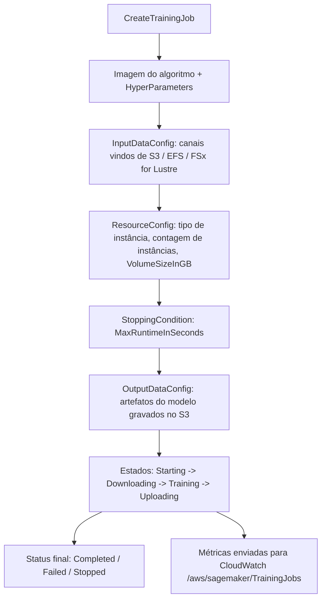
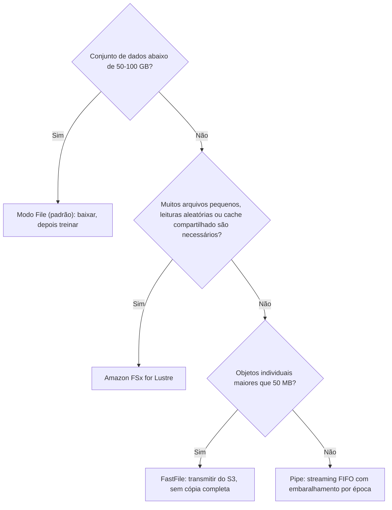
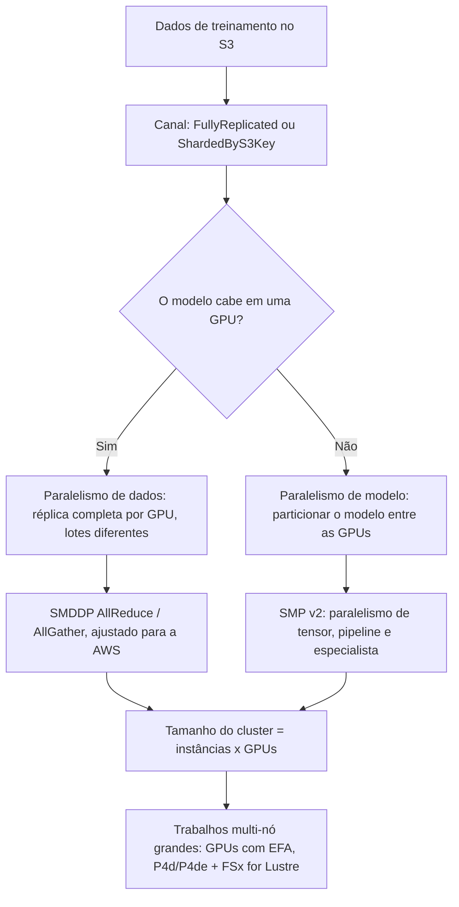
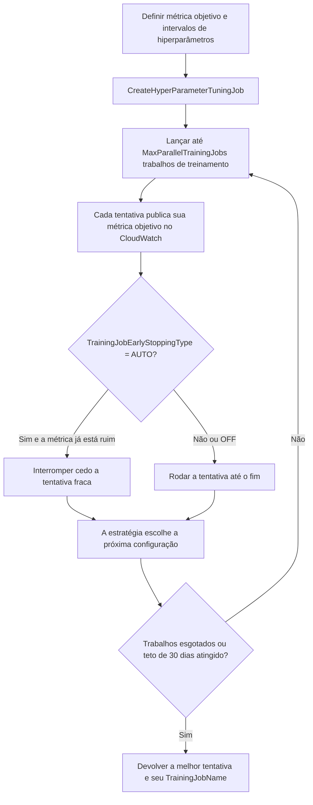
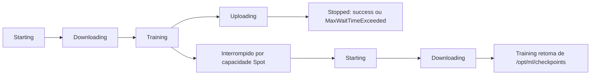

# Treinamento e Ajuste de Hiperparâmetros no Amazon SageMaker

Um trabalho de treinamento é o objeto mais caro que você cria antes de um modelo servir a primeira requisição, e é o objeto sobre o qual o exame AIF-C01 pede que você raciocine com mais precisão. O Domínio 1 carrega **20%** do conteúdo pontuado, e a Tarefa 1.3 nomeia diretamente *"realizar ajuste de hiperparâmetros ou otimização de modelo"*. O modo de falha nunca é "você não sabia que o SageMaker treina". É que você escolheu o **modo File** para um conjunto de dados de 600 GB composto por arquivos pequenos, ou escolheu **Bayesian** quando o requisito era *"reproduzir o conjunto idêntico de combinações em cada reexecução"*, ou habilitou o Spot sem checkpoint e depois esbarrou no limite de espera de **3.600 segundos** que não está documentado nas suas notas.

```text
=====================================================================
 UM TRABALHO DE TREINAMENTO DO SAGEMAKER, PEDAÇO A PEDAÇO   (AIF-C01 Tarefa 1.3)
=====================================================================
  AlgorithmSpecification ... imagem de treinamento + TrainingInputMode
  ResourceConfig ........... tipo de instância, contagem de instâncias,
                             VolumeSizeInGB (armazenamento de ML)
  StoppingCondition ........ MaxRuntimeInSeconds
  InputDataConfig .......... canais (S3 / EFS / FSx for Lustre)
  OutputDataConfig ......... artefatos do modelo -> S3
  HyperParameters .......... os ajustes do seu algoritmo
  RoleArn .................. função IAM assumida pelo trabalho
  CheckpointConfig ......... URI S3 para retomada do Spot (opcional)
  EnableNetworkIsolation / EnableInterContainerTraffic ...
---------------------------------------------------------------------
  MODOS DE ENTRADA (enum da API):  File (padrão) | FastFile | Pipe
  ESTRATÉGIAS DE AJUSTE:           Bayesian (padrão do SDK) | Random |
                                   Grid | Hyperband
  FÓRMULA DE ECONOMIA DO SPOT:     (1 - billable / training) x 100
  MONITORAMENTO:                   CloudWatch /aws/sagemaker/TrainingJobs
=====================================================================
```

> [!NOTE]
> **Como ler esta lição.** Todo número abaixo é um limite publicado pela AWS, tirado do guia de desenvolvedor do SageMaker, da referência da API do SageMaker ou de uma página de preços da AWS. Onde a AWS publica dois números diferentes para a mesma coisa, ela faz isso na economia do Spot e no tempo máximo de execução do ajuste, ambos aparecem, e a resposta preferida do exame está marcada na seção 12 e na seção 13.

Ao final desta lição você será capaz de:

- nomear os **campos obrigatórios** de `CreateTrainingJob` e explicar o que cada um controla;
- escolher entre os modos de entrada **File, FastFile e Pipe** usando os próprios limiares de tamanho da AWS, e configurar **canais** (`s3_data_type`, `distribution`, `compression`, `record_wrapping`);
- selecionar uma **família de instância `ml.*`** para treinamento versus inferência, e calcular o **tamanho do cluster** como instâncias × GPUs;
- decidir entre **paralelismo de dados** e **paralelismo de modelo**, e nomear as bibliotecas da AWS (**SMDDP**, **SMP v2**) que os implementam;
- executar o **Ajuste Automático de Modelo** e escolher a **estratégia** certa: Grid vs. Random vs. Bayesian vs. Hyperband;
- configurar o **Managed Spot Training** corretamente (`MaxWaitTimeInSeconds ≥ MaxRuntimeInSeconds`) e calcular a **economia real** com a fórmula oficial;
- dimensionar um fluxo de **checkpoint** para que um trabalho interrompido retome em vez de reiniciar;
- ler as métricas de treinamento do **CloudWatch** e explicar o que fazem o **Debugger** e os **Experiments**, e que o Debugger está fechado para novos clientes;
- defender um **veredito comparativo** sobre Grid vs. Random vs. Bayesian e sobre **treinamento gerenciado vs. faça você mesmo**;
- responder **dez questões em formato de exame** escritas na voz oficial, incluindo dois cálculos de custo.

---

## 1. Anatomia de um trabalho de treinamento do SageMaker

### 1.1 As oito peças obrigatórias

`CreateTrainingJob` é uma única chamada de API, mas é um conjunto de oito decisões independentes. O exame tende a testá-las como "qual destas está faltando / mal configurada", então aprenda-as como uma checklist.

| Campo | O que ele guarda | O que dá errado quando você erra |
|---|---|---|
| `AlgorithmSpecification` | URI da imagem de treinamento, `TrainingInputMode`, ponto de entrada | Contêiner errado → o trabalho nunca começa; modo de entrada errado → veja a seção 2 |
| `ResourceConfig` | Tipo de instância, contagem de instâncias, `VolumeSizeInGB` | Volume pequeno demais → o modo File falha no download; poucas instâncias → OOM |
| `StoppingCondition` | `MaxRuntimeInSeconds` (padrão **1 dia**, máx. **28 dias**) | O padrão interrompe um trabalho desgovernado em um dia; a vida total do trabalho é limitada a **30 dias** |
| `InputDataConfig` | Um ou mais **canais** apontando para S3, EFS ou FSx | Canal em outra Região → o trabalho não consegue lê-lo |
| `OutputDataConfig` | `S3OutputPath` para `model.tar.gz` | Os artefatos param em algum lugar onde ninguém olha |
| `HyperParameters` | Mapa de strings com os ajustes do algoritmo | Chaves que o algoritmo não aceita → falha imediata |
| `RoleArn` | Função IAM assumida pelo trabalho | `s3:GetObject` ausente → acesso negado silenciosamente |
| `CheckpointConfig` | `S3Uri` para checkpoints | Ausente → as interrupções do Spot forçam um reinício completo (seção 7) |

Dois limites valem a pena memorizar porque são baratos de lembrar e aparecem com frequência: o `MaxRuntimeInSeconds` de um único trabalho de treinamento começa em **1 dia** e para de forma brusca em **28 dias**, e a soma de execução mais espera não pode exceder **30 dias**. Ao parar, o SageMaker envia **`SIGTERM`** e espera **120 segundos** para o seu código descarregar os dados: que é exatamente a janela dentro da qual o seu manipulador de checkpoint tem que funcionar.

### 1.2 O ciclo de vida que um trabalho realmente percorre



### 1.3 O que o treinamento custa, e como é cobrado

O SageMaker cobra **por instância-segundo para horas de instância parciais, sem mínimo e sem compromisso antecipado**. Isso importa mais do que qualquer tarifa horária isolada: um trabalho de treinamento de 90 segundos custa 90 segundos de uma instância, não uma hora inteira.

| Item do free tier (primeiros 2 meses) | Quantidade | Equivalente aproximado |
|---|---|---|
| Instâncias de notebook `ml.t3.medium` | **250 horas** | ~8,3 dias-de-instância de trabalho interativo |
| **Treinamento** em `ml.m4.xlarge` / `ml.m5.xlarge` | **50 horas** | ~seis execuções de 8 horas |
| Inferência em tempo real | **125 horas** | ~4,2 dias de hospedagem |

- **📚 Você sabia?** O free tier de treinamento do SageMaker é de **50 horas de `ml.m4.xlarge` ou `ml.m5.xlarge`** nos primeiros dois meses: suficiente para cerca de seis dias úteis completos de treinamento contínuo em CPU, mas apenas para um punhado de execuções em GPU. A AWS rotula a janela de dois meses como uma promoção na página de preços, então confirme os termos antes de montar um orçamento de curso em cima dela.

---

## 2. Como colocar dados no trabalho: modos de entrada e canais

Este é o tópico de maior retorno desta lição. A AWS documenta exatamente **três** modos de entrada no enum da API, `File`, `FastFile` e `Pipe`, e o guia de desenvolvedor ainda chama o File de **padrão**.

### 2.1 Os três modos lado a lado

| Dimensão | **File** (padrão) | **FastFile** | **Pipe** |
|---|---|---|---|
| Movimento | Conjunto de dados inteiro baixado para o armazenamento de ML **antes** do início do treinamento | Objetos são apenas identificados; o S3 é exposto como um sistema de arquivos POSIX e transmitido sob demanda | S3 transmitido para um pipe FIFO com alto pré-carregamento |
| Latência de início | Máxima, o treinamento espera a cópia completa | Baixa, sem cópia completa | Baixa |
| Espaço local necessário | **Conjunto de dados inteiro + artefatos** (`VolumeSizeInGB` tem que caber tudo) | Apenas artefatos | Apenas artefatos |
| Padrão de leitura | Aleatório ou sequencial (disco local) | Melhor sequencial, aleatório aceitável | Sequencial; um leitor por pipe |
| Manifestos | Prefixo, manifesto, **manifesto aumentado** | **Somente prefixo** | Prefixo / manifesto, mais RecordIO e Gzip |
| Sharding / embaralhamento | `ShardedByS3Key` | Herda o layout do S3 | Sharding gerenciado + embaralhamento por época |
| Treinamento incremental | **Suportado: escolha File** | Não declarado | Não declarado |
| Ressalvas | A sobrecarga cresce com o número de arquivos; você precisa dimensionar o volume | Possíveis cobranças extras de CloudTrail / KMS | A AWS diz que foi "largamente substituído pelo … fast file mode" |
| Melhor para | Dados pequenos (**< 50 to 100 GB**), modo local | Arquivos grandes (**> 50 MB**, ideal **> 150 MB**) | Dados enormes onde o disco local é o gargalo |

### 2.2 Modo File: o padrão que silenciosamente custa tempo

No modo File, a instância de treinamento precisa ter **espaço de armazenamento suficiente para caber no conjunto de dados inteiro**: essa é uma citação direta do guia de desenvolvedor, e é o mecanismo por trás do item clássico de exame: *"o treinamento só começa depois de uma longa fase de transferência de dados, e o armazenamento da instância tem que comportar o conjunto de dados inteiro."* Resposta: **File**.

O modo File é também o único modo que a documentação liga explicitamente ao **treinamento incremental**, e ele aceita os três valores de `s3_data_type`, incluindo `AugmentedManifestFile`. O sharding entre instâncias é feito com `distribution = ShardedByS3Key`.

A própria orientação de dimensionamento da AWS: o modo File atende conjuntos de dados **abaixo de 50 to 100 GB**, e na taxa documentada de **50 GB em cerca de 5 minutos** com fragments de 100 MB, a AWS recomenda serializar arquivos menores que **50 MB** em blocos de cerca de **150 MB** (TFRecord ou RecordIO).

**Exemplo resolvido 1, dimensionamento do modo File (seção 12, Exemplo 1).** Um conjunto de dados de 80 GB no modo File precisa de um volume **≥ 80 GB** mais espaço para a saída. Na taxa da AWS, o download leva cerca de **8 minutos** antes do passo um rodar, aproximadamente **21% de um trabalho de 30 minutos** gastos copiando. Mude para o FastFile, ou faça o sharding com `ShardedByS3Key`.

### 2.3 FastFile: transmita sem copiar

O FastFile **identifica os objetos mas não baixa nada**. O S3 é exposto como um sistema de arquivos POSIX e lido sob demanda, então a inicialização é rápida e o espaço local só é necessário para os artefatos. Duas restrições para memorizar: ele aceita **somente prefixo** (sem manifesto aumentado), e leituras aleatórias funcionam, mas **leituras sequenciais são as melhores**. Cobranças extras de **CloudTrail e KMS** podem se aplicar porque o FastFile registra acessos em nível de objeto.

### 2.4 Pipe: o modo de streaming original

O Pipe transmite os objetos do S3 para um **pipe FIFO** com alto pré-carregamento, mantém o disco apenas para os artefatos e oferece **embaralhamento por época** gerenciado, compressão **Gzip** e empacotamento **RecordIO**. A AWS agora o descreve como "largamente substituído pelo … fast file mode", então no exame o Pipe costuma ser o distrator de *streaming* quando o FastFile é a resposta melhor, ou a resposta correta quando a questão menciona RecordIO/Gzip/embaralhamento por época.

### 2.5 Canais: como os objetos são enumerados e divididos

Um canal é uma entrada do trabalho. Seus campos de configuração são onde o esconde o detalhe.

| Campo | Valores | Significado |
|---|---|---|
| `s3_data_type` | `S3Prefix` (padrão), `ManifestFile`, `AugmentedManifestFile` | Como os objetos são enumerados |
| `distribution` | `FullyReplicated` (padrão), `ShardedByS3Key` | Cópia completa em cada instância vs. fragmento entre nós |
| `input_mode` | `File` / `Pipe` / `FastFile` / não definido | Sobrescrita por canal do `TrainingInputMode` do trabalho |
| `compression` | `None`, `Gzip` | O Gzip se aplica ao modo Pipe |
| `record_wrapping` | `None`, `RecordIO` | Pipelines RecordIO (estilo MXNet) |
| `shuffle_config.seed` | Inteiro | Embaralhamento determinístico; no modo Pipe ele re-embaralha a cada época |

As lojas suportadas são **Amazon S3, Amazon EFS e Amazon FSx for Lustre** (mais S3 Express One Zone), e o conjunto de dados tem que viver na **mesma Região do trabalho de treinamento**: um bucket S3 em `us-west-2` alimentando um trabalho em `us-east-1` não é um padrão suportado.

### 2.6 Escolhendo um modo, usando os limiares da AWS



| Forma dos dados | Caminho recomendado pela AWS |
|---|---|
| < 50 to 100 GB, ou treinamento incremental | **Modo File** |
| Arquivos **> 50 MB**, idealmente **> 150 MB**, a latência de início importa | **FastFile** |
| Conjunto de dados grande, **muitos arquivos pequenos**, ou leituras **aleatórias** | **Amazon FSx for Lustre** |
| Dados enormes, disco local é o gargalo, RecordIO/Gzip necessário | **Pipe** |
| Dados já no EFS ou no FSx for Lustre | Monte-os; nenhuma cópia no S3 |

> [!WARNING]
> **As três armadilhas dos modos de entrada que aparecem em todo ciclo de exame.**
> - **O modo File é o padrão**: uma questão que descreve uma longa fase de transferência antes do treinamento e um volume dimensionado para o conjunto de dados está descrevendo o File, não o Pipe.
> - **O FastFile aceita somente prefixo.** Se a questão menciona um **manifesto aumentado** (típico de conjuntos de dados estilo RLHF ou de sentimento construídos com o SageMaker Ground Truth / reforço contextual), o FastFile não pode ser a resposta.
> - **A proximidade de Região é incondicional.** Tanto o conjunto de dados quanto o bucket dos checkpoints têm que estar na Região do trabalho de treinamento. Leituras entre Regiões são um distrator, nunca uma solução.

---

## 3. Escolhendo a computação: as famílias de instância `ml.*`

### 3.1 A regra de nomenclatura

Todo SKU de computação do SageMaker é prefixado com **`ml.`**. Esse prefixo é o indício mais barato do exame: se uma opção diz `p4d.24xlarge` sem o `ml.` quando o contexto é um trabalho de treinamento do SageMaker ou um endpoint, ela está descrevendo EC2, não SageMaker. As famílias se separam limpo por papel.

| Família | Papel | Exemplos verificados | Notas |
|---|---|---|---|
| `ml.p5` | Treinamento, maior escala de GPU | `ml.p5.48xlarge`: 8 × H100 | GA em **4 de agosto de 2023**; 640 GB de HBM, 192 vCPU, 2 TiB, 3.200 Gbps EFAv2 |
| `ml.p6` | Treinamento, GPU mais recente | P6-B200 to 8 × Blackwell, 1.440 GB de HBM | GA em **6 de junho de 2025** (`us-west-2`) |
| `ml.p4d` / `ml.p4de` | Treinamento, ponto ideal para distribuir | `ml.p4d.24xlarge`: 8 × A100 40 GB (p4de: 80 GB) | Escolha da AWS para multi-nó + paralelismo de modelo (EFA) |
| `ml.p3` / `ml.p3dn` | Treinamento, GPU de geração anterior | 2xlarge / 8xlarge / 16xlarge / p3dn.24xlarge | 1 / 4 / 8 / 8 GPUs: mesmas contagens do EC2 p3 |
| `ml.g4dn` / `ml.g5` / `ml.g6` | Treinamento **e** inferência em GPU | `ml.g4dn.xlarge` (notebook GPU padrão) | Treinamento testado no Training Compiler em G4dn e G5 |
| `ml.trn1` | **Treinamento** no Trainium | `ml.trn1.*` (até 16 dispositivos) | Estimador PyTorch; `torchrun` suportado |
| `ml.m4` / `ml.m5` / `ml.c4` / `ml.c5` / `ml.t3` | Treinamento em CPU e geral | `ml.m4.xlarge`, `ml.c4.xlarge`, `ml.t3.medium` | Free tier: 50 h de treinamento em m4/m5.xlarge |
| `ml.inf1` / `ml.inf2` | **Somente inferência** (Inferentia) | `ml.inf2` (implantação) | **Não** é uma família de treinamento: um distrator clássico |

### 3.2 O hardware de GPU que a AWS publica

| Instância | vCPU | Memória | GPU | Memória total de GPU | Rede |
|---|---|---|---|---|---|
| `ml.p5.48xlarge` | 192 | 2 TiB | 8 × H100 | 640 GB (80/GPU) | 3.200 Gbps EFAv2 |
| `ml.p4d.24xlarge` | 96 | 1.152 GB | 8 × A100 | 320 GB (40/GPU) | 400 Gbps ENA + EFA |
| `ml.p4de.24xlarge` | 96 | 1.152 GB | 8 × A100 | 640 GB (80/GPU) | 400 Gbps ENA + EFA |
| `ml.p3.16xlarge` | 64 | 488 GiB | 8 × V100 | 128 GB (16/GPU) | 25 Gbps NVLink |
| `ml.p3.8xlarge` | 32 | 244 GiB | 4 × V100 | 64 GB | 10 Gbps NVLink |
| `ml.p3.2xlarge` | 8 | 61 GiB | 1 × V100 | 16 GB | até 10 Gbps |
| `ml.p3dn.24xlarge` | 96 | 768 GiB | 8 × V100 | 256 GB (32/GPU) | 100 Gbps |

### 3.3 Duas regras de dimensionamento que decidem a sua fatura

**Regra 1: dimensione o tamanho da instância antes de adicionar instâncias.** A orientação da AWS sobre treinamento distribuído é explícita: um único **`ml.p3.16xlarge` supera dois `ml.p3.8xlarge`** para as mesmas 8 GPUs, porque você paga por um interconect em vez de um salto de rede. Adicionar instâncias é o que se faz quando uma máquina não consegue conter o modelo ou os dados.

**Regra 2: tamanho do cluster = instâncias × GPUs.** Dois nós `ml.p3.16xlarge` dão um cluster de **16 GPUs**, não 8. Todo grau de paralelismo, cálculo de tamanho de lote e custo de comunicação da seção 4 deriva desse produto.

**Exemplo resolvido 2: dimensionamento distribuído (seção 12, Exemplo 2).** `ml.p3.16xlarge × 2` = 8 GPUs por nó → tamanho do cluster **16**. A referência publicada da AWS para um LLM de 70 bilhões de parâmetros é **32 × `ml.p4d.24xlarge`** = **256 GPUs**, com grau de paralelismo de dados fragmentado de 256 e tamanho de lote 2; um modelo de 175B precisa de **64 × `ml.p4d.24xlarge`**, enquanto um modelo de 7B cabe em **1 × `ml.p4d.24xlarge`**.

- **📚 Você sabia?** O `ml.p5.48xlarge` sai de fábrica com **8 × H100 e 640 GB de memória total de GPU** e rede **EFAv2 de 3.200 Gbps**: mais largura de banda do que a maioria dos racks tinha uma década atrás, e a razão de o treinamento multi-nó nessa família ser limitado por banda e não por computação. Ele atingiu disponibilidade geral em **4 de agosto de 2023**, inicialmente em `us-east-1` e `us-west-2`.

---

## 4. Treinamento distribuído: paralelismo de dados vs. paralelismo de modelo

### 4.1 A distinção que o exame quer

| Estratégia | O que é dividido | Quando usá-la | Mecanismo |
|---|---|---|---|
| **Paralelismo de dados** | Os **dados**: cada GPU mantém uma réplica completa do modelo e vê um lote diferente | O modelo cabe em uma GPU; você quer vazão | Os gradientes são sincronizados após cada passo (AllReduce) |
| **Paralelismo de modelo** | O **modelo**: ele é particionado entre as GPUs | O modelo **não cabe** na memória de uma GPU | Particionamento de tensor / pipeline / especialista mais checkpointing de ativação |

A formulação do exame costuma ser um sintoma: *"o modelo não cabe na memória de uma única GPU, mas o conjunto de dados é modesto"* → **paralelismo de modelo**. O espelho disso: *"o modelo treina bem em uma GPU, mas o conjunto de dados é enorme"* → **paralelismo de dados**.



### 4.2 As bibliotecas que a AWS nomeia

| Biblioteca | O que faz | Notas |
|---|---|---|
| **SMDDP** (SageMaker Distributed Data Parallel) | Coleativas AllReduce / AllGather ajustadas para as redes da AWS | Backend para PyTorch DDP/FSDP e DeepSpeed |
| **SMP v2** (SageMaker Distributed Model Parallel) | Dados fragmentados mais paralelismo de tensor, pipeline e especialista; checkpointing e offloading de ativações | O caminho para modelos que não cabem em um único dispositivo |
| Horovod, `torchrun`, MPI, parameter server | Alternativas no nível do framework | Ainda documentadas; não específicas da AWS |

Para **trabalhos multi-nó grandes**, a orientação da AWS converge na mesma pilha toda vez: **GPUs habilitadas para EFA, de preferência `ml.p4d`/`ml.p4de` (A100) ou mais novo, mais Amazon FSx for Lustre** para o conjunto de dados. O EFA importa porque contorna a pilha de rede do SO; o FSx importa porque mil pequenos arquivos lidos pelo S3 vão sufocar 256 GPUs.

**Exemplo resolvido 3: quanto modelo cabe onde (seção 12, Exemplo 3).** As referências publicadas da AWS: Llama 2 **7B → 1 × `ml.p4d.24xlarge`**; Llama 2 **70B → 32 × `ml.p4d.24xlarge`**; **175B → 64 ×**; **GPT-2 10B → 16 ×**. Leia-as como uma regra prática: a contagem de parâmetros, não o tamanho do conjunto de dados, é o que dita o número de instâncias depois que você ultrapassa a capacidade de uma GPU.

---

## 5. Ajuste Automático de Modelo: o que um trabalho de ajuste faz

### 5.1 A ideia em uma frase

O **Ajuste Automático de Modelo (AMT)** executa muitos trabalhos de treinamento sobre os intervalos de hiperparâmetros que você fornece e mantém o que tem melhor desempenho na sua **métrica objetivo**. Você define os intervalos; o SageMaker executa a busca; você recebe de volta a melhor tentativa.

O exame chama isso de *"ajuste de hiperparâmetros ou otimização de modelo"*, e está bem dentro da Tarefa 1.3.

### 5.2 O fluxo do trabalho de ajuste



### 5.3 Intervalos, escalas e a métrica objetivo

Os intervalos de hiperparâmetros são tipados e escalados. `Auto`, `Linear`, `Logarithmic` e `ReverseLogarithmic` são as quatro opções de escala, e cada uma tem uma regra de domínio que vale conhecer porque é uma verificação de correção grátis no exame:

| Escala | Use-a para | Regra de domínio |
|---|---|---|
| `Auto` | Padrão quando você não tem motivo para escolher | Qualquer intervalo válido |
| `Linear` | Parâmetros cujo efeito é proporcional (tamanho do lote, drop-out em uma faixa estreita) | Qualquer intervalo válido |
| `Logarithmic` | Taxa de aprendizado, momentum: valores que abrangem ordens de grandeza | O valor tem de ser **> 0** |
| `ReverseLogarithmic` | Parâmetros que se agrupam perto do topo do intervalo | **0 ≤ x < 1** |

`TrainingJobEarlyStoppingType` é **`OFF`** por padrão e pode ser definido como **`AUTO`** para interromper tentativas que claramente não vão vencer. O **warm start** reusa as tentativas-pai de um trabalho de ajuste anterior, o que reduz tanto o custo quanto o tempo de relógio quando você estende uma busca em vez de reiniciá-la.

### 5.4 Os limites que você deve conseguir recitar

| Recurso | Padrão | Aumente para |
|---|---|---|
| Trabalhos de ajuste simultâneos (conta) | **100** |: |
| Hiperparâmetros por trabalho de ajuste | **30** |: (menos é mais rápido) |
| Métricas por trabalho de ajuste | **20** |: |
| Trabalhos de treinamento simultâneos por trabalho de ajuste | **10** | **100** |
| Trabalhos de treinamento por trabalho de ajuste (Bayesian / Hyperband / Grid) | **750** |: |
| Trabalhos de treinamento por trabalho de ajuste (**Random**) | **750** | **10.000** |
| Tempo máximo de execução do trabalho de ajuste | **30 dias** |: |
| Valores por parâmetro categórico | **30** |: |

Duas consequências seguem imediatamente. Primeiro, a AWS recomenda manter a contagem de hiperparâmetros **bem abaixo do teto de 30**: cada dimensão extra dilui a busca. Segundo, o `RandomSeed` torna uma busca Random ou Hyperband **reprodutível em até 100%**, que é o mecanismo por trás do item de exame sobre "reproduzir combinações idênticas".

**Exemplo resolvido 4: orçamento de ajuste e aritmética de cota (seção 12, Exemplo 4).** `MaxNumberOfTrainingJobs = 20`, uma hora cada em `ml.g4dn.12xlarge` à tarifa publicada da AWS de **$4.89/h** → **20 × $4.89 = $97.80**. Com `MaxParallelTrainingJobs = 10` você roda **2 ondas ≈ 2 horas** em vez de 20. Empurrar para 100 trabalhos custa **$489** sem nenhuma garantia de precisão melhor. Separadamente, o próprio exemplo de cota da AWS: **10 trabalhos de ajuste × 100 trabalhos de treinamento × 20 simultâneos** em `ml.m4.xlarge` passa pelos limites de 100 ajustes simultâneos e de 750 trabalhos, mas precisa de aumento para **20 trabalhos de treinamento simultâneos** (padrão 10) e **200 instâncias `ml.m4.xlarge`** (padrão 20).

- **📚 Você sabia?** Um trabalho de ajuste do SageMaker não é um produto de computação separado: é um **orquestrador** que cria trabalhos de treinamento comuns e observa as métricas deles no CloudWatch. É por isso que as cotas de trabalho de ajuste são expressas tanto em *trabalhos de ajuste* (100 simultâneos) quanto em *trabalhos de treinamento* (10 paralelos, 750 no total): você é medido nos mesmos instância-segundos de qualquer forma.

---

## 6. Estratégias de ajuste: Grid vs. Random vs. Bayesian vs. Hyperband

Esta é a comparação que o exame pede que você faça sob pressão de tempo. Aprenda a linha que difere, não a tabela inteira.

### 6.1 A comparação completa

| Dimensão | **Bayesian** (padrão do SDK) | **Random** | **Grid** | **Hyperband** |
|---|---|---|---|---|
| Como escolhe | Regressão sobre tentativas anteriores | Sorteios aleatórios, **ignora** resultados anteriores | Toda combinação categórica distinta | Multi-fidelidade: realoca épocas, interrompe trabalhos fracos |
| Paralelismo | Baixo: sequencial, "não escala massivamente" | **Máximo** (trabalhos independentes) | Moderado (varredura exaustiva) | Muitos trabalhos paralelos |
| Tipos de parâmetro | int / contínuo / categórico | int / contínuo / categórico | **somente categórico** | Conforme o algoritmo permite |
| Trabalhos permitidos | 750 (fixo) | 750 → **10.000** | Auto-calculado = número de combinações | 750 (fixo) |
| Reprodutibilidade | A semente melhora | Mesma semente → **até 100%** | Idêntico por design | Mesma semente → **até 100%** |
| Restrição de algoritmo | Qualquer | Qualquer | Qualquer (com intervalos categóricos) | **Somente iterativo**: XGBoost e RCF sim; árvores e k-NN não |
| Melhor quando | Orçamento limitado, aprender entre execuções | Busca paralela grande, com tempo limitado | Auditorias, cobertura uniforme, reexecuções | Trabalhos longos de aprendizado profundo |
| Vantagem citada pela AWS | Melhor uso de um orçamento pequeno | "Maior número de trabalhos paralelos" | Determinismo | Até **3× mais rápido** que o Bayesian (afirmação da AWS) |

### 6.2 Grid: determinístico, categórico, combinatório

O Grid enumera toda combinação distinta dos valores categóricos que você dá, e o SageMaker calcula a contagem de trabalhos automaticamente: você deve definir `MaxNumberOfTrainingJobs` com esse número. É a estratégia para **reproduzir resultados** e para cobrir uniformemente um espaço de busca.

**Exemplo resolvido 5: contagem de trabalhos do Grid (seção 12, Exemplo 5).** Dois parâmetros categóricos com **5** e **4** valores → 5 × 4 = **20** combinações → o SageMaker cria **20** trabalhos de treinamento. Acrescente um terceiro parâmetro com **3** valores → **60** trabalhos. O Grid explode combinatorialmente, e é exatamente por isso que a AWS direciona espaços de busca grandes para o Bayesian ou o Random.

### 6.3 Random: paralelismo máximo, aprendizagem zero

Como o Random **ignora resultados anteriores**, cada tentativa é independente e a estratégia suporta o maior número de trabalhos de treinamento simultâneos de qualquer estratégia. É também a única estratégia cujo teto de trabalhos pode ser elevado de **750 para 10.000**, e com um `RandomSeed` fixo ela reproduz a sequência idêntica de configurações.

### 6.4 Bayesian: o padrão do SDK e um otimizador sequencial

O Bayesian constrói um modelo de regressão sobre as tentativas concluídas até então e propõe a próxima configuração onde a melhora parece mais provável. Isso o torna o **melhor uso de um orçamento pequeno** e o **padrão no `HyperparameterTuner` do SageMaker SDK**, mas também o torna sequencial: a tentativa *n+1* depende da tentativa *n*, então a AWS afirma que ele **não escala massivamente** em paralelo.

### 6.5 Hyperband: multi-fidelidade, somente algoritmos iterativos

O Hyperband realoca épocas entre rodadas sucessivas, interrompe trabalhos fracos cedo e roda muitos trabalhos em paralelo. A restrição dura é o algoritmo: ele precisa de algoritmos **iterativos** que possam ser julgados de forma significativa no meio do caminho. **XGBoost e Random Cut Forest se qualificam; árvores de decisão e k-NN, não.** A AWS o comercializa como até **3× mais rápido** que o Bayesian: esse número vem de uma página *what-is* da AWS, então cite-o como uma afirmação da AWS, não como um benchmark reproduzido.

> [!WARNING]
> **Seleção de estratégia, reduzida a quatro frases.**
> - Tem que reproduzir o **conjunto idêntico** de combinações em cada reexecução, **somente categóricos** → **Grid**.
> - Precisa do **maior número de trabalhos independentes e paralelos** → **Random**.
> - Orçamento pequeno, intervalos mistos de int/contínuo/categórico, caminho padrão → **Bayesian**.
> - Trabalhos longos de aprendizado profundo em um algoritmo **iterativo** e você precisa de velocidade → **Hyperband**, mas nunca Hyperband para k-NN ou um modelo de árvore.

---

## 7. Managed Spot Training e checkpoints

### 7.1 O que é

O **Managed Spot Training** executa o seu trabalho de treinamento em capacidade **Spot** do EC2, com o SageMaker gerenciando as interrupções para você. A AWS o lançou em **26 de agosto de 2019** e publicou desde então dois números diferentes de economia: ambos publicados pela AWS, e ambos aparecem em material de exame:

| Fonte | Afirmação |
|---|---|
| Guia de desenvolvedor do SageMaker (`model-managed-spot-training`) | Economia **de até 90%** |
| Referência da API `CreateTrainingJob` | Economia **de até 80%** |
| Demonstração de lançamento no AWS News Blog (2019) | 837 faturáveis de 2.423 segundos → **65%** reais |
| História de cliente no AWS ML Blog (2020) | **70%** de redução no custo de EC2, **+40%** de trabalhos diários concluídos |

### 7.2 A fórmula oficial, e o único cálculo de que você precisa

$$
\text{Savings (\%)} = \left(1 - \frac{\text{BillableTimeInSeconds}}{\text{TrainingTimeInSeconds}}\right) \times 100
$$

**Exemplo resolvido 6: a matemática da economia do Spot (seção 12, Exemplo 6).** Um trabalho roda por **500 segundos** e é cobrado por **100 segundos**:

$$
(1 - 100/500) \times 100 = 80\%
$$

O trabalho de demonstração do blog de lançamento da AWS rodou **2.423 segundos** e foi cobrado por **837** → $(1 - 837/2423) \times 100 \approx \mathbf{65\%}$. Calcule por trabalho; nunca assuma um número fixo.

**Exemplo resolvido 7, On-Demand vs. Spot para uma execução em GPU (seção 12, Exemplo 7).** `ml.g4dn.12xlarge` publicado pela AWS = **$4.89/h**. Duas horas On-Demand = **$9.78**. Se apenas **36 dos 120 minutos de relógio** forem faturáveis no Spot: $0.6 \times 4.89 \approx$ **$2.93**, cerca de **70% de economia**, batendo com a história do cliente Cinnamon AI.

```plot
{
  "type": "line",
  "title": "Economia do Spot em função da fração faturável",
  "data": [
    {"billableShare": 0.1, "savings": 90},
    {"billableShare": 0.2, "savings": 80},
    {"billableShare": 0.35, "savings": 65},
    {"billableShare": 0.5, "savings": 50},
    {"billableShare": 0.65, "savings": 35},
    {"billableShare": 0.8, "savings": 20},
    {"billableShare": 1.0, "savings": 0}
  ],
  "xKey": "billableShare",
  "yKey": "savings",
  "xLabel": "BillableTimeInSeconds / TrainingTimeInSeconds",
  "yLabel": "Economia (%)"
}
```

### 7.3 As duas regras de configuração

| Regra | Valor | Por quê |
|---|---|---|
| `MaxWaitTimeInSeconds` vs. `MaxRuntimeInSeconds` | Espera **≥** tempo de execução | Exigência dura da AWS; sem isso o Spot não pode ser usado |
| Algoritmos incorporados / da Marketplace sem checkpoint | `MaxWaitTimeInSeconds` limitado a **3.600 s** | Sem checkpoints, um trabalho interrompido tem que reiniciar, então a AWS limita a espera |
| Algoritmos com checkpoint | Sem teto de 3.600 s: a própria demonstração da AWS usou **48 horas** | A retomada torna esperas longas compensatórias |
| Encerramento gracioso | `SIGTERM`, depois **120 s** | O seu código de checkpoint tem que terminar dentro dessa janela |

**Exemplo resolvido 8, configuração do Spot (seção 12, Exemplo 8).** Um trabalho de 6 horas com checkpoint: `MaxRuntimeInSeconds = 21.600` e `MaxWaitTimeInSeconds` **maior que isso** (a demonstração da AWS usou 48 h = 172.800 s), mais `CheckpointConfig.S3Uri`. Rode o mesmo trabalho de 6 horas **sem** checkpoint e o teto de espera é **3.600 s**, então você acrescenta checkpoint ou roda On-Demand.

### 7.4 Checkpoints: retomar, não reiniciar

| Propriedade | Comportamento verificado |
|---|---|
| Caminho local | **`/opt/ml/checkpoints`** |
| Persistido em | `CheckpointConfig.S3Uri` |
| Restaurado | **No início do trabalho**, o trabalho retoma, não reinicia |
| Arquivos copiados para o S3 *depois* do início do trabalho | **Não** são puxados de volta na retomada |
| Exclusões locais | Propagam para o S3 |
| Localização do bucket | Tem de estar na **mesma Região** do trabalho |
| Retomada no SDK | Um **novo estimador** apontado para o **mesmo `checkpoint_s3_uri`** |

### 7.5 O que um trabalho interrompido realmente parece



A máquina de estados documentada é `Starting → Downloading → Training → Uploading`, com laços `Interrupted → Starting → …` no meio e um terminal `Stopped: MaxWaitTimeExceeded` quando o orçamento de espera se esgota antes de o trabalho terminar.

```fillblank
{
  "question": "Complete a fórmula oficial de economia do Managed Spot Training:",
  "template": "Savings (%) = (1 - {{1}} / {{2}}) x 100. Um trabalho com 100 segundos faturáveis de 500 segundos de treinamento economizou {{3}}%.",
  "answers": {
    "1": "BillableTimeInSeconds",
    "2": "TrainingTimeInSeconds",
    "3": "80"
  },
  "distractors": ["MaxWaitTimeInSeconds", "MaxRuntimeInSeconds", "65", "90"],
  "explanation": "A AWS documenta a economia como (1: BillableTimeInSeconds / TrainingTimeInSeconds) x 100, e o próprio exemplo resolvido dela, com 100 segundos faturáveis de 500 segundos de treinamento, produz 80%. 65% é o número do trabalho do blog de lançamento de 2019 (837 de 2.423 segundos), e 90% / 80% são as faixas de manchete do guia de desenvolvedor e da referência da API, respectivamente: nenhum dos dois é um resultado por trabalho."
}
```

---

## 8. Observando a execução: métricas, Debugger e Experiments

### 8.1 Para onde os números vão

As métricas de treinamento são publicadas no **Amazon CloudWatch** sob o namespace **`/aws/sagemaker/TrainingJobs`**, e a visão **Training jobs → Monitor** do console do SageMaker as grafica. Esta é a resposta sempre que uma questão pergunta como você sabe se um trabalho está convergindo, divergindo ou saturando a GPU.

### 8.2 Debugger: tensores, regras e ações

| Capacidade | O que observa | O que pode fazer |
|---|---|---|
| Coleta de tensores | Gradientes, ativações, parâmetros | Detectar gradientes desvanecentes/explosivos, picos de loss |
| Métricas de sistema | Utilização de GPU, memória, E/S | Identificar um pipeline de entrada faminto |
| **Regras incorporadas** | Heurísticas pré-treinadas | Disparar ações: **`StopTraining()`**, **`Email()`**, **`SMS()`** |
| Regras personalizadas | Seu próprio Python | Cobrado pelo tempo de instância |
| Preços | Regras incorporadas **gratuitas**; regras personalizadas cobram tempo de instância |: |
| **Status (2026)** | **Não está mais aberto a novos clientes** | Clientes existentes mantêm o acesso |

Assim o item de exame *"interromper automaticamente o trabalho de treinamento quando uma regra de gradiente desvanecente disparar e enviar um e-mail para a equipe"* se resolve nas **ações incorporadas do Debugger**: com a ressalva de que o Debugger está fechado para novos clientes.

### 8.3 SageMaker Experiments

O **Experiments** rastreia cada tentativa e execução, os hiperparâmetros usados, as métricas produzidas, os artefatos gravados, para que você possa comparar execuções lado a lado. A saída do Debugger pode ser roteada para o **TensorBoard** para visualização. O Experiments é a resposta para "qual das minhas 20 execuções foi a melhor, e com quais configurações"; o Debugger é a resposta para "o que está acontecendo dentro desta execução agora".

> [!WARNING]
> **Armadilhas de disponibilidade na pilha de monitoramento.**
> - **O Debugger está fechado para novos clientes.** Contas existentes o mantêm; uma conta nova não consegue começar a usá-lo. As regras incorporadas são gratuitas, as regras personalizadas cobram tempo de instância.
> - **Experiments (Classic)** está atrelado ao Studio Classic, e a AWS aponta o trabalho novo para o **MLflow** gerenciado. Não construa uma arquitetura nova sobre o Experiments Classic sem re-verificar a documentação atual.
> - As métricas em **`/aws/sagemaker/TrainingJobs`** estão disponíveis de qualquer forma, o CloudWatch é a resposta sempre correta para "para onde vão as métricas de treinamento".

---

## 9. Caminhos que pulam o loop de treinamento inteiro

### 9.1 JumpStart: modelos pré-treinados que você pode ajustar

O **JumpStart** é o hub do SageMaker de modelos de código aberto pré-treinados, extraídos do **TensorFlow Hub, PyTorch Hub, Hugging Face e GluonCV**. Dois números importam para o exame: ele cobre **15 tipos de problema**, dos quais **8 são treináveis**, ou seja, você pode fazer treinamento incremental / fine-tuning neles, e ele se integra ao **Ajuste Automático de Modelo**.

### 9.2 Autopilot: AutoML para dados tabulares (e, via v2, mais)

| Estágio | O que o Autopilot faz |
|---|---|
| 1 | Análise do conjunto de dados |
| 2 | Classificação do tipo de problema |
| 3 | Lista curta de algoritmos: **árvores de decisão impulsionadas por gradiente, redes neurais profundas feedforward, regressão logística** |
| 4 | Pré-processamento e seleção de atributos |
| 5 | **Otimização de hiperparâmetros (HPO)** |
| 6 | Treinar, ranquear, opcionalmente implantar automaticamente mais um relatório do Clarify |

Escopo: **dados tabulares de até centenas de gigabytes**; tarefas de **texto, imagem e previsão** mais fine-tuning de LLM são tratados pela **API AutoML v2**. A UI migrou para o **SageMaker Canvas em 30 de novembro de 2023**, então usuários sem código vão para o Canvas, e o Autopilot permanece como o caminho de API.

### 9.3 Escolhendo um ponto de partida

| Você tem | Melhor primeiro movimento |
|---|---|
| Nenhum modelo, um tipo de problema público, quer um baseline rápido | **JumpStart** |
| Um conjunto de dados tabular rotulado, nenhum engenheiro de ML | **SageMaker Canvas** (Autopilot por baixo) |
| Um conjunto de dados rotulado e você quer a API | **Autopilot / API AutoML v2** |
| Um algoritmo customizado e o seu próprio contêiner | **Trabalho de treinamento** |
| Um espaço de busca em torno de um trabalho de treinamento que funciona | **Ajuste Automático de Modelo** |
| Orçamento para muitas tentativas a baixo custo | **Managed Spot Training** + checkpoints |

- **📚 Você sabia?** A lista curta de algoritros do Autopilot é deliberadamente pequena, árvores impulsionadas por gradiente, uma DNN feedforward e regressão logística, porque o AutoML é um mecanismo de *seleção e ajuste*, não um laboratório de pesquisa. O estágio de HPO que ele executa internamente é o mesmo mecanismo de Ajuste Automático de Modelo descrito na seção 5, e é por isso que os dois dividem a linguagem de cotas.

---

## 10. Veredito comparativo: estratégias e gerenciado vs. faça você mesmo

### 10.1 Treinamento gerenciado vs. construir você mesmo

| Dimensão | **Gerenciado (trabalhos de treinamento do SageMaker, AMT, Spot)** | **Faça você mesmo (EC2 / ECS / EKS autogerenciado)** |
|---|---|---|
| Infraestrutura | Tipo de instância, contagem, volume: sem trabalho de SO | SO, drivers, CUDA, imagens de framework, patching |
| Interruptions | Spot gerenciado com retomada por checkpoint | Você constrói o manipulador de preempção |
| Ajuste | AMT com quatro estratégias, warm start, interrupção antecipada | Seu próprio script de varredura e agendador |
| Métricas | CloudWatch `/aws/sagemaker/TrainingJobs` pronto para uso | Você instrumenta e agrega |
| Debugger / Experiments | Incorporados (Debugger fechado para novos clientes) | Seus próprios profilers e loja de rastreamento |
| Preparação de dados | File / FastFile / Pipe, EFS, FSx for Lustre | Você liga a camada de armazenamento |
| Cobrança | Por segundo, sem mínimo, Savings Plans de até **64%** | Por segundo na instância subjacente + o seu trabalho |
| Melhor quando | Velocidade, governança e integração nativa com a AWS importam | Controle de hardware/driver que o SageMaker não expõe |

### 10.2 Estratégia de ajuste num relance

| Requisito | Estratégia |
|---|---|
| Reproduzir as combinações idênticas em cada reexecução, somente categóricos | **Grid** |
| Maior número de trabalhos independentes e paralelos | **Random** |
| Melhor uso de um orçamento pequeno; padrão do SDK | **Bayesian** |
| Trabalhos longos e iterativos de aprendizado profundo, a velocidade importa | **Hyperband** |

> [!IMPORTANT]
> **Veredito Comparativo: estratégias de ajuste e treinamento gerenciado × faça você mesmo**
> - **Grid vs. Random vs. Bayesian:** o **Grid** é a única estratégia que *garante* um conjunto idêntico e uniformemente coberto de combinações em cada reexecução, e a única restrita a parâmetros **categóricos**, com a contagem de trabalhos calculada automaticamente como o número de combinações distintas (5 × 4 = 20 trabalhos; acrescente um terceiro parâmetro com 3 valores e você está em 60). O **Random** ignora resultados anteriores, e é exatamente por isso que a AWS o chama de estratégia que roda o *maior número de trabalhos paralelos*, e por isso que é a única cujo teto pode ser elevado de 750 para **10.000**, com um `RandomSeed` fixo ele é **reprodutível em até 100%**. O **Bayesian** é o padrão do SDK e o melhor uso de um orçamento pequeno, mas é sequencial, uma regressão sobre tentativas anteriores, então a AWS afirma que ele "não escala massivamente". Escolha **Grid** para auditorias e determinismo, **Random** para abrangência e velocidade de relógio, **Bayesian** quando cada hora de treinamento é cara e o espaço de busca mistura intervalos int, contínuo e categórico. O **Hyperband** fica fora desse triângulo: ele é multi-fidelidade e precisa de um algoritmo **iterativo**, então é a aposta de velocidade para XGBoost/RCF e está descartado para árvores e k-NN.
> - **Treinamento gerenciado vs. faça você mesmo:** o treinamento gerenciado vence em **tempo até o primeiro resultado, tratamento de interrupções, canalização de cotas e métricas, e integração nativa com a AWS**, e custa o mesmo por instância-segundo do EC2 por baixo dele, você não está pagando um prêmio pela orquestração, você não paga por ociosidade, e a cobrança por segundo sem mínimo significa que um trabalho de 90 segundos custa 90 segundos. Escolha faça você mesmo (EC2/ECS/EKS) somente quando precisar de controle que o SageMaker não expõe: ajuste no nível do kernel, drivers especiais, um build de framework não suportado, ou um parque Kubernetes existente que você não pode bifurcar. Um notebook com um script de shell não é uma alternativa em nenhuma das duas colunas, ele não consegue provar quais hiperparâmetros produziram um dado modelo, não consegue retomar após uma interrupção, e não pode ser re-executado por mais ninguém. A resposta padrão do exame é o caminho gerenciado, a menos que uma questão nomeie um requisito concreto de controle.

---

## 11. Limites, cotas e evidências de custo em um lugar só

### 11.1 Limites e benchmarks publicados

| Item | Número | Fonte |
|---|---|---|
| Modos de entrada (enum da API) | `Pipe`, `File` (padrão), `FastFile` | Guia de desenvolvedor |
| Orientação do modo File | < **50 to 100 GB**; 50 GB ≈ **5 min** com fragments de 100 MB | Guia de melhores práticas |
| Orientação do FastFile | Arquivos **> 50 MB** (ideal **> 150 MB**); sem manifesto aumentado | Guia de desenvolvedor |
| Hiperparâmetros / métricas / valores categóricos do AMT | **30 / 20 / 30** | Limites do AMT |
| Trabalhos de ajuste simultâneos / trabalhos de treinamento simultâneos do AMT | **100** / **10 → 100** | Limites do AMT |
| Trabalhos de treinamento por trabalho de ajuste do AMT | **750** (Random → **10.000**) | Limites do AMT |
| Tempo máximo de execução do AMT | **30 dias** | Limites do AMT |
| Hyperband vs. Bayesian | Até **3× mais rápido** (afirmação da AWS) | Página *what-is* da AWS |
| Afirmação de economia do Spot | **90%** (guia) / **80%** (API) | Guia de desenvolvedor / referência da API |
| Teto de espera do Spot sem checkpoint | **3.600 s** | Guia de desenvolvedor |
| Referência de paralelismo de modelo | Llama 2 70B → **32 × `ml.p4d.24xlarge`**; 175B → **64 ×** | Guia de melhores práticas |
| Free tier de treinamento | **50 h** de `m4.xlarge`/`m5.xlarge`, primeiros 2 meses | Página de preços |
| Ponto de preço publicado | `ml.g4dn.12xlarge` **$4.89/h** | Página de preços do AWS Canvas |
| Tempo de execução do trabalho de treinamento | padrão **1 dia**, máx. **28 dias**, **30 dias** no total | Referência da API |
| Parada graciosa | `SIGTERM` + **120 s** | Guia de desenvolvedor |

### 11.2 Evidências de custo

| Evidência | Número |
|---|---|
| Fórmula de economia | $(1 - \text{billable} / \text{training}) \times 100$ |
| Afirmação de lançamento (2019) | "de até **90%**" |
| Trabalho de demonstração do lançamento (2019) | 837 / 2.423 s → **65%** |
| Resultado de cliente (2020) | **70%** de redução no custo de EC2, **+40%** de trabalhos diários |
| Apresentação de custos do re:Invent (2024) | Spot até **90%**; Savings Plans até **64%**; escolha de família de instância **25 to 35%** |
| Granularidade da cobrança | Por segundo para horas de instância parciais, sem mínimo, sem antecipado |

### 11.3 Atualizações de 2026 (em outubro de 2026)

Todo número das seções 1 to 10 vem de páginas da AWS verificadas em **6 de outubro de 2026**. O que realmente se moveu em 2025 to 2026 foi sobretudo a **disponibilidade**, não a aritmética: o produto mudou de nome, uma faixa inteira de funcionalidades do SageMaker em torno do loop de treinamento foi colocada em manutenção, e o guia do exame foi revisado. Mudanças de disponibilidade importam no exame porque uma funcionalidade fechada para novos clientes pode ser a resposta errada mesmo quando o guia de desenvolvedor ainda a documenta por completo.

| Atualização | Data | O que a AWS publicou | Por que importa para treinamento / ajuste |
|---|---|---|---|
| "Amazon SageMaker" → **Amazon SageMaker AI** | 3 de dezembro de 2024 | "the current Amazon SageMaker has been renamed to Amazon SageMaker AI", anunciado junto com o SageMaker de nova geração (Unified Studio, Catalog, Lakehouse, zero-ETL) | A prosa do exame ainda diz "SageMaker"; o nome do produto agora é SageMaker AI |
| **Model Monitor, Clarify, Ground Truth, A2I, Debugger, Role Manager, Geospatial, Studio Lab, Mechanical Turk, Profiler** fechados para novos clientes | **30 de julho de 2026** | Aviso de fim de suporte do SageMaker AI: "no longer open to new customers starting July 30, 2026" | O estado é **manutenção**, não desligamento: contas existentes mantêm a funcionalidade, nenhuma funcionalidade nova está planejada |
| Fim de suporte do SageMaker **Ground Truth Plus** | **30 de junho de 2026** | Anúncio de fim de suporte | O Ground Truth em si permanece para rotulagem |
| Fim de suporte do SageMaker **Mechanical Turk** | **30 de setembro de 2026** (post What's New: 29 de setembro) | Duas páginas da AWS divergem em um dia | Ground Truth ou um rotulador de terceiros |
| Fim de suporte do SageMaker **Profiler** | **30 de junho de 2027** | Pôr do sol planejado | Não comece trabalho novo de profiling nele |
| Orientação de substituição do **Model Monitor** | 30 de julho de 2026 | Métricas do CloudWatch e detecção de anomalias, Amazon Evidently, EventBridge + Lambda, SHAP | O CloudWatch permanece como resposta de métricas (seção 8) |
| Orientação de substituição do **Clarify** | 30 de julho de 2026 | Amazon Bedrock Model Evaluations, SHAP, Bedrock Guardrails | Questões de viés e avaliação apontam cada vez mais para o Bedrock |
| **Amazon Forecast** fechado para novos clientes | 29 de julho de 2024 | Migrar o uso existente para o **SageMaker Canvas** | Reforça a seção 9: o Canvas é o destino sem código |
| **Guia do exame AIF-C01 v1.1** | **30 de abril de 2026** (v1.0: 26 de março de 2026) | Sete objetivos novos: 1.2.6 ML tradicional vs. FM, 2.1.4 precificação por token, 2.1.5 engenharia de contexto, 2.1.6 IA agêntica / MCP, 3.2.5 Prompt Management, 3.4.5 métricas de negócio, 5.1.5 detecção de alucinação; **SageMaker JumpStart** incluído no escopo, Amazon MemoryDB removido | A Tarefa 1.3 ("realizar ajuste de hiperparâmetros ou otimização de modelo") e o peso de **20%** do Domínio 1 permanecem inalterados; o formato continua 65 questões, 90 minutos, aprovação em **700/1000** |

O próprio vocabulário de ciclo de vida da AWS (AWS General Reference, *Service lifecycle*) vale a pena aprender porque diz o que "fechado" realmente significa: **Maintenance** = sem novos clientes, sem funcionalidades novas, ainda suportado; **Sunset** = um fim planejado de operações, tipicamente com cerca de 12 meses de antecedência; **Full Shutdown** = removido do portfólio. Todo item do SageMaker no aviso de 30 de julho de 2026 está no primeiro estado, não no terceiro, e é exatamente por isso que esta lição mantém o Debugger na seção 8 com uma data anexada em vez de deletá-lo.

- **📚 Você sabia?** A AWS afirma que mudanças no guia do exame aparecem no exame vivo cerca de **um mês após a publicação**, então os objetivos do v1.1 publicados em **30 de abril de 2026** se tornaram examináveis a partir de aproximadamente **finais de maio de 2026**. Essa mesma revisão colocou o **SageMaker JumpStart** na lista de serviços no escopo (seção 9.1 desta lição), removeu o Amazon MemoryDB e deixou a aritmética do exame intocada: **65 questões (50 pontuadas + 15 não pontuadas), 90 minutos, 100 USD, aprovação em 700/1000, validade de três anos**, com domínios ponderados **20 / 24 / 28 / 14 / 14**.

---

## 12. Exemplos resolvidos da AWS com números

**Exemplo 1: dimensionamento do modo File.** Conjunto de dados de 80 GB, modo File → volume **≥ 80 GB** mais folga para a saída. Na taxa documentada da AWS (50 GB ≈ 5 min com fragments de 100 MB) a cópia leva ≈ **8 minutos**, cerca de **21% de um trabalho de 30 minutos**, antes do primeiro passo de treinamento. Correção: FastFile, ou `distribution = ShardedByS3Key`.

**Exemplo 2: dimensionamento distribuído.** `ml.p3.16xlarge × 2` → 8 GPUs/nó → tamanho do cluster **16**. Orientação da AWS: tente o **nó único maior primeiro** (1 × 16xlarge supera 2 × 8xlarge para as mesmas 8 GPUs). Escala de referência: 7B → **1 × `ml.p4d.24xlarge`**, 70B → **32 ×** (256 GPUs, grau de paralelismo de dados fragmentado 256, lote 2), 175B → **64 ×**.

**Exemplo 3, o cabimento do modelo dita o número de instâncias.** A contagem de parâmetros, não o tamanho do conjunto de dados, decide o número de nós depois que você ultrapassa a memória de uma GPU: 8 × A100 40 GB = **320 GB** em um `ml.p4d.24xlarge`, 8 × H100 = **640 GB** em um `ml.p5.48xlarge`. Se o modelo mais o estado do optimizer exceder o dispositivo, nenhum volume de paralelismo de dados ajuda, você precisa de **paralelismo de modelo** (SMP v2).

**Exemplo 4: orçamento de ajuste e aritmética de cotas.** `MaxNumberOfTrainingJobs = 20` × 1 h × `ml.g4dn.12xlarge` @ **$4.89/h** = **$97.80**; com `MaxParallelTrainingJobs = 10` → **2 ondas ≈ 2 h** em vez de 20 h. Com 100 trabalhos a fatura é **$489** sem nenhuma garantia de precisão. O exemplo de cota da AWS: 10 trabalhos de ajuste × 100 trabalhos de treinamento × 20 simultâneos → passa pelos limites de 100 trabalhos de ajuste e 750 trabalhos de treinamento, mas precisa de aumentos para **20 trabalhos de treinamento simultâneos** (padrão 10) e **200 instâncias `ml.m4.xlarge`** (padrão 20).

**Exemplo 5: contagem de trabalhos do Grid.** 5 valores × 4 valores = **20** trabalhos. Acrescente um terceiro parâmetro com 3 valores → **60** trabalhos. O Grid cresce multiplicativamente; esse é o argumento para o Bayesian ou o Random em qualquer espaço não trivial.

**Exemplo 6, economia do Spot.** 500 s de treinamento, 100 s cobrados → $(1 - 100/500) \times 100 = \mathbf{80\%}$. Trabalho do blog de lançamento: 837 / 2.423 → ≈ **65%**. O mesmo trabalho com fração faturável de 90% economizaria apenas 10%, a economia é uma medição por trabalho, nunca um desconto fixo.

**Exemplo 7: On-Demand vs. Spot.** `ml.g4dn.12xlarge` à tarifa publicada da AWS de **$4.89/h**: 2 h On-Demand = **$9.78**. Spot com 36 minutos faturáveis de 120 → $0.6 \times 4.89 \approx$ **$2.93**, ou seja ≈ **70% de economia**.

**Exemplo 8: configuração de Spot + checkpoint.** Trabalho de 6 horas: `MaxRuntimeInSeconds = 21.600`, `MaxWaitTimeInSeconds` **maior** (a demonstração da AWS usou 48 h), mais `CheckpointConfig.S3Uri` e código gravando em **`/opt/ml/checkpoints`**. O mesmo trabalho com um algoritmo incorporado e **sem** checkpoint → espera limitada a **3.600 s** → rode On-Demand em vez disso.

- **📚 Você sabia?** O SageMaker cobra o treinamento **por segundo e sem mínimo**, então o experimento falho mais barato é o rápido. Esse é o argumento real por trás de `TrainingJobEarlyStoppingType = AUTO`: interromper uma tentativa sem esperança no minuto 12 em vez do minuto 60 é uma redução de 5/6 na fatura daquela tentativa, e com até **100 trabalhos de treinamento simultâneos** por trabalho de ajuste essas economias se multiplicam por toda a busca.

---

## 13. Fatos conflitantes, não verificados e não examináveis

Separe o que a AWS *documenta* do que a AWS *comercializa*. Mantenha esta tabela fora do seu conjunto de memorização, exceto onde ela estiver marcada como "use no exame".

| Afirmação | O que as fontes dizem | Como lidar com isso |
|---|---|---|
| Economia do Spot | Guia de desenvolvedor **"de até 90%"** vs. API `CreateTrainingJob` **"de até 80%"** | Ambos publicados pela AWS; espere "de até 80 to 90%", e sempre calcule o número real com a fórmula |
| Desconto do Spot por instância / Região | Varia por AZ e horário; a AWS publica apenas as faixas + fórmula | Nunca memorize um desconto por instância |
| Tempo máximo de execução do ajuste | A página de limites diz **30 dias**; `API_ResourceLimits` mostra `MaxRuntimeInSeconds` até **15.768.000 s** (≈ 182,5 dias) | **Use 30 dias no exame** |
| Grid no console | Um walkthrough do console lista apenas "random, Bayesian, or Hyperband"; CLI/API aceitam `Grid` | O Grid é válido: API/CLI são normativas |
| Hyperband "3× mais rápido" | Vem de uma página de marketing *what-is* da AWS, não do capítulo do guia de desenvolvedor | Cite como uma afirmação da AWS, não como um benchmark |
| Preço horário do `ml.p3.2xlarge` | Rastreadores de terceiros citam **$3.825/h**: não confirmado | Não memorize; as páginas de preços são renderizadas no cliente |
| `ml.g4dn.12xlarge` = **$4.89/h** | Publicado pela AWS na página de preços do Canvas | Utilizável em cálculos, mas pode mudar |
| Contagem de modelos do JumpStart | Modelos retirados em **13 de março de 2026**; nenhuma contagem fixa verificada | Use **15 tipos de problema / 8 treináveis** (tabela da documentação) e espere que ela mude |
| "Automatic Model Training" como produto | O nome formal da AWS é **Automatic Model Tuning (AMT)**; "automatic model training" é prosa na documentação do Autopilot | Não existe tal serviço |
| Status do Experiments (Classic) | Somente Studio Classic; a AWS aponta o trabalho novo para o MLflow gerenciado | Re-verifique antes de projetar em cima disso |
| Matriz de Regiões do `ml.g6` / `ml.p6e` | Os nomes aparecem em páginas de preços e What's New; lista completa de Regiões não recuperada | Não afirme Regiões |
| Termos do free tier (50 h de treinamento) | Promoção de "primeiros 2 meses" na página de preços | Confirme antes de citar |

Fontes primárias desta lição: as páginas do **guia de desenvolvedor** do SageMaker `model-access-training-data`, `model-access-training-data-best-practices`, `automatic-model-tuning{,-how-it-works,-considerations,-limits}`, `multiple-algorithm-hpo-create-tuning-jobs`, `model-managed-spot-training{,-status}`, `model-checkpoints{,-resume}`, `distributed-training{,-get-started,-scenarios}`, `model-parallel-intro-v2`, `model-parallel-best-practices-v2`, `train-debugger`, `debugger-debug-training-jobs`, `debugger-built-in-actions`, `experiments-mlops`, `view-train-metrics`, `cmn-info-instance-types`, `jumpstart-models`, `studio-jumpstart`, `use-auto-ml`, `autopilot-automate-model-development`; a **referência da API** `API_CreateTrainingJob`, `API_AlgorithmSpecification`, `API_Channel`, `API_HyperParameterTuningJobConfig`, `API_ResourceLimits`, `API_StoppingCondition`; **boto3** `create_training_job` / `describe_training_job`; o **SDK** do SageMaker `HyperparameterTuner`; o **Guia do Exame AIF-C01**; e as páginas de **preços** do SageMaker.

---

## 14. Casos Reais

A AWS publica poucas histórias de clientes sobre *treinamento* como tal, o momento faturável raramente é fotogênico, então estas quatro são a metade de treinamento-e-ajuste do registro de estudos de caso da AWS: cada uma nomeia seus serviços, seus números e sua fonte, e cada uma mapeia de volta para uma seção acima. Leia cada porcentagem como um número **afirmado pelo cliente ou pela AWS, não auditado**, e leia "de até" como um teto.

### 14.1 As quatro histórias

**HAYAT HOLDING: Ajuste Automático de Modelo em uma linha de produção ao vivo (manufatura, 2023).** O fabricante de painéis de MDF havia construído seus próprios ambientes de ML e os descrevia como "demorados e complicados". A arquitetura publicada roda **194 sensores** via OPC-UA para um **SiteWise Edge Gateway** do AWS IoT Greengrass, depois **SageMaker Model Training + Automatic Model Tuning + Model Deployment**, com o **SageMaker Edge Manager** servindo o modelo resultante no dispositivo. Resultado relatado: **$300.000 por ano** economizados, ao lado de qualidade mais alta e produção otimizada. Esta é a seção 5 em produção: varreduras manuais de hiperparâmetros substituídas pelo AMT em 194 entradas: com o alvo de implantação sendo um dispositivo de borda e não um endpoint. Fonte: AWS Machine Learning Blog, `blogs/machine-learning/hayat-holding-uses-amazon-sagemaker-to-increase-product-quality-and-optimize-manufacturing-output-saving-300000-annually` (2023).

**RareJob: treinamento Spot gerenciado em vez de uma fila (EdTech, 2020).** A pontuação de testes de fala (PROGOS) começou em um PC local, o que permitia **um modelo por desenvolvedor**, e depois migrou para EC2/ECS e ainda custava caro demais. A arquitetura da AWS alimenta **AWS Glue** e **Amazon Athena** para **trabalhos de treinamento Spot gerenciados do SageMaker** em paralelo. Resultado relatado: **25% menos tempo de treinamento**, **mais de 10× de eficiência de desenvolvimento**, **100 horas por mês** economizadas, e notas devolvidas em **2 to 3 minutos**. Esta é a seção 7 em produção: o gargalo era o enfileiramento, não a qualidade do modelo, e o Spot mais a orquestração transformaram uma fila serial em um fan-out. Fonte: estudo de caso da AWS, `solutions/case-studies/rare-job-case-study` (2020).

**Chronomics, a falha documentada de treinamento faça você mesmo (health-tech, 2022).** Quatro meses de modelagem interna de visão computacional customizada para ler resultados de testes de COVID-19 nunca atingiram a meta. A equipe entregou com **Amazon Rekognition Custom Labels** (AutoML da AWS) em **3 to 4 semanas** com **96,5% de precisão / F1 de 97,9%**, pontuado com `DetectCustomLabels`. A análise de limiares publicada é a parte que vale memorizar: um limiar de confiança de **0,99 → 99,6%** das previsões corretas com **5% descartados**, e **0,999 → 99,87%** com **27% descartados**. A lição é a seleção de nível (seção 9): para uma tarefa de visão estreita, o AutoML gerenciado superou um loop de treinamento construído à mão, e alguém ainda tem que decidir o que acontece com os 5% descartados, o caminho humano documentado pela AWS para essa cauda é o **Amazon A2I**. Fonte: AWS Machine Learning Blog, `blogs/machine-learning/chronomics-detects-covid-19-test-results-with-amazon-rekognition-custom-labels` (2022).

**Forethought, o que a infraestrutura faça você mesmo custa a uma equipe de três pessoas (suporte de clientes SaaS).** O SupportGPT lida com **30 milhões de interações por ano** com vários modelos por cliente, e a equipe de **3 pessoas** não conseguia rodar modelos e Kubernetes ao mesmo tempo, exceções de memória e quedas os tiraram do próprio **Amazon EKS**. Eles migraram para **endpoints multimodelo do SageMaker** e **SageMaker Serverless Inference**: **66% de custo menor** nos endpoints multimodelo *com latência melhor*, **cerca de 80% menor** no Serverless (manchete: **de até 80%**), e **mais de 80% da inferência em GPU** rodando agora no SageMaker. A ligação com esta lição é o veredito da seção 10: cada dólar economizado na servição é um dólar de volta no orçamento de treinamento e ajuste, e a infraestrutura autogerenciada é o imposto oculto que as duas colunas daquela tabela alertam. Fonte: estudo de caso da AWS, `solutions/case-studies/forethought-technologies-case-study`.

### 14.2 Serviços, números e fontes num relance

| Caso (ano) | Serviços AWS nomeados na fonte | Números de manchete | Fonte |
|---|---|---|---|
| **HAYAT HOLDING** (2023) | SageMaker Training, **Automatic Model Tuning**, Model Deployment, **Edge Manager**; AWS IoT Greengrass (SiteWise Edge Gateway) | **194** sensores; **$300.000/ano** economizados | ML Blog `hayat-holding-uses-amazon-sagemaker-…-saving-300000-annually` |
| **RareJob** (2020) | SageMaker **managed Spot training**, AWS Glue, Amazon Athena | **−25%** de tempo de treinamento; **>10×** de eficiência de desenvolvimento; **100 h/mês**; notas em **2 to 3 min** | Estudo de caso `rare-job-case-study` |
| **Chronomics** (2022) | **Rekognition Custom Labels** (AutoML), `DetectCustomLabels` | **4 meses → 3 to 4 semanas**; **96,5% / F1 de 97,9%**; 0,99 → **99,6%** (5% descartados) | ML Blog `chronomics-detects-covid-19-test-results-…` |
| **Forethought** (ano não publicado) | SageMaker **multi-model endpoints**, **Serverless Inference** | **−66%** em MME; **≈ −80%** em Serverless; **>80%** da inferência em GPU | Estudo de caso `forethought-technologies-case-study` |

- **📚 Você sabia?** O "antes" mais dramático de todo o registro de estudos de caso pertence ao **Sun Finance** (fintech, ML Blog 2026): o primeiro protótipo enviava fotos de documento direto para o **Claude Sonnet 4** e pontuava **61,8% no geral, 43% no número do documento, e foi rejeitado**. Separar as tarefas (Amazon Textract para OCR, Rekognition como fallback e máscara de rosto, o modelo apenas para estruturar, mais regras de validação em **585 imagens**) levou o mesmo pipeline a **85%** e depois a **90,80%** de precisão, **−91%** de custo por documento e **20 horas → menos de 5 segundos**. O loop de treinamento nunca foi o problema; a avaliação foi.

### 14.3 O que cada caso prova nesta lição

| Caso | Antes | Depois | Seção da lição que ele prova |
|---|---|---|---|
| HAYAT HOLDING | Ambientes de ML construídos internamente, varreduras manuais | Trabalhos de ajuste AMT alimentando uma implantação de borda | §5, o AMT substitui as varreduras manuais de hiperparâmetros |
| RareJob | Um modelo por desenvolvedor em um PC local | Trabalhos Spot gerenciados em paralelo com Glue/Athena | §7: economia do Spot e fan-out com checkpoint |
| Chronomics | 4 meses de VC interna, abaixo da meta | 3 to 4 semanas de AutoML gerenciado | §9: escolha o ponto de partida antes de construir |
| Forethought | Cluster EKS próprio, equipe de 3 pessoas | Endpoints multimodelo + Serverless Inference | §10: gerenciado vs. faça você mesmo, inclusive no lado da servição |

> [!WARNING]
> **Como ler um estudo de caso de cliente.**
> - **Todos esses números são afirmados pelo cliente ou pela AWS e não auditados.** Apenas Sun Finance (**n = 585 imagens**) e Adobe (seu próprio conjunto de testes) divulgam uma base amostral, e um selo de ano na página é renderizado no cliente: trate qualquer ano como indicativo.
> - **"De até" é um teto.** O **de até −80%** do Forethought é o melhor caso; os dois números impressos são **−66%** e **≈ −80%**. Nunca cite um teto como uma economia esperada, em nenhuma direção.
> - **A única taxa de resultado publicada é 65%**: a AWS relata que **65%** dos projetos do Generative AI Innovation Center chegaram à produção em 2025, de **mais de 1.000** implementações, então planeje para os outros 35%, e note que a AWS nunca afirma 100%.

---

## Perguntas de Prática (Practice Questions)

```question
{
  "id": "aid-05-q1",
  "type": "multiple-choice",
  "question": "Um trabalho de treinamento só começa depois de uma longa fase de transferência de dados, e o volume de armazenamento da instância tem de ser grande o suficiente para conter o conjunto de dados inteiro. Qual modo de entrada está em uso?",
  "options": [
    "Pipe",
    "FastFile",
    "File",
    "FSx for Lustre"
  ],
  "correct": 2,
  "explanation": "O modo File é o padrão: ele baixa o conjunto de dados inteiro para o armazenamento de ML antes do início do treinamento, então o treinamento só começa depois que a cópia termina, e o VolumeSizeInGB tem de caber no conjunto de dados. Pipe e FastFile transmitem sob demanda e precisam de espaço apenas para artefatos, enquanto o FSx for Lustre é um serviço de armazenamento, não um modo de entrada."
}
```

```question
{
  "id": "aid-05-q2",
  "type": "multiple-choice",
  "question": "Um conjunto de dados de 600 GB é composto por muitos arquivos pequenos (abaixo de 20 MB cada) e é lido aleatoriamente durante o treinamento. O que a documentação do SageMaker recomenda?",
  "options": [
    "Modo File a partir do Amazon S3",
    "FastFile a partir do Amazon S3",
    "Amazon FSx for Lustre",
    "Um manifesto aumentado no modo File"
  ],
  "correct": 2,
  "explanation": "A orientação da AWS é modo File para conjuntos de dados abaixo de cerca de 50-100 GB, FastFile para arquivos individuais acima de 50 MB (idealmente acima de 150 MB), e Amazon FSx for Lustre quando os dados são grandes, feitos de muitos arquivos pequenos, ou lidos aleatoriamente. Um manifesto aumentado não muda o padrão de leitura, e o FastFile tem melhor desempenho com acesso sequencial a objetos grandes."
}
```

```question
{
  "id": "aid-05-q3",
  "type": "multiple-choice",
  "question": "Uma equipe precisa reproduzir um conjunto idêntico de combinações de hiperparâmetros em cada reexecução, usando apenas hiperparâmetros categóricos. Qual estratégia de ajuste deve ser usada?",
  "options": [
    "Bayesian",
    "Random",
    "Grid",
    "Hyperband"
  ],
  "correct": 2,
  "explanation": "O Grid enumera toda combinação categórica distinta, então a contagem de trabalhos é determinística e trabalhos de ajuste idênticos produzem resultados idênticos: é por isso que a AWS chama o Grid de estratégia para reproduzir resultados e cobertura uniforme. O Bayesian aprende com tentativas anteriores e é sequencial, o Random sorteia de forma independente (reprodutível apenas com um RandomSeed fixo), e o Hyperband realoca épocas em vez de enumerar um espaço."
}
```

```question
{
  "id": "aid-05-q4",
  "type": "multiple-choice",
  "question": "Qual estratégia de ajuste permite o maior número de trabalhos de treinamento independentes e simultâneos, cujos resultados não se influenciam mutuamente?",
  "options": [
    "Bayesian",
    "Grid",
    "Hyperband",
    "Random"
  ],
  "correct": 3,
  "explanation": "O Random ignora resultados anteriores, então cada tentativa é independente e a AWS o documenta como a estratégia que roda o maior número de trabalhos paralelos: é também a única estratégia cujo teto pode ser elevado de 750 para 10.000 trabalhos de treinamento. O Bayesian é sequencial e, nas palavras da AWS, não escala massivamente; o Grid varre combinações; o Hyperband interrompe trabalhos fracos em vez de rodá-los de forma independente."
}
```

```question
{
  "id": "aid-05-q5",
  "type": "multiple-choice",
  "question": "Um engenheiro aplica o Hyperband a um classificador k-Nearest Neighbors e o trabalho de ajuste é rejeitado. Por quê, e o que deve ser usado em vez disso?",
  "options": [
    "Hyperband exige algoritmos iterativos como XGBoost; use Bayesian para k-NN",
    "Hyperband exige intervalos somente categóricos; use Random",
    "Hyperband exige MaxNumberOfTrainingJobs de pelo menos 100",
    "Hyperband não está disponível no SageMaker; use Grid"
  ],
  "correct": 0,
  "explanation": "O Hyperband é uma estratégia multi-fidelidade: ele realoca épocas entre rodadas e interrompe trabalhos fracos cedo, o que só faz sentido para algoritmos iterativos que melhoram com mais iterações. XGBoost e Random Cut Forest se qualificam; árvores de decisão e k-NN, não. Bayesian (ou Random ou Grid) funciona com qualquer algoritmo, e a única exigência especial do Grid são intervalos categóricos."
}
```

```question
{
  "id": "aid-05-q6",
  "type": "multiple-choice",
  "question": "Um trabalho de Managed Spot Training rodou por 500 segundos e foi cobrado por 100 segundos. Usando a fórmula oficial da AWS, qual economia ele alcançou?",
  "options": [
    "50%",
    "65%",
    "80%",
    "90%"
  ],
  "correct": 2,
  "explanation": "A AWS documenta a economia como (1: BillableTimeInSeconds / TrainingTimeInSeconds) x 100, então (1 - 100/500) x 100 = 80%. O número de 65% vem do trabalho do blog de lançamento de 2019 (837 faturáveis de 2.423 segundos), e 90% e 80% são as faixas de manchete publicadas no guia de desenvolvedor e na referência da API CreateTrainingJob, respectivamente."
}
```

```question
{
  "id": "aid-05-q7",
  "type": "multiple-choice",
  "question": "Um trabalho de treinamento de 6 horas com checkpoint deve rodar no Managed Spot Training. Qual configuração está correta?",
  "options": [
    "MaxRuntimeInSeconds de 21.600 com MaxWaitTimeInSeconds de 7.200",
    "MaxRuntimeInSeconds de 21.600 com MaxWaitTimeInSeconds maior do que ele, mais uma URI S3 de CheckpointConfig",
    "Habilitar apenas o Spot, deixando MaxWaitTimeInSeconds no padrão",
    "Limitar MaxWaitTimeInSeconds a 3.600 porque todos os trabalhos Spot são limitados a uma hora"
  ],
  "correct": 1,
  "explanation": "A AWS exige que MaxWaitTimeInSeconds seja maior ou igual a MaxRuntimeInSeconds, e uma URI S3 de CheckpointConfig é o que permite que um trabalho interrompido retome de /opt/ml/checkpoints em vez de reiniciar. O teto de 3.600 segundos se aplica apenas a algoritmos incorporados e da Marketplace que não suportam checkpoint, e 7.200 segundos de espera contra um tempo de execução de 21.600 segundos viola a regra de forma flagrante."
}
```

```question
{
  "id": "aid-05-q8",
  "type": "multiple-choice",
  "question": "Um modelo não cabe na memória de uma única GPU, mas o conjunto de dados de treinamento é modesto. Qual estratégia deve ser usada?",
  "options": [
    "Paralelismo de dados",
    "Paralelismo de modelo",
    "Canais de dados totalmente replicados",
    "Batch transform"
  ],
  "correct": 1,
  "explanation": "O paralelismo de dados dá a cada GPU uma réplica completa do modelo e divide os dados, então não ajuda quando o próprio modelo não cabe. O paralelismo de modelo particiona o modelo entre as GPUs usando o SMP v2 do SageMaker (paralelismo de tensor, pipeline e especialista com checkpointing de ativações). Canais totalmente replicados copiam o conjunto de dados inteiro para cada instância, e o batch transform é uma opção de inferência."
}
```

```question
{
  "id": "aid-05-q9",
  "type": "multiple-choice",
  "question": "Um trabalho de ajuste roda MaxNumberOfTrainingJobs = 12, cada um levando 1,5 horas em ml.g4dn.12xlarge à tarifa publicada da AWS de $4.89 por hora, com MaxParallelTrainingJobs = 6. Qual é o custo máximo de computação e o tempo mínimo de relógio?",
  "options": [
    "$88.02 e 1,5 horas",
    "$58.68 e 3 horas",
    "$88.02 e 3 horas",
    "$176.04 e 1,5 horas"
  ],
  "correct": 2,
  "explanation": "As instância-horas são 12 x 1,5 = 18, e 18 x $4.89 = $88.02. Com 6 trabalhos rodando por vez, 12 trabalhos precisam de 2 ondas de 1,5 horas, então o tempo decorrido mínimo é de 3 horas. O paralelismo reduz o tempo de relógio, mas nunca as instância-horas, então $58.68 (o custo de apenas uma onda) e 1,5 hora subestimam a fatura de forma igual."
}
```

```question
{
  "id": "aid-05-q10",
  "type": "multiple-choice",
  "question": "Uma equipe quer que um trabalho de treinamento pare automaticamente quando uma regra do Debugger detectar gradientes desvanecentes, e quer que a equipe receba um e-mail no mesmo instante. Qual funcionalidade fornece ambas as ações?",
  "options": [
    "SageMaker Experiments",
    "Regras incorporadas do Debugger com as ações StopTraining e Email",
    "Otimização de hiperparâmetros do Autopilot",
    "Status de aprovação do Model Registry"
  ],
  "correct": 1,
  "explanation": "As regras do Debugger suportam as ações StopTraining(), Email() e SMS(), e as regras incorporadas são gratuitas enquanto as regras personalizadas cobram tempo de instância. Note a ressalva de disponibilidade: o Debugger não está mais aberto a novos clientes, então uma conta existente poderia usá-lo, mas uma nova não. O Experiments rastreia execuções para comparação, o Autopilot constrói e ajusta modelos, e o Model Registry armazena o status de aprovação."
}
```

```question
{
  "id": "aid-05-q11",
  "type": "multiple-choice",
  "question": "Um trabalho de treinamento com checkpoint roda por 4 horas de relógio em ml.g4dn.12xlarge à tarifa publicada da AWS de $4.89 por hora sob Managed Spot Training, e apenas 45 dos 240 minutos são faturáveis. Usando a fórmula oficial da AWS, qual economia o trabalho alcançou e quanto foi cobrado?",
  "options": [
    "81,25% de economia; $3.67",
    "75% de economia; $3.67",
    "81,25% de economia; $19.56",
    "18,75% de economia; $3.67"
  ],
  "correct": 0,
  "explanation": "A AWS define a economia como (1: BillableTimeInSeconds / TrainingTimeInSeconds) x 100, então (1 - 45/240) x 100 = 81,25%. O Spot cobra apenas pelo tempo faturável: 45 minutos = 0,75 h, e 0,75 x $4.89 = $3.67, contra $19.56 (4 x $4.89) pela mesma execução On-Demand. 75% seria a resposta se o trabalho tivesse rodado 180 em vez de 240 minutos, $19.56 é a fatura On-Demand e não a do Spot, e 18,75% é a própria fração faturável, o inverso exato da fórmula. O número de 90% é o teto de manchete do guia de desenvolvedor, nunca um resultado por trabalho."
}
```

```question
{
  "id": "aid-05-q12",
  "type": "multiple-choice",
  "question": "Em 30 de julho de 2026, uma conta AWS recém-criada tenta habilitar o SageMaker Clarify e o SageMaker Debugger e não consegue. Qual é o status documentado desses dois serviços?",
  "options": [
    "Ambos estão em desligamento completo e indisponíveis para qualquer conta",
    "Ambos estão fechados para novos clientes, mas ainda disponíveis para clientes existentes, sem nenhuma funcionalidade nova planejada",
    "Ambos foram rebatizados como Amazon Bedrock Model Evaluations",
    "Ambos voltam a aceitar novos clientes, com funcionalidades novas planejadas para 2027"
  ],
  "correct": 1,
  "explanation": "O SageMaker AI End of Support Notice lista Debugger, Model Monitor, Clarify, Ground Truth, A2I, Role Manager, Geospatial, Studio Lab, Mechanical Turk e Profiler como não estando mais abertos a novos clientes a partir de 30 de julho de 2026. O vocabulário de ciclo de vida da AWS chama esse estado de manutenção, ainda suportado para clientes existentes, sem funcionalidades novas, o que é nem um desligamento nem um rebatismo; a orientação documentada de substituição do Clarify direciona o trabalho novo para o Amazon Bedrock Model Evaluations, SHAP e Guardrails, enquanto o CloudWatch permanece como resposta para as métricas de treinamento."
}
```

```matching
{
  "question": "Relacione cada requisito de ajuste à estratégia que o satisfaz:",
  "pairs": [
    {"left": "Reproduzir as combinações idênticas em cada reexecução, somente categóricos", "right": "Grid: enumera toda combinação distinta; contagem de trabalhos auto-calculada"},
    {"left": "Maior número de trabalhos de treinamento independentes e paralelos", "right": "Random: ignora resultados anteriores; teto elevável de 750 para 10.000"},
    {"left": "Melhor uso de um orçamento pequeno; padrão do SageMaker SDK", "right": "Bayesian: regressão sobre tentativas anteriores; sequencial, não escala massivamente"},
    {"left": "Trabalho longo e iterativo de aprendizado profundo onde a velocidade importa", "right": "Hyperband: multi-fidelidade; somente algoritmos iterativos; a AWS afirma até 3x mais rápido"},
    {"left": "Interromper uma tentativa fraca antes que ela gaste o tempo de execução inteiro", "right": "TrainingJobEarlyStoppingType = AUTO (o padrão é OFF)"},
    {"left": "Estender uma busca anterior em vez de começar do zero", "right": "Warm start: reusa as tentativas-pai de um trabalho de ajuste anterior"}
  ],
  "explanation": "O Grid é a aposta de determinismo e é somente categórico; o Random maximiza o paralelismo independente e é reprodutível com um RandomSeed fixo; o Bayesian é o padrão para orçamento pequeno, mas é sequencial; o Hyperband precisa de um algoritmo iterativo. A interrupção antecipada (AUTO) e o warm start são controles ortogonais que reduzem o custo independentemente de qual estratégia você escolher."
}
```

---

> [!WARNING]
> **Armadilhas do dia do exame para esta lição:**
> - **O modo File é o padrão**: uma longa transferência antes do treinamento mais um volume dimensionado para o conjunto de dados significa File, não Pipe;
> - **O FastFile aceita somente prefixo**: manifesto aumentado significa modo File (ou uma loja como EFS/FSx), nunca FastFile;
> - **Dados e checkpoints têm que estar na Região do trabalho**, sempre;
> - **O Grid é somente categórico**; o Random dá o maior número de trabalhos paralelos; o Bayesian é o padrão sequencial do SDK; o Hyperband precisa de um algoritmo **iterativo**: k-NN e árvores estão fora;
> - **Spot: `MaxWaitTimeInSeconds ≥ MaxRuntimeInSeconds`**, e o teto de espera de **3.600 segundos** se aplica apenas a algoritmos **sem** checkpoint;
> - **A economia do Spot é uma medição, não um desconto**: calcule $(1 - \text{billable}/\text{training}) \times 100$ por trabalho; 90% e 80% são faixas de manchete publicadas pela AWS;
> - **Os checkpoints ficam em `/opt/ml/checkpoints`** e são restaurados no início do trabalho: arquivos copiados para o S3 *depois* do início não são puxados de volta;
> - **`ml.inf1` / `ml.inf2` são famílias de inferência**, não famílias de treinamento;
> - **O Debugger está fechado para novos clientes**, e as regras incorporadas são gratuitas enquanto as regras personalizadas cobram tempo de instância;
> - **Limites do AMT:** 30 hiperparâmetros, 20 métricas, 30 valores categóricos, 100 trabalhos de ajuste simultâneos, 10 → 100 trabalhos de treinamento paralelos, 750 trabalhos (Random → 10.000), teto de execução de 30 dias.

> [!SUCCESS]
> **Pontos Principais (Key Takeaways):**
> 1. Um trabalho de treinamento é oito campos, algoritmo e `TrainingInputMode`, `ResourceConfig` (tipo, contagem, `VolumeSizeInGB`), `StoppingCondition`, canais de `InputDataConfig`, `OutputDataConfig`, `HyperParameters`, função e `CheckpointConfig` opcional, mais dois números de tempo de execução (`MaxRuntimeInSeconds` padrão **1 dia**, máx. **28 dias**; **30 dias** no total) e a janela graciosa de `SIGTERM` + **120 s**.
> 2. **Três modos de entrada, três trabalhos:** **File** (padrão: cópia completa primeiro, o volume tem de caber, necessário para treinamento incremental, < 50 to 100 GB), **FastFile** (streaming, somente prefixo, arquivos > 50 MB), **Pipe** (streaming FIFO, Gzip, RecordIO, embaralhamento por época); os canais acrescentam `s3_data_type`, `distribution = ShardedByS3Key` e a proximidade de Região.
> 3. **O paralelismo de dados divide os dados; o paralelismo de modelo divide o modelo.** Tamanho do cluster = instâncias × GPUs, dimensione o tamanho da instância antes de adicionar instâncias, e busque GPUs com EFA (`ml.p4d`/`ml.p4de`) mais FSx for Lustre em trabalhos multi-nó grandes, o Llama 2 70B é a própria referência de **32 × `ml.p4d.24xlarge`** da AWS.
> 4. **As estratégias do AMT diferem em um eixo cada:** Grid = determinístico, somente categórico, contagem de trabalhos auto-calculada; Random = paralelismo independente máximo, 750 → **10.000** trabalhos; Bayesian = padrão sequencial do SDK, melhor uso de orçamento pequeno; Hyperband = multi-fidelidade, **somente algoritmos iterativos**, a AWS afirma até **3× mais rápido**. Limites: **30 / 20 / 30** (hiperparâmetros / métricas / valores categóricos), **100** trabalhos de ajuste simultâneos, **10 → 100** trabalhos de treinamento paralelos, **30 dias**.
> 5. **Managed Spot** é configuração mais matemática: `MaxWaitTimeInSeconds ≥ MaxRuntimeInSeconds`, um teto de espera de **3.600 s** quando não há checkpoint, checkpoints em **`/opt/ml/checkpoints` → S3** para retomar-em-vez-de-reiniciar, e economia calculada como $(1 - \text{billable}/\text{training}) \times 100$: 100/500 s = **80%**, a demonstração de 2019 = **65%**, e os números de 90% / 80% são faixas de manchete de duas páginas diferentes da AWS.
> 6. **Observabilidade:** as métricas de treinamento vão para o CloudWatch **`/aws/sagemaker/TrainingJobs`**; o Debugger observa tensores e dispara `StopTraining()` / `Email()` / `SMS()`, mas está **fechado para novos clientes** (regras incorporadas gratuitas, regras personalizadas cobradas); o Experiments compara tentativas entre execuções.
> 7. **Veredito comparativo:** escolha **Grid** para reprodutibilidade e cobertura uniforme, **Random** para abrangência paralela, **Bayesian** para orçamento pequeno e intervalos mistos, **Hyperband** para trabalhos longos e iterativos de aprendizado profundo; e prefira o **treinamento gerenciado** ao faça você mesmo, a menos que precise de controle de hardware ou driver que o SageMaker não expõe: a fatura por segundo é a mesma, e a orquestração, o tratamento de interrupções e a canalização de métricas não são.
