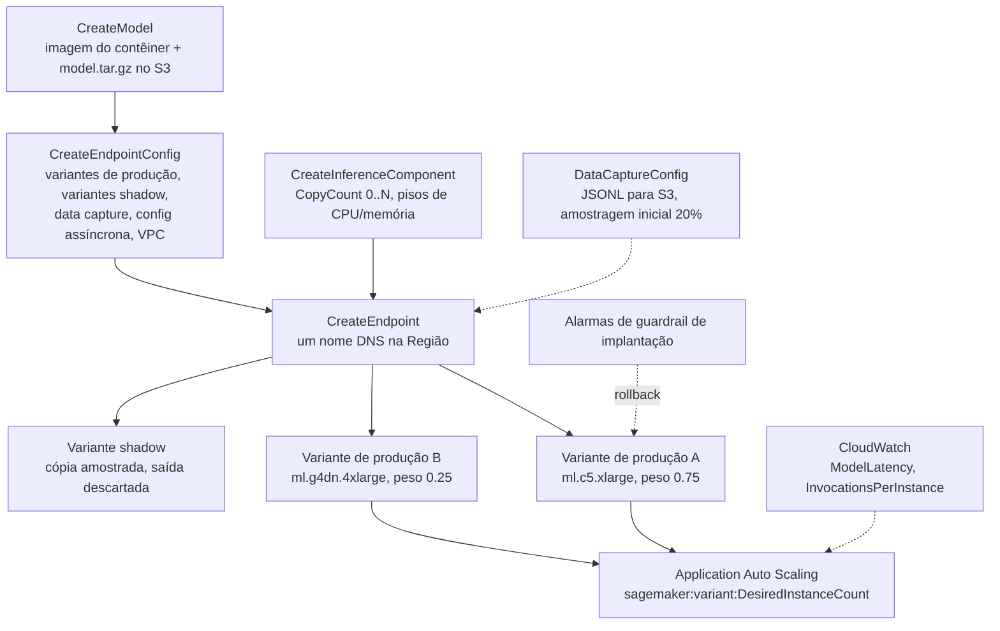
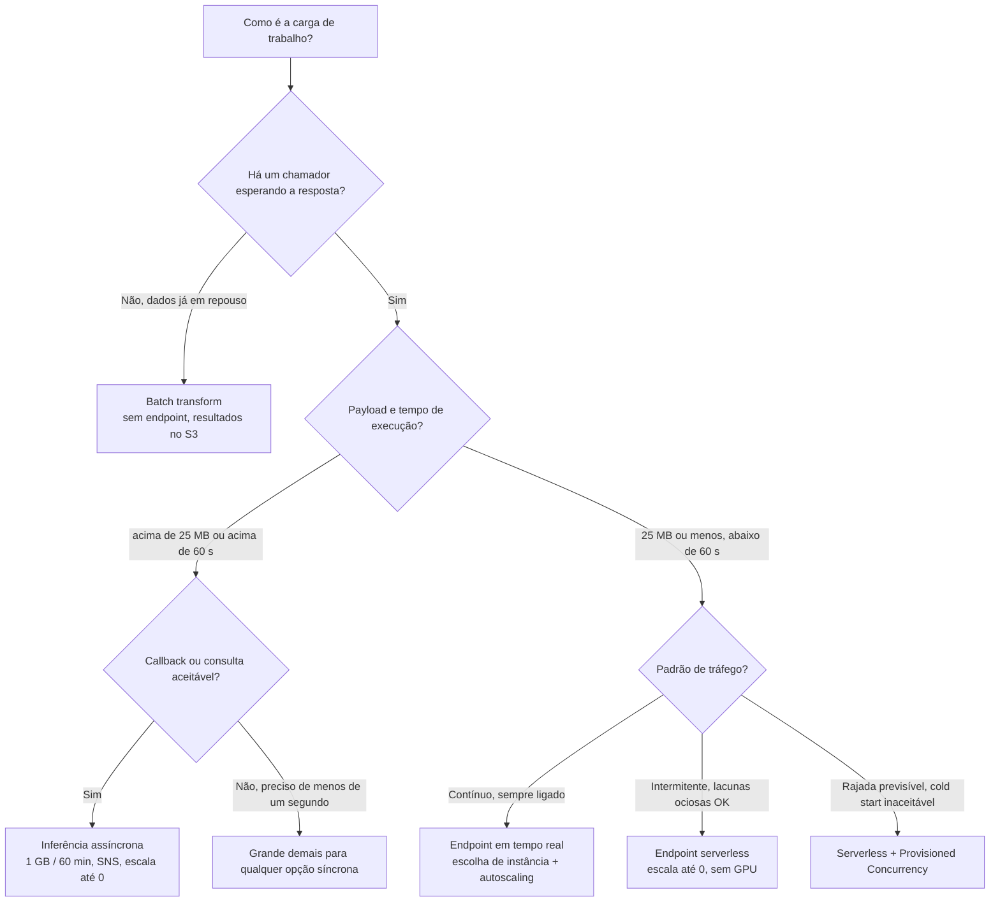
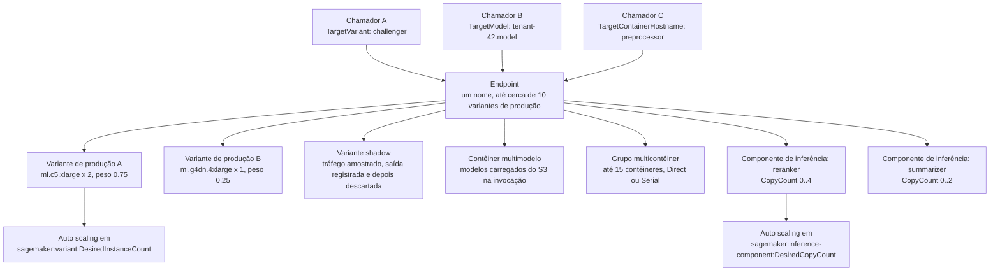
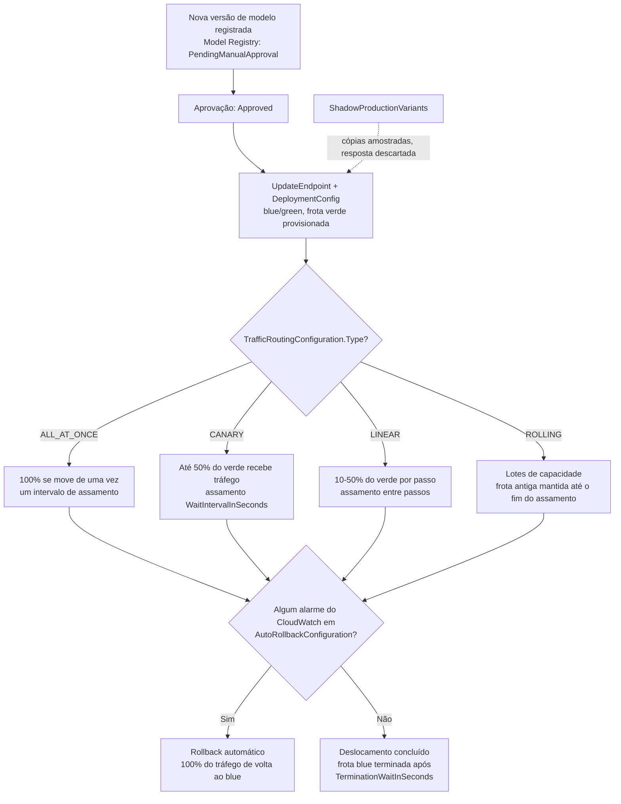
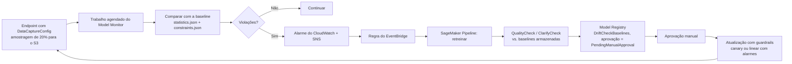

# Implantação e Inferência no Amazon SageMaker

O treinamento produz um artefato; **a inferência é onde o modelo encontra um chamador e onde a fatura começa**. No exame AIF-C01 este é território do Domínio 2, *"Tarefa 2.1: selecione a opção de implantação apropriada para uma solução de IA/ML"*, e é a tarefa de seleção de serviços mais densa de todo o guia. O modo de falha nunca é "você não sabia que o SageMaker hospeda um modelo". É que você escolheu **serverless** para um payload de 800 MB, **batch** para uma interface de chat com latência abaixo de um segundo, **tempo real** para um trabalho que roda duas vezes por noite, ou configurou um canário em **60%** da frota verde e nunca percebeu que o número é limitado.

```text
=====================================================================
 AS QUATRO OPÇÕES DE IMPLANTAÇÃO   (exatamente quatro — AIF-C01 Tarefa 2.1)
=====================================================================
  REAL-TIME ...... endpoint REST persistente, latência em ms,
                   tráfego contínuo, payload <= 25 MB, GPU sim
  SERVERLESS ..... escala até 0, sem tipo de instância, 4 MB / 60 s,
                   tráfego intermitente, GPU não, cold start
  ASYNC .......... enfileirado via InvokeEndpointAsync, 1 GB / 60 min,
                   resultados no S3 + SNS, escala até 0, GPU sim
  BATCH .......... nenhum endpoint, trabalho sobre dados em repouso,
                   100 MB por lote, dias de execução, resultados no S3
---------------------------------------------------------------------
  MODELO DE OBJETOS:  CreateModel -> CreateEndpointConfig -> CreateEndpoint
                      (+ CreateInferenceComponent, opcional)
  TOPOLOGIAS:         modelo único | multimodelo | multicontêiner |
                      pipeline serial | componentes de inferência
  ROLLOUT:            blue/green (padrão) | ALL_AT_ONCE | CANARY | LINEAR
  MONITORAMENTO:      qualidade de dados | qualidade de modelo | desvio de
                      viés | desvio de atribuição de atributo (data capture
                      obrigatório)
=====================================================================
```

> [!NOTE]
> **Como ler esta lição.** Todo teto, timeout e preço abaixo é um número publicado pela AWS, tirado do guia de desenvolvedor do SageMaker, da referência da API do SageMaker ou da página de preços do SageMaker. Onde a AWS publicou uma *mudança*, e em 2026 ela publicou duas grandes, o fechamento do Model Monitor para novos clientes e a descontinuação do Edge Manager, a mudança está marcada na seção onde você de outro modo usaria o fato antigo.

Ao final desta lição você será capaz de:

- nomear as **exatamente quatro** opções de inferência e recitar o payload, o tempo de execução e o teto de endpoint de cada uma;
- percorrer o modelo de objetos `CreateModel` → `CreateEndpointConfig` → `CreateEndpoint` e dizer o que cada campo faz;
- escolher entre as **cinco topologias** por trás de um endpoint (modelo único, multimodelo, multicontêiner, pipeline serial, componentes de inferência) com seus limites de contêiner e variante;
- configurar o **auto scaling** na dimensão escalável certa, incluindo os alvos de métrica que a própria AWS documenta;
- executar **testes A/B, variantes shadow e rollouts blue/green com guardrails**, incluindo os limites de porcentagem do canário e do linear;
- explicar o **data capture** e os quatro tipos do **Model Monitor**, e a mudança de disponibilidade de 2026 que os fecha para novos clientes;
- calcular o custo real de um endpoint em tempo real, um endpoint serverless e uma configuração de Provisioned Concurrency a partir dos próprios exemplos resolvidos da AWS;
- ligar **SageMaker Projects, operadores do EKS e Neo** a uma história de CI/CD e de borda;
- defender um **veredito comparativo** entre tempo real vs. serverless vs. batch vs. assíncrono vs. borda;
- responder **dez questões em formato de exame** escritas na voz oficial, incluindo dois itens de aritmética.

---

## 1. O modelo de objetos: três chamadas e uma quarta opcional

### 1.1 O que cada chamada de API possui

A implantação no SageMaker não é um único botão. É uma cadeia de três chamadas de API, cada uma das quais possui uma decisão diferente, mais uma quarta opcional para componentes. O exame adora o formato *"qual destas é configurada onde"*, então aprenda a tabela de propriedade de cor.

| Chamada de API | O que você decide ali | Campos que o exame nomeia |
|---|---|---|
| `CreateModel` | **O que** o modelo é | `PrimaryContainer.Image` / `ModelDataUrl`, `ExecutionRoleArn`, `VpcConfig`, `EnableNetworkIsolation` |
| `CreateEndpointConfig` | **Como** ele é servido | `ProductionVariants`, `ShadowProductionVariants`, `DataCaptureConfig`, `AsyncInferenceConfig`, `VpcConfig`, `KmsKeyId` |
| `CreateEndpoint` | **Para onde** o tráfego vai | nome do endpoint; depois atualizado com `UpdateEndpoint` + `DeploymentConfig` |
| `CreateInferenceComponent` (opcional) | **Quanto** do endpoint um modelo recebe | `VariantName`, `ModelPackageName`/`InferenceComponentName`, `RuntimeConfig.InitialCopyCount`, `ComputeConfigRequirements` (`NumberOfCpuCoresRequired`, `MinMemoryRequiredInMb`) |

Duas chamadas de acompanhamento importam tanto quanto as três acima:

- **`UpdateEndpointWeightsAndCapacities`** re-pesa variantes vivas *sem* substituir o endpoint; esta é a alavanca do A/B;
- **`UpdateEndpoint` + `DeploymentConfig`** troca a frota inteira por trás do endpoint usando uma configuração de roteamento de tráfego com guardrails.

### 1.2 A arquitetura de implantação



### 1.3 Onde mora a chave assíncrona

A presença de `AsyncInferenceConfig` dentro da configuração do endpoint é o que torna um endpoint **somente assíncrono**. Esse campo carrega `S3OutputPath`, tópicos SNS opcionais `SuccessTopic`/`ErrorTopic`, `ClientConfig` (`MaxConcurrentInvocationsPerInstance`) e o TTL da requisição. Um endpoint criado com ele aceita **apenas `InvokeEndpointAsync`**: chamadas síncronas `Invoke` não fazem parte do contrato.

- **📚 Você sabia?** A fila de requisições assíncronas é sustentada por **Amazon SQS** com um TTL documentado de **6 horas** (`RequestTTLSeconds` máx. **21.600**), e a invocação em si expira por timeout em **900 segundos** por padrão, com máximo de **3.600 segundos**. É por isso que a AWS descreve o assíncrono como *"enfileirado, quase em tempo real"* e não como um substituto de batch: a fila esquece a sua requisição na marca das 6 horas, mesmo que o seu modelo eventualmente terminaria.

---

## 2. As quatro opções de inferência

### 2.1 Endpoints em tempo real

Um endpoint em tempo real é um **endpoint REST persistente** com latência em milissegundos, destinado a **tráfego contínuo e previsível**. Você escolhe o tipo e a contagem de instâncias, habilita o auto scaling, e obtém data capture, Model Monitor, variantes shadow e rollouts com guardrails. Você também paga por ele **todo segundo em que ele existe**: a cobrança em tempo real é a instância-hora enquanto roda, medida por segundo com um mínimo de um minuto, mais o volume de EBS e a transferência de dados.

### 2.2 Serverless Inference

O Serverless remove a escolha de instância: você fornece uma configuração de memória (**1024, 2048, 3072, 4096, 5120 ou 6144 MB**, com vCPU escalando ao lado dela) e a AWS escala o endpoint a partir do tráfego **até zero**. A imagem de contêiner máxima é **10 GB**, e cada contêiner roda **1 worker com 1 cópia do modelo**. Ocioso não custa nada; a primeira requisição depois de um período ocioso paga um cold start que a AWS descreve apenas como *"alguns segundos extras"*.

As exclusões são a lista favorita do exame, porque cada uma delas mata uma opção que soa plausível:

| Não suportado no serverless | Onde *é* suportado |
|---|---|
| GPUs | tempo real, assíncrono, batch |
| Pacotes do Marketplace e registros privados | tempo real |
| Endpoints multimodelo | tempo real |
| Configuração de VPC e isolamento de rede | tempo real |
| Data capture e **Model Monitor** | tempo real (capture no trabalho para batch) |
| Múltiplas variantes de produção / A/B | tempo real |
| Pipelines de inferência (serial) | tempo real |

> [!WARNING]
> **O Serverless é de mão única.** Criar uma configuração de endpoint que misture uma variante serverless com as funcionalidades acima lança um **`ValidationError`**. E a conversão é assimétrica por design: você pode ir *de* uma configuração em tempo real *para* serverless descartando as peças não suportadas, mas a AWS documenta a direção contrária como uma porta de mão única. Lembre também dos tetos duros antes de se comprometer: payload de **4 MB** e **60 segundos** de processamento, contra **25 MB** do tempo real.

**Exemplo resolvido 1, a fatura mensal do serverless (exemplo de preços da AWS).** 10.000.000 requisições × 100 ms = **1.000.000 segundos** de computação × **$0.00004/segundo** = **$40.00**; 10 GB de transferência de dados × **$0.016/GB** = **$0.16** → **$40.16 por mês**, e **$0.00 enquanto ocioso**. O mesmo tráfego em um endpoint em tempo real é cobrado da mesma forma, seja ele 10 requisições ou 10 milhões, e esse é todo o argumento do serverless em carga intermitente.

### 2.3 Batch transform

O batch transform **não tem endpoint**. Você aponta um trabalho de transformação para dados já em repouso, ele sobe instâncias, grava os resultados no S3 como **`<input>.out`** (por exemplo `input.csv.out`), e a computação desaparece com o trabalho. O payload é por lote via **`MaxPayloadInMB`** (até **100 MB**), o teto do trabalho é **3.600 segundos**, e é a resposta correta sempre que os dados estão disponíveis de antemão e ninguém está esperando.

**Exemplo resolvido 7, aritmética de payload do batch.** A regra documentada é `MaxConcurrentTransforms × MaxPayloadInMB ≤ 100 MB`: **4 × 25 MB = 100 MB é legal**, **4 × 50 MB = 200 MB é rejeitado**. Definir `MaxPayloadInMB: 0` muda para streaming em blocos, que os algoritmos incorporados **não** suportam, então o caminho padrão é o limitado.

### 2.4 Inferência assíncrona

A inferência assíncrona recebe uma requisição grande, **enfileira-a**, e deixa o chamador tanto consultar o S3 quanto receber uma mensagem SNS. É a opção com o maior payload (**1 GB**) e a maior janela de processamento (**60 minutos** por padrão **900 s**, máximo **3.600 s**), ela escala até **zero** entre rajadas, e é a única opção cujo *caminho de sucesso* é assíncrono por construção.

**Exemplo resolvido 3: quando só o assíncrono serve.** Um modelo de vídeo tem que aceitar um arquivo de **800 MB**, pode rodar **40 minutos**, e o chamador quer uma notificação SNS. O tempo real para em **25 MB / 60 s**; o serverless para em **4 MB**; o batch limita o payload por lote a **100 MB**. O assíncrono a **1 GB / 60 min** com `S3OutputPath` e `SuccessTopic` é a única configuração que passa pelos três requisitos.

### 2.5 Os tetos lado a lado

| Teto | Tempo real | Serverless | Assíncrono | Batch transform |
|---|---|---|---|---|
| Payload | **25 MB** | **4 MB** | **1 GB** | **100 MB** por lote (`MaxPayloadInMB`) |
| Tempo de processamento | **60 s** (8 min com streaming) | **60 s** | **60 min** (padrão 900 s) | trabalho de **3.600 s** |
| Padrão de tráfego | contínuo | intermitente | enfileirado | GBs, até dias |
| Endpoint persiste | sim | sim (escala até 0 quando ocioso) | sim (escala até 0) | não (somente o trabalho) |
| TTL da fila |: |: | **6 h** (máx. 21.600 s) |: |
| GPU | sim | **não** | sim | sim |
| Data capture / Model Monitor | sim | **não** | sim | capture no trabalho |
| Saída | síncrona | síncrona | S3 + **SNS** opcional | S3 `.out` |

*Fontes: `deploy-model-options`, `hosting-faqs`, `async-inference-troubleshooting`, `batch-transform` (2026).*



- **📚 Você sabia?** A AWS nunca publica um número exato de cold start. O guia de desenvolvedor diz que uma requisição depois de um período de escala até zero paga *"algundos segundos extras"* para o download do modelo e o start do contêiner, enquanto as unidades de **Provisioned Concurrency** são documentadas como *"prontas em milissegundos"*. Qualquer opção de exame que cite um número preciso de cold start p95 em segundos está inventando.

---

## 3. Escolhendo uma opção: a matriz de decisão

As quatro opções são apenas metade da história. Depois que você sabe *quando* o tráfego chega, a pergunta restante é *quantos modelos* e *como eles dividem a computação*. Esta matriz é a Tarefa 2.1 do exame em forma de tabela.

| Situação | Escolha | Por quê / configuração-chave |
|---|---|---|
| Interface interativa, abaixo de um segundo, sempre ligada | **Endpoint em tempo real** | 25 MB, latência consistente, autoscaling, monitoramento + guardrails |
| Tráfego espicado, lacunas ociosas, cold start aceitável | **Serverless** | escala até 0, sem escolha de instância, 4 MB / 60 s, sem GPU |
| Rajada previsível, nunca um cold start | **Serverless + Provisioned Concurrency** | aquecido em milissegundos, cobrado por ms |
| Pontuação noturna de um arquivo de 50 GB | **Batch transform** | sem endpoint, GBs de dados, saída para o S3 |
| Entrada de 800 MB, minutos de trabalho, callback desejado | **Assíncrono** | 1 GB / 60 min, S3 na entrada e na saída, SNS, escala até 0 |
| Milhares de modelos do mesmo framework | **Endpoint multimodelo** | contêiner compartilhado, adicionados via S3, tolerante a cold start |
| Poucos frameworks, pouco tráfego em cada | **Multicontêiner (Direct)** | `TargetContainerHostname`, escopo de IAM, ≤15 contêineres |
| Pré/pós-processamento encadeado a um modelo | **Pipeline serial de inferência** | `Mode=Serial`; apenas um MME permitido nele |
| Vários modelos, CPU e memória por modelo | **Componentes de inferência** | `CopyCount`, autoscaling até 0 |
| Candidato vs. incumbente em tráfego vivo | **Variantes de produção (A/B)** | pesos + `TargetVariant` + `UpdateEndpointWeightsAndCapacities` |
| Validar sem que usuários vejam | **Variante shadow** | cópias amostradas, só a resposta de produção é retornada |
| Corte com aborto baseado em alarme | **Blue/green + canary ou linear** | `DeploymentConfig` + alarmes do CloudWatch + auto-rollback |
| Modelos para câmeras/robôs, sem chamadas à nuvem | **Compilação Neo (+ plano de borda em estágios)** | Edge Manager descontinuado em 26 de abril de 2024 |
| Código do modelo na sua própria VPC ou Kubernetes | **Imagem BYOC no ECR + operador do EKS** | CRD `HostingDeployment`; controladores ACK |

**Verifique a sua seleção de opções:**

```matching
{
  "question": "Relacione cada descrição de carga de trabalho à opção de implantação que a AWS documenta para ela:",
  "pairs": [
    {"left": "Interface de chat estável, respostas abaixo de um segundo, precisa de métricas de latência por variante", "right": "Endpoint em tempo real com variantes de produção - 25 MB, latência em ms, autoscaling"},
    {"left": "O tráfego fica zero por 26 dias e espeteça no fim do mês", "right": "Serverless com Provisioned Concurrency: escala até 0, aquecido em milissegundos"},
    {"left": "Pontuação noturna de um arquivo de 6 GB, ninguém esperando", "right": "Batch transform: sem endpoint, GBs de dados, resultados como arquivos.out no S3"},
    {"left": "Vídeo de 800 MB, 40 minutos de processamento, callback SNS", "right": "Inferência assíncrona: payload de 1 GB, teto de 60 min, saída no S3 mais tópicos SNS"},
    {"left": "460 modelos de locatários, cerca de 2% chamados em qualquer dia", "right": "Endpoint multimodelo por framework: contêiner compartilhado, carga e descarga a partir do S3"},
    {"left": "Comparar um candidato à produção sem que usuários vejam suas respostas", "right": "Variante de produção shadow: cópia amostrada, apenas a resposta de produção é retornada"}
  ],
  "explanation": "O tempo real é a resposta de baixa latência contínua; o serverless é o dono do caso de lacuna ociosa e ganha previsibilidade com o Provisioned Concurrency; o batch é o dono dos dados em repouso; o assíncrono é o dono de payloads grandes com callback; os endpoints multimodelo são o dono de muitos modelos do mesmo framework com tráfego misto de quentes e frios; as variantes shadow são o único mecanismo que avalia um candidato em tráfego vivo sem nunca retornar sua saída."
}
```

---

## 4. Topologias de endpoint: cinco maneiras de compartilhar um endpoint

Um único nome DNS de endpoint pode frontear muito mais do que um modelo. A AWS documenta cinco topologias, e o exame as testa como *"qual topologia, qual seletor, qual limite"*.

| | Modelo único | Multimodelo (MME) | Multicontêiner (MCE) | Componente de inferência | Variantes de produção |
|---|---|---|---|---|---|
| Compartilha o endpoint | 1 modelo | N modelos, **1 contêiner compartilhado** | ≤ **15 contêineres** | N modelos, recursos por modelo | ≤ ~10 variantes |
| Seleção na invocação | implícita | `TargetModel` | `TargetContainerHostname` | nome do modelo | `TargetVariant` / peso |
| Frameworks | qualquer | **o mesmo** (NVIDIA Triton para GPU) | heterogêneos | heterogêneos | heterogêneos |
| Adicionar modelo sem atualizar o endpoint | não | **sim** (upload para o S3) | não | **sim** (componente novo) | não |
| Cold start | não | **sim** (carga/descarga) | não | não | não |
| Escopo de IAM |: | `sagemaker:TargetModel` | `sagemaker:TargetContainerHostname` | CPU/memória por componente | instâncias por variante |
| A/B + guardrails | via atualização | limitado | limitado | via componentes | **nativo** |
| Uso típico | um modelo | muitos modelos de locatários | alguns modelos de pouco tráfego | modelos de fundação em uma frota compartilhada | teste e rollout |

*Fontes: `model-deploy-feature-matrix`, `multi-model-endpoints`, `multi-container-create` (2026). A frase **"multi-access endpoint"** não aparece em nenhum lugar da documentação da AWS: os três nomes reais são multi-model, multi-container e inference component.*

### 4.1 Endpoints multimodelo

Um MME coloca **um contêiner de servição compartilhado** por trás do endpoint e carrega/descarrega modelos a partir do S3 **na invocação**, então você pode adicionar ou aposentar modelos enviando um objeto: **sem atualizar o endpoint**. Os modelos têm de compartilhar um framework; o uso de GPU exige **NVIDIA Triton**. O custo é o cold start no primeiro acesso a um modelo que não está residente, e a restrição é que **um pipeline serial pode conter no máximo um MME**.

### 4.2 Endpoints multicontêiner

Um MCE coloca até **15 contêineres** atrás de um endpoint. `Mode=Direct` roteia com o cabeçalho de requisição `TargetContainerHostname` (e a chave de IAM `sagemaker:TargetContainerHostname`); `Mode=Serial` os encadeia como um pipeline. O modo Direct **não tem suporte a GPU**, e o AWS ML Blog da AWS afirma **economia de até 90%** comparado a rodar um endpoint separado por contêiner.

### 4.3 Componentes de inferência

A resposta moderna para *"vários modelos, necessidades de recursos diferentes, em uma única frota"*: cada componente declara `NumberOfCpuCoresRequired`, `MinMemoryRequiredInMb` e `CopyCount`, faz autoscaling em sua própria dimensão (`DesiredCopyCount`) e pode escalar suas cópias **até zero**. Esta é também a topologia que permite que um modelo de fundação e um classificador pequeno dividam a capacidade, sem que nenhum dos dois seja dono da contagem de instâncias.

### 4.4 A arquitetura de implantação sob um endpoint



- **📚 Você sabia?** O teto de **~10 variantes de produção** vem de um post do AWS Machine Learning Blog (2022), não de uma página de cotas: a AWS o publica como orientação e não como cota de serviço. Trate-o como "cerca de dez, não projete além disso", e lembre de que cada variante carrega seu próprio tipo de instância, contagem, peso e dimensão do CloudWatch.

---

## 5. Auto scaling, capacidade aquecida e escala até zero

### 5.1 Os três passos padrão

A AWS documenta a mesma sequência para todo alvo de escalonamento do SageMaker: **registrar o alvo escalável** (namespace `sagemaker`) → **definir a política** → **`PutScalingPolicy`** com `TargetTrackingScaling` ou `StepScaling`. O target tracking é o tipo de política recomendado para variantes de produção.

| Alvo | Dimensão escalável | Métrica / nota |
|---|---|---|
| Variante de produção | `sagemaker:variant:DesiredInstanceCount` | `SageMakerVariantInvocationsPerInstance` (alvo de exemplo **70**/min), `ConcurrentRequestsPerModel`, `CPUUtilization` |
| Componente de inferência | `sagemaker:inference-component:DesiredCopyCount` | `SageMakerInferenceComponentInvocationsPerCopy` (exemplo **1**), mínimo **0** |
| Provisioned Concurrency serverless | `sagemaker:variant:DesiredProvisionedConcurrency` | target tracking em unidades de PC (exemplo 1 to 10) |
| Endpoint explicável | dimensão da variante | `ExplanationsPerInstance` (com `EnableExplanations`) |
| Recuperação de escala até zero |: | `NoCapacityInvocationFailures` → **step scaling** |
| Excluído |: | instâncias **burstable T2** |

*Fontes: `endpoint-auto-scaling-policy`, `endpoint-auto-scaling-add-code-define`, `endpoint-auto-scaling-zero-instances` (2026).*

### 5.2 Escala até zero e o caminho de recuperação

A escala até zero se aplica às cópias **serverless, assíncronas e de componentes de inferência**. Em uma variante de tempo real o console impõe uma **contagem mínima de instâncias ≥ 1**, e **instâncias burstable T2 não podem ser escaladas de forma automática de jeito nenhum**. A recuperação a partir do zero não é instantânea: o CloudWatch emite **`NoCapacityInvocationFailures`**, a política de **step scaling** reage, e a AWS documenta a recuperação como levando *"vários minutos"*.

**Exemplo resolvido 6, aritmética do target tracking.** Target tracking em `SageMakerVariantInvocationsPerInstance` com `TargetValue = 70` mantém cada instância perto de **70 invocações por minuto**; `ScaleOutCooldown` de **300 s** e `ScaleInCooldown` de **600 s** evitam que a frota fique oscilando. Registrar `MinCapacity = 1`, `MaxCapacity = 8` limita o gasto a 8 × **$0.204/h** = **$1.63/h** de computação, a configuração legal em tempo real mais barata, e ainda assim infinitamente mais cara que um endpoint serverless parado em zero.

```fillblank
{
  "question": "Complete as regras de auto scaling para endpoints do SageMaker:",
  "template": "O tipo de política recomendado para uma variante de produção é {{1}}. Ele escala na métrica {{2}}, com um alvo de exemplo documentado de {{3}} invocações por minuto. Instâncias da família {{4}} não podem ser escaladas de forma automática de jeito nenhum, e um endpoint que escalou até zero se recupera através do CloudWatch {{5}} disparado em uma política de step scaling.",
  "answers": {
    "1": "target tracking",
    "2": "SageMakerVariantInvocationsPerInstance",
    "3": "70",
    "4": "burstable T2",
    "5": "NoCapacityInvocationFailures"
  },
  "distractors": ["step scaling", "SageMakerEndpointInvocations", "100", "burstable T3", "ModelLatencyAlarm", "CPUUtilization"],
  "explanation": "A AWS recomenda target tracking para variantes de produção em SageMakerVariantInvocationsPerInstance com um exemplo documentado de 70; instâncias burstable T2 são excluídas do auto scaling; e um endpoint que escalou até zero sinaliza NoCapacityInvocationFailures, que uma política de step scaling transforma de volta em capacidade ao longo de vários minutos."
}
```

---

## 6. Teste e rollout: A/B, variantes shadow e guardrails

### 6.1 Teste A/B com variantes de produção

O teste A/B é apenas **pesos de variante**: `InitialVariantWeight` divide o tráfego (o próprio walkthrough da AWS começa em **1 / 1 = 50/50**), `TargetVariant` fixa um chamador específico a uma variante específica independentemente do peso, e `UpdateEndpointWeightsAndCapacities` re-pesa a divisão **ao vivo, sem substituir o endpoint**. Métricas por variante caem no CloudWatch sob a dimensão da variante.

**Exemplo resolvido 5, o walkthrough dos pesos.** Duas variantes com `InitialVariantWeight 1/1` → **50/50**. A Variante 2 vence a comparação → `UpdateEndpointWeightsAndCapacities` define **25/75**, movendo **75%** do tráfego para a Variante 2. O passo final **0/1** dá tudo à Variante 2, e a Variante 1 é excluída. `TargetVariant` sobrescreve os pesos para um chamador fixado.

### 6.2 Implantações shadow

`ShadowProductionVariants` na configuração do endpoint envia uma **cópia amostrada** do tráfego vivo para o candidato. O comportamento crítico, e a frase favorita do exame sobre este tópico, é que **somente a resposta da variante de produção chega ao chamador**; a saída da shadow é registrada ou descartada. As atualizações shadow em si são **blue/green**: a configuração do endpoint muda nos bastidores.

### 6.3 Guardrails de implantação

Guardrails são a forma de você colocar um modelo em produção sem apostar o endpoint nele. O blue/green é o **padrão para atualizações de modelo**, o rolling substitui capacidade em lotes, e o tipo de roteamento de tráfego é um enum explícito.

| Modo | Unidade do deslocamento | Limite | Assamento | Em alarme |
|---|---|---|---|---|
| `ALL_AT_ONCE` | 100% do tráfego |: | um intervalo de assamento | → 100% de volta ao blue |
| `CANARY` | % da **frota verde** | **≤ 50%** | `WaitIntervalInSeconds` (exemplo 600 s) | → 100% de volta ao blue |
| `LINEAR` | % do verde por passo | **10 to 50%** por passo | por passo (exemplo 300 s) | → 100% de volta ao blue |
| Rolling | lotes de instância/capacidade | tamanho de lote do cliente | por lote | frota antiga mantida até o fim do assamento |
| Plano de implantação de borda | % da frota ou dispositivos nomeados | plano em estágios | por estágio | `ROLLBACK_ON_FAILURE` |

*Fontes: `deployment-guardrails`, `deployment-guardrails-blue-green-canary`, `deployment-guardrails-blue-green-linear` (2026). Controles: `WaitIntervalInSeconds`, `MaximumExecutionTimeoutInSeconds`, `AutoRollbackConfiguration.Alarms[]`.*

**Exemplo resolvido 3 (rollout): cronograma do canary.** `Type: CANARY`, `CanarySize: 30%`, `WaitIntervalInSeconds: 600`, `TerminationWaitInSeconds: 600`, `MaximumExecutionTimeoutInSeconds: 1800`: **30% da frota verde** recebe tráfego por **10 minutos**, o resto só se move se nenhum alarme disparar, a frota blue morre **10 minutos** depois do corte, e a implantação inteira aborta em **30 minutos**. 30% é válido porque o teto é **≤ 50%**.

**Exemplo resolvido 4 (rollout), o piso do linear.** `LinearStepSize: 20%` com `WaitIntervalInSeconds: 300` significa 100 / 20 = **5 passos × 5 minutos = pelo menos 25 minutos** de assamento, confortavelmente dentro de um `MaximumExecutionTimeoutInSeconds` de uma hora. Um passo fora de **10 to 50%** é inválido, 5% e 60% são ambos rejeitados.



- **📚 Você sabia?** Um canary é medido contra a frota **verde**, não contra o tráfego total, o limite da AWS é *"não mais que 50% da frota verde"*, e é por isso que uma questão sobre uma frota verde de 8 instâncias aceita `CAPACITY_PERCENT 50` e rejeita `60` e `80`. É uma porcentagem de dois passos: primeiro do verde, depois do endpoint inteiro.

---

## 7. Monitoramento: data capture, Model Monitor e o loop de desvio

### 7.1 O data capture é a pré-condição

`DataCaptureConfig` vive na configuração do endpoint e tem três campos: `EnableCapture`, `InitialSamplingPercentage` (0 to 100) e `DestinationS3Uri`. A **amostragem padrão do SDK é de 20%**, os registros são gravados como **JSONL** sob `s3://…/{endpoint}/{variant}/yyyy/mm/dd/hh/`, e o capture **para acima de 75% de uso de disco**. Sem capture, sem monitoramento: o Model Monitor lê o que o capture gravou.

### 7.2 Os quatro tipos de monitor

| Monitor | Detecta | Precisa de ground truth? | Baseline | Motor / métrica | Alerta |
|---|---|---|---|---|---|
| **Qualidade de dados** | desvio de entrada, mudança de dados a montante | **Não** | `statistics.json` + `constraints.json` | estatísticas/restrições (**somente tabular**) | CloudWatch em violações |
| **Qualidade de modelo** | desvio de acurácia, precisão, recall, F1, AUC, RMSE, MAE | **Sim** (rótulos no S3) | restrições de métrica | trabalho de processamento agendado | CloudWatch + SNS |
| **Desvio de viés** | mudança de equidade vs. treinamento (ex. DPPL) | atributos protegidos | baseline de viés do Clarify | Clarify + intervalos de confiança bootstrap (exemplo de 2 dias, DPPL −0,1…0,1) | CloudWatch |
| **Desvio de atribuição de atributo** | importância SHAP mudou | Não | baseline SHAP | comparação de ranque por **NDCG** | **NDCG < 0,90** |
| Saúde do endpoint/sistema | latência, 5xx, invocações, CPU | No | métricas do CloudWatch | `ModelLatency`, `InvocationsPerInstance`, `NoCapacityInvocationFailures` | auto-rollback de guardrail |

*Fontes: `model-monitor`, `clarify-model-monitor-feature-attribution-drift` (2026).*

### 7.3 A mudança de disponibilidade de 2026

> [!WARNING]
> **O Model Monitor e o SageMaker Clarify estão fechados para novos clientes a partir de 30 de julho de 2026.** Clientes existentes mantêm o acesso, sem funcionalidades novas; o anúncio de disponibilidade de serviços da AWS de junho de 2026 os lista entre as funcionalidades do SageMaker que passam para manutenção. Para projetos **novos** a AWS aponta **MLflow Apps + Evidently AI + QuickSight + CloudWatch** (sete soluções publicadas em `aws-samples`, tipicamente ligadas com Athena, EventBridge e Lambda). Uma opção de exame que diz *"criar um novo agendamento do Model Monitor"* para uma conta recém-criada no fim de 2026 está testando se você leu a página de disponibilidade.

### 7.4 O loop de desvio-para-treinamento-novamente

Desvio não é um alerta que você lê; é um gatilho que você liga. O caminho documentado: uma violação levanta um alarme do CloudWatch → o SNS notifica → o **EventBridge** casa com o alarme e invoca o Lambda ou inicia um **CodePipeline** → um **SageMaker Pipeline** retreina → os passos `QualityCheck` / `ClarifyCheck` comparam o candidato às baselines armazenadas no **Model Registry** (`DriftCheckBaselines`) → um humano aprova → uma atualização com guardrails é colocada em produção.



- **📚 Você sabia?** O desvio de atribuição de atributo é pontuado com **NDCG** sobre ranqueamentos SHAP, e o limiar de alerta documentado pela AWS é **NDCG < 0,90**: um valor de 0,69 significa que a importância viva dos atributos divergiu materialmente do treinamento. O Model Monitor em si produz apenas métricas **tabulares**, então um modelo cujos atributos são embeddings de texto fica inteiramente fora do seu motor estatístico.

### 7.5 Atualizações de 2026 (em outubro de 2026)

As seções 7.1 to 7.4 descrevem o que o Model Monitor *faz*; esta subseção descreve o que a AWS *fez* com ele, porque os dois já não andam juntos. O aviso de fim de suporte do SageMaker AI da AWS lista **Model Monitor** e **Clarify**, junto com Mechanical Turk, Ground Truth, Augmented AI (A2I), Studio Lab, Debugger, Role Manager, Geospatial e Profiler, entre as funcionalidades **"no longer open to new customers starting July 30, 2026"**. O status que a AWS lhes atribui é **manutenção**: clientes existentes os mantêm, nenhuma funcionalidade nova é lançada, nada é desligado e nada é rebatizado.

| Funcionalidade no aviso | Data documentada | Estado do ciclo de vida | Direção documentada para trabalho novo |
|---|---|---|---|
| SageMaker **Model Monitor** | fechado para novos clientes em **30 de julho de 2026** | **Manutenção** | Métricas do CloudWatch e detecção de anomalias, Amazon Evidently, EventBridge + Lambda, baselines SHAP |
| SageMaker **Clarify** | fechado para novos clientes em **30 de julho de 2026** | **Manutenção** | **Bedrock Model Evaluations**, SHAP, Bedrock Guardrails |
| Ground Truth, **A2I (Augmented AI)**, Studio Lab, Debugger, Role Manager, Geospatial | fechados para novos clientes em **30 de julho de 2026** | **Manutenção**: ainda suportados, sem funcionalidades novas | página de cada funcionalidade; a revisão humana do A2I vira uma fila mais um aplicativo que você constrói |
| SageMaker **Mechanical Turk** | fechado para novos clientes em **30 de julho de 2026**, **EOS em 30 de setembro de 2026** (post What's New datado de 29 de setembro) | fim de suporte | Ground Truth com um fornecedor ou força de trabalho privada, ou outro serviço de rotulagem |
| Ground Truth Plus | **EOS em 30 de junho de 2026** | fim de suporte | trabalhos de rotulagem do Ground Truth padrão |
| SageMaker **Profiler** | **EOS em 30 de junho de 2027** | pôr do sol | alternativas de observabilidade do SageMaker |
| Amazon **Forecast** (distrator: não é um serviço de monitoramento) | fechado para novos clientes em **29 de julho de 2024** | manutenção | SageMaker Canvas |

*Fontes: a página de funcionalidades do SageMaker AI, `model-monitor-availability-change`, `clarify-availability-change`, os anúncios de disponibilidade de serviços do AWS What's New de junho e setembro de 2026, e a página `service-lifecycle` do AWS General Reference (24 de setembro de 2026). O conflito de 29 vs. 30 de setembro no Mechanical Turk é da própria AWS e não é resolvido aqui.*

A AWS define o vocabulário de ciclo de vida em exatamente um documento, e o exame testa as *palavras* com mais frequência do que as datas:

| Estado do ciclo de vida | O que a AWS diz que significa | Como responder no exame |
|---|---|---|
| **Manutenção** | sem novos clientes, sem funcionalidades novas, **ainda suportado** | "fechado para novos clientes" não é "morto": uma conta criada antes de 30 de julho de 2026 ainda pode rodar um agendamento do Model Monitor |
| **Sunset** | fim planejado de operações com data publicada, tipicamente um horizonte de 12 meses | existe um prazo e a funcionalidade ainda funciona até ele, o SageMaker Profiler roda até **30 de junho de 2027** |
| **Full Shutdown** | removido do portfólio da AWS | a API e o console se foram; nunca uma resposta válida para uma construção nova |

**Onde a mordida da mudança pega uma resposta de exame:**

- *"Criar um agendamento do Model Monitor para uma conta **nova**"* → indisponível a partir de **30 de julho de 2026**; a direção documentada é métricas do CloudWatch e detecção de anomalias, **Amazon Evidently**, um loop **EventBridge + Lambda** e baselines SHAP que você calcula você mesmo;
- *"Avaliar a qualidade e o viés de um candidato para um projeto **novo**"* → **Bedrock Model Evaluations** é a dupla que a AWS agora escreve no objetivo **4.2.2** do guia do exame, com **SHAP** e **Bedrock Guardrails** nomeados ao lado do Clarify;
- *"Roteirizar previsões de baixa confiança para um humano"* → o **A2I** está no mesmo aviso, então uma construção nova alcança uma fila mais um aplicativo de revisão, ou o Ground Truth, em vez do Augmented AI;
- *"Cliente existente, 2026, mantém seus agendamentos do Model Monitor"* → correto: **manutenção** significa suportado, e apenas novos cadastros são bloqueados.

**O que *não* mudou:** toda a mecânica memorizada acima ainda se comporta como escrito, o `DataCaptureConfig` com sua amostragem padrão do SDK de **20%**, o layout JSONL sob `{endpoint}/{variant}/…`, a parada acima de **75% de disco**, os quatro tipos de monitor e seus motores (estatísticas e restrições, restrições de métrica, intervalos bootstrap do Clarify, **NDCG < 0,90**), o loop de desvio pelo EventBridge até um SageMaker Pipeline e os `DriftCheckBaselines` do Model Registry, e a limitação de **somente tabular** do motor estatístico do Model Monitor. O aviso de 2026 muda *quem pode se cadastrar*, não o que o software faz, e essa é toda a distinção entre *manutenção* e *desligamento*.

**Formulação do guia do exame que você vai encontrar agora (v1.1, publicado em 30 de abril de 2026):**

- o objetivo **1.1.3** mudou seus exemplos resolvidos para **inferência assíncrona e serverless**, duas das quatro opções desta lição, então o vocabulário de implantação agora aparece mais cedo no guia do que aparecia antes do v1.1;
- o objetivo **4.2.2** diz **Clarify mais Bedrock Model Evaluations**, e o objetivo **1.3.4** lista **Bedrock, Amazon Quick, Kiro e SageMaker AI** como o conjunto de serviços;
- o histórico de mudanças do guia afirma que atualizações chegam ao exame cerca de **um mês** após a publicação, e o exame ainda se chama **AIF-C01** (65 questões, 90 minutos, aprovação em 700/1000).

Por fim, o nome do produto: desde **3 de dezembro de 2024** a AWS documenta que *"o Amazon SageMaker atual foi renomeado para **Amazon SageMaker AI**"*, com o SageMaker de nova geração (Unified Studio, Catalog, Lakehouse, zero-ETL) ao lado dele. Toda chamada de API da seção 1 permanece intocada, `CreateModel`, `CreateEndpointConfig` e `CreateEndpoint` ainda vivem no namespace `sagemaker`, mas o console, a página de serviço e a lista de serviços do exame dizem **SageMaker AI**.

- **📚 Você sabia?** A AWS define os três estados do ciclo de vida em exatamente um lugar, a página **`service-lifecycle`** do AWS General Reference, atualizada pela última vez em **24 de setembro de 2026**, e o Model Monitor está no estado mais suave, **Manutenção**. Uma funcionalidade em **Sunset** já carrega uma data final publicada (SageMaker Profiler, **30 de junho de 2027**), enquanto **Full Shutdown** significa que a API se foi do portfólio. É por isso que *"o Model Monitor foi descontinuado"* e *"o Model Monitor foi rebatizado como Bedrock Model Evaluations"* estão ambos errados: ele está fechado para clientes *novos*, inalterado para os existentes, e a dupla com Bedrock vive na formulação do guia do exame e não em um rebatismo.

---

## 8. Dimensionamento, custo e Inference Recommender

### 8.1 De que a fatura é feita

| Item | Valor de exemplo da AWS | Fonte |
|---|---|---|
| Hospedagem de `ml.c5.xlarge` | **$0.204/hora** | exemplo resolvido de preços do SageMaker |
| `ml.m5.4xlarge` (trabalho do Model Monitor) | **$0.922/hora** | exemplo resolvido de preços do SageMaker |
| Dados na entrada / saída | **$0.016/GB** | exemplo resolvido de preços do SageMaker |
| Computação serverless sob demanda | **$0.00004/segundo** | exemplo resolvido de preços do SageMaker |
| Serverless com Provisioned Concurrency | **$0.000023/segundo** | exemplo resolvido de preços do SageMaker |
| Free tier: tempo real | **125 horas** de `m4.xlarge`/`m5.xlarge`, primeiros 2 meses | free tier do SageMaker |
| Free tier: serverless | **150.000 segundos**, primeiros 2 meses | free tier do SageMaker |
| Total mensal de tempo real do exemplo | **$305.88** | exemplo resolvido de preços do SageMaker |
| Total mensal serverless do exemplo | **$40.16** | exemplo resolvido de preços do SageMaker |
| Exemplo com Provisioned Concurrency | **$173.20** = $144 + $23 + $6 + $0.208 | exemplo resolvido de preços do SageMaker |

*Os preços são os próprios exemplos resolvidos da AWS e são exemplos específicos de Região, não uma tabela de tarifas. Savings Plans (1 ou 3 anos, compromissos de $/hora) cobrem endpoints em tempo real, batch transform, treinamento e processamento.*

**Exemplo resolvido 2: a fatura mensal em tempo real.** 2 × `ml.c5.xlarge` × 24 h × 31 d = **1.488 instância-horas** × **$0.204** = **$303.52**; um trabalho do Model Monitor de **2,5 h** × **$0.922** = **$2.31**; dados de 3.100 MB na entrada + 310 MB na saída ≈ **$0.06** → **≈ $305.88 por mês**. O monitoramento fica abaixo de **1%** da fatura; a computação ociosa é cerca de **99%** dela. Compare com o exemplo serverless de **$40.16** e você tem todo o argumento de custo em dois números.

**Exemplo resolvido 8, cold start versus Provisioned Concurrency.** Ocioso → escala até zero → a próxima requisição paga o download do modelo e o start do contêiner (*"alguns segundos extras"*). Comprar determinismo em vez disso: Provisioned Concurrency de **$144** + computação da PC de **$0.000023/s** + sob demanda de **$6** depois dos **150.000 segundos gratuitos** = **$173.20 por mês**, cerca de **4×** a linha de computação sob demanda, e só vale a pena quando um cold start quebraria um SLA.

### 8.2 Inference Recommender

Antes de você chutar uma instância, execute um trabalho de recomendação. Um trabalho **`Default`** leva **até 45 minutos** e começa a partir de um ARN de Model Package; um trabalho **`Advanced`** roda cerca de **2 horas** com testes de carga. Saída: tipo e contagem de instâncias recomendados, latência, **custo por hora e custo por inferência**, mais utilização de CPU e memória: exatamente a evidência que uma questão de dimensionamento quer.

- **📚 Você sabia?** Endpoints em tempo real são cobrados **por segundo, com um mínimo de um minuto**, enquanto existem, e é por isso que o exame trata um endpoint não escalado e sempre ligado como um problema de *custo* e não de *desempenho*. Um endpoint que não serve nada às 03:00 ainda paga instância-horas, EBS e dados, e essa é a frase por trás de toda questão sobre "qual opção evita custo de ociosidade": serverless, assíncrono e cópias de componentes de inferência são os três que podem chegar a **zero**.

---

## 9. MLOps: CI/CD, Kubernetes e a borda

### 9.1 SageMaker Projects e o caminho de CI/CD

O SageMaker **Projects** traz templates que provisionam **AWS CodePipeline** (ou Jenkins), integração Git através do **CodeConnections** e uma pilha de **CloudFormation**. O fluxo canônico é **fonte → build (um SageMaker Pipeline roda treinamento e avaliação) → endpoint de staging → aprovação manual → endpoint de produção**, com uma regra do EventBridge na transição de status do Model Registry `PendingManualApproval → Approved`. As imagens de contêiner seguem **CodeBuild → ECR → `ImageVersion` → EventBridge**.

**Verifique a ordem do pipeline com gate:**

```dragdrop
{
  "question": "Ordene os estágios de um pipeline MLOps de SageMaker Project, do commit à produção:",
  "items": [
    "Fonte: commit no repositório Git conectado (CodeConnections)",
    "Build: o CodeBuild constrói a imagem e envia para o Amazon ECR",
    "Treinar e avaliar: o SageMaker Pipeline roda treinamento, avaliação e RegisterModel",
    "Implantar no endpoint de staging",
    "Gate de aprovação manual (status do Model Registry de PendingManualApproval para Approved)",
    "Implantar no endpoint de produção sob guardrails de implantação"
  ],
  "correctOrder": [
    "Fonte: commit no repositório Git conectado (CodeConnections)",
    "Build: o CodeBuild constrói a imagem e envia para o Amazon ECR",
    "Treinar e avaliar: o SageMaker Pipeline roda treinamento, avaliação e RegisterModel",
    "Implantar no endpoint de staging",
    "Gate de aprovação manual (status do Model Registry de PendingManualApproval para Approved)",
    "Implantar no endpoint de produção sob guardrails de implantação"
  ],
  "explanation": "A ordem do template é fonte, build, SageMaker Pipeline (treinar, avaliar, registrar), endpoint de staging, aprovação manual, produção. A aprovação é o ponto de controle: nenhum modelo chega à produção sem que o status do Model Registry mude de PendingManualApproval para Approved, que é também o que uma regra do EventBridge escuta."
}
```

### 9.2 Kubernetes

O caminho suportado são os **SageMaker Operators baseados em ACK**: o `kubectl apply` de um recurso customizado **`HostingDeployment`** cria ou atualiza um endpoint, a AWS documenta a reconciliação levando **até 15 minutos**, enquanto componentes do **Kubeflow** dirigem trabalhos de treinamento, ajuste e batch transform. Esta é a resposta quando a questão diz *"a equipe já roda Kubernetes e quer endpoints do SageMaker gerenciados a partir dele"*.

### 9.3 Borda: Neo e a descontinuação do Edge Manager

O **Neo** compila um modelo treinado para um alvo com `CreateCompilationJob`, onde **`TargetDevice` e `TargetPlatform` são mutuamente exclusivos**. Alvos de nuvem incluem `ml_c5`; alvos de borda incluem `jetson_nano`, `rasp3b` / `rasp4b` e `coreml`. A compilação sobrevive; a frota gerenciada ao redor dela, não.

> [!WARNING]
> **O Amazon SageMaker Edge Manager foi descontinuado em 26 de abril de 2024.** A compilação do Neo ainda existe e ainda é a resposta correta para *"compilar um modelo para câmeras, robôs ou Raspberry Pi"*, mas frotas de dispositivos do Edge Manager, implantações de modelo e o console de administração associado não são uma resposta válida em 2026. Mecânicas legadas que ainda podem aparecer em material antigo: `CreateEdgeDeploymentPlan` com rollouts em estágios (porcentagens ou nomes de dispositivo), `ROLLBACK_ON_FAILURE` e `StartEdgeDeploymentStage`. Se uma opção oferece **Edge Manager** para uma implantação nova, é um distrator histórico.

- **📚 Você sabia?** O `CreateCompilationJob` devolve um artefato de modelo que você pode hospedar **tanto** na nuvem **quanto** em um dispositivo: a mesma família de trabalhos de compilação cobre instâncias de inferência `ml_c5` e placas `rasp4b`. Essa simetria é a razão de o Neo aparecer tanto em uma questão de dimensionamento de nuvem quanto em uma questão de IoT, e de `TargetDevice` XOR `TargetPlatform` ser uma regra real de API e não prosa de documentação.

---

## 10. Veredito comparativo

> [!IMPORTANT]
> **Veredito Comparativo: tempo real vs. serverless vs. batch vs. assíncrono vs. borda**
> - **Tempo real** é a resposta sempre que um humano ou um cliente síncrono está esperando: tráfego contínuo, **25 MB / 60 s**, escolha de instância, auto scaling por target tracking, data capture, Model Monitor, variantes shadow e rollouts canary com guardrails vivem todos aqui, e em mais nenhum outro lugar com força total. O seu modo de falha é financeiro, não funcional: instância-horas acumulam a cada segundo em que o endpoint existe, e o próprio exemplo da AWS é de **$305.88/mês**, dos quais cerca de **99%** é computação pela qual você estava pagando enquanto ocioso.
> - **Serverless** vence em tráfego **intermitente**: sem tipo de instância, dimensionamento só de memória (1024 to 6144 MB), escala até **zero**, e o exemplo resolvido da AWS de **$40.16/mês** para 10 milhões de requisições de 100 ms com **$0** enquanto ocioso. O seu modo de falha é capacidade e cold start: **sem GPU, sem endpoints multimodelo, sem configuração de VPC, sem data capture, sem Model Monitor, sem variantes A/B**, um teto de **4 MB / 60 s**, e um cold start medido apenas como *"alguns segundos extras"*. Acrescente **Provisioned Concurrency** quando uma rajada nunca pode pagar esse cold start (**$173.20/mês** no exemplo da AWS, aquecido *"em milissegundos"*).
> - **Batch transform** é a resposta quando os dados já estão em repouso e ninguém está esperando: nenhum endpoint, **100 MB por payload** sob a regra `MaxConcurrentTransforms × MaxPayloadInMB ≤ 100 MB`, trabalhos de até **3.600 s**, resultados como `input.csv.out` no S3. O seu modo de falha é ser pedida uma resposta interativa: batch não tem endpoint para chamar.
> - **Assíncrono** é a resposta quando o payload ou o tempo de processamento quebra toda opção síncrona: **1 GB / 60 minutos**, enfileirado com TTL de **6 horas**, saída no S3, tópicos SNS de sucesso e erro, e escala até zero entre rajadas. O seu modo de falha é um SLA abaixo de um segundo: a fila é a funcionalidade, não o defeito.
> - **Borda** é a resposta quando o modelo tem que rodar **sem chamadas à nuvem**: o **Neo** compila para `jetson_nano`, `rasp3b`/`rasp4b` ou `coreml`, com planos em estágios e `ROLLBACK_ON_FAILURE` para rollout de frota, mas o **próprio Edge Manager foi descontinuado em 26 de abril de 2024**, então a compilação do Neo é a parte durável da história. O seu modo de falha é modelos em desvio que você não pode monitorar, e é exatamente por isso que uma escolha de borda deve ser pareada com uma história de retreinamento.
> - **Regra prática para o exame:** *quem está esperando, e quão grande é o payload?* Humano esperando abaixo de 25 MB → **tempo real**; humano esperando com orçamento para ociosidade → **serverless**; ninguém esperando com dados em repouso → **batch**; ninguém esperando mas o payload é enorme → **assíncrono**; ninguém esperando porque não há rede → **borda**.

---

## 11. Exemplos resolvidos da AWS com números

| # | Cenário | Aritmética | Resultado |
|---|---|---|---|
| 1 | Mês serverless: 10.000.000 requisições × 100 ms | 1.000.000 s × $0.00004 + 10 GB × $0.016 | **$40.16**, $0 ocioso |
| 2 | Mês em tempo real: 2 × `ml.c5.xlarge` × 24 h × 31 d | 1.488 h × $0.204 + 2,5 h × $0.922 + ~$0,06 de dados | **≈ $305.88** |
| 3 | Canary de 30%, assamento de 600 s, término de 600 s, timeout de 1800 s | 10 min só do verde, aborto em 30 min | teto **≤ 50%** |
| 4 | Passos lineares de 20%, assamento de 300 s | 100/20 = 5 passos × 5 min | **≥ 25 min** de assamento |
| 5 | Pesos A/B | 1/1 → 25/75 → 0/1 com `UpdateEndpointWeightsAndCapacities` | 50/50 → 75% → 100% |
| 6 | Target tracking a 70 invocações/min, máx. 8 instâncias | 8 × $0.204 | teto de **$1.63/h** |
| 7 | Regra de payload do batch | 4 × 25 MB = 100 MB (legal) vs. 4 × 50 MB = 200 MB (rejeitado) | ≤ **100 MB** |
| 8 | Mês com Provisioned Concurrency | $144 + $23 + $6 + $0.208 | **$173.20**, ≈ **4×** a linha de computação |

---

## 12. Fatos conflitantes, não verificados e não examináveis

Separe o que a AWS *documenta* do que terceiros *repetem*. Mantenha esta tabela fora do seu conjunto de memorização, exceto onde ela diz "use no exame".

| Afirmação | O que as fontes dizem | Como lidar com isso |
|---|---|---|
| "Multi-access endpoint" | Não é um termo da AWS em nenhuma página de documentação | Nunca use; os nomes reais são multi-model, multi-container, inference component |
| Taxa serverless por requisição (ex. $0.20 / 1.000 requisições) | Apenas blogs de terceiros; os exemplos da AWS cobram **duração + dados** | Não cite; verifique na calculadora ao vivo |
| Segundos exatos de cold start | A AWS diz *"algundos segundos extras"*; Provisioned Concurrency é *"milissegundos"* | Não existe um número oficial de p95 |
| Região das tarifas de $0.204/h e $0.922/h | Os exemplos resolvidos da AWS não rotulam a Região | Trate como tarifas de exemplo, não como lista de preços garantida |
| "Até 10 variantes de produção" | AWS Machine Learning Blog (2022), não uma página de cotas | Use como orientação; não trate como cota dura |
| Contagens de configuração do Inference Recommender | O doc de teste de carga diz "até 10", o console diz "até 8 tipos de instância" | Formulação de UI vs. API, não cota de serviço |
| Substituto do Edge Manager | Edge Manager descontinuado em **26 de abril de 2024**; a página de orientação do sucessor não foi verificada para esta lição | A compilação Neo está confirmada; trate os sucessores de gerenciamento de frota como em aberto |
| Catálogo Inf1/Inf2/Trn1/P4d e cotas de GPU por Região | Não recuperados para esta lição | Use apenas os exemplos verificados: `ml.m5.xlarge`, `ml.c5.xlarge`, `ml.g4dn.4xlarge`, `ml.r5.large`, `ml.g5.8xlarge`, `ml.p3.2xlarge` |

Fontes primárias desta lição: as páginas do **guia de desenvolvedor** do SageMaker `deploy-model-options`, `model-deploy-feature-matrix`, `hosting-faqs`, `realtime-endpoints-deploy-models`, `serverless-endpoints`, `batch-transform`, `async-inference`, `multi-model-endpoints`, `multi-container-create`, `multi-container-endpoints`, `endpoint-auto-scaling-policy`, `endpoint-auto-scaling-add-code-define`, `endpoint-auto-scaling-zero-instances`, `model-ab-testing`, `model-shadow-deployment`, `deployment-guardrails*`, `model-monitor`, `model-monitor-availability-change`, `clarify-model-monitor-feature-attribution-drift`, `model-monitor-data-capture-endpoint`, `pipelines-quality-clarify-baseline-lifecycle`, `inference-recommender-recommendation-jobs`, `sagemaker-projects-templates-sm`, `kubernetes-sagemaker-operators`, `edge`, `neo-supported-devices-edge-devices`; a **referência da API** `CreateEndpointConfig`, `InvokeEndpointAsync`, `DataCaptureConfig`; o anúncio de disponibilidade de serviços do **What's New** da AWS de junho de 2026; e as páginas de **preços** do SageMaker.

---

## 13. Casos Reais

As seções 1 to 12 tiram seus tetos da documentação da AWS. Esta seção acrescenta a outra metade da evidência: o que os *clientes* da AWS publicaram sobre servir modelos em produção com esses mesmos serviços. Todo número abaixo é uma afirmação de cliente publicada pela AWS, recuperada em 6 de outubro de 2026 de `aws.amazon.com/solutions/case-studies/*` e `aws.amazon.com/blogs/machine-learning/*`, e cada um é não auditado: "de até" é um teto, não uma média.

### 13.1 Cinco casos de implantação: serviços, números, fontes

| # | Cliente (indústria, ano) | Serviços na implantação | Resultado documentado | Fonte |
|---|---|---|---|---|
| 1 | **Forethought** (suporte de clientes SaaS, ano não publicado na página) | saída do próprio **Amazon EKS** → SageMaker **multi-model endpoints** + **Serverless Inference** | MME de **−66%** com latência melhor, serverless de **≈ −80%** (manchete **de até −80%**), **>80%** da inferência em GPU no SageMaker, **30 milhões** de interações/ano, equipe de **3 pessoas** | `solutions/case-studies/forethought-technologies-case-study` |
| 2 | **HAYAT HOLDING** (manufatura de MDF, 2023) | **OPC-UA → AWS IoT Greengrass** SiteWise Edge Gateway → SageMaker Training + **Automatic Model Tuning** + Deployment + **Edge Manager** no dispositivo | **194 sensores** monitorados, **$300.000/ano** economizados | ML Blog `hayat-holding-uses-amazon-sagemaker-to-increase-product-quality-and-optimize-manufacturing-output-saving-300000-annually` |
| 3 | **Prime Focus Technologies** (mídia, 2025) | **Amazon Bedrock** + agentes **AWS Lambda** no CLEAR, **14 milhões+** de ativos | custo de localização de **−20 to 30%**, precisão de **+20 to 30%**, turnaround de **−30 to 40%**; a primeira tentativa em APIs externas de LLM foi **lenta demais para tagging ao vivo** | `solutions/case-studies/prime-focus-case-study` |
| 4 | **Epilot** (software de energia, 2026) | API → **Amazon SQS** → **AWS Lambda** → **Bedrock (Claude Sonnet)**, modelo escolhido com **Bedrock Evaluations**, dados em uma **Região da UE** | tempo de atendimento de **−87%**, **55.000** resumos/mês, MVP em **2 meses**, **80%** dos usuários dizem que simplifica o trabalho | `solutions/case-studies/epilot-genai-case-study` |
| 5 | **Chronomics** (health-tech, 2022) | **Amazon Rekognition Custom Labels** com um limiar de pontuação e uma cauda humana | **4 meses** internos → **3 to 4 semanas**, precisão de **96,5%** / F1 de **97,9%**; limiar de **0,99 → 99,6%** (**5%** descartados), **0,999 → 99,87%** (**27%** descartados) | ML Blog `chronomics-detects-covid-19-test-results-with-amazon-rekognition-custom-labels` |

**Caso 1: Forethought: inferência faça você mesmo é um imposto que você pode citar.**
- **Contexto:** o SupportGPT lida com **30 milhões de interações por ano** com vários modelos por cliente, operado por uma **equipe de 3 pessoas** que também tinha que operar o Amazon EKS através de exceções de memória e quedas.
- **Movimento de implantação:** saída do próprio EKS para **endpoints multimodelo** do SageMaker (um contêiner compartilhado, modelos adicionados por upload ao S3 sem atualizar o endpoint) mais **Serverless Inference** para os classificadores pequenos.
- **Números:** **−66%** em MME *com latência melhor*, **≈ −80%** em serverless, manchete de **até −80%**, e **mais de 80%** da inferência em GPU agora no SageMaker.
- **Mapeia para:** §4.1 para a topologia, §2.2 para a escala até zero, e §8 para o argumento de custo: um endpoint sempre ligado é cobrado quer o tráfego chegue ou não.
- **Fonte:** `aws.amazon.com/solutions/case-studies/forethought-technologies-case-study` (nenhum ano é publicado na página).

**Caso 2: HAYAT HOLDING: um padrão de borda que sobreviveu ao nome do seu produto.**
- **Contexto:** manufatura de painéis de MDF; o cliente chamava seus ambientes de ML construídos internamente de "demorados e complicados".
- **Pipeline:** **194 sensores** via **OPC-UA** → SiteWise Edge Gateway dentro do **AWS IoT Greengrass** → SageMaker Model Training com **Automatic Model Tuning** → Model Deployment com o **SageMaker Edge Manager** rodando o modelo no dispositivo.
- **Números:** **$300.000 por ano** economizados, com qualidade de painel mais alta e produção otimizada, o ajuste automático substituiu as varreduras manuais de hiperparâmetros em 194 entradas.
- **Mapeia para:** §9.3, o *padrão* (treinamento gerenciado, ajuste automático, compilar e enviar ao dispositivo) está atual, mas o **Edge Manager foi descontinuado em 26 de abril de 2024**, então o nome do produto dentro de um caso de 2023 é um distrator para uma construção em 2026, enquanto a compilação do **Neo** sobrevive.
- **Fonte:** AWS Machine Learning Blog, `hayat-holding-uses-amazon-sagemaker-to-increase-product-quality-and-optimize-manufacturing-output-saving-300000-annually` (2023).

**Caso 3: Prime Focus Technologies: a latência decidiu o placement antes de a matriz de opções rodar.**
- **Contexto:** a plataforma CLEAR mantém **14 milhões+ de ativos** (Disney Star, CBS, Lionsgate) e cobre localização mais tagging de cricket **ao vivo**.
- **Números:** **custo de localização −20 to 30%**, **precisão +20 to 30%**, **turnaround −30 to 40%**.
- **A frase de implantação:** a **primeira tentativa usou APIs externas de LLM cuja latência era alta demais para tagging ao vivo**, e a latência *"caiu dramaticamente"* quando a carga de trabalho rodou na AWS por trás do **Amazon Bedrock** e de agentes **AWS Lambda**.
- **Mapeia para:** a primeira questão da §2: *quem está esperando?* Um tagger ao vivo é um chamador de latência abaixo de um segundo, então qualquer placement fora do orçamento de latência é eliminado **antes** que tempo real, serverless, assíncrono e batch sejam sequer comparados.
- **Fonte:** `aws.amazon.com/solutions/case-studies/prime-focus-case-study` (2025).

**Caso 4: Epilot: uma cadeia orientada a eventos onde a fila é a arquitetura.**
- **Contexto:** software de energia de Colônia, resumindo longas cadeias de e-mails de clientes em mais de 170 clientes de utilidades.
- **Pipeline:** API → **Amazon SQS** → **AWS Lambda** → **Amazon Bedrock (Claude Sonnet)**; o modelo foi escolhido com **Amazon Bedrock Evaluations** (avaliações humanas entre versões de prompt), e um agente posterior grava registros **com humanos verificando**: nenhum agente grava sem supervisão.
- **Números:** tempo de atendimento de **−87%**, **55.000 resumos por mês** com taxa de falha desprezível, **80%** dos usuários dizem que simplifica o trabalho, MVP em **2 meses**, dados processados mantidos em uma **Região da UE**.
- **Mapeia para:** a lógica de fila da §2.4 em um contexto serverless: desacople o chamador do trabalho com **SQS**, mantenha a peça tolerante a frio no **Lambda**, e trate *residência* e *avaliação* como gates pré-implantação e não como pensamento tardio.
- **Fonte:** `aws.amazon.com/solutions/case-studies/epilot-genai-case-study` (indexado em julho de 2026).

**Caso 5: Chronomics: a cauda de monitoramento que você tem que decidir antes de implantar.**
- **Contexto:** um leitor de resultados de testes de COVID para o qual **4 meses** de visão computacional customizada interna nunca atingiram a meta.
- **Movimento:** **Amazon Rekognition Custom Labels** (AutoML) entregue em **3 to 4 semanas** com **96,5% de precisão / F1 de 97,9%**, pontuado por `DetectCustomLabels`.
- **A decisão de monitoramento:** limiar de **0,99 → 99,6%** com **5%** das previsões descartadas, limiar de **0,999 → 99,87%** com **27%** descartados: precisão é comprada com cobertura, e alguém tem que ser dono da cauda descartada.
- **Mapeia para:** §7, onde um limiar de violação é igualmente uma escolha de precisão-versus-cobertura, e o caminho humano documentado, **A2I** (GA 2020, **mais de 60 workflows**), está ele próprio fechado para novos clientes a partir de **30 de julho de 2026** (§7.5).
- **Fonte:** AWS Machine Learning Blog, `chronomics-detects-covid-19-test-results-with-amazon-rekognition-custom-labels` (13 de dezembro de 2022).

### 13.2 Antes e depois, lado a lado

| Cliente | Métrica | Antes | Depois | Mudança |
|---|---|---|---|---|
| Forethought | custo de inferência, modelos compartilhados | Amazon EKS autogerenciado, GPU sempre ligada | **−66%** com latência melhor | **de até −80%** de manchete |
| Forethought | classificadores pequenos | servição autogerenciada | **≈ −80%** no Serverless Inference | **>80%** da inferência em GPU no SageMaker |
| HAYAT | custo operacional anual | ambientes de ML construídos internamente | **−$300.000/ano** | **194 sensores** em um pipeline de borda |
| Prime Focus | custo de localização · precisão · turnaround | linha de base do fornecedor | **−20 to 30% · +20 to 30% · −30 to 40%** | **14 milhões+** de ativos, latência de tagging ao vivo |
| Epilot | tempo de atendimento de e-mails de clientes | linha de base | **−87%** | **55.000** resumos por mês |
| Chronomics | tempo de construção | 4 meses internos, nunca na meta | **3 to 4 semanas** | precisão de **96,5%** / F1 de **97,9%** |

### 13.3 O que cada caso prova para a Tarefa 2.1

| Caso | Seção da lição | O takeaway em forma de exame |
|---|---|---|
| **Forethought** | §4.1 + §2.2 | um contêiner compartilhado mais um endpoint que escala até zero supera um endpoint sempre ligado por modelo |
| **HAYAT HOLDING** | §9.3 | treinamento gerenciado com ajuste automático mais implantação no dispositivo; o *padrão* está atual, o *nome* Edge Manager está aposentado |
| **Prime Focus** | matriz de decisão da §2 | latência e placement são resolvidos **antes** que as quatro opções sejam comparadas |
| **Epilot** | §2.4 + §5 | uma fila (SQS) desacopla o chamador do trabalho; residência e avaliação são gates, não pensamentos tardios |
| **Chronomics** | §7 | um limiar de confiança é uma decisão de monitoramento, e a cauda humana precisa de um serviço que contas novas ainda possam usar |

**Cinco regras que você pode levar para o exame a partir destes arquivos:**

- **Topologia antes do tipo de instância.** O Forethought economizou dois terços da sua fatura mudando *como os modelos dividem a computação* (multimodelo, serverless), não negociando um preço melhor de instância;
- **O custo de ociosidade é o modo de falha padrão.** Toda economia publicada acima vem de remover capacidade que rodava para ninguém: a mesma aritmética do $305.88 contra $40.16 da §8;
- **Placement precede a seleção de opção.** O Prime Focus não conseguia avaliar nenhuma das quatro opções até que o modelo rodasse em algum lugar rápido o suficiente; latência é um *filtro*, não uma *pontuação*;
- **Uma arquitetura publicada pode anteceder uma aposentadoria.** O pipeline da HAYAT está correto como padrão e desatualizado como lista de produtos: confira o aviso de disponibilidade antes de citar os nomes de serviço de um caso;
- **Toda porcentagem precisa de uma linha de base e de uma cauda humana.** O Chronomics comprou 3,1 pontos de precisão descartando 5% das previsões, e a própria primeira tentativa do Sun Finance pontuou apenas 61,8% antes de o pipeline ser dividido.

- **📚 Você sabia?** O Generative AI Innovation Center da AWS publica a única taxa de resultado de projetos em todo o seu corpus de casos: **65%** dos seus projetos de IA generativa chegaram à produção em 2025 (alguns em apenas **45 dias**) de **mais de 1.000** implementações, avaliados com o framework dos **Five V's** da AWS: **Value → Visualize → Validate → Verify → Venture**. Os outros **35%** não entraram em produção, então planeje para iteração em vez de para uma linha reta do piloto à produção.

> [!WARNING]
> **Três armadilhas nos casos acima.**
> - **Os números são evidência de marketing, não constantes de exame.** Eles são afirmados pelo cliente/pela AWS e não auditados, "de até" é um teto e não uma média (a manchete do Forethought é *de até* −80%), e apenas Sun Finance (**n = 585**) e Adobe (próprio conjunto de testes) divulgam uma base amostral. Nunca cite uma porcentagem sem o seu "antes";
> - **A lista de serviços de um caso envelhece mais rápido que a sua arquitetura.** O pipeline de 2023 da HAYAT roda o **SageMaker Edge Manager**, descontinuado em **26 de abril de 2024**, então repetir o nome do produto do caso é um distrator de 2026, mesmo que o padrão de borda por trás dele ainda se sustente;
> - **A decisão de implantação já pode ter terminado antes de a matriz rodar.** A primeira tentativa do Prime Focus falhou no *placement*, APIs externas de LLM eram lentas demais para tagging ao vivo, então uma questão construída sobre um orçamento de latência pode eliminar todas as opções exceto a que pode ser colocada perto o suficiente.

---

## Perguntas de Prática (Practice Questions)

```question
{
  "id": "aid-06-q1",
  "type": "multiple-choice",
  "question": "Uma API de pontuação de fraude tem que responder em menos de 200 ms em tráfego estável, e a equipe precisa de métricas de latência por variante. Qual opção é a mais adequada?",
  "options": [
    "Batch transform gravando resultados no Amazon S3",
    "Inferência assíncrona com um tópico SNS de sucesso",
    "Um endpoint em tempo real com variantes de produção",
    "Inferência serverless com configurações padrão"
  ],
  "correct": 2,
  "explanation": "O tempo real é projetado para tráfego contínuo com latência em milissegundos, e as variantes de produção dão métricas do CloudWatch por variante mais autoscaling e guardrails. O batch transform é offline e não tem endpoint, o assíncrono é trabalho longo enfileirado com um teto de 60 minutos, e o serverless limita payloads a 4 MB, não tem GPU e não suporta múltiplas variantes de produção."
}
```

```question
{
  "id": "aid-06-q2",
  "type": "multiple-choice",
  "question": "Um trabalho noturno pontua um conjunto de dados de 6 GB. Ninguém espera pelo resultado e nenhum endpoint deve ficar rodando. Qual opção deve ser usada?",
  "options": [
    "Um endpoint em tempo real com autoscaling mínimo de 1",
    "Inferência serverless",
    "Batch transform",
    "Inferência assíncrona com escala até zero"
  ],
  "correct": 2,
  "explanation": "O batch transform roda sobre dados já em repouso sem endpoint persistente, aceita até 100 MB por lote de payload, pode rodar por dias e grava resultados como arquivos .out no S3. O serverless limita payloads a 4 MB, o assíncrono ainda exige uma configuração de endpoint, e um endpoint em tempo real cobra instância-horas a noite inteira."
}
```

```question
{
  "id": "aid-06-q3",
  "type": "multiple-choice",
  "question": "Um modelo de vídeo tem que aceitar um arquivo de 800 MB, pode processar por 40 minutos, e o chamador quer uma mensagem SNS quando o resultado estiver pronto. Qual configuração satisfaz os três requisitos?",
  "options": [
    "Um endpoint em tempo real com o limite de payload elevado para 1 GB",
    "Um endpoint assíncrono com AsyncInferenceConfig, S3OutputPath e um SuccessTopic SNS",
    "Um endpoint serverless com 6144 MB de memória",
    "Um trabalho de batch transform com MaxPayloadInMB definido como 800"
  ],
  "correct": 1,
  "explanation": "A inferência assíncrona documenta um payload de 1 GB, um teto de processamento de 60 minutos (900 segundos por padrão, 3.600 segundos no máximo), saída no S3 e tópicos SNS opcionais de sucesso e erro. O tempo real para em 25 MB e 60 segundos, o serverless para em 4 MB, e o MaxPayloadInMB é limitado a 100 MB no batch transform."
}
```

```question
{
  "id": "aid-06-q4",
  "type": "multiple-choice",
  "question": "Qual lista corresponde às exclusões documentadas do Serverless Inference?",
  "options": [
    "GPUs, pacotes do Marketplace, registros privados, endpoints multimodelo, configuração de VPC, data capture, múltiplas variantes de produção, Model Monitor e pipelines de inferência",
    "Autoscaling, artefatos de modelo no Amazon S3, funções IAM e métricas do CloudWatch",
    "Batch transform, variantes shadow, Edge Manager e CodePipeline",
    "Provisioned Concurrency, criptografia KMS, contêineres customizados e imagens no Amazon ECR"
  ],
  "correct": 0,
  "explanation": "A AWS lista GPUs, pacotes do Marketplace, registros privados, endpoints multimodelo, configuração de VPC, isolamento de rede, data capture, múltiplas variantes de produção, Model Monitor e pipelines de inferência como não suportados em endpoints serverless. Autoscaling, artefatos no S3, IAM, CloudWatch, Provisioned Concurrency, KMS e imagens customizadas no ECR são todos suportados."
}
```

```question
{
  "id": "aid-06-q5",
  "type": "multiple-choice",
  "question": "O tráfego fica quase zero por 26 dias e espeteça no fim do mês. A equipe não quer custo de ociosidade e quer latência previsível durante a rajada. Qual combinação está correta?",
  "options": [
    "Um endpoint em tempo real com step scaling até zero instâncias",
    "Inferência serverless mais Provisioned Concurrency escalado com Application Auto Scaling",
    "Um endpoint multimodelo com target tracking a 70 invocações por instância",
    "Batch transform agendado de hora em hora"
  ],
  "correct": 1,
  "explanation": "O serverless escala até zero por design incorporado, e o Provisioned Concurrency mantém unidades aquecidas documentadas como prontas em milissegundos; ele é em si um alvo de auto scaling em sagemaker:variant:DesiredProvisionedConcurrency. Variantes de tempo real impõem contagem mínima de instâncias de pelo menos 1, e instâncias burstable T2 são inteiramente excluídas do auto scaling, então step scaling até zero não é o caminho documentado."
}
```

```question
{
  "id": "aid-06-q6",
  "type": "multiple-choice",
  "options": [
    "460 endpoints em tempo real separados",
    "Um endpoint multimodelo por framework",
    "Um endpoint multicontêiner com 460 contêineres",
    "Um endpoint serverless por modelo"
  ],
  "correct": 1,
  "explanation": "Os endpoints multimodelo são feitos para muitos modelos do mesmo framework com tráfego misto de quentes e frios: um único contêiner de servição compartilhado carrega e descarrega modelos do S3 na invocação, e modelos podem ser adicionados sem atualizar o endpoint. Os endpoints multicontêiner param em 15 contêineres, e um endpoint por modelo ou um endpoint serverless por modelo seria proibitivamente caro, porque o tempo real cobra instância-horas independentemente do tráfego."
}
```

```question
{
  "id": "aid-06-q7",
  "type": "multiple-choice",
  "question": "Uma nova versão de modelo tem que ser comparada à produção em tráfego vivo, mas os chamadores nunca podem receber suas respostas. Qual mecanismo fornece isso?",
  "options": [
    "Variantes de produção com pesos de 99 e 1",
    "Uma variante de produção shadow com amostragem de tráfego",
    "Deslocamento canary de tráfego em 10 por cento",
    "Batch transform sobre uma cópia do log de tráfego"
  ],
  "correct": 1,
  "explanation": "ShadowProductionVariants recebem cópias amostradas do tráfego vivo enquanto apenas a resposta da variante de produção chega ao chamador; a saída da shadow é registrada ou descartada. Variantes ponderadas e deslocamento canary ambos expõem usuários reais ao candidato, e um batch transform sobre uma cópia registrada não é tráfego vivo."
}
```

```question
{
  "id": "aid-06-q8",
  "type": "multiple-choice",
  "question": "Uma implantação canary começa agora e a frota verde contém 8 instâncias. Qual valor de CanarySize é válido?",
  "options": [
    "CAPACITY_PERCENT 60",
    "CAPACITY_PERCENT 50",
    "CAPACITY_PERCENT 80",
    "CAPACITY_PERCENT 0"
  ],
  "correct": 1,
  "explanation": "A AWS limita um canary a não mais que 50 por cento da frota verde, então 50 é o maior valor válido; 60 e 80 excedem o limite documentado, e 0 não deslocaria tráfego algum, o que derrotaria a implantação."
}
```

```question
{
  "id": "aid-06-q9",
  "type": "multiple-choice",
  "question": "O Model Monitor relata desvio de atribuição de atributo com um valor NDCG de 0,69. O que o limiar documentado significa neste caso?",
  "options": [
    "Nada, porque NDCG não tem limiar na AWS",
    "Um alerta é levantado porque o valor está abaixo de 0,90",
    "O endpoint é automaticamente excluído",
    "O retreinamento é obrigatório em 24 horas"
  ],
  "correct": 1,
  "explanation": "O limiar de alerta documentado para desvio de atribuição de atributo é NDCG abaixo de 0,90, então 0,69 significa que os ranqueamentos SHAP vivos divergiram da baseline de treinamento e um alerta dispara. A AWS não exclui endpoints automaticamente nem impõe um prazo de retreinamento de 24 horas; o retreinamento é acionado apenas pela automação que o cliente ligar ao alarme do CloudWatch."
}
```

```question
{
  "id": "aid-06-q10",
  "type": "multiple-choice",
  "question": "Uma equipe quer este fluxo: merge para main, build e treinamento, registro do modelo, implantação em um endpoint de staging, gate humano, depois produção. Qual padrão construído pela AWS o fornece?",
  "options": [
    "Amazon CodeGuru Reviewer sozinho",
    "Um SageMaker Project com CodePipeline, aprovação do Model Registry e um estágio de aprovação manual entre staging e produção",
    "Uma regra do EventBridge que chama UpdateEndpoint em cada commit",
    "Um plano de implantação do SageMaker Edge Manager"
  ],
  "correct": 1,
  "explanation": "Os templates do SageMaker Project provisionam CodePipeline (ou Jenkins) com integração Git através do CodeConnections, um SageMaker Pipeline para build e treinamento, um endpoint de staging, um estágio de aprovação manual e produção, com o status de aprovação do Model Registry como gatilho que o EventBridge escuta. O CodeGuru é um revisor de código e não constrói pipeline nenhum, uma regra do EventBridge em cada commit não tem gate, e o Edge Manager foi descontinuado em 26 de abril de 2024."
}
```

```question
{
  "id": "aid-06-q11",
  "type": "multiple-choice",
  "question": "Uma equipe SaaS de três pessoas serve vários modelos por cliente do próprio cluster Amazon EKS e paga por capacidade de GPU sempre ligada. Migrar para qual combinação corresponde ao resultado publicado do estudo de caso da AWS?",
  "options": [
    "Um endpoint em tempo real dedicado por modelo de cliente com target tracking a 70 invocações por instância",
    "Endpoints multimodelo do SageMaker para os modelos compartilhados mais Serverless Inference para os classificadores pequenos, documentados em menos 66 por cento e aproximadamente menos 80 por cento",
    "Batch transform sobre os logs de interação já armazenados no Amazon S3",
    "Provisioned Throughput no Amazon Bedrock com compromisso de três anos"
  ],
  "correct": 1,
  "explanation": "O estudo de caso do Forethought da AWS documenta uma saída do Amazon EKS do próprio cliente para endpoints multimodelo do SageMaker, o que cortou o custo em 66 por cento com latência melhor, mais Serverless Inference em aproximadamente 80 por cento, com manchete de até 80 por cento e mais de 80 por cento da inferência em GPU no SageMaker atrás de 30 milhões de interações por ano e uma equipe de três pessoas. Um endpoint por modelo repete o problema de custo que o caso estava corrigindo, o batch transform não consegue responder a um assistente ao vivo, e a capacidade provisionada do Bedrock não é o que a AWS mediu."
}
```

```question
{
  "id": "aid-06-q12",
  "type": "multiple-choice",
  "question": "Qual é o status documentado do Amazon SageMaker Model Monitor e do SageMaker Clarify em 30 de julho de 2026?",
  "options": [
    "Ambos permanecem totalmente abertos a novos clientes, com funcionalidades novas planejadas",
    "Ambos estão em desligamento completo e indisponíveis para todos",
    "Ambos estão fechados para novos clientes enquanto clientes existentes continuam a usá-los, sem funcionalidades novas planejadas",
    "Ambos foram rebatizados como Amazon Bedrock Model Evaluations"
  ],
  "correct": 2,
  "explanation": "O aviso de fim de suporte do SageMaker AI da AWS lista Model Monitor e Clarify como não estando mais abertos a novos clientes a partir de 30 de julho de 2026, que é o estado de Manutenção: ainda suportados para clientes existentes, sem funcionalidades novas, não desligados e não rebatizados. Para trabalho novo a AWS aponta métricas do CloudWatch e detecção de anomalias, Amazon Evidently, EventBridge com Lambda e SHAP para monitoramento, e Bedrock Model Evaluations, SHAP e Guardrails para avaliação."
}
```

```question
{
  "id": "aid-06-q13",
  "type": "multiple-choice",
  "question": "No vocabulário de ciclo de vida de serviços do AWS General Reference, o que o estado de Manutenção significa?",
  "options": [
    "O serviço foi removido do portfólio da AWS e suas APIs não funcionam mais",
    "Sem novos clientes e sem funcionalidades novas, mas a funcionalidade ainda é suportada para clientes existentes",
    "Um fim planejado de operações com data publicada, tipicamente um horizonte de cerca de 12 meses",
    "A funcionalidade foi renomeada e todo cliente existente é migrado automaticamente"
  ],
  "correct": 1,
  "explanation": "A AWS define exatamente três estados: Manutenção significa sem novos clientes, sem funcionalidades novas, ainda suportado; Sunset significa um fim planejado de operações com data publicada em um horizonte de cerca de 12 meses, como o SageMaker Profiler em 30 de junho de 2027; Full Shutdown significa que o serviço é removido do portfólio. Model Monitor e Clarify estão em Manutenção, então uma opção de exame que os descreva como mortos ou rebatizados está testando se você leu o vocabulário e não a data de manchete."
}
```

```matching
{
  "question": "Relacione cada número de implantação ao que ele limita:",
  "pairs": [
    {"left": "25 MB", "right": "Teto de payload em tempo real: payloads maiores precisam ir para o assíncrono ou batch"},
    {"left": "4 MB", "right": "Teto de payload do serverless, ao lado de um limite de processamento de 60 segundos"},
    {"left": "1 GB", "right": "Teto de payload da inferência assíncrona, com até 60 minutos de processamento"},
    {"left": "100 MB", "right": "MaxPayloadInMB do batch transform, e MaxConcurrentTransforms x MaxPayloadInMB tem de ficar em ou abaixo dele"},
    {"left": "50 por cento", "right": "CanarySize máximo como fração da frota verde"},
    {"left": "15 contêineres", "right": "Máximo de contêineres atrás de um endpoint multicontêiner"},
    {"left": "6 horas", "right": "TTL da fila de requisições assíncronas: RequestTTLSeconds máximo 21.600"}
  ],
  "explanation": "Estes são os tetos que o exame testa diretamente: 25 MB em tempo real, 4 MB serverless, 1 GB assíncrono, 100 MB por lote, canary limitado a 50 por cento do verde, 15 contêineres por endpoint multicontêiner e um TTL de fila assíncrona de 6 horas. Cada um deles é um limite duro documentado, não uma orientação."
}
```

---

> [!WARNING]
> **Armadilhas do dia do exame para esta lição:**
> - **Exatamente quatro** opções de implantação: tempo real, serverless, batch transform, assíncrona: "multi-access endpoint" não é um termo da AWS de jeito nenhum;
> - **Tetos de payload:** tempo real **25 MB**, serverless **4 MB**, assíncrono **1 GB**, batch **100 MB** por lote; processamento de **60 s / 60 s / 60 min / trabalho de 3.600 s**;
> - **O assíncrono é um endpoint diferente**: `AsyncInferenceConfig` presente significa `InvokeEndpointAsync`, TTL de fila de **6 horas** e timeout de invocação de **900 s** por padrão (3.600 s no máximo);
> - **Exclusões do serverless**: sem GPU, sem Marketplace ou registros privados, sem MME, sem configuração de VPC, sem data capture, sem Model Monitor, sem múltiplas variantes, sem pipelines de inferência, e o caminho de migração é **de mão única**;
> - **Auto scaling**: target tracking é recomendado em `SageMakerVariantInvocationsPerInstance` (alvo de exemplo **70**), **burstable T2** é excluído, e o mínimo do console em tempo real é **≥ 1** instância;
> - **Canary ≤ 50%** da **frota verde**, passos lineares de **10 to 50%**: ambos são limites duros, e qualquer alarme em `AutoRollbackConfiguration.Alarms[]` devolve o tráfego ao blue;
> - **Variantes shadow nunca respondem a um chamador**; variantes ponderadas e canaries ambos respondem;
> - **O data capture é a pré-condição para o Model Monitor**, a amostragem padrão do SDK é **20%**, layout JSONL sob o prefixo do endpoint e da variante, e o capture para acima de **75% de disco**;
> - **Model Monitor e Clarify estão fechados para novos clientes a partir de 30 de julho de 2026**: construções novas usam MLflow Apps, Evidently AI, QuickSight e CloudWatch;
> - **Alertas de desvio de atribuição de atributo abaixo de NDCG 0,90**; as métricas do Model Monitor são **somente tabulares**;
> - **O Edge Manager foi descontinuado em 26 de abril de 2024**, o Neo (`CreateCompilationJob`, `TargetDevice` XOR `TargetPlatform`) é a resposta de borda sobrevivente;
> - **`TargetModel`** seleciona um modelo em um MME, **`TargetContainerHostname`** seleciona um contêiner em um MCE, **`TargetVariant`** seleciona uma variante: três cabeçalhos diferentes para três topologias diferentes.

> [!SUCCESS]
> **Pontos Principais (Key Takeaways):**
> 1. **Quatro opções, quatro formatos:** **tempo real** (REST persistente, 25 MB / 60 s, tráfego contínuo, GPU, monitoramento e guardrails), **serverless** (4 MB / 60 s, escala até 0, sem GPU, sem Model Monitor, memória de 1024 to 6144 MB), **assíncrono** (`InvokeEndpointAsync`, 1 GB / 60 min, TTL de fila de 6 horas, S3 + SNS, escala até 0) e **batch transform** (sem endpoint, 100 MB por lote, trabalho de 3.600 s, resultados como `.out` no S3).
> 2. **O modelo de objetos é `CreateModel` → `CreateEndpointConfig` → `CreateEndpoint`**, com `CreateInferenceComponent` opcional; a configuração do endpoint é onde vivem `ProductionVariants`, `ShadowProductionVariants`, `DataCaptureConfig` e `AsyncInferenceConfig`, e onde uma topologia é escolhida entre modelo único, multimodelo (≤ muitos modelos do mesmo framework, um contêiner compartilhado, carga/descarga no S3), multicontêiner (≤ **15**, `TargetContainerHostname`), pipeline serial e componentes de inferência (`CopyCount`, pisos de CPU/memória, escala até 0).
> 3. **O escalonamento tem dois regimes:** variantes de produção escalam em `sagemaker:variant:DesiredInstanceCount` com target tracking em `SageMakerVariantInvocationsPerInstance` (exemplo documentado **70**), nunca em **burstable T2**, e nunca abaixo de **1** instância; serverless, assíncrono e componentes de inferência chegam a **zero**, recuperando através de `NoCapacityInvocationFailures` em step scaling ao longo de *"vários minutos"*.
> 4. **A segurança do rollout é aritmética limitada:** A/B via `InitialVariantWeight`, `TargetVariant` e `UpdateEndpointWeightsAndCapacidades`; variantes shadow onde **somente a resposta de produção chega ao chamador**; guardrails com `ALL_AT_ONCE`, **CANARY ≤ 50% do verde** e **LINEAR 10 to 50% por passo**, cada um com `WaitIntervalInSeconds`, `MaximumExecutionTimeoutInSeconds` e `AutoRollbackConfiguration.Alarms[]` para rollback automático.
> 5. **O monitoramento precisa do capture primeiro:** `DataCaptureConfig` (`InitialSamplingPercentage`, padrão do SDK de **20%**, para em **75% de disco**) alimenta os quatro tipos de monitor, qualidade de dados, qualidade de modelo, desvio de viés, desvio de atribuição de atributo (**alerta abaixo de NDCG 0,90**), e o alarme de desvio fecha o loop pelo EventBridge até um SageMaker Pipeline, `QualityCheck`/`ClarifyCheck`, os `DriftCheckBaselines` do Model Registry e uma aprovação manual. **Em 30 de julho de 2026, Model Monitor e Clarify estão fechados para novos clientes.**
> 6. **O custo é o verdadeiro seletor:** os próprios exemplos da AWS dão **$305.88/mês** para dois `ml.c5.xlarge` ociosos (cerca de **99%** de computação) contra **$40.16/mês** para 10 milhões de requisições serverless com **$0** ocioso, e **$173.20/mês** quando o Provisioned Concurrency compra aquecimento *"em milissegundos"*; o Inference Recommender quantifica a escolha com um trabalho Default de **45 minutos** ou Advanced de **~2 horas**.
> 7. **Veredito comparativo:** *quem está esperando e quão grande é o payload?* Humano esperando abaixo de 25 MB → **tempo real**; orçamento para ociosidade → **serverless** (+ Provisioned Concurrency para garantir aquecimento); dados em repouso, ninguém esperando → **batch**; payload enorme ou execução longa → **assíncrono**; nenhuma rede → **borda compilada com Neo** (Edge Manager descontinuado em 26 de abril de 2024), e coloque-a em produção através do **SageMaker Projects** com CodePipeline, staging, um gate de aprovação manual e produção com guardrails.
