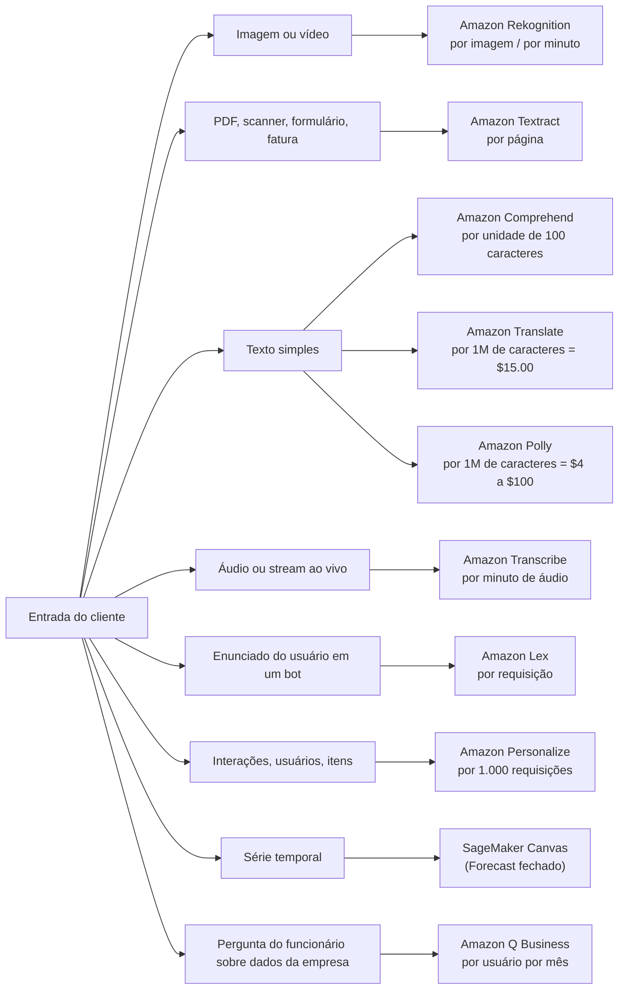
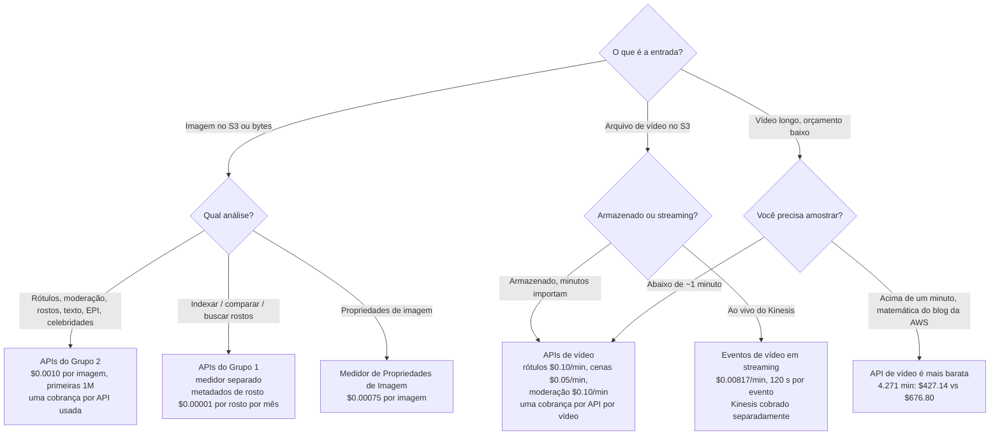
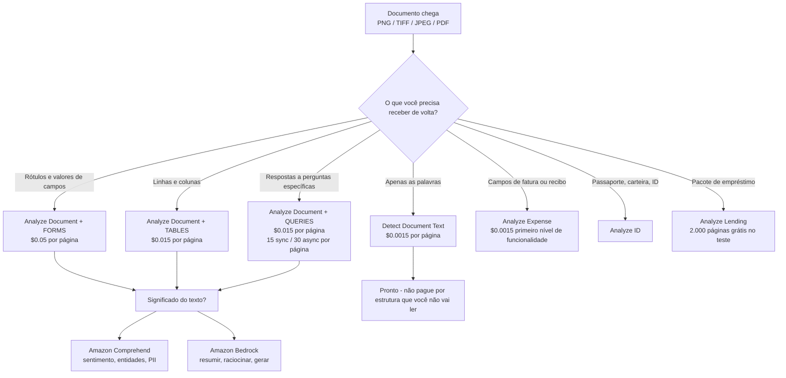
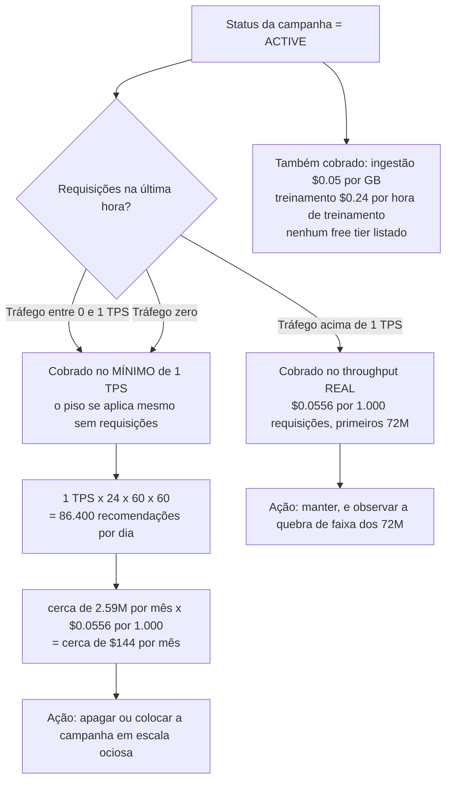

# Serviços Pré-Construídos de IA da AWS: Visão, Linguagem, Fala e Conversação

Tudo o que você construiu até agora: pipelines de dados, algoritmos, trabalhos de treinamento, endpoints: era **seu**: seus dados, seu modelo, sua conta de instância-horas. Esta lição trata da outra metade da superfície do AIF-C01: os serviços onde **a AWS já possui o modelo** e você aluga a resposta por unidade. Essa única mudança de propriedade muda cada decisão que você toma. Você não sintoniza mais hiperparâmetros; você escolhe **a API certa, o conjunto de funcionalidades certo dentro daquela API, e o medidor certo**, e o exame testa exatamente isso, porque "qual serviço?" e "quanto custa?" são as duas formas de questão que se repetem em todos os cinco domínios.

```text
 =====================================================================
  A CAMADA PRÉ-CONSTRUÍDA — dez serviços, quatro modalidades, uma pergunta
 =====================================================================
  IMAGEM / VÍDEO ....... Amazon Rekognition ......... por imagem / por minuto
  DOCUMENTO ............ Amazon Textract ............ por página
  TEXTO ................ Amazon Comprehend .......... por unidade de 100 caracteres
  TEXTO -> TEXTO ......... Amazon Translate ........... por caractere
  TEXTO -> FALA ....... Amazon Polly ............... por caractere
  FALA -> TEXTO ....... Amazon Transcribe .......... por minuto de áudio
  CONVERSAÇÃO ........ Amazon Lex ................. por requisição
  RECOMENDAÇÕES ..... Amazon Personalize ......... por 1.000 requisições
  PREVISÃO ......... Amazon Forecast ............ FECHADO 29/07/2024
                        -> Amazon SageMaker Canvas
  P&A CORPORATIVO ...... Amazon Q ................... por usuário / mês
 ---------------------------------------------------------------------
  REGRA DO EXAME: o tipo de entrada nomeia o serviço, e a unidade de
  cobrança nomeia a resposta. Aprenda a unidade e você calcula a fatura.
 =====================================================================
```

> [!NOTE]
> **Como ler esta lição.** Todo preço, cota e número de free tier abaixo vem de uma página de preços da AWS, de uma página "Guidelines and quotas" da AWS, de um FAQ da AWS ou de um exemplo resolvido da AWS, capturado em 2026. Onde um número circula apenas em calculadoras de terceiros, taxas de streaming do Lex, algumas taxas de Transcribe de nível 2/3, preços por unidade de Textract Layout e Signatures, ele é marcado como *não memorize* na seção em que você seria tentado a usá-lo de outra forma. Quando a AWS e um blog discordam, a AWS vence; quando uma página da AWS e outra página da AWS discordam, a página de preços vence para taxas e a página de cotas vence para limites.

Ao final desta lição você será capaz de:

- mapear **modalidade para serviço** e defender a escolha contra três distratores plausíveis;
- afirmar a **unidade de cobrança** de cada serviço em escopo e calcular uma fatura mensal a partir dos próprios exemplos resolvidos da AWS;
- recordar os **free tiers que diferem em duração**: 12 meses para a maioria, **3 meses para o Textract**, 60 dias para o Amazon Q Business;
- aplicar a divisão de medição **Rekognition Grupo 1 / Grupo 2** e explicar por que duas APIs em uma imagem custam o dobro;
- escolher a combinação correta de **API e funcionalidades do Textract** para OCR, formulários, tabelas, queries, IDs, despesas e empréstimos;
- defender o **mínimo de 1 TPS provisionado do Personalize** e a resposta sobre o **ciclo de vida do Amazon Forecast**;
- separar **serviços pré-construídos, construções personalizadas no SageMaker e Amazon Bedrock** com o veredito comparativo;
- responder **dez questões em formato de exame** escritas na voz oficial, incluindo quatro itens de aritmética.

---

## 1. A paisagem pré-construída: para que cada serviço serve

### 1.1 Dez serviços, quatro modalidades

O exame AIF-C01 não pede que você memorize nomes de métodos de API. Ele pede que você leia uma descrição de carga de trabalho e nomeie o serviço. Isso é uma tarefa de **classificação**, e ela começa com uma entrada: *o que o cliente está te entregando?*

| Serviço | Modalidade | O trabalho que ele faz | Unidade de cobrança | Taxa principal da AWS (2026) |
|---|---|---|---|---|
| **Amazon Rekognition** | Imagem + vídeo | Rótulos, detecção/busca/verificação de rostos, reconhecimento de celebridades, moderação, texto em imagem, EPI, rastreamento de pessoas | Por imagem **e** por minuto, **por API** | Grupo 2 imagem **$0.0010**; vídeo armazenado **$0.10/min** |
| **Amazon Comprehend** | Texto | Entidades, sentimento, frases-chave, idioma, sintaxe, detecção/redação de PII, tóxicidade, segurança de prompt, classificação personalizada | Por **unidade de 100 caracteres**, mínimo de 3 unidades | **$0.0001/unidade** (cerca de $1 por 1M de caracteres) |
| **Amazon Textract** | Documento | OCR mais formulários, tabelas, consultas em linguagem natural, assinaturas, layout, despesas, extração de ID e empréstimos | Por **página** | OCR **$0.0015** → Formulários+Tabelas+Queries **$0.070** |
| **Amazon Translate** | Texto → texto | Tradução automática de texto, HTML e documentos, com terminologia personalizada | Por **caractere** (incluindo espaços) | **$15.00 por 1M de caracteres** |
| **Amazon Polly** | Texto → fala | TTS neural e generativo para IVR, eLearning, acessibilidade, narração; marcas de fala SSML | Por **caractere** | Standard **$4.00** → Long-Form **$100.00 por 1M de caracteres** |
| **Amazon Transcribe** | Fala → texto | ASR em lote e ao vivo, transcrições de call center, diarização, redação, Call Analytics | Por **minuto de áudio**, incrementos de 1 segundo | Streaming Nível 1 **$0.01/min**; CA pós-chamada **$0.03/min** |
| **Amazon Lex** | Texto/fala de entrada | NLU de intenção e slot para chatbots e IVR, com fulfillment via Lambda | Por **requisição** (fala ou texto) | Fala **$0.004**; texto **$0.00075** |
| **Amazon Personalize** | Interações | Recomendações em tempo real, reordenação, personalização em lote | Por GB / hora de treinamento / **1.000 requisições** | **$0.0556 por 1.000** (primeiros 72M/mês) |
| **Amazon Forecast** | Séries temporais | Previsão de demanda, energia e transporte |: | **Fechado para novos clientes em 29/07/2024** → SageMaker Canvas |
| **Amazon Q** | Texto (corporativo) | Assistente Q Business com permissões, ajuda de codificação do Q Developer, assistente de agente Q no Connect | Por **usuário/mês** + capacidade de índice | Lite **$3** / Pro **$20** por usuário por mês |



### 1.2 O que "pré-construído" significa neste exame

Um serviço pré-construído é **uma API com um contrato de saída fixo**. Você envia um JPEG e recebe de volta rótulos com escores de confiança e caixas delimitadoras; você envia 550 caracteres e recebe de volta entidades com deslocamentos. Você não consegue mudar o vocabulário de rótulos no `DetectLabels` do Rekognition (é para isso que serve o Rekognition Custom Labels), você não consegue fazer o Comprehend retornar um parágrafo de raciocínio (isso é tarefa de modelo de fundação), e você não consegue perguntar ao Textract o que o documento *significa* (isso é Queries do Textract para estrutura, ou Comprehend/Bedrock para semântica).

Três consequências impulsionam o exame inteiro:

1. **A precificação é por unidade, não por hora**: imagens, páginas, caracteres, minutos, requisições, usuários. Nenhuma instância para dimensionar, nenhum endpoint ocioso para esquecer (com uma exceção barulhenta: campanhas do Personalize, seção 8.1).
2. **A seleção de funcionalidades dentro de um serviço muda a fatura**, o OCR do Textract é **$0.0015** por página e os Formulários do Textract são **$0.05** por página, um multiplicador de **33×** no mesmo documento.
3. **Os free tiers não são uniformes**: 12 meses para a maioria dos serviços, **3 meses para o Textract**, um **teste de 60 dias** para o Amazon Q Business, e **nada** para o Personalize.

- **📚 Você sabia?** A lista de serviços de IA/ML em escopo do guia de exame AIF-C01 contém **14 serviços**: Amazon Augmented AI (A2I), Amazon Bedrock, Amazon Comprehend, Amazon Fraud Detector, Amazon Kendra, Amazon Lex, Amazon Personalize, Amazon Polly, Amazon Q, Amazon Rekognition, Amazon SageMaker, Amazon Textract, Amazon Transcribe e Amazon Translate. Oito dos dez serviços desta lição vêm direto dessa lista, o Amazon Forecast **não** (é uma questão de ciclo de vida, não de construção), e o Amazon Q foi adicionado em uma revisão posterior do guia junto com Aurora, Bedrock AgentCore, Kiro, Strands Agents, SageMaker JumpStart e AWS Transform. Verifique novamente a lista em escopo atual antes do dia do exame; a lista já mudou e mudará de novo.

---

## 2. Amazon Rekognition: imagens, vídeos, rostos e moderação

### 2.1 Dois grupos de API, uma imagem

O Rekognition é o serviço com o medidor mais incompreendido de todo o conjunto pré-construído, e o motivo é histórico. Na redução de preço de **9 de novembro de 2021** a AWS dividiu as APIs de imagem em dois grupos que são **medidos separadamente**, e essa divisão ainda governa a cobrança em 2026.

| Grupo 1, APIs de rosto e de usuário | Grupo 2, APIs de detecção |
|---|---|
| `CompareFaces`, `IndexFaces`, `SearchFaceByImage`, `SearchFaces` | `DetectFaces`, `DetectModerationLabels`, `DetectLabels` |
| `AssociateFaces`, `DisassociateFaces`, `SearchUsersByImage`, `SearchUsers` | `DetectText`, `RecognizeCelebrities`, `DetectProtectiveEquipment` |

A regra que o exame realmente testa: **a cobrança de imagem é por imagem, por chamada de API**. Execute `DetectLabels` e depois `DetectModerationLabels` nas mesmas 2,5 milhões de imagens e você processou **5 milhões de imagens faturadas**, não 2,5 milhões. O vídeo se comporta da mesma forma: um minuto de vídeo armazenado analisado pela API de rótulos e pela API de moderação de conteúdo fatura **dois minutos**, um por API.

### 2.2 Os medidores

| Medidor | Preço (página de preços da AWS, 2026) |
|---|---|
| Grupo 2 imagem, primeiras 1M de imagens/mês | **$0.0010 por imagem** |
| Grupo 2 imagem, acima de 1M | $0.0008 por imagem |
| Propriedades de imagem (medidor separado) | **$0.00075 por imagem** primeiras 1M, depois $0.0006 |
| Vídeo armazenado: detecção de rótulos | **$0.10 por minuto** |
| Vídeo armazenado: detecção de cenas | **$0.05 por minuto** |
| Vídeo armazenado: moderação de conteúdo | **$0.10 por minuto** |
| Eventos de vídeo em streaming (entrada do Kinesis Video Streams) | **$0.00817 por minuto**, até **120 segundos** analisados por evento; Kinesis cobrado separadamente |
| Armazenamento de metadados de rosto | **$0.00001 por rosto por mês**, o *"$0.01 per 1,000 face vectors per month"* do FAQ |

### 2.3 Limites duros e free tier

| Limite | Valor |
|---|---|
| Imagem do S3 / imagem como bytes | **15 MB** / **5 MB** (4 MB para a API de EPI) |
| Dimensão mínima da imagem | **80 px** (64 px para EPI) |
| Arquivo de vídeo | **10 GB**, **6 horas**, H.264 ou MPEG-4/MOV |
| Trabalhos de vídeo simultâneos | **20 por conta** |
| Janela de análise de evento em streaming | **120 segundos** por evento |
| Free tier (12 meses) | **5.000 imagens/mês** + **60 minutos de vídeo/mês** para rótulos, moderação, rostos, busca de rostos, celebridades, texto e rastreamento de pessoas |

### 2.4 Exemplos resolvidos da AWS

**Exemplo 1: 2,5 milhões de imagens de moderação.** O próprio exemplo de preços da AWS roda `DetectModerationLabels` sobre 2.500.000 imagens em um mês:

$$
1{,}000{,}000 \times \$0.0010 + 1{,}500{,}000 \times \$0.0008 = \$1{,}000 + \$1{,}200 = \$2{,}200 \text{ per month}
$$

Acrescente uma segunda API nas mesmas imagens (digamos `DetectText` para marcas d'água) e a fatura dobra para **$4.400/mês**, porque cada API fatura a sua própria contagem de imagens.

**Exemplo 2: API de vídeo versus amostragem de quadros.** Para um vídeo de 60 segundos:

| Abordagem | Aritmética | Custo |
|---|---|---|
| API de vídeo, detecção de rótulos | 1 minuto × $0.10 | **$0.10** |
| Amostragem de quadros a 2 fps, imagens do Grupo 2 | 120 imagens × $0.0010 | **$0.12** + sua própria computação de extração |

A lacuna aumenta com a duração: em uma análise de blog da AWS de **4.271 minutos** de vídeo, a API de vídeo custou **$427.14**, enquanto a amostragem de imagens a 2 fps custou **$512.57 pelas imagens mais $164.23 pelo Lambda que as amostrou: $676.80 no total**. Abaixo de cerca de um minuto as duas ficam próximas; acima disso, a API de vídeo vence no preço *e* retorna timestamps, limites de cena e rastreamento de pessoas que a amostragem de quadros não consegue.



> [!WARNING]
> **As três armadilhas do Rekognition que custam pontos.**
> 1. **Duas APIs em um ativo = dois ativos faturados.** Grupo 1 e Grupo 2 são medidos separadamente, e dentro de um grupo cada chamada de API fatura a sua própria imagem (ou o seu próprio minuto de vídeo).
> 2. **A moderação de vídeo é uma API de vídeo, não uma API de imagem.** Se a opção diz *"cobrado por imagem"* para vídeos armazenados no S3, ela está descrevendo amostragem de quadros: uma escolha de engenharia válida, mas não a resposta nativa do serviço, que é **$0.10 por minuto de vídeo**.
> 3. **Os eventos de streaming não são de forma livre.** Cada evento acionado pelo Kinesis analisa no máximo **120 segundos**, custa **$0.00817/min**, e você ainda paga o Kinesis por cima.

- **📚 Você sabia?** O medidor de metadados de rosto tem duas grafias oficiais do mesmo número: a página de preços diz **$0.00001 por rosto por mês** e o FAQ diz **$0.01 per 1,000 face vectors per month**. Elas são idênticas ($0.01 ÷ 1.000 = $0.00001). As opções do exame adoram apresentar uma como desconto da outra: elas são o mesmo preço, e ambas são *armazenamento*: uma coleção de 500.000 rostos custa **$5.00/mês** quer você a busque quer não.

---

## 3. Amazon Comprehend: o que o texto está dizendo

### 3.1 A unidade e o mínimo

O Comprehend mede em **unidades de 100 caracteres** com um **mínimo de 3 unidades (300 caracteres) por requisição**. A taxa padrão nos exemplos resolvidos da AWS é **$0.0001 por unidade**, o que é **$1.00 por 1.000.000 de caracteres**.

O mínimo é onde os candidatos perdem pontos fáceis. Um tweet de 120 caracteres é uma unidade de conteúdo real, mas é faturado como **3 unidades = $0.0003**. Um chamado de suporte de 600 caracteres é faturado como **6 unidades = $0.0006**. Requisições em lote são iguais: você paga pelo que envia, arredondado para cima por requisição.

**Exemplo resolvido: chamados de suporte.** 10.000 chamados de 550 caracteres cada: 550 ÷ 100 = 5,5 → **6 unidades por requisição** → 10.000 × 6 = 60.000 unidades × $0.0001 = **$6.00 por mês**. Note o que esse número ensina: neste volume o Comprehend é efetivamente gratuito, e é exatamente por isso que o exame o pareia com uma questão de *seleção de funcionalidades* em vez de uma questão de *custo*.

### 3.2 O que a superfície da API inclui

| Capacidade | API / funcionalidade | Notas para o exame |
|---|---|---|
| Entidades | `DetectEntities` | Pessoas, organizações, lugares, datas, quantidades, com confiança |
| Sentimento | `DetectSentiment` | Positivo / negativo / neutro / misto, com escores |
| Frases-chave | `DetectKeyPhrases` | Extração de frases nominais |
| Idioma | `DetectDominantLanguage` | Também um pré-requisito para outras chamadas |
| Sintaxe | `DetectSyntax` | Etiquetagem de partes da fala |
| Sentimento direcionado | `DetectTargetedSentiment` | Sentimento por entidade, não por documento |
| PII | `ContainsPiiEntities`, `DetectPiiEntities` | Detecção **e** redação |
| Tópicos | `DetectTopics` | Modelagem de tópicos sobre um lote |
| Tóxicidade | `DetectToxicity` | Escores de tóxicidade do texto |
| Segurança de prompt | Classificação de segurança de prompt | Filtra entradas antes que elas cheguem a um modelo |
| Classificação personalizada | `CreateClassifier` | Rotula suas próprias categorias |
| Entidades personalizadas | `CreateEntityRecognizer` | Seu próprio vocabulário de entidades |

### 3.3 Comprehend personalizado: onde o medidor muda

| Item | Taxa |
|---|---|
| Treinamento | **$3.00 por hora**, cobrado por segundo |
| Gerenciamento de modelo | **$0.50 por mês** por modelo |
| Endpoint enquanto rodando | Cobrado em **incrementos de 1 segundo**, **mínimo de 60 segundos** |
| Throughput provisionado | **1 unidade de inferência (IU) = 100 caracteres/segundo** a **$0.0005 por segundo** |
| Trabalho de modelagem de tópicos | Primeiros **100 MB fixos**, depois **$0.004 por MB** |
| Free tier | **50.000 unidades (5M de caracteres) por API por mês**: **sem free tier para o Comprehend personalizado** |

### 3.4 Limites que valem a pena memorizar

| Limite | Valor |
|---|---|
| Lote síncrono | **25 documentos por requisição** |
| Tamanho do documento assíncrono | **1 MB por documento**, **5 GB por requisição** |
| Trabalhos assíncronos ativos | **10 por API** |
| Endpoints | **20 por Região**, **200 IU por Região**, **50 IU por endpoint** |
| Corpo da requisição personalizada síncrona | **10 KB** |

- **📚 Você sabia?** A **classificação de segurança de prompt** do Comprehend é a ponte entre esta lição e o Bedrock: a AWS a adicionou para que você possa filtrar um prompt do usuário quanto a conteúdo prejudicial *antes* que ele chegue a um modelo de fundação. No exame, uma questão sobre "filtrar uma entrada antes da geração" tem duas respostas que parecem válidas e apenas uma é correta, o **Comprehend** classifica e pontua o texto; os **Bedrock Guardrails** aplicam políticas no momento da geração. Leia com cuidado em que lado da chamada a questão coloca você.

---

## 4. Amazon Textract: estrutura a partir de documentos

### 4.1 Cinco APIs, um interruptor de funcionalidade

O Textract expõe **cinco APIs**: `Detect Document Text`, `Analyze Document`, `Analyze Expense`, `Analyze ID` e `Analyze Lending`. Apenas o `Analyze Document` carrega tipos de funcionalidade, **Forms, Tables, Queries, Custom Queries, Signatures e Layout**, e eles são combináveis em uma única chamada, precificados por página *por funcionalidade habilitada*.

| API | O que retorna | Quando usá-la |
|---|---|---|
| `Detect Document Text` | Palavras e linhas (OCR puro) | Texto limpo, sem estrutura |
| `Analyze Document` | KEY_VALUE_SET, células de TABLE, respostas de Query, SIGNATURE, LAYOUT | Formulários, tabelas, perguntas, assinaturas |
| `Analyze Expense` | Campos e itens de linha de fatura/recibo | Contas a pagar |
| `Analyze ID` | Campos e fotos de documento de identidade | Verificações de conhecimento do cliente |
| `Analyze Lending` | Campos de pacote de hipoteca/empréstimo | Pipelines de empréstimo |

### 4.2 A escada de preços (us-west-2, primeiras 1M de páginas por mês)

| Configuração | Preço por página |
|---|---|
| Apenas OCR (`Detect Document Text`) | **$0.0015** |
| Tabelas | **$0.015** |
| Formulários | **$0.05** |
| Queries | **$0.015** |
| Tabelas + Queries | **$0.020** |
| Formulários + Tabelas + Queries | **$0.070** |
| Custom Queries | **$0.025** |

Dois fatos saem dessa tabela. Primeiro, **habilitar Formulários multiplica a fatura de OCR por 33×**. Segundo, **Formulários + Tabelas + Queries a $0.070 é cerca de 47× o OCR puro**: é por isso que o exame adora a questão *"quais funcionalidades a carga de trabalho realmente precisa?"*.

> [!NOTE]
> **Signatures e Layout.** A página pública de preços do Textract da AWS precifica as seis combinações de funcionalidades acima. `Layout` a **$0.004/página** e `Signatures` a **$0.0035/página** aparecem em um template de preços de exemplo da Biblioteca de Soluções da AWS, e a documentação da AWS observa que o Layout é **gratuito quando Tables está habilitado**. Trate esses dois preços por unidade como *verifique antes de citá-los*: mas memorize a regra: **o Layout acompanha o Tables, e cada outra funcionalidade adiciona a sua própria cobrança por página.**

### 4.3 Queries: precificadas por página, não por resposta

Queries permitem que você faça perguntas em linguagem natural a um documento, *"Qual é o número da conta?"*, e receba de volta respostas com coordenadas de página. Os limites são **15 queries por página de forma síncrona** e **30 por página de forma assíncrona**, e a regra crítica de precificação é que **você é cobrado por página independentemente de quantas respostas voltam**. Fazer uma pergunta ou quinze perguntas na mesma página custa o mesmo. Fazer a mesma pergunta a 100.000 páginas custa 100.000 × $0.015.

### 4.4 Free tier: três meses, não doze

| API do Textract | Free tier | Duração |
|---|---|---|
| `Detect Document Text` | **1.000 páginas/mês** | **3 meses** |
| `Analyze Document` (apenas Signatures) | 1.000 páginas/mês | **3 meses** |
| `Analyze Document` (qualquer outra funcionalidade) | 100 páginas/mês | **3 meses** |
| `Analyze Expense` | 100 páginas/mês | **3 meses** |
| `Analyze ID` | 100 páginas/mês | **3 meses** |
| `Analyze Lending` | 2.000 páginas/mês | **3 meses** |
| Custom Queries | **Sem free tier** |: |

A contagem de páginas é simples e deliberadamente amigável ao exame: **uma imagem (PNG, TIFF ou JPEG) é uma página**, e **cada página de um PDF é uma página**.

**Exemplo resolvido, seleção de funcionalidades.** OCR de 100.000 páginas custa **$150**. Formulários + Tabelas em 5.000 páginas custa 5.000 × ($0.05 + $0.015) = **$325**. O segundo trabalho toca **20× menos páginas** e custa **2.2× mais**, $0.065 por página contra $0.0015, uma **diferença de unidade de 43×**. A lição não é "evite Formulários"; é "habilite apenas as funcionalidades que você vai ler".



---

## 5. Amazon Translate: tradução automática em alto volume

### 5.1 Taxas

| Tipo de tradução | Taxa por 1M de caracteres |
|---|---|
| Texto padrão (tempo real), HTML, documentos em lote | **$15.00** |
| Tradução de documento **DOCX** em tempo real | **$30.00** |
| **Active Custom Translation** (modelo personalizado) | **$60.00** |

Os caracteres incluem espaços, então você não consegue trapacear o medidor removendo espaço em branco.

### 5.2 Free tier

- **2.000.000 de caracteres por mês por 12 meses** para tradução padrão e em lote;
- **Active Custom Translation: 500.000 caracteres por mês por 2 meses**;
- **Nenhum free tier** para tradução de documento em tempo real.

### 5.3 O que você não é cobrado

O FAQ da AWS traça uma linha incomumente precisa: você **não** é cobrado quando o **idioma de origem é igual ao idioma de destino**, e você **não** é cobrado quando a chamada **retorna erro e nenhuma tradução**. Você **é** cobrado por conteúdo não traduzível que ainda produz saída. Na prática isso significa que um loop mal configurado que "traduz" inglês para inglês é gratuito, e também que o exame pode perguntar sobre exceções de cobrança sem nenhuma aritmética.

### 5.4 Terminologia personalizada

A terminologia personalizada é como você fixa nomes de marca, códigos de produto e termos legais. Seus limites são todo material de exame citável:

| Limite | Valor |
|---|---|
| Tamanho do arquivo | **10 MB** |
| Arquivos por conta por Região | **100** |
| Idiomas de destino por arquivo | **10** |
| Bytes por termo | **200** |
| Arquivos por requisição | **1** |
| Correspondência | **Sensível a maiúsculas/minúsculas** |

**Exemplo resolvido: localizando um manual.** 100 páginas × 20.000 caracteres = 2.000.000 de caracteres:

| Opção | Aritmética | Custo |
|---|---|---|
| Tradução padrão | 2 × $15.00 | **$30.00** |
| Active Custom Translation | 2 × $60.00 | **$120.00** |
| Um único artigo de 6.500 caracteres | 6.500 ÷ 1.000.000 × $15.00 | **$0.0975** |

---

## 6. Amazon Polly e Amazon Transcribe: a dupla da fala

Polly e Transcribe são as duas metades do mesmo problema, e o gosta de colocá-las na mesma lista de opções para ver se você sabe para qual direção o áudio flui.

### 6.1 Amazon Polly: texto para fala

| Motor | Preço por 1M de caracteres | Free tier por mês |
|---|---|---|
| Standard | **$4.00** ($4.80 no GovCloud) | 5.000.000 de caracteres |
| Neural | **$16.00** ($19.20 no GovCloud) | 1.000.000 de caracteres (primeiros 12 meses) |
| Generative | **$30.00** | 100.000 caracteres (primeiros 12 meses) |
| Long-Form | **$100.00** | 500.000 caracteres (primeiros 12 meses) |

**A regra da cobrança dupla:** `Speech` e `Speech Marks` são **requisições faturadas separadas**. Solicitar ambos para os mesmos 1.000 caracteres fatura **2.000 caracteres**. As marcas de fala são o que um player da web usa para destacar palavras em sincronia com o áudio, então o padrão é comum em eLearning, e ele dobra a linha do Polly na fatura.

**Exemplo resolvido: um milhão de caracteres:**

| Motor | Apenas áudio | Áudio + marcas de fala |
|---|---|---|
| Standard | **$4.00** | $8.00 |
| Neural | **$16.00** | **$32.00** |
| Generative | **$30.00** | $60.00 |
| Long-Form | **$100.00** | $200.00 |

O Polly é cobrado **por caractere**, nunca por requisição: uma opção que diz "por requisição de síntese" é um distrator.

### 6.2 Amazon Transcribe: fala para texto

O Transcribe cobra em **incrementos de 1 segundo sem mínimo**, o que é incomum e vale a pena memorizar por si só: um clipe de 3 segundos custa três segundos, não um minuto arredondado.

| Produto | Taxa por minuto de áudio (níveis do exemplo da AWS) |
|---|---|
| Transcrição em lote, Nível 1 | Cerca de **$0.006** |
| Transcrição em streaming, Nível 1 | **$0.01** |
| Call Analytics, **pós-chamada** | **$0.0300** primeiros 250K min → **$0.0186** próximos 750K → **$0.0138** próximos 4M |
| Call Analytics, **tempo real** | **$0.0375** → **$0.0233** → **$0.0173** |
| Resumo generativo de chamada | **$0.0024** → **$0.0015** → **$0.0011**, **mínimo de 15 segundos por requisição** |

**O que está incluído versus o que custa extra:**

| Incluído sem custo extra | Medidor extra |
|---|---|
| Vocabulários personalizados | **Redação de PII** |
| Filtro de vocabulário | **Modelos de idioma personalizados** |
| Diarização de falantes | |
| Identificação de idioma | |
| Formatos de transcrição (JSON, TXT, SRT, VTT) | |

Duas regras estruturais: **áudio estéreo fatura a duração total uma vez, não por canal**, e **o Call Analytics retorna campos de insight**, tempo de fala, interrupções, não-fala, sentimento por participante, que a transcrição simples não retorna.

**Exemplo resolvido: um call center de 200.000 chamadas.** 200.000 chamadas × 10 minutos = **2.000.000 de minutos** de análise pós-chamada:

$$
250{,}000 \times \$0.0300 + 750{,}000 \times \$0.0186 + 1{,}000{,}000 \times \$0.0138
= \$7{,}500 + \$13{,}950 + \$13{,}800 = \$35{,}250 \text{ per month}
$$

**Limites e free tier:**

| Limite | Valor |
|---|---|
| Arquivo de áudio em lote | **28.800 segundos (8 horas)** |
| Lote médico e de Call Analytics | **14.400 segundos (4 horas)** |
| Duração mínima do áudio | **500 ms** |
| Fila de trabalhos | **10.000 trabalhos** |
| Concorrência do Call Analytics | **100 trabalhos** |
| Free tier | **60 minutos por mês por 12 meses**, compartilhados entre Transcribe, Call Analytics e Transcribe Medical; sem GovCloud, sem acumulação |

- **📚 Você sabia?** O **free tier de 5 milhões de caracteres do Polly Standard** é o único número na página de preços da AWS que omite o qualificador *"primeiros 12 meses"* usado para Neural, Long-Form e Generative, enquanto páginas de terceiros chamam com confiança de "sempre gratuito". Não construa uma resposta sobre isso: memorize a página como ela está, e trate qualquer afirmação de um free tier permanentemente gratuito do Polly como não verificada. A mesma disciplina se aplica às taxas de streaming do Lex, que circulam em calculadoras de terceiros, mas não estão no próprio excerto de preços da AWS, os números do Lex publicados pela AWS são **$0.004 fala** e **$0.00075 texto**.

---

## 7. Amazon Lex: intenções, slots e o medidor por requisição

### 7.1 A fatura

| Tipo de requisição | Preço |
|---|---|
| Requisição de fala | **$0.004** |
| Requisição de texto | **$0.00075** |

Exemplo resolvido da AWS: **8.000 requisições de fala + 2.000 requisições de texto** = 8.000 × $0.004 + 2.000 × $0.00075 = $32.00 + $1.50 = **$33.50 por mês**.

### 7.2 O que conta como uma requisição

- **Cada entrada do usuário é uma requisição faturada.** Cinco mensagens digitadas em uma conversa são cinco requisições.
- **Em uma conversa em streaming, todas as voltas andam em uma única chamada de API**, o Lex V2 transmite sobre **HTTP/2**, e a troca inteira é uma única chamada faturável em vez de cinco.
- A entrada de fala é limitada a **15 segundos por requisição**.
- As respostas carregam escores de confiança do NLU, sentimento e um campo `interpretationSource` de valor `Bedrock` ou `Lex`: a dica do exame de que o Lex pode ser sustentado por um modelo de fundação para o significado generativo enquanto ainda retorna uma intenção estruturada.

### 7.3 Free tier

**10.000 requisições de texto + 5.000 de fala por mês no primeiro ano.**

### 7.4 Onde o Lex para

O Lex responde *"o que o usuário quis dizer?"*: intenção, slots, estado da sessão, estado do fulfillment. Ele **não** responde perguntas abertas sobre conteúdo corporativo, e ele não gera prosa. Essa fronteira é o conjunto de distratores mais comum desta lição: **Q Business** para respostas com permissões sobre dados da empresa, **Bedrock** para geração aberta, **Lex** para roteamento estruturado de intenção para um Lambda.

---

## 8. Amazon Personalize e Amazon Forecast

### 8.1 Personalize: o medidor com um piso

| Medidor | Taxa |
|---|---|
| Ingestão de dados | **$0.05 por GB** |
| Treinamento | **$0.24 por hora de treinamento** |
| Inferência em tempo real | **$0.0556 por 1.000 requisições** (primeiros 72M/mês), **$0.0278** (próximos 648M), **$0.0139** (acima de 720M) |
| Modelo recommender-hour | **$0.375 / $0.045 / $0.018 / $0.005 por 100.000 usuários**, com **4.000 / 6.000 / 9.000 / 14.000 recomendações grátis por hora**; extras a **$0.0833 / $0.0417 / $0.0208 por 1.000** |
| Free tier | **Nenhum listado na página de preços** |

**A armadilha: throughput provisionado mínimo.** Por padrão toda campanha ativa deve manter **pelo menos 1 transação por segundo (TPS) provisionada**, e a AWS afirma de forma direta que o mínimo se aplica **"mesmo que você não faça nenhuma requisição"**: você é cobrado no **maior entre o mínimo e o TPS real**.

A aritmética é brutal e o próprio Knowledge Center da AWS a publica: 1 TPS mantido por um dia é

$$
1 \times 24 \times 60 \times 60 = 86{,}400 \text{ billed recommendations per day}
$$

o qual a $0.0556 por 1.000 equivale a cerca de **$144 por mês para uma campanha que ninguém está chamando** (cerca de 2,59 milhões de recomendações por mês). A resposta operacional é curta: **apague campanhas ociosas**.



### 8.2 Amazon Forecast: uma questão de ciclo de vida, não de construção

| Fato | Detalhe |
|---|---|
| Fechado para novos clientes | **29 de julho de 2024** |
| Clientes existentes | Continuam trabalhando; **sem funcionalidades novas** |
| Substituto documentado | **Amazon SageMaker Canvas** |
| Status de ciclo de vida da AWS | Listado em **"Services in Maintenance"** (29/07/2024) |
| Vocabulário de ciclo de vida da AWS | **Maintenance → Sunset (tipicamente ~12 meses) → Full Shutdown** |

> [!WARNING]
> **Não responda "Amazon Forecast" a uma questão de previsão em campo virgem.** O Forecast está fechado para novos clientes desde **29 de julho de 2024** e aparece na lista de manutenção da AWS; o caminho de migração documentado é o **Amazon SageMaker Canvas**. Clientes existentes continuam a executar seus preditores: então uma opção que diz *"clientes existentes devem migrar imediatamente"* é igualmente errada. A resposta correta do exame é sempre o par: **novos → SageMaker Canvas, existentes → continuar sem funcionalidades novas**. E o Personalize *não* é um serviço de previsão: ele recomenda itens a partir de interações, ele não projeta uma série temporal.

---

## 9. Amazon Q: a resposta por usuário

O Amazon Q está explicitamente **em escopo para o AIF-C01**, e é o único serviço desta lição precificado **por usuário por mês** em vez de por unidade de trabalho. Essa diferença é a questão inteira.

| SKU | Preço | O que ele compra |
|---|---|---|
| **Q Business Lite** | **$3 por usuário por mês** | Respostas de aproximadamente uma página |
| **Q Business Pro** | **$20 por usuário por mês** | Cerca de sete páginas, Q Apps, Q in QuickSight Reader Pro, plugins |
| **Índice do Q Business** | Por hora de capacidade de índice | Cobrado enquanto o índice existir; a cobrança começa no primeiro uso |
| **Teste do Q Business** | **60 dias** | Até **50 usuários Pro ou Lite por aplicativo** + **1.500 horas de índice** |
| **Q Developer Free** | **$0** | **50 requisições agênticas/mês**, **1.000 LOC/mês** de transformação Java |
| **Q Developer Pro** | **$19 por usuário por mês** | **4.000 LOC/mês compartilhados** na conta pagadora, **$0.003/LOC** de excesso, indenização de IP |
| **Q in Connect** | **$0.0015 por mensagem de chat**, **$0.0080 por minuto de voz** | Assistência de call center |

Três leituras que o exame testa:

1. **O Q Business é RAG corporativo com permissões.** Ele responde perguntas sobre seus conectores (S3, Confluence, Salesforce e dezenas mais) **com as permissões de cada usuário respeitadas**, e ele cita as fontes. Esse é um produto diferente de "um chatbot público anônimo".
2. **O teste é de 60 dias, não de 12 meses**, o período gratuito mais curto desta lição, e o que os candidatos mais confundem com o free tier da AWS de 12 meses.
3. **O excesso do Q Developer Pro é por linha de código**, a **$0.003/LOC** acima dos 4.000 LOC/mês compartilhados: um medidor que ninguém espera, e portanto favorito para uma opção numérica.

---

## 10. Qual serviço de IA? A árvore de decisão

Tudo acima colapsa em um diagrama. Leia a entrada primeiro, depois a intenção, depois o medidor: essa ordem é exatamente como o exame escreve suas opções.

```mermaid
flowchart TD
    START["O que o cliente está te entregando?"]
    START -->|"Imagem ou vídeo"| VIS{"O que você precisa dela?"}
    VIS -->|"Rótulos, rostos, moderação, texto em imagem, EPI"| REK["Amazon Rekognition<br/>por imagem / por minuto, por API"]
    VIS -->|"Defeito de nicho ou visão de domínio específico"| CUSTOM["Rekognition Custom Labels<br/>ou SageMaker com seus dados rotulados"]
    VIS -->|"Um documento como imagem"| TX2["Amazon Textract"]

    START -->|"Documento: PDF, scanner, fatura, ID"| DOC{"Estrutura ou apenas palavras?"}
    DOC -->|"Apenas palavras"| OCR2["Textract Detect Document Text<br/>$0.0015 por página"]
    DOC -->|"Formulários, tabelas, queries, IDs, despesas"| AN2["APIs Analyze* do Textract<br/>$0.015 a $0.070 por página"]
    DOC -->|"O que o texto significa"| CO2["Amazon Comprehend<br/>por unidade de 100 caracteres, mín 3"]

    START -->|"Texto simples"| TXT{"O que você precisa dele?"}
    TXT -->|"Entidades, sentimento, PII, tópicos, tóxicidade"| CMP["Amazon Comprehend<br/>$0.0001 por unidade"]
    TXT -->|"Outro idioma"| TRN["Amazon Translate<br/>$15.00 por 1M de caracteres"]
    TXT -->|"Fala de saída para o usuário"| POL["Amazon Polly<br/>$4 a $100 por 1M de caracteres"]
    TXT -->|"Geração aberta ou raciocínio"| BED["Amazon Bedrock<br/>por token de entrada e de saída"]

    START -->|"Áudio"| AUD{"Arquivos em repouso ou ao vivo?"}
    AUD -->|"Arquivos, call center, diarização"| TRL["Amazon Transcribe<br/>por minuto de áudio"]
    AUD -->|"Stream ao vivo"| TRLS["Transcribe streaming<br/>$0.01 por minuto Nível 1"]

    START -->|"Enunciado do usuário em um bot"| LX["Amazon Lex<br/>$0.004 fala / $0.00075 texto"]

    START -->|"Interações, usuários, itens"| PERS["Amazon Personalize<br/>$0.0556 por 1.000 + 1 TPS mínimo"]

    START -->|"Série temporal para prever"| FC2["Amazon SageMaker Canvas<br/>Forecast fechado para novos clientes"]

    START -->|"Funcionário pergunta sobre dados da empresa"| QB["Amazon Q Business<br/>$3 Lite / $20 Pro por usuário"]

    START -->|"Desenvolvedor pergunta sobre a base de código"| QD["Amazon Q Developer<br/>Free ou $19 por usuário"]
```



Pratique o mapeamento até que ele seja automático:

```matching
{
  "question": "Relacione cada frase de carga de trabalho ao serviço da AWS e à sua unidade de cobrança:",
  "pairs": [
    {"left": "Sinalizar conteúdo explícito em vídeos armazenados no S3", "right": "Moderação de vídeo do Amazon Rekognition: cobrado por minuto de vídeo a $0.10"},
    {"left": "Extrair pares chave-valor e células de tabela de PDFs de empréstimo digitalizados", "right": "Amazon Textract AnalyzeDocument com FORMS e TABLES: cobrado por página a $0.05 e $0.015"},
    {"left": "Redigir números de cartão de crédito de chamados de suporte de 550 caracteres", "right": "Detecção e redação de PII do Amazon Comprehend: cobrado por unidade de 100 caracteres com mínimo de 3 unidades"},
    {"left": "Manter um nome de produto fora de um trabalho de localização de 2.000.000 de caracteres", "right": "Terminologia personalizada do Amazon Translate - 10 MB por arquivo, 100 arquivos por conta por Região, 200 bytes por termo"},
    {"left": "Ler uma transcrição de chat de volta para um supervisor com sentimento por participante", "right": "Amazon Transcribe Call Analytics pós-chamada: cobrado por minuto de áudio a $0.0300 para os primeiros 250 mil minutos"},
    {"left": "Roteigar um chamador de voz para o Lambda certo por intenção e slot", "right": "Amazon Lex: cobrado por requisição a $0.004 para fala e $0.00075 para texto"},
    {"left": "Servir recomendações em tempo real enquanto uma campanha ociosa ainda custa dinheiro", "right": "Amazon Personalize - $0.0556 por 1.000 requisições mais um mínimo padrão de 1 TPS provisionado por campanha"},
    {"left": "Responder à pergunta de um funcionário sobre o Confluence com as permissões dele", "right": "Amazon Q Business - $3 Lite ou $20 Pro por usuário por mês mais capacidade de índice por hora"}
  ],
  "explanation": "Cada frase nomeia primeiro um tipo de entrada: vídeo para o Rekognition, documentos para o Textract, texto bruto para o Comprehend, memória de tradução para o Translate, áudio para o Transcribe, enunciados de usuário para o Lex, histórico de interações para o Personalize e conteúdo corporativo para o Q Business. Uma vez que a entrada escolhe o serviço, a unidade de cobrança escolhe a resposta: por minuto, por página, por unidade, por caractere, por requisição, por 1.000 requisições ou por usuário."
}
```

- **📚 Você sabia?** As respostas do Amazon Lex V2 carregam um campo `interpretationSource` que pode ler **`Bedrock`** em vez de **`Lex`**, o NLU do bot pode ser sustentado por um modelo de fundação enquanto a resposta permanece uma intenção estruturada com slots e confiança. É por isso que "use Bedrock em vez de Lex" é um distrator *parcialmente* errado: o Bedrock te dá geração e raciocínio, o Lex te dá a máquina de estados da conversa, a sessão, os hooks de fulfillment e o medidor por requisição com o qual o call center é orçado.

---

## 11. Free tiers, limites e os números que você deve memorizar

### 11.1 Free tier: memorize os valores atípicos

| Serviço | Unidade | Quantidade | Duração |
|---|---|---|---|
| Rekognition Image / Video | imagens / minutos de vídeo | 5.000 / 60 por mês | **12 meses** |
| Comprehend | unidades de 100 caracteres, por API | 50.000/mês (5M de caracteres) | **12 meses**; Custom excluído |
| Textract `Detect Document Text` | páginas | 1.000/mês | **3 meses** |
| Textract `Analyze Document` | páginas | 100/mês (1.000 apenas Signatures) | **3 meses** |
| Translate | caracteres | 2.000.000/mês | **12 meses** |
| Polly Standard / Neural | caracteres | 5.000.000 / 1.000.000 por mês | Standard sem qualificador de 12 meses; Neural 12 meses |
| Transcribe (+ Call Analytics, Medical) | minutos de áudio | 60/mês | **12 meses** |
| Lex | requisições texto + fala | 10.000 + 5.000/mês | primeiro ano |
| Amazon Q Business | usuários + índice | 50 usuários/app + 1.500 horas de índice | **teste de 60 dias** |
| Personalize |, | **nenhum listado** |, |

As três durações são o presente do exame: **12 meses** para quase tudo, **3 meses** para o Textract, **60 dias** para o Q Business.

### 11.2 Limites duros que valem a pena memorizar

| Serviço | Limite | Valor |
|---|---|---|
| Rekognition | imagem (S3 / bytes) / vídeo | 15 MB / 5 MB (4 MB EPI) / vídeo 10 GB, 6 h, H.264 |
| Rekognition | dimensão mín. / trabalhos simultâneos / duração do evento | 80 px (64 px EPI) / 20 por conta / 120 s |
| Comprehend | unidade de cobrança + mínimo | 100 caracteres + 3 unidades (300 caracteres) por requisição |
| Comprehend | sync em lote / doc async / trabalhos ativos / cotas de endpoint | 25 docs / 1 MB / 10 trabalhos / 20 endpoints, 50 IU cada |
| Textract | queries por página / duração do free tier | 15 sync, 30 async / **3 meses** |
| Translate | arquivo de terminologia / arquivos / idiomas de destino / termo | 10 MB / 100 / 10 / 200 bytes |
| Transcribe | máx. de áudio em lote / lote Medical + CA | 28.800 s (8 h) / 14.400 s (4 h) |
| Transcribe | duração mín. / fila / concorrência da CA | 500 ms / 10.000 trabalhos / 100 trabalhos |
| Lex | entrada de fala / free tier | 15 s / 10.000 texto + 5.000 fala |
| Personalize | TPS provisionado mínimo padrão | **1 TPS por campanha ativa** |

### 11.3 Exemplos resolvidos da AWS, todos em uma tabela

| # | Cenário da AWS | Aritmética | Resultado |
|---|---|---|---|
| 1 | 2,5M de imagens do Grupo 2 | 1M × $0.0010 + 1,5M × $0.0008 | **$2.200/mês** |
| 2 | 100k min de rótulos + 100k min de cenas + 50k min de moderação | 100k × $0.10 + 100k × $0.05 + 50k × $0.10 | **$20.000/mês** |
| 3 | 10.000 requisições do Comprehend × 550 caracteres | 6 unidades cada = 60.000 × $0.0001 | **$6.00/mês** |
| 4 | 100.000 páginas de OCR | 100k × $0.0015 | **$150** |
| 5 | 5.000 páginas de Formulários + Tabelas | 5.000 × ($0.05 + $0.015) | **$325** |
| 6 | 2M de minutos de análise pós-chamada | 250k × $0.03 + 750k × $0.0186 + 1M × $0.0138 | **$35.250/mês** |
| 7 | 8.000 requisições de fala + 2.000 de texto do Lex | 8.000 × $0.004 + 2.000 × $0.00075 | **$33.50/mês** |
| 8 | 1M de caracteres do Polly, áudio + marcas de fala, Neural | 1M × $16.00 × 2 | **$32.00** |
| 9 | Campanha do Personalize ociosa a 1 TPS por um dia | 86.400 recomendações/dia ≈ 2,59M/mês × $0.0556/1.000 | **≈ $144/mês** |
| 10 | 2M de caracteres localizados, padrão vs. Active Custom | 2 × $15.00 vs. 2 × $60.00 | **$30.00 vs. $120.00** |

### 11.4 Entrada dentro, saída fora

| Serviço | Entrada aceita | Saída primária |
|---|---|---|
| Rekognition | JPEG/PNG (S3 ≤15 MB, bytes ≤5 MB); vídeo ≤10 GB, 6 h; stream do Kinesis | JSON com rótulos, confiança e caixas, vetores de rosto, rótulos de moderação, geometria do texto, timestamps |
| Comprehend | Texto UTF-8; PDF/DOCX; arquivos em lote no S3 | Entidades, escores de sentimento, frases-chave, idioma, trechos PII ou texto redigido, classes, flags de tóxicidade |
| Textract | PNG/JPEG/TIFF (1 página), PDF (mult página) | Blocks: palavras/linhas, KEY_VALUE_SET, células de TABLE, Query → Answer, SIGNATURE, LAYOUT |
| Translate | Texto (tempo real), documentos no S3 (HTML/TXT/DOCX), dados paralelos | Texto ou documentos traduzidos |
| Polly | Texto mais SSML | Áudio (MP3, OGG, PCM …) e/ou JSON de Speech Marks com tokens de tempo |
| Transcribe | Áudio/vídeo no S3 (mp3, mp4, wav, flac, ogg, amr, webm, m4a) ou áudio ao vivo (HTTP/2, WebSocket) | Transcrições (JSON/TXT/SRT/VTT), diarização, sentimento, campos do Call Analytics |
| Lex | Enunciados de texto ou fala ≤15 s; stream HTTP/2 | Intenção, slots, estado da sessão, estado do fulfillment, mensagens, sentimento |
| Personalize | Datasets de interações/usuários/itens (S3 ou event trackers) | Resultados de GetRecommendations, ranqueamentos, arquivos de recomendação em lote |
| Q Business | Perguntas mais conectores (S3, Confluence, Salesforce, 40+) e arquivos | Respostas com permissões e citações, conteúdo gerado, Q Apps, insights do QuickSight |
| Q Developer | Código, repositórios, perguntas de CLI/console, erros de build | Sugestões de código, refactors, varreduras de segurança, patches de transformação Java/.NET |

- **📚 Você sabia?** Dois serviços desta lição **não cobram você quando nada acontece**: o Translate não cobra uma chamada cujo idioma de origem é igual ao de destino ou que retorna erro sem retornar tradução: enquanto o **mínimo de 300 caracteres** do Comprehend significa que uma requisição de 40 caracteres custa o mesmo que uma de 300. O exame adora parear uma regra de "sem cobrança" com uma regra de "cobrança mínima" na mesma lista de opções para ver se você está recordando um serviço específico ou apenas a vibe geral da precificação por unidade.

---

## 12. Veredito comparativo

> [!IMPORTANT]
> **Veredito Comparativo: serviço pré-construído vs. SageMaker personalizado vs. Amazon Bedrock**
> - **Serviço pré-construído** (Rekognition, Comprehend, Textract, Translate, Polly, Transcribe, Lex, Personalize, Q) é a resposta quando a tarefa é **um problema bem conhecido com uma API correspondente e um contrato de saída previsível**: rótulos com confiança, trechos de entidade, pares chave-valor, transcrições, intenções e slots, recomendações. Você paga **por unidade**, você não implanta **nada**, você não treina **nada**, e você chega à produção em uma tarde. O seu modo de falha é **forma**: se a saída necessária não é a saída da API, uma classe de defeito de nicho, um layout de documento proprietário, uma resposta que precisa citar seus próprios documentos, nenhum ajuste de parâmetro mudará a resposta, porque não há parâmetros para ajustar. Os próprios números da AWS mostram o teto também: Textract Forms a **$0.05/página** contra OCR a **$0.0015/página** é um prêmio de **33×** por estrutura.
> - **SageMaker personalizado** (Rekognition Custom Labels, algoritmos embutidos, fine-tuning com JumpStart, seu próprio trabalho de treinamento) é a resposta quando você tem **dados rotulados e uma tarefa que as APIs pré-construídas erram**, inspeção de defeitos visuais, um template de documento que ninguém mais usa, um modelo de sentimento sintonizado ao vocabulário da sua indústria. Você troca o medidor por unidade por **horas de treinamento e horas de endpoint**: o próprio caminho personalizado do Comprehend cobra **$3/hora** para treinar, **$0.50/mês** para gerenciar e **$0.0005/segundo por unidade de inferência** enquanto um endpoint roda, e os endpoints do SageMaker cobram cada segundo em que existem. O seu modo de falha é **custo fixo e carga de MLOps**: você agora é dono da rotulagem de dados, da avaliação, do desvio e da fatura do endpoint ocioso, a mesma lição dos **$305.88/mês de computação majoritariamente ociosa** da Lição 6.
> - **Amazon Bedrock** é a resposta quando o trabalho é **geração aberta ou raciocínio sobre seu conteúdo**: resumos, rascunhos, extração nas suas próprias palavras, RAG sobre uma base de conhecimento, agentes multi-etapa, ou escolha multi-modelo com throughput provisionado. Você paga **por token de entrada e de saída**, você pode trocar modelos sem reescrever a aplicação, e Guardrails/Knowledge Bases/Agents dão a camada de governança. O seu modo de falha é **determinismo**: uma resposta generativa para "qual é o número da conta?" é a ferramenta errada quando o Queries do Textract retorna aquele valor a **$0.015/página** com uma coordenada de página e nenhuma chance de invenção: e tokens generativos custam dinheiro a cada chamada, onde uma API de classificação custa uma fração de centavo.
> - **Regra geral para o exame:** *a questão descreve uma tarefa fixa com uma API correspondente?* Sim → **serviço pré-construído**, e então escolha o **conjunto de funcionalidades mais barato que retorna o que você lê** (OCR antes de Forms; transcrição simples antes de Call Analytics). *Você tem dados rotulados e uma tarefa que a API falha?* → **SageMaker personalizado**. *A saída é aberta, conversacional ou fundamentada nos seus documentos?* → **Bedrock**, ou **Amazon Q Business** quando a questão acrescenta *respostas com permissões para funcionários sobre dados da empresa* a **$3/$20 por usuário por mês**. Quando uma opção oferece "construir um modelo personalizado" para uma tarefa com uma API pré-construída dedicada, é um distrator; quando uma opção oferece a API pré-construída para uma tarefa que precisa dos seus próprios rótulos, é o outro distrator.

---

## 13. Armadilhas do exame para esta lição

> [!WARNING]
> **As dez armadilhas que custam pontos exatamente neste material:**
> 1. **O Rekognition cobra por API.** Duas APIs em uma imagem = duas imagens faturadas; duas APIs de vídeo em um vídeo = dois minutos faturados. Grupo 1 e Grupo 2 são **medidores separados**.
> 2. **O mínimo do Comprehend é 300 caracteres (3 unidades)**, então uma requisição de 120 caracteres ainda fatura 3 unidades a **$0.0001 cada**.
> 3. **O free tier do Textract é de 3 meses, não de 12**, e **Custom Queries não tem free tier nenhum**.
> 4. **O OCR do Textract é $0.0015 e Forms é $0.05**: habilite apenas o que você lê; Tables+Queries é **$0.020**, Forms+Tables+Queries é **$0.070**.
> 5. **O Polly cobra por caractere, e Speech Marks cobra separado**: 1.000 caracteres com áudio e marcas de fala = **2.000 caracteres faturados**.
> 6. **O Transcribe cobra em incrementos de 1 segundo sem mínimo**, estéreo cobra **duração total uma vez**, e o Call Analytics retorna campos de insight que a transcrição simples não retorna.
> 7. **O Lex cobra $0.004 por requisição de fala e $0.00075 por requisição de texto**: mas uma **conversa em streaming é uma única chamada de API**, e a entrada de fala é limitada a **15 segundos**.
> 8. **O mínimo padrão do Personalize é 1 TPS provisionado por campanha ativa, cobrado mesmo com zero requisições**: 86.400 recomendações por dia, cerca de **$144/mês** para uma campanha ociosa. Apague campanhas ociosas.
> 9. **O Amazon Forecast está fechado para novos clientes desde 29 de julho de 2024**: trabalho novo vai para o **Amazon SageMaker Canvas**, clientes existentes continuam sem funcionalidades novas.
> 10. **O Amazon Q é por usuário, não por token**: Lite **$3**, Pro **$20**, Q Developer Pro **$19** com excesso de **$0.003/LOC**, Q in Connect **$0.0015 por mensagem de chat** e **$0.0080 por minuto de voz**, teste de **60 dias**.
>
> E duas bandeiras de "não memorize": as **taxas de streaming do Lex** e os preços por unidade de **Textract Layout ($0.004) / Signatures ($0.0035)** vêm de rastreadores de terceiros e de um template de exemplo da AWS em vez das páginas públicas de preços: a AWS publica as taxas de requisição/resposta do Lex e as seis combinações de funcionalidades precificadas do Textract. Verifique na página de preços antes de citá-las.

---

## Acompanhamento do ciclo de vida do serviço

A AWS aposenta e renomeia serviços de IA em um cronograma publicado, e parte deste exame é distinguir um anúncio de **manutenção** de um **desligamento**. O vocabulário vem do AWS General Reference (Service Lifecycle, atualizado pela última vez em 24 de setembro de 2026) e é o mesmo vocabulário que a seção 8.2 já usou para o Amazon Forecast:

- **Maintenance**: fechado para novos clientes e para funcionalidades novas, mas ainda suportado para clientes existentes;
- **Sunset**: um fim planejado de operações, tipicamente anunciado com cerca de **12 meses** de antecedência;
- **Full Shutdown**, o serviço é removido do portfólio da AWS inteiramente.

### Atualizações de 2026 (em outubro de 2026)

Cada linha abaixo é verificada contra uma página de mudança de disponibilidade da AWS, uma publicação do What's New da AWS, um blog da AWS ou o guia de exame AIF-C01. Nada aqui vem de um rastreador de terceiros.

| Serviço ou funcionalidade | Data | Status | Substituto documentado |
|---|---|---|---|
| **Amazon Forecast** | Fechado para novos clientes **29/07/2024** | Maintenance | **Amazon SageMaker Canvas** |
| **Amazon Kendra** | Maintenance **30/06/2026**; fechado para novos clientes **30/07/2026** | Maintenance | **Amazon Bedrock Managed Knowledge Base** (Smart Parsing + Agentic Retrieval API) |
| **Amazon Q Business** | A página de disponibilidade agora lê **"no longer open to new customers"**: **a AWS não publicou data de fechamento** | Sem novos clientes | **Amazon Quick** (traga sua própria identidade); Guardrails e User Store **não** são transferidos |
| **Amazon Q Developer** | Cadastros bloqueados **15/05/2026**; funcionalidades de IDE e pagas **fim de suporte 30/04/2027** | Caminho de Sunset | **Kiro** |
| **SageMaker Model Monitor, Clarify, Ground Truth, A2I, Debugger, Role Manager, Geospatial, Studio Lab, Mechanical Turk, Profiler** | Fechado para novos clientes **30/07/2026** (Mechanical Turk fim de suporte **30/09/2026**; Profiler **30/06/2027**) | **Maintenance, não desligamento** | Clarify → **Bedrock Model Evaluations**; Model Monitor → métricas do CloudWatch e detecção de anomalias |
| **Ground Truth Plus** | Fim de suporte **30/06/2026** | Sunset | Ground Truth |
| **Amazon QuickSight → Quick Suite** | **09/10/2025** | Expandido e renomeado | Amazon Quick Suite (Author Pro **$50 → $40**) |
| **AWS Chatbot** | **26/02/2025** | Renomeado | **Amazon Q Developer** |
| **Amazon MemoryDB** | Removido da lista em escopo do AIF-C01 **30/04/2026** | Fora do escopo do exame |: |

O próprio exame mudou ao mesmo tempo. A AWS publicou o guia de exame **v1.0 em 26 de março de 2026** e **v1.1 em 30 de abril de 2026**, e afirma que mudanças no guia aparecem no exame ativo cerca de **um mês após a publicação**:

| Mudança no guia de exame (v1.1, 30/04/2026) | Detalhe |
|---|---|
| Adicionado à lista em escopo | Amazon Aurora, **Amazon Bedrock AgentCore**, **Kiro**, **Strands Agents**, **Amazon Q**, SageMaker JumpStart, AWS Transform |
| Removido da lista em escopo | **Amazon MemoryDB** |
| Novo objetivo **2.1.6** | IA agêntica: padrões multi-agente, **MCP**, gerenciamento de memória, uso de ferramentas, orquestração |
| Novos objetivos **2.1.4 / 2.1.5** | Precificação baseada em tokens e seu efeito em custo e desempenho; engenharia de contexto |
| Novo objetivo **3.2.5** | Versionamento de prompts via **Bedrock Prompt Management** |
| Novo objetivo **5.1.5** | Detecção de alucinação e fundamentação: fundamentação com RAG, validação de saída, escores de confiança |
| Inalterado | **65 questões (50 avaliadas + 15 não avaliadas)**, **90 minutos**, **USD 100**, aprovação **700/1000**, validade de 3 anos, domínios ponderados **20 / 24 / 28 / 14 / 14** |

Duas das respostas desta lição ganharam portanto uma irmã de 2026: **Forecast → SageMaker Canvas** (fechado em 29/07/2024) e agora **Kendra → Bedrock Managed Knowledge Base** (fechado em 30/07/2026). Ambas são questões de ciclo de vida, não de construção, o exame quer o *par* (novos clientes → substituto, clientes existentes → continuar rodando, sem funcionalidades novas).

```fillblank
{
  "question": "Complete os fatos verificados de ciclo de vida de serviços de 2025 to 2026 para esta lição:",
  "template": "O Amazon Kendra entrou em manutenção em {{1}} e fechou para novos clientes em {{2}}, com {{3}} documentado como o substituto para novas aplicações de busca. O guia de exame AIF-C01 v1.1 foi publicado em {{4}}, e o SageMaker Model Monitor e o Clarify fecharam para novos clientes em {{5}}.",
  "answers": {
    "1": "30 de junho de 2026",
    "2": "30 de julho de 2026",
    "3": "Amazon Bedrock Managed Knowledge Base",
    "4": "30 de abril de 2026",
    "5": "30 de julho de 2026"
  },
  "distractors": [
    "29 de julho de 2024",
    "Amazon SageMaker Canvas",
    "26 de março de 2026",
    "13 de outubro de 2025",
    "Amazon Quick"
  ],
  "explanation": "O Amazon Kendra entrou em manutenção em 30 de junho de 2026 e fechou para novos clientes em 30 de julho de 2026, com o Amazon Bedrock Managed Knowledge Base documentado como o caminho para novas aplicações. O guia de exame v1.1 foi publicado em 30 de abril de 2026, e o Model Monitor e o Clarify fecharam para novos clientes em 30 de julho de 2026: manutenção, não desligamento. 29 de julho de 2024 é a data do Amazon Forecast e o SageMaker Canvas é o substituto do Forecast, não do Kendra."
}
```

> [!WARNING]
> **Leia a linguagem de ciclo de vida ao pé da letra.**
> 1. **"Fechado para novos clientes" é manutenção, não desligamento.** Clientes existentes continuam a usar Model Monitor, Clarify, Kendra e Q Business enquanto nenhuma funcionalidade nova chega. Uma opção que diz *"o serviço foi descontinuado"* ou *"clientes existentes devem migrar imediatamente"* é a armadilha do Forecast reciclada: e está errada.
> 2. **Uma data é deliberadamente não memorizada.** A página de disponibilidade do Q Business da AWS diz **"no longer open to new customers"**, mas **não publica data**, e a renomeação Quick → Amazon Quick aparece apenas em uma resposta do AWS re:Post, não em uma publicação do AWS News Blog. Qualquer opção que cite uma data específica de fechamento do Q Business em 2026 está afirmando algo que a AWS não escreveu.
> 3. **Decisões de manutenção são respostas de exame, não trivia.** Quando um serviço na lista em escopo entra em manutenção, a resposta correta pareia o *substituto documentado* com a *continuidade para clientes existentes*: nunca uma migração forçada e nunca "ele ainda aceita novos cadastros".

- **📚 Você sabia?** A logística do exame não mudou enquanto o conteúdo mudou: o AIF-C01 ainda é **65 questões (50 avaliadas + 15 não avaliadas)** em **90 minutos** por **USD 100**, nota de aprovação **700/1000**, válido por **3 anos**: mas as versões em italiano e alemão foram aposentadas após **15 de outubro de 2026**. A AWS também diz que atualizações do guia chegam ao exame ativo cerca de um mês após a publicação, então os novos objetivos do v1.1: IA agêntica com **MCP**, engenharia de contexto, precificação baseada em tokens, versionamento de prompts e fundamentação de alucinação: foram examináveis a partir de cerca de fins de maio de 2026.

---

## Casos Reais

As tabelas de preços dizem quanto um serviço custa; as histórias publicadas de clientes da AWS dizem **quando recorrer a ele**. Todo número abaixo é citado do estudo de caso da AWS ou da publicação do AWS Machine Learning Blog nomeada na coluna Fonte. Todos eles são alegações do cliente ou da AWS e não auditados, e onde uma fonte diz "de até", trate-o como um teto, não como uma expectativa.

### Caso 1, Anthem: primeiro o Textract pré-construído, humanos para a cauda

A extração de formulários de reivindicação da Anthem custava supostamente milhões de dólares por ano e levava **20 minutos por reivindicação** quando tratada manualmente. A arquitetura publicada pela AWS roteia documentos do portal pelo OCR do **Amazon Textract** mais uma etapa de índice/classificação de ML. O resultado relatado: **80% do fluxo automatizado**, com uma meta de **90%+**, em milhares de reivindicações por dia. A parte relevante para o exame é o que acontece com o resto: uma tarefa regulada de extração estruturada com uma API pré-construída correspondente recebe o **serviço pré-construído primeiro**, e os 10 to 20% restantes de casos difíceis vão para um caminho de exceção humana: que é exatamente o que o **Amazon A2I** existe para gerenciar. Fonte: `aws.amazon.com/solutions/case-studies/anthem` (sessão do re:Invent 2020).

### Caso 2, Chronomics: quatro meses de visão faça você mesmo → 3 to 4 semanas de AutoML

A Chronomics gastou **4 meses** construindo um modelo de visão computacional interno para ler resultados de testes de COVID-19 e nunca atingiu sua meta. A troca para o **Amazon Rekognition Custom Labels** foi entregue em **3 to 4 semanas** com **96,5% de precisão / F1 de 97,9%**, pontuada com `DetectCustomLabels`. A aritmética do limiar é o detalhe relevante para o exame: a um limiar de **0,99**, previsões aceitas são **99,6%** corretas, mas **5%** das previsões são **descartadas**; a **0,999**, a precisão sobe para **99,87%** enquanto **27%** são descartados. Alguém precisa decidir o que acontece com a cauda descartada, a resposta de revisão humana/A2I, antes que o limiar seja definido. Fonte: AWS Machine Learning Blog, 13 de dezembro de 2022, `aws.amazon.com/blogs/machine-learning/chronomics-detects-covid-19-test-results-with-amazon-rekognition-custom-labels`.

### Caso 3, Sun Finance: a armadilha do OCR só com LLM, e a correção

Sun Finance (fintech de empréstimos em 9 países) tinha **60% das solicitações de microcrédito** exigindo revisão manual, cada uma levando de **10 minutos a 20 horas**. Tentativa 1: enviar fotos de ID direto ao **Claude Sonnet 4** para extração JSON: pontuou **61,8% no geral** e apenas **43%** em números de ID, e foi **rejeitada**, porque proteções de privacidade bloqueiam extração direta de PII. Tentativa 2, construída com o AWS Generative AI Innovation Center, separa as etapas: **Textract** para OCR → **Rekognition** como fallback e checagens de rosto → o modelo de fundação **apenas para estruturação** → regras de validação, com **Titan Multimodal Embeddings** em **S3 Vectors** para similaridade de fraude, avaliado em **585 imagens**. Resultados: precisão geral **79,73% → 90,80%** (número de ID **74,32% → 89,40%**, tipo de documento **78,43% → 96,40%**), **−91%** de custo por documento, **20 horas → menos de 5 segundos**, detecção de fraude em **81%**. Ângulo do exame: **OCR não é raciocínio**: a API pré-construída determinística lê os caracteres, e o modelo apenas redige a resposta. Fonte: AWS Machine Learning Blog, 30 de abril de 2026, `aws.amazon.com/blogs/machine-learning/sun-finance-automates-id-extraction-and-fraud-detection-with-generative-ai-on-aws`.

### Caso 4, Alnylam: Amazon Q Business com citações sob GxP

A triagem de reclamações da Alnylam Pharmaceuticals levava **3 to 4 dias**, e encontrar uma resposta interna levava **15+ minutos**. Usando **Amazon Bedrock**, **Amazon S3** e **Amazon Q Business**, a equipe construiu um protótipo de intake-e-triagem em **3 meses** sob restrições GxP, mais o **AskALNY**, um assistente de Slack servindo **2.000 funcionários e 1.000 contratados** que retorna respostas **com links de fonte**. Resultados relatados: triagem caiu de **3 to 4 dias para horas**, busca de informação de **15 minutos para 30 segundos**, e **250+ casos de uso** seguiram os dois primeiros. Ângulo do exame: *"respostas com permissões sobre dados da empresa, com citações"* é o **Amazon Q Business** a **$3 Lite / $20 Pro por usuário por mês**: não Lex (roteamento de intenção para um Lambda) e não uma chamada crua do Bedrock (sem camada de conector ou permissões). Fonte: `aws.amazon.com/solutions/case-studies/alnylam-case-study`.

| Caso | Nível da árvore de decisão desta lição | Serviços AWS nomeados pela AWS | Números principais | Fonte |
|---|---|---|---|---|
| **Anthem** (seguro de saúde) | **Pré-construído** | Amazon Textract | 20 min/reivindicação → **80% automatizado**, meta **90%+** | `aws.amazon.com/solutions/case-studies/anthem` |
| **Chronomics** (health-tech) | **Pré-construído + AutoML** | Rekognition Custom Labels | **4 meses → 3 to 4 semanas**; **96,5% / F1 de 97,9%**; limiar 0,99 → 99,6% (5% descartados) | AWS ML Blog, 13 de dezembro de 2022 |
| **Sun Finance** (fintech) | **Híbrido: OCR pré-construído + estruturação generativa** | Textract, Rekognition, Bedrock (Claude Sonnet 4, Titan embeddings), Lambda, Step Functions, S3 Vectors | **79,73% → 90,80%**; **−91%** custo/doc; **20 h → <5 s**; tentativa só com LLM **61,8%** rejeitada | AWS ML Blog, 30 de abril de 2026 |
| **Alnylam** (biotecnologia) | **Generativo + P&A corporativo** | Bedrock, Amazon S3, **Amazon Q Business** | triagem **3 to 4 d → horas**; busca **15 min → 30 s**; **3.000 usuários**; **250+** casos de uso | `aws.amazon.com/solutions/case-studies/alnylam-case-study` |

| Padrão que esta lição testa | Evidência do caso (números verificados) | A resposta de exame que ele sustenta |
|---|---|---|
| Serviço pré-construído primeiro para extração estruturada e regulada | Anthem **80% automatizado** com Textract | Escolha a API pré-construída, depois projete o caminho de exceção humana |
| Um modelo faça você mesmo é um imposto oculto | Chronomics **4 meses → 3 to 4 semanas**, **96,5%** no Custom Labels | Tente o nível pré-construído/AutoML antes de construir; itere nos dados, não na esperança |
| Extração só com LLM falha | Sun Finance tentativa 1: **61,8%** no geral, **43%** números de ID, rejeitada | Separe OCR de raciocínio: **Textract/Rekognition leem, o modelo redige** |
| Respostas com permissões sobre dados da empresa | Alnylam AskALNY, **3.000 usuários**, respostas **com links de fonte** | **Amazon Q Business**, não Lex e não uma chamada crua do Bedrock |
| Latência e residência são requisitos duros | Sun Finance **20 h → <5 s**; protótipo rejeitado | Meça a linha de base antes de construir: uma porcentagem sem um "antes" é marketing |

- **📚 Você sabia?** A única taxa de prontidão para produção que a AWS publica é **65%**: de mais de **1.000** implementações do Generative AI Innovation Center, **65% chegaram à produção em 2025**, algumas em apenas **45 dias**, usando o framework **Five V's** da AWS (**Value → Visualize → Validate → Verify → Venture**). Nunca memorize "todo piloto tem sucesso": os outros **35%** é o número que te ensina a baselinear a métrica antes de construir, e a planejar um caminho humano para o que o modelo erra.

---

## Perguntas de Prática (Practice Questions)

```question
{
  "id": "aid-07-q1",
  "type": "multiple-choice",
  "question": "Uma empresa de mídia deve sinalizar conteúdo adulto explícito e sugestivo em vídeos armazenados no Amazon S3. Qual serviço e unidade de precificação se ajustam melhor?",
  "options": [
    "Amazon Rekognition DetectModerationLabels, cobrado por imagem",
    "Moderação de vídeo do Amazon Rekognition Video, cobrado por minuto de vídeo processado",
    "Detecção de tóxicidade do Amazon Comprehend, cobrado por unidade de 100 caracteres",
    "Amazon Transcribe Call Analytics, cobrado por minuto de áudio",
    "Guardrails do Amazon Bedrock, cobrado por token de entrada"
  ],
  "correct": 1,
  "explanation": "A moderação de vídeo é uma API assíncrona de vídeo medida por minuto de vídeo armazenado a $0.10 por minuto. A opção A descreve DetectModerationLabels em imagens estáticas, o que exigiria amostragem de quadros e cobraria por imagem. A detecção de tóxicidade do Comprehend é uma funcionalidade de texto, o Call Analytics do Transcribe é áudio, e os guardrails do Bedrock operam sobre conteúdo gerado, não sobre vídeo armazenado."
}
```

```question
{
  "id": "aid-07-q2",
  "type": "multiple-choice",
  "question": "Uma equipe envia 600 caracteres por chamada ao Amazon Comprehend para reconhecimento de entidades. Qual é o tamanho mínimo faturado de cada requisição?",
  "options": [
    "100 caracteres",
    "300 caracteres",
    "600 caracteres",
    "6.000 caracteres",
    "1.000 caracteres"
  ],
  "correct": 1,
  "explanation": "O Comprehend mede em unidades de 100 caracteres com um mínimo documentado de 3 unidades por requisição, então o piso é 300 caracteres. Esta requisição específica de 600 caracteres fatura 6 unidades a $0.0001 cada, mas a questão pergunta o tamanho mínimo faturado, que é onde candidatos que esquecem o piso de 3 unidades perdem o ponto."
}
```

```question
{
  "id": "aid-07-q3",
  "type": "multiple-choice",
  "question": "Um credor precisa extrair pares chave-valor, células de tabela e a resposta à pergunta \"Qual é o número da conta?\" de PDFs de empréstimo digitalizados. Qual configuração ele deve usar?",
  "options": [
    "Amazon Textract DetectDocumentText (apenas OCR)",
    "Amazon Textract AnalyzeDocument com FORMS, TABLES e QUERIES",
    "Classificação personalizada do Amazon Comprehend com detecção de PII",
    "Amazon Rekognition DetectText",
    "Amazon Textract AnalyzeID"
  ],
  "correct": 1,
  "explanation": "AnalyzeDocument é a única API do Textract que combina Forms, Tables e Queries em uma única chamada, e esses tipos de funcionalidade são o que retornam KEY_VALUE_SET, células de TABLE e respostas de Query. DetectDocumentText retorna apenas palavras e linhas sem estrutura, o Comprehend não lê documentos digitalizados, o Rekognition DetectText é para texto dentro de imagens, não documentos, e o AnalyzeID é feito para documentos de identidade, não pacotes de empréstimo."
}
```

```question
{
  "id": "aid-07-q4",
  "type": "multiple-choice",
  "question": "Qual afirmação sobre o free tier do Amazon Textract está correta?",
  "options": [
    "12 meses, com 1.000 páginas por mês para cada API",
    "3 meses; DetectDocumentText recebe 1.000 páginas por mês enquanto as combinações de Forms e Tables recebem 100 páginas por mês",
    "Páginas ilimitadas nos primeiros 30 dias",
    "3 meses, incluindo 1.000 páginas grátis por mês para Custom Queries",
    "60 dias, com 500 páginas por mês em todas as APIs"
  ],
  "correct": 1,
  "explanation": "O free tier do Textract dura 3 meses em vez dos 12 meses que a maioria dos outros serviços de IA da AWS oferece, com 1.000 páginas por mês para DetectDocumentText, 100 páginas por mês para AnalyzeDocument quando qualquer funcionalidade além de Signatures está habilitada, e nenhum free tier para Custom Queries. O número de 60 dias pertence ao teste do Amazon Q Business, não ao Textract."
}
```

```question
{
  "id": "aid-07-q5",
  "type": "multiple-choice",
  "question": "Uma plataforma de aprendizado sintetizará 10 milhões de caracteres por mês usando vozes Neural do Amazon Polly. Qual é o custo mensal a preço de tabela antes de qualquer free tier?",
  "options": [
    "$160",
    "$40",
    "$16",
    "$300",
    "Vozes Neural são cobradas por requisição, não por caractere"
  ],
  "correct": 0,
  "explanation": "Neural é $16.00 por 1 milhão de caracteres, então 10 milhões de caracteres custam 10 x $16.00 = $160.00. $40 seria o motor Standard a $4.00 por milhão, $16 é um milhão de caracteres Neural, e $300 corresponde a uma combinação diferente de motores. O Polly cobra por caractere, nunca por requisição de síntese."
}
```

```question
{
  "id": "aid-07-q6",
  "type": "multiple-choice",
  "question": "Um call center precisa de transcrições mais insights como tempo de fala, interrupções e sentimento por participante para chamadas armazenadas no Amazon S3. Qual serviço e unidade se ajustam melhor?",
  "options": [
    "Transcrição padrão do Amazon Transcribe, por minuto de áudio",
    "Amazon Transcribe Call Analytics pós-chamada, por minuto de áudio",
    "Transcribe streaming, por incremento de 1 segundo",
    "Amazon Polly, por caractere",
    "Amazon Lex, por requisição"
  ],
  "correct": 1,
  "explanation": "O Call Analytics pós-chamada retorna os campos de insight listados na questão e é cobrado por minuto de áudio a $0.0300 para os primeiros 250.000 minutos, depois $0.0186 e $0.0138. A transcrição padrão entrega uma transcrição sem esses campos de insight, a transcrição em streaming é para áudio ao vivo em vez de arquivos em repouso, o Polly converte texto em fala, e o Lex lida com intenções, não transcrições."
}
```

```question
{
  "id": "aid-07-q7",
  "type": "multiple-choice",
  "question": "Um chatbot deve entender intenções e slots de usuário em texto e voz, e então chamar uma função AWS Lambda para cumprir a requisição. Qual serviço e medidor se aplicam?",
  "options": [
    "Amazon Q Business, por usuário por mês",
    "Amazon Lex, por requisição de entrada do usuário a $0.004 para fala e $0.00075 para texto",
    "Amazon Bedrock, por token de entrada e de saída",
    "Amazon Kendra, por hora de índice",
    "Amazon Comprehend, por unidade de 100 caracteres"
  ],
  "correct": 1,
  "explanation": "O Lex é o serviço de conversa: ele retorna intenção, slots, estado da sessão e estado do fulfillment, e cobra por requisição a $0.004 para fala e $0.00075 para texto, com 10.000 requisições de texto mais 5.000 de fala grátis no primeiro ano. O Q Business é precificado por usuário por mês, o Bedrock é medido por tokens, o Kendra é um índice de busca corporativa, e o Comprehend realiza analítica de texto, não gerenciamento de diálogo."
}
```

```question
{
  "id": "aid-07-q8",
  "type": "multiple-choice",
  "question": "Uma equipe de baixo tráfego lança recomendações em tempo real com o Amazon Personalize e então deixa a campanha rodando sem uso por um mês. O que o arquiteto deve esperar?",
  "options": [
    "Nenhuma cobrança até a primeira recomendação ser servida",
    "Um mínimo padrão de 1 TPS provisionado por campanha ativa é cobrado mesmo sem requisições, cerca de 86.400 recomendações por dia",
    "Apenas recomendações bem-sucedidas são cobradas, não requisições",
    "Campanhas são grátis; apenas a ingestão de dados a $0.05 por GB é cobrada",
    "A cobrança pausa automaticamente após 24 horas de inatividade"
  ],
  "correct": 1,
  "explanation": "O Personalize cobra o maior entre o throughput provisionado mínimo e o throughput real, e o mínimo padrão é 1 TPS por campanha ativa que se aplica mesmo que você não faça nenhuma requisição. Um TPS mantido por um dia é 1 x 24 x 60 x 60 = 86.400 recomendações faturadas, o qual a $0.0556 por 1.000 é cerca de $144 por mês. A resposta operacional é apagar campanhas ociosas."
}
```

```question
{
  "id": "aid-07-q9",
  "type": "multiple-choice",
  "question": "Um novo cliente da AWS quer previsão de demanda gerenciada para suas lojas de varejo. Qual orientação está correta?",
  "options": [
    "Amazon Forecast, que é gratuito por 12 meses para todos os novos clientes",
    "Amazon Forecast, disponível para novos clientes mediante solicitação através do AWS Support",
    "Amazon SageMaker Canvas, porque o Amazon Forecast fechou para novos clientes em 29 de julho de 2024",
    "Receitas de previsão do Amazon Personalize",
    "Analítica do Amazon Q Business"
  ],
  "correct": 2,
  "explanation": "O Amazon Forecast está fechado para novos clientes desde 29 de julho de 2024, está listado entre serviços da AWS em manutenção, e está documentado como migrando para o Amazon SageMaker Canvas; clientes existentes continuam trabalhando sem funcionalidades novas. O Forecast nunca foi gratuito por 12 meses, o acesso não é concedido pelo Support, o Personalize é um serviço de recomendação, não de previsão, e o Q Business é um assistente corporativo."
}
```

```question
{
  "id": "aid-07-q10",
  "type": "multiple-choice",
  "question": "Da lista em escopo do AIF-C01, qual serviço se ajusta a um assistente corporativo que responde perguntas de funcionários sobre dados da empresa com respostas cientes de permissões?",
  "options": [
    "Amazon Q Business a Lite $3 ou Pro $20 por usuário por mês, mais capacidade de índice por hora",
    "Amazon Forecast, cobrado por hora de treinamento do preditor",
    "Amazon Rekognition Custom Labels, cobrado por imagem",
    "Amazon Transcribe, cobrado por minuto de áudio",
    "Amazon Personalize, cobrado por 1.000 requisições"
  ],
  "correct": 0,
  "explanation": "O Amazon Q Business está explicitamente na lista em escopo do AIF-C01 e é o serviço que responde perguntas sobre conectores como S3, Confluence e Salesforce respeitando as permissões de cada usuário; ele é precificado por assinatura de usuário mais capacidade de índice, com um teste de 60 dias de até 50 usuários por aplicativo e 1.500 horas de índice. O Forecast não está em escopo e está fechado para novos clientes, Rekognition e Transcribe não entregam resposta a perguntas corporativas, e o Personalize serve recomendações, não respostas."
}
```

```question
{
  "id": "aid-07-q11",
  "type": "multiple-choice",
  "question": "Uma equipe de engenharia deve manter seu codinome de produto de ser traduzido em um trabalho de localização de 2.000.000 de caracteres. Qual funcionalidade e custo se aplicam com o Amazon Translate padrão?",
  "options": [
    "Terminologia personalizada, com a tradução ainda custando $30.00 por mês na taxa padrão",
    "Terminologia personalizada, que adiciona um fixo de $50 por mês à taxa padrão",
    "Active Custom Translation, custando $30.00 pelo trabalho",
    "Terminologia personalizada, e o trabalho se torna gratuito porque nenhum caractere muda",
    "Nenhuma funcionalidade existe; a equipe deve pós-editar cada string"
  ],
  "correct": 0,
  "explanation": "A terminologia personalizada deixa você travar nomes de marca e codinomes sem cobrança separada: 10 MB por arquivo, 100 arquivos por conta por Região, 10 idiomas de destino por arquivo, 200 bytes por termo e um arquivo por requisição, com correspondência sensível a maiúsculas/minúsculas. A tradução em si ainda é cobrada por caractere a $15.00 por 1 milhão de caracteres, então 2.000.000 de caracteres custam 2 x $15.00 = $30.00. O Active Custom Translation é uma funcionalidade diferente a $60.00 por milhão, e caracteres que passam pela terminologia personalizada não são isentos da cobrança."
}
```

```question
{
  "id": "aid-07-q12",
  "type": "multiple-choice",
  "question": "Um desenvolvedor quer um assistente da AWS que possa responder perguntas sobre uma base de código Java no IDE e transformar 1.000 linhas de código por mês sem custo. Qual opção está correta?",
  "options": [
    "Free tier do Amazon Q Developer, que inclui 50 requisições agênticas por mês e 1.000 LOC por mês de transformação Java",
    "Amazon Q Business Lite a $3 por usuário por mês",
    "Amazon Q Developer Pro, que é gratuito nos primeiros 12 meses",
    "Precificação legada do Amazon CodeWhisperer a $0.004 por requisição",
    "Amazon Bedrock com throughput provisionado"
  ],
  "correct": 0,
  "explanation": "O free tier do Q Developer documenta 50 requisições agênticas por mês e 1.000 linhas de código por mês de transformação Java, enquanto o Q Developer Pro custa $19 por usuário por mês, compartilha 4.000 LOC por mês na conta pagadora e cobra $0.003 por linha de código acima daquele pool. O Q Business Lite é o SKU de assistente corporativo, não o assistente de codificação, e o Bedrock é IA generativa medida por tokens, não um assistente de codificação de IDE."
}
```

```question
{
  "id": "aid-07-q13",
  "type": "multiple-choice",
  "question": "Um protótipo fintech envia fotos de documentos de identidade diretamente a um modelo de fundação e pede que ele retorne JSON estruturado. Avaliado em 585 imagens, o protótipo pontua 61,8% no geral e 43% em números de ID, então é rejeitado. Qual redesenho corresponde ao resultado publicado pela AWS?",
  "options": [
    "Aumentar os tokens máximos de saída do modelo e re-executar o pipeline idêntico",
    "Amazon Textract para OCR, Amazon Rekognition para fallback e checagens de rosto, e o modelo de fundação apenas para estruturação, com regras de validação",
    "Fine-tune do modelo de fundação em dez imagens e baixar o limiar de confiança para aceitar todo resultado",
    "Substituir o pipeline por classificação personalizada do Amazon Comprehend a $0.0001 por unidade de 100 caracteres",
    "Amazon Rekognition DetectText sozinho, cobrado por imagem a $0.0010"
  ],
  "correct": 1,
  "explanation": "Esta é a progressão documentada da Sun Finance: uma primeira tentativa só com LLM pontuou 61,8% no geral e 43% em números de ID porque proteções de privacidade bloqueiam extração direta de PII, enquanto o design aceito separou OCR de raciocínio: Textract lê os caracteres, Rekognition cobre fallback e checagens de rosto, o modelo apenas estrutura a resposta, e regras de validação pegam o resto, alcançando 79,73% a 90,80% de precisão com 91% menos custo por documento. Aumentar limites de tokens e fazer fine-tune em dez imagens não corrigem um erro de escolha de ferramenta, Comprehend analisa texto em vez de ler imagens de documento, e DetectText sozinho retorna palavras sem estrutura."
}
```

```question
{
  "id": "aid-07-q14",
  "type": "multiple-choice",
  "question": "O Amazon Kendra entrou em manutenção em 30 de junho de 2026 e fechou para novos clientes em 30 de julho de 2026. Uma organização precisa de busca corporativa gerenciada com resposta generativa a perguntas sobre seu conteúdo no Amazon S3. Qual orientação está correta?",
  "options": [
    "Amazon Personalize, porque busca e recomendações compartilham um medidor",
    "Amazon Bedrock Managed Knowledge Base, o substituto documentado para novas aplicações de busca corporativa",
    "Amazon Q Business, que substitui o Kendra e é cobrado por página processada",
    "Amazon Forecast pareado com Amazon SageMaker Canvas, o par padrão de migração",
    "Reconstruir apenas no Amazon OpenSearch Service, já que a resposta generativa está fora do escopo deste exame"
  ],
  "correct": 1,
  "explanation": "A página de mudança de disponibilidade do Kendra da AWS direciona novas aplicações de busca ao Amazon Bedrock Managed Knowledge Base (Smart Parsing, armazenamento vetorial híbrido, Agentic Retrieval API); clientes existentes do Kendra continuam a executar seus índices sem funcionalidades novas. O Personalize é um serviço de recomendação, o Q Business é um assistente corporativo por usuário em vez de um substituto do Kendra por página, o par Forecast-to-SageMaker Canvas pertence à questão de ciclo de vida de previsão de 29 de julho de 2024, e a resposta generativa sobre conteúdo corporativa está inteiramente em escopo para o AIF-C01."
}
```

```dragdrop
{
  "question": "Ordene estes fatos de precificação da AWS do período gratuito ou de teste mais curto para o mais longo:",
  "items": [
    "Amazon Q Business: teste de 60 dias, até 50 usuários por aplicativo mais 1.500 horas de índice",
    "Amazon Textract - 3 meses, 1.000 páginas por mês para DetectDocumentText",
    "Amazon Polly Neural, Rekognition, Comprehend, Translate, Transcribe e Lex - 12 meses",
    "Amazon Personalize: nenhum free tier listado na página de preços"
  ],
  "correctOrder": [
    "Amazon Personalize: nenhum free tier listado na página de preços",
    "Amazon Q Business: teste de 60 dias, até 50 usuários por aplicativo mais 1.500 horas de índice",
    "Amazon Textract - 3 meses, 1.000 páginas por mês para DetectDocumentText",
    "Amazon Polly Neural, Rekognition, Comprehend, Translate, Transcribe e Lex - 12 meses"
  ],
  "explanation": "A ordem vai de nenhum período gratuito até o mais longo: Personalize lista nenhum free tier, Q Business te dá 60 dias, Textract te dá 3 meses em vez dos habituais 12, e o resto dos serviços pré-construídos dá 12 meses. Confundir estas três durações - 60 dias, 3 meses e 12 meses, é o padrão de distrator mais confiável que a AWS usa contra o material desta lição."
}
```

---

> [!WARNING]
> **Checklist final do dia do exame para esta lição:**
> - Nomeie o **tipo de entrada primeiro**, depois o serviço, depois a **unidade de cobrança**: essa ordem responde a toda questão de "qual serviço?";
> - **Rekognition**: por imagem **e** por minuto **por API**; Grupo 1 e Grupo 2 são medidores separados; moderação de vídeo é **$0.10/min**; eventos de streaming **$0.00817/min** com janela de **120 s**; metadados de rosto **$0.00001 por rosto por mês**;
> - **Comprehend**: unidades de 100 caracteres, **mínimo de 3 unidades**, **$0.0001** por unidade, treinamento personalizado **$3/hora** e gerenciamento de modelo **$0.50/mês**, sem free tier para o Custom;
> - **Textract**: cinco APIs, precificação por página dirigida por funcionalidade de **$0.0015 a $0.070**, queries **15 sync / 30 async por página** e cobrado **por página**, free tier de **3 meses** **sem faixa de Custom Queries**;
> - **Translate**: **$15.00 por 1M** padrão, **$30** DOCX, **$60** Active Custom, **2M de caracteres grátis por 12 meses**, terminologia sensível a maiúsculas/minúsculas limitada a **10 MB / 100 arquivos / 10 idiomas / 200 bytes**;
> - **Polly**: **$4 / $16 / $30 / $100 por 1M de caracteres** por motor, e **Speech Marks cobra separado**;
> - **Transcribe**: **incrementos de 1 segundo sem mínimo**, Call Analytics pós-chamada a partir de **$0.0300/min**, áudio em lote de **8 horas** no máximo, **60 minutos grátis por mês**;
> - **Lex**: **$0.004 fala / $0.00075 texto**, limite de fala de **15 segundos**, conversa em streaming = **uma chamada de API**;
> - **Personalize**: ingestão **$0.05/GB**, treinamento **$0.24/hora**, **$0.0556 por 1.000 requisições**, e um **mínimo de 1 TPS que cobra enquanto ocioso**;
> - **Forecast**: fechado para novos clientes **29 de julho de 2024** → **SageMaker Canvas**; **Amazon Q**: Lite **$3**, Pro **$20**, Developer Pro **$19**, Connect **$0.0015** por chat e **$0.0080** por minuto de voz, teste de **60 dias**.

> [!SUCCESS]
> **Pontos Principais (Key Takeaways):**
> 1. **O tipo de entrada nomeia o serviço e a unidade de cobrança nomeia a resposta**: imagens e vídeo → **Rekognition** (por imagem / por minuto, por API), documentos → **Textract** (por página), texto bruto → **Comprehend** (por unidade de 100 caracteres, mínimo 3), tradução → **Translate** (por caractere), fala de saída → **Polly** (por caractere), áudio de entrada → **Transcribe** (por minuto de áudio), voltas de bot → **Lex** (por requisição), histórico de interações → **Personalize** (por 1.000 requisições), perguntas corporativas → **Amazon Q** (por usuário por mês).
> 2. **A granularidade da medição é a aritmética favorita do exame**: Rekognition cobra **uma vez por API por ativo** (Grupo 1 e Grupo 2 separadamente, APIs de vídeo por minuto por API), Comprehend arredonda cada requisição para pelo menos **300 caracteres**, Textract cobra **por página independentemente de quantas respostas de Query voltam**, e Polly cobra **fala e marcas de fala separadamente**.
> 3. **Os free tiers são deliberadamente não uniformes**: **12 meses** para Rekognition (5.000 imagens + 60 minutos de vídeo), Comprehend (50.000 unidades por API), Translate (2M de caracteres), Polly, Transcribe (60 minutos) e Lex (10.000 texto + 5.000 fala); **3 meses** para Textract; **60 dias** para Amazon Q Business; **nada** para Personalize ou Comprehend personalizado.
> 4. **A seleção de funcionalidades dentro de um serviço é uma decisão de precificação**: Textract OCR **$0.0015** versus Forms **$0.05** versus Forms+Tables+Queries **$0.070**; transcrição padrão do Transcribe versus Call Analytics a **$0.0300/min**; Polly Standard **$4** versus Long-Form **$100** por milhão de caracteres. Habilite apenas o que você lê.
> 5. **Duas respostas de ciclo de vida devem ser memorizadas verbatim**: **Amazon Forecast fechado para novos clientes em 29 de julho de 2024**, listado em manutenção, com **Amazon SageMaker Canvas** como substituto documentado e clientes existentes continuando sem funcionalidades novas; **Amazon Q está em escopo para AIF-C01**, precificado **$3 Lite / $20 Pro / $19 Q Developer Pro** mais horas de índice e **$0.0015 por mensagem de chat / $0.0080 por minuto de voz** no Connect.
> 6. **O único mínimo padrão nesta lição é o de 1 TPS provisionado por campanha ativa do Personalize**, cobrado mesmo com zero tráfego, **86.400 recomendações por dia, cerca de $144/mês**, então a primeira ação do arquiteto em um lançamento de baixo tráfego é apagar campanhas ociosas.
> 7. **Veredito comparativo:** tarefa fixa com API correspondente → **serviço pré-construído**; dados rotulados e tarefa que a API falha → **SageMaker personalizado** (horas de treinamento e horas de endpoint); geração aberta ou respostas fundamentadas → **Bedrock**, ou **Amazon Q Business** quando a questão acrescenta respostas com permissões sobre dados da empresa: e quando uma opção oferece construir um modelo personalizado para uma tarefa que já tem uma API dedicada, é um distrator.
