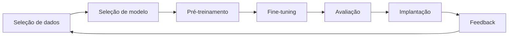
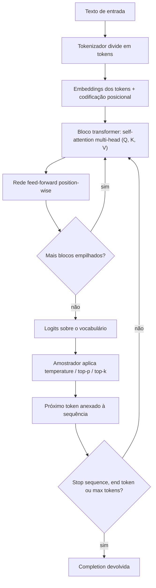
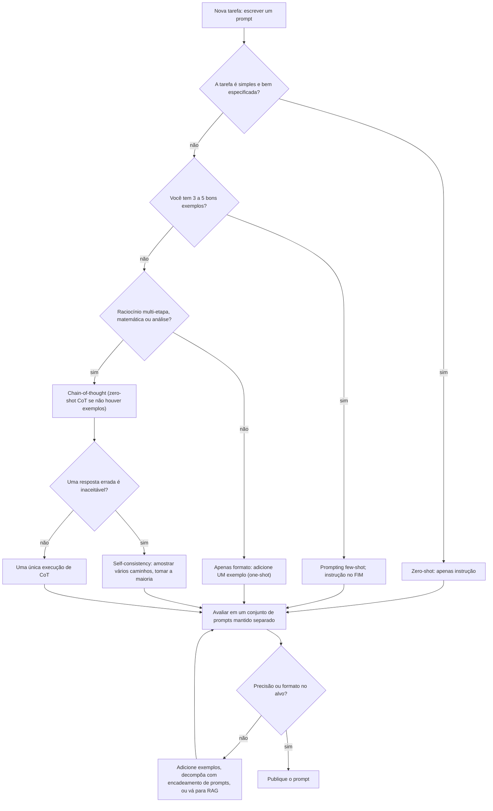
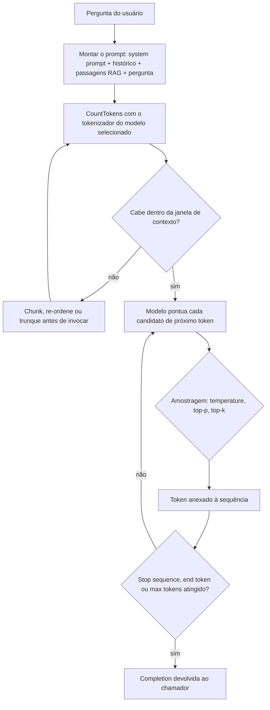
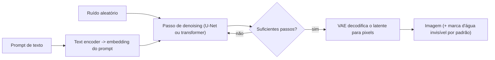
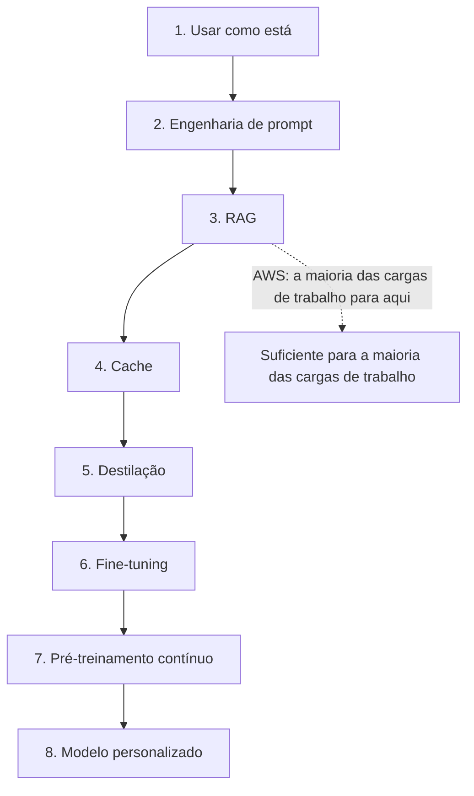

# Fundamentos de IA Generativa: Tokens, Transformers, Prompting e Modelos de Fundação

Esta é a lição de maior alavancagem do curso. **O Domínio 2 (Fundamentos de IA Generativa) carrega 24% e o Domínio 3 (Aplicações de Modelos de Fundação) carrega 28%** do conteúdo avaliado, **52% no total**, e quase toda questão dentro desses dois domínios é construída a partir do mesmo conjunto pequeno de objetos: um **token**, uma **janela de contexto**, um **prompt**, um **parâmetro de inferência**, um **embedding** e um **modelo de fundação (FM)**. Aprenda os objetos e os números a eles ligados, e metade do exame vira aritmética mais vocabulário em vez de palpite.

```text
 =====================================================================
  A METADE GENERATIVA DO EXAME AIF-C01          (Digest: out. 2026)
 =====================================================================
  DOMÍNIO 2  Fundamentos de IA Generativa ............. 24 %
  DOMÍNIO 3  Aplicações de Modelos de Fundação ......... 28 %
  ----------------------------------------------------------
  peso combinado do material desta lição ............. 52 %
 ---------------------------------------------------------------------
  VOCABULÁRIO DA TAREFA 2.1
    tokens · chunking · embeddings · vetores · engenharia de prompt ·
    LLMs baseados em transformer · modelos de fundação · modelos multimodais ·
    modelos de difusão
  CICLO DE VIDA DO FM
    seleção de dados -> seleção de modelo -> pré-treinamento ->
    fine-tuning -> avaliação -> implantação -> feedback
 ---------------------------------------------------------------------
  VANTAGENS AWS  ... adaptabilidade · capacidade de resposta ·
                     capacidade conversacional · geração de conteúdo
  RISCOS AWS       ... alucinações · baixa interpretabilidade ·
                      imprecisão · indeterminismo
 =====================================================================
```

> [!NOTE]
> **Como ler esta lição.** Todo limite, padrão e percentual abaixo vem do Guia de Exame AIF-C01, do guia do usuário do Amazon Bedrock, de um blog da AWS ou de uma publicação científica da AWS. Duas regras governam os números: **quando a AWS publica um número, a AWS vence qualquer calculadora de terceiros**; isso importa mais para estimativa de tokens, onde o "~4 caracteres por token" popular da internet *não* é um número da AWS; e **percentuais de marketing são reproduzidos como alegações da AWS**, claramente rotulados como tais, porque sua metodologia não é verificada de forma independente.

Ao final desta lição você será capaz de:

- explicar o **self-attention** em termos de query/key/value e dizer por que transformers vencem RNNs em sequências longas;
- estimar **tokens** com ambas as regras publicadas pela AWS (6 caracteres por token, e 4,7 caracteres por token para embeddings em inglês) e saber qual delas a questão está usando;
- orçar uma **janela de contexto** como system prompt + entrada do cliente + contexto RAG + saída, e prever o que um **Context Window Overflow** faz ao comportamento;
- escolher entre **zero-shot, few-shot, chain-of-thought, self-consistency e encadeamento de prompts** e afirmar o custo de cada um;
- definir **temperature, top-p, top-k, max tokens, stop sequences e penalidades** para uma carga de trabalho e defender a resposta sobre determinismo;
- ler uma **tabela de modalidade** e escolher a família de FM certa para texto, embeddings, imagem, vídeo ou entradas imagem+texto;
- percorrer o **espectro de customização** da engenharia de prompt até um modelo personalizado e nomear os números que a AWS liga à destilação e ao fine-tuning por reforço;
- avaliar um FM com **ROUGE, BLEU, BERTScore, LLM-as-a-judge e avaliação humana**;
- aplicar as **seis políticas dos Guardrails** e a escada de três passos de mitigação de alucinação;
- defender o **veredito comparativo** entre IA generativa, ML tradicional e sistemas baseados em regras.

---

## 1. O que a IA generativa é, e o que ela não é

### 1.1 A definição que o exame realmente usa

IA generativa é a classe de sistemas que **cria conteúdo novo**: texto, código, imagens, vídeo, áudio e embeddings. Aquela única palavra, *novo*, é a distinção inteira. Um modelo de ML tradicional responde "a qual balde esta linha pertence?"; um modelo generativo responde "escreva algo que pertença a este balde". Modelos de fundação são os motores por baixo: grandes modelos treinados em corpora amplos que você adapta através de **prompting, geração aumentada por recuperação (RAG) ou fine-tuning** em vez de retreinar.

A AWS é explícita sobre a troca. Modelos de fundação são **não-determinísticos**: *"entradas idênticas podem produzir respostas diferentes"*. Essa propriedade é o que os torna úteis para rascunho e brainstorming e o que os torna perigosos para extração, pontuação e qualquer coisa que um auditor leia duas vezes.

### 1.2 As vantagens e os riscos que a AWS nomeia

O guia de exame lista quatro vantagens e quatro desvantagens. Eles não são decoração: cada vantagem pareia com um controle, e cada risco pareia com uma mitigação que você será pedido a nomear.

| Vantagem (guia de exame AIF-C01) | O que ela entrega | O controle que a mantém útil |
|---|---|---|
| **Adaptabilidade** | um modelo, muitas tarefas através de prompting e fine-tuning | espectro de customização (Seção 9) |
| **Capacidade de resposta** | saída condicionada ao prompt inteiro | orçamentação da janela de contexto (Seção 7) |
| **Capacidade conversacional** | diálogo multi-volta sobre seus dados | RAG mais Guardrails (Seção 11) |
| **Geração de conteúdo** | texto, código, imagem, áudio, vídeo novos | avaliação e revisão humana (Seção 10) |

| Desvantagem (guia de exame AIF-C01) | A falha que ela produz | Mitigação documentada pela AWS |
|---|---|---|
| **Alucinação** | fabricação confiante | refino de prompt → RAG → modelo diferente; checagens de fundamentação contextual |
| **Baixa interpretabilidade** | sem importâncias de features legíveis | avaliação programática + juiz + humana |
| **Imprecisão** | fatos errados, formato errado | fundamentação, ROUGE/BLEU/BERTScore, conjuntos de prompt de teste mantidos separadamente |
| **Indeterminismo** | mesma entrada, saída diferente | temperature 0, seeds fixos, Guardrails, humano no loop |

### 1.3 O ciclo de vida do modelo de fundação

A Tarefa 2.1 exige o ciclo de vida em ordem. Também é a forma da maioria das questões de sequenciamento do exame.



- **🔢 📚 Você sabia?** A própria formulação do guia de exame para o ciclo de vida é um *ciclo*, não uma linha: **o feedback retorna à seleção de dados**. É por isso que "monitore o modelo implantado e devolva dados de produção ao corpus" lê-se como correto no exame, enquanto "implantação é o passo final" lê-se como um distrator: e é o mesmo loop que faz do *desvio* um problema de IA generativa e não apenas de ML clássico.

---

## 2. Tokens: a unidade em que tudo é medido

### 2.1 O que é um token

Um **token** é o pedaço de texto que um modelo realmente lê e escreve. Um **tokenizador** divide o texto bruto em tokens antes que o modelo o veja, e a geração acontece um token de cada vez. A propriedade crítica é que **a tokenização é específica do modelo**: a mesma frase pode ser 12 tokens em um modelo e 17 em outro, e é por isso que uma fórmula fixa "palavras ÷ X = tokens" é não-confiável, e por isso que o Amazon Bedrock expõe uma API **CountTokens** que conta com o tokenizador *do modelo selecionado* sobre a entrada exata que você está prestes a invocar.

**Chunking** é o conceito companheiro: quando um documento é mais longo que o limite de entrada do modelo, você o divide em segmentos (parágrafos, seções, páginas) para que cada segmento caiba. A qualidade do chunking é a maior alavancagem em um sistema RAG: a AWS publicou um caso em que apenas um chunking melhor elevou a **relevância de contexto de 67% para 93%** e removeu alucinações **sem mudar o prompt**.

### 2.2 As duas regras de estimativa publicadas pela AWS

| Regra | Fonte da AWS | Para que serve | Valor exato |
|---|---|---|---|
| **≈ 6 caracteres por token** | Bedrock *Prepare model customizations* | cotas de fine-tuning e planejamento de dataset | caracteres permitidos = cota de tokens × 6 |
| **≈ 4,7 caracteres por token (inglês)** | Bedrock *Titan Text Embeddings* | limites de entrada de embedding | 8.192 tokens ≈ **38.502 caracteres** |

> [!WARNING]
> **A regra "~4 caracteres por token" que você encontrará em blogs não é um número da AWS.** Ela circula amplamente em calculadoras de tokens de terceiros, e é próxima o bastante para ser tentadora, e errada o bastante para falhar um item de aritmética. No exame, use os números da AWS: **6 caracteres por token** para fine-tuning e planejamento de cotas, **4,7 caracteres por token** para entrada em inglês no Titan Text Embeddings V2. Quando uma opção é construída sobre 4 caracteres por token, ela é construída sobre um número que a AWS nunca publicou.

### 2.3 Exemplo resolvido 1: cota de fine-tuning em caracteres

Uma equipe quer fazer fine-tune do **Amazon Titan Text G1 Express** e tem um prompt de exemplo de **30.000 caracteres**. A cota de fine-tuning com batch size 1 para aquele modelo é **4.096 tokens de entrada+saída**.

1. Converta a cota para caracteres: $4{,}096 \times 6 = 24{,}576$ caracteres permitidos.
2. Converta o exemplo para tokens: $30{,}000 \div 6 = 5{,}000$ tokens: **904 tokens acima** da cota de 4.096.
3. Converta o excesso de volta para caracteres: $30{,}000 - 24{,}576 = 5{,}424$ caracteres a mais.

**Resposta:** o exemplo excede a cota em **5.424 caracteres**; divida-o em dois registros ou trunque. O distrator "50.000 caracteres" é o teto do *Embeddings V2* do Titan, um modelo diferente e um limite diferente.

### 2.4 Exemplo resolvido 2: qual limite de embedding prende primeiro?

O Titan Text Embeddings V2 aceita **8.192 tokens *ou* 50.000 caracteres**. Qual dos dois pára um documento longo em inglês primeiro?

1. Inglês tem em média **4,7 caracteres por token**, então o limite de tokens prende em $8{,}192 \times 4,7 \approx 38{,}502$ caracteres.
2. Um artigo de **50.000 caracteres** converte portanto em $50{,}000 \div 4,7 \approx 10{,}638$ tokens.
3. Excesso: $10{,}638 - 8{,}192 = 2{,}446$ tokens.

**Resposta:** o **limite de tokens prende primeiro**, em cerca de 38.502 caracteres para inglês: 11.498 caracteres *antes* do teto de 50.000 caracteres. O remédio documentado pela AWS é segmentar o documento em parágrafos ou seções e embutir cada um.

- **🔢 📚 Você sabia?** O endpoint **CountTokens** do Bedrock responde uma pergunta que nenhuma fórmula consegue: ele roda o tokenizador *do próprio modelo invocado* sobre a sua string exata. O mesmo artigo de 47.000 caracteres pode estar acima do orçamento em um modelo e confortavelmente abaixo em outro, e é por isso que a AWS documenta o CountTokens como a etapa de planejamento antes de qualquer chamada sensível a cota, e não como uma conveniência opcional.

---

## 3. Transformers e self-attention: como um modelo lê uma sequência

### 3.1 Query, key e value

O **self-attention** deixa cada token de uma sequência olhar para cada outro token e decidir o que importa. Cada embedding de token é projetado em três vetores, e as descrições da AWS deles são a formulação exata que o exame usa:

| Vetor | A pergunta que ele responde | Papel na pontuação de atenção |
|---|---|---|
| **Query (Q)** | *"o que estou procurando?"* | o que este token quer encontrar em outro lugar na sequência |
| **Key (K)** | *"o que ofereço?"* | o rótulo que cada token anuncia sobre si mesmo |
| **Value (V)** | *"o que repasso?"* | o conteúdo realmente levado adiante para a próxima camada |

As pontuações de atenção são computadas a partir de **Q comparado contra K**, e então usadas para ponderar os vetores **V**. O resultado é uma representação de cada token que já contém o seu contexto: é por isso que "bank" em *river bank* e "bank" em *bank account* terminam como vetores diferentes mesmo tendo sido a mesma string de entrada.

### 3.2 O bloco transformer e a codificação posicional

Um bloco transformer é, na definição da AWS, **self-attention multi-head mais uma rede feed-forward position-wise**. Múltiplos heads atendem em paralelo para que heads diferentes possam se especializar: um rastreando sintaxe, outro rastreando co-referência, outro rastreando distância. Como a atenção em si é cega à ordem, a **codificação posicional** injeta a ordem da sequência para que o modelo saiba qual token veio primeiro.

### 3.3 Por que transformers vencem RNNs, e por que modelos estilo GPT são pilhas de decoders

Transformers processam **a sequência inteira em paralelo**, onde um RNN deve percorrê-la uma posição de cada vez. As consequências são as duas coisas que valem a pena memorizar: **treinamento mais rápido** e a capacidade de lidar com **sequências muito mais longas**. Modelos estilo GPT são pilhas de blocos de **decoder** e são **autoregressivos**: eles produzem um token, o anexam à entrada, e rodam de novo.



> [!NOTE]
> Duas formulações que o exame adora: um bloco transformer é *"self-attention multi-head **mais** uma rede feed-forward position-wise"*, não atenção sozinha, e é a **codificação posicional**, não o mecanismo de atenção em si, que fornece a ordem das palavras. Se um distrator afirma que a atenção preserva a ordem naturalmente, ele está testando se você lembra que a atenção é invariante à permutação.

---

## 4. Embeddings, vetores e bancos de dados vetoriais

### 4.1 De tabelas one-hot ao espaço de embeddings

Antes dos embeddings, dados categóricos viviam em **tabelas one-hot**: um vetor alto e esparso onde cada palavra era uma coluna independente e nenhuma noção de significado existia entre elas. **Embeddings substituem isso** por um vetor denso no qual palavras semanticamente similares ficam **perto umas das outras**. O retorno é aritmética que a codificação one-hot nunca conseguiu fazer, o exemplo documentado pela AWS é `Paris − France + Germany ≈ Berlin`, onde a *direção* entre dois embeddings codifica um relacionamento.

### 4.2 Quem calcula a similaridade: o modelo ou o banco de dados?

Um detalhe que decide muitas pontuações: o modelo **produz** o vetor; o **banco de dados vetorial calcula** a similaridade, usando **similaridade de cosseno ou k-nearest neighbours (k-NN)**. A recuperação em um pipeline RAG é portanto uma operação de banco de dados, e o guia de exame nomeia os armazenamentos de embedding que ele espera que você reconheça.

| Armazenamento nomeado na Tarefa 3.1 | Mecanismo de recuperação | Enquadramento típico do AIF-C01 |
|---|---|---|
| **Amazon OpenSearch Service** | k-NN / busca vetorial | busca vetorial gerenciada ao lado de full-text |
| **Amazon Aurora** | **pgvector** no Aurora PostgreSQL | dados relacionais com recuperação vetorial |
| **Amazon Neptune** | busca vetorial no grafo | relacionamentos *e* similaridade |
| **Amazon DocumentDB (with MongoDB compatibility)** | busca vetorial | cargas de trabalho de documento com embeddings |
| **Amazon RDS for PostgreSQL** | pgvector | implantações de estilo autogerenciado na AWS |

### 4.3 Os modelos de embedding e seus limites verificados

| Modelo | Direção | Especificação verificada |
|---|---|---|
| **Amazon Titan Text Embeddings G1** | texto → vetor | entrada máx. **8K tokens**; vetor de saída máx. **1.536** dimensões |
| **Amazon Titan Text Embeddings V2** (`amazon.titan-embed-text-v2:0`) | texto → vetor | **8.192 tokens ou 50.000 caracteres** de entrada; **1.024** dimensões (também 512 e 256); **4,7 caracteres por token** para inglês |
| **Cohere Embed v3** | texto → vetor | **1.024** valores |
| **Amazon Titan Multimodal Embeddings G1** | imagem ou texto → vetor compartilhado | compara um prompt contra uma imagem gerada por **similaridade de cosseno** |

### 4.4 Exemplo resolvido 3: quanto um armazenamento vetorial realmente custa em bytes

O Titan Text Embeddings V2 retorna **1.024** dimensões. Assumindo floats de 32 bits (4 bytes por valor: uma suposição, não um número publicado pela AWS), um vetor é:

$$
1{,}024 \times 4\ \text{bytes} = 4{,}096\ \text{bytes} \approx 4\ \text{KB}
$$

Para uma base de conhecimento de **100.000 passagens**:

$$
100{,}000 \times 4\ \text{KB} = 400{,}000\ \text{KB} \approx 400\ \text{MB}
$$

**Resposta:** cerca de **400 MB de payload bruto de vetores** antes de sobrecarga de índice, metadados e sharding. Esse é o número que você carrega para a escolha entre OpenSearch, Aurora (pgvector), Neptune, DocumentDB e RDS for PostgreSQL: e é por isso que a redução de dimensionalidade para **512 ou 256** (ambos suportados pelo V2) é uma alavancagem legítima de custo: reduzir as dimensões pela metade reduz o payload bruto pela metade para cerca de **200 MB**.

- **🔢 📚 Você sabia?** Aritmética de embedding não é truque de festa: é evidência de que o espaço vetorial codifica *relacionamentos como direções*. `Paris − France + Germany ≈ Berlin` funciona porque o deslocamento "capital de" é consistente entre países. No exame isso aparece indiretamente: quando uma questão diz que vetores colocam itens semanticamente similares perto um dos outros, a resposta pretendida é quase sempre sobre **similaridade de cosseno em um banco de dados vetorial**, não sobre o modelo reler o texto.

---

## 5. Engenharia de prompt: a primeira alavancagem que você deve sempre puxar

### 5.1 O vocabulário de shots

| Termo | Definição (AWS) |
|---|---|
| **Zero-shot** | apenas instrução, **nenhum** exemplo entrada→saída |
| **One-shot** | exatamente **um** exemplo resolvido |
| **Few-shot** | **k** exemplos pareados; um "shot" é um par entrada→saída |
| **Instruction** | a descrição da tarefa; a AWS diz colocar a **pergunta ou instrução no fim** do prompt |
| **Conjunto de teste mantido separado (held-out)** | prompts reservados do desenvolvimento para que você meça regressões honestamente |

### 5.2 A tabela de técnicas

| Técnica | Definição | Quando a AWS diz para usá-la | Contrapartida |
|---|---|---|---|
| **Zero-shot** | apenas instrução | tarefas simples e bem especificadas | mais barata; menos controle de formato |
| **One-shot** | exatamente 1 exemplo | um exemplar corrige o formato | pequena adição de tokens |
| **Few-shot (in-context)** | k exemplos pareados | controle de formato ou tom; **3 to 5** para classificação simples | mais tokens de entrada → mais custo e latência |
| **Chain-of-thought (CoT)** | etapas intermediárias de raciocínio ("pense passo a passo…") | análise multi-etapa, matemática, raciocínio complexo | **+latência, +tokens de saída** |
| **Zero-shot CoT** | uma frase gatilho de CoT sem exemplo resolvido | raciocínio sem a sobrecarga de exemplo | mesma sobrecarga de CoT |
| **Self-consistency** | amostrar vários caminhos de raciocínio, tomar a resposta majoritária | raciocínio de alto risco | multiplica o custo de inferência |
| **Encadeamento de prompts / Prompt Flows** | a saída da etapa N vira a entrada da etapa N+1 | tarefas complexas decomponíveis | complexidade de orquestração |

### 5.3 Chain-of-thought: o que ela compra e o que ela custa

O Amazon Bedrock documenta que chain-of-thought, com a marca **model reasoning** no console, *"pode muitas vezes melhorar a precisão do modelo dando ao modelo a chance de pensar antes de responder"*. O custo é igualmente explícito: **latência aumentada e tokens de saída aumentados**. E a exclusão importa tanto quanto o benefício: a AWS afirma que **tarefas simples não são bons candidatos para chain-of-thought**. Pedir a um modelo que raciocine longamente para classificar um chamado de suporte em uma de quatro filas é pagar tokens de saída sem precisão.

### 5.4 A árvore de decisão de engenharia de prompt



### 5.5 Exemplo resolvido 4: quanto few-shot prompting realmente custa

Uma instrução custa **80 tokens**; um exemplo rotulado custa **60 tokens**.

| Variante | Tokens de entrada | Múltiplo do zero-shot |
|---|---|---|
| Zero-shot | $80$ | 1,00× |
| One-shot | $80 + 60 = 140$ | 1,75× |
| **3-shot** | $80 + (3 \times 60) = 260$ | 3,25× |
| 5-shot | $80 + (5 \times 60) = 380$ | **4,75×** |

**Resposta:** um prompt de 5-shot custa **4,75×** os tokens de entrada do zero-shot pela *mesma única resposta*. Como a AWS diz que **3 a 5 exemplos bastam** para classificação simples de texto, **3 shots é o ponto ideal**: você obtém controle de formato a 3,25× em vez de 4,75×. E se você então acrescentar chain-of-thought, o custo se move para o lado da **saída**, onde o `maxTokenCount` padrão do Titan Text de **512** começa a apertar; eleve-o antes de habilitar raciocínio.

```matching
{
  "question": "Relacione cada técnica de engenharia de prompt à orientação da AWS sobre quando recorrer a ela:",
  "pairs": [
    {"left": "Prompting zero-shot", "right": "Tarefa simples e bem especificada: apenas instrução, opção mais barata, menos controle de formato"},
    {"left": "Prompting few-shot", "right": "Formato ou tom deve ser controlado: 3 a 5 exemplos para classificação simples, instrução colocada no fim"},
    {"left": "Chain-of-thought (model reasoning)", "right": "Raciocínio multi-etapa ou matemática: precisão melhora, mas latência e tokens de saída aumentam"},
    {"left": "Self-consistency", "right": "Raciocínio de alto risco: amostrar vários caminhos de raciocínio e manter a resposta majoritária"},
    {"left": "Encadeamento de prompts / Prompt Flows", "right": "Tarefa complexa que decompõe: a saída da etapa N vira a entrada da etapa N+1"}
  ],
  "explanation": "O exame testa o pareamento de técnica com tarefa, não a capacidade de recitar definições. Tarefa simples significa zero-shot; controle de formato significa 3 a 5 exemplos few-shot com a instrução no fim; raciocínio significa chain-of-thought e você paga em latência e tokens de saída; alto risco significa self-consistency e você paga em inferência multiplicada; trabalho decomponível significa encadeamento e você paga em complexidade de orquestração."
}
```

- **🔢 📚 Você sabia?** A orientação de engenharia de prompt da AWS esconde dois hábitos que separam um prompt que funciona de uma demo: coloque a **pergunta ou instrução no fim** do prompt (para que os tokens mais relevantes fiquem mais perto de onde a geração começa), e mantenha um **conjunto de prompts mantido separado** que você nunca mostra à equipe enquanto itera. Sem o conjunto separado, "o prompt melhorou" é uma anedota: a mesma disciplina de um conjunto de teste separado no ML clássico, aplicada a texto.

---

## 6. Parâmetros de inferência: pilotando o próximo token

### 6.1 A tabela completa de parâmetros

Cada número aqui é verificado contra as páginas *Inference response generation* e *Titan Text* do Bedrock.

| Parâmetro | Controla | Mais baixo → | Mais alto → | Use quando | Intervalo/padrão verificado |
|---|---|---|---|---|---|
| **Temperature** | forma da distribuição de probabilidade do próximo token | mais íngreme → **determinístico, factual, repetitivo** | mais plano → **aleatório, criativo** | 0 to 0,3 para extração, SQL, classificação, Q&A; 0,7 to 1,0 para brainstorm e copy | **0,0 to 1,0**; **padrão do Titan 0,7** |
| **Top-p** | corte de probabilidade acumulada | pool de candidatos menor → estável, repetitivo | pool mais largo → mais diverso | sintonizar *junto com* a temperature, nunca ambos agressivamente | **0,0 to 1,0**; **padrão do Titan 0,9** |
| **Top-k** | contagem de candidatos mais prováveis mantidos | saídas mais seguras, mais prováveis | tokens menos prováveis admitidos | controle fino de diversidade; **específico do Claude** no Bedrock | inteiro ≥ 0, específico do modelo |
| **Max tokens** | teto da saída gerada | mais barato, mais curto, menor latência | mais longo, mais caro, pode divagar | defina logo acima do tamanho realista da resposta | **padrão do Titan 512**; Lite **4.096**, Express **8.192**, Premier **3.072** |
| **Stop sequences** | parar geração em uma sequência de caracteres |, |, | cercar a saída antes de `END`, ou antes de um segundo objeto JSON | Converse **0 to 2.500** itens; Agents **0 to 4**; item **1 to 1.000** caracteres |
| **Penalidades** (frequency / presence / count) | punir repetição | menos repetição | mais repetição tolerada | parar loops e ecos em gerações longas | expostas pelo **AI21 Labs Jurassic** no Bedrock |
| *Imagem:* **cfgScale / seed / quality / numberOfImages** | aderência, reprodutibilidade, fidelidade, lote | aderência mais frouxa ao prompt | aderência mais estrita | fixar `seed` para comparar execuções | Nova Canvas `quality` = standard ou premium; **máx. 5 imagens** |

### 6.2 Os padrões que você deve saber de cor

| Família de modelo | temperature | topP | maxTokenCount |
|---|---|---|---|
| **Amazon Titan Text G1** | **0,7** | **0,9** | **512** (Lite 4.096 / Express 8.192 / Premier 3.072 máximo) |
| **Anthropic Claude (no Bedrock)** | acrescenta **Top K** como alavanca extra |: | específico do modelo |
| **AI21 Labs Jurassic** |, |, | acrescenta **penalidades presence / count / frequency** |

> [!WARNING]
> **Baixar a temperature não torna um modelo verdadeiro: torna-o repetitivo.** Temperature 0 (ou um valor baixo com top-p reduzido) é a resposta correta para questões de *determinismo*: extração de cláusulas contratuais, geração de SQL, classificação, qualquer carga de trabalho cuja saída deve ser reprodutível e auditável. É a resposta **errada** para alucinação, porque um modelo determinístico produzirá a *mesma* fabricação toda vez. Para alucinação, a resposta do exame é a escada de mitigação da Seção 11: refinar o prompt, adicionar RAG, ou tentar um modelo diferente.

### 6.3 Exemplo resolvido 5: três cargas de trabalho, três conjuntos de parâmetros

Uma equipe roda três trabalhos no mesmo modelo Titan Text Express. Assuma o mesmo prompt e o mesmo teto de saída padrão de 512 tokens.

1. **Extração de cláusulas contratuais** (deve ser auditável): temperature **0,0**, top-p reduzido de 0,9 para **0,1 to 0,3**. Efeito: a distribuição fica mais íngreme, o pool de candidatos encolhe, e re-execuções convergem na mesma extração.
2. **Brainstorm de manchetes de campanha**: temperature **1,0**, top-p deixado em **0,9**. Efeito: a distribuição achata, mais da cauda fica acessível, e a diversidade sobe: ao custo da reprodutibilidade.
3. **Raciocínio chain-of-thought sobre uma resposta de 400 tokens**: temperature **0,2**, mas `maxTokenCount` elevado de **512** para pelo menos **1.024**, porque tokens de raciocínio são tokens de *saída*. Deixar o padrão em vigor trunca a cadeia no meio da derivação.

**Resposta:** determinismo é comprado com **temperature e top-p**; criatividade com **temperature**; e capacidade de raciocínio com **max tokens**, o parâmetro que mais frequentemente é esquecido, porque a falha parece um bug em vez de uma configuração.

---

## 7. Janelas de contexto: o orçamento que falha silenciosamente

### 7.1 O que realmente cabe

A **janela de contexto** é o número máximo de tokens que um modelo considera de uma vez, e ela é um orçamento para *tudo* na chamada:

$$
\text{context window} \ge \text{system prompt} + \text{client input} + \text{RAG context} + \text{output}
$$

Defina `maxTokenCount` por subtração: **janela − tokens de entrada − margem de segurança**. Nunca por intuição.

### 7.2 O ring buffer FIFO e o Context Window Overflow

O blog de segurança da AWS descreve a janela de contexto como um **ring buffer FIFO**. Uma vez cheio, **cada novo token silenciosamente expulsa o token mais antigo**, nenhum erro, nenhum aviso, apenas comportamento derivando. O fenômeno tem um nome na AWS: **Context Window Overflow (CWO)**. O horror prático é que o **system prompt geralmente é o conteúdo mais antigo**, então sob CWO as instruções que definem o comportamento do seu agente são a primeira coisa a desaparecer, e a aplicação continua retornando 200 OK enquanto ignora suas próprias regras.

### 7.3 Exemplo resolvido 6: um orçamento de janela de contexto

System prompt **400** + passagens RAG **1.600** + histórico de conversa **900** + pergunta **100**:

$$
400 + 1{,}600 + 900 + 100 = 3{,}000\ \text{input tokens}
$$

Com `maxTokenCount` no máximo do Titan Text Premier de **3.072**, o total vira $3{,}000 + 3{,}072 = 6{,}072$ tokens de demanda. Se a janela do modelo for menor que isso, o overflow não levanta exceção: os ~3.000 tokens mais antigos (começando pelo system prompt) são expulsos conforme a geração procede, e o comportamento deriva em vez de falhar.

**Correção, em ordem:** rode **CountTokens** no prompt exato → defina `maxTokenCount` = janela − entrada − margem → encurte ou re-ordene passagens RAG → resuma voltas mais antigas do histórico.

### 7.4 O fluxo de geração ponta a ponta



- **🔢 📚 Você sabia?** A janela de contexto *não* é publicada como um número fixo por família de modelo nas páginas que a AWS verificou para este digest, então itens "qual modelo tem a maior janela?" são dirigidos por anúncios e devem ser re-checados perto do dia do exame. O que *é* verificado e estável: máximos de `maxTokenCount` do Titan Text (**4.096 / 8.192 / 3.072**), Titan Embeddings **8K** tokens, Embeddings V2 **8.192** tokens, fine-tuning do Llama soma de entrada + saída **16.000** (**10.000** para o 90B), e fine-tuning do Claude 3 Haiku **32.000** tokens. Orcue a partir desses números, não de uma manchete de blog.

---

## 8. Modelos de fundação por modalidade, e como imagens são feitas

### 8.1 A tabela de modalidades

| Modalidade | Entrada → saída | Modelos listados verificados pela AWS | Especificação verificada |
|---|---|---|---|
| **Texto → Texto** | texto → texto | Amazon Titan Text G1 Lite/Express/**Premier**; Amazon Nova; Anthropic Claude; Meta Llama 3.1 8B/70B, 3.2 1B/3B, 3.3 70B; Cohere Command / Command Light; Mistral AI; AI21 Labs Jurassic; DeepSeek-R1; OpenAI gpt-oss-20b | `maxTokenCount` do Titan: Lite **4.096** · Express **8.192** · Premier **3.072** |
| **Texto → Embeddings** | texto → vetor | Titan Text Embeddings **G1** e **V2**; Cohere Embed v3 | G1: 8K entrada / **1.536** saída · V2: 8.192 tokens ou 50.000 caracteres / **1.024** (512, 256) saída · Cohere v3: **1.024** valores |
| **Texto → Imagem** | texto (± imagem de referência) → imagem | Amazon Titan Image Generator G1; Amazon Nova Canvas; Stability AI SDXL / 3.5 Large / Stable Image Core | Titan Image: legenda 3 to 1.024 caracteres, lado 512 to 4.096 px, ≤ **5** imagens de referência, **marca d'água invisível ativada por padrão** |
| **Texto + Imagem → Texto** | imagem + texto → texto | Meta Llama 3.2 11B/90B Instruct Vision, Llama 3.3 70B Vision Instruct | tokens de imagem = `min(2,max(H//560,1)) × min(2,max(W//560,1)) × 1601` → **1.601 to 6.404** |
| **Texto → Vídeo** | texto → vídeo | Amazon Nova Reel | latent diffusion transformer (VAE + text encoder + denoiser) |
| **Imagem/Texto → Embeddings multimodais** | qualquer → vetor compartilhado | Amazon Titan Multimodal Embeddings G1 | compara prompt vs. imagem gerada por similaridade de cosseno |
| **Geração de áudio** | áudio de saída | A AWS lista geração de áudio como caso de uso de GenAI em escopo | nenhum FM de áudio específico do Bedrock verificado neste digest: trate como não confirmado |

### 8.2 Como um modelo de difusão produz uma imagem

O treinamento de difusão ensina a um modelo a **remover ruído que foi adicionado a imagens reais**. A geração roda esse processo ao contrário: começa a partir de **ruído aleatório** e denoisa iterativamente, cada passo condicionado ao embedding do prompt de texto. **Difusão latente** faz o trabalho em um espaço latente comprimido (uma U-Net, ou um transformer denoiser) e só então decodifica para pixels.

**Amazon Nova Canvas e Nova Reel** são **modelos de difusão latente com backbones de transformer**, frequentemente chamados de *diffusion transformers*, construídos a partir de três partes: um **VAE** que converte entre pixels e tokens visuais, um **text encoder** para o prompt, e um **transformer denoiser**. O **Amazon Titan Image Generator** é um FM de difusão condicionado por texto: ele codifica o prompt, casa vetores em um espaço compartilhado de embedding texto/imagem, e transforma uma codificação aleatória de baixa resolução na imagem final.



### 8.3 Exemplo resolvido 7: entradas de visão também são aritmética de tokens

A fórmula publicada pela AWS para tokens de imagem no fine-tuning de visão do Llama é:

$$
\text{tokens} = \min(2, \max(H // 560,\ 1)) \times \min(2, \max(W // 560,\ 1)) \times 1601
$$

| Imagem | Cálculo do fator | Tokens |
|---|---|---|
| 560 × 560 | $1 \times 1 \times 1601$ | **1.601** |
| 1.120 × 1.120 | $2 \times 2 \times 1601$ | **6.404** |
| 300 × 900 | $1 \times 1 \times 1601$ (altura trava em 1, largura trava em 2) | **1.601** |

Contra a cota de fine-tuning de soma de entrada-mais-saída de **16.000** do Meta Llama 3.2: uma imagem de 1.120 × 1.120 = 6.404 ✓, duas = 12.808 ✓, três = 19.212 ✗: **acima da cota**.

**Resposta:** duas imagens grandes cabem, três não cabem, e o comportamento de clamp significa que uma imagem pequena ainda custa pelo menos **1.601 tokens**.

- **🔢 📚 Você sabia?** O Amazon Titan Image Generator sai com uma **marca d'água invisível ativada por padrão** e aceita no máximo **5 imagens de referência**: ambos são fatos com forma de exame porque respondem a duas perguntas diferentes: "como a AWS torna conteúdo gerado *identificável*?" (marca d'água, um controle de transparência) e "quanta personalização a API aceita?" (5 imagens, não 50). Pareie qualquer um com a Responsible AI Lens da Seção 11 quando uma questão pedir um artefato de transparência.

### 8.4 Atualizações de 2026 (em outubro de 2026)

A tabela de modalidades em 8.1 é a linha de base do guia de exame; o elenco por trás dela mudou duas vezes dentro da janela que a AWS verificou para esta lição. Tudo abaixo vem do AWS What's New, do guia do usuário do Amazon Bedrock e da própria cobertura do re:Invent 2025 da AWS: apenas funcionalidades e datas que a AWS publicou ela mesma.

| Mudança verificada | Data | Por que importa no exame |
|---|---|---|
| Família **Amazon Nova 2** anunciada; modelo fala-para-fala **Nova 2 Sonic** GA (`amazon.nova-2-sonic-v1:0`, 7 idiomas) e **Nova 2 Omni** em preview; **Nova 2 Lite** lista contexto de **1M de tokens** com interpretador de código, fundamentação web e MCP remoto | 1 to 4 de dezembro de 2025 (Sonic GA **2 de dezembro de 2025**) | uma modalidade **fala-entrada → fala-saída** e um modelo **omni** (texto, imagem, vídeo e fala de entrada → texto + imagem de saída) se juntam à tabela de modalidades; Nova de geração 1 (Micro/Lite/Pro/Premier, Canvas, Reel, Sonic, Embeddings) permanece listado |
| **Anthropic Claude Sonnet 4.6** adicionado ao Bedrock | **17 de fevereiro de 2026** | **1M de contexto / 64K de saída**, o maior par contexto-mais-saída que a AWS publica para a linha Claude 4.x, e uma resposta direta a "qual modelo se ajusta a um trabalho de documento longo?" |
| **Seis modelos de pesos abertos** gerenciados no Bedrock, DeepSeek V3.2, MiniMax M2.1, GLM 4.7 / 4.7 Flash, Kimi K2.5, Qwen3 Coder Next, servidos através do **Project Mantle** | **1 de fevereiro de 2026** | pesos abertos são agora uma escolha de **seleção de modelo gerenciado** no Bedrock, em vez de uma decisão de auto-hospedagem |
| **OpenAI GPT-6 Astra** GA e **GLM 5.3 (Z.ai)** GA no Bedrock | 8 de setembro de 2026 / 5 de outubro de 2026 | a amplitude do provedor cresce; as regras de ciclo de vida, avaliação e Guardrails do FM não mudam com isso |
| **Amazon Bedrock AgentCore** GA (Runtime, Gateway, Memory), depois **Policy** GA (Cedar ou linguagem natural) e **Evaluations** GA (**13 avaliadores**) | 13 de outubro de 2025 / 3 de março de 2026 / 31 de março de 2026 | o material de **IA agêntica**: uso de ferramentas, **MCP**, gerenciamento de memória, orquestração |
| **Política de ciclo de vida do modelo**: **Active → Legacy → EOL**, com cerca de uma janela de **6 meses em Legacy** para a maioria dos modelos | 7 de setembro de 2026 | **Legacy** bloqueia *novos clientes* e *novo Provisioned Throughput*; ele não desliga endpoints existentes |
| **Guia de exame AIF-C01 v1.1** publicado (o exame ainda é AIF-C01) | **30 de abril de 2026** | novos objetivos: precificação baseada em tokens (**2.1.4**), **engenharia de contexto** (**2.1.5**), IA agêntica incl. MCP (**2.1.6**), versionamento de Prompt Management (**3.2.5**), métricas de alinhamento de negócio (**3.4.5**), detecção de alucinação e fundamentação (**5.1.5**) |

Os Guardrails cresceram ao lado do elenco de modelos: a AWS agora documenta **code safeguards**, uma **ApplyGuardrail API** independente, filtra um prompt para *qualquer* modelo sem invocar um FM, e **cross-account safeguards** que impõem um guardrail em uma AWS Organization. O **conjunto de seis políticas** e as alegações publicadas (**88%** de bloqueio de conteúdo prejudicial, **99%** de precisão de Automated Reasoning) estão inalterados, então a Seção 11 ainda responde a toda questão de política; o que mudou é *onde* essas políticas podem ser aplicadas.

- **🔢 📚 Você sabia?** O guia de exame v1.1 tornou a **precificação baseada em tokens um objetivo explícito (2.1.4)**, o exame agora espera que você raciocine sobre como contagens de tokens e formatos de precificação moldam custo e desempenho, o que é precisamente a aritmética já praticada nas Seções 2, 5 e 7. A AWS afirma que mudanças no guia aparecem no exame cerca de **um mês após a publicação**, então tudo que o v1.1 acrescentou está ao vivo: o formato está inalterado em **65 questões (50 avaliadas + 15 não avaliadas)**, **90 minutos**, **700/1000** para passar.

---

## 9. O espectro de customização: prompt primeiro, modelo personalizado por último

### 9.1 A escada que a AWS publica

| Passo | Técnica | O que ela te custa | Quando é a resposta |
|---|---|---|---|
| 1 | **Usar o modelo como está** | nada | o comportamento padrão já é bom o bastante |
| 2 | **Engenharia de prompt** | alguns tokens de entrada | formato, tom, definição da tarefa |
| 3 | **RAG (com cache por perto)** | infra de recuperação + tokens de contexto | respostas devem ser fundamentadas nos **seus** documentos |
| 4 | **Cache** | armazenamento de cache | prefixos idênticos se repetem em volume |
| 5 | **Destilação de modelo** | um modelo professor + um trabalho de treinamento de aluno | você precisa de velocidade e cortes de custo em uma tarefa *fixa* |
| 6 | **Fine-tuning** | um dataset rotulado + horas de treinamento | estilo, formato ou comportamento de domínio deve ser embutido |
| 7 | **Pré-treinamento contínuo** | um grande corpus de domínio | o modelo deve absorver um domínio inteiro novo |
| 8 | **Modelo personalizado** | um orçamento completo de pré-treinamento | nenhum FM existente se ajusta |

O próprio resumo da AWS: **a maioria das cargas de trabalho nunca passa do Passo 3**. Essa frase vale mais no exame que qualquer técnica individual, porque ela converte "qual customização devo usar?" em "qual é a degrau *mais barato* que corrige o problema?": e cada degrau mais barato que você pula é custo e latência que você paga por nada.



### 9.2 O vocabulário de fine-tuning da Tarefa 3.3

| Técnica | O que é | Enquadramento do exame |
|---|---|---|
| **RLHF** | aprendizado por reforço com feedback **humano**: humanos ranqueiam saídas, um modelo de recompensa aprende com os ranqueamentos | a etapa nomeada de preferência humana |
| **Instruction tuning** | treinamento supervisionado em pares instrução→resposta | ensina o modelo a *seguir* instruções |
| **Adaptação de domínio** | expor o modelo a texto e tarefas de domínio | vocabulário e estilo de uma indústria |
| **Transfer learning** | reusar conhecimento de uma tarefa em outra | o princípio geral por baixo da adaptação |
| **Pré-treinamento contínuo** | alimentar periodicamente o pré-treinamento com novos dados de domínio | mantém um modelo atual enquanto o corpus deriva |

### 9.3 Fine-tuning por reforço e destilação: os números

**Reinforcement fine-tuning (RFT)** usa funções de recompensa, uma função **AWS Lambda** implementando verificação baseada em regras (RLVR), ou um **model-as-judge** (RLAIF), com o método de otimização **GRPO**. A AWS alega **ganho de precisão de até 66%**. Guardrails na própria funcionalidade: **mínimo de 100 registros**, **máximo de 20.000 prompts** para modelos Nova, e o próprio conselho da AWS de **pular o RFT quando a recompensa da linha de base já exceder 95%**.

**Model Distillation** (GA maio de 2025) treina um aluno menor nas saídas do professor. A AWS alega que o aluno pode ser **até 500% mais rápido**, **75% mais barato**, com **menos de 2% de perda de precisão**.

### 9.4 Exemplo resolvido 8; esta equipe deve fazer fine-tune?

Uma equipe de suporte quer que seu assistente adote o estilo da casa. Recompensa de avaliação da linha de base em seu conjunto de prompts mantido separado: **91%**.

1. Linha de base **91% < 95%**, então o RFT está *tecnicamente* disponível: mas ele precisa de **≥ 100 registros rotulados** e adiciona treinamento e manutenção da função de recompensa.
2. A escada da AWS diz tentar os passos **1 to 3** primeiro: engenharia de prompt (regras de estilo da casa no system prompt) e **RAG** (a base de conhecimento de respostas passadas).
3. Se o estilo ainda falhar após os passos 1 to 3, **fine-tuning (passo 6)** é o degrau correto: e a equipe precisa de um dataset rotulado, não de mais ajuste de temperature.

**Resposta:** não comece no passo 6. Se a recompensa da linha de base algum dia chegar **acima de 95%**, a AWS diz explicitamente para **pular o RFT inteiramente**.

```fillblank
{
  "question": "Complete o espectro de customização com os próprios números da AWS:",
  "template": "A AWS diz que a maioria das cargas de trabalho nunca passa do passo {{1}} do espectro: usar como está, engenharia de prompt, RAG, cache, destilação, fine-tuning, pré-treinamento contínuo, modelo personalizado. O Model Distillation (GA maio de 2025) alega um aluno até {{2}}% mais barato com menos de 2% de perda de precisão, e o Reinforcement fine-tuning precisa de um mínimo de {{3}} registros e no máximo 20.000 prompts para modelos Nova.",
  "answers": {
    "1": "3",
    "2": "75",
    "3": "100"
  },
  "distractors": ["6", "50", "1.000"],
  "explanation": "O passo 3 é RAG, e a orientação publicada da AWS é que a maioria das cargas de trabalho nunca vai além dele: engenharia de prompt mais recuperação cobre a maioria dos casos de uso de resposta fundamentada. A destilação é alegada como até 500% mais rápida e 75% mais barata com menos de 2% de perda de precisão, e o Reinforcement fine-tuning requer pelo menos 100 registros, no máximo 20.000 prompts para Nova, e deve ser pulado quando a recompensa da linha de base já excede 95%."
}
```

- **🔢 📚 Você sabia?** O espectro de customização é a resposta direta à forma recorrente do exame "a equipe quer fazer fine-tune, o que eles devem fazer primeiro?": e o **ganho de 66% de precisão do RFT** da AWS, o **500% mais rápido / 75% mais barato / <2% de perda de precisão na destilação** e o **"a maioria das cargas de trabalho nunca passa do passo 3"** são todos alegações da AWS reproduzidas como publicadas. Use-os como *direções* (destilação é mais barata, RFT pode ajudar tarefas difíceis, prompting e RAG vêm primeiro) e não como promessas que a sua arquitetura deve entregar.

---

## 10. Avaliando IA generativa

### 10.1 Três famílias de avaliação no Amazon Bedrock Model Evaluation

| Família | O que é | Métricas / notas |
|---|---|---|
| **Programática** | pontuação automatizada contra ground truth | **accuracy** (0 to 1), **robustness** (menor = mais robusto; sensibilidade a espaço em branco, maiúsculas/minúsculas, erros de digitação, números escritos por extenso), **toxicity** (baseado em Detoxify; mais próximo de 0 = mais limpo) |
| **LLM-as-a-judge** | um segundo modelo pontua o primeiro | qualidade: correção, completude, **faithfulness**; UX: utilidade, coerência, relevância; instrução: seguir instruções, estilo/tom; segurança: prejudicialidade, estereotipagem, recusa |
| **Baseada em humanos** | sua equipe **ou** um workflow gerenciado pela AWS | avaliação humana pela própria equipe documentada a **$0.21 por tarefa concluída** |

Datasets embutidos incluem **Real Toxicity, BOLD, TREX, WikiText-2, Gigaword, BoolQ, Natural Questions** e **TriviaQA**.

### 10.2 As regras do juiz que aparecem verbatim como respostas

- A AWS alega que LLM-as-a-judge entrega **economia de custo de até 98%** versus revisão humana.
- Melhor prática: usar um **modelo avaliador de uma família diferente da do gerador**: um juiz da mesma família herda as mesmas pontos cegos.
- **Faithfulness** é a métrica de alucinação: a resposta permanece dentro do contexto recuperado?
- Revisão humana não é substituída; ela é **camada**: métricas de juiz para escala, workflows humanos para aprovação.

### 10.3 As métricas clássicas de geração de texto da Tarefa 3.4

| Métrica | O que mede | Referência que precisa |
|---|---|---|
| **ROUGE** | **sobreposição** de n-gramas contra uma referência | um **resumo** de referência (sobreposição orientada a recall) |
| **BLEU** | **sobreposição** de n-gramas contra uma referência | uma **tradução** de referência (sobreposição orientada a precisão) |
| **BERTScore** | **similaridade semântica** via embeddings contextuais | uma resposta de referência; casa significado, não redação exata |

### 10.4 Métricas específicas de RAG

A tríade RAG é **relevância de contexto**, **faithfulness** e **relevância de resposta**; a AWS acrescentou **citation precision** e **citation coverage** em 2025, ambas pontuadas de 0 to 1 (coverage é N/A quando a resposta é inteiramente infiel). O caso publicado da AWS: chunking melhor elevou a **relevância de contexto de 67% para 93%** e removeu alucinações **sem mudar o prompt**: a evidência mais clara disponível de que em RAG, a **qualidade da recuperação** geralmente é o bug, e o prompt não é.

### 10.5 Exemplo resolvido 9: juiz mais humano, precificado

Uma equipe deve avaliar 2.000 gerações:

1. **LLM-as-a-judge** pontua as 2.000 em correção, completude, faithfulness e segurança: a AWS alega **economia de custo de até 98%** versus fazer à mão.
2. **Revisão humana** em uma amostra de 10% de 200 tarefas ao **$0.21 documentado por tarefa concluída**: $200 \times 0.21 = \$42.00$.
3. O **modelo juiz vem de uma família diferente** da do gerador, então modos de falha compartilhados não se cancelam.

**Resposta:** juiz em escala para cobertura, humanos a **$42.00** para uma amostra de 200 tarefas para autoridade, o padrão que a AWS documenta em vez de avaliação só com juiz ou só com humanos.

---

## 11. Guardrails, mitigação de alucinação e IA responsável

### 11.1 As seis políticas dos Guardrails

| Política | O que ela bloqueia ou checa |
|---|---|
| **Content filters** | Hate, Insults, Sexual, Violence, Misconduct, **Prompt Attack** |
| **Denied topics** | tópicos que você declarou fora dos limites |
| **PII filters** | detectar e mascarar informações pessoais identificáveis |
| **Word filters** | termos específicos que você nunca quer retornados |
| **Contextual grounding checks** | respostas **não fundamentadas** no contexto que você forneceu |
| **Automated Reasoning checks** | declarações que violam suas regras/políticas formalizadas |

A AWS alega: **88%** de bloqueio de conteúdo prejudicial, **99%** de precisão de validação de Automated Reasoning, e **mais de 75%** de respostas alucinadas filtradas pelas checagens de fundamentação.

### 11.2 Automated Reasoning checks: os limites que valem a pena memorizar

| Limite | Valor |
|---|---|
| Idioma | **apenas English (US)** |
| Streaming | **não suportado** |
| Proteção contra prompt-injection | **não fornecida** por esta checagem |
| Detecção de off-topic | **não fornecida** por esta checagem |
| Documentos de origem | **≤ 5 MB / 50.000 caracteres** |
| Modos | **apenas detect mode**: achados, não bloqueio |

> [!WARNING]
> **Automated Reasoning é um bisturi, não uma cerca.** Ele detecta violações da sua política formalizada e reporta achados: ele **não** transmite em streaming, **não** fala nenhum idioma além de English (US), **não** para prompt injection e **não** detecta prompts off-topic. Um distrator oferecendo "Automated Reasoning checks para bloquear jailbreaks" está testando dois daqueles limites ao mesmo tempo. Para comportamento de bloqueio, a resposta do exame é **content filters** e proteção **prompt attack** dentro do conjunto de seis políticas.

### 11.3 A escada de mitigação de alucinação: na ordem da AWS

A AWS documenta exatamente três rotas, nesta sequência:

1. **Refinar ou otimizar o prompt**: mais barata, sem infraestrutura.
2. **Usar RAG para fornecer dados relevantes**: fundamenta a resposta nos seus documentos.
3. **Tentar um modelo diferente**: alguns modelos alucinam menos na sua carga de trabalho.

Então, no topo da escada, **contextual grounding checks** nos Guardrails detectam respostas não suportadas pela fonte (a AWS alega **>75% filtradas**).

### 11.4 Exemplo resolvido 10: quanto 75% de filtragem realmente te deixa?

Um chatbot de produção emite **1.000 respostas por dia**, e a equipe habilita **apenas** contextual grounding checks:

$$
1{,}000 \times (1 - 0.75) = 250
$$

**Resposta:** cerca de **250 respostas não fundamentadas ainda passam** a cada 1.000 quando as checagens de fundamentação são o *único* controle: e é por isso que a AWS **camada** controles: content filters a **88%**, Automated Reasoning a **99%** em violações de política, trabalhos de avaliação antes da liberação, e revisão humana para os casos que restam. Nenhum percentual isolado nesta seção substitui a pilha.

### 11.5 As dimensões de IA responsável e seus artefatos

A AWS avalia sistemas de IA generativa em oito dimensões, **fairness, explainability, veracity/robustness, governance, transparency, privacy & security, safety** e **controllability**, que são codificadas na **AWS Well-Architected Responsible AI Lens**. O artefato de transparência que a AWS publica para seus próprios serviços é o **AI Service Card**, e o mesmo vocabulário da lens é o que uma questão "qual dimensão isso preocupa?" está citando.

- **🔢 📚 Você sabia?** Os percentuais publicados de guardrails da AWS (**88% / 99% / >75%**), o ganho de **66%** do RFT, a economia de **98%** do LLM-as-a-judge, a alegação de destilação **500% mais rápido / 75% mais barato** e o caso de chunking **67% → 93%** são todos **alegações da AWS com suas próprias metodologias**: eles são reproduzidos aqui como a AWS os publica. No exame, eles funcionam como pistas de *ordenação* (qual controle é mais forte, qual passo vem primeiro), não como garantias; trate qualquer opção que transforma uma alegação em absoluto como suspeita.

---

## 12. Veredito comparativo

> [!IMPORTANT]
> **Veredito Comparativo: IA generativa vs. ML tradicional vs. baseado em regras**
> - **Lógica & regras** é a resposta quando o fluxo é **simples, repetível e deve ser auditável**: checagens de elegibilidade, roteamento IVR, cálculo de taxas. Custa quase nada para construir, é **totalmente determinístico**, falha apenas em casos-limite não tratados, e você depura com testes unitários. Nas palavras da própria AWS: regras são **baratas, de baixo risco e fáceis de auditar** para fluxos simples. O seu modo de falha é complexidade: no momento em que a decisão precisa de contexto que as regras não podem enumerar, o manual de regras se torna o passivo.
> - **ML tradicional / IA clássica** é a resposta quando **um trabalho deve ser feito muito bem**: detecção de intenção, previsão de churn, pontuação de fraude, uma previsão. Você precisa de um dataset rotulado, você recebe um **rótulo, classe, score ou volta**: e para aquele trabalho único ele é **mais barato e mais rápido** que um modelo de fundação. O seu modo de falha é escopo: ele não consegue escrever, resumir ou manter uma conversa, porque nunca esteve gerando nada.
> - **IA generativa (modelos de fundação)** é a resposta onde **produz algo novo importa**: sumarização, rascunho, tradução, Q&A de documentos, geração de código, agentes multi-etapa. Ela é **não-determinística**, entradas idênticas podem produzir respostas diferentes, então ela precisa de revisão humana no loop, fundamentação com RAG, Guardrails e avaliação onde os outros dois precisam apenas de testes. O seu modo de falha é *fabricação plausível*: o modelo está confiante e errado, que é um modo de falha que nem regras nem um classificador produzem da mesma forma.
> - **Regra geral para o exame:** *a questão precisa de conteúdo novo, ou de compreensão de entradas bagunçadas e dependentes de dados?* → **IA generativa**. *É uma tarefa preditiva estreita com rótulos?* → **ML tradicional**. *É uma decisão fixa, repetível e auditável?* → **regras**. A própria metáfora da AWS é a guarda contra o erro oposto: usar IA generativa em uma tarefa de regras é *"como usar um marrete para pregar um tachinha"*: e uma opção que propõe GenAI para um lookup determinístico é um distrator por definição.

| Dimensão | Lógica & regras | ML tradicional / IA clássica | IA generativa (FM) |
|---|---|---|---|
| **Saída** | ramos fixos, lookups | rótulo, classe, score, previsão | **conteúdo novo**: texto, código, imagem, vídeo, áudio, embeddings |
| **Exemplos** | roteamento IVR, checagens de elegibilidade | detecção de intenção, churn, pontuação de fraude | sumarização, tradução, rascunho, Q&A de docs, geração de código |
| **Determinismo** | totalmente determinístico | determinístico para uma dada entrada | **não-determinístico / probabilístico** |
| **Barra de confiabilidade** | 100%, auditável | alta para uma tarefa | menor → humano no loop, RAG, guardrails |
| **Custo & latência** | muito baixo | **mais barato e mais rápido** para um trabalho estreito | maior ("marrete para tachinha" se mal usado) |
| **Dados para construir** | nenhum (regras escritas à mão) | conjunto rotulado por tarefa | nenhum para prompting; conjunto rotulado para fine-tuning |
| **Modo de falha** | caso-limite não tratado | rótulo ou score errado | **alucinação**, fabricação plausível, viés |
| **Escolha quando** | simples, repetível, deve ser auditável | um trabalho feito muito bem | você deve **gerar** algo novo |
| **Controles necessários** | testes unitários | avaliação offline + monitoramento | Guardrails, filtros PII, checagens de fundamentação, revisão humana |

---

## 13. Armadilhas do exame para esta lição

> [!WARNING]
> **As dez armadilhas que custam pontos exatamente neste material:**
> 1. **Temperature 0 corrige determinismo, não alucinação.** Um modelo determinístico repete a mesma fabricação: a resposta para alucinação é prompt → RAG → modelo diferente.
> 2. **Estimativa de tokens usa os números da AWS**: **6 caracteres por token** para cotas e **4,7 caracteres por token** para embeddings em inglês: nunca o "~4" padrão de blog.
> 3. **A janela de contexto é um ring buffer FIFO**: overflow **silenciosamente expulsa os tokens mais antigos**, começando pelo system prompt, em vez de levantar um erro.
> 4. **Chain-of-thought adiciona latência e tokens de saída** e a AWS diz que **tarefas simples não são bons candidatos** para ela.
> 5. **Few-shot é 3 to 5 exemplos**, com a **instrução no fim** e um **conjunto de prompts mantido separado** para medição.
> 6. **Os padrões do Titan são temperature 0,7, topP 0,9, maxTokenCount 512**, e os máximos de `maxTokenCount` são Lite **4.096** / Express **8.192** / Premier **3.072**.
> 7. **A similaridade é calculada pelo banco de dados vetorial** (cosseno / k-NN), não pelo modelo; os armazenamentos nomeados na Tarefa 3.1 são **OpenSearch, Aurora, Neptune, DocumentDB e RDS for PostgreSQL**.
> 8. **Automated Reasoning checks são apenas detect mode**, apenas English (US), sem streaming, sem proteção contra prompt-injection, documentos ≤ **5 MB / 50.000 caracteres**.
> 9. **LLM-as-a-judge deve vir de uma família de modelo diferente** da do gerador, e as métricas clássicas da Tarefa 3.4 são **ROUGE, BLEU e BERTScore**.
> 10. **A maioria das cargas de trabalho nunca passa do passo 3 (RAG)** do espectro de customização: uma opção que pula direto para fine-tuning em uma tarefa de Q&A fundamentada em documentos é a armadilha.
>
> E uma bandeira de "não memorize": **preços em dólar por token de modelos e embeddings do Bedrock** não foram verificados para esta lição. O único preço verificado neste material é **$0.21 por tarefa de avaliação humana concluída** (AWS News Blog, 2024). Da mesma forma, **contagens de camadas, contagens de attention heads e hidden sizes** de LLMs específicos não são fatos examinados pela AWS: não gaste seu orçamento de memorização com eles.

---

## 14. Casos Reais

Tudo até aqui é mecanismo, como tokens, recuperação, parâmetros de inferência e Guardrails se comportam. Esta seção é evidência: implantações de IA generativa publicadas pela AWS, cada uma com os serviços usados, os números que a AWS e o cliente imprimiram, e a fonte. Leia-as como **exemplos de padrão** para o Domínio 3 (Aplicações de Modelos de Fundação, 28%): o exame raramente pede o nome de uma empresa, mas ele constantemente pergunta qual *forma* de arquitetura entrega qual resultado, e estas são as formas que a própria AWS publica.

### 14.1 Seis implantações de IA generativa, com serviços e números

| Cliente (indústria) | Serviços AWS | Números publicados pela AWS | Fonte |
|---|---|---|---|
| **Bynder** (gestão de ativos digitais) | **Amazon Bedrock** com **Amazon Titan Multimodal Embeddings** para vetores de imagem e consulta, depois busca por similaridade de cosseno | tempo de busca **−75%**, resultados utilizáveis por busca **~+50%**, mais de **175 M de ativos / 18 PB / 4.000 clientes** | estudo de caso da AWS, `aws.amazon.com/solutions/case-studies/bynder-bedrock-case-study` |
| **Epilot** (software de energia) | **Amazon SQS → AWS Lambda → Amazon Bedrock (Claude Sonnet)**; modelo selecionado com **Amazon Bedrock Evaluations**; dados mantidos em uma **Região da UE** | tempo de manuseio de e-mails **−87%**, **55.000 resumos/mês**, **80%** dos usuários dizem que simplifica o trabalho, MVP em **2 meses** | estudo de caso da AWS, `aws.amazon.com/solutions/case-studies/epilot-genai-case-study` |
| **Alnylam Pharmaceuticals** (biotecnologia) | **Amazon Bedrock + Amazon S3** RAG para triagem de reclamações, mais **Amazon Q Business** (assistente AskALNY retornando links de fonte) | triagem **3 to 4 dias → horas**, busca de informação **15 min → 30 s**, **2.000 funcionários + 1.000 contratados**, **250+** casos de uso | estudo de caso da AWS, `aws.amazon.com/solutions/case-studies/alnylam-case-study` |
| **Sun Finance** (fintech) | **Amazon Textract** OCR → **Amazon Rekognition** fallback → **Claude Sonnet 4** estruturando → regras de validação → **Titan Multimodal Embeddings** em **S3 Vectors** para similaridade de fraude | precisão **79,73% → 90,80%**, custo por documento **−91%**, processamento **20 h → <5 s**, detecção de fraude **81%** | AWS Machine Learning Blog, 30 de abril de 2026 |
| **Nippon India Mutual Fund** (serviços financeiros) | **Bedrock Knowledge Bases** (FM-como-parser, reformulação de consulta, multi-query RAG, reranker, GraphRAG) + **Bedrock Guardrails** + citações | precisão **+>95%**, alucinação **−90 to 95%**, geração de relatórios **2 dias → ~10 minutos** | AWS Machine Learning Blog, 29 de julho de 2025 |
| **Adobe** (software) | **Bedrock Knowledge Bases** com chunks de **400 tokens / 20% de sobreposição**, **Titan Text Embeddings V2**, **Amazon OpenSearch Service**, Retrieve API | precisão de recuperação **+20%** sobre sua busca incumbente em seu próprio conjunto de teste | AWS Machine Learning Blog, 11 de junho de 2025 |

### 14.2 Os três casos dos quais o exame vai emprestar

**Sun Finance: OCR e raciocínio são trabalhos separados.** O primeiro protótipo enviou fotografias de ID direto a um LLM e foi **rejeitado a 61,8% no geral (43% em números de ID)**; a AWS atribui a falha a proteções de privacidade que bloqueiam extração direta de PII. Separar as preocupações: **Textract lê, Claude estrutura, regras validam**: produziu **85%** na segunda tentativa e **90,80%** no pipeline publicado, com **−91%** de custo por documento e **20 horas → menos de 5 segundos** por caso. Essa é a escada de mitigação da Seção 11 aplicada antes que os parâmetros sejam tocados: corrija o *pipeline*, não a temperature.

**Nippon India: recuperação vence ajuste de parâmetro.** RAG ingênuo degradou conforme o volume de documentos cresceu e produziu alucinações, então a equipe engenheirou a *recuperação*: FM-como-parser, reformulação de consulta, multi-query RAG, modelos reranker, GraphRAG, filtragem por metadados: e camadou **Bedrock Guardrails** e citações por cima: precisão de **+>95%**, alucinação de **−90 to 95%**, relatórios caindo de **2 dias para cerca de 10 minutos**. A AWS sinaliza todos estes como funcionalidades de produto GA, não código exclusivo do cliente. A leitura com forma de exame: quando um assistente fundamentado alucina, a escada ainda é prompt → RAG → modelo diferente, e a *qualidade da recuperação* geralmente é o bug (Seção 10.4).

**Adobe: chunking é um hiperparâmetro mensurável.** Quatro estratégias de chunking foram benchmarkadas no próprio conjunto de teste da Adobe; chunks de **400 tokens com 20% de sobreposição** foram tanto os mais simples quanto os mais precisos, dando **+20%** de precisão de recuperação sobre a busca incumbente quando embutidos com **Titan Text Embeddings V2** no **Amazon OpenSearch Service**. É a confirmação ao vivo da Seção 2.1: a qualidade do chunking, não a redação do prompt, é a maior alavancagem em um sistema RAG.

### 14.3 Antes e depois: os números que valem a pena carregar para o exame

| Métrica | Antes | Depois | Mudança |
|---|---|---|---|
| Sun Finance: precisão do documento | 79,73% | **90,80%** | **+11,07 pontos** |
| Sun Finance, *primeira tentativa, só com LLM* |, | **61,8%** (número de ID 43%) | **rejeitado** |
| Sun Finance: tempo de processamento · custo por doc | até 20 h · linha de base | **<5 s** · **−91%** | ~1.000× mais rápido |
| Nippon India: precisão · alucinação | linha de base | **+>95%** · **−90 to 95%** | engenharia de recuperação |
| Adobe: precisão de recuperação | busca incumbente | **+20%** | chunking + embeddings V2 |
| Bynder: tempo de busca · opções utilizáveis | linha de base | **−75%** · **~+50%** | embeddings multimodais |
| Epilot: tempo de manuseio de e-mails | linha de base | **−87%** | cadeia serverless de Bedrock |

> [!WARNING]
> **Números de estudo de caso são alegações, não garantias, e "de até" é um teto.** Todo percentual acima é **alegação do cliente ou da AWS e não auditado**; apenas Sun Finance (**n = 585** documentos) e Adobe (seu próprio conjunto de teste) divulgam uma base amostral, e chips de ano são renderizados no cliente, então vários rótulos são apenas indicativos. A AWS publica exatamente uma taxa de resultado de projeto: **65%** dos projetos do Generative AI Innovation Center chegaram à produção em 2025, extraídos de **mais de 1.000** implementações, o que significa que **35% não chegaram**. Uma opção que converte um percentual de estudo de caso em uma promessa ("migrar para Bedrock *vai* cortar o custo de inferência em 80%") é um distrator; a resposta alinhada à AWS mantém uma **linha de base, uma etapa de avaliação e um caminho de revisão humana** no quadro.

- **🔢 📚 Você sabia?** As falhas documentadas são a parte com mais forma de exame destes casos: a extração **só com LLM** da Sun Finance (**61,8%**), a primeira tentativa do Prime Focus Technologies com **APIs externas de LLM cuja latência era alta demais para tagging ao vivo**, e os **4 meses** de visão computacional interno da Chronomics que nunca atingiram a meta antes de o **Rekognition Custom Labels** ser entregue em **3 to 4 semanas a 96,5% de precisão / F1 de 97,9%**. Todos os três re-enunciam a Seção 12 em forma de produção: escolha o nível deliberadamente (pré-construído → personalizado gerenciado → generativo), e avalie antes de lançar: **o Epilot escolheu seu modelo com Bedrock Evaluations** em vez de em um notebook.

---

## Perguntas de Prática (Practice Questions)

```question
{
  "id": "aid-08-q1",
  "type": "multiple-choice",
  "question": "Uma equipe de legal-ops deve extrair cláusulas contratuais de modo que os resultados sejam reprodutíveis e auditáveis entre execuções. Qual mudança de parâmetro de inferência mais melhora o determinismo?",
  "options": [
    "Elevar a temperature para 1,0 e o top-p para 1,0",
    "Definir temperature em 0 (ou um valor muito baixo) e baixar o top-p",
    "Elevar maxTokenCount ao máximo do modelo",
    "Adicionar mais stop sequences à requisição",
    "Trocar o modelo para um prompt de chain-of-thought"
  ],
  "correct": 1,
  "explanation": "A temperature molda a distribuição do próximo token: baixá-la inclina a curva para tokens de alta probabilidade, e baixar o top-p encolhe o pool de candidatos, então re-execuções convergem na mesma saída. Elevar a temperature para 1,0 faz o oposto, maxTokenCount apenas limita o comprimento, e stop sequences param a geração sem reduzir a aleatoriedade. Chain-of-thought adiciona tokens de raciocínio e latência, o que trabalha contra um requisito estrito de reprodutibilidade."
}
```

```question
{
  "id": "aid-08-q2",
  "type": "multiple-choice",
  "question": "Uma amostra de fine-tuning do Titan Text G1 Express pode usar no máximo 4.096 tokens de entrada mais saída (batch size 1). Usando a regra de estimativa publicada pela AWS, qual é a cota aproximada em caracteres para essa amostra?",
  "options": [
    "6.827 caracteres",
    "24.576 caracteres",
    "40.960 caracteres",
    "50.000 caracteres",
    "32.768 caracteres"
  ],
  "correct": 1,
  "explanation": "A AWS publica a regra 'use aproximadamente 6 caracteres por token' para planejar tamanhos de dataset e cotas, então 4.096 x 6 = 24.576 caracteres. 6.827 vem de dividir em vez de multiplicar (4.096 x 1.667 ou 4.096 / 0.6), 40.960 é a contagem de tokens multiplicada por 10, 50.000 é o teto de caracteres do Titan Text Embeddings V2: um modelo diferente e um limite diferente: e 32.768 é uma potência de dois arbitrária que a AWS nunca publica para esse propósito."
}
```

```question
{
  "id": "aid-08-q3",
  "type": "multiple-choice",
  "question": "O Titan Text Embeddings V2 aceita 8.192 tokens ou 50.000 caracteres, e o inglês tem em média cerca de 4,7 caracteres por token. Um artigo de base de conhecimento de 47.000 caracteres é enviado para embedding. O que acontece?",
  "options": [
    "Ele cabe, porque 47.000 é menos que 50.000 caracteres",
    "Ele cabe, porque 47.000 dividido por 4,7 é exatamente 8.192 tokens",
    "Ele excede o limite de tokens: cerca de 10.000 tokens, então o artigo deve ser segmentado",
    "Ele excede o limite apenas quando a entrada é multilíngue",
    "Ele é rejeitado apenas se a dimensionalidade de saída for definida como 1.536"
  ],
  "correct": 2,
  "explanation": "47.000 / 4,7 é cerca de 10.000 tokens, o que está acima do teto de 8.192 tokens. O limite de tokens realmente prende em cerca de 8.192 x 4,7 = 38.502 caracteres para inglês, bem antes do limite de 50.000 caracteres, então o artigo deve ser dividido em parágrafos ou seções: o remédio documentado pela AWS. A opção B é aritmeticamente impossível (8.192 x 4,7 é 38.502, não 47.000), o teto de caracteres não é o que falha aqui, e a dimensionalidade (1.024 ou 512 ou 256) não muda o limite de entrada."
}
```

```question
{
  "id": "aid-08-q4",
  "type": "multiple-choice",
  "question": "Um assistente RAG monta um prompt de um system prompt de 400 tokens, 1.600 tokens de passagens recuperadas, 900 tokens de histórico de conversa e uma pergunta de 100 tokens, e então define maxTokenCount em 3.072 (máximo do Titan Text Premier). O que o modelo de janela de contexto da AWS prevê se a janela do modelo for excedida durante a geração?",
  "options": [
    "A API retorna um erro de validação e nenhum token é gerado",
    "A geração succeede mas cada token é silenciosamente truncado para metade do comprimento",
    "Os tokens mais antigos, tipicamente o system prompt: são silenciosamente expulsos conforme novos tokens chegam, e o comportamento deriva sem erro",
    "Os tokens mais novos são descartados primeiro, então a pergunta do usuário desaparece",
    "A temperature é automaticamente reiniciada em 0 até a próxima requisição"
  ],
  "correct": 2,
  "explanation": "A demanda de entrada é 400 + 1.600 + 900 + 100 = 3.000 tokens, e adicionar o benefício de saída de 3.072 tokens dá 6.072 tokens de demanda total. A AWS descreve a janela de contexto como um ring buffer FIFO: uma vez cheio, cada novo token silenciosamente expulsa o mais antigo: que é tipicamente o system prompt: produzindo Context Window Overflow com comportamento derivando em vez de exceção. Sem truncamento de tokens individuais, sem reinício automático de temperature, e os tokens mais novos são expulsos por último, não primeiro."
}
```

```question
{
  "id": "aid-08-q5",
  "type": "multiple-choice",
  "question": "Um desenvolvedor quer que um LLM resolva um problema palavra de aritmética multi-etapa. Qual técnica o Amazon Bedrock recomenda, e qual é o seu custo?",
  "options": [
    "Prompting few-shot; o custo é criar e manter um dataset rotulado",
    "Chain-of-thought (model reasoning); o custo é latência aumentada e tokens de saída aumentados",
    "Baixar o top-p; o custo é criatividade reduzida na resposta",
    "Stop sequences; o custo é respostas truncadas",
    "RAG sobre uma base de conhecimento; o custo é armazenamento de embeddings"
  ],
  "correct": 1,
  "explanation": "O Amazon Bedrock documenta que chain-of-thought pode muitas vezes melhorar a precisão do modelo dando ao modelo a chance de pensar antes de responder, e nomeia o custo explicitamente como latência aumentada e tokens de saída aumentados. A AWS também observa que tarefas simples não são bons candidatos para chain-of-thought, então a técnica é escolhida especificamente para raciocínio multi-etapa. Baixar o top-p reduz o pool de candidatos em vez de adicionar raciocínio, stop sequences truncam a saída, e RAG fornece fatos externos em vez de um processo de raciocínio."
}
```

```question
{
  "id": "aid-08-q6",
  "type": "multiple-choice",
  "question": "Uma empresa roteia chamados de clientes com um motor de regras determinístico e totalmente auditado. Qual é a recomendação mais alinhada à AWS?",
  "options": [
    "Substituir o motor de regras por IA generativa, porque IA generativa é sempre mais precisa",
    "Manter regras para o fluxo simples e repetível, e usar IA generativa apenas onde gerar conteúdo novo ou compreensão complexa dependente de dados for necessário",
    "Retreinar o motor de regras semanalmente como um modelo de classificação de ML tradicional",
    "Usar IA generativa mas desabilitar o filtro de saída, porque regras também não precisam de filtro",
    "Mover as regras para o system prompt de um modelo de fundação e apagar o motor"
  ],
  "correct": 1,
  "explanation": "A AWS descreve sistemas baseados em regras como baratos, de baixo risco e fáceis de auditar para fluxos simples e repetíveis, e diz que IA generativa diferencia onde gerar novas saídas importa: usar IA generativa em uma tarefa de regras é como usar um marrete para pregar um tachinha. Modelos de fundação são não-determinísticos, então substituir um motor determinístico auditado reduziria a confiabilidade enquanto adicionava custo. Desabilitar o filtro de saída ignora a camada dos Guardrails, e um plano de retreinamento semanal é uma resposta de ML clássico para uma questão de regras."
}
```

```question
{
  "id": "aid-08-q7",
  "type": "multiple-choice",
  "question": "Como um modelo de imagem como o Amazon Nova Canvas ou o Amazon Titan Image Generator produz uma imagem?",
  "options": [
    "Ele busca uma biblioteca de imagens e retorna a foto de stock mais próxima",
    "Ele começa a partir de ruído aleatório e iterativamente o denoisa, condicionado a um embedding do prompt de texto",
    "Ele analisa o prompt em um grafo de cena 3D e o renderiza em um motor de jogo",
    "Ele copia linhas de pixels de suas imagens de treinamento em sequência",
    "Ele recupera a imagem mais próxima de um banco de dados vetorial e faz upscale"
  ],
  "correct": 1,
  "explanation": "Modelos de difusão são treinados para remover ruído adicionado a imagens reais, e a geração inverte esse processo: começar a partir de ruído aleatório e denoiser passo a passo, cada passo condicionado ao embedding do prompt. Nova Canvas e Nova Reel são modelos de difusão latente com backbones de transformer: um VAE, um text encoder e um transformer denoiser, e o Titan Image Generator é um modelo de fundação de difusão condicionado por texto que casa vetores em um espaço compartilhado de embedding texto/imagem. Nenhuma recuperação de foto de stock, renderização de grafo de cena ou cópia de pixels está envolvida, e a marca d'água que ele aplica por padrão é um controle de transparência pós-geração."
}
```

```question
{
  "id": "aid-08-q8",
  "type": "multiple-choice",
  "question": "Um chatbot RAG afirma coisas confiantes que não são encontradas nos documentos recuperados. Qual caminho de mitigação a documentação da AWS lista, em ordem?",
  "options": [
    "Aumentar a temperature, adicionar stop sequences, então desabilitar a recuperação",
    "Refinar ou otimizar o prompt, então usar RAG para fornecer dados mais relevantes, então tentar um modelo diferente: com checagens de fundamentação contextual dos Guardrails por cima",
    "Elevar o top-p para 1,0, então elevar maxTokenCount ao máximo do modelo",
    "Apenas fine-tuning, sem etapa de avaliação",
    "Habilitar Automated Reasoning checks em modo de streaming para bloquear a resposta"
  ],
  "correct": 1,
  "explanation": "O Amazon Bedrock documenta exatamente três rotas de mitigação para alucinação, nesta ordem: refinar ou otimizar o prompt, usar RAG para fornecer dados relevantes, e tentar um modelo diferente. Contextual grounding checks nos Guardrails então detectam respostas não fundamentadas na fonte fornecida, com a AWS alegando mais de 75% de respostas alucinadas filtradas. Temperature e top-p mais altas aumentam a aleatoriedade, stop sequences apenas param a geração, fine-tuning sem avaliação pula o loop de feedback, e Automated Reasoning checks não suportam streaming e operam em apenas detect mode."
}
```

```question
{
  "id": "aid-08-q9",
  "type": "multiple-choice",
  "question": "Qual funcionalidade deixa uma equipe comparar modelos de fundação em faithfulness e harmfulness sem contratar revisores, enquanto ainda permite revisão humana depois?",
  "options": [
    "Amazon Bedrock Model Evaluation com métricas LLM-as-a-judge, combinado com workflows de avaliação baseados em humanos",
    "Filtros de métrica do CloudWatch Logs no grupo de logs da aplicação",
    "Apenas a política de denied-topics do Bedrock Guardrails",
    "Regras do AWS Config verificando a configuração do endpoint",
    "Versionamento do Amazon Bedrock Prompt Flow"
  ],
  "correct": 0,
  "explanation": "O Amazon Bedrock Model Evaluation oferece três famílias: métricas programáticas (accuracy, robustness, toxicity), métricas LLM-as-a-judge que incluem faithfulness e harmfulness entre as dimensões de qualidade e segurança, e avaliação baseada em humanos executada pela sua própria equipe ou gerenciada pela AWS: documentada a $0.21 por tarefa concluída. A melhor prática afirmada pela AWS é usar um modelo avaliador de uma família de modelo diferente da do gerador. CloudWatch e Config não pontuam qualidade de geração, e denied-topics dos Guardrails é uma política de conteúdo de runtime, não um workflow de avaliação."
}
```

```question
{
  "id": "aid-08-q10",
  "type": "multiple-choice",
  "question": "Qual conjunto de serviços é explicitamente nomeado no guia de exame AIF-C01 para armazenar embeddings?",
  "options": [
    "Amazon S3 Glacier, Amazon SQS e Amazon SNS",
    "Amazon OpenSearch Service, Amazon Aurora, Amazon Neptune, Amazon DocumentDB (with MongoDB compatibility) e Amazon RDS for PostgreSQL",
    "Amazon GuardDuty, Amazon Inspector e AWS Shield",
    "Amazon Bedrock Guardrails, Amazon Rekognition e Amazon Textract",
    "Amazon Kinesis Data Firehose, Amazon MSK e Amazon ElastiCache"
  ],
  "correct": 1,
  "explanation": "A Tarefa 3.1 nomeia exatamente aqueles cinco armazenamentos: OpenSearch, Aurora, Neptune, DocumentDB with MongoDB compatibility e RDS for PostgreSQL. O modelo de fundação produz os vetores; o banco de dados vetorial performa recuperação por similaridade de cosseno ou k-nearest neighbour sobre eles. Os outros grupos de opções são arquivamento e mensageria, varredura de segurança, serviços de IA generativa/visão/documento, e streaming ou cache: nenhum deles é nomeado como armazenamento de embeddings no guia de exame."
}
```

```question
{
  "id": "aid-08-q11",
  "type": "multiple-choice",
  "question": "Uma equipe precisa de um modelo de fundação que aceite uma imagem mais uma pergunta de texto e retorne texto, para Q&A de screenshot. Qual pareamento de modalidade e família de modelo estão corretos?",
  "options": [
    "Texto para embeddings; Amazon Titan Text Embeddings V2",
    "Texto para imagem; Amazon Nova Canvas",
    "Texto-imagem para texto; Meta Llama 3.2 11B/90B Instruct Vision ou Llama 3.3 70B Vision Instruct",
    "Texto para vídeo; Amazon Nova Reel",
    "Imagem para embeddings; Amazon Titan Multimodal Embeddings G1 com uma etapa de pós-processamento"
  ],
  "correct": 2,
  "explanation": "A tabela de modalidades da AWS lista modelos Text-Image-to-Text, imagem e texto de entrada, texto de saída, e nomeia as famílias Meta Llama 3.2 11B/90B Instruct Vision e Llama 3.3 70B Vision Instruct para exatamente essa forma. Titan Text Embeddings V2 retorna um vetor em vez de uma resposta, Nova Canvas produz uma imagem a partir de texto, Nova Reel produz vídeo, e Titan Multimodal Embeddings G1 apenas embute ambas as entradas em um espaço vetorial compartilhado para comparação de similaridade: ele não retorna uma resposta textual a uma pergunta."
}
```

```question
{
  "id": "aid-08-q12",
  "type": "multiple-choice",
  "question": "Uma equipe tem um dataset de fine-tuning de 180.000 caracteres e treinará um modelo cuja cota com batch size 1 é 8.192 tokens de entrada-mais-saída por registro. Usando a regra de planejamento publicada pela AWS, roughly de quantos tokens é o dataset, e qual é o número mínimo de registros em que ele deve ser dividido?",
  "options": [
    "Cerca de 5.000 tokens; 1 registro é suficiente",
    "Cerca de 30.000 tokens; pelo menos 4 registros",
    "Cerca de 30.000 tokens; pelo menos 3 registros",
    "Cerca de 1.080.000 tokens; pelo menos 132 registros",
    "Cerca de 30.000 tokens; pelo menos 8 registros"
  ],
  "correct": 1,
  "explanation": "A regra de planejamento de fine-tuning da AWS é aproximadamente 6 caracteres por token, então 180.000 / 6 = 30.000 tokens. Contra a cota de registro de 8.192 tokens, 30.000 / 8.192 = 3,66, que arredonda para cima para 4 registros - 3 registros conteriam apenas 3 x 8.192 = 24.576 tokens e deixariam 5.424 tokens (cerca de 32.544 caracteres) sem treinamento. A opção A aplica a regra ao contrário uma segunda vez (30.000 / 6), a opção C trunca 3,66 em vez de arredondar para cima, a opção D multiplica por 6 em vez de dividir, e a opção E assume a cota de 4.096 tokens de um modelo menor em vez dos 8.192 indicados na questão."
}
```

```question
{
  "id": "aid-08-q13",
  "type": "multiple-choice",
  "question": "Uma fintech envia fotografias de documentos de identidade direto a um modelo Claude para extração JSON. Em uma avaliação de 585 imagens o protótipo pontua 61,8% no geral e 43% em números de ID, então é rejeitado. Qual pipeline corresponde à correção publicada pela AWS, e qual resultado a AWS reportou?",
  "options": [
    "Manter apenas Claude, definir temperature em 0 e adicionar 3 a 5 exemplos few-shot; 85% de precisão",
    "Amazon Textract para OCR, Amazon Rekognition como fallback com mascaramento de rosto, Claude Sonnet 4 para estruturamento mais regras de validação, e Titan Multimodal Embeddings em S3 Vectors para similaridade de fraude; 90,80% de precisão com corte de 91% no custo por documento",
    "Amazon Rekognition Custom Labels AutoML treinado nas 585 imagens; 96,5% de precisão em 3 a 4 semanas",
    "Amazon Bedrock Knowledge Bases com Guardrails e reranking; alucinações cortadas em 90 a 95%",
    "Amazon Bedrock Model Evaluation com apenas LLM-as-a-judge; economia de custo de até 98% na revisão"
  ],
  "correct": 1,
  "explanation": "O pipeline Sun Finance publicado pela AWS separa leitura de raciocínio: Textract realiza OCR, Rekognition fornece fallback e mascaramento de rosto, Claude Sonnet 4 estrutura os campos extraídos, regras de validação os verificam, e Titan Multimodal Embeddings em S3 Vectors suportam similaridade de fraude: reportado a 79,73% subindo para 90,80% de precisão, custo por documento caindo 91%, e 20 horas cortadas para menos de 5 segundos. A primeira tentativa rejeitada foi só com LLM a 61,8% porque proteções de privacidade da AWS bloqueiam extração direta de PII, e baixar a temperature não conserta um problema de pipeline. A opção C é o caso de visão computacional da Chronomics, a opção D é o caso de RAG do Nippon India, e a opção E mede qualidade em vez de corrigir a extração."
}
```

```dragdrop
{
  "question": "Ordene estes controles de IA generativa da primeira resposta documentada pela AWS a uma alucinação até o último recurso:",
  "items": [
    "Passo 3: tentar um modelo de fundação diferente",
    "Passo 1: refinar ou otimizar o prompt",
    "Passo 2: usar RAG para fornecer dados relevantes",
    "Camada por cima: checagens de fundamentação contextual dos Guardrails (a AWS alega mais de 75% de respostas alucinadas filtradas)",
    "Rede de segurança final: trabalhos de avaliação e revisão humana antes da liberação"
  ],
  "correctOrder": [
    "Passo 1: refinar ou otimizar o prompt",
    "Passo 2: usar RAG para fornecer dados relevantes",
    "Passo 3: tentar um modelo de fundação diferente",
    "Camada por cima: checagens de fundamentação contextual dos Guardrails (a AWS alega mais de 75% de respostas alucinadas filtradas)",
    "Rede de segurança final: trabalhos de avaliação e revisão humana antes da liberação"
  ],
  "explanation": "O Amazon Bedrock documenta a escada de mitigação exatamente nesta ordem: refinar o prompt primeiro porque custa nada, adicionar RAG segundo porque fundamenta a resposta nos seus próprios dados, e trocar de modelo terceiro. Contextual grounding checks são um controle camadado sobre aquela escada, não um degrau dela, e revisão humana mais avaliação permanece a rede de segurança final: nenhum percentual isolado substitui a pilha, que é por isso que a AWS também publica 88% de bloqueio de conteúdo prejudicial e 99% de precisão de validação de Automated Reasoning como controles separados e cumulativos."
}
```

---

> [!WARNING]
> **Checklist final do dia do exame para esta lição:**
> - **Vocabulário primeiro**: token, chunking, embedding, vetor, engenharia de prompt, LLM baseado em transformer, modelo de fundação, modelo multimodal, modelo de difusão: todo termo da Tarefa 2.1 deve ser definível em uma frase.
> - **Duas regras de tokens**: **6 caracteres por token** para cotas e planejamento de fine-tuning; **4,7 caracteres por token** para entrada em inglês no Titan Text Embeddings V2. Nunca "~4".
> - **Janela de contexto** = system prompt + entrada do cliente + contexto RAG + saída; ela é um **ring buffer FIFO**, e overflow **silenciosamente expulsa os tokens mais antigos** (Context Window Overflow).
> - **Parâmetros**: temperature e top-p variam de **0,0 to 1,0**; padrões do Titan **0,7 / 0,9 / 512**; máximos do Titan **4.096 / 8.192 / 3.072**; stop sequences **0 to 2.500** no Converse, **0 to 4** no Agents, **1 to 1.000** caracteres cada.
> - **Prompting**: zero-shot = sem exemplos; few-shot = **3 to 5** exemplos com a **instrução no fim**; chain-of-thought = precisão por **+latência e +tokens de saída**, e **tarefas simples não são bons candidatos**.
> - **Embeddings**: V2 = **8.192 tokens ou 50.000 caracteres de entrada, 1.024 dimensões de saída**; G1 = **8K entrada, 1.536 saída**; recuperação é **cosseno / k-NN no banco de dados vetorial** (OpenSearch, Aurora, Neptune, DocumentDB, RDS for PostgreSQL).
> - **Avaliação**: programática (**accuracy, robustness, toxicity**), **LLM-as-a-judge** (use uma **família de modelo diferente**), humana (**$0.21 por tarefa**); métricas da Tarefa 3.4 = **ROUGE, BLEU, BERTScore**.
> - **Guardrails**: seis políticas: content filters, denied topics, PII filters, word filters, **contextual grounding checks**, **Automated Reasoning checks** (apenas detect mode, apenas English (US), sem streaming, ≤ 5 MB / 50.000 caracteres).
> - **Customização**: engenharia de prompt → RAG → cache → destilação → fine-tuning → pré-treinamento contínuo → modelo personalizado; **a maioria das cargas de trabalho nunca passa do passo 3 (RAG)**.

> [!SUCCESS]
> **Pontos Principais (Key Takeaways):**
> 1. **IA generativa cria conteúdo novo**, texto, código, imagem, vídeo, áudio, embeddings, o que é exatamente o que a separa do ML tradicional (rótulo/score/previsão) e de regras (ramos fixos). As vantagens nomeadas pela AWS são adaptabilidade, capacidade de resposta, capacidade conversacional e geração de conteúdo; os riscos nomeados são alucinações, baixa interpretabilidade, imprecisão e **indeterminismo**.
> 2. **Tokens são a unidade contábil.** A tokenização é específica do modelo, então use o **CountTokens** do Bedrock para contagens exatas e as duas estimativas publicadas pela AWS para planejamento: **6 caracteres por token** para cotas e **4,7 caracteres por token** para embeddings em inglês (8.192 × 4,7 ≈ **38.502 caracteres**, o que prende antes do teto de 50.000 caracteres).
> 3. **Um bloco transformer é self-attention multi-head mais uma rede feed-forward position-wise**, com a **codificação posicional** fornecendo a ordem; a atenção projeta cada token em **query (o que ele busca), key (o que ele oferece) e value (o que ele repassa)**, e a sequência inteira é processada **em paralelo**: ao contrário de RNNs. Modelos estilo GPT são blocos de **decoder** empilhados e são **autoregressivos**.
> 4. **O modelo embute; o banco de dados vetorial recupera.** Similaridade de cosseno e k-NN rodam sobre vetores no OpenSearch, Aurora (pgvector), Neptune, DocumentDB ou RDS for PostgreSQL: e a 1.024 dimensões × 4 bytes, **100.000 passagens ≈ 400 MB** de payload bruto de vetores.
> 5. **Prompting é o passo 2 do espectro e geralmente suficiente**: zero-shot para tarefas simples, **3 to 5 exemplos few-shot** com a instrução no fim, chain-of-thought para raciocínio multi-etapa ao custo de **latência e tokens de saída**, self-consistency para alto risco: tudo medido contra um **conjunto de prompts mantido separado**.
> 6. **Parâmetros de inferência pilotam, não verificam.** Temperature e top-p mais baixas compram **determinismo** (nunca veracidade); `maxTokenCount` tem padrão **512** no Titan; a janela de contexto é um **ring buffer FIFO** cujo overflow expulsa os **tokens mais antigos, geralmente o system prompt, silenciosamente**.
> 7. **Veredito comparativo:** fluxo fixo, auditável, repetível → **regras**; uma tarefa preditiva estreita com rótulos → **ML tradicional**; conteúdo novo ou compreensão complexa dependente de dados → **IA generativa**, com fundamentação com RAG, Guardrails e revisão humana: porque um modelo de fundação é **não-determinístico**, e usá-lo em uma tarefa de regras é um marrete para um tachinha.
