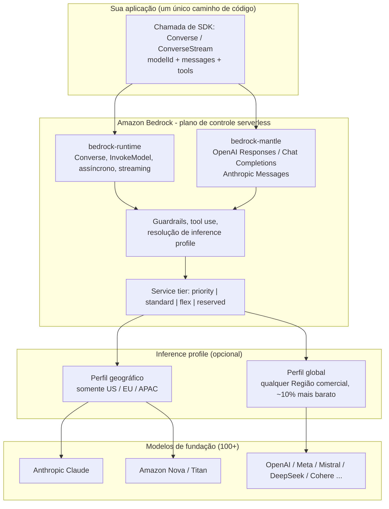
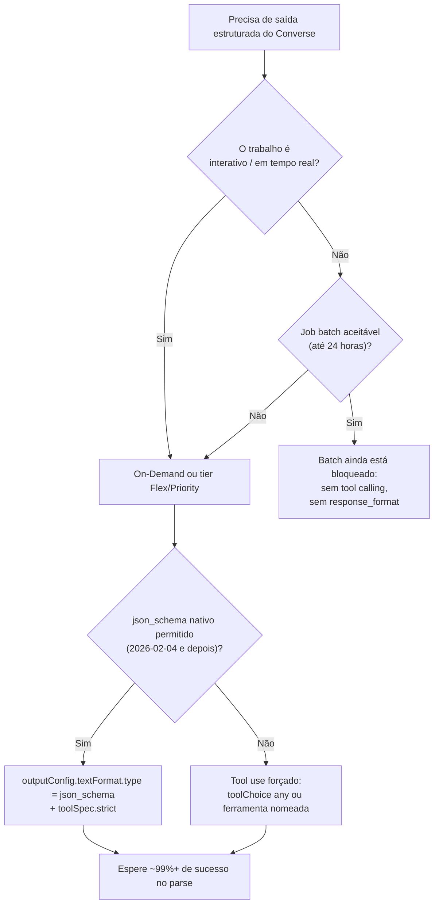
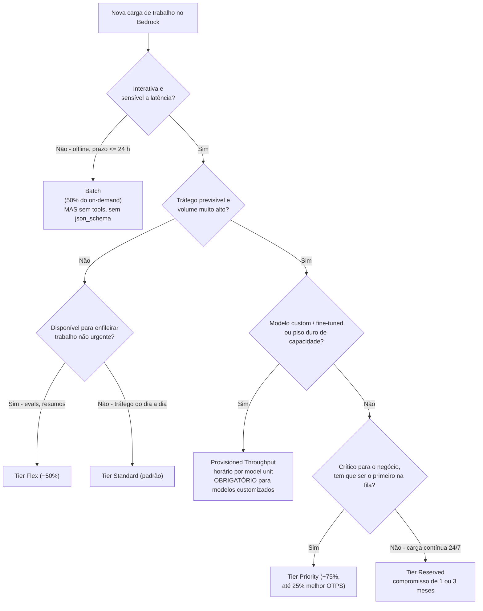
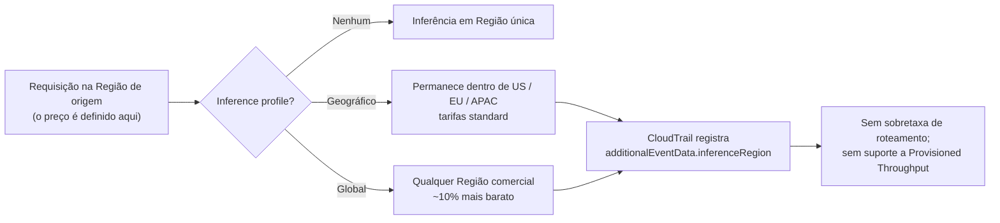
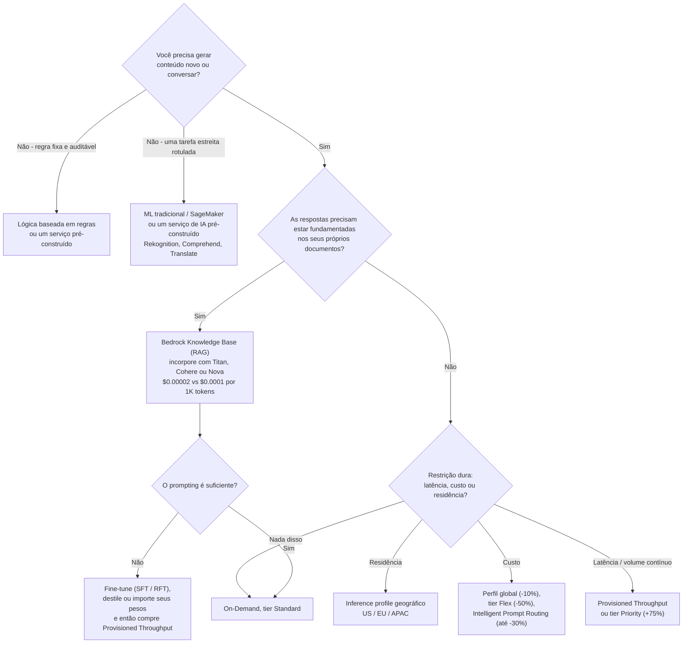
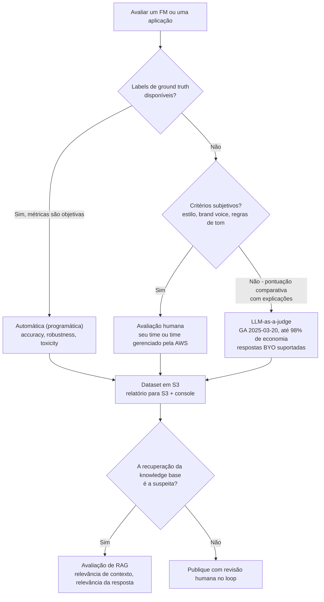

# Fundamentos do Amazon Bedrock: APIs, Acesso a Modelos, Preços, Tipos de Inferência e Avaliações

Amazon Bedrock é o serviço que o exame AIF-C01 nomeia mais do que qualquer outro, e também é o serviço que muda mais rápido. Essa combinação é perigosa: decorar uma lista de modelos ou um preço por token é uma estratégia de estudo com validade de semanas, enquanto decorar **mecanismos**, como on-demand, batch, provisioned throughput, service tiers e perfis de inferência cross-Region realmente se comportam, continua correta por anos. Esta lição foi construída em torno dessa divisão. Cada número abaixo está preso a uma fonte da AWS de primeira parte em **outubro de 2026**, e qualquer coisa que a AWS não confirma é sinalizada em vez de ensinada.

```text
 =====================================================================
  AMAZON BEDROCK EM UMA OLHADA               (Digest: out. 2026)
 =====================================================================
  MODELO DE SERVIÇO ..... totalmente gerenciado, serverless, API única
  CATÁLOGO DE MODELOS ... "100+" modelos de fundação, 19 provedores
                          de primeira parte (AI21, Amazon, Anthropic,
                          Cohere, DeepSeek, Google, Luma, Meta, MiniMax,
                          Mistral, Moonshot, NVIDIA, OpenAI, Qwen,
                          Stability, TwelveLabs, Writer, xAI, Z.AI)
  ENDPOINTS ............. bedrock-runtime  (Invoke / Converse)
                          bedrock-mantle   (OpenAI Responses + Chat
                          Completions, Anthropic Messages)
  EIXOS DE PREÇO ........ on-demand (por token) · batch (50% off,
                          <=24 h) · provisioned (por hora por model
                          unit) · service tiers (priority/standard/
                          flex/reserved) · perfis cross-Region
  CUSTOMIZATION ......... supervised fine-tuning · reinforcement
                          fine-tuning · distillation · model import
  AVALIAÇÃO ............. automática · humana · LLM-as-a-judge
 =====================================================================
```

> [!NOTE]
> **Como ler esta lição.** A AWS publica a lista de modelos, os preços e o suporte a recursos do Bedrock continuamente, então o exame recompensa respostas de *mecanismo* mais do que respostas de *disponibilidade*. Três regras de leitura valem ao longo de toda a lição: (1) **o número publicado pela própria AWS vence qualquer rastreador de terceiros**; (2) **percentuais de marketing são reproduzidos como alegações da AWS**, rotulados como tais, porque sua metodologia não é auditada de forma independente; e (3) **um fato que a AWS não confirma em primeira parte é exibido como não verificado**, nunca como material de decoreba.

Ao final desta lição você será capaz de:

- explicar o que "totalmente gerenciado, serverless, API única" significa operacionalmente e nomear os dois endpoints do Bedrock;
- enunciar as regras de acesso a modelos de 2026, incluindo o formulário Anthropic que a maioria dos candidatos esquece;
- escolher entre **on-demand, batch e provisioned throughput**, e entre os quatro **service tiers**, usando preço, latência, compromisso e suporte a recursos;
- escolher o **perfil de inferência** certo para custo versus residência de dados e prever o que o CloudTrail vai registrar;
- percorrer uma **árvore de decisão de seleção de modelo** e defender uma escolha com preços por token verificados;
- nomear os quatro caminhos de customization e dizer qual deles exige provisioned throughput;
- selecionar avaliação **automática, humana ou LLM-as-a-judge** para uma métrica dada;
- defender o **veredito comparativo** entre Bedrock, SageMaker auto-hospedado, um serviço de IA pré-construído e construir você mesmo.

---

## 1. O que o Amazon Bedrock é

### 1.1 A definição que a AWS usa

Amazon Bedrock é um **serviço totalmente gerenciado e serverless que te dá uma única API para invocar modelos de fundação de muitos provedores**. Três palavras carregam toda a proposta de valor:

- **Totalmente gerenciado**: a AWS roda a infraestrutura, o scaling e o hospedagem do modelo; você nunca vê uma instância, uma URL de endpoint ou uma GPU.
- **Serverless**: você paga por token (on-demand e batch) ou por hora (provisioned throughput); não existe conta de capacidade ociosa, a menos que você compre uma deliberadamente.
- **API única**: um formato de requisição, um SDK, um conjunto de ações de IAM; trocar de Anthropic Claude para Amazon Nova é uma mudança de `modelId`, não uma reescrita.

Essa última propriedade é a frase mais examinável desta lição. Uma questão que diz *"sem reescrever a lógica da aplicação"* está apontando para a API unificada, e cada outra opção nessa questão (roteamento cross-Region, provisioned throughput, model import) é um mecanismo completamente diferente.

### 1.2 O catálogo de provedores

A AWS lista **100+** modelos de fundação sem publicar uma contagem exata. A lista de provedores de primeira parte verificada em outubro de 2026 é:

| Grupo de provedor | Provedores no Bedrock |
|---|---|
| **Laboratórios dos EUA** | AI21 Labs, Anthropic, Cohere, Google, Meta, NVIDIA, OpenAI, Writer, xAI, Z.AI |
| **Amazon (primeira parte)** | Amazon (família Nova, família Titan, Nova Canvas / Reel / Multimodal Embeddings) |
| **Laboratórios europeus** | Mistral AI (França), Stability AI, Luma AI |
| **Laboratórios asiáticos** | DeepSeek, MiniMax, Moonshot AI, Qwen, TwelveLabs |
| **Seus próprios pesos** | Custom Model Import (arquiteturas Llama, Mistral, Mixtral, Qwen, GPT-OSS, GPTBigCode) |

> **📚 Você sabia?** **DeepSeek é oficialmente suportado**: DeepSeek V3.2, V3.1 e R1 aparecem todos na página *Models at a glance* da AWS, e o V3.2 roda tanto no `bedrock-runtime` quanto no endpoint compatível com OpenAI `bedrock-mantle`. Candidatos que pulam o catálogo atual costumam assumir que o DeepSeek só está disponível por meio de um marketplace ou de um stack auto-hospedado; no exame, "Amazon Bedrock não hospeda DeepSeek" é um distrator por construção.

### 1.3 Os dois endpoints

O Bedrock expõe dois endpoints de serviço, e o exame testa quais operações vivem em cada um:

| Endpoint | Operações | Propósito | Orientação da AWS |
|---|---|---|---|
| **`bedrock-runtime`** | `InvokeModel`, `InvokeModelWithResponseStream`, `Converse`, `ConverseStream`, `StartAsyncInvoke`, `InvokeModelWithBidirectionalStream` | Invocar modelos para inferência: payloads brutos do provedor e a API Converse agnóstica de provedor | **Recomendado para novas aplicações** |
| **`bedrock-mantle`** | **Responses** e **Chat Completions** compatíveis com OpenAI; **Messages** da Anthropic | Compatibilidade drop-in: código existente do SDK OpenAI ou Anthropic roda contra o Bedrock sem mudanças | Use para migração de código existente de SDK |

A distinção importa na prática: o `bedrock-mantle` existe para que uma aplicação escrita para o SDK OpenAI ou Anthropic possa apontar para o Bedrock com uma mudança de base URL e chave, enquanto o `bedrock-runtime` é a casa do Converse: a API que te dá ferramentas, Guardrails e paridade multi-provedor em um único formato de requisição.

### 1.4 Arquitetura: uma API, muitos modelos



### 1.5 O que a AWS promete sobre seus dados

Dois compromissos aparecem na visão geral da documentação do Bedrock e ambos têm formato de exame:

1. **Entradas e saídas não são compartilhadas com provedores de modelo de terceiros.**
2. **Entradas e saídas não são usadas para treinar os modelos de fundação base.** Fine-tuning, em contraste, treina uma **cópia privada do modelo que pertence à sua conta**: que é exatamente por que um modelo customizado é seu e por que ele é cobrado de forma diferente.

> **📚 Você sabia?** A garantia de "não usada para treinar modelos base" é precisamente por que o fine-tuning é descrito como a criação de um *modelo customizado privado*: seu JSONL rotulado vai para o S3, um job de treino produz um checkpoint que só a sua conta pode invocar, e o FM base que outros clientes usam permanece intacto. O fato companion que os candidatos perdem é que **invocar um modelo com supervised fine-tuning exige Provisioned Throughput**, on-demand não vai rodá-lo, enquanto **Custom Model Import** (traga seus próprios pesos) *pode* rodar on-demand.

### 1.6 Quatro coisas que o Bedrock não é

Confusões que produzem opções erradas mais vezes do que qualquer outro fato sobre o Bedrock:

| Confusão comum | O que o Bedrock realmente é |
|---|---|
| "Bedrock é um modelo como Claude ou Nova" | Bedrock é o **serviço gerenciado e a API**; Claude, Nova, Llama e o resto são os modelos que ele hospeda |
| "Bedrock implanta meu job de treino" | Treino e gerenciamento de endpoints são território do **SageMaker AI**; o Bedrock serve FMs pré-treinados (mais seus próprios jobs de customization) |
| "Bedrock é um serviço de IA pré-construído como Rekognition" | Serviços pré-construídos respondem **uma tarefa estreita**; Bedrock é uma **API de FM de propósito geral** que você dá prompt, fundamenta e customiza |
| "Usar Bedrock significa que meus prompts vão para o fornecedor do modelo" | Entradas e saídas **não são compartilhadas com provedores de terceiros** e **não são usadas para treinar FMs base** |

---

## 2. Acesso a modelos: o que realmente desbloqueia uma invocação

O acesso a modelo costumava ser um opt-in por clique para cada modelo. Em 2026 o fluxo é mais simples, com **uma exceção que ainda derruba candidatos**:

| Etapa | Requisito | Escopo |
|---|---|---|
| 1 | **O acesso a modelos está ativo por padrão** nas Regiões comerciais da AWS | Nenhuma ação necessária para a maioria dos modelos |
| 2 | Permissões de IAM para AWS Marketplace: `aws-marketplace:Subscribe`, `aws-marketplace:Unsubscribe`, `aws-marketplace:ViewSubscriptions` | Necessárias **somente na primeira vez** que você habilita um modelo vindo do Marketplace |
| 3 | Uma **forma de pagamento válida** na conta | Sempre |
| 4 | **Formulário Anthropic form-to-use (FTU)** | **Modelos Anthropic no `bedrock-runtime`**: não é necessário para Anthropic Messages no `bedrock-mantle` |

Depois da etapa 4, `InvokeModel`/`Converse` funcionam; antes dela, você recebe um erro de acesso que parece um problema de IAM e não é um.

> [!WARNING]
> **Não decore a lista de modelos, decore o mecanismo de acesso.** O catálogo do Bedrock, o suporte a recursos por modelo (streaming, ferramentas, fine-tuning, provisioned throughput) e os preços mudam semanalmente. No exame, uma opção construída sobre *"o modelo X não está disponível na Região Y"* é quase sempre um distrator velho. Os fatos duráveis são: **acesso padrão ativado**, **permissões de Marketplace no primeiro habilitamento**, o **formulário FTU da Anthropic** e **uma forma de pagamento válida**. Quando uma questão depende de se um modelo novo específico existe, procure uma opção que descreva um *mecanismo*, quase sempre essa é a resposta pretendida.

---

## 3. A superfície da API: Invoke, Converse e os endpoints de compatibilidade

### 3.1 Famílias de operações

| Família | Operações | Endpoint | Para que serve |
|---|---|---|---|
| **Invoke** | `InvokeModel`, `InvokeModelWithResponseStream` | `bedrock-runtime` | **Payloads brutos** do provedor em um disparo único ou com streaming: você monta o JSON do provedor você mesmo |
| **Converse** | `Converse`, `ConverseStream` | `bedrock-runtime` | Mensagens, ferramentas, Guardrails e parâmetros de inferência **agnósticos de provedor** |
| **Chat Completions** | compatível com OpenAI | `bedrock-mantle` | Uso drop-in do SDK OpenAI |
| **Responses** | compatível com OpenAI | `bedrock-mantle` | OpenAI Responses API (famílias GPT-OSS e GPT) |
| **Messages** | Anthropic Messages | `bedrock-mantle` | Código do SDK Anthropic roda contra o Bedrock sem mudanças |
| **Assíncrono** | `StartAsyncInvoke` (subconjunto de modelos) | `bedrock-runtime` | Jobs de longa duração com um destino de callback |
| **Bidirecional** | `InvokeModelWithBidirectionalStream` | `bedrock-runtime` | Sessões de áudio em tempo real: **não utilizável com chaves de API do Bedrock** |

### 3.2 Parâmetros de inferência do Converse: exatamente quatro

A `InferenceConfiguration` base da API Converse contém **quatro** parâmetros e mais nada:

| Parâmetro | Tipo / faixa | Significado |
|---|---|---|
| `maxTokens` | inteiro | Máximo de tokens a **gerar** |
| `temperature` | 0 to 1 | Aleatoriedade da amostragem: menor é mais determinístico |
| `topP` | 0 to 1 | Corte da amostragem por núcleo (nucleus) |
| `stopSequences` | até **2.500** strings | A geração para quando qualquer sequência é produzida |

Controles específicos do modelo (por exemplo `topK` ou o budget de `thinking` de um provedor) vão para **`additionalModelRequestFields`**, que é repassado ao modelo. Uma opção que alega que o Converse expõe cinco ou seis parâmetros base de primeira classe está testando se você conhece a fronteira entre a API portátil e o escape hatch específico do provedor.

### 3.3 Streaming

O streaming usa `InvokeModelWithResponseStream` (família Invoke) ou `ConverseStream` (família Converse), com a ação de IAM **`bedrock:InvokeModelWithResponseStream`**. Se um dado modelo pode fazer streaming é descobrível programaticamente: `GetFoundationModel` retorna **`responseStreamingSupported`**. Se uma questão pergunta "como você confirma o suporte a streaming antes de prometê-lo na interface?", essa flag é a resposta.

### 3.4 Tool use e escolha forçada de ferramenta

`toolChoice` tem exatamente três valores:

| Valor | Comportamento | Disponibilidade |
|---|---|---|
| `auto` | O modelo decide se chama uma ferramenta (padrão) | Todos os modelos que suportam ferramentas |
| `any` | Deve chamar **pelo menos uma** ferramenta; sem texto livre | Todos os modelos que suportam ferramentas |
| `tool` | Deve chamar **uma ferramenta específica nomeada** | Documentado **somente para Anthropic Claude 3+ e Amazon Nova** |

Essa terceira linha é um micro-fato clássico de exame: forçar uma ferramenta *nomeada* não é universal, e uma opção que generaliza isso para todo modelo do Bedrock está errada.

### 3.5 Saída estruturada

Duas rotas existem para JSON conforme a um schema:

1. **Tool use forçado** (`toolChoice: {any: {}}` ou `{tool: {name:...}}`): a rota de longa data, porque restringir o modelo ao JSON schema de uma ferramenta é estrutural em vez de consultivo.
2. **Saída estruturada nativa**: adicionada ao `Converse`/`ConverseStream` em **2026-02-04** via `outputConfig.textFormat.type = "json_schema"` junto com `toolSpec.strict`.

A lacuna de confiabilidade é grande e publicada pela AWS: um teste comunitário de **102 amostras** no AWS Builder Center encontrou *"retorne JSON válido"* apenas com prompt funcionando em cerca de **70 to 80%** das vezes contra **99%+** com tool use forçado. Transforme isso em um número operacional: 10.000 documentos de fatura com 70 to 80% de sucesso sem ferramenta significam cerca de **2.500 análises e tentativas de novo com falha**; a 99% significam cerca de **100**.

**Exemplo resolvido 1, escolhendo o mecanismo certo para 10.000 extrações estruturadas.** O trabalho precisa de JSON estrito, sem interatividade, e resultados até de manhã. Resposta: **Converse on-demand ou no tier Flex com `outputConfig.textFormat.type = "json_schema"`**, porque **a inferência batch não suporta saída estruturada nem tool calling**, e ela também não roda modelos provisionados. Duas armadilhas separadas, uma questão.



> **📚 Você sabia?** A instrução de JSON só com prompt falha por um motivo estrutural: o modelo está *amostrando*, não validando. Pedir educadamente no system prompt muda a probabilidade de chaves aparecerem; isso não cria uma restrição. Tool use forçado e a saída `json_schema` funcionam porque tornam a saída inválida **impossível por construção** em vez de improvável, e é exatamente por isso que a própria orientação de confiabilidade da AWS trata "só diga JSON no prompt" como uma resposta distratora em toda questão de saída estruturada.

### 3.6 Anatomia da requisição: onde cada controle vive

```text
POST /model/<modelId>/converse          <-- bedrock-runtime
  headers: Authorization (SigV4), X-Amz-Target
{
  "modelId": "anthropic.claude-...",      <-- troque isto para mudar de modelo
  "system":    [ {"text": "..."} ],       <-- prompt de sistema (no nível do Bedrock)
  "messages": [ {"role": "user", "content": [...]} ],
  "inferenceConfig": {                    <-- EXATAMENTE QUATRO parâmetros base
      "maxTokens": 1024,
      "temperature": 0.2,
      "topP": 0.9,
      "stopSequences": ["</answer>"]      <-- até 2.500 strings
  },
  "additionalModelRequestFields": {       <-- extras específicos do provedor
      "topK": 50, "thinking": {"type": "enabled"}
  },
  "toolConfig": {
      "tools": [{"toolSpec": {"name": "get_weather", ...}}],
      "toolChoice": {"auto": {}}
  },
  "guardrailIdentifier": "...",           <-- aplicado no Bedrock, não no modelo
  "promptVariables": {...}
}
Response 200  ->  output.message.content,  usage.inputTokens / outputTokens
Streaming      ->  ConverseStream (IAM: bedrock:InvokeModelWithResponseStream)
```

Duas leituras desse payload importam no exame: a **superfície portátil** (`system`, `messages`, `inferenceConfig`, `toolConfig`, `guardrailIdentifier`) é a mesma para todo provedor, e é isso que faz a troca de provedor ser uma mudança de uma linha; e **`additionalModelRequestFields` é o escape hatch deliberado** para qualquer coisa específica do provedor, e é por isso que a lista de parâmetros base continua em quatro, não importa quantos controles um dado modelo exponha.

---

## 4. Preços: quatro mecanismos e quatro service tiers

A precificação do Bedrock não é um modelo único: é **um par ortogonal de escolhas**: *como você compra capacidade* (on-demand / batch / provisioned) e *qual service tier você aceita* (priority / standard / flex / reserved).

### 4.1 Os três mecanismos de capacidade

| Dimensão | **On-Demand** | **Batch** | **Provisioned Throughput** |
|---|---|---|---|
| Unidade de preço | por 1M de tokens de entrada / 1M de saída | **50% do on-demand** por token | **por hora por model unit (MU)** |
| Compromisso | nenhum | nenhum | **termo de 1 ou 6 meses** (algumas opções horárias sem compromisso) |
| Latência | tempo real | **assíncrono, tipicamente ≤ 24 h, sem SLA** | em tempo real e previsível |
| Melhor para | picos imprevisíveis, protótipos | trabalho offline em massa: conjuntos de avaliação, sumarização de arquivo, classificação em massa | produção contínua de alto volume; **obrigatório para modelos customizados** |
| Tool calling | sim | **não** | sim |
| Saída estruturada | sim | **não** | sim |
| Roda modelos provisionados | n/a | **não** | n/a |
| Cobrança | pelos tokens de cada requisição | pelos tokens de cada job | **por hora mesmo ocioso** |
| Capacidade | compartilhada entre tiers | cota de batch separada | model units dedicados (cota via AWS Support) |

### 4.2 Os quatro service tiers (o segundo eixo)

`serviceTier` é definido por requisição e se aplica a tráfego **on-demand**:

| Tier | Valor `serviceTier` | Regra de preço | Quando a AWS diz para usá-lo |
|---|---|---|---|
| **Priority** | `priority` | Preço standard **+75%**, para **25% mais throughput de tokens de saída** no máximo | Tráfego em tempo real, orientado ao cliente, crítico para o negócio |
| **Standard** | `default` (ou omitido) | Tarifa standard | Trabalho do dia a dia, o padrão |
| **Flex** | `flex` | **−50%**, enfileirado atrás do Standard sob carga | Avaliações, sumarização, etapas de segundo plano e agentic |
| **Reserved** | `reserved` | Preço comprometido, termo de **1 ou 3 meses**, o transbordo vaza para o Standard | Carga previsível 24/7 que precisa de capacidade garantida |

As condições de entrada do tier Reserved publicadas pela AWS (fonte secundária: AWS Builder Center) são **≥ 100K tokens de entrada por minuto e ≥ 10K tokens de saída por minuto**, um compromisso de **1 ou 3 meses**, **99,5%** de uptime com transbordo para o Standard.

### 4.3 Exemplo resolvido 2: aritmética pura de on-demand

O próprio exemplo da AWS: **Amazon Titan Text Lite** a **$0.0003 por 1K tokens de entrada** e **$0.0004 por 1K tokens de saída**.

$$
\frac{2{,}000}{1{,}000}\times \$0.0003 + \frac{1{,}000}{1{,}000}\times \$0.0004 = \$0.001 \text{ per call}
$$

A **1.000 chamadas por hora** isso dá **$1.00 por hora**. O segundo exemplo da AWS, **AI21 Jurassic-2 Mid** a $0.0125 por 1K tokens nos dois sentidos, para **10.000 de entrada / 2.000 de saída**:

$$
\frac{10{,}000}{1{,}000}\times \$0.0125 + \frac{2{,}000}{1{,}000}\times \$0.0125 = \$0.15 \text{ per request}
$$

### 4.4 Exemplo resolvido 3: batch economiza exatamente 50%

**Claude 3.5 Sonnet** (Public Extended Access): **$6.00 entrada / $30.00 saída** por 1M de tokens on-demand, **$3.00 / $15.00** no batch. Um job de **10M de entrada + 2M de saída**:

| Modo | Cálculo | Total |
|---|---|---:|
| On-demand | $10 \times 6.00 + 2 \times 30.00$ | **$120.00** |
| Batch | $10 \times 3.00 + 2 \times 15.00$ | **$60.00** |
| **Economia** | | **$60.00 (50%)** |

A entrega é tipicamente **dentro de 24 horas**, e o job **não pode usar tool calling nem saída estruturada**.

### 4.5 Exemplo resolvido 4: provisioned throughput queima quer você use quer não

A aritmética documentada da AWS para um model unit a **$16.20/hora**:

$$
1 \times \$16.20 \times 24 \text{ h} \times 31 \text{ d} = \$12{,}052.80 \text{ per month}
$$

Taxas horárias publicadas para **Cohere Command** por model unit: **$49.50** (sem compromisso), **$39.60** (1 mês, −20%), **$23.77** (6 meses, **−52%**). **Llama 2** 13B/70B provisionado: **$21.18** (1 mês) e **$13.08** (6 meses). A regra de decisão: provisioned só vence quando o custo das horas ociosas é menor do que a economia de capacidade e por token que você realmente captura: para Claude, Nova e a maioria dos modelos modernos a AWS não publica taxas horárias de modo algum e pede que você contate o time da conta.

### 4.6 Exemplo resolvido 5: aritmética dos service tiers

**DeepSeek V3.1** em `ap-southeast-2` é precificado a **$0.5974 de entrada / $1.7304 de saída** por 1M de tokens no tier Standard. Aplicando os modificadores documentados:

| Tier | Entrada por 1M | Saída por 1M | 1M entrada + 1M saída |
|---|---:|---:|---:|
| Standard | $0.5974 | $1.7304 | **$2.33** |
| Priority (+75%) | $1.0455 | $3.0282 | **$4.07** |
| Flex (−50%) | $0.2987 | $0.8652 | **$1.16** |

Envie **10% do tráfego para o Priority, 60% para o Flex e 30% para o Standard** e a mistura é $0.10 \times 4.07 + 0.60 \times 1.16 + 0.30 \times 2.33 \approx \$1.80$: cerca de **23% abaixo** do preço todo-Standard de $2.33. Disciplina de tiers, não escolha de modelo, é geralmente a otimização mais barata disponível.

### 4.7 Preços de tokens verificados (USD por 1M, Standard / on-demand)

| Provedor | Modelo | Entrada | Saída | Observação |
|---|---|---:|---:|---|
| Anthropic | Claude 3.5 Sonnet | $6.00 | $30.00 | batch $3 / $15; cache write $7.50; cache read $0.60 |
| DeepSeek | DeepSeek V3.2 | $0.62 | $1.85 | Regiões dos EUA; $0.74 / $2.22 em Mumbai, São Paulo, Jacarta, Tóquio, Estocolmo |
| MiniMax | M2 / M2.1 / M2.5 | $0.30 | $1.20 | Regiões dos EUA |
| Mistral AI | Mistral Large 3 | $0.50 | $1.50 | Regiões dos EUA |
| Google | Gemma 4 31B / E2B | $0.14 / $0.04 | $0.40 / $0.08 | Regiões dos EUA |
| Moonshot AI | Kimi K2.5 | $0.60 | $3.00 | Regiões dos EUA |
| NVIDIA | Nemotron 3 Super 120B | $0.18 | $0.78 | Regiões dos EUA |
| AI21 Labs | Jamba 1.5 Large / Mini | $2.00 / $0.20 | $8.00 / $0.40 | Regiões dos EUA |
| Cohere | Rerank 3.5 | **$2.00 por 1.000 queries** |: | 1 query cobre ≤ 100 chunks de documento |

Preços fixos e horários que valem a pena saber: **armazenamento de modelo customizado $1.95/mês**, **Titan Text Embeddings V2 $0.00002 por 1K tokens**, **Cohere Embeddings $0.0001 por 1K tokens** (uma lacuna de **5×** no mesmo trabalho).



### 4.8 Dois alavancas de economia a mais: roteamento e caching

O **Intelligent Prompt Routing** opera *dentro* de uma família de modelos, Claude Sonnet ↔ Claude Haiku, Nova Pro ↔ Nova Lite, e a página de preços da AWS alega que ele pode cortar o custo em **até 30%**. A aritmética por trás da alegação é simples: envie prompts fáceis para o irmão barato e mantenha prompts difíceis no modelo forte.

**Exemplo resolvido 10: aritmética de roteamento.** Use uma âncora **verificada**: Claude 3.5 Sonnet a **$6.00 / $30.00** por 1M de tokens. A taxa por token do irmão **não é publicada nas fontes verificadas para esta lição**, então assuma um modelo classe Haiku a **$1.00 / $5.00** (ilustrativo) e uma mistura diária de **10M entrada / 2M saída**:

| Estratégia | Cálculo | Custo diário |
|---|---|---:|
| Todo o tráfego no modelo forte | $10 \times 6.00 + 2 \times 30.00$ | **$120.00** |
| 50% do volume roteado para o irmão barato | $0.5 \times (10 \times 1.00 + 2 \times 5.00) + 0.5 \times 120.00$ | **$70.00** |
| **Economia nesta mistura** | | **$50.00 (42%)** |

Duas leituras se seguem. Primeiro, a alegação publicada da AWS é **"até 30%"**, que é o número conservador no tráfego real: nunca cite o 42% ilustrativo como um número da AWS. Segundo, o roteamento é uma alavanca de *mistura de tráfego* em vez de um desconto por requisição, e é exatamente isso que o separa do batch (**−50%** em cada token), do tier Flex (**−50%** em cada token) e de um perfil global (**−10%** em cada token).

O **prompt caching (Amazon Nova)** é a outra alavanca, e seus limites são precisos: um **mínimo de 1.000 tokens** por checkpoint, **no máximo 4 checkpoints** por requisição, um time to live de **5 minutos** e um teto de cache de **20.000 tokens**. Tokens de entrada em cache são cobrados pela taxa de cache read: para o Claude 3.5 Sonnet isso é **$0.60 por 1M** contra **$6.00** sem cache (uma **redução de 10×**), enquanto um cache *write* custa **$7.50 por 1M** (um **prêmio de 25%**). Caching, portanto, só paga quando um checkpoint é lido repetidamente dentro do seu TTL.

Relacione cada mecanismo de preços à sua regra documentada:

```matching
{
  "question": "Relacione cada mecanismo de preços do Amazon Bedrock ao seu comportamento documentado:",
  "pairs": [
    {"left": "Inferência batch", "right": "50% do on-demand, assíncrono, tipicamente concluído em até 24 horas"},
    {"left": "Service tier Flex", "right": "50% abaixo do Standard, enfileirado atrás do Standard quando a demanda está alta"},
    {"left": "Service tier Priority", "right": "Preço standard mais 75%, para até 25% melhor throughput de tokens de saída"},
    {"left": "Perfil cross-Region global", "right": "Cerca de 10% mais barato, pode processar em qualquer Região comercial"},
    {"left": "Provisioned Throughput", "right": "Horário por model unit em um termo de 1 ou 6 meses, cobrado mesmo quando ocioso"},
    {"left": "Intelligent Prompt Routing", "right": "Até 30% de economia roteando dentro de uma única família de modelos"}
  ],
  "explanation": "Cada alavanca tem seu próprio número e seu próprio mecanismo: batch é um tipo de job a meia preço com uma janela de 24 horas, Flex e Priority são service tiers on-demand a −50% e +75%, o perfil global é uma opção de roteamento que vale cerca de −10%, provisioned throughput é uma reserva de capacidade cobrada por hora por model unit, e o roteamento de prompts economiza até 30% enviando prompts fáceis para um modelo irmão mais barato dentro da mesma família."
}
```

---

## 5. Inferência cross-Region: perfis, preço e residência

### 5.1 Perfis geográficos versus globais

A inferência cross-Region é expressa através de **inference profiles**, e existem dois tipos:

| Propriedade | **Perfil geográfico** | **Perfil global** |
|---|---|---|
| Escopo do roteamento | Dentro de uma única geografia: **somente US, EU ou APAC** | **Qualquer Região comercial da AWS** |
| Preço | Tarifas standard | **~10% mais barato** (entrada e saída) |
| Residência de dados | Os dados permanecem dentro da geografia | Pode ser processado em uma Região que você não habilitou manualmente |
| Sobretaxa | **Nenhuma**, o preço sempre vem da Região de **origem** | **Nenhuma**, a mesma regra |
| IAM | IAM regional padrão | Precisa de IAM com `aws:RequestedRegion: "unspecified"` |
| Uso típico no exame | Questões de **conformidade / residência** | Questões de **custo** |

### 5.2 O que o CloudTrail mostra

Requisições cross-Region podem ser roteadas para Regiões que **não estão habilitadas manualmente na sua conta**; os dados permanecem na rede da AWS e são criptografados em trânsito. O AWS CloudTrail registra onde o trabalho realmente aconteceu em **`additionalEventData.inferenceRegion`**, e é exatamente por isso que uma entrada do CloudTrail pode mostrar uma Região diferente da Região de origem da requisição sem implicar erro de faturamento. **A precificação sempre usa a Região de origem**, então não existe sobretaxa de roteamento.

### 5.3 Dois limites que os candidatos perdem

1. **Inference profiles não suportam Provisioned Throughput.** Capacidade reservada por model unit e roteamento cross-Region são mecanismos separados; você não pode combiná-los.
2. **Application profiles existem para tagging de alocação de custo**: um conceito separado dos perfis de roteamento, usado para atribuir gasto em vez de posicionar computação.

**Exemplo resolvido 6: economia cross-Region.** Um perfil geográfico como `us.amazon.nova-lite-v1:0` mantém o processamento dentro dos Estados Unidos às tarifas standard. Um perfil **global** é cerca de **10% mais barato**, mas pode executar em qualquer Região comercial. Para uma carga de trabalho financeira na UE, a escolha é decidida pela residência, não pelo preço: escolha o perfil **geográfico (EU)** e aceite a tarifa mais alta.



> **📚 Você sabia?** O **desconto de ~10% do perfil global** e a regra do **"preço vem da Região de origem"** apontam para direções opostas e ambas são verdadeiras: sua fatura é calculada com a lista de preços da sua Região de origem, mas as taxas do pool global são publicadas cerca de 10% mais baixas, então rotear globalmente economiza dinheiro sem uma linha de sobretaxa. Enquanto isso, o **Intelligent Prompt Routing**, um recurso completamente diferente, pode cortar o custo em **até 30%** roteando dentro de uma família de modelos (Claude Sonnet ↔ Claude Haiku, Nova Pro ↔ Nova Lite). Três alavancas de economia separadas, três mecanismos diferentes: batch (−50%), tier Flex (−50%), perfil global (−10%), roteamento de prompts (até −30%).

---

## 6. Escolhendo um modelo: a árvore de decisão que a AWS realmente ensina

### 6.1 A árvore de decisão



### 6.2 Matriz verificada provedor × modelo

| Provedor | Modelos verificados no Bedrock | runtime | mantle | Customization |
|---|---|---|---|---|
| **Amazon** | Nova 2 Lite / 2 Sonic / Pro / Lite / Micro / Premier, Nova Canvas, Nova Reel, Nova Multimodal Embeddings; Titan Text / Image / Embeddings | Sim | parcial | **SFT + RFT (Nova 2 Lite)**; Titan image/embedding |
| **Anthropic** | Claude Sonnet 5.5, Opus 5.5, Fable 5.1/5, Mythos 5.1/5, Opus 5, Sonnet 5; Claude 3.5 Haiku, Claude 3 Haiku | Sim | Sim (Messages) | não documentado |
| **OpenAI** | família GPT-6, GPT-6.1 Sol, família GPT-5.x, **gpt-oss 20B/120B**, GPT-OSS Safeguard | Sim | Sim (Responses/Chat) | **RFT em `openai.gpt-oss-20b`** |
| **Meta** | Llama 4, 3.3, 3.2, 3.1, 3, 2 | Sim |: | **SFT: 3.1 8B/70B, 3.2 1B/3B/11B-V/90B-V, 3.3 70B-V** |
| **Mistral AI** | Mistral Large 3, Mistral Small, Ministral 3B/8B/14B, Magistral Small, Devstral 2, Pixtral Large, Voxtral, Mixtral 8x7B, Mistral 7B | Sim | Sim (Chat) | importa arquiteturas Mistral/Mixtral |
| **Cohere** | Command R, Command R+, Embed English/Multilingual/v4, **Rerank 3.5** | Sim |: | **SFT: Command, Command Light** |
| **AI21 Labs** | Jamba 1.5 Large, Jamba 1.5 Mini | Sim |: | Jamba 1.5 Mini listado |
| **DeepSeek** | **V3.2, V3.1, R1** | Sim | somente V3.2 / V3.1 |: |
| **Google** | Gemma 4 (31B, 26B-A4B, E2B), Gemma 3 (12B, 27B, 4B) | Gemma 3 | **Gemma 4 é exclusivo do mantle** |: |
| **Qwen** | Qwen3 235B A22B, Qwen3 32B, Qwen3 Next 80B, Qwen3 Coder, Qwen3 VL | Sim | Sim | **RFT em `qwen.qwen3-32b`** |
| **Moonshot / MiniMax / NVIDIA / xAI** | Kimi K3/K2.5, família M2, Nemotron 3 / Nano 3, Grok 4.7/4.6/4.3 | Sim | alguns |: |
| **Seu modelo** | **Custom Model Import**: Llama 2/3/3.1/3.2/3.3, Mistral, Mixtral, Qwen2/2.5/3, GPT-OSS, GPTBigCode | Sim |: | pesos < 200 GB texto / < 100 GB multimodal, contexto < 128K |

### 6.3 Exemplo resolvido 7: mesmo trabalho, custo de embedding 5×

Um blog da AWS calculou uma ingestão RAG de um documento de **5M de tokens** mais **0,5M de tokens de query** = **5,5M de tokens**:

| Modelo de embedding | Taxa por 1K tokens | Custo para 5,5M de tokens |
|---|---:|---:|
| Amazon Titan Text Embeddings V2 | $0.00002 | **$0.11** |
| Cohere Embeddings | $0.0001 | **$0.55** |

Mesmo corpus, mesmo trabalho, **diferença de 5×**, e é por isso que a escolha do modelo de embedding, não apenas a escolha do LLM, pertence a uma questão de custo.

### Atualizações de 2026 (em outubro de 2026)

As seções 6.1 to 6.3 ensinam um *processo* de decisão que sobrevive ao carrossel do catálogo; este subseção registra o que realmente virou entre o fim de 2025 e outubro de 2026, para que uma lista de modelos velha nunca se torne uma resposta errada. Cada linha abaixo foi verificada contra um post AWS What's New, uma página de documentação da AWS, a página de preços do Bedrock ou um blog da AWS: nada aqui vem de um rastreador de terceiros.

**Mudanças de catálogo (verificadas):**

| Mudança | Data verificada | O que a AWS publicou | Fonte |
|---|---|---|---|
| **Família Amazon Nova 2** | re:Invent 2025, **1 to 4 dez 2025** | **Nova 2 Lite** (contexto de 1M, code interpreter, web grounding, MCP remoto), **Nova 2 Sonic** speech-to-speech **GA 2 dez 2025** (`amazon.nova-2-sonic-v1:0`, 7 idiomas), **Nova 2 Omni** **preview 2 dez 2025** (texto/imagem/vídeo/fala como entrada → texto e imagem como saída, mais de 200 idiomas de texto), **Nova 2 Pro** *early access* (GA não confirmado), **Nova Forge** para treino customizado; os modelos Nova de 1ª geração permanecem listados | AWS What's New e AWS Blog |
| **Claude Sonnet 4.6** | **17 fev 2026** | Janela de contexto de **1M**, saída máxima de **64K**, corte de treino ago 2025 | Bedrock model card `model-card-anthropic-claude-sonnet-4-6` |
| **Seis modelos de pesos abertos no Project Mantle** | **1 fev 2026** | DeepSeek V3.2, MiniMax M2.1, GLM 4.7 / 4.7 Flash, Kimi K2.5 e Qwen3 Coder Next servidos pelo endpoint Mantle compatível com OpenAI, ao lado dos **18** modelos de pesos abertos adicionados no re:Invent 2025 | AWS What's New |
| **OpenAI GPT-6 Astra** | **GA 8 set 2026** | Contexto de **1M**, computer use e browser use | AWS What's New |
| **GLM 5.3 (Z.AI)** | **GA 5 out 2026** | **753B** de parâmetros totais / **40B** ativos, contexto de **1M**, saída de **128K** | AWS What's New |
| **Política de ciclo de vida do Bedrock** | vigente a partir de **7 set 2026** | **Active → Legacy → EOL**; a maioria dos modelos ganha uma janela **Legacy de 6 meses** (existe uma variante de **45 dias**); **Legacy bloqueia novos clientes e novo Provisioned Throughput**, enquanto o uso existente continua | Guia do usuário do Bedrock `model-lifecycle` |

**Mudanças de capacidade (verificadas):**

| Capacidade | Data verificada | O que ela acrescenta |
|---|---|---|
| **Guardrails: seis políticas + `ApplyGuardrail`** | Automated Reasoning checks em preview **3 dez 2024**; `ApplyGuardrail` e safeguards cross-account desde então | moderação de conteúdo, detecção de prompt attack, tópicos negados, filtros de PII/informações sensíveis, contextual grounding e **Automated Reasoning checks**: mais uma API que aplica safeguards a *qualquer* modelo **sem invocar um FM**, e um guardrail aplicado em toda uma AWS Organization. A AWS alega **até 88%** de conteúdo prejudicial bloqueado e **99%** de acurácia dos Automated Reasoning checks |
| **Bedrock AgentCore** | preview **16 jul 2025** → GA **13 out 2025** → **Policy GA 3 mar 2026** → **Evaluations GA 31 mar 2026** | runtime, gateway, memória e ferramentas para agentes; Policy (Cedar ou linguagem natural) intercepta chamadas de ferramenta do Gateway *fora* do loop de raciocínio; Evaluations traz **13** avaliadores |
| **Crescimento das Knowledge Bases** | 2025 to 2026 | reranking, conectores customizados, ingestão direta, **avaliação de RAG com LLM-as-a-judge**, inference profiles dentro do `RetrieveAndGenerate`, **S3 Vectors** e **Bedrock Managed Knowledge Base** (Smart Parsing + Agentic Retrieval API) documentados como o caminho depois que a **Amazon Kendra** fechou para novos clientes em **30 jul 2026** |
| **Alavancas de preço** | 2025 to 2026 | **Intelligent Prompt Routing cobrado a $1 por 1.000 requisições** (até **30%** mais barato); prompt cache **reads −90%** (Claude/GPT) ou **−75%** (Nova) com **writes a 1,25×** no TTL de 5 minutos (2× no TTL de 1 hora), e **caching nunca é combinado com batch** |
| **Guia de exame v1.1** | **30 abr 2026** | novos objetivos: precificação baseada em tokens (**2.1.4**), engenharia de contexto (**2.1.5**), IA agentic com **MCP** (**2.1.6**), versionamento de prompt via **Bedrock Prompt Management** (**3.2.5**), distillação (**3.1.5**), **LLM-as-a-judge** (**3.4.2**) e grounding de alucinação (**5.1.5**); a AWS diz que mudanças no guia chegam ao exame cerca de um mês após a publicação |

**O que *não* mudou:** cada mecanismo desta lição se comporta como escrito: a única API Converse e seus **quatro** parâmetros base, batch a **50%** sem tool calling e sem saída estruturada, provisioned throughput cobrado **por hora por model unit**, a escada de tiers **+75% / default / −50% / 1 ou 3 meses**, perfis geográficos para residência contra perfis globais a **~10%**, e os três modos de avaliação sobre um dataset em **S3**. O catálogo é a parte que se move; a mecânica é a parte sobre a qual você é avaliado.

> **📚 Você sabia?** A política de ciclo de vida transforma o conselho desta lição de "não decore a lista de modelos" em uma regra de *faturamento*: porque um modelo **Legacy** recusa pedidos **novos** de Provisioned Throughput, uma equipe que prende a capacidade a um modelo no dia antes dele sair do Active pode ficar exatamente travada da seção de compromisso que a seção 4.5 diz que cargas de trabalho fine-tuned e de estado estável precisam: enquanto seus model units existentes continuam rodando. É por isso que uma opção de exame que nomeia um modelo específico como "disponível" ou "indisponível" é quase sempre um distrator, e por isso que as respostas duráveis são mecanismos: acesso padrão ativado, permissões de Marketplace no primeiro habilitamento, o formulário FTU da Anthropic, uma forma de pagamento válida.

---

## 7. Customization: quatro caminhos e a regra do provisioned throughput

| Caminho | O que faz | Entrada | Números-chave |
|---|---|---|---|
| **Supervised fine-tuning (SFT)** | Treina uma cópia privada em exemplos rotulados | JSONL rotulado em **S3** | Modelo customizado privado; **exige Provisioned Throughput para invocar** |
| **Reinforcement fine-tuning (RFT)** | Aprende com sinais de recompensa rumo a um comportamento-alvo | Dados de preferência / recompensa | Lançado em **dez 2025** no **Nova 2 Lite** com **ganho médio de acurácia de ~66%**; em **2026-02-17** adicionou **`qwen.qwen3-32b`** e **`openai.gpt-oss-20b`** com APIs compatíveis com OpenAI |
| **Distillation** | Um modelo professor produz dados de treino para um aluno menor | Saídas do professor | A AWS alega treino **500% mais rápido / 75% mais barato** versus treino completo (alegação da AWS) |
| **Custom Model Import** | Serve **seus próprios pesos** serverlessmente | Artefatos do modelo (< 200 GB texto / < 100 GB multimodal, contexto < 128K) | Pode rodar **on-demand**; armazenamento **$1.95/mês** |

**Exemplo resolvido 8: custo do fine-tuning, o próprio exemplo de imagem da AWS.** Amazon Titan Image Generator a **$0.005 por imagem**, **500 steps**, **batch size 64**:

$$
\$0.005 \times 500 \times 64 = \$160.00
$$

mais **$1.95/mês** de armazenamento de modelo customizado e **1 hora** de inferência customizada a **$21.00** dá **$182.95 no primeiro mês**.

> [!WARNING]
> **"Modelo fine-tuned + on-demand" é sempre a combinação errada.** Um modelo com supervised fine-tuning deve ser servido com **Provisioned Throughput**, que cobra **por hora por model unit mesmo ocioso**. A exceção é o **Custom Model Import**, que pode rodar on-demand. Questões que oferecem "faça fine-tune do modelo e continue pagando por token on-demand" estão testando exatamente essa fronteira: e questões que oferecem fine-tuning como o *primeiro* passo para uma tarefa de Q&A fundamentada em documentos estão testando o espectro de customization da Lição 8: **prompting e RAG vêm primeiro**, porque a maioria das cargas de trabalho nunca precisa de um modelo customizado.

### 7.1 Prompt caching (Amazon Nova)

| Configuração | Valor |
|---|---|
| Segmento mínimo cacheável | **1.000 tokens** por checkpoint |
| Máximo de checkpoints por requisição | **4** |
| Time to live | **5 minutos** |
| Teto de tamanho do cache | **20.000 tokens** |

---

## 8. Avaliações: três modos, uma localização de dataset

### 8.1 Os três modos

| Método | Modo do job | Métricas integradas | Quem pontua | Entrada → saída |
|---|---|---|---|---|
| **Automática (programática)** | `automated` + `taskType` | **accuracy, robustness, toxicity** | Rubricas gerenciadas pela AWS | Dataset em **S3** → relatório em S3 + console |
| **Humana** | job human-based | Custom: relevância, estilo, brand voice | **Seus funcionários** *ou* um **time gerenciado pela AWS** | Prompts + referências em S3 → relatório em S3 + portal da equipe de trabalho |
| **LLM-as-a-judge** | `automated` + `evaluatorModelConfig` | Corretude, completude, prejudicialidade, recusa, tom + custom | Um **modelo juiz** | Seus prompts **ou** respostas trazidas por você → pontuações, explicações, histograma |
| **Avaliação de RAG** | Job separado de knowledge base (incl. modo retrieve-only) | Relevância de contexto, corretude, relevância da resposta | Modelo juiz | KB + dataset → relatório em S3 |

**Tipos de tarefa automáticos:** Geração geral, Sumarização, Q&A, Classificação de texto.
**Modelos juiz disponíveis:** Nova Pro / 2 Lite / Micro / Premier, Claude 3.5 Sonnet v1/v2, Claude Opus 4.7/4.8, Claude Sonnet 4.0/4.5, Llama 3.1 70B, Mistral Large.

LLM-as-a-judge chegou ao **GA em 2025-03-20** e a AWS alega **economia de custo de até 98%** com turnaround **em horas em vez de semanas**. Ele também oferece **bring-your-own-inference-response**, então você pode pontuar saídas de modelos que nem estão hospedados no Bedrock.

### 8.2 Exemplo resolvido 9: qual avaliação, qual métrica

| Requisito | Modo correto | Por que os outros falham |
|---|---|---|
| Corretude e toxicidade contra ground truth, sem rotulagem manual | **Automática (programática)** | Modelos juiz são subjetivos; o humano custa tempo; roteamento é irrelevante |
| Alinhamento de brand voice e estilo | **Humana** (seus revisores ou time gerenciado pela AWS) | Métricas automáticas não têm rubrica de brand voice; um juiz precisaria de uma métrica custom que você ainda não confia |
| Pontuação de primeira passada barata de 5.000 respostas, com explicações | **LLM-as-a-judge** | Humano é lento demais; métricas automáticas não explicam *por quê* |
| Qualidade de recuperação de uma knowledge base | **Avaliação de RAG** (modo retrieve-only isola a recuperação) | Avaliações de geração pura confundem recuperação e geração |



> **📚 Você sabia?** O recurso **bring-your-own-inference-response** do LLM-as-a-judge silenciosamente torna o Bedrock Evaluations utilizável como uma camada de qualidade *plataforma-fria*: você submete respostas produzidas por qualquer modelo, inclusive rodando fora da AWS, e um juiz do Bedrock as pontua com uma explicação e um histograma de pontuação gravado em S3. É por isso que "a avaliação deve rodar no mesmo provedor que o modelo em teste" é um distrator: a AWS construiu explicitamente o oposto.

---

## 9. Veredito comparativo

> [!IMPORTANT]
> **Veredito Comparativo: Amazon Bedrock vs. SageMaker auto-hospedado vs. um serviço de IA pré-construído vs. DIY**
> - **Amazon Bedrock** é a resposta quando você quer **modelos de fundação pré-treinados através de uma única API serverless** com **gerenciamento mínimo de infraestrutura**. Você recebe 100+ FMs de 19 provedores, preços on-demand/batch/provisioned, perfis cross-Region, service tiers, Knowledge Bases, Agents, Guardrails, Prompt Flows e Evaluations: e você nunca gerencia uma GPU, um endpoint ou uma política de scaling. Seus limites: você não pode ver ou controlar a computação subjacente, modelos provisionados exigem um compromisso, e alguns FMs (**Claude, Jurassic e outros modelos exclusivos do Bedrock**) são exclusivos dele.
> - **SageMaker AI auto-hospedado (incluindo JumpStart)** é a resposta quando você precisa de **controle total sobre treino, implantação e infraestrutura**: computação granular, loops de treino custom, qualquer framework, políticas de scaling de endpoint e monitoramento. Ele é **primariamente serverful**: você implanta em um endpoint e paga por instance-hour (à parte o Serverless Inference). Seus limites: você precisa de habilidades de ML/infra que funcionem, você é dono da disponibilidade do endpoint, e a economia por token é mais difícil de raciocinar.
> - **Um serviço de IA pré-construído** (Rekognition, Comprehend, Translate, Transcribe, Textract, Polly, Kendra) é a resposta quando a tarefa é **estreita, bem definida e não-generativa**: detectar objetos em imagens, detectar entidades em texto, traduzir, transcrever. O mais barato e rápido até a produção, totalmente determinístico para uma dada entrada, mas não pode receber prompt, ser fine-tuned em um modelo conversacional nem ser composto em um agente multi-etapa.
> - **DIY (modelos open-source auto-hospedados na sua própria computação)** é a resposta apenas quando **nenhuma opção hospedada é aceitável**: controle total do preço em volume contínuo muito alto, ou dados/pesos que não podem sair do seu perímetro. Isso custa tudo o que o Bedrock remove: patching, scaling, quantização, frameworks de serving, segurança, upgrades de modelo e as pessoas que fazem tudo isso.
> - **Regra prática para o exame:** *precisa de um modelo de fundação com a menor infraestrutura* → **Bedrock**. *Precisa treinar e ser dono do modelo e do endpoint* → **SageMaker AI**. *Precisa de uma tarefa estreita não-generativa* → **serviço de IA pré-construído**. *Precisa de modelos sem nenhum provedor gerenciado* → **DIY**. O guia de decisão da AWS diz isso claramente: *"Escolha o Bedrock se você precisa principalmente de FMs pré-treinados para inferência e quer o FM que melhor se ajusta ao seu caso de uso"* e *"Use o SageMaker quando você precisa de controle total sobre treino, implantação e infraestrutura."*

| Dimensão | **Amazon Bedrock** | **SageMaker AI auto-hospedado (JumpStart)** | **Serviço de IA pré-construído** | **DIY na sua própria computação** |
|---|---|---|---|---|
| Modelo de serviço | **Serverless**, somente API, totalmente gerenciado | Endpoints **primariamente serverful** (mais o Serverless Inference) | Totalmente gerenciado, por chamada | Você roda os servidores |
| Público | Desenvolvedores construindo apps de GenAI via API | Cientistas de dados / engenheiros de ML | Qualquer desenvolvedor | Engenheiros de ML/infra |
| Controle de infra | nenhum necessário | computação **granular**, scaling, monitoramento | nenhum | total |
| Origem dos modelos | FMs curados de 19 provedores + Custom Model Import | FMs públicos + proprietários, **seleção mais ampla**, mais modelos treinados | curados pela AWS, capacidade fixa | qualquer coisa que você possa servir |
| Modelos exclusivos | **Claude, Jurassic, outros FMs exclusivos do Bedrock** |, |, | depende da licença |
| Implantação | `modelId` serverless, sem etapa de deploy | `deploy()` para um endpoint | chamada de API do serviço | construa um stack de serving |
| Modelo de custo | **por token** ou **por hora por model unit** | **por instance-hour** (serverless: por inferência) | por chamada / por página / por minuto | hardware + pessoas |
| Recursos integrados de GenAI | Agents, Knowledge Bases, Guardrails, Prompt Flows, Evaluations, Routing, Distillation, Web Search | Clarify evals, Canvas, Pipelines, Feature Store | somente específicos da tarefa | construa você mesmo |
| Interop | Endpoints do JumpStart marcados **"Bedrock Ready"** podem ser **registrados no Bedrock** | Endpoint do Studio → "Use with Bedrock" | n/a | n/a |
| Escolha quando | FMs pré-treinados, infra mínima | controle total sobre treino/implantação/infra | uma tarefa estreita não-generativa | nenhuma opção hospedada é aceitável |

---

## 10. Armadilhas do exame para esta lição

> [!WARNING]
> **As armadilhas que custam pontos exatamente neste material:**
> 1. **A API única/Converse é a resposta do "sem reescrita"**: mudar `modelId` é o mecanismo; provisioned throughput, perfis cross-Region e model import são todos mecanismos diferentes.
> 2. **Batch = 50% off, ≤ 24 h, sem SLA, sem tool calling, sem saída estruturada, sem modelos provisionados.** Qualquer opção que conceda ao batch um recurso que ele não tem está errada por construção.
> 3. **Priority é +75% (para até 25% melhor OTPS), Flex é −50%, cross-Region global é ~10%, batch é 50%, Intelligent Prompt Routing é até 30%.** Quatro alavancas de economia, quatro números diferentes: nunca os misture.
> 4. **Provisioned Throughput cobra por hora mesmo ocioso, é medido em model units, e é obrigatório para modelos fine-tuned.** Inference profiles **não** o suportam.
> 5. **A precificação cross-Region usa a Região de origem; o CloudTrail registra a Região de processamento em `additionalEventData.inferenceRegion`.** Sem sobretaxa de roteamento.
> 6. **Perfis geográficos = residência (US/EU/APAC); perfis globais = custo (qualquer Região comercial).** Uma questão de residência de dados apontando para o perfil global mais barato é um distrator.
> 7. **A Anthropic precisa de um formulário FTU no `bedrock-runtime`**; o acesso a modelos é de resto padrão ativado, com permissões de Marketplace usadas apenas no primeiro habilitamento.
> 8. **O Converse tem exatamente quatro parâmetros base**, `maxTokens`, `temperature` (0 to 1), `topP` (0 to 1), `stopSequences` (≤ 2.500), todo o resto vai em `additionalModelRequestFields`.
> 9. **`toolChoice: {tool: ...}` é documentado somente para Anthropic Claude 3+ e Amazon Nova.**
> 10. **Métricas objetivas → avaliação automática; métricas subjetivas → avaliação humana; pontuação barata com explicação → LLM-as-a-judge** (até 98% mais barato, GA 2025-03-20).
>
> E um sinal de "não decore": **os preços horários de provisioned throughput para Claude, Nova e a maioria dos modelos modernos não são publicados**: a AWS diz para contatar o time da conta. Do mesmo modo, a **inferência otimizada para latência** ainda está rotulada *preview, sujeita a mudanças*, e a **contagem exata de modelos** nunca é publicada (apenas "100+"). Não gaste orçamento de decoreba com nenhum dos dois.

---

## Casos Reais

As seções 1 to 10 constroem os mecanismos; as histórias de clientes publicadas pela AWS mostram a qual mecanismo uma equipe real de fato recorreu, e com quais números. Tudo abaixo é citado do estudo de caso da AWS ou do post do AWS Machine Learning Blog nomeado na coluna Fonte, recuperado em 6 de outubro de 2026. Todos esses números são alegações do cliente ou da AWS e não auditados, e onde uma fonte diz "até", leia-o como um teto, não como uma expectativa.

### Os casos em uma olhada: serviços, números e fontes

| # | Cliente (indústria, ano) | Serviços Bedrock citados pela AWS | Resultado documentado | Fonte |
|---|---|---|---|---|
| 1 | **Epilot** (software de energia, 2026) | **Bedrock (Claude Sonnet)**, **Bedrock Evaluations**, Amazon SQS, AWS Lambda, **Região UE** | tempo de atendimento **−87%**, **55.000** resumos/mês, MVP em **2 meses**, **80%** dos usuários dizem que simplifica o trabalho | `solutions/case-studies/epilot-genai-case-study` |
| 2 | **Bynder** (gestão de ativos digitais, 2025) | **Bedrock** com **Amazon Titan Multimodal Embeddings** | tempo de busca **−75%**, cerca de **+50%** de resultados por busca; **175 M** de ativos / **18 PB** / **4.000** clientes | `solutions/case-studies/bynder-bedrock-case-study` |
| 3 | **Nippon India** (serviços financeiros, 2025) | **Bedrock Knowledge Bases**, **Bedrock Guardrails**, Claude 3 Sonnet, reranker | acurácia **+>95%**, alucinação **−90 to 95%**, relatórios **2 dias → ~10 minutos** | ML Blog `how-nippon-india-mutual-fund-improved-the-accuracy-of-ai-assistant-responses-using-advanced-rag-methods-on-amazon-bedrock` |
| 4 | **Adobe** (software, 2025) | **Bedrock Knowledge Bases**, **Titan Text Embeddings V2**, Amazon OpenSearch Service, **Retrieve API** | acurácia de recuperação **+20%** no próprio conjunto de testes da Adobe; chunking de 400 tokens / 20% de sobreposição venceu | ML Blog `adobe-enhances-developer-productivity-using-amazon-bedrock-knowledge-bases` |
| 5 | **Prime Focus Technologies** (mídia, 2025) | **Bedrock** + agentes **AWS Lambda** no CLEAR (**14 M+** de ativos) | custo **−20 to 30%**, acurácia **+20 to 30%**, turnaround **−30 to 40%**; APIs de LLM externas rápidas demais para tagging ao vivo | `solutions/case-studies/prime-focus-case-study` |
| 6 | **Alnylam** (biotecnologia, 2025) | **Bedrock**, **Amazon S3**, RAG, Amazon Q Business | triagem **3 to 4 dias → horas**, busca **15 min → 30 s**, **3.000** usuários, **250+** casos de uso | `solutions/case-studies/alnylam-case-study` |

**Caso 1: Epilot: escolha o modelo com Bedrock Evaluations antes da produção.** Software de energia de Colônia resume longas cadeias de e-mails de clientes para mais de 170 concessionárias. O pipeline é API → **Amazon SQS** → **AWS Lambda** → **Amazon Bedrock (Claude Sonnet)**, e o modelo em si foi selecionado com **Amazon Bedrock Evaluations** (avaliações humanas entre versões de prompt) em vez de por preferência; um agente posterior grava registros **com humanos verificando**. Resultados: tempo de atendimento **−87%**, **55.000 resumos por mês** com taxa de falha negligenciável, **80%** dos usuários dizendo que simplifica o trabalho, um MVP em **2 meses**, e dados processados mantidos em uma **Região UE**. Ângulo do exame: este são os modos de avaliação da seção 8 usados como um *gate*, e a questão de residência da seção 5 respondida de antemão em vez de depois do lançamento. Fonte: `aws.amazon.com/solutions/case-studies/epilot-genai-case-study` (indexado em julho de 2026).

**Caso 2, Bynder: embeddings são um recurso de produto, não apenas uma linha de custo.** A Bynder roda **175 milhões de ativos / 18 petabytes** para **4.000 empresas**, e a busca textual não consegue expressar "ache mais parecidos com este". Imagens e queries são vetorizadas com **Amazon Titan Multimodal Embeddings no Bedrock** para busca visual mais similaridade contextual. Resultados: tempo de busca **−75%** e cerca de **+50%** de resultados utilizáveis por busca. Ângulo do exame: a aritmética de embeddings da §6.3 é a mesma tabela de preços que torna o Titan Text Embeddings V2 **5×** mais barato que os embeddings da Cohere, e embeddings multimodais acrescentam um eixo de busca *visual* que um modelo de embedding só-texto não consegue precificar de modo algum. Fonte: `aws.amazon.com/solutions/case-studies/bynder-bedrock-case-study` (2025).

**Caso 3, Nippon India: o ganho veio de engenharia de recuperação, não de um modelo maior.** RAG ingênuo degradava conforme o volume de documentos crescia e produzia alucinações. O conjunto de correções: parse com **FM-as-parser**, reformulação de query, **multi-query RAG**, modelos **reranker**, **GraphRAG** e filtragem de metadados no **Bedrock Knowledge Bases**, mais **Bedrock Guardrails** e citações. Resultados: acurácia **+>95%**, alucinação **−90 to 95%**, geração de relatórios **2 dias → ~10 minutos**. Ângulo do exame: a **avaliação de RAG** da §8 existe justamente para separar uma falha de recuperação de uma falha de geração, e a AWS observa que cada técnica acima é um recurso de produto GA, não código exclusivo de cliente. Fonte: AWS Machine Learning Blog, 29 jul 2025, `aws.amazon.com/blogs/machine-learning/how-nippon-india-mutual-fund-improved-the-accuracy-of-ai-assistant-responses-using-advanced-rag-methods-on-amazon-bedrock`.

**Caso 4: Adobe: a escolha de chunking e embedding decide a acurácia do RAG.** Milhares de desenvolvedores estavam recebendo resultados fracos de busca de documentação. A Adobe testou quatro estratégias de chunking no **Bedrock Knowledge Bases**: **400 tokens / 20% de sobreposição**, 1.000 tokens, hierárquico e semântico: com **Amazon Titan Text Embeddings V2** gravado no **Amazon OpenSearch Service** e lido através da **Retrieve API**. Resultado: **+20% de acurácia de recuperação** no próprio conjunto de testes da Adobe, com a estratégia *mais simples* (400 tokens / 20% de sobreposição) sendo a mais precisa. Ângulo do exame: uma questão de knowledge base que oferece "escolha um modelo maior" está respondendo o eixo errado; chunking, escolha de embedding e recuperação são os controles, e o benchmark roda no *seu* dataset. Fonte: AWS Machine Learning Blog, 11 jun 2025, `aws.amazon.com/blogs/machine-learning/adobe-enhances-developer-productivity-using-amazon-bedrock-knowledge-bases`.

**Caso 5, Prime Focus Technologies: a latência decidiu o posicionamento antes do preço.** O CLEAR mantém **14 milhões+ de ativos** (Disney Star, CBS, Lionsgate) e cobre localização mais tagging **ao vivo** de cricket. Agentes **Amazon Bedrock** + **AWS Lambda** automatizaram os workflows; os resultados foram custo de localização **−20 to 30%**, acurácia **+20 to 30%** e turnaround **−30 to 40%**. O aviso documentado importa mais que os percentuais: a **primeira tentativa usou APIs de LLM externas cuja latência era alta demais para tagging ao vivo**, e a latência "caiu drasticamente" uma vez que a carga de trabalho rodou no Bedrock na AWS. Ângulo do exame: as questões de roteamento da §5 e a árvore de decisão da §6 começam ambas com *quem está esperando*, o posicionamento é resolvido antes de o preço ser comparado. Fonte: `aws.amazon.com/solutions/case-studies/prime-focus-case-study` (2025).

**Caso 6: Alnylam: citações são o recurso de conformidade.** A triagem de reclamações levava **3 to 4 dias** e achar uma resposta interna levava **15+ minutos**. Com **Amazon Bedrock**, **Amazon S3** e uma camada de RAG, a equipe entregou um protótipo de intake-e-triagem em **3 meses** sob restrições GxP, mais o assistente Slack **AskALNY** servindo **2.000 funcionários + 1.000 contratados** que retorna respostas **com links de origem**. Resultados: triagem **3 to 4 dias → horas**, busca **15 min → 30 s**, e então **250+ casos de uso**. Ângulo do exame: grounding mais citações é exatamente o objetivo **5.1.5** do guia de exame (detecção de alucinação e grounding), e uma resposta regulada sem link de origem não é uma resposta. Fonte: `aws.amazon.com/solutions/case-studies/alnylam-case-study` (2025).

### Antes e depois, lado a lado

| Cliente | Métrica | Antes | Depois | Mudança |
|---|---|---|---|---|
| **Epilot** | tempo de atendimento de e-mails de clientes | baseline | **−87%** | **55.000** resumos/mês, MVP em 2 meses |
| **Bynder** | tempo de busca visual | busca textual sobre **175 M** de ativos | **−75%** | cerca de **+50%** de resultados por busca |
| **Nippon India** | acurácia · alucinação | RAG ingênuo, alucinação pesada | **+>95% · −90 to 95%** | relatórios **2 d → ~10 min** |
| **Adobe** | acurácia de recuperação | busca de documentação existente | **+20%** | próprio conjunto de testes, chunking 400 tokens/20% |
| **Prime Focus** | custo · acurácia · turnaround | baseline do fornecedor | **−20 to 30% · +20 to 30% · −30 to 40%** | **14 M+** de ativos, latência de tagging ao vivo resolvida |
| **Alnylam** | triagem · busca de respostas | **3 to 4 d · 15 min** | **horas · 30 s** | **3.000** usuários, **250+** casos de uso |

Reconstrua a arquitetura da Epilot e seus números publicados:

```fillblank
{
  "question": "Complete o estudo de caso verificado da Epilot:",
  "template": "O pipeline de sumarização da Epilot roda API → {{1}} → {{2}} → Amazon Bedrock (Claude Sonnet); o modelo foi selecionado com {{3}}; os dados processados ficam em uma {{4}}; e o tempo de atendimento de e-mails de clientes caiu {{5}}.",
  "answers": {
    "1": "Amazon SQS",
    "2": "AWS Lambda",
    "3": "Amazon Bedrock Evaluations",
    "4": "Região EU",
    "5": "87%"
  },
  "distractors": [
    "Amazon SNS",
    "AWS Fargate",
    "SageMaker Clarify",
    "us-east-1",
    "50%"
  ],
  "explanation": "A cadeia publicada da Epilot é API para Amazon SQS para AWS Lambda para Amazon Bedrock (Claude Sonnet), com o modelo escolhido usando Amazon Bedrock Evaluations e os dados mantidos em uma Região UE; o tempo de atendimento caiu 87% enquanto 55.000 resumos por mês eram produzidos. Amazon SNS e AWS Fargate não estão na cadeia, SageMaker Clarify é uma ferramenta de viés/qualidade do SageMaker em vez do gate de seleção de modelo usado pela Epilot, us-east-1 derrotaria o requisito de residência UE documentado, e 50% é o desconto de batch em vez do resultado deste caso."
}
```

> [!WARNING]
> **Leia estudos de caso de clientes como evidência, não como garantias.**
> 1. **Todo percentual aqui é não auditado.** Apenas Sun Finance (**n = 585 imagens**) e Adobe (seu próprio conjunto de testes) divulgam uma base de amostra; o resto é direcional. Uma opção de exame construída sobre *"a AWS garante 90% de economia"* está errada quer o número seja 66%, 75% ou 87%.
> 2. **"Até" é um teto, nunca uma média.** Manchetes como *até −80%* (Forethought), *até −30%* (Intelligent Prompt Routing) e *500% mais rápido* na distillação são alegações de melhor caso com uma lacuna de metodologia declarada: reproduza-as como alegações da AWS, exatamente como as regras de leitura no topo desta lição exigem.
> 3. **As falhas documentadas são as respostas reais de exame.** A AWS publicou três: **inferência DIY** (Forethought, antes de migrar fora do próprio Amazon EKS), **OCR só com LLM** (a primeira tentativa da Sun Finance pontuou **61,8%** no geral e **43%** em números de ID e foi rejeitada), e **quatro meses de CV interno** que nunca bateu a meta (Chronomics → **3 to 4 semanas** no Rekognition Custom Labels). Uma opção propondo qualquer uma dessas como o *primeiro* passo está errada por construção: pré-construído ou hospedado primeiro, avalie antes da produção, humanos na cauda.

> **📚 Você sabia?** A única taxa de prontidão para produção que a AWS publica é **65%**: de mais de **1.000** implementações do Generative AI Innovation Center, **65% chegaram à produção em 2025**, algumas em tão pouco quanto **45 dias**, usando o framework **Five V's** (**Value → Visualize → Validate → Verify → Venture**). Esse número é o que fez a Epilot colocar a escolha do modelo atrás de um gate no **Bedrock Evaluations**, o que fez a Sun Finance *rejeitar* a tentativa 1 em vez de publicá-la, e o que faz cada caso acima citar um "antes" ao lado do "depois": os outros **35%** é o que você evita fazendo baseline da métrica antes de construir.

---

## Perguntas de Prática (Practice Questions)

```question
{
  "id": "aid-09-q1",
  "type": "multiple-choice",
  "question": "Um desenvolvedor quer trocar de Anthropic Claude para Amazon Nova sem reescrever a lógica da aplicação. Qual princípio do Bedrock torna isso possível?",
  "options": [
    "Provisioned Throughput reserva os mesmos model units entre provedores",
    "A única API Converse, agnóstica de provedor, permite que o mesmo código invoque modelos diferentes mudando apenas o modelId",
    "Inference profiles cross-Region replicam cada modelo em cada Região",
    "Custom Model Import converte pesos do Claude em pesos do Nova",
    "Intelligent Prompt Routing migra tráfego automaticamente para o Nova"
  ],
  "correct": 1,
  "explanation": "O valor central do Bedrock é uma única API serverless unificada: o formato da requisição, as ações de IAM e as chamadas de SDK permanecem idênticos enquanto apenas o modelId muda. Provisioned Throughput compra capacidade para um modelo, perfis cross-Region roteiam um único modelo entre Regiões, Custom Model Import serve seus próprios pesos em vez de converter provedores, e Intelligent Prompt Routing troca apenas entre modelos dentro da mesma família."
}
```

```question
{
  "id": "aid-09-q2",
  "type": "multiple-choice",
  "question": "Uma equipe precisa processar 40 milhões de tokens de classificação de documentos noturna com o menor custo possível, com resultados necessários na manhã seguinte. Qual tipo de throughput eles devem usar?",
  "options": [
    "Inferência On-Demand com o service tier Priority",
    "Provisioned Throughput com compromisso de 6 meses",
    "Inferência batch a 50% do on-demand, concluída tipicamente em até 24 horas",
    "Um perfil de inferência cross-Region global no tier Standard",
    "Custom Model Import rodando on-demand"
  ],
  "correct": 2,
  "explanation": "A inferência batch é explicitamente projetada para grandes jobs assíncronos a exatamente 50% do preço on-demand com uma janela de conclusão típica de até 24 horas, o que combina com um prazo noturno. O tier Priority aumenta o preço em 75%, o provisioned throughput cobra por hora independentemente do uso, um perfil cross-Region só muda o roteamento e a Região de preço, e o Custom Model Import é para servir seus próprios pesos, não para inferência barata em massa."
}
```

```question
{
  "id": "aid-09-q3",
  "type": "multiple-choice",
  "question": "Uma carga de trabalho previsível de 500.000 tokens por minuto não tolera perda de capacidade e roda um modelo custom fine-tuned. Qual opção é obrigatória?",
  "options": [
    "Inferência On-Demand com o service tier Flex",
    "Provisioned Throughput, precificado por hora por model unit em um compromisso de termo",
    "Inferência batch a 50% do preço on-demand",
    "Um application inference profile para tagging de alocação de custo",
    "Intelligent Prompt Routing dentro de uma família de modelos"
  ],
  "correct": 1,
  "explanation": "Provisioned Throughput é o único mecanismo que entrega capacidade dedicada e previsível medida em model units, e a AWS documenta que um modelo customizado (fine-tuned) deve ser invocado através do Provisioned Throughput. Flex é um tier de desconto que enfileira trabalho não urgente, batch é offline e não pode rodar modelos provisionados, um application profile cuida do tagging de alocação de custo, e o roteamento de prompts só escolhe entre modelos dentro de uma família."
}
```

```question
{
  "id": "aid-09-q4",
  "type": "multiple-choice",
  "question": "Uma carga de trabalho financeira na UE deve manter todo o processamento de inferência dentro das Regiões da UE, mas ainda assim emprestar capacidade entre elas. Qual recurso deve ser usado?",
  "options": [
    "Um perfil de inferência cross-Region global",
    "Um perfil de inferência cross-Region geográfico (UE)",
    "Inferência batch rodando em us-east-1",
    "Provisioned Throughput em uma única Região da UE",
    "Intelligent Prompt Routing com um alvo Claude Haiku"
  ],
  "correct": 1,
  "explanation": "Inference profiles geográficos roteiam apenas dentro de uma única geografia, US, UE ou APAC, que é exatamente a garantia de residência de dados que a carga de trabalho precisa, enquanto ainda distribui a carga entre as Regiões daquela geografia. Um perfil global pode processar em qualquer Região comercial (é cerca de 10% mais barato, mas quebra a residência), batch em us-east-1 processa fora da UE, e provisioned throughput em uma Região não empresta capacidade entre Regiões da UE."
}
```

```question
{
  "id": "aid-09-q5",
  "type": "multiple-choice",
  "question": "Uma entrada do CloudTrail para uma invocação do Bedrock mostra uma Região da AWS diferente da Região da qual a requisição foi enviada. Qual explicação está correta?",
  "options": [
    "A requisição foi faturada pela lista de preços da Região de destino",
    "Foi usada inferência cross-Region: a Região de processamento é registrada em additionalEventData.inferenceRegion e a precificação usa a Região de origem",
    "O modelo foi invocado pelo SageMaker JumpStart em vez do Bedrock",
    "O habilitamento de Região da conta foi desativado automaticamente",
    "Provisioned Throughput transbordou silenciosamente para uma Região vizinha"
  ],
  "correct": 1,
  "explanation": "Quando um inference profile roteia uma requisição, o CloudTrail registra onde o trabalho realmente executou em additionalEventData.inferenceRegion, enquanto o faturamento sempre usa a lista de preços da Região de origem, então não há sobretaxa de roteamento. Provisioned Throughput não suporta inference profiles de modo algum, uma invocação JumpStart não apareceria como uma chamada de runtime do Bedrock, e o habilitamento de Região é irrelevante para onde um perfil pode processar."
}
```

```question
{
  "id": "aid-09-q6",
  "type": "multiple-choice",
  "question": "Um serviço precisa retornar JSON estritamente conforme ao schema a partir da API Converse para 10.000 documentos de fatura. Qual é a abordagem mais confiável?",
  "options": [
    "Acrescentar a instrução 'Responda apenas com JSON válido' ao system prompt",
    "Definir inferenceConfig.temperature como 0 e aumentar maxTokens para o máximo do modelo",
    "Usar tool use forçado com toolChoice {any:{}} ou outputConfig.textFormat.type nativo = json_schema com toolSpec.strict",
    "Enviar o job pela inferência Batch com response_format habilitado",
    "Habilitar prompt caching para que o schema seja lembrado entre chamadas"
  ],
  "correct": 2,
  "explanation": "Tanto o tool use forçado quanto o caminho de saída estruturada nativo json_schema (adicionado ao Converse em 2026-02-04) restringem a saída estruturalmente em vez de persuasivamente; o teste do Builder Center da AWS mostrou JSON só com prompt a cerca de 70 to 80% de sucesso contra 99%+ com tool use forçado. Temperature 0 apenas reduz a variância da amostragem, prompt caching é irrelevante para a validade, e a inferência Batch explicitamente não suporta saída estruturada nem tool calling."
}
```

```question
{
  "id": "aid-09-q7",
  "type": "multiple-choice",
  "question": "Um praticante precisa pontuar um novo modelo de fundação quanto a corretude e toxicidade contra ground truth usando um dataset curado, sem rotulagem manual. Qual tipo de avaliação se encaixa?",
  "options": [
    "Avaliação humana com uma equipe de trabalho gerenciada pela AWS",
    "Avaliação automática (programática) do modelo usando as métricas accuracy, robustness e toxicity",
    "LLM-as-a-judge com uma rubrica custom de brand voice",
    "Intelligent Prompt Routing em uma família de modelos",
    "Uma avaliação humana usando os próprios funcionários do praticante"
  ],
  "correct": 1,
  "explanation": "Avaliações automáticas e programáticas rodam um dataset curado no S3 contra métricas predefinidas, accuracy, robustness e toxicity, sem humanos envolvidos, o que combina com o requisito exatamente. Avaliação humana (quer seus próprios revisores quer um time gerenciado pela AWS) é para critérios subjetivos como estilo e brand voice, um LLM-as-a-judge é subjetivo por design, e o Intelligent Prompt Routing é um recurso de custo/latência, não uma avaliação."
}
```

```question
{
  "id": "aid-09-q8",
  "type": "multiple-choice",
  "question": "Para critérios subjetivos como alinhamento de brand voice e estilo de escrita, qual abordagem a AWS recomenda?",
  "options": [
    "Avaliação automática usando a métrica de toxicidade",
    "Avaliação humana, usando seus próprios funcionários ou uma equipe de avaliação gerenciada pela AWS",
    "Benchmarking de Provisioned Throughput contra um model unit",
    "Inferência batch sobre o dataset de prompts seguida de um diff",
    "Intelligent Prompt Routing para o modelo de maior qualidade"
  ],
  "correct": 1,
  "explanation": "A AWS posiciona a avaliação humana precisamente para métricas subjetivas, relevância, estilo e brand voice, e oferece duas opções de staffing: seus próprios revisores ou um time gerenciado pela AWS. Avaliações automáticas cobrem métricas objetivas como accuracy, robustness e toxicity; provisioned throughput e batch são mecanismos de preço; e o roteamento de prompts escolhe entre modelos em vez de pontuar a qualidade da saída."
}
```

```question
{
  "id": "aid-09-q9",
  "type": "multiple-choice",
  "question": "Qual declaração corresponde à orientação da AWS ao escolher entre Amazon Bedrock e Amazon SageMaker AI?",
  "options": [
    "Bedrock é primariamente serverful e exige gerenciar endpoints de GPU, enquanto SageMaker é serverless",
    "Bedrock é serverless e API-first para consumir FMs pré-treinados, enquanto SageMaker AI é primariamente serverful com controle granular de computação para treinar e implantar seus próprios modelos",
    "Endpoints do SageMaker JumpStart nunca podem ser usados com recursos do Bedrock como Agents ou Knowledge Bases",
    "Bedrock só pode ser usado com os modelos de fundação da própria Amazon",
    "SageMaker AI não pode treinar modelos; ele apenas os serve"
  ],
  "correct": 1,
  "explanation": "O guia de decisão Bedrock-ou-SageMaker da AWS diz exatamente isso: escolha o Bedrock para modelos de fundação pré-treinados com gerenciamento mínimo de infraestrutura, e o SageMaker quando você precisa de controle total sobre treino, implantação e infraestrutura. Endpoints do JumpStart marcados Bedrock Ready podem ser registrados no Bedrock para Agents, Knowledge Bases e Guardrails, o Bedrock hospeda 19 provedores de terceiros bem como modelos da Amazon, e o SageMaker é fundamentalmente uma plataforma de treino e implantação."
}
```

```question
{
  "id": "aid-09-q10",
  "type": "multiple-choice",
  "question": "Uma equipe quer cortar o custo de sumarização de segundo plano não urgente em tráfego on-demand sem trocar de modelo nem se comprometer com um termo. Qual opção entrega o desconto documentado?",
  "options": [
    "O service tier Flex, que é precificado a 50% abaixo do Standard e enfileirado atrás do Standard sob carga",
    "O service tier Priority, que é precificado 75% abaixo do Standard",
    "Um compromisso de Provisioned Throughput de 6 meses no mesmo modelo",
    "Um perfil de inferência cross-Region geográfico, que é cerca de 10% mais barato",
    "Inferência batch, que não pode ser usada porque a sumarização retorna texto"
  ],
  "correct": 0,
  "explanation": "O service tier Flex é documentado a 50% off da tarifa Standard e é destinado exatamente a trabalho não urgente como avaliações, sumarização e etapas de segundo plano ou agentic, sem compromisso de termo. Priority é 75% mais caro em vez de mais barato, provisioned throughput exige compromisso de termo e cobra por hora, um perfil geográfico é uma escolha de roteamento às tarifas standard (os ~10% de economia pertencem aos perfis globais), e o batch de fato suporta sumarização de texto simples, então o raciocínio dessa última opção é falso, ainda que o batch também teria sido um candidato."
}
```

```question
{
  "id": "aid-09-q11",
  "type": "multiple-choice",
  "question": "Um assistente de serviços financeiros construído sobre RAG ingênuo alucinava pesadamente conforme o volume de documentos crescia. Qual conjunto de correções corresponde ao caso de cliente publicado pela AWS?",
  "options": [
    "Aumentar maxTokens e temperature para que o modelo possa raciocinar mais sobre cada passagem recuperada",
    "Habilitar inferência batch mais um perfil de inferência cross-Region global para distribuir a carga de recuperação",
    "RAG avançado no Bedrock Knowledge Bases (FM-as-parser, reformulação de query, multi-query RAG, modelos reranker, GraphRAG, filtragem de metadados) mais Bedrock Guardrails e citações",
    "Supervised fine-tune do modelo de fundação em todo o corpus de documentos, e então servi-lo em Provisioned Throughput",
    "Trocar para um perfil de inferência cross-Region geográfico em uma única Região da UE"
  ],
  "correct": 2,
  "explanation": "A correção publicada da Nippon India foi engenharia de recuperação no Bedrock Knowledge Bases, parse com FM-as-parser, reformulação de query, multi-query RAG, modelos reranker, GraphRAG e filtragem de metadados, mais Bedrock Guardrails e citações, entregando mais de 95% de acurácia e um corte de 90 to 95% em alucinações com relatórios caindo de 2 dias para cerca de 10 minutos. Aumentar parâmetros de amostragem não conserta recuperação, inferência batch é um desconto offline (e não pode rodar ferramentas nem saída estruturada), fine-tuning é o caminho de customization que vem depois de prompting e RAG, e um inference profile muda roteamento e preço em vez da qualidade de recuperação."
}
```

```question
{
  "id": "aid-09-q12",
  "type": "multiple-choice",
  "question": "A política de ciclo de vida do Amazon Bedrock entrou em vigor em 7 de setembro de 2026 e cobre modelos lançados naquela data ou depois. Qual declaração está correta?",
  "options": [
    "Modelos Legacy são excluídos do catálogo imediatamente, então toda invocação existente falha",
    "A maioria dos modelos recebe um período Legacy de 6 meses (existe uma variante de 45 dias); Legacy bloqueia novos clientes e novos pedidos de Provisioned Throughput enquanto o uso existente continua",
    "Modelos Legacy não podem mais ser invocados por nenhum mecanismo de capacidade, on-demand incluído",
    "A política se aplica apenas a modelos customizados; modelos de primeira parte nunca deixam o status Active",
    "Todo modelo vai direto de Active para fim de vida após 30 dias, sem estágio Legacy"
  ],
  "correct": 1,
  "explanation": "O ciclo de vida documentado é Active, Legacy, EOL: a maioria dos modelos ganha uma janela Legacy de 6 meses (alguns ganham 45 dias), e Legacy bloqueia novos clientes mais compromissos novos de Provisioned Throughput enquanto o uso existente continua funcionando, e é por isso que esta lição te diz para decorar mecanismos de acesso e preço em vez de linhas de catálogo. Exclusão imediata, banimento de invocação on-demand, escopo restrito a modelos customizados e um caminho direto de 30 dias para o EOL contradizem todos a política publicada."
}
```

```dragdrop
{
  "question": "Ordene as etapas de um job de avaliação do Amazon Bedrock como a AWS as documenta:",
  "items": [
    "Etapa 4, leia o relatório no S3 e no console do Bedrock, e então itere sobre prompts ou modelos",
    "Etapa 1, prepare o dataset (prompts, referências e, se necessário, respostas de inferência) no Amazon S3",
    "Etapa 2, escolha o modo: automático (programático), humano ou LLM-as-a-judge com um evaluatorModelConfig",
    "Etapa 3, execute o job; rubricas gerenciadas pela AWS, seus revisores ou o modelo juiz pontuam as saídas"
  ],
  "correctOrder": [
    "Etapa 1, prepare o dataset (prompts, referências e, se necessário, respostas de inferência) no Amazon S3",
    "Etapa 2, escolha o modo: automático (programático), humano ou LLM-as-a-judge com um evaluatorModelConfig",
    "Etapa 3, execute o job; rubricas gerenciadas pela AWS, seus revisores ou o modelo juiz pontuam as saídas",
    "Etapa 4, leia o relatório no S3 e no console do Bedrock, e então itere sobre prompts ou modelos"
  ],
  "explanation": "Todo caminho de avaliação começa com um dataset no S3, porque o job lê suas entradas do armazenamento de objetos; então você seleciona o modo que combina com suas métricas (métricas automáticas objetivas, revisão humana subjetiva, ou LLM-as-a-judge para pontuação com explicação); o job roda com o pontuador apropriado; e a saída é um relatório gravado no S3 mais o console. Escolher o modo antes de o dataset existir é o erro comum: a métrica que você consegue computar é ditada por aquilo que você preparou."
}
```

---

> [!SUCCESS]
> **Pontos Principais (Key Takeaways):**
> 1. **Bedrock é um serviço totalmente gerenciado, serverless, de API única** hospedando **100+ modelos de fundação de 19 provedores de primeira parte**; o mesmo código invoca um modelo diferente mudando apenas o `modelId`. O runtime vive no **`bedrock-runtime`** (Invoke + Converse, recomendado para novos apps) e a compatibilidade com OpenAI/Anthropic vive no **`bedrock-mantle`**.
> 2. **O acesso a modelos é padrão ativado** nas Regiões comerciais; você precisa de permissões de Marketplace (`aws-marketplace:Subscribe/Unsubscribe/ViewSubscriptions`) **somente da primeira vez**, de uma forma de pagamento válida sempre, e de um **formulário Anthropic form-to-use (FTU)** para modelos Anthropic no `bedrock-runtime`.
> 3. **Três mecanismos de capacidade, quatro service tiers.** On-demand é por token; **batch é 50% do on-demand, tipicamente ≤ 24 h, sem tool calling, sem saída estruturada e sem modelos provisionados**; provisioned throughput é **por hora por model unit em um termo de 1 ou 6 meses e é obrigatório para modelos fine-tuned**. Tiers: **Priority +75% (até 25% melhor OTPS), Standard padrão, Flex −50%, Reserved 1/3 meses**.
> 4. **A inferência cross-Region usa perfis**: **geográfico (US/EU/APAC) para residência**, **global (qualquer Região comercial) para ~10% de economia**; o preço vem da **Região de origem**, o CloudTrail registra `additionalEventData.inferenceRegion`, e **perfis não suportam Provisioned Throughput**.
> 5. **Os parâmetros base do Converse são exatamente quatro**, `maxTokens`, `temperature` (0 to 1), `topP` (0 to 1), `stopSequences` (≤ 2.500), com extras do modelo em `additionalModelRequestFields`; `toolChoice: {tool:...}` é documentado **somente para Claude 3+ e Nova**, e JSON estrito vem de **tool use forçado ou saída nativa `json_schema` (2026-02-04)**, nunca de uma instrução de prompt.
> 6. **Customization tem quatro caminhos**, SFT, RFT (**ganho médio de acurácia de 66%** no Nova 2 Lite; `qwen.qwen3-32b` e `openai.gpt-oss-20b` adicionados em 2026-02-17), distillação e **Custom Model Import** ($1.95/mês de armazenamento), e a avaliação tem **três modos**: automática (**accuracy, robustness, toxicity**), humana (**seu time ou um time gerenciado pela AWS**) e **LLM-as-a-judge** (GA 2025-03-20, **até 98% de economia de custo**, respostas trazidas por você).
> 7. **Veredito comparativo:** FMs pré-treinados com infra mínima → **Bedrock**; controle total sobre treino, implantação e infraestrutura → **SageMaker AI**; uma tarefa estreita não-generativa → **serviço de IA pré-construído**; nenhuma opção hospedada aceitável → **DIY**. As entradas e saídas do Bedrock **não são compartilhadas com provedores de terceiros e não são usadas para treinar FMs base**.


