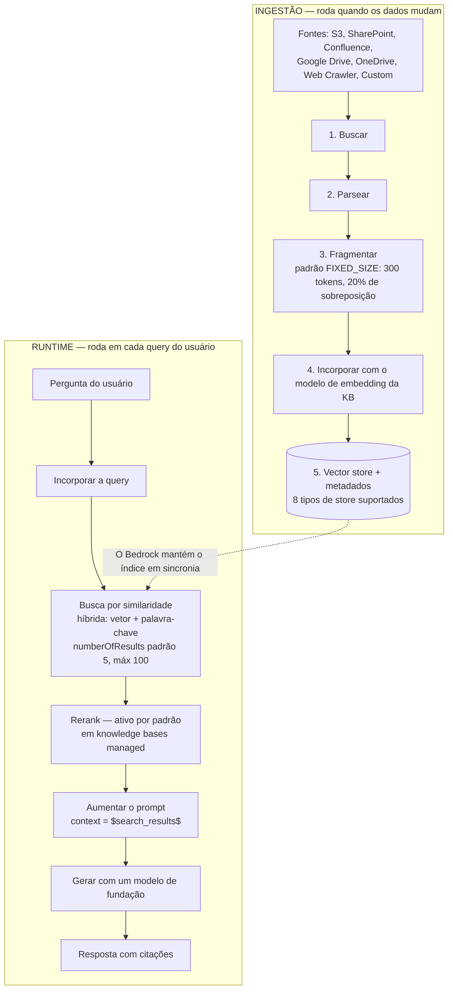
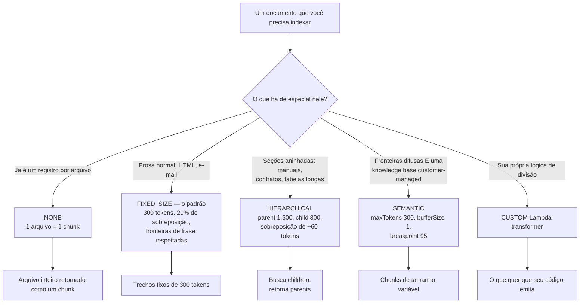
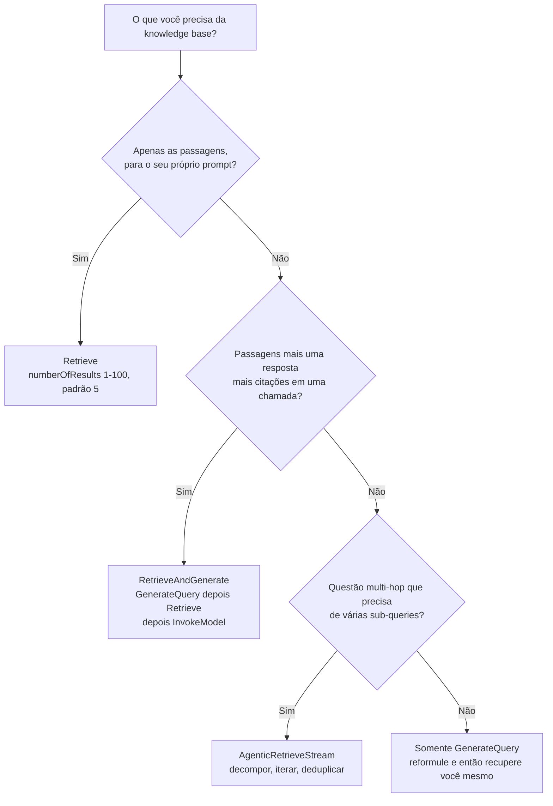
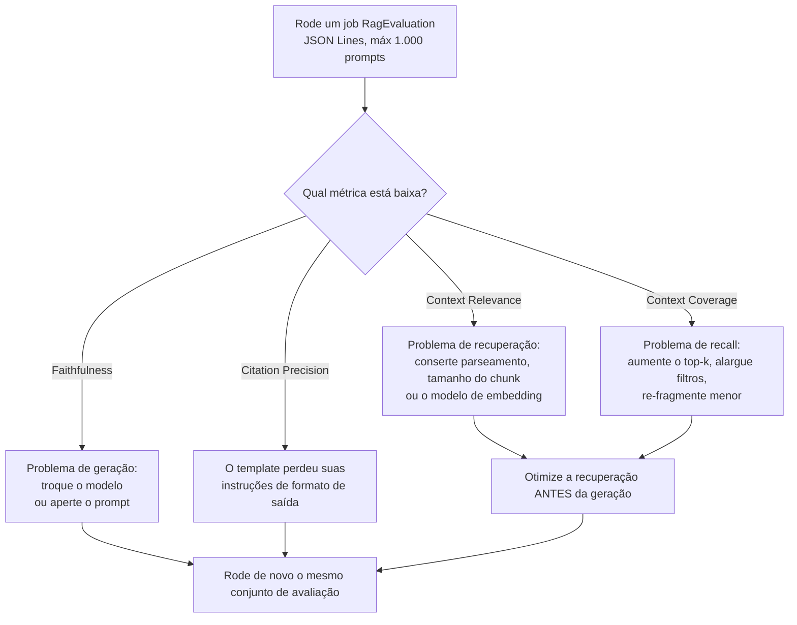
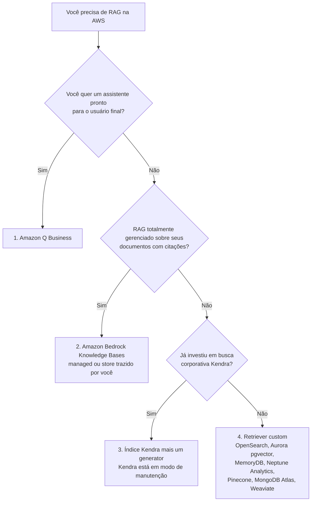
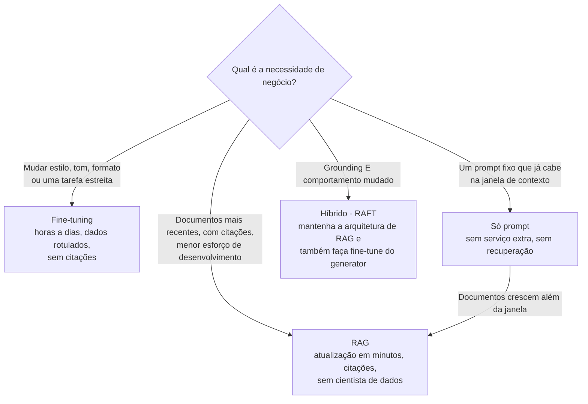

# RAG e Knowledge Bases no Amazon Bedrock: Chunking, Embeddings, Recuperação e Avaliação

Geração aumentada por recuperação é o tópico de maior frequência no Domínio 3 do exame AIF-C01, e também é o tópico onde a maioria dos candidatos decora slogans em vez de mecanismos. O guia de exame da AWS nomeia o RAG três vezes: *"Defina RAG e suas aplicações de negócio (por exemplo, Amazon Bedrock Knowledge Bases)"*, *"serviços que armazenam embeddings (OpenSearch, Aurora, Neptune, RDS for PostgreSQL)"* e *"grounding de RAG"*. Um slogan como "RAG reduz alucinação" não te sustenta, porque o exame pergunta o que acontece **quando o tamanho padrão de chunk está errado, quando o top-k é grande demais, quando um operador de filtro não é suportado, ou quando uma métrica cai abaixo do limite**. Esta lição ensina os mecanismos, e cada número nela está preso a uma página da AWS de primeira parte em **outubro de 2026**.

```text
 =====================================================================
  AMAZON BEDROCK KNOWLEDGE BASES EM UMA OLHADA   (Digest: out. 2026)
 =====================================================================
  O QUE RAG É ...... informações da fonte de dados melhoram
                    relevância e acurácia; seus dados são bus-
                    cados no momento da query e injetados no
                    prompt
  DOIS TIPOS DE KB . MANAGED (BMKB): a AWS roda ingestão, indexação,
                    armazenamento, recuperação e reranking
                    CUSTOMER-MANAGED: você é dono do vector store
                    e de toda a configuração
  INGESTÃO ......... buscar -> parsear -> fragmentar -> incorporar ->
                    vector store, cada chunk mapeado ao doc de origem
  RUNTIME .......... incorporar query -> busca por similaridade ->
                    aumentar prompt -> gerar com citações
  CHUNKING PADRÃO .. FIXED_SIZE, 300 tokens, 20% de sobreposição,
                    fronteiras de frase respeitadas
  ESTRATÉGIAS ...... FIXED_SIZE | NONE | HIERARCHICAL | SEMANTIC
  TOP-K ............ numberOfResults: min 1, máx 100, padrão 5
  EMBEDDINGS ....... Titan V2 1024 (também 512 / 256), Titan G1 1536,
                     Cohere Embed v3 1024, multimodal 1024
  STORES (8) ....... OPENSEARCH_SERVERLESS, OPENSEARCH_MANAGED_
                     CLUSTER, RDS, NEPTUNE_ANALYTICS,
                     REDIS_ENTERPRISE_CLOUD, PINECONE,
                     MONGO_DB_ATLAS, S3_VECTORS
  APIs ............. Retrieve | RetrieveAndGenerate |
                     GenerateQuery | AgenticRetrieveStream
  AVALIAÇÃO ........ applicationType "RagEvaluation", LLM-as-a-judge,
                     JSON Lines, máx 1.000 prompts por job,
                     métricas pontuadas 0-1
  KENDRA ........... modo de manutenção desde 2026-06-30; fechado
                     para novos clientes após 2026-07-30
 =====================================================================
```

> [!NOTE]
> **Como ler esta lição.** Os recursos das Knowledge Bases chegam mais rápido do que os guias de exame são reescritos, então três regras de leitura valem. (1) **O padrão publicado pela própria AWS vence o exemplo de qualquer blog**, uma amostra que usa `numberOfResults: 10` não muda o padrão documentado de 5. (2) **Diferenças de capacidade entre knowledge bases managed e customer-managed são ouro de exame**, vários recursos existem em uma e não na outra. (3) **Qualquer coisa que a AWS não confirma em primeira parte é exibida como não verificada**, nunca como material de decoreba.

Ao final desta lição você será capaz de:

- explicar as duas metades de uma knowledge base, **ingestão** e **recuperação em runtime**, e nomear o que quebra em cada estágio;
- escolher entre uma knowledge base **managed** e **customer-managed**, e nomear os sete conectores managed;
- escolher a **estratégia de chunking** certa e defender os valores de parâmetro que a AWS recomenda;
- dimensionar um **modelo de embedding** por dimensão, limite de entrada e custo;
- selecionar um dos **oito vector stores** para uma restrição dada;
- escrever um **filtro de metadados** que uma knowledge base managed realmente aceite;
- escolher entre **Retrieve, RetrieveAndGenerate, GenerateQuery e AgenticRetrieveStream**, e consertar um prompt que excede o limite de caracteres;
- diagnosticar um sistema de RAG com falha lendo **relevância de contexto, cobertura e fidelidade** na ordem certa;
- defender o **veredito comparativo**: RAG vs. fine-tuning vs. só prompt, e Bedrock Knowledge Bases vs. Amazon Kendra.

---

## 1. O que RAG é, e o que o guia de exame realmente pergunta

### 1.1 A definição que a AWS usa

A AWS define geração aumentada por recuperação como o uso de **informações da fonte de dados para melhorar a relevância e a acurácia** da resposta de um modelo de fundação. A cláusula decisiva é a segunda metade: a knowledge base **busca seus dados no momento da query e aumenta o prompt** com as passagens que encontra. Nada é gravado no modelo. Os pesos não se movem, nenhum job de treino roda, e o mesmo modelo de fundação que respondia descuidadamente sem seus documentos agora responde com eles.

Essa frase já elimina três distrators em toda questão de RAG:

- RAG **não** muda o modelo, então não pode ser confundido com fine-tuning ou continued pre-training;
- RAG **não** precisa de dados rotulados, então não pode ser a resposta para "a equipe não tem cientistas de dados";
- RAG **pode** ser atualizado em minutos, então "os dados mudam semanalmente" aponta para o RAG, não para um loop de treino.

### 1.2 As três questões que o guia de exame mapeia para esta lição

| Linha do guia de exame | O que ela realmente testa | Onde cai aqui |
|---|---|---|
| Defina RAG e suas aplicações de negócio (por exemplo, Bedrock Knowledge Bases) | Definição, frescor, citações, baixo esforço | Seções 1, 2 e 11 |
| Serviços que armazenam embeddings (OpenSearch, Aurora, Neptune, RDS for PostgreSQL) | O enum `StorageConfiguration.type` | Seção 6 |
| Trade-offs de custo: pré-treino, fine-tuning, in-context learning, RAG, destilação de modelo | RAG vs. fine-tuning vs. só prompt | Seção 11 |
| Grounding de RAG | Métricas de fidelidade e citação | Seção 9 |

O exame AIF-C01 tem **65 questões em 90 minutos**, e o Domínio 3 (o Domínio 3 cobre Modelos de Fundação, Implantação e Operações em parte) tem peso de **28%**. O RAG aparece dentro desse peso tanto como item de definição quanto como item de troubleshooting, e é por isso que esta lição gasta tantas linhas em avaliação quanto em arquitetura.

### 1.3 No que RAG é fraco

A AWS é explícita sobre a fraqueza estrutural do RAG: ele é **ruim em sumarizar um documento inteiro**, porque a recuperação retorna *chunks*, não arquivos inteiros. Se a necessidade de negócio é "leia as 400 páginas e me dê os três temas", RAG é a ferramenta errada, e o exame espera que você saiba disso. Mantenha essa limitação ao lado do benefício: RAG compra **frescor e citações**, e paga com **contexto parcial**.

> **📚 Você sabia?** A ordem de decisão oficial da AWS para RAG na AWS começa com **Amazon Q Business**, depois **Bedrock Knowledge Bases**, depois **Kendra mais um generator**, e então um **retriever custom**: nessa ordem, do *Choosing a RAG option* do Prescriptive Guidance. A maioria dos candidatos pula direto para o Bedrock e esquece que um assistente pronto para o usuário final fica um passo acima dele na própria lista da AWS. No exame, "resposta totalmente gerenciada para usuários de negócio" pode legitimamente apontar para o Amazon Q Business em vez de uma knowledge base que você monta você mesmo.

---

## 2. O pipeline de RAG: ingestão e runtime

Uma knowledge base são dois pipelines que nunca rodam ao mesmo tempo. **Ingestão** roda quando os dados mudam; **recuperação** roda em cada query. Confundir os dois é a causa raiz da maioria dos diagnósticos ruins: uma alucinação quase nunca é um problema de ingestão, e um documento ausente nunca é um problema de geração.

### 2.1 Ingestão: buscar, parsear, fragmentar, incorporar, armazenar

A AWS documenta a sequência de ingestão como: **buscar** o documento → **parseá-lo** → **fragmentá-lo** → **incorporar** cada chunk → gravar os vetores em um **vector store**, com cada chunk mapeado de volta ao seu documento de origem. O Amazon Bedrock mantém o banco de vetores em sincronia para você, incluindo exclusões e re-ingestão, que é o significado prático de "totalmente gerenciado" aqui.

### 2.2 Runtime: incorporar, buscar, aumentar, gerar

No momento da query o fluxo se inverte: a **query é incorporada** com o mesmo modelo de embedding → uma **busca por similaridade** retorna os chunks mais próximos → os chunks são **injetados no prompt** → o modelo de fundação **gera** uma resposta que carrega citações de volta aos documentos de origem.



### 2.3 O que quebra em cada estágio

| Estágio | Falha que você introduz | O que o usuário vê | Qual métrica se move |
|---|---|---|---|
| Buscar | Prefixo errado, arquivo com mais de 50 MB, permissão negada | Documento simplesmente ausente das respostas | Context Coverage cai |
| Parsear | Tabelas e colunas de PDF achatadas em ruído | Respostas fluentes sobre nada | Context Relevance cai |
| Fragmentar | Pergunta e resposta divididas em dois chunks | "Não há contexto suficiente" | Context Relevance cai |
| Incorporar | Chunk maior que o limite de entrada do modelo | Truncamento silencioso, meia chunk indexada | Context Coverage cai |
| Buscar | top-k pequeno demais, filtro estrito demais | Documento correto nunca recuperado | Context Coverage cai |
| Gerar | O template de prompt perdeu suas instruções | Contradição com o texto recuperado | Faithfulness cai |

**Exemplo resolvido 1: dimensionamento padrão de ingestão.** Se você omitir a configuração de chunking, o Bedrock usa **chunking de tamanho fixo em 300 tokens com 20% de sobreposição**. A sobreposição é de 60 tokens, então cada chunk avança por um **stride de 240 tokens**.Um manual de funcionários de **4.800 tokens** produz portanto cerca de **4.800 ÷ 240 = 20 chunks**, cada um recuperável isoladamente. A própria regra prática da AWS para estimar documentos: **1 KB de texto ≈ 1.000 caracteres ≈ 200 to 250 palavras**.

Coloque a ordem do runtime na sequência correta:

```dragdrop
{
  "question": "Ordene as etapas de runtime de uma query em uma knowledge base do Bedrock, da entrada do usuário até a resposta:",
  "items": [
    "Etapa 4: o modelo de fundação gera a resposta e retorna citações para as passagens de origem",
    "Etapa 1: a query do usuário é incorporada com o mesmo modelo de embedding usado na ingestão",
    "Etapa 2: uma busca por similaridade retorna os chunks mais próximos, reordenados por padrão em knowledge bases managed",
    "Etapa 3: os chunks recuperados são injetados no prompt como $search_results$"
  ],
  "correctOrder": [
    "Etapa 1: a query do usuário é incorporada com o mesmo modelo de embedding usado na ingestão",
    "Etapa 2: uma busca por similaridade retorna os chunks mais próximos, reordenados por padrão em knowledge bases managed",
    "Etapa 3: os chunks recuperados são injetados no prompt como $search_results$",
    "Etapa 4: o modelo de fundação gera a resposta e retorna citações para as passagens de origem"
  ],
  "explanation": "A recuperação sempre precede a geração: incorpore a query, busque no índice, aumente o prompt e então gere. A ordem importa para diagnóstico, se o documento certo nunca chegou ao prompt, trocar o modelo ou o prompt não conserta a resposta, e é exatamente a regra que a seção 9 transforma em um procedimento de decisão."
}
```

> [!WARNING]
> **Não diagnostique um problema de geração na ingestão.** Se as passagens recuperadas estão corretas e a resposta ainda as contradiz, a correção é o **modelo ou o prompt**, não o tamanho do chunk. Se as passagens recuperadas estão erradas ou ausentes, a correção é **parseamento, chunking, o modelo de embedding ou o top-k**, não o modelo. A orientação de avaliação da AWS enuncia a regra diretamente: **otimize a recuperação antes da geração**.

---

## 3. Dois tipos de knowledge base: managed e customer-managed

### 3.1 Managed (BMKB) versus customer-managed

| Dimensão | **Knowledge base managed** | **Knowledge base customer-managed** |
|---|---|---|
| Quem roda ingestão, indexação, armazenamento | **AWS** | Você (e o Bedrock, na sua configuração) |
| Quem é dono do vector store | **AWS** | **Você** |
| Embedding + reranking | Managed, reranking **ativo por padrão** | Você configura ambos |
| Modos de busca | **Somente híbrido, sempre** | `HYBRID` ou `SEMANTIC` via `overrideSearchType` (somente OpenSearch Serverless) |
| Chunking semântico | **Não suportado** | Suportado |
| Conectores | **7** (S3, SharePoint, Confluence, Google Drive, OneDrive, Web Crawler, Custom) | Sua configuração de fonte de dados |
| Filtros `startsWith` / `stringContains` | **Não suportados** | Depende do store |

### 3.2 Os sete conectores managed

| # | Conector | Conteúdo típico |
|---|---|---|
| 1 | **Amazon S3** | Exportações, data lakes, conjuntos de documentos estáticos |
| 2 | **SharePoint** | Intranets corporativas |
| 3 | **Confluence** | Wikis de engenharia e suporte |
| 4 | **Google Drive** | Docs, Sheets, Slides de uma equipe |
| 5 | **OneDrive** | Arquivos pessoais e de equipe |
| 6 | **Web Crawler** | Sites públicos de produto e de ajuda |
| 7 | **Custom** | Seu próprio conector através da integração documentada |

Note a assimetria que as questões de exame exploram: uma knowledge base **customer-managed** que usa Confluence, SharePoint ou Salesforce como fonte **exige OpenSearch Serverless** como seu store, enquanto uma knowledge base managed te oferece quatro stores de quick-create no console.

### 3.3 Cotas que valem a pena decorar

| Limite | Valor |
|---|---|
| Tamanho do arquivo de origem | **50 MB** |
| Arquivo sidecar de metadados | **10 KB** |
| Knowledge bases managed por conta por Região | **10.000** |
| Fontes de dados por knowledge base | **200** |
| Jobs de ingestão simultâneos | **50** |
| Armazenamento bruto (managed) | **10 TB** |
| Caracteres de entrada da query | **10.000** |
| Requisições Retrieve por minuto | **600** (burst de **25 por segundo**) |

> **📚 Você sabia?** O **teto de 50 MB para arquivos de origem** e o **teto de 10 KB para metadados** são limites diferentes que as pessoas fundem em uma lenda urbana única de "limite de arquivo de 10 MB". O conector de fonte de dados também expõe `maxFileSizeInMegaBytes` com um padrão documentado de **500**, mais `inclusionPrefixes`, `exclusionPrefixes`, regex `inclusionPatterns` / `exclusionPatterns`, `metadataFilesPrefix` e `aclEnabled`, então a maioria dos chamados "por que este arquivo sumiu" é um problema de filtro, não de tamanho.

---

## 4. Chunking: as quatro estratégias e seus parâmetros

Chunking é onde a qualidade do RAG é ganha ou perdida, porque um sistema de recuperação só pode retornar o que a ingestão realmente criou. A API da AWS aceita exatamente quatro valores para `chunkingStrategy`: **`FIXED_SIZE`, `NONE`, `HIERARCHICAL`, `SEMANTIC`**: nada mais é válido.

### 4.1 O padrão que você recebe quando não configura nada

Omitir a configuração de chunking dá **chunking de tamanho fixo: 300 tokens com 20% de sobreposição, respeitando fronteiras de frase**. Respeitar fronteiras de frase importa mais do que parece: é a diferença entre um chunk que termina no meio de uma cláusula e um chunk que termina em um ponto final, e o caso publicado pela própria AWS mostra a relevância de contexto indo de **67% para 93%** puramente porque perguntas e respostas de FAQ pararam de ser separadas.

### 4.2 Comparação das estratégias

| Estratégia | Valor da API | Parâmetros | Recomendado pela AWS | Melhor para | Observações |
|---|---|---|---|---|---|
| **Padrão / fixo** | `FIXED_SIZE` (ou omitido) | `maxTokens`, `overlapPercentage` | **300 tokens, 20% de sobreposição** | A maioria dos documentos | Respeita fronteiras de frase |
| **Nenhum** | `NONE` |: | 1 arquivo = 1 chunk | Dados pré-divididos, 1 SKU por arquivo | Você pré-processa a jusante |
| **Hierárquico** | `HIERARCHICAL` | parent, child, tokens de sobreposição | Parent **1.500**, child **300**, sobreposição **≈60** | Manuais, jurídico, tabelas aninhadas | Busca children, retorna **parents** |
| **Semântico** | `SEMANTIC` | `maxTokens`, `bufferSize`, `breakpointPercentileThreshold` | **300**, buffer **1**, threshold **95** | Fronteiras nebulosas | **Não disponível em KBs managed** |
| **Custom** | Lambda transformer | Seu código |: | Divisão específica de domínio | `vectorIngestionConfiguration` |



### 4.3 Chunking hierárquico

O chunking hierárquico cria um chunk **parent** (recomendado **1.500 tokens**, não incorporado) e chunks **child** (recomendado **300 tokens**, incorporados), com uma sobreposição recomendada em **20% do tamanho do child ≈ 60 tokens**. A recuperação busca os children mas retorna os **parents**, então o modelo recebe contexto de nível de seção em vez de um fragmento.

**Exemplo resolvido 2, dimensionamento hierárquico.** Com parent 1.500, child 300 e sobreposição 60, a própria amostra da AWS pedindo `numberOfResults = 5` voltou com **3 chunks**, porque vários children mapearam para o mesmo parent. `numberOfResults` é portanto um **teto, não uma promessa**, um fato que o exame pode testar em qualquer direção: "menos resultados do que o pedido" é normal, e "mais resultados do que o pedido" não é.

### 4.4 Chunking semântico

O chunking semântico incorpora frases adjacentes, compara sua similaridade e corta onde a similaridade cai. As faixas de parâmetros são contratuais:

| Parâmetro | Faixa | Recomendado pela AWS | Significado |
|---|---|---|---|
| `maxTokens` | 1 to 8.192 (o blog nota 20 to 8.192 dependendo do embedder) | **300** | Teto duro para um chunk |
| `bufferSize` | 0 to 1 | **1** | Quantas frases de cada lado são comparadas |
| `breakpointPercentileThreshold` | 50 to 99 | **95** | Corte apenas nos N% de fronteiras menos similares |

**Exemplo resolvido 3, o exemplo resolvido da API da AWS.** Com um threshold de **90** sobre **101 frases**, o Bedrock compara **100 pares** e divide nos **10 pontos de fronteira menos similares (10%)**, produzindo **11 chunks**, que são re-divididos se algum exceder `maxTokens`. Com `bufferSize = 1`, a frase 10 é incorporada a partir do contexto das frases **9 + 10 + 11**. O Cohere Embed v3 limita a entrada em **512 tokens**, então chunks construídos para ele não podem exceder isso mesmo se `maxTokens` for maior.

> [!WARNING]
> **O chunking semântico está indisponível em knowledge bases managed**, e ele nunca é o padrão. Qualquer resposta alegando "chunking semântico com threshold 95 é o que você recebe por padrão" está errada duas vezes. Do mesmo modo, `HIERARCHICAL` deve ser configurado explicitamente, o padrão é tamanho fixo, não hierárquico.

Relacione cada estratégia à situação que ela resolve:

```matching
{
  "question": "Relacione cada estratégia de chunking à situação para a qual ela é projetada:",
  "pairs": [
    {"left": "FIXED_SIZE (padrão, 300 tokens, 20% de sobreposição)", "right": "Prosa e HTML comuns onde as fronteiras de frase são claras e não existe estrutura especial"},
    {"left": "NONE", "right": "Dados que você já dividiu a montante, como um SKU ou um ticket por arquivo"},
    {"left": "HIERARCHICAL (parent 1.500 / child 300)", "right": "Manuais, contratos e tabelas longas aninhados onde a resposta precisa de contexto de nível de seção"},
    {"left": "SEMANTIC (buffer 1, breakpoint 95)", "right": "Documentos com fronteiras difusas: indisponível em knowledge bases managed"},
    {"left": "Custom Lambda transformer", "right": "Regras de divisão específicas de domínio que nenhuma das quatro estratégias embutidas expressa"}
  ],
  "explanation": "FIXED_SIZE é o padrão documentado para a maioria dos documentos; NONE assume que você pré-divide; HIERARCHICAL busca children e retorna parents, então as contagens podem ser menores que numberOfResults; SEMANTIC adapta os pontos de corte à similaridade mas não é oferecido em knowledge bases managed; um transformer custom é o escape hatch configurado através de vectorIngestionConfiguration. A API aceita exatamente FIXED_SIZE, NONE, HIERARCHICAL e SEMANTIC."
}
```

---

## 5. Modelos de embedding: dimensões, limites e custo

### 5.1 Os modelos que uma knowledge base aceita

| Provedor | Modelo | Model ID | Dimensões | Tipos | Limite de entrada |
|---|---|---|---|---|---|
| Amazon | Titan Embeddings G1: Text | `amazon.titan-embed-text-v1` | **1536** | float | 8.192 tokens |
| Amazon | **Titan Text Embeddings V2** | `amazon.titan-embed-text-v2:0` | **1024 padrão, 512, 256** | float, binary | **8.192 tokens / 50.000 chars** |
| Cohere | Embed English v3 | `cohere.embed-english-v3` | **1024** | float, binary | **512 tokens ≈ 2.048 chars** |
| Cohere | Embed Multilingual v3 | `cohere.embed-multilingual-v3` | **1024** | float, binary | 512 tokens |
| Amazon | Titan Multimodal G1 |: | **1024** | float | multimodal |
| Cohere | Embed v3 (multimodal) |: | **1024** | float, binary | multimodal |
| Amazon | Nova Multimodal Embeddings |: | **1024** | float | multimodal |

### 5.2 O trade-off de dimensão

| Dimensões | Acurácia vs. 1024 | Armazenamento vs. 1024 | Uso |
|---|---|---|---|
| **1024** (padrão) | baseline | 1× | Acurácia máxima |
| **512** | **≈99%** | −50% | Equilibrado |
| **256** | **97%** | **−75%** | Custo e escala |

**Exemplo resolvido 4, o orçamento de dimensão.** Uma equipe no Amazon Titan Text Embeddings V2 que precisa de cerca de **75% menos armazenamento de vetores** mantendo cerca de **97% de acurácia de recuperação** deve definir a dimensão de saída como **256**. A **512** ela mantém **≈99%** de acurácia com **metade** do armazenamento. Acrescentar `embeddingTypes: ["binary"]` corta o armazenamento ainda mais. O gasto de embedding é medido em tokens: Titan V2 é precificado a **$0.02 por 1 milhão de tokens**, contra **$0.10** do V1, uma redução de 80% na mesma carga de trabalho.

> **📚 Você sabia?** O Titan Text V2 aceita **8.192 tokens ou 50.000 caracteres** e cobre **mais de 100 idiomas**, enquanto o Cohere Embed v3 aceita apenas **512 tokens (cerca de 2.048 caracteres)**. Esse único fato explica duas armadilhas de exame de uma vez: escolher Cohere significa que seu teto efetivo de chunk cai para 512, e um chunk que "cabe nos 300 tokens padrão" ainda pode estourar um embedder se você aumentou `maxTokens` para um modelo diferente. Dimensão e limite de entrada são controles independentes: 1024 dimensões não diz nada sobre quanto texto você pode enviar.

---

## 6. Vector stores: oito opções, quatro quick-creates de console

| Store | `type` da API | Quick-create no console | Observações e limites |
|---|---|---|---|
| **OpenSearch Serverless** | `OPENSEARCH_SERVERLESS` | Sim | Precisa de um índice **motor `faiss`** para arquivos de metadados; o único store que permite `overrideSearchType: HYBRID`; **obrigatório** para fontes Confluence/SharePoint/Salesforce |
| **OpenSearch Service (cluster managed)** | `OPENSEARCH_MANAGED_CLUSTER` |: | Híbrido mais busca full-text |
| **Aurora PostgreSQL + pgvector** | `RDS` | Sim (Serverless) | SQL mais vetores, ACID; pgvector suporta até **2.000 dimensões**, IVFFlat e HNSW |
| **Neptune Analytics** | `NEPTUNE_ANALYTICS` | Sim | **GraphRAG**: vetores mais travessia de grafo com openCypher |
| **Redis Enterprise Cloud** | `REDIS_ENTERPRISE_CLOUD` |: | In-memory, latência ultra-baixa |
| **Pinecone** | `PINECONE` |: | Banco de vetores managed |
| **MongoDB Atlas** | `MONGO_DB_ATLAS` |: | APIs compatíveis com Mongo |
| **Amazon S3 Vectors** | `S3_VECTORS` | Sim | O mais barato: custo de armazenamento **até 90%** menor, **2 bilhões de vetores por índice**; sem `startsWith` ou `stringContains` |

Atalho de exame: **OpenSearch Serverless = padrão e híbrido · Aurora pgvector = SQL mais vetor · Neptune = GraphRAG · Redis = menor latência · S3 Vectors = mais barato · Kendra = busca corporativa, não um store de knowledge base.**

> **📚 Você sabia?** **Amazon S3 Vectors** é a entrada mais nova e a que tem mais chance de ser enquadrada como uma questão de custo: o Prescriptive Guidance da AWS o coloca com **armazenamento até 90% mais barato** que bancos de vetores tradicionais, com **2 bilhões de vetores por índice**, a uma latência de query de cerca de **100 ms+**. A pegadinha para fins de exame é funcional, não financeira: índices S3 Vectors **não** suportam os operadores de filtro `startsWith` ou `stringContains`, então o store mais barato também é o que remove os filtros de substring mais convenientes.

> [!WARNING]
> **`Amazon EMR Serverless` não é um vector store de knowledge base.** Ele aparece em algum material do Prescriptive Guidance sobre processamento de big data, mas está **ausente do enum `StorageConfiguration.type`**: `OPENSEARCH_SERVERLESS`, `OPENSEARCH_MANAGED_CLUSTER`, `RDS`, `NEPTUNE_ANALYTICS`, `REDIS_ENTERPRISE_CLOUD`, `PINECONE`, `MONGO_DB_ATLAS`, `S3_VECTORS`. Qualquer opção oferecendo EMR Serverless como o vector store de uma knowledge base está errada por construção. Do mesmo modo, **Amazon Kendra é um serviço de busca, não um tipo de armazenamento**: ele pode *alimentar* uma knowledge base, mas não pode *ser* o store de uma.

---

## 7. Metadados: arquivos sidecar e filtros de recuperação

### 7.1 O padrão sidecar

Ao lado de `articles.pdf` você coloca `articles.pdf.metadata.json` na **mesma pasta do S3**, com teto de **10 KB**, contendo valores string, número ou boolean. Definir `includeForEmbedding: true` em um campo concatena sua chave e valor no texto que é incorporado, e é assim que um valor como `genre: cooking` se torna parte da representação pesquisável em vez de apenas um pós-filtro. Uma fonte de dados CSV pode em vez disso declarar uma coluna `contentFields`.

**Exemplo resolvido 5, o exemplo de filtro da AWS.** Dado `articles.pdf` mais um sidecar declarando `genre`, `year` e `author`, o seguinte filtro recupera artigos de entretenimento publicados depois de 2018, ou qualquer artigo de culinária ou esportes cujo nome do autor comece com "C":

```json
{
  "orAll": [
    {
      "andAll": [
        { "equals": { "key": "genre", "value": "entertainment" } },
        { "greaterThan": { "key": "year", "value": 2018 } }
      ]
    },
    {
      "andAll": [
        { "in": { "key": "genre", "value": ["cooking", "sports"] } },
        { "startsWith": { "key": "author", "value": "C" } }
      ]
    }
  ]
}
```

### 7.2 O conjunto de operadores

`RetrievalFilter` é uma **união**: primitivas compostas com `andAll` / `orAll`, cada um dos quais exige **pelo menos 2 itens**.

| Categoria | Operadores |
|---|---|
| Igualdade | `equals`, `notEquals` |
| Ordenação | `greaterThan`, `greaterThanOrEquals`, `lessThan`, `lessThanOrEquals` |
| Pertencimento | `in`, `notIn`, `listContains` |
| String | `startsWith`, `stringContains` |
| Composição | `andAll`, `orAll` (mínimo de 2 itens cada) |
| Chave embutida | `x-amz-bedrock-kb-source-uri`: filtra por prefixo S3 sem nenhum arquivo sidecar |

**Exemplo resolvido 6, o operador que falha.** Se o mesmo filtro acima roda contra uma **knowledge base managed**, ele falha no `startsWith`. A AWS documenta que **`startsWith` e `stringContains` não são suportados em knowledge bases managed nem em índices S3 Vector**. A correção é reestruturar o ramo para `equals` ou `in`: por exemplo, uma lista explícita de autores: ou rodar a lógica de substring na aplicação depois da recuperação. Note que `listContains` não é um substituto: ele testa **pertencimento a um campo lista**, não um substring de um campo string.

> [!WARNING]
> **Três armadilhas de filtro que custam pontos.** (1) `startsWith` e `stringContains` **não são suportados** em knowledge bases managed ou índices S3 Vector. (2) `andAll` / `orAll` precisam de **dois ou mais** filhos: um único filho é inválido. (3) Arquivos de metadados têm teto de **10 KB**; sidecars acima do tamanho são silenciosamente um problema da fonte de dados, não de recuperação. Sempre distinga "o operador é inválido" de "o operador é válido, mas não é suportado aqui".

---

## 8. Recuperação: quatro APIs, top-k e o orçamento de tokens

### 8.1 Qual API chamar

| API | O que faz | Use quando |
|---|---|---|
| **`Retrieve`** | Retorna apenas passagens ranqueadas | Você é dono do prompt e da etapa de geração |
| **`RetrieveAndGenerate`** | Retrieve → `InvokeModel` → citações em uma chamada | Você quer uma resposta com fontes, código mínimo |
| **`GenerateQuery`** | Reformula a pergunta do usuário | Você orquestra o loop você mesmo |
| **`AgenticRetrieveStream`** | O FM decompõe em sub-queries, itera e deduplica | Questões multi-hop sobre corpora grandes |

Por baixo dos panos, `RetrieveAndGenerate` roda **GenerateQuery → Retrieve → InvokeModel**. Com **query decomposition** habilitada, `numberOfRerankedResults` pode chegar a **5× `numberOfResults`**, o único lugar onde uma contagem reordenada legitimamente excede o top-k pedido.



### 8.2 top-k e o orçamento de tokens

`numberOfResults` é um inteiro com **mínimo 1, máximo 100 e padrão 5**. Ele dimensiona diretamente o placeholder `$search_results$` no prompt de geração.

**Exemplo resolvido 7: top-k versus a janela de prompt.** Com o chunk padrão de **300 tokens**:

| `numberOfResults` | Tokens aproximados em `$search_results$` | Veredito |
|---|---|---|
| **5** (padrão) | **≈1.500** | Seguro para a maioria dos modelos |
| 10 | ≈3.000 | A amostra da AWS para respostas de "contexto insuficiente" |
| 100 (máximo da API) | ≈30.000 | Quase certamente acima do limite do prompt |

Aumentar o top-k aumenta o recall e reduz a alucinação, mas faz o prompt crescer linearmente. Quando uma chamada `RetrieveAndGenerate` falha porque o prompt aumentado **excede o limite de caracteres do modelo**, a AWS documenta exatamente três remediações: **reduzir `numberOfResults`**, **recriar a fonte de dados com chunks menores**, ou **encurtar o template de prompt ou a query do usuário**. Aumentar `numberOfResults` piora o erro, e é por isso que aparece como um distrator.

### 8.3 Contrato do template de prompt

Prompts de geração **devem incluir `$search_results$`**. Prompts de orquestração devem incluir `$conversation_history$` **e** `$output_format_instructions$`. O template de amostra da AWS empacota o contexto como `<context>$search_results$</context>` ao lado de `$query$`: e remover `$output_format_instructions$` **remove as citações** da saída, o que quebra silenciosamente o requisito de "respostas fundamentadas com fontes".

### 8.4 Modo de busca

`overrideSearchType` aceita `HYBRID` ou `SEMANTIC`, e se aplica **somente** ao OpenSearch Serverless com um campo de texto filtrável. **Knowledge bases managed são sempre híbridas**: não existe configuração para desligar isso, então "configure a knowledge base managed para busca somente semântica" é um distrator.

> **📚 Você sabia?** Dois contadores rodam na mesma requisição e são fáceis de confundir: `numberOfResults` (top-k pedido, **1 to 100, padrão 5**) e `numberOfRerankedResults` (o que o reranking realmente retorna depois de filtragem e deduplicação). Em knowledge bases managed o reranking está **ativo por padrão**, e com query decomposition a contagem reordenada pode chegar a **5× o top-k pedido**. O exame pode, portanto, legitimamente mostrar uma requisição de 10 passagens com mais de 10 candidatos reordenados: enquanto nunca mostra mais de 100 resultados *pedidos*.

---

## 9. Avaliando uma aplicação de RAG

### 9.1 A forma do job

A avaliação de RAG é uma avaliação do Bedrock com `applicationType: "RagEvaluation"`, pontuada por um **LLM-as-a-judge**. Existem dois tipos de job, **somente retrieve** e **retrieve and generate**, e as métricas são pontuadas **0 to 1** e calculadas como média sobre os prompts. O dataset é **JSON Lines** com um máximo de **1.000 prompts por job**; o ground truth vive em `referenceContexts` (para recuperação) e `referenceResponses` (para geração).

### 9.2 As famílias de métricas

| Estágio | Métrica | O que ela mede |
|---|---|---|
| Somente retrieve | **Context Relevance** | Precisão dos chunks recuperados |
| Somente retrieve | **Context Coverage** | Recall contra os `referenceContexts` de ground truth |
| Retrieve + generate | **Correctness / Completeness / Helpfulness / Logical Coherence** | Respostas precisas, completas, úteis e sem contradições |
| Retrieve + generate | **Faithfulness** | **Resistência à alucinação contra os chunks recuperados** |
| Retrieve + generate | **Citation Precision / Coverage** | Citações são precisas / completas |
| Retrieve + generate | **Harmfulness, Stereotyping, Refusal** | Métricas de IA responsável |

### 9.3 A regra de diagnóstico

| Sintoma | Métrica a ler primeiro | Correção |
|---|---|---|
| Respostas ignoram documentos disponíveis | **Context Coverage** | Reduza a estricidade do filtro, aumente o top-k, re-fragmente menor |
| Chunks recuperados são irrelevantes | **Context Relevance** | Conserte parseamento, tamanho do chunk ou o modelo de embedding |
| Resposta contradiz as passagens | **Faithfulness** | Troque o modelo ou o prompt |
| Citações ausentes ou erradas | **Citation Precision** | Restaure `$output_format_instructions$` no template |



**Exemplo resolvido 8: a correção de 67% para 93%.** A AWS publicou um caso em que a relevância de contexto estava em **67%** porque perguntas de FAQ eram separadas de suas respostas no meio da frase. Re-fragmentar de modo que cada pergunta e resposta ficassem juntas: alinhadas a frases, **sem nenhuma mudança de prompt**: levou a relevância de contexto a **93%** nas mesmas 15 queries e eliminou as alucinações. A lição não é o número; é que a correção pousou na **ingestão**, ainda que o sintoma aparecesse na **geração**.

> [!WARNING]
> **Leia as métricas em ordem.** Baixa **context relevance** é um problema de indexação, parseamento, tamanho do chunk ou modelo de embedding. Baixa **faithfulness** é um problema de geração, modelo ou prompt. Equipes que recorrem a um modelo maior enquanto o retriever está retornando as passagens erradas queimam um ciclo inteiro de avaliação para confirmar o que uma métrica de recuperação já dizia. A orientação da AWS é inequívoca: **otimize a recuperação antes da geração**.

---

## 10. Escolhendo uma opção de RAG na AWS, e a transição do Kendra

### 10.1 A ordem documentada da AWS

O Prescriptive Guidance lista as opções de RAG em uma ordem deliberada: **(1) Amazon Q Business → (2) Amazon Bedrock Knowledge Bases → (3) Amazon Kendra mais um generator → (4) um retriever custom** construído sobre OpenSearch, Aurora pgvector, MemoryDB, Neptune Analytics, Pinecone, MongoDB Atlas ou Weaviate.



### 10.2 Kendra versus Bedrock Knowledge Bases

| Dimensão | **Amazon Kendra** | **Bedrock (Managed) Knowledge Base** |
|---|---|---|
| Status | **Manutenção desde 2026-06-30; sem novos clientes após 2026-07-30** | O alvo de migração declarado pela AWS |
| Conectores | Cerca de 30+ conectores corporativos | **7**: S3, SharePoint, Confluence, Google Drive, OneDrive, Web Crawler, Custom |
| Geração | Passagens ranqueadas: você traz seu próprio LLM | Nativo **`RetrieveAndGenerate`** mais **`AgenticRetrieveStream`** |
| Modos de busca | Palavra-chave / semântico / híbrido | **Somente híbrido** |
| Busca corporativa | Facetas, sugestões, sinônimos, verificação ortográfica, aprendizado incremental | **Ausente: workarounds necessários** |
| Máximo de recuperação | **100 passagens × ≤200 tokens** | **100 resultados** (`numberOfResults`) |
| Reuso | Um índice Kendra GenAI **pode alimentar** uma knowledge base do Bedrock |: |

**Exemplo resolvido 9: a questão em formato de migração.** Uma empresa quer "RAG totalmente gerenciado com geração nativa, citações e recuperação agentic, como o substituto recomendado para a nossa aplicação Kendra". A resposta é **Amazon Bedrock Managed Knowledge Base**: o Kendra está em modo de manutenção e fechado para novos clientes após 2026-07-30, e a AWS nomeia a knowledge base managed como o substituto. Só o OpenSearch não oferece geração nem citações; Amazon Q Developer é um assistente de código; continued pre-training não acrescenta recuperação de modo algum.

> **📚 Você sabia?** O Kendra não é apenas descontinuado, ele é **repurposável**: um índice Kendra GenAI ainda pode ser conectado como uma **fonte de dados para uma knowledge base do Bedrock**, então uma organização com anos de tuning de Kendra pode manter seu índice e mover apenas a camada de geração. Esse é o caminho de migração que a AWS realmente documenta, e é por isso que "apague o Kendra e reindexe tudo" é um distrator. Note também que as contagens de conectores vêm de lugares diferentes: os **7 conectores managed** são confirmados no `docs.aws.amazon.com`, enquanto a cifra "30+" do Kendra circula via material de migração da AWS, não por uma página reproduzida aqui, trate o número exato como aproximado.

### 10.3 Atualizações de 2026 (em outubro de 2026)

Tudo nesta subseção foi lido no `docs.aws.amazon.com`, em um post AWS What's New, em um post do AWS Machine Learning Blog ou no próprio guia de exame AIF-C01: nada vem de um rastreador de terceiros, e datas que a AWS não publica são marcadas como não publicadas em vez de serem preenchidas. Dois grupos de mudança importam para esta lição: o que chegou **dentro** do Bedrock Knowledge Bases e seus vector stores, e o que a AWS fez com **Kendra, Amazon Q Business e o exame** ao redor deles.

Onde a AWS não publica data, a linha diz isso: **não existe data de lançamento publicada** para o Bedrock Managed Knowledge Base e **não existe data de encerramento publicada** para o Amazon Q Business, e nenhuma das duas foi inventada aqui.

| Mudança de knowledge base / vector store | Data (publicada pela AWS) | O que o exame quer que você saiba |
|---|---|---|
| **Reranking, conectores customizados, ingestão direta, avaliação de RAG e inference profiles no `RetrieveAndGenerate`** | Histórico de recursos do Bedrock User Guide, 2025 | Reranking está **ativo por padrão** em knowledge bases managed; a avaliação é `applicationType: "RagEvaluation"` pontuada por um **LLM-as-a-judge**; um inference profile deixa uma chamada `RetrieveAndGenerate` escolher a Região |
| **Amazon S3 Vectors se torna um store de knowledge base** | re:Invent 2025 (**30 nov, 4 dez 2025**) | O oitavo e mais recente valor de `StorageConfiguration.type`, o mais barato em **até 90% a menos**, **2 bilhões de vetores por índice**, e o store que rejeita `startsWith` / `stringContains` |
| **Bedrock Managed Knowledge Base (BMKB): Smart Parsing mais a API Agentic Retrieval** | Documentado como o substituto do Kendra; a AWS **não publicou uma data de lançamento** | A AWS roda ingestão, indexação, armazenamento, recuperação e reranking; `AgenticRetrieveStream` é a API de recuperação agentic com streaming que fica atrás do tier managed |
| **Amazon Kendra entra em manutenção e depois fecha para novos clientes** | Manutenção **30 jun 2026**, fechado para novos clientes **30 jul 2026** | A AWS redireciona novas aplicações de busca para o **Bedrock Managed Knowledge Base**; clientes Kendra existentes continuam rodando sob o vocabulário de *manutenção* da AWS |
| **Amazon Q Business não está mais aberto para novos clientes** | A página de disponibilidade diz *"não está mais aberto para novos clientes"*: **a AWS não publica data** | O passo 1 da própria ordem de decisão de RAG da AWS agora carrega uma ressalva; o sucessor documentado é **Amazon Quick** (traga sua própria identidade), e Guardrails e User Store **não** se transferem |
| **Amazon MemoryDB removido da lista em escopo do AIF-C01** | Guia de exame v1.1, **30 abr 2026** | O Prescriptive Guidance ainda nomeia o MemoryDB na cadeia de retriever custom da seção 10.1, mas o serviço não está mais em escopo para este exame |

| Mudança no guia de exame (v1.1, publicado em 30 abr 2026) | Detalhe para um candidato de RAG |
|---|---|
| Novo objetivo **5.1.5** | Detecção de alucinação e grounding: **grounding de RAG**, validação de saída, pontuação de confiança: a razão pela qual as métricas da Seção 9 são examináveis |
| Novo objetivo **2.1.5** | **Engenharia de contexto**: como o contexto recuperado é montado no prompt (`$search_results$`, contratos de template, dimensionamento do top-k) |
| Novo objetivo **2.1.6** | IA agentic: padrões multi-agente, **MCP**, gerenciamento de memória, uso de ferramentas, orquestração, o formato que o `AgenticRetrieveStream` dá a uma chamada de recuperação |
| Exemplo alterado **3.4.2** | **LLM-as-a-judge**, o mecanismo de pontuação por trás da avaliação de RAG do Bedrock |
| Adicionado / removido da lista em escopo | **Amazon Aurora** adicionado (o store `RDS` com pgvector); **Amazon MemoryDB** removido |
| Inalterado | **65 questões (50 pontuadas + 15 não pontuadas)**, **90 minutos**, aprovação **700/1000**, domínios com pesos **20 / 24 / 28 / 14 / 14** |

A AWS afirma que atualizações do guia de exame chegam ao exame vivo cerca de **um mês após a publicação**, então os novos objetivos do v1.1 estão valendo desde cerca de **o fim de maio de 2026**. A ordem prática de leitura não mudou: os recursos da primeira tabela são o que você configura, e os objetivos da segunda tabela são sobre o que a AWS agora pergunta a respeito deles.

**Exemplo resolvido 11, o que as mudanças de 2026 significam para um cliente Kendra existente.** Uma empresa roda um índice Kendra GenAI há anos, com tuning de sinônimos e ranking que não quer perder, e agora quer respostas generativas com citações. O caminho documentado da AWS **não** é reindexar tudo: um índice Kendra GenAI ainda pode ser conectado como uma **fonte de dados para uma knowledge base do Bedrock**, então o tuning sobrevive e apenas a camada de geração se move, enquanto o próprio índice Kendra continua servindo seus usuários existentes sob **manutenção** (modo iniciado em **30 jun 2026**, fechado para novos clientes após **30 jul 2026**). Para uma aplicação *nova* a resposta é o **Bedrock Managed Knowledge Base**, e a terceira opção na ordem de decisão da AWS, Amazon Q Business, agora tem que ser verificada quanto ao seu próprio status de *"não está mais aberto para novos clientes"* antes que alguém a ofereça como a resposta do passo um.

| Mudança de 2025 to 2026 | Qual seção desta lição ela atualiza |
|---|---|
| Reranking ativo por padrão, conectores customizados, ingestão direta | Seções 2 e 3 |
| Avaliação de RAG pontuada por um LLM-as-a-judge | Seção 9 |
| Inference profiles utilizáveis dentro do `RetrieveAndGenerate` | Seção 8 |
| **Amazon S3 Vectors** como o oitavo tipo de store | Seção 6 |
| **Bedrock Managed Knowledge Base** + API Agentic Retrieval | Seções 3 e 10 |
| Datas de manutenção e encerramento do Kendra | Seção 10 |
| Objetivos do guia de exame v1.1 **5.1.5, 2.1.5, 2.1.6, 3.4.2** | Seções 9, 8 e 1 |

> **📚 Você sabia?** A página de disponibilidade do Kendra nunca usa a palavra "descontinuado": ela redireciona novas aplicações de busca para o **Amazon Bedrock Managed Knowledge Base**, cujo Smart Parsing e **Agentic Retrieval API** a AWS documenta como o substituto, enquanto o próprio Kendra continua servindo clientes existentes sob a definição de **manutenção** da própria AWS (sem novos clientes, sem novos recursos, ainda suportado). É por isso que *"o Kendra foi desligado"* e *"clientes Kendra existentes devem migrar imediatamente"* são ambos distrators, e é por isso que a resposta correta pareia **continuidade para clientes existentes** com **um substituto documentado para novos**.

---

## 11. Veredito comparativo: RAG vs fine-tuning vs só prompt, e Bedrock KB vs Kendra

### 11.1 RAG vs fine-tuning

| Dimensão | **RAG** | **Fine-tuning** |
|---|---|---|
| O que muda | Nada no modelo; conhecimento injetado no momento da query | **Pesos** do modelo |
| Frescor | Documentos mais recentes em **minutos** | **Horas a dias** por execução |
| Citações de fonte | **Sim** | **Não** |
| Alucinação | **Reduzida**: fundamentada no contexto recuperado | **Aumentada** para cargas de trabalho de Q&A |
| Habilidades e dados | **Nenhum cientista de dados**; documentos brutos | Pode precisar de um cientista de dados (LoRA/PEFT); pares **rotulados** |
| Disponibilidade | Qualquer modelo do Bedrock | **Não disponível para todos os modelos** |
| Fraqueza | **Ruim em sumarizar documentos inteiros** | Envelhece rápido, caro, sem grounding |
| A AWS diz melhor para | **Q&A sobre documentos: comece aqui** | **Estilo, tom, formato; sumarização e outras tarefas** |
| Combinação |: | **Híbrido (RAFT)**: fine-tune do generator *e* mantenha o RAG |

**Exemplo resolvido 10, o que o híbrido realmente comprou.** No caso publicado da Amazon Nova pela AWS, RAG sozinho e fine-tuning sozinho cada um melhorou a qualidade medida por LLM-as-a-judge em cerca de **+30%**; combiná-los chegou a **+83%**. A latência se comportou diferente por alavanca: fine-tuning cortou a latência em cerca de **50%**, enquanto o RAG a cortou em cerca de **30%**. O gasto de tokens se moveu em direções opostas, fine-tuning reduziu os tokens totais em **mais de 60%**, enquanto o RAG **mais que dobrou** eles porque o contexto é passado em cada chamada. Mesmo problema, quatro alavancas diferentes, quatro faturas diferentes.



### 11.2 Bedrock Knowledge Bases vs Kendra

Escolha **Bedrock Knowledge Bases** quando o pedido é *RAG totalmente gerenciado, documentos internos, citações, operações mínimas*: e escolha **busca corporativa estilo Kendra** apenas quando o pedido é *facetas, sinônimos, verificação ortográfica, passagens ranqueadas sem um generator*. Em 2026 a segunda resposta é uma de legado: o Kendra está em modo de manutenção e fechado para novos clientes.

> [!IMPORTANT]
> **Veredito Comparativo: RAG vs fine-tuning vs só prompt, e Bedrock Knowledge Bases vs Amazon Kendra**
> - **RAG** é a resposta padrão para **Q&A sobre documentos**: os dados mudam com frequência, o negócio precisa de **citações de fonte**, a alucinação precisa cair, e não há cientista de dados disponível. A AWS diz para **começar aqui**. As atualizações chegam em **minutos**; a fraqueza é sumarizar documentos inteiros, porque a recuperação retorna chunks.
> - **Fine-tuning** é a resposta quando o requisito é **estilo, tom, formato ou uma tarefa estreita e repetitiva**: não para conhecimento fresco. Ele muda **pesos**, leva **horas a dias**, precisa de dados **rotulados**, produz **sem citações** e **não está disponível para todo modelo**. Escolhê-lo para "nossos PDFs de política mudam semanalmente" está errado nos quatro aspectos.
> - **Só prompt (in-context learning)** é a resposta quando tudo de que o modelo precisa cabe no prompt e não muda. É o caminho mais barato e rápido e não requer nenhum serviço extra: e falha no momento em que o corpus cresce além da janela de contexto ou precisa ser mantido atualizado.
> - **Híbrido (RAFT)** é a combinação sancionada pela AWS: mantenha a arquitetura de RAG **e** faça fine-tune do generator. A AWS cita o trabalho RAFT da UC Berkeley para isso, e o próprio caso de estudo de Nova dela mediu **+30% de cada alavanca e +83% combinados**.
> - **Bedrock Knowledge Bases** é a resposta para *RAG totalmente gerenciado sobre documentos internos com citações e operações mínimas*: **7 conectores managed, busca sempre híbrida, reranking ativo por padrão, `RetrieveAndGenerate` e `AgenticRetrieveStream` nativos**.
> - **Amazon Kendra** é a resposta apenas para *recursos de busca corporativa*, facetas, sinônimos, verificação ortográfica, passagens ranqueadas, e mesmo assim está **em modo de manutenção desde 2026-06-30 e fechado para novos clientes após 2026-07-30**, com a AWS nomeando a knowledge base managed do Bedrock como o substituto.
> - **Heurística de exame:** *"RAG totalmente gerenciado, docs internos, citações, operações mínimas"* → **Bedrock Knowledge Bases**. *"Estilo, tom, formato"* → **fine-tuning**. *"Facetas e sinônimos, sem generator"* → **Kendra**.

| Pergunta no enunciado | Resposta correta |
|---|---|
| Docs que mudam semanalmente + citações + menor esforço | **RAG / Bedrock Knowledge Bases** |
| Mudar o tom e o formato do assistente | **Fine-tuning** |
| Tudo cabe em um único prompt, estático | **Só prompt** |
| Grounding *e* mudança de comportamento | **Híbrido (RAFT)** |
| RAG totalmente gerenciado recomendado como substituto do Kendra | **Bedrock Managed Knowledge Base** |
| Facetas, sinônimos, verificação ortográfica, passagens ranqueadas | **Kendra** (legado) |

---

## 12. Armadilhas do exame, limites e o que não decorar

> [!WARNING]
> **As armadilhas que custam pontos exatamente neste material:**
> 1. **O chunking padrão é de tamanho fixo em 300 tokens com 20% de sobreposição**: nunca semântico, nunca hierárquico, e `NONE` apenas se você pedir explicitamente.
> 2. **`numberOfResults`: padrão 5, mín 1, máx 100.** "10" aparece em amostras de blog da AWS e não é o padrão; "100" é o máximo, não o padrão.
> 3. **Chunking semântico não é suportado em knowledge bases managed**; knowledge bases managed são **sempre híbridas**, e reranking está **ativo por padrão**.
> 4. **`startsWith` e `stringContains` não são suportados** em knowledge bases managed nem em índices S3 Vector.
> 5. **O enum de stores tem exatamente oito valores**: `OPENSEARCH_SERVERLESS`, `OPENSEARCH_MANAGED_CLUSTER`, `RDS`, `NEPTUNE_ANALYTICS`, `REDIS_ENTERPRISE_CLOUD`, `PINECONE`, `MONGO_DB_ATLAS`, `S3_VECTORS`. EMR Serverless e Kendra não estão entre eles.
> 6. **Titan Text G1 é 1536 dimensões; Titan Text V2 é 1024 (também 512 e 256); Cohere v3 é 1024 com um teto de entrada de 512 tokens.**
> 7. **Consertar "prompt excede o limite de caracteres" significa reduzir o top-k, re-fragmentar menor ou encurtar o template/query**: nunca aumentar `numberOfResults`.
> 8. **Context relevance baixa → indexação. Faithfulness baixa → geração.** Otimize a recuperação primeiro.
> 9. **Prompts de geração devem conter `$search_results$`; prompts de orquestração devem conter `$conversation_history$` e `$output_format_instructions$`**: remover o último remove as citações.
> 10. **Kendra está em modo de manutenção (2026-06-30) e fechado para novos clientes após 2026-07-30.** Responder "Amazon Kendra" para uma construção nova está errado.

**Itens que a AWS não confirma em primeira parte: não os transforme em material de decoreba:**

- **Contagens de conectores do Kendra** ("30+" ou "32+"): os **7 conectores managed do Bedrock** são confirmados no `docs.aws.amazon.com`; a cifra do Kendra vem de texto de migração da AWS repassado por terceiros.
- **Precificação de Kendra e de knowledge bases managed**: rastreadores de terceiros reportam cifras como ~$230/mês para um tier Kendra GenAI ou ~$5.00/GB/mês para knowledge bases managed; estas **não foram lidas em páginas de preços da AWS**.
- **Limites por campo do S3 Vectors**, o teto documentado é o arquivo de metadados de **10 KB**; qualquer limite de contagem por campo é não confirmado.
- **Cifras de latência** ("RAG acrescenta 200 to 500 ms"): exemplos de blogs de terceiros, não SLAs da AWS.
- **Confusão de precificação do Titan V2**: uma página do builder center cita "$0.02 per 1,000 tokens" enquanto o AWS ML Blog diz **$0.02 por 1 milhão de tokens**; use a cifra do blog da AWS.
- **Alegações de composição do exame** ("3 to 6 questões de RAG por sessão"): de sites de preparação para exame, não da AWS.
- **`Amazon EMR Serverless` como vector store**: aparece em um guia do Prescriptive Guidance mas **não** no enum `StorageConfiguration`; nunca responda com ele.

---

## Casos Reais

As tabelas acima dizem o que as APIs aceitam; as histórias de clientes publicadas pela AWS dizem **qual alavanca realmente moveu uma métrica**. Todo número abaixo é citado do estudo de caso da AWS ou do post do AWS Machine Learning Blog nomeado em sua linha de Fonte. Todos são **alegados pelo cliente ou pela AWS e não auditados**, e onde uma fonte diz "até", leia-o como um teto, não como um plano.

Cada entrada nomeia o mecanismo, os serviços que a própria AWS lista, os números que a AWS publicou e onde lê-los. Os cinco foram escolhidos porque, juntos, cobrem cada metade desta lição:

- **Nippon India**: engenharia de recuperação mais Guardrails contra alucinação (Seção 9);
- **Adobe**: escolha de chunking e embedding como a alavanca de acurácia (Seções 4 e 5);
- **Alnylam**: RAG com citações dentro de um workflow regulado (Seções 1 e 11);
- **Bynder**: embeddings multimodais por trás do mesmo formato incorporar → buscar → aumentar (Seção 5);
- **Sun Finance**: seleção de vector store e os limites de estágio ao redor dele (Seção 6).

### Caso 1, Nippon India: engenharia de recuperação, não um modelo maior

O assistente interno do Nippon India Mutual Fund foi construído sobre RAG ingênuo, e degradava conforme o volume de documentos crescia, produzindo exatamente as alucinações que a Seção 9 te ensina a medir. O conjunto de correções foi inteiramente do lado da recuperação: **FM-as-parser**, **reformulação de query**, **multi-query RAG**, modelos **reranker**, **GraphRAG** e **filtragem de metadados** no **Amazon Bedrock Knowledge Bases**, mais **Amazon Bedrock Guardrails** e citações. Resultados relatados: **acurácia +>95%**, **alucinação −90 to 95%**, e geração de relatórios caindo de **2 dias para cerca de 10 minutos**. Ângulo do exame: nenhuma alavanca naquela lista toca o generator, e a AWS publicou o post para notar que estes são **recursos de produto generally available**, não código que o cliente escreveu, uma reclamação de alucinação foi respondida consertando a recuperação primeiro. Fonte: AWS Machine Learning Blog, 29 jul 2025, `aws.amazon.com/blogs/machine-learning/how-nippon-india-mutual-fund-improved-the-accuracy-of-ai-assistant-responses-using-advanced-rag-methods-on-amazon-bedrock`.

### Caso 2, Adobe: quatro configurações de chunking, e a mais simples venceu

A busca de documentação para desenvolvedores da Adobe estava perdendo acurácia para milhares de desenvolvedores. A equipe fez benchmark de **quatro configurações de chunking** no **Amazon Bedrock Knowledge Bases**: **400 tokens com 20% de sobreposição**, **1.000 tokens**, **hierárquico** e **semântico**: incorporadas com **Amazon Titan Text Embeddings V2**, armazenadas no **Amazon OpenSearch Service** e lidas de volta através da **API `Retrieve`**. Resultado relatado: **+20% de acurácia de recuperação** contra o próprio conjunto de testes da Adobe, com a configuração **400 tokens / 20% de sobreposição** sendo a mais simples e a mais precisa. Ângulo do exame, em duas partes: a escolha de chunking moveu a métrica enquanto o modelo permaneceu o mesmo, e **400 tokens é um benchmark de cliente, não uma mudança do padrão de 300 tokens documentado pela AWS**: uma amostra publicada nunca sobrepõe um padrão publicado. Fonte: AWS Machine Learning Blog, 11 jun 2025, `aws.amazon.com/blogs/machine-learning/adobe-enhances-developer-productivity-using-amazon-bedrock-knowledge-bases`.

### Caso 3, Alnylam: citações como o recurso de conformidade

A triagem de reclamações da Alnylam Pharmaceuticals levava **3 to 4 dias**, e achar uma resposta interna levava **15+ minutos**. Usando **Amazon Bedrock**, **Amazon S3** e um assistente estilo RAG, a equipe entregou um protótipo de intake-e-triagem em **3 meses** sob restrições GxP, mais **AskALNY**, um assistente Slack servindo **2.000 funcionários e 1.000 contratados** que retorna respostas **com links de origem**. Resultados relatados: triagem **3 to 4 dias → horas**, busca de informação **15 minutos → 30 segundos**, com **250+ casos de uso** seguindo os dois primeiros. Ângulo do exame: em um workflow regulado **a citação é o audit trail**, e é exatamente por isso que a Seção 11 arquiva as referências de fonte sob a coluna do RAG e "sem citações" sob o fine-tuning. Fonte: `aws.amazon.com/solutions/case-studies/alnylam-case-study`.

### Caso 4, Bynder: o modelo de embedding carrega a modalidade

A Bynder roda **175 milhões de ativos** em **18 petabytes** para **4.000 empresas**, e a busca por palavra-chave não consegue expressar "ache algo parecido com esta imagem". Imagens e queries são vetorizadas com **Amazon Titan Multimodal Embeddings no Amazon Bedrock** para busca de similaridade visual e contextual. Resultado relatado: tempo de busca **−75%**, com cerca de **+50%** a mais de resultados utilizáveis por busca. Ângulo do exame: o padrão de recuperação é o mesmo pipeline do RAG textual, incorporar, buscar, aumentar, mas o **modelo de embedding** é o componente que decide qual modalidade pode ser buscada de modo algum, e essa é a linha da tabela da Seção 5 sobre a qual um enunciado de exame realmente está perguntando. Fonte: `aws.amazon.com/solutions/case-studies/bynder-bedrock-case-study`.

### Caso 5, Sun Finance: a escolha do store, e por que o primeiro protótipo falhou

Sun Finance (fintech de empréstimos em 9 países) tinha **60% das solicitações de microcrédito** precisando de revisão manual, cada uma levando de **10 minutos a 20 horas**. Sua primeira tentativa: enviar fotos de documentos de identidade direto para o **Claude Sonnet 4** para extração em JSON: pontuou **61,8% no geral** e apenas **43%** em números de ID, e foi **rejeitada**. O pipeline publicado separa os estágios: **Amazon Textract** para OCR, **Amazon Rekognition** como fallback e checagem de rosto, o modelo de fundação **apenas para estruturar**, regras de validação, e **Titan Multimodal Embeddings** gravados no **Amazon S3 Vectors** para busca de similaridade de fraude, avaliado em **585 imagens**. Resultado relatado: acurácia **79,73% → 90,80%**, custo por documento **−91%**, processamento **20 horas → menos de 5 segundos**. Ângulo do exame para esta lição: S3 Vectors aparece no enum `StorageConfiguration.type` como o store **mais barato**, e este caso mostra ele fazendo trabalho real de similaridade: enquanto a primeira tentativa rejeitada mostra que um pipeline de recuperação ou extração é apenas tão bom quanto os limites de estágio desenhados dentro dele. Fonte: AWS Machine Learning Blog, 30 abr 2026, `aws.amazon.com/blogs/machine-learning/sun-finance-automates-id-extraction-and-fraud-detection-with-generative-ai-on-aws`.

| Caso | Onde cai nesta lição | Serviços AWS citados pela AWS | Números de manchete | Fonte |
|---|---|---|---|---|
| **Nippon India** (serviços financeiros, 2025) | Seção 9: otimize a recuperação antes da geração | Bedrock Knowledge Bases, Bedrock Guardrails, modelos reranker, GraphRAG | Acurácia **+>95%**, alucinação **−90 to 95%**, relatórios **2 dias → ~10 minutos** | AWS ML Blog, 29 jul 2025 |
| **Adobe** (software, 2025) | Seção 4: chunking decide a qualidade do RAG | Bedrock Knowledge Bases, OpenSearch Service, Titan Text Embeddings V2, `Retrieve` | **+20%** de acurácia de recuperação; **400 tokens / 20% de sobreposição** venceu o bake-off | AWS ML Blog, 11 jun 2025 |
| **Alnylam** (biotecnologia, 2025) | Seção 11: citações são a vantagem do RAG | Bedrock, Amazon S3, assistente RAG | Triagem **3 to 4 dias → horas**, busca **15 min → 30 s**, **3.000 usuários** | Estudo de caso da AWS |
| **Bynder** (ativos digitais, 2025) | Seção 5: embeddings carregam a modalidade | Bedrock, Titan Multimodal Embeddings | Tempo de busca **−75%**, resultados **~+50%**, **175M de ativos / 18 PB** | Estudo de caso da AWS |
| **Sun Finance** (fintech, 2026) | Seção 6, o vector store mais barato em produção | Bedrock (Claude Sonnet 4), Textract, Rekognition, Titan Multimodal Embeddings, **S3 Vectors** | Acurácia **79,73% → 90,80%**, custo **−91%**, **20 h → <5 s**, n = **585** | AWS ML Blog, 30 abr 2026 |

Três padrões se repetem nessas cinco histórias, e cada um é uma seção desta lição disfarçada:

1. **A recuperação moveu a métrica, não o generator**: Nippon India e Adobe melhoraram respostas reengenhando chunks, reranking e filtros enquanto o modelo ficou parado (Seções 4 e 9).
2. **A citação é o entregável**: os links de origem do Alnylam e as citações do Nippon foram o que tornou respostas reguladas auditáveis, que é toda a coluna do RAG da Seção 11.
3. **O store e o modelo de embedding são escolhidos por restrição**: modalidade para o Bynder, custo e carga de trabalho de similaridade para o Sun Finance, busca híbrida e filtros de metadados para o resto (Seções 5, 6 e 7).

> [!WARNING]
> **Como ler números de clientes neste exame.**
> 1. **Eles são alegados, não auditados.** Todo percentual acima é alegado pelo cliente ou pela AWS; apenas um punhado de estudos de caso de IA publicados pela AWS divulga uma base de amostra de modo algum (o pipeline de OCR da Sun Finance em **n = 585** imagens, a Adobe em seu próprio conjunto de testes).
> 2. **"Até" é um teto.** Uma opção que reafirma um teto como um resultado garantido está errada mesmo quando o número por trás é real.
> 3. **Um benchmark não muda um padrão.** O vencedor de **400 tokens** da Adobe não move o padrão documentado pela AWS de **300 tokens com 20% de sobreposição**, exatamente como uma amostra da AWS usando `numberOfResults: 10` não move o padrão de **5**.
> 4. **A única taxa de resultado de projeto publicada é 65%**: a proporção de projetos do Generative AI Innovation Center da AWS que chegaram à produção em 2025, de mais de **1.000** implementações. Qualquer opção alegando que a AWS reporta que *todos* os seus projetos de IA generativa chegam à produção está inventando um número.

> **📚 Você sabia?** A lista de correções do Nippon India, **FM-as-parser, reformulação de query, multi-query RAG, modelos reranker, GraphRAG e filtragem de metadados**, parece um roadmap de capacidades que a AWS entrega *dentro* do Bedrock Knowledge Bases em vez de código que o cliente teve que escrever, e a AWS publicou o caso em grande parte para fazer esse ponto. Duas surpresas nele: a equipe acrescentou **Bedrock Guardrails** ao lado das mudanças de recuperação em vez de em vez delas, e o ganho relatado de **2 dias → ~10 minutos** veio de melhor recuperação enquanto o generator ficava onde estava.

---

## Perguntas de Prática (Practice Questions)

```question
{
  "id": "aid-10-q1",
  "type": "multiple-choice",
  "question": "Documentos de política no Amazon S3 mudam semanalmente. O assistente deve refletir os documentos mais recentes, incluir citações de fonte e usar o MENOR esforço de desenvolvimento. Qual abordagem a equipe deve escolher?",
  "options": [
    "Fazer fine-tune semanal de um modelo de fundação nos documentos atualizados",
    "Usar Amazon Bedrock Knowledge Bases com uma fonte de dados S3 e RetrieveAndGenerate",
    "Continuar o pré-treino do modelo mensalmente no conjunto completo de documentos",
    "Colar todos os documentos no prompt a cada requisição",
    "Rodar um job de treino do Amazon SageMaker e implantar um modelo privado"
  ],
  "correct": 1,
  "explanation": "A AWS afirma que o RAG incorpora novos documentos em minutos, retorna referências de fonte e não requer nenhum cientista de dados. Fine-tuning e continued pre-training levam horas a dias por execução e, para Q&A, produzem sem citações e um risco maior de alucinação. Colar cada documento no prompt explode a janela de contexto conforme o corpus cresce, e um job de treino do SageMaker acrescenta trabalho de infraestrutura que o requisito de menor esforço exclui."
}
```

```question
{
  "id": "aid-10-q2",
  "type": "multiple-choice",
  "question": "Uma fonte de dados é criada no Amazon Bedrock Knowledge Bases sem nenhuma configuração de chunking especificada. O que o serviço usa?",
  "options": [
    "Chunking semântico com um breakpoint percentile threshold de 95",
    "Chunking hierárquico com parents de 1.500 tokens e children de 300 tokens",
    "Chunking de tamanho fixo de 300 tokens com 20% de sobreposição, respeitando fronteiras de frase",
    "Sem chunking: cada arquivo vira um único chunk",
    "Chunking custom implementado por um Lambda transformer gerenciado pela AWS"
  ],
  "correct": 2,
  "explanation": "O padrão documentado é chunking de tamanho fixo em 300 tokens com 20% de sobreposição que respeita fronteiras de frase. Chunking semântico nunca é o padrão e não é suportado em knowledge bases managed; chunking hierárquico deve ser configurado explicitamente com valores de parent, child e sobreposição; um único chunk por arquivo é o que a estratégia explícita NONE produz; e transformação custom requer seu próprio código em vectorIngestionConfiguration."
}
```

```question
{
  "id": "aid-10-q3",
  "type": "multiple-choice",
  "question": "Uma equipe precisa dividir manuais técnicos longos e aninhados de modo que a recuperação retorne contexto abrangente de nível de seção em vez de fragmentos. Qual estratégia de chunking se encaixa MELHOR?",
  "options": [
    "NONE",
    "FIXED_SIZE com um valor de maxTokens de 100",
    "SEMANTIC com um bufferSize de 1",
    "HIERARCHICAL com tamanhos de chunk parent e child",
    "FIXED_SIZE com um overlapPercentage de 0"
  ],
  "correct": 3,
  "explanation": "Chunking hierárquico mira exatamente este caso: ele busca chunks child incorporados e retorna seus parents maiores, dando ao modelo contexto de nível de seção. NONE mantém um manual inteiro como um único chunk, coarse demais para recuperar com precisão; um FIXED_SIZE de 100 tokens fragmenta seções ainda mais; SEMANTIC está indisponível em knowledge bases managed; e sobreposição zero remove a proteção contra dividir uma frase nas fronteiras de chunks."
}
```

```question
{
  "id": "aid-10-q4",
  "type": "multiple-choice",
  "question": "Qual declaração sobre chunking semântico no Amazon Bedrock Knowledge Bases é VERDADEIRA?",
  "options": [
    "É a estratégia padrão para toda knowledge base",
    "Não é suportado para knowledge bases managed",
    "Exige uma configuração de tamanho de chunk parent",
    "Trata cada arquivo como um único chunk",
    "Exige que numberOfResults seja definido acima de 10"
  ],
  "correct": 1,
  "explanation": "Chunking semântico é suportado apenas em knowledge bases customer-managed, nunca nas managed. Ele nunca é o padrão: o padrão é tamanho fixo em 300 tokens com 20% de sobreposição: e ele aceita maxTokens, bufferSize e breakpointPercentileThreshold em vez de um tamanho parent, que pertence ao HIERARCHICAL. Tratar um arquivo como um chunk único descreve NONE, e o top-k é irrelevante para a estratégia de chunking."
}
```

```question
{
  "id": "aid-10-q5",
  "type": "multiple-choice",
  "question": "Uma requisição Retrieve omite numberOfResults. Quantos chunks de origem são pedidos por padrão?",
  "options": [
    "1",
    "5",
    "10",
    "100",
    "Depende da estratégia de chunking usada na ingestão"
  ],
  "correct": 1,
  "explanation": "numberOfResults tem um mínimo documentado de 1, um máximo de 100 e um padrão de 5. Dez é o valor usado em algumas amostras de blog da AWS, não o padrão; 100 é o máximo da API; 1 é o mínimo; e a estratégia de chunking afeta o tamanho do chunk, nunca o top-k pedido."
}
```

```question
{
  "id": "aid-10-q6",
  "type": "multiple-choice",
  "question": "Uma equipe usa Amazon Titan Text Embeddings V2 e quer cerca de 75% menos armazenamento de vetores mantendo cerca de 97% de acurácia de recuperação. Qual dimensão de saída ela deve configurar?",
  "options": [
    "1024",
    "512",
    "256",
    "1536",
    "2048"
  ],
  "correct": 2,
  "explanation": "A AWS mediu 256 dimensões a 97% da acurácia baseline de 1024 dimensões com cerca de 75% de redução de armazenamento. 512 dimensões mantém cerca de 99% de acurácia com metade do armazenamento, 1024 é o baseline padrão, 1536 é Titan Text Embeddings G1 em vez de V2, e 2048 não é uma opção de saída para este modelo."
}
```

```question
{
  "id": "aid-10-q7",
  "type": "multiple-choice",
  "question": "As respostas do RAG são fluentes mas às vezes contradizem as passagens recuperadas. Qual métrica de avaliação de RAG do Amazon Bedrock a equipe deve examinar PRIMEIRO?",
  "options": [
    "Builtin.ContextCoverage",
    "Builtin.Faithfulness",
    "Builtin.Harmfulness",
    "Builtin.Stereotyping",
    "Builtin.ContextRelevance"
  ],
  "correct": 1,
  "explanation": "Faithfulness mede se a resposta gerada permanece consistente com os chunks recuperados: é a métrica anti-alucinação. ContextCoverage é recall da recuperação contra referenceContexts e só importa se as passagens certas nunca foram recuperadas; ContextRelevance mede precisão da recuperação, não contradição na resposta; Harmfulness e Stereotyping são métricas de IA responsável que não dizem nada sobre grounding."
}
```

```question
{
  "id": "aid-10-q8",
  "type": "multiple-choice",
  "question": "Uma empresa quer RAG totalmente gerenciado com geração nativa, citações e recuperação agentic como o substituto recomendado para sua aplicação Kendra. Qual serviço ela deve escolher?",
  "options": [
    "Amazon OpenSearch Service usado como um vector store autônomo",
    "Amazon Bedrock Managed Knowledge Base",
    "Amazon Q Developer",
    "Continued pre-training de um modelo de fundação",
    "Amazon Kendra GenAI Enterprise com um segundo índice"
  ],
  "correct": 1,
  "explanation": "A AWS nomeia a knowledge base managed do Bedrock como o substituto do Kendra, que entrou em modo de manutenção em 2026-06-30 e fechou para novos clientes após 2026-07-30. Só o OpenSearch não oferece geração nem citações, Amazon Q Developer é um assistente de código, continued pre-training não acrescenta recuperação de modo algum, e acrescentar um segundo índice Kendra estende um serviço que a AWS está aposentando em vez de substituí-lo."
}
```

```question
{
  "id": "aid-10-q9",
  "type": "multiple-choice",
  "question": "Uma chamada RetrieveAndGenerate falha porque o prompt aumentado excede o limite de caracteres do modelo. Qual ação NÃO é uma remediação documentada?",
  "options": [
    "Reduzir o número máximo de resultados recuperados",
    "Recriar a fonte de dados usando chunks menores",
    "Encurtar o template de prompt ou a query do usuário",
    "Aumentar numberOfResults para 100",
    "Reduzir numberOfResults abaixo do padrão de 5"
  ],
  "correct": 3,
  "explanation": "Aumentar numberOfResults acrescenta mais chunks a $search_results$ e deixa o prompt maior, piorando o erro. A AWS documenta três correções: reduzir numberOfResults, recriar a fonte de dados com chunks menores, ou encurtar o template de prompt ou a query do usuário. Note que a última opção nesta lista, reduzir o top-k abaixo do padrão: é uma instância válida da primeira correção documentada."
}
```

```question
{
  "id": "aid-10-q10",
  "type": "multiple-choice",
  "question": "Uma knowledge base managed precisa filtrar resultados por um campo de metadados de autor. Qual operador de filtro de recuperação é suportado?",
  "options": [
    "stringContains",
    "startsWith",
    "equals",
    "listContains",
    "Tanto stringContains quanto startsWith"
  ],
  "correct": 2,
  "explanation": "A AWS documenta que startsWith e stringContains não são suportados em knowledge bases managed nem em índices S3 Vector. equals é totalmente suportado, assim como notEquals, as famílias greaterThan e lessThan, in, notIn e os combinadores andAll e orAll (cada um precisando de pelo menos dois filhos). listContains testa pertencimento de um valor dentro de um campo lista, então também não pode implementar uma correspondência de substring em um campo string."
}
```

```question
{
  "id": "aid-10-q11",
  "type": "multiple-choice",
  "question": "Um assistente de serviços financeiros construído sobre RAG ingênuo começou a alucinar conforme o corpus de documentos crescia. A AWS publicou um caso de cliente em qual conjunto de mudanças cortou a alucinação em 90 to 95% enquanto elevava a acurácia em mais de 95%?",
  "options": [
    "Prompt caching, inferência batch, provisioned throughput e intelligent prompt routing",
    "FM-as-parser, reformulação de query, multi-query RAG, modelos reranker, GraphRAG e filtragem de metadados no Bedrock Knowledge Bases, mais Bedrock Guardrails",
    "Fine-tune do generator no corpus e desabilitar a recuperação inteiramente",
    "Aumentar numberOfResults para o máximo da API de 100 e remover o template de prompt",
    "Trocar o store para S3 Vectors e reduzir o tamanho do chunk para 50 tokens para que todo chunk seja recuperado"
  ],
  "correct": 1,
  "explanation": "O caso do Nippon India no AWS Machine Learning Blog lista exatamente aquelas técnicas do lado da recuperação no Amazon Bedrock Knowledge Bases, junto com Guardrails e citações, relatando acurácia até mais de 95% e alucinação 90 to 95% menor. As outras opções falham no mecanismo: caching, batch, roteamento e throughput são alavancas de custo e latência que nunca tocam a recuperação; fine-tuning remove o grounding e produz sem citações; aumentar o top-k para 100 é a maneira documentada de estourar o limite de caracteres do prompt, e remover o template derruba $search_results$ inteiramente; um chunk de 50 tokens destrói fronteiras de frase e, no S3 Vectors, ainda não pode usar startsWith ou stringContains."
}
```

```question
{
  "id": "aid-10-q12",
  "type": "multiple-choice",
  "question": "Uma equipe de portal para desenvolvedores faz benchmark de chunking no Amazon Bedrock Knowledge Bases com Titan Text Embeddings V2 e descobre que a configuração mais simples também é a mais precisa, melhorando a acurácia de recuperação em 20% em seu próprio conjunto de testes. Qual configuração venceu, e o que isso significa para o padrão documentado?",
  "options": [
    "Chunking SEMANTIC em maxTokens 300, bufferSize 1 e breakpointPercentileThreshold 95: e ele se torna o novo padrão",
    "Chunking HIERARCHICAL com parents de 1.500 tokens e children de 300 tokens: e ele se torna o novo padrão",
    "Chunking FIXED_SIZE em 400 tokens com 20% de sobreposição: um benchmark de cliente que deixa o padrão documentado de 300 tokens com 20% de sobreposição inalterado",
    "NONE, com um chunk por página de documento: e ele se torna o novo padrão",
    "O padrão de estoque de 300 tokens sem nenhum tuning, que a AWS reporta vencer para todo cliente"
  ],
  "correct": 2,
  "explanation": "O caso publicado da Adobe fez benchmark de quatro configurações - 400 tokens com 20% de sobreposição, 1.000 tokens, hierárquico e semântico: e a opção de 400 tokens / 20% de sobreposição foi a mais simples e a mais precisa, valendo cerca de 20% de acurácia de recuperação no próprio conjunto de testes da Adobe. O padrão documentado da AWS permanece de tamanho fixo em 300 tokens com 20% de sobreposição, não importa o que um benchmark de cliente reporte, assim como uma amostra da AWS usando numberOfResults de 10 não muda o padrão de 5. Chunking semântico nunca vence por padrão (está indisponível em knowledge bases managed), hierárquico deve ser configurado explicitamente, e NONE assume que você pré-divide a montante."
}
```

```matching
{
  "question": "Relacione cada sintoma de RAG ao primeiro lugar onde a AWS diz para consertá-lo:",
  "pairs": [
    {"left": "Passagens recuperadas são irrelevantes para a pergunta", "right": "Ingestão: parseamento, tamanho do chunk ou o modelo de embedding (Context Relevance)"},
    {"left": "O documento correto nunca aparece nos resultados", "right": "Configurações de recuperação, aumente o top-k, alargue filtros, re-fragmente menor (Context Coverage)"},
    {"left": "A resposta contradiz as passagens que foram recuperadas", "right": "Geração, troque o modelo ou aperte o prompt (Faithfulness)"},
    {"left": "A resposta não tem citação alguma", "right": "Template de prompt: restaure $output_format_instructions$"},
    {"left": "O prompt excede o limite de caracteres do modelo", "right": "Reduza numberOfResults, re-fragmente menor, ou encurte template e query"}
  ],
  "explanation": "A regra da AWS é otimizar a recuperação antes da geração: baixa Context Relevance aponta para indexação, baixa Context Coverage aponta para as configurações de recuperação, e apenas então uma pontuação baixa de Faithfulness justifica tocar o modelo ou o prompt. Citações ausentes vêm de remover $output_format_instructions$ do prompt de orquestração, e um prompt acima do tamanho é consertado encolhendo o que entra em $search_results$, nunca aumentando-o."
}
```

---

> [!WARNING]
> **Verificações de última hora para esta lição:**
> - **Chunking padrão = tamanho fixo, 300 tokens, 20% de sobreposição**: alinhado a frases; semântico nunca é padrão e está indisponível em knowledge bases managed.
> - **`numberOfResults` = 5 (mín 1, máx 100)**; knowledge bases managed são **sempre híbridas** com **reranking ativo por padrão**.
> - **Somente oito tipos de store**: OpenSearch Serverless (híbrido + obrigatório para Confluence/SharePoint/Salesforce), Aurora pgvector (SQL + vetor), Neptune Analytics (GraphRAG), Redis (latência), S3 Vectors (mais barato, sem filtros de substring).
> - **`startsWith` e `stringContains` falham em knowledge bases managed e índices S3 Vector.**
> - **Titan V2 = 1024 / 512 / 256 dimensões** (trade-offs de 99% e 97% de acurácia), **Titan G1 = 1536**, **Cohere v3 = 1024 com um teto de entrada de 512 tokens**.
> - **Diagnostique em ordem: context relevance → indexação; faithfulness → geração.**
> - **Kendra: manutenção desde 2026-06-30, sem novos clientes após 2026-07-30**; Bedrock Knowledge Bases é o substituto declarado.

> [!SUCCESS]
> **Pontos Principais (Key Takeaways):**
> 1. **RAG busca seus dados no momento da query e aumenta o prompt**: não muda pesos nem dados de treino, então se atualiza em **minutos**, retorna **citações**, não precisa de **cientista de dados**, e é fraco em **sumarizar documentos inteiros**. Comece aqui para Q&A sobre documentos.
> 2. **Dois pipelines, dois domínios de falha.** Ingestão é *buscar → parsear → fragmentar → incorporar → vector store*; runtime é *incorporar query → busca por similaridade → aumentar → gerar*. **Otimize a recuperação antes da geração**: context relevance baixa é um bug de indexação, faithfulness baixa é um bug de geração.
> 3. **O padrão de chunking é tamanho fixo em 300 tokens com 20% de sobreposição**; as únicas estratégias válidas são `FIXED_SIZE`, `NONE`, `HIERARCHICAL` e `SEMANTIC`. Hierárquico usa parent **1.500** / child **300** / sobreposição **≈60** e retorna parents (então as contagens podem cair abaixo de `numberOfResults`); semântico usa **300 / buffer 1 / threshold 95** e **não está disponível em knowledge bases managed**.
> 4. **`numberOfResults` tem padrão 5, faixa 1 to 100**, e dimensiona diretamente `$search_results$`: 5 ≈ 1.500 tokens, 100 ≈ 30.000. Conserte um prompt acima do tamanho **reduzindo o top-k, re-fragmentando menor ou encurtando o template**, nunca aumentando-o.
> 5. **Embeddings:** Titan Text V2 = **1024 (512 / 256)** dimensões a **$0.02 por 1M de tokens**, Titan G1 = **1536**, Cohere Embed v3 = **1024 com um teto de entrada de 512 tokens**; 256 dims mantém **97%** de acurácia com **75% menos armazenamento**.
> 6. **Oito vector stores, quatro quick-creates de console** (OpenSearch Serverless, Aurora Serverless, Neptune Analytics, S3 Vectors); EMR Serverless e Kendra **não** são tipos de store, e S3 Vectors é o mais barato mas carece de `startsWith` / `stringContains`.
> 7. **Knowledge bases managed são sempre híbridas com reranking ativo por padrão, expõem 7 conectores e rejeitam `startsWith` / `stringContains`**; prompts de geração devem manter `$search_results$` e prompts de orquestração devem manter `$output_format_instructions$` ou as citações desaparecem.
> 8. **Veredito comparativo:** *docs frescos + citações + menor esforço* → **RAG**; *estilo, tom, formato* → **fine-tuning**; *cabe no prompt* → **só prompt**; *ambos* → **híbrido (RAFT)** (caso Nova: **+30% cada, +83% combinados**). Para RAG managed substituindo Kendra → **Bedrock Managed Knowledge Base** (Kendra em manutenção desde **2026-06-30**, sem novos clientes após **2026-07-30**).
