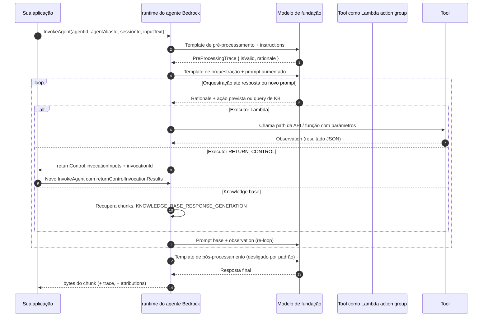
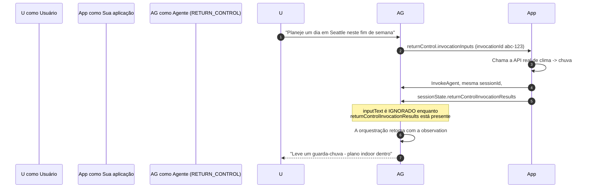
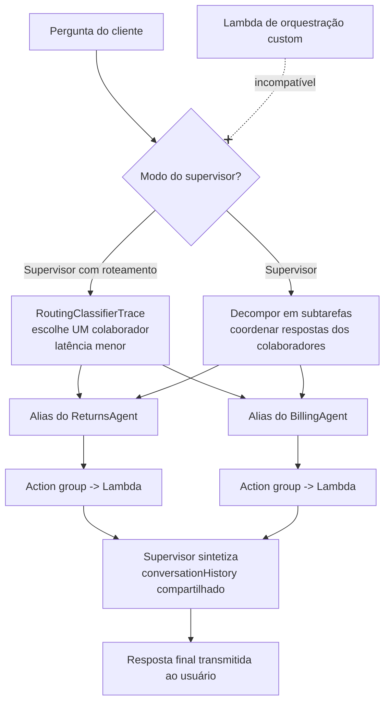
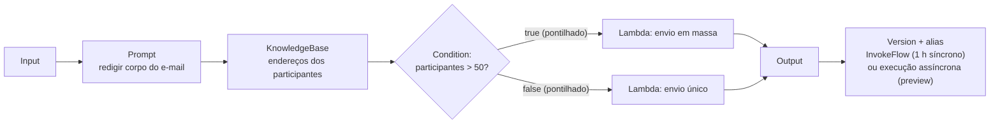
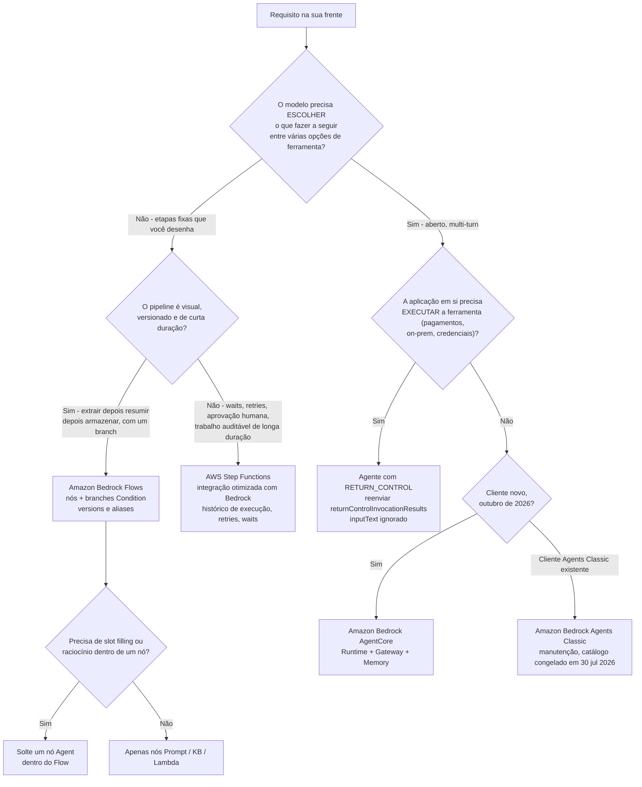

# Amazon Bedrock Agents, Flows e Orquestração

Tudo neste curso até agora foi sobre **uma chamada de modelo**: escreva um prompt, obtenha uma completion, avalie-a. IA em produção raramente é uma chamada. É uma *sequência*, procure algo, verifique uma condição, chame uma API, faça uma pergunta de acompanhamento ao usuário, tente de novo, e o exame tem um vocabulário dedicado para quem é dono dessa sequência: **você** (o código da sua aplicação), **o modelo** (um agente que escolhe ações em runtime), **um grafo que você desenhou** (Amazon Bedrock Flows), ou **uma máquina de estados** (AWS Step Functions). A Lição 11 é sobre essa decisão de propriedade, e sobre os serviços da AWS que implementam cada resposta.

```text
 =====================================================================
  QUEM É DONO DO PRÓXIMO PASSO?           (Digest: 06 out. 2026)
 =====================================================================
  SEU CÓDIGO ........... Converse + toolConfig (o modelo propõe JSON,
                         seu app executa a função)
  O MODELO ............. agente Amazon Bedrock: pré-processamento ->
                         loop de orquestração (rationale -> action ->
                         observation) -> pós-processamento
  O GRAFO .............. Amazon Bedrock Flows (ex-"Prompt Flows"):
                         nós Input/Prompt/KB/Condition/Lambda/Agent
  A DEFINIÇÃO .......... AWS Step Functions: máquina de estados
                         determinística, retries, waits, aprovação humana
 --------------------------------------------------------------------
  NOMES QUE VALEM A PENA SABER
    Amazon Bedrock Agents Classic ... fechado para novos clientes
                                      em 30 jul 2026 (manutenção)
    Amazon Bedrock AgentCore ........ sucessor (GA, 9 regiões)
    Amazon Bedrock Flows ............ GA 22 nov 2024 (ex-Prompt
                                      Flows), cobrado por node
                                      transition
    Amazon Bedrock Prompt Management . prompts salvos e versionados
 =====================================================================
```

> [!NOTE]
> **Como ler esta lição.** Três regras valem ao longo de todo o texto. (1) **Nomeação é examinável**: a AWS renomeou "Agents for Amazon Bedrock" para **Amazon Bedrock Agents Classic** e "Prompt Flows" para **Amazon Bedrock Flows**, e a lista em escopo do AIF-C01 agora diz **Amazon Bedrock AgentCore**. (2) **Mecanismos vencem listas decoradas**: o loop, a união de executors e o contrato `sessionState` mudam raramente; o catálogo de modelos dentro de um agente é congelado. (3) **Qualquer coisa que a AWS não confirma em primeira parte é sinalizada**, nunca ensinada como material de decoreba: os sinalizadores são coletados no final da lição.

Ao final desta lição você será capaz de:

- nomear os quatro componentes de build time que todo agente precisa e os opcionais que a AWS lista ao lado deles;
- percorrer o loop de runtime, pré-processamento, orquestração, pós-processamento, e dizer qual dos quatro templates base de prompt é editável em cada fase;
- escolher entre um **OpenAPI schema** e **function details**, e entre um **executor Lambda** e **`RETURN_CONTROL`**;
- enunciar o contrato do `InvokeAgent`: parâmetros obrigatórios, o teto de **2.048 caracteres** do `inputText`, os scopes do `sessionState` e o que acontece com o `inputText` em um resubmission de return control;
- descrever a memória do agente (`SESSION_SUMMARY`, 1 to 365 dias) e as cotas de gerenciamento de sessão;
- configurar **colaboração multi-agente** (≤ 10 aliases de colaborador, dois modos) e explicar por que orquestração custom é incompatível com ela;
- listar os **16 tipos de nó do Flows**, os dois tipos de conexão e os limites de execução (1 h sync, 5 min/nó e 24 h async em preview);
- defender o **veredito comparativo**: agente vs. prompt simples vs. workflow vs. código.

---

## 1. Três nomes, três serviços: Agents Classic, AgentCore e Flows

### 1.1 Os renomeamentos que decidem o exame

Dois renomeamentos carregam mais pontos do que qualquer outro fato desta lição:

1. **"Amazon Bedrock Agents" / "Agents for Amazon Bedrock" → Amazon Bedrock Agents Classic.** A AWS o colocou sob *Serviços indo para Manutenção* no seu **Service Availability Update de 30 de junho de 2026**: **fechado para novos clientes a partir de 30 de julho de 2026**, **sem novos recursos**, e um **catálogo de modelos de fundação congelado em 30 de julho de 2026**. Clientes existentes não são afetados, e modelos, Knowledge Bases e Guardrails do Amazon Bedrock são explicitamente *não* afetados. Não há exceções para o corte de novos clientes.
2. **"Prompt Flows" → Amazon Bedrock Flows**, generally available em **22 de novembro de 2024**, acrescentando visibilidade de execução por etapa e suporte a Guardrails em nós de prompt e de knowledge base. O nome antigo sobrevive apenas em algumas listas em escopo de certificação.

O alvo de migração documentado para o Agents Classic é o **Amazon Bedrock AgentCore**: um conjunto de seis componentes (Runtime, Gateway, Identity, Memory, Observability e Harness) que entrou em preview em **julho de 2025**, chegou ao GA em **nove regiões**, e continuou entregando ao longo de 2026 (**Managed Knowledge Base GA em junho de 2026**, **Agent Registry GA em agosto de 2026**).

| Recurso (nome oficial atual) | Status em outubro de 2026 | Data-chave |
|---|---|---|
| **Amazon Bedrock Agents Classic** | Manutenção: sem novos clientes, sem novos recursos, catálogo de FM congelado | 30 jul 2026 |
| **Amazon Bedrock AgentCore** | GA em nove regiões, releases mensais | Preview jul 2025 |
| **Amazon Bedrock Flows** (ex-Prompt Flows) | GA; cobrado por node transition | 22 nov 2024 |
| Flows: **execuções de fluxo assíncronas** | **Preview**: ≤ 5 min por nó, ≤ 24 h por fluxo | 11 jul 2025 |
| Flows: **conversa multi-turn** | **Preview**: `INPUT_REQUIRED` → resposta → `SUCCESS` | 2026 |
| **Colaboração multi-agente** | GA (preview em 3 dez 2024) | 2024 to 25 |
| **Return of control**; **memória de agente** | GA | 2024 to 26 |
| **Amazon A2I** (Augmented AI) | Sem novos clientes, sem novos recursos; **removido da lista em escopo do AIF-C01** | jun/jul 2026 |
| Nome **"Prompt Flows"** | Substituído pelo Amazon Bedrock Flows | 22 nov 2024 |

> [!WARNING]
> **Não responda uma questão do AIF-C01 com um nome substituído.** Se uma opção diz *"criar um Prompt Flow"* ou *"adicionar um modelo novo ao meu agente Bedrock"*, leia-a como uma armadilha: Prompt Flows virou **Amazon Bedrock Flows** em novembro de 2024, e um agente **Agents Classic** não pode receber novos modelos de fundação depois de **30 de julho de 2026**. A resposta aprovada descreve o serviço *atual*, **Flows** para grafos, **AgentCore** para novas construções de agente, ou reconhece explicitamente o status de manutenção.

> **📚 Você sabia?** AgentCore não é um agente renomeado: é uma decomposição. Seus seis componentes mapeiam para peças que costumavam viver dentro de um único agente: **Runtime** (o loop de invocação), **Gateway** (exposição de ferramentas/APIs), **Identity**, **Memory**, **Observability** (traces e telemetria) e **Harness** (empacotamento). É por isso que a orientação de migração da AWS fala em mover *capacidades*, não em um upgrade com um clique de um ID de agente existente.

### 1.2 O que o exame oficialmente pergunta sobre agentes

O guia de exame AIF-C01 é a autoridade para o escopo, e seu conteúdo agentic fica em dois lugares:

| Objetivo / peso | O que a AWS diz | Cobertura na lição |
|---|---|---|
| **2.3.1**: Serviços GenAI | Bedrock, SageMaker AI, JumpStart, Amazon Q, Kiro, Strands Agents, **AgentCore** | §1, §7, §9 |
| **Conceitos agentic do Domínio 2** | *Padrões multi-agent, MCP, gerenciamento de memória, uso de ferramentas, orquestração de workflows* | §4, §5, §6, §7 |
| **3.1.6** | *"Defina o papel dos agentes de IA e descreva suas aplicações de negócio."* | §8, §9 |
| Pesos dos domínios | **20 / 24 / 28 / 14 / 14 %** (Domínios 1 to 5) |: |

Duas mudanças de escopo foram publicadas para esta versão do exame: **AgentCore, Kiro, Strands Agents, Amazon Q, SageMaker JumpStart e AWS Transform foram adicionados**, e **Amazon MemoryDB foi removido**. Amazon A2I, listado no guia de exame v1.4 (2024), não está mais na lista de escopo atual.

---

## 2. Anatomia de um agente

### 2.1 O mínimo de build time

A própria redação da AWS sobre o que um agente é feito é precisa e vale decorar como uma frase: um modelo de fundação, **instructions**, opcionalmente templates de prompt base ou advanced, e **pelo menos um de: action groups ou knowledge bases**. Memória, Guardrails, code interpretation e colaboração multi-agente são todos add-ons opcionais.

| Componente | Papel no build time | Papel no runtime |
|---|---|---|
| **Modelo de fundação** | Escolhido por agente (catálogo Classic congelado em 30 jul 2026) | Rationale, predição de ação, leitura de observations, resposta final |
| **Instructions** | Descrição de trabalho em linguagem natural para o agente | Injetadas no prompt base aumentado em **cada** etapa de orquestração |
| **Templates de prompt base / advanced** | **4** templates; você pode sobrescrever texto, parser ou `overrideLambda` | Dirigem pré-processamento, orquestração, geração de resposta da KB e pós-processamento |
| **Action group: OpenAPI schema** | Documento OpenAPI hospedado no S3 ou inline | Agente seleciona o path/verbo da API; parâmetros vão para um evento Lambda ou para return control |
| **Action group: function details** | Funções com `name`, tipos de dados e flags `required` | Agente **primeiro elicita do usuário os parâmetros required ausentes** |
| **Executor** | ARN do Lambda **ou** `customControl: RETURN_CONTROL` | Executa a ação, ou devolve a invocação para a sua aplicação |
| **Associação de knowledge base** | Anexe uma KB existente | Recuperação dentro do loop de orquestração → `KNOWLEDGE_BASE_RESPONSE_GENERATION` |
| **Memória** | Habilite + `storageDays` (**1 to 365**) | Carrega resumos para um `memoryId`; sumarização assíncrona após o fim da sessão |
| **Guardrails** | Anexe um guardrail | Produz `GuardrailTrace`; `applyGuardrailInterval` controla a cadência do streaming |
| **Colaboração multi-agente** | Marque o agente como supervisor; anexe **aliases** de colaborador (≤ 10) | Planeja ou roteia; compartilhamento de `conversationHistory` entre agentes |
| **Versão / alias** | `PrepareAgent` → versão → **alias** | Você pode invocar **apenas** com um `agentAliasId` |
| **Code interpretation** | Habilite | Código gerado pelo FM roda em um sandbox seguro |

Duas linhas merecem ênfase própria. Primeiro, **alias**: `InvokeAgent` exige `agentAliasId`, nunca um agent ID puro: um rascunho de agente que você nunca preparou e criou alias não pode ser chamado. Segundo, **function details vs. OpenAPI**: eles são alternativas, não camadas. Um action group usa exatamente **um** dos dois schemas, e a união de executor (`Lambda ARN | RETURN_CONTROL`) se aplica a ambos.

### 2.2 Exemplo 1: construindo um agente de viagens (build time)

1. Crie o agente e dê a ele **instructions**: *"Você é um agente de viagens. Reserve o voo mais barato em conformidade. Nunca invente preços; sempre chame a FlightsAPI."*
2. Escolha um **modelo de fundação** do catálogo disponível para Agents Classic na sua conta.
3. Adicione um **action group** `FlightsAPI` com um **OpenAPI schema** descrevendo `searchFlights` e `bookFlight`.
4. Defina o **executor** como um **ARN de Lambda** (o Lambda valida IAM, chama a API da companhia aérea e retorna JSON).
5. Opcionalmente anexe uma **knowledge base** de políticas de viagem corporativas, um **guardrail** que bloqueia números de cartão, e **memória** com `storageDays = 90`.
6. `PrepareAgent` → anote a **versão** → crie um **alias** (por exemplo `T1`).
7. Entregue à aplicação `agentId` + `agentAliasId` e chame `InvokeAgent`.

Nada acima é autônomo ainda: a autonomia aparece apenas em runtime, no loop que o modelo dirige.

---

## 3. Runtime: o loop de orquestração

### 3.1 As três fases, em ordem

Cada chamada `InvokeAgent` passa por **pré-processamento**, depois um **loop de orquestração** que se repete até que exista uma resposta ou o usuário receba um novo prompt, e então **pós-processamento** (desativado por padrão). O próprio loop tem um ritmo interno fixo: o modelo produz um **rationale**, prevê uma **chamada de action group ou uma query de knowledge base**, os parâmetros vão para o Lambda *ou* de volta para a sua aplicação via return control, o resultado volta como uma **observation**, a observation é anexada ao prompt base, e o loop se repete.



Três consequências saem daquele diagrama e cada uma já foi testada:

- **O custo escala com as iterações, não com as requisições.** Cada volta do loop é outra invocação do modelo de fundação contra o prompt aumentado, e é por isso que um agente é mais caro do que um prompt único para a mesma pergunta.
- **Return control é uma *segunda* chamada `InvokeAgent`**, não um campo que você pode preencher depois na mesma requisição. Sua aplicação executa a ferramenta e resubmete.
- **Observations, não o histórico de chat, dirigem os resultados de ferramenta.** O resultado de uma ação é anexado ao prompt base para que o modelo raciocine sobre ele na próxima iteração.

### 3.2 Os quatro templates base editáveis

| Template | Fase | `ModelInvocationInput.type` | Editável por você |
|---|---|---|---|
| Pré-processamento | antes do loop | `PRE_PROCESSING` | Sim: texto, parser, `overrideLambda` |
| Orquestração | dentro do loop | `ORCHESTRATION` | Sim: texto, parser, `overrideLambda` |
| Geração de resposta da KB | quando uma KB é consultada | `KNOWLEDGE_BASE_RESPONSE_GENERATION` | Sim: texto |
| Pós-processamento | depois do loop | `POST_PROCESSING` | Sim, e **desligado por padrão** |

A AWS documenta **quatro** templates base como sobrescrevíveis. Prompts advanced deixam você substituir o texto inteiramente; `promptCreationMode` e `parserMode` no trace dizem se um valor veio de `DEFAULT` ou `OVERRIDDEN`: que é a sua evidência de auditoria de que um override está ativo.

### 3.3 Tipos de trace: sete objetos que respondem sete perguntas

Com `enableTrace = true` o runtime transmite eventos de trace ao lado dos eventos `chunk`. Existem **7** tipos de objeto de trace:

| Objeto de trace | `type` | A pergunta que ele responde |
|---|---|---|
| `PreProcessingTrace` | `PRE_PROCESSING` | A requisição era válida? `isValid` + rationale |
| `OrchestrationTrace` | `ORCHESTRATION` | Rationale → `InvocationInput` (action group, verbo, `apiPath`, função, parâmetros, `executionType`) → `Observation` |
| Geração de resposta da KB | `KNOWLEDGE_BASE_RESPONSE_GENERATION` | Quais chunks foram recuperados, e o que foi gerado a partir deles |
| `PostProcessingTrace` | `POST_PROCESSING` | Como a resposta final foi formatada? |
| `RoutingClassifierTrace` | `ROUTING_CLASSIFIER` | Qual colaborador o supervisor escolheu? |
| `CustomOrchestrationTrace` |: (event-driven) | Que ordem *o seu* Lambda orquestrador impôs? |
| `GuardrailTrace` / `FailureTrace` |: | Qual ação de guardrail disparou / por que a execução falhou (`FailureTrace` não carrega `ModelInvocationInput`) |

### 3.4 Exemplo 2: uma requisição de reserva, trace a trace

1. A aplicação chama `InvokeAgent` com `agentId`, `agentAliasId`, `sessionId = S1`, `inputText = "Reserve o voo mais barato para Denver na próxima sexta"` (**≤ 2.048 caracteres**) e `enableTrace = true`.
2. **Pré-processamento** valida a requisição → `PreProcessingTrace { isValid: true, rationale }`.
3. **Orquestração, iteração 1**: rationale → prevê `FlightsAPI.searchFlights` → `InvocationInput { apiPath, parameters }` → Lambda executa → `Observation` contendo a lista JSON de voos.
4. **Iteração 2**: um parâmetro required (`travelerId`) está ausente → a **Observation retornada faz um novo prompt ao usuário**: *"Para qual viajante devo reservar?"* (a AWS documenta esse comportamento explicitamente).
5. O usuário responde **na mesma `sessionId`** → a ação executa → nova `Observation`.
6. **Pós-processamento** (se habilitado) formata a resposta → a aplicação recebe `chunk.bytes` como *"Reservado UA 512…"*, mais um objeto `attribution` se uma knowledge base foi usada. Traces são transmitidos ao lado dos chunks.

```dragdrop
{
  "question": "Ordene as fases de runtime de uma chamada de agente Bedrock como a AWS as documenta:",
  "items": [
    "Etapa 4: loop de orquestração: rationale, prever ação ou query de KB, invocar, receber observation, re-loop",
    "Etapa 1: InvokeAgent chega com agentAliasId, sessionId e inputText de no máximo 2.048 caracteres",
    "Etapa 2: o pré-processamento valida a requisição e emite PreProcessingTrace",
    "Etapa 3: o prompt base aumentado é construído a partir das instructions mais o estado da conversa",
    "Etapa 5: o pós-processamento formata a resposta final (desligado por padrão) e os chunks são transmitidos de volta"
  ],
  "correctOrder": [
    "Etapa 1: InvokeAgent chega com agentAliasId, sessionId e inputText de no máximo 2.048 caracteres",
    "Etapa 2: o pré-processamento valida a requisição e emite PreProcessingTrace",
    "Etapa 3: o prompt base aumentado é construído a partir das instructions mais o estado da conversa",
    "Etapa 4: loop de orquestração: rationale, prever ação ou query de KB, invocar, receber observation, re-loop",
    "Etapa 5: o pós-processamento formata a resposta final (desligado por padrão) e os chunks são transmitidos de volta"
  ],
  "explanation": "A ordem documentada é pré-processamento, depois o loop de orquestração (rationale -> ação prevista ou query de KB -> invocação -> observation -> re-loop) até que exista uma resposta ou o usuário receba um novo prompt, e então pós-processamento, que está desligado por padrão. O loop é o que torna um agente autônomo: cada iteração é uma chamada nova do modelo de fundação contra o prompt aumentado, então custo e latência crescem com as iterações, não com as requisições."
}
```

> **📚 Você sabia?** O `OrchestrationTrace` é onde você pode provar o que seu agente realmente fez: `InvocationInput` registra o **action group, verbo HTTP, `apiPath` ou nome da função, os parâmetros resolvidos e o `executionType`**, e `Observation` registra o que voltou. Quando um stakeholder pergunta "por que o agente chamou a API de pagamento?", o trace, não o CloudTrail, é o primeiro lugar para olhar, porque o CloudTrail vê a invocação do Lambda, mas não o rationale do modelo por tê-la escolhido.

### 3.5 Lendo um trace: sintoma → objeto de trace → correção

| Sintoma em produção | Objeto de trace a abrir | O que o trace diz | Correção típica |
|---|---|---|---|
| Agente responde besteira para uma requisição malformada | `PreProcessingTrace` | `isValid` e o rationale do modelo | Aperte as instructions; a execução deveria parar aqui |
| Agente chama a API errada | `OrchestrationTrace` → `InvocationInput` | Action group, verbo, `apiPath`, parâmetros resolvidos, `executionType` | Estreite as descrições do action group; acrescente exemplos às instructions |
| Resposta ignora o texto de política recuperado | Trace de geração de resposta da KB | Chunks recuperados vs. resposta gerada | Conserte chunking/recuperação, não o prompt |
| Agente nunca formata a resposta final como exigido | `PostProcessingTrace` | Se o pós-processamento rodou (está desligado por padrão) | Habilite e edite o quarto template base |
| Supervisor escolheu o colaborador errado | `RoutingClassifierTrace` | A decisão de roteamento | Renomeie/descreva aliases de colaborador com mais precisão |
| Orquestrador custom rodou etapas na ordem errada | `CustomOrchestrationTrace` | A ordem de etapas do seu Lambda orquestrador | Conserte o orquestrador; este trace existe apenas para orquestração custom |
| Execução parou sem nenhum input de modelo | `FailureTrace` | Motivo da falha; carrega **nenhum** `ModelInvocationInput` | Leia o motivo da falha e rode de novo |
| Guardrail bloqueou uma resposta que parecia válida | `GuardrailTrace` | Qual ação de guardrail disparou | Ajuste o guardrail ou o `applyGuardrailInterval` |

---

## 4. Action groups, return of control e tool use bruto

### 4.1 Dois estilos de schema, dois executors

Um action group é definido por **exatamente um** estilo de schema e **exatamente um** executor:

| Ferramenta / tipo de ação | Onde é definido | Executor | Schema | Observação-chave |
|---|---|---|---|---|
| **Action group OpenAPI** | `apiSchema` (S3 ou inline) | Lambda **ou** `RETURN_CONTROL` | paths, verbos e parâmetros OpenAPI | Agente seleciona a operação da API em runtime |
| **Function details** | `functionSchema` | Lambda **ou** `RETURN_CONTROL` | Funções + parâmetros (`name`, tipo, `required`) | Agente **elicita primeiro os parâmetros required ausentes** |
| **Return of control** | `customControl: RETURN_CONTROL` | **A sua aplicação**, depois resubmita | `invocationInputs` + `invocationId` | `inputText` ignorado no resubmission; `responseState` `FAILURE`/`REPROMPT`; `confirmationState` `CONFIRM`/`DENY` |
| **Knowledge base** | Associação de KB | Recuperação gerenciada pelo Bedrock |: | Emite o trace de geração de resposta da KB |
| **`toolConfig` toolSpec do Converse** | Seu app, **fora** dos agentes | Seu código | `{name, description, inputSchema.json}` | O modelo apenas propõe JSON (`stopReason = toolUse`) |
| **`systemTool` (embutido)** | União `toolConfig` do Converse | Gerenciado pelo Bedrock | nome da ferramenta | Suporte ao modelo varia |
| **Orquestração custom** | Lambda no nível do agente | O seu Lambda ordena ações | contrato de eventos | `CustomOrchestrationTrace`; **incompatível com colaboração multi-agente** |
| **Nós do Flow como ferramentas** | Definição do Flow | Lambda / Storage / Retrieval / KB / Agent / Lex | configuração do nó | Flows chamam apenas o que você ligou |

Dois limites que valem a pena citar: a `description` de um action group vai de **1 to 200 caracteres**, e um executor é um **tipo união**: um ARN de Lambda *ou* `customControl: RETURN_CONTROL`, nunca ambos.

### 4.2 Exemplo 3: return of control, o cenário oficial de clima

Use return of control quando **a sua aplicação** deve executar a chamada: um trilho de pagamento privado, um sistema on-premises, uma credencial que o Bedrock pode não reter.

1. Crie o action group `WeatherAPIs` com a função `getWeather(location, date)` e executor `customControl = RETURN_CONTROL`.
2. O usuário diz *"Planeje um dia em Seattle neste fim de semana."* → a orquestração prevê `getWeather`.
3. A resposta carrega `returnControl.invocationInputs` com `invocationId = abc-123` e parâmetros `{location: seattle, date: 2024-09-15}`.
4. **A sua aplicação** chama a API real de clima → a resposta é *chuva*.
5. Você chama `InvokeAgent` **de novo com a mesma `sessionId`**, fornecendo `sessionState.returnControlInvocationResults = [{ functionResult: { actionGroup, function, responseBody: { TEXT: { body: "{\"cond\":\"rain\"}" } } } }]` com o **`invocationId` correspondente**, e **`inputText` é ignorado** porque `returnControlInvocationResults` está presente.
6. A orquestração retoma: *"Leve um guarda-chuva; aqui está um plano para indoors…"*. Variantes: `responseState = REPROMPT` alimenta um resultado de ferramenta com falha de volta para uma nova tentativa; `responseState = FAILURE` falha a execução com um erro de dependência; `confirmationState = CONFIRM | DENY` implementa um gate de **confirmação do usuário antes da ação**.



### 4.3 Exemplo 4: slot filling com function details

1. A função é `BookHotel(HotelName/required, CheckinDate/required, NumberOfNights/optional, Email/required, AllowMarketingEmails/required)`.
2. O usuário diz *"Reserve o Hotel X para amanhã"* → o agente preenche `HotelName` e `CheckinDate`.
3. Dois parâmetros **required** são desconhecidos → o agente **pergunta ao usuário**: *"Qual é o seu e-mail? Podemos enviar promoções?"*
4. O usuário responde em dois turns (valores com escopo de turn vivem em `promptSessionAttributes`) → todos os parâmetros required estão presentes → a ação executa → uma confirmação é retornada.

**Slot elicitation é o discriminador canônico agente-versus-prompt.** Um prompt simples não pode *esperar* por um parâmetro required ausente, chamar uma API e então retomar: um agente faz exatamente isso, dirigido pela observation de que um parâamento está ausente.

### 4.4 Tool use bruto sem um agente

O function calling também existe **sem** nenhum agente, na API Converse: você passa `toolConfig.tools[].toolSpec { name, description, inputSchema.json }` (mais `toolChoice`), o modelo retorna JSON com `stopReason = toolUse`, **a sua aplicação executa a função**, e você envia um `toolResult` de volta. O modelo **nunca executa a função**: essa fronteira é o ponto inteiro, e é a maneira mais confiável de distinguir uma questão de *ferramenta* de uma questão de *agente*.

| Sinal na questão | Mecanismo correto |
|---|---|
| "O modelo deveria decidir qual das minhas funções chamar, mas meu código as roda" | Tool use via `toolConfig` do Converse |
| "O serviço deveria planejar, chamar ferramentas entre turns e pedir de novo slots ausentes" | Action group de **agente** |
| "Minha aplicação deve rodar a chamada por razões de segurança/conformidade" | Action group com `RETURN_CONTROL` |
| "A ordem das etapas é fixa e auditável" | **Flows** ou **Step Functions** |

> [!WARNING]
> **O contrato de resubmission de return control é exato.** Você deve reusar a **mesma `sessionId`**, o **mesmo `invocationId`**, e os mesmos nomes de `actionGroup`/`function`; você deve enviar o resultado através de `sessionState.returnControlInvocationResults`; e enquanto aquele campo está presente, **`inputText` é ignorado**, então um resubmission que também carrega uma nova pergunta do usuário descarta a pergunta silenciosamente. Opções alegando que você precisa de uma `sessionId` nova, de um `invocationId` novo, ou de que `inputText` deve repetir a requisição original estão todas erradas.

---

## 5. InvokeAgent, session state e memória

### 5.1 O contrato da requisição

| Parâmetro | Regra |
|---|---|
| `agentId` | O identificador do agente |
| `agentAliasId` | **Obrigatório e deve ser um alias**: nunca o agent ID puro |
| `sessionId` | Chave da conversa; resubmissions de return control devem reusá-la |
| `inputText` | **≤ 2.048 caracteres** |
| `enableTrace` | Transmite os 7 tipos de objeto de trace ao lado dos chunks |
| `endSession` | Encerra a sessão e, com memória ligada, dobra a sessão em um `memoryId` |
| `memoryId` | Carrega resumos armazenados para memória entre sessões |
| `sessionState` | Atributos, histórico de conversa, resultados de return control, overrides de KB |
| `streamingConfigurations` | `streamFinalResponse`, `applyGuardrailInterval` |

A resposta transmite **`chunk` + `trace` + `attributions` + `returnControl`**, e os headers da resposta incluem **`x-amz-bedrock-agent-session-id`** e, quando memória é usada, **`x-amz-bedrock-agent-memory-id`**.

```text
POST /agents/<agentId>/agentAliases/<agentAliasId>/invoke   <-- alias é obrigatório
  headers: Authorization (SigV4), X-Amz-Target
{
  "inputText": "Reserve o voo mais barato para Denver ...",   <-- MÁX 2048 chars
  "sessionId": "S1",                                       <-- reusar no resubmit
  "enableTrace": true,
  "endSession": false,
  "memoryId": "M-user-42",                                 <-- opcional, entre sessões
  "streamingConfigurations": {
      "streamFinalResponse": true,
      "applyGuardrailInterval": 5                          <-- cadência do guardrail
  },
  "sessionState": {
      "sessionAttributes":          {"locale": "pt-BR"},   <-- sessão inteira
      "promptSessionAttributes":    {"tier": "gold"},      <-- um único turn
      "conversationHistory":        [...],                 <-- multi-agente
      "knowledgeBaseConfigurations":[...],                 <-- KB por requisição
      "returnControlInvocationResults": [ { "functionResult": {
          "actionGroup": "WeatherAPIs",
          "function": "getWeather",
          "invocationId": "abc-123",
          "responseBody": {"TEXT": {"body": "{\"cond\":\"rain\"}"}}
      } } ]                      <-- se presente, inputText é IGNORADO
  }
}
Response: event stream
  -> chunk      (bytes da resposta)   -> attribution (fontes da KB)
  -> trace      (7 tipos de trace)    -> returnControl (invocationInputs)
  headers: x-amz-bedrock-agent-session-id, x-amz-bedrock-agent-memory-id
Nota: a AWS CLI não consegue consumir este event stream - use um SDK reader.
```

### 5.2 `sessionState`: cinco scopes, uma regra de override

| Campo | Scope | Propósito |
|---|---|---|
| `sessionAttributes` | **Sessão inteira** | Fatos estáveis (locale, tier da conta) carregados entre turns |
| `promptSessionAttributes` | **Um turn** | Valores que devem expirar após o turn atual |
| `conversationHistory` | Multi-agente | Histórico compartilhado quando o compartilhamento de histórico conversacional está ligado |
| `returnControlInvocationResults` | Resubmission | Resultados de ferramenta; **quando presente, `inputText` é ignorado** |
| `knowledgeBaseConfigurations` | Por requisição | Overrides de knowledge base por requisição |

### 5.3 Exemplo 5: memória entre sessões

1. Na sessão `S1` o usuário diz *"Sou alérgico a frutos do mar"*; a aplicação chama `InvokeAgent` com `endSession = true`.
2. `S1` se dobra em **`memoryId = M-user-42`** e a sumarização assíncrona escreve um resumo usando o template de sumarização (editável).
3. Depois, `InvokeAgent(sessionId = S2, memoryId = M-user-42, inputText = "Sugira um starter")` carrega os resumos armazenados → a resposta **exclui frutos do mar**; o header `x-amz-bedrock-agent-memory-id` confirma que memória foi usada.
4. `storageDays = 90` significa que resumos mais antigos são expurgados após 90 dias; **desligar a memória** retorna o contexto de sessão única padrão.

Fatos sobre memória em um lugar: o **único** tipo de memória é **`SESSION_SUMMARY`**, a retenção é de **1 to 365 dias** (`storageDays`), os gatilhos de dobra são **`endSession = true` na mesma `sessionId`** ou o vencimento do **`idleSessionTimeout`**, a sumarização roda **de forma assíncrona** com um template editável, e você lê resumos com **`GetAgentMemory`** (ou a aba Memory do console).

### 5.4 Cotas de gerenciamento de sessão (separadas da memória)

| Cota | Valor |
|---|---|
| Etapas por sessão | **≤ 1.000** |
| Tamanho por etapa | **≤ 50 MB** |
| Timeout de ociosidade | **1 hora** |
| Exclusão automática | **30 dias** |
| Integração LangGraph | `BedrockSessionSaver` |

> **📚 Você sabia?** **A AWS CLI não consegue transmitir `InvokeAgent`.** Transmitir eventos `chunk` e `trace` requer um SDK com tratamento de event-stream (por exemplo boto3/Java/Node com o response stream reader). Este é um problema operacional real, e um distrator favorito: *"habilite o streaming com `aws bedrock-agent-runtime invoke-agent --no-cli-pager`"* não existe. Use `enableTrace = true` mais um SDK stream reader, e leia a sessão de volta do header de resposta `x-amz-bedrock-agent-session-id`.

---

## 6. Colaboração multi-agente

### 6.1 Um supervisor, no dez colaboradores, dois modos

| Item | Regra |
|---|---|
| Colaboradores | **≤ 10 aliases de colaborador** anexados a um único supervisor |
| Modo **Supervisor** | O supervisor **coordena e sintetiza** as respostas dos colaboradores (decompõe em subtarefas) |
| Modo **Supervisor com roteamento** | O supervisor **roteia para um único** colaborador → **latência menor** |
| Histórico | `conversationHistory` é construído automaticamente quando o compartilhamento de histórico conversacional está ligado |
| Conflito | **Orquestração custom não pode ser combinada com colaboração multi-agente** |
| Linha do tempo | Preview **3 dez 2024**; GA anunciado em notícias da AWS ao longo de 2025 |

### 6.2 Exemplo 6: um supervisor de triagem

1. Implante os colaboradores `ReturnsAgent` e `BillingAgent` e crie um **alias** para cada.
2. Promova `TriageAgent` a supervisor, escolha o modo **Supervisor com roteamento** e anexe ambos os aliases (nunca mais de 10).
3. O cliente pergunta *"Por que fui cobrado duas vezes em março?"* → **`RoutingClassifierTrace`** registra a decisão → o supervisor invoca `BillingAgent` com `sessionState.conversationHistory`.
4. O action group de `BillingAgent` chama o Lambda → a resposta final é sintetizada e transmitida de volta.
5. Se o requisito fosse *"investigar devoluções **e** faturamento, depois resumir"*, o modo correto seria **Supervisor** puro, que decompõe a requisição e coordena as respostas dos colaboradores em vez de escolher um.



---

## 7. Amazon Bedrock Flows (ex-Prompt Flows)

### 7.1 O que um Flow é

Um Flow é um **grafo visual e declarativo de nós** que você desenha no Flow builder e invoca através de `CreateFlow` → `PrepareFlow` → `InvokeFlow` (com **versões e aliases**, exatamente como agentes). O modelo não escolhe as etapas, **o grafo escolhe**. Flows tornou-se GA em **22 de novembro de 2024** como "Amazon Bedrock Flows, anteriormente conhecido como Prompt Flows", acrescentando visibilidade de execução por etapa e Guardrails em nós de prompt e de knowledge base.

### 7.2 Os 16 tipos de nó

| Nó | Propósito | Nó | Propósito |
|---|---|---|---|
| **Input** | Ponto de entrada do flow | **Output** | Ponto de saída / resultado |
| **Prompt** | Executa um prompt (opcionalmente um prompt salvo do Prompt Management) | **KnowledgeBase** | Recupera de uma KB anexada |
| **Agent** | Chama um agente do Bedrock dentro do grafo | **Condition** | Ramifica em uma expressão |
| **Lex** | Nó de conversa do Amazon Lex | **LambdaFunction** | Chama o seu Lambda |
| **Storage** | Lê/escreve object storage | **Retrieval** | Nó de recuperação custom |
| **Iterator** | Percorre uma lista | **Collector** | Coleta resultados |
| **InlineCode** | Executa código inline (status conforme docs da AWS em out. 2026) | **Loop** | Laço estilo do-while |
| **LoopInput** | Alimenta o loop | **LoopController** | Controla a saída do loop |

As conexões vêm em dois tipos: **conexões de dados (sólidas)** que sempre carregam valores, e **conexões condicionais (pontilhadas)** que disparam apenas quando um nó `Condition` avalia como true. Guardrails podem ser anexados a nós de **prompt** e de **knowledge base**: é assim que você aplica uma política dentro de um grafo em vez de ao redor dele.

### 7.3 Exemplo 7: um pipeline de convites com um branch

1. `CreateFlow` com um nome e uma role do IAM; ligue os nós: `Input → Prompt (redigir o corpo do e-mail) → KnowledgeBase (endereços dos participantes) → Condition (participantes > 50?)`.
2. Branch **Sim** → nó `Lambda` de envio em massa; branch **Não** → nó `Lambda` de envio único; ambos convergem em `Output`. As conexões de dados são sólidas; os dois branches condicionais são pontilhados.
3. `PrepareFlow` → teste dentro do Flow builder, inspecionando o **input/output de cada nó**.
4. Crie uma **versão** e um **alias**; a aplicação chama `InvokeFlow` (síncrono, teto de **1 hora**) ou inicia uma **execução de flow assíncrona** (preview: **≤ 5 minutos por nó**, **≤ 24 horas por flow**, snapshot via `GetExecutionFlowSnapshot`, erros como `ExecutionTimedOut`).
5. Leia `FlowTraceEvent`s para visibilidade por etapa; troque o nó `Prompt` por um nó **Agent** quando raciocínio for necessário: a API de conversa multi-turn está em **preview** (`INPUT_REQUIRED` → sua resposta → `SUCCESS`).



### 7.4 O que um Flow custa, e o que ele não faz

Flows são cobrados **por transição de nó**, além do uso de modelo de fundação, Lambda e knowledge base dentro dos nós. O próprio walkthrough de preços da AWS conta uma execução como **2 + 10×2 + 3 = 25 transições**; uma taxa de **$0.035 por 1.000 transições** foi anunciada para **1 de fevereiro de 2025**, e a taxa atual deve ser confirmada na página de preços do Bedrock antes de você citá-la. Dois limites para decorar: execuções síncronas do `InvokeFlow` estouram em **1 hora**, e trabalho de longa duração pertence a **execuções de flow assíncronas** (preview: 5 minutos por nó, 24 horas no total) ou a **Step Functions**.

**Exemplo resolvido: contando transições de nó.** O walkthrough de preços da AWS cobra uma execução como **2 + 10×2 + 3 = 25 transições**: 2 para entrar e ramificar, um corpo de loop de 10 iterações × 2 nós, e mais 3 para convergir e sair. A lição é que **transições, não nós, são a unidade faturável**:

| Forma do grafo | Nós no canvas | Transições por execução |
|---|---:|---:|
| Linha reta `Input → Prompt → Output` | 3 | 2 |
| Branch tomado uma vez (`Input → Prompt → Condition → 1 de 2 → Output`) | 6 | 4 |
| Exemplo de preços documentado pela AWS | 6 | **25** (2 + 10×2 + 3) |
| Mesmo grafo, loop roda 50× em vez de 10× | 6 | **105** (2 + 50×2 + 3) |

| Modo de execução | Teto | Status |
|---|---|---|
| `InvokeFlow` (síncrono) | **1 hora** | GA |
| Execução de flow assíncrona | **≤ 5 min por nó, ≤ 24 h por flow** | **Preview** (11 jul 2025) |
| Conversa multi-turn com Flows | `INPUT_REQUIRED` → resposta → `SUCCESS` | **Preview** (2026) |
| Cobrança | **por transição de nó** | GA desde 22 nov 2024 |

> **📚 Você sabia?** A aritmética do exemplo de preços, **2 + 10×2 + 3 = 25 transições de nó**, é um lembrete de que *loops não são grátis em um grafo*: um nó revisitado dez vezes é cobrado dez vezes. Isso é o oposto de um agente, onde as iterações são cobradas como tokens de modelo de fundação, e o oposto de Step Functions, onde as transições são cobradas como transições de máquina de estados mais os serviços que você chama. Três orquestradores, três unidades de custo diferentes.

---

## 8. Escolhendo: prompt, agente, Flows ou Step Functions

### 8.1 A árvore de decisão



### 8.2 A matriz de decisão

| Critério | **Prompt simples** (Converse / Prompt Management) | **Agente Bedrock** (Classic / AgentCore) | **Bedrock Flows** | **Step Functions + Bedrock** |
|---|---|---|---|---|
| Metáfora | Uma chamada de modelo para dentro e para fora | Loop autônomo que *escolhe* ações | Grafo declarativo que você desenha | Máquina de estados determinística |
| Quem escolhe o próximo passo? | **Seu código** | **O FM em runtime** | **O grafo** (nós `Condition`) | **A definição** |
| Escolha de ferramenta multi-etapa | ❌ hard-coded | ✅ rationale → ação → observation | ⚠️ apenas caminhos pré-ligados | ✅ apenas explícito |
| Chamadas externas | Depois da resposta, no seu app | Action groups (Lambda / OpenAPI / return control) | Nós Lambda / Storage / Retrieval | Integrações / Lambda |
| Branches e loops | Código da aplicação | Implícito no loop de orquestração | `Condition`, `Iterator`/`Collector`, `Loop*` | Choice / Wait / Map / Parallel |
| Determinismo e auditoria | Alto | Baixo: médio (use **traces**) | Alto (flow trace + versions) | **O mais alto** (histórico de execução) |
| Aprovação humana | Código da aplicação | Return control + `CONFIRM`/`DENY` | Via Lambda ou efeitos colaterais do agente | Pausa nativa / padrão de aprovação |
| Construtor visual | ❌ | Agent builder (semi-visual) | ✅ Flow builder, versions, aliases | ✅ Workflow Studio |
| Melhor para | "Resumir / classificar / o que é X?" | Tarefas abertas multi-turn que precisam de escolha de ferramenta | Pipelines fixos com branches e guardrails | Longa duração, auditável, retries, waits |
| Unidade de custo | Tokens de FM | Tokens de FM **por iteração de orquestração** + Lambda/KB | FM/Lambda/KB + **$ por 1.000 transições de nó** | Transições + serviços |
| Novos clientes (out. 2026) | ✅ | Classic ❌ / AgentCore ✅ | ✅ | ✅ |

### 8.3 Exemplo 8: três requisitos, três respostas

1. **Extrair determinístico → condition → gravar, com rollback A/B** → **Amazon Bedrock Flows**: desenhe o grafo, publique a versão `v2`, o alias aponta para `v1`, faça rollback movendo o alias. Um alias de versão de Flow é exatamente o mecanismo A/B que um agente não tem.
2. **Tarefa aberta multi-turn onde o FM decide o que chamar** → **um agente** (AgentCore para uma construção nova em outubro de 2026). Slot elicitation, re-prompts e observations são os indicadores.
3. **"Esperar 3 dias por aprovação, tentar 5 vezes, depois notificar"** → **AWS Step Functions**, cuja integração otimizada com Bedrock (anunciada em novembro de 2023) inclui `InvokeModel`, `CreateModelCustomizationJob .sync` e um sample documentado *"Perform prompt-chaining with Bedrock"*. Nem Flows (teto síncrono de 1 hora) nem um agente (sem timers nativos de longa duração) servem.

```matching
{
  "question": "Combine cada requisito com o mecanismo de orquestração que a AWS documenta para ele:",
  "pairs": [
    {"left": "Resumir, classificar ou explicar de uma vez só", "right": "Prompt simples na API Converse: seu código é dono de cada etapa"},
    {"left": "Tarefa aberta multi-turn com escolha de ferramenta e slot filling", "right": "Agente Amazon Bedrock: rationale, predição de ação, observation, re-loop"},
    {"left": "Pipeline fixo com um branch de condição e rollback A/B", "right": "Amazon Bedrock Flows: nós Condition mais versions e aliases"},
    {"left": "Esperar dias, retry com backoff, aprovação humana, histórico completo de auditoria", "right": "AWS Step Functions: histórico de execução, retries, waits, Map e Parallel"},
    {"left": "Sua aplicação deve executar a ferramenta por conformidade", "right": "Action group com RETURN_CONTROL: reenviar returnControlInvocationResults, inputText ignorado"},
    {"left": "Construção de agente nova em outubro de 2026", "right": "Amazon Bedrock AgentCore - Agents Classic está fechado para novos clientes desde 30 jul 2026"}
  ],
  "explanation": "Cada mecanismo é dono do próximo passo de um modo diferente: seu código (prompt simples), o modelo em runtime (agente), o grafo que você desenhou (Flows) ou a definição de máquina de estados (Step Functions). As palavras-sinal do examinador se mapeiam de forma limpa - 'multi-turn, qual ferramenta a seguir' significa agente; 'determinístico, versionado, ramificado' significa Flows; 'esperar, retry, aprovar, auditar' significa Step Functions; e 'executamos nós mesmos' significa return of control."
}
```

---

## 9. Veredito comparativo

> [!IMPORTANT]
> **Veredito Comparativo: agente vs. prompt simples vs. workflow vs. código**
> - **Prompt simples (Converse API, opcionalmente Prompt Management)** é a resposta quando a tarefa é **uma chamada de modelo para dentro e para fora**: resumir, classificar, extrair, explicar. É a opção mais barata, mais determinística e mais auditável, e é onde todo caso de uso deve começar. **O código da sua aplicação** é dono de cada passo subsequente: se a sequência importa, a sequência vive no seu repo.
> - **Um agente Bedrock (Agents Classic hoje, AgentCore para construções novas)** é a resposta quando **o modelo de fundação deve escolher o que fazer a seguir**: escolher entre action groups ou knowledge bases, coletar parâmetros required ausentes ao longo de vários turns, re-promptar o usuário e repetir o loop até que exista uma resposta. Você abre mão do determinismo (recupere-o com `enableTrace`) e paga **por iteração de orquestração**, em troca de uma autonomia que você teria que escrever à mão.
> - **Um workflow: Amazon Bedrock Flows** é a resposta quando a sequência é **conhecida de antemão e deve ser visível**: um grafo desenhado de nós `Prompt`, `KnowledgeBase`, `Condition`, `Lambda` e `Agent` com **versions e aliases** para rollback, cobrado **por transição de nós**. Você mantém o determinismo e ganha um construtor visual; você perde a liberdade do modelo de escolher uma etapa que não está no grafo.
> - **Código: sua aplicação com `toolConfig` do Converse (ou Step Functions para trabalho de longa duração)** é a resposta quando você precisa de **controle explícito e testável**: o modelo propõe JSON (`stopReason = toolUse`) e **seu código executa a função**; Step Functions acrescenta retries, waits, aprovação humana e um histórico de execução quando uma execução precisa sobreviver a horas ou dias. Nem um agente nem um Flow substitui o rastro de auditoria de uma máquina de estados.
> - **Regra prática para o exame:** *o modelo decide qual ferramenta →* **agente**. *Eu desenhei as etapas →* **Flows**. *Eu escrevi as etapas →* **código** (ferramentas do Converse para etapas dentro da requisição, Step Functions para etapas entre requisições). *Uma chamada, sem follow-up →* **prompt simples**. E em outubro de 2026, uma construção **nova** de agente significa **AgentCore**, porque Agents Classic está fechado para novos clientes.

| Se a pergunta diz… | Resposta | Por que as outras falham |
|---|---|---|
| "…precisa decidir por si qual API chamar" | **Agente** | Flows chamam apenas nós ligados; código não tem escolha em runtime |
| "…determinístico, versionado, desenhado visualmente, rollback" | **Flows** | Agentes deixam o FM escolher; Step Functions é definido em código, não visual no Bedrock |
| "…o modelo retorna um objeto JSON e nosso serviço o roda" | **`toolConfig` do Converse** | Isso é tool use bruto; action groups pertencem a agentes |
| "…esperar 3 dias, retry 5×, aprovação humana" | **Step Functions** | Flows estouram em 1 h (síncrono); agentes não têm timers nativos |
| "…nossa aplicação deve executar a API de pagamento" | **`RETURN_CONTROL`** | Um executor Lambda rodaria isso dentro do Bedrock |
| "…conta de nova, construir um agente hoje" | **AgentCore** | Agents Classic fechou para novos clientes em 30 jul 2026 |

### 9.1 Revisão humana hoje

Amazon A2I está em manutenção: *"não está mais aberto a novos clientes… não planejamos introduzir novos recursos"*, fazia parte do lote de manutenção de **30 de junho de 2026**, e foi **removido da lista em escopo atual do AIF-C01** (estava presente no guia de exame v1.4, 2024). Para **workflows**, o padrão documentado de intervenção humana é **Step Functions** com sua integração otimizada com Bedrock (2023). A AWS não documenta nenhum hook de A2I nativo do agente Bedrock, então uma opção descrevendo "anexar A2I a um agente Bedrock como etapa de revisão humana" está testando se você sabe que o serviço saiu do escopo do exame.

---

## 10. Armadilhas do exame e os números que valem a pena decorar

> [!WARNING]
> **As armadilhas que custam pontos neste material exato:**
> 1. **"Prompt Flows" é um nome substituído.** O serviço é **Amazon Bedrock Flows** (GA 22 nov 2024); a grafia antiga sobrevive apenas em algumas listas em escopo de certificação.
> 2. **Agents Classic está fechado para novos clientes desde 30 de julho de 2026** e seu catálogo de FM está congelado, mas o Bedrock em si, Knowledge Bases e Guardrails **não** estão fechados. Uma opção alegando que "todo o Bedrock está fechado para novos clientes" é falsa.
> 3. **Mínimo de build time = FM + instructions + pelo menos um de action groups ou knowledge bases.** Não "FM + knowledge base + guardrail apenas".
> 4. **Parâmetro required ausente → o agente re-prompta o usuário através de uma Observation.** Ele não falha, não inventa nulls e não descarta a ação silenciosamente.
> 5. **`returnControlInvocationResults` presente ⇒ `inputText` é ignorado**: mesma `sessionId`, mesmo `invocationId`, mesmos nomes de action group e função.
> 6. **Tool use bruto no Converse: o modelo nunca executa a função.** Sua aplicação executa, depois retorna um `toolResult`.
> 7. **Tipo de memória é apenas `SESSION_SUMMARY`, retenção 1 to 365 dias**, dobrada por `endSession = true` ou `idleSessionTimeout`: não tipos de memória arbitrários, e nenhuma vector database é necessária.
> 8. **Multi-agente: ≤ 10 aliases de colaborador, dois modos (Supervisor, Supervisor com roteamento), orquestração custom incompatível.** Não "exatamente dois colaboradores".
> 9. **Um agente invoca apenas com um `agentAliasId`**, e **`inputText` tem teto de 2.048 caracteres**.
> 10. **A2I está fora do escopo do AIF-C01** e fechado para novos clientes; o caminho documentado de human-in-the-loop para workflows é Step Functions.

| Número testável | Valor |
|---|---|
| Agents Classic fechado para novos clientes / congelamento do catálogo de FM | **30 jul 2026** |
| Máximo de agentes colaboradores por supervisor | **10** |
| Tipo / retenção da memória do agente | **`SESSION_SUMMARY`** / **1 to 365 dias** |
| Gatilhos de dobra do `memoryId` | `endSession = true` ou `idleSessionTimeout` |
| Comprimento máximo do `inputText` | **2.048 caracteres** |
| Comprimento da `description` do action group | **1 to 200 caracteres** |
| Cotas de gerenciamento de sessão | **1.000 etapas · 50 MB/etapa · 1 h de ociosidade · retenção de 30 dias** |
| Timeout síncrono do `InvokeFlow` | **1 hora** |
| Execução de flow assíncrona (preview) | **≤ 5 min por nó, ≤ 24 h no total** |
| Preço de transição de nó do Flow | **$0.035 por 1.000** anunciado (1 fev 2025): confirme a taxa atual |
| Templates de prompt base editáveis | **4** |
| Tipos de objeto de trace | **7** |
| Tipos de nó do Flow | **16** |
| Pesos dos domínios do AIF-C01 | **20 / 24 / 28 / 14 / 14 %** |

Sinalizadores sobre fatos que esta lição deliberadamente **não** afirmou como verificados: o preço **atual** por transição do Flow; a **data exata de GA** da colaboração multi-agente (agregadores mostram itens de 3 dez 2024 e 10 mar 2025); a **lista atual de modelos suportados** para multi-agente; o **nome do campo `executionId`** usado para retomar um flow multi-turn (os estados `INPUT_REQUIRED` / `SUCCESS` são documentados, o nome do campo não foi localizado); e o status preview-vs-GA do nó `InlineCode`.

### 10.1 Atualizações de 2026 (em outubro de 2026)

Tudo nesta subseção foi lido em `docs.aws.amazon.com`, um post do AWS What's New, um post do AWS News Blog ou no próprio guia de exame AIF-C01: nada aqui vem de um rastreador de terceiros. Dois grupos de mudança importam para esta lição: o que foi entregue **dentro do Amazon Bedrock AgentCore e do Amazon Bedrock Flows**, e o que a AWS fez com o **guia de exame e com os serviços ao redor de um agente**.

| Mudança no agente / Flows | Data (publicada pela AWS) | O que o exame quer que você saiba |
|---|---|---|
| **Preview do AgentCore** | 16 jul 2025 | O destino de migração documentado para Agents Classic chega como um produto separado, não como um rename |
| **Nó DoWhile do Flows e traces de execução** | 26 set 2025 | Controle de loop mais visibilidade por etapa dentro do grafo: a lista de nós da §7.2 ganha um construto de loop documentado |
| **GA do AgentCore**: nove regiões, VPC, PrivateLink, **A2A no Runtime**, **MCP no Gateway**, auth IAM | 13 out 2025 | Uma construção de agente totalmente nova tem um alvo GA a partir desta data |
| **Policy, Evaluations e Memory** do AgentCore anunciados | 2 dez 2025 | Governança e avaliação juntam-se a Runtime, Gateway, Identity e Observability como componentes |
| **GA do Policy do AgentCore**: Cedar ou linguagem natural, interceptando chamadas de ferramenta do Gateway **fora** do loop de raciocínio | 3 mar 2026 | Policy é um controle de gateway, não uma quarta fase de orquestração dentro do loop |
| **GA do Evaluations do AgentCore**: **13 avaliadores** | 31 mar 2026 | A qualidade do agente é verificada por um serviço gerenciado em vez de um script ad-hoc |
| **Amazon Q Developer** com cadastros bloqueados; fim de suporte IDE/pago em 30 abr 2027 | 15 mai 2026 | O destino documentado para novos usuários é **Kiro** |
| **Amazon Kendra** em manutenção, depois fechado para novos clientes | 30 jun → 30 jul 2026 | O substituto que a AWS nomeia para novas construções de busca é o **Amazon Bedrock Managed Knowledge Base** (Smart Parsing + **Agentic Retrieval API**) |
| **SageMaker Model Monitor, Clarify, Ground Truth e Amazon A2I** fechados para novos clientes | 30 jul 2026 | O mesmo lote de manutenção do Agents Classic: sem novos clientes, sem novos recursos, ainda suportado |

| Mudança no guia de exame (v1.1, publicado em 30 abr 2026) | Detalhe para um candidato de IA agentic |
|---|---|
| Novo objetivo **2.1.6** | IA agentic: padrões multi-agent, **MCP**, gerenciamento de memória, uso de ferramentas, orquestração, o assunto das §3 a §6 |
| Novo objetivo **3.2.5** | Versionamento de prompts através do **Amazon Bedrock Prompt Management** (GA 7 nov 2024) |
| Novos objetivos **2.1.4** / **2.1.5** | Preços baseados em tokens e seu efeito em custo e desempenho; **context engineering** |
| Novo objetivo **5.1.5** | Detecção de alucinação e grounding: RAG grounding, validação de saída, scoring de confiança |
| Adicionado à lista em escopo | **Amazon Bedrock AgentCore, Kiro, Strands Agents, Amazon Q, SageMaker JumpStart, AWS Transform, Amazon Aurora** |
| Removido da lista em escopo | **Amazon MemoryDB** |
| Inalterado | **65 questões (50 pontuadas + 15 não pontuadas)**, **90 minutos**, aprovação **700/1000**, domínios **20 / 24 / 28 / 14 / 14** |

A AWS afirma que atualizações do guia de exame chegam ao exame vivo cerca de **um mês após a publicação**, então os novos objetivos da v1.1 foram válidos desde aproximadamente **finais de maio de 2026**. Também dentro desta janela: o **Bedrock Studio** isolado foi incorporado ao **SageMaker Unified Studio** (workspaces fechados em 28 fev 2025, documentação movida em 25 mar 2025), então o Flow builder e as ferramentas de prompt agora se encontram lá em vez de em um studio separado.

> **📚 Você sabia?** O SDK do AgentCore passou de **2 milhões de downloads em seus primeiros cinco meses** após o GA, e o **AgentCore Evaluations** vem com **13 avaliadores**, o número de adoção que a própria AWS publicou para mostrar onde o trabalho novo de agentes se espera que aterrice. Isso também explica o formato das questões do exame: itens de escopo perguntam sobre *capacidades* (Runtime, Gateway, Identity, Memory, Observability, Harness, agora unidos por Policy e Evaluations) em vez de sobre um objeto "agente" único, porque a AWS decompôs um serviço em componentes em vez de renomeá-lo.

---

## 11. Casos Reais

A AWS publica poucas histórias de clientes sobre *orquestração* como tal, um loop interno raramente é fotogênico, então estas quatro foram escolhidas porque cada uma nomeia seus serviços, seus números e sua fonte, e cada uma se mapeia em um ramo diferente da árvore de decisão da §8. Leia cada percentual como uma figura **reivindicada pelo cliente ou pela AWS, não auditada**, e leia "até" como um teto.

### 11.1 As quatro histórias

**Epilot: uma fila, não um agente, é dona da sequência (software de energia, Colônia, 2026).** Longas cadeias de e-mails entre **mais de 170 clientes de utilities** estavam drenando o tempo da equipe. O pipeline publicado é uma API → **Amazon SQS** → **AWS Lambda** → **Amazon Bedrock (Claude Sonnet)**, com o modelo escolhido usando **Amazon Bedrock Evaluations** (avaliações humanas entre versões de prompt) antes da produção, e um agente posterior que grava registros **com humanos verificando**. Resultado relatado: **−87%** no tempo de tratamento de e-mails, **55.000 resumos por mês** com taxa de falha negligenciável, **80%** dos usuários dizendo que simplifica seu trabalho, um MVP em **2 meses**, e dados processados mantidos em uma **região da UE**. Este é o ramo *"seu código é dono de cada etapa"* da §8 em produção, mais dois hábitos que esta lição repete: avalie o modelo antes de publicar, e mantenha um humano no fim de uma gravação automatizada. Fonte: estudo de caso da AWS, `solutions/case-studies/epilot-genai-case-study` (2026).

**Prime Focus Technologies: agentes onde as etapas diferem por asset (mídia, 2025).** Localização (legendas, tradução, transcrições) em **mais de 14 milhões de assets** no CLEAR: Disney Star, CBS, Lionsgate: é intensiva em mão de obra, e a marcação ao vivo de cricket precisava de baixa latência. A arquitetura publicada roda agentes **Amazon Bedrock + AWS Lambda** que automatizam e re-revisam esses workflows. Resultado relatado: custo de localização **−20 to 30%**, precisão **+20 to 30%**, turnaround **−30 to 40%**. A precaução dentro da fonte é a parte examinável: a **primeira tentativa usou APIs externas de LLM, cuja latência era alta demais para marcação ao vivo**, e a latência "caiu dramaticamente" quando as chamadas rodaram na AWS. Este é o ramo *"o modelo escolhe o que fazer a seguir"* da §8, com o posicionamento do modelo como um requisito rígido. Fonte: estudo de caso da AWS, `solutions/case-studies/prime-focus-case-study` (2025).

**Alnylam Pharmaceuticals, citações como o recurso de conformidade (biotecnologia, 2025).** O triagem de reclamações levava **3 to 4 dias** e a busca de informação interna **15+ minutos**. Desde junho de 2023 a equipe construiu um protótipo de intake/triagem em **Amazon Bedrock + Amazon S3** com RAG em cerca de **3 meses** sob restrições GxP, mais o **AskALNY**, um assistente Slack no **Amazon Q Business** que retorna **links de fontes**. Resultado relatado: triagem **3 dias → horas**, busca **15 min → 30 s**, **2.000 funcionários + 1.000 contratados** atendidos, **250+ casos de uso** identificados. O mecanismo é uma knowledge base sob o que quer que seja dono do loop, e é por isso que a §3.3 trata as atribuições de KB como de primeira classe: em uma resposta regulada, a citação *é* o rastro de auditoria. Fonte: estudo de caso da AWS, `solutions/case-studies/alnylam-case-study` (2025).

**Sun Finance: uma máquina de estados, e um protótipo somente-LLM rejeitado (fintech de empréstimos, 9 países, 2026).** **60% das aplicações de microemprestimo** precisavam de revisão manual, levando **10 minutos a 20 horas** cada. O pipeline entregue, construído com o AWS Generative AI Innovation Center, é OCR **Amazon Textract** → fallback **Amazon Rekognition** e mascaramento de rosto → estruturação **Claude Sonnet 4** → regras de validação → **Titan Multimodal Embeddings** em **S3 Vectors** para similaridade de fraude, coordenado com **AWS Step Functions** e **AWS Lambda**. Resultado relatado: precisão **79,73% → 90,80%**, custo por documento **−91%**, processamento **20 horas → menos de 5 segundos**, detecção de fraude **81%**. Este é o ramo de máquina de estados da §8 e a lição da §4 lida de trás para frente: serviços determinísticos extraem, o modelo estrutura, e cada etapa permanece auditável. Fonte: AWS Machine Learning Blog, `blogs/machine-learning/sun-finance-automates-id-extraction-and-fraud-detection-with-generative-ai-on-aws` (2026).

### 11.2 Serviços, números e fontes em uma olhada

| Caso (ano) | Serviços AWS nomeados na fonte | Números de destaque | Fonte |
|---|---|---|---|
| **Epilot** (2026) | **Amazon Bedrock** (Claude Sonnet), **Amazon SQS**, **AWS Lambda**, **Bedrock Evaluations** | **−87%** no tempo de tratamento; **55.000** resumos/mês; MVP em **2 meses**; **região da UE** | Estudo de caso `epilot-genai-case-study` |
| **Prime Focus** (2025) | **Amazon Bedrock**, **AWS Lambda** | **−20 to 30%** custo, **+20 to 30%** precisão, **−30 to 40%** turnaround; **14 M+ assets** | Estudo de caso `prime-focus-case-study` |
| **Alnylam** (2025) | **Amazon Bedrock**, **Amazon S3**, **Amazon Q Business** | triagem **3 d → horas**; busca **15 min → 30 s**; **3.000 usuários**; **250+ casos de uso** | Estudo de caso `alnylam-case-study` |
| **Sun Finance** (2026) | **Textract**, **Rekognition**, **Bedrock** (Claude Sonnet 4), **Lambda**, **Step Functions**, **S3 Vectors** | **79,73 → 90,80%**; **−91%** custo/doc; **20 h → <5 s** | ML Blog `sun-finance-automates-id-extraction-…` |

### 11.3 O que cada caso prova contra esta lição

| Caso | O mecanismo da §8/§9 que foi entregue | Seção da lição que ele prova |
|---|---|---|
| Epilot | **Código**, SQS e Lambda são donos da sequência; o modelo é chamado, não no comando | §8, uma fila é o orquestrador mais barato, e avaliação precede produção |
| Prime Focus | **Agente**, agentes Bedrock + Lambda escolhem a próxima ação por asset | §4/§8, escolha de ferramenta em runtime, mais latência como requisito de posicionamento |
| Alnylam | **Knowledge base / RAG** com links de fonte sob GxP | §3: contexto recuperado e atribuições são o artefato de conformidade |
| Sun Finance | **Step Functions**, pipeline determinístico de OCR → validação | §8, retries, waits e histórico de auditoria superam um loop autônomo para extração regulada |

> [!WARNING]
> **Como ler um estudo de caso de cliente.**
> - **Cada figura acima é reivindicada pelo cliente ou pela AWS e não foi auditada.** Apenas Sun Finance (**n = 585 imagens**) e Adobe (seu próprio conjunto de testes) divulgam uma base amostral, e um selo de ano na página é renderizado no lado do cliente: trate qualquer ano como indicativo.
> - **"Até" é um teto, não uma média.** Os intervalos de custo e precisão da Prime Focus são relativos ao fornecedor e não auditados; nunca cite um teto como um resultado esperado em nenhuma direção.
> - **A única taxa de resultado publicada é 65%**: a AWS relata que **65%** dos projetos do Generative AI Innovation Center chegaram à produção em 2025, a partir de **mais de 1.000** implementações, algumas em apenas **45 dias**, usando o framework **Five V's** (**Value → Visualize → Validate → Verify → Venture**). A AWS nunca afirma 100%, e figuras circulando sem metodologia, "88% dos pilotos de agentes travam", "95% dos pilotos de GenAI falham", **não** são publicadas pela AWS e não são examináveis.

> **📚 Você sabia?** O protótipo rejeitado da Sun Finance é a lição mais limpa de OCR-versus-raciocínio do curso: tentativa **1**, **Claude Sonnet 4 sozinho**, alcançou apenas **61,8% no geral e 43% em números de documento de identidade** e foi descartado, porque as proteções de privacidade do modelo bloqueiam a extração direta de PII. A tentativa **2** (Textract + Claude) atingiu **85%**, e o pipeline entregue com regras de validação atingiu **90,80%** com **−91%** de custo por documento. A lição combina exatamente com a §4: deixe um serviço determinístico fazer a extração, deixe o modelo fazer a estruturação, e deixe uma máquina de estados guardar o recibo.

---

## Perguntas de Prática (Practice Questions)

```question
{
  "id": "aid-11-q1",
  "type": "multiple-choice",
  "question": "Em outubro de 2026 um desenvolvedor cria uma conta AWS totalmente nova e tenta construir um agente Amazon Bedrock. O que acontece?",
  "options": [
    "Funciona, porque contas novas são automaticamente na lista de permitidos para agentes",
    "Falha - Amazon Bedrock Agents Classic está fechado para novos clientes desde 30 de julho de 2026, e o caminho documentado para construções novas é Amazon Bedrock AgentCore",
    "Funciona apenas depois que a colaboração multi-agente é habilitada na conta",
    "Falha, todo o Amazon Bedrock está fechado para novos clientes",
    "Funciona mas o agente não pode usar nenhuma knowledge base"
  ],
  "correct": 1,
  "explanation": "A AWS moveu Bedrock Agents para modo de manutenção: fechado para novos clientes desde 30 de julho de 2026, sem novos recursos e um catálogo de modelo de fundação congelado na mesma data, com o Amazon Bedrock AgentCore documentado como o destino de migração. Clientes existentes não são afetados, e modelos, knowledge bases e Guardrails do Bedrock permanecem abertos: então a opção alegando que todo o Bedrock está fechado é falsa, e a colaboração multi-agente não tem nada a ver com elegibilidade de conta."
}
```

```question
{
  "id": "aid-11-q2",
  "type": "multiple-choice",
  "question": "Qual conjunto CORRESPONDE MELHOR à configuração de build time de um agente Amazon Bedrock?",
  "options": [
    "Modelo de fundação, knowledge base, guardrail e um índice vetorial do S3 apenas",
    "Modelo de fundação + instructions + pelo menos um action group ou knowledge base, mais memória opcional, guardrails, code interpretation e colaboração multi-agente",
    "Imagem de container, usuário do IAM, endpoint do API Gateway e um alias do Lambda",
    "Máquina de estados do Step Functions, regra do EventBridge e uma tarefa agendada",
    "Histórico de chat, uma configuração de temperature e um template de system prompt"
  ],
  "correct": 1,
  "explanation": "A documentação de agentes da AWS define a anatomia como um modelo de fundação, instructions, opcionalmente templates de prompt base ou advanced, e pelo menos um de action groups ou knowledge bases, com memória, guardrails, code interpretation e colaboração multi-agente como adições opcionais. Knowledge base sozinho é insuficiente porque a condição 'pelo menos um de' pode ser satisfeita por um action group em vez disso, e nenhuma das opções de infraestrutura (containers, API Gateway, Step Functions) faz parte da definição de um agente."
}
```

```question
{
  "id": "aid-11-q3",
  "type": "multiple-choice",
  "question": "Durante a orquestração um agente selecionou um action group mas está faltando um parâmetro required. O que o agente faz?",
  "options": [
    "Emite um FailureTrace e encerra a sessão",
    "Retorna uma Observation que re-prompta o usuário pela informação ausente, depois continua o loop",
    "Descarta a ação e responde do conhecimento paramétrico do modelo",
    "Invoca a ação com valores null e registra um warning",
    "Grava a requisição em uma dead-letter queue para um humano processar"
  ],
  "correct": 1,
  "explanation": "Com action groups de function details o agente elicita dos usuário os parâmetros required ausentes: o slot ausente vira uma Observation que alimenta um re-prompt dentro do loop de orquestração, e o loop continua uma vez que o usuário responde na mesma sessionId. Nenhum trace de falha é produzido, nulls nunca são passados, e a ação não é descartada silenciosamente: slot elicitation é o comportamento que separa um agente de um prompt de tiro único."
}
```

```question
{
  "id": "aid-11-q4",
  "type": "multiple-choice",
  "question": "Um action group deve deixar a própria aplicação executar uma API de pagamento e então continuar a orquestração. Qual configuração está correta?",
  "options": [
    "actionGroupExecutor = { lambda: arn:aws:lambda:us-east-1:... } para o Bedrock chamar a função",
    "actionGroupExecutor = { customControl: \"RETURN_CONTROL\" }, depois um novo InvokeAgent com a mesma sessionId e sessionState.returnControlInvocationResults carregando o invocationId retornado",
    "Definir enableTrace = true e ler o resultado do pagamento do evento chunk",
    "Armazenar o resultado do pagamento em promptSessionAttributes antes da requisição",
    "Adicionar a API de pagamento como uma fonte de dados de knowledge base"
  ],
  "correct": 1,
  "explanation": "Return of control usa o valor união de executor customControl: RETURN_CONTROL: o runtime retorna invocationInputs mais um invocationId, sua aplicação executa a chamada, e um segundo InvokeAgent na mesma sessionId reenvia sessionState.returnControlInvocationResults com o invocationId e action group correspondentes. Traces carregam diagnósticos em vez de resultados de ferramenta, promptSessionAttributes são valores com escopo de turn em vez de um canal de resultado, e um executor Lambda executaria a chamada dentro do Bedrock em vez de na sua aplicação."
}
```

```question
{
  "id": "aid-11-q5",
  "type": "multiple-choice",
  "question": "No reenvio de return control descrito acima, qual afirmação é VERDADEIRA?",
  "options": [
    "inputText é obrigatório e deve repetir a pergunta original do usuário",
    "inputText é ignorado sempre que returnControlInvocationResults está presente",
    "Uma sessionId totalmente nova deve ser fornecida para o reenvio",
    "O invocationId deve ser substituído por um UUID recém-gerado",
    "O agentAliasId é opcional para chamadas de return control"
  ],
  "correct": 1,
  "explanation": "O contrato do sessionState é explícito: quando sessionState.returnControlInvocationResults está presente, inputText é ignorado, então qualquer nova pergunta carregada naquele campo é descartada silenciosamente. O reenvio deve reusar a mesma sessionId e o mesmo invocationId (com os mesmos nomes de action group e função), e o agentAliasId permanece obrigatório porque InvokeAgent sempre exige um alias."
}
```

```question
{
  "id": "aid-11-q6",
  "type": "multiple-choice",
  "question": "Para function calling bruto da API Converse sem um agente, qual é a divisão correta de responsabilidades?",
  "options": [
    "Anexar um action group ao modelo e o Bedrock executa a função para você",
    "Passar toolConfig.tools[].toolSpec com name, description e inputSchema.json; o modelo retorna JSON, sua aplicação executa a função e retorna um toolResult",
    "Colocar o ARN da função no system prompt e o Bedrock a invoca automaticamente",
    "Usar stopSequences para disparar a execução da função",
    "Habilitar code interpretation para o modelo poder rodar a função em um sandbox"
  ],
  "correct": 1,
  "explanation": "Tool use na API Converse é um mecanismo de proposta: o modelo retorna um payload JSON com stopReason toolUse e nunca executa nada. Sua aplicação roda a função e envia um toolResult de volta. Action groups pertencem a agentes em vez da API Converse, stopSequences apenas param a geração, e code interpretation executa código gerado pelo FM em um sandbox em vez das suas funções declaradas."
}
```

```question
{
  "id": "aid-11-q7",
  "type": "multiple-choice",
  "question": "Qual afirmação sobre a memória do agente Amazon Bedrock está correta?",
  "options": [
    "Armazena transcrições brutas indefinidamente e suporta tipos de memória arbitrários escolhidos pelo desenvolvedor",
    "Usa o tipo de memória SESSION_SUMMARY com retenção de 1-365 dias, é indexada pelo memoryId passado ao InvokeAgent, e sumariza de forma assíncrona após o fim da sessão",
    "Requer o Amazon OpenSearch Service como vector database antes de poder ser habilitada",
    "Funciona apenas quando a colaboração multi-agente está habilitada no agente",
    "Dobra a sessão em toda chamada do InvokeAgent independentemente do endSession"
  ],
  "correct": 1,
  "explanation": "A AWS documenta exatamente um tipo de memória, SESSION_SUMMARY, com retenção storageDays entre 1 e 365 dias. Uma sessão dobra em um memoryId quando endSession = true naquela sessionId ou quando o idleSessionTimeout expira, a sumarização roda de forma assíncrona com um template editável, e os resumos são lidos com GetAgentMemory: nenhuma vector database está envolvida, a memória é independente da colaboração multi-agente, e a dobra não é automática em toda chamada."
}
```

```question
{
  "id": "aid-11-q8",
  "type": "multiple-choice",
  "question": "Requisito: um pipeline determinístico, versionado, desenhado visualmente (extrair do S3 -> prompt -> guardrail -> condition -> gravar no S3) com rollback A/B. Qual é o MELHOR ajuste?",
  "options": [
    "Um agente Bedrock com um único action group e um executor Lambda",
    "Amazon Bedrock Flows com conexões de dados e condicionais mais versions e aliases",
    "Human loops do Amazon Augmented AI para cada etapa do pipeline",
    "Prompt caching na API Converse",
    "Colaboração multi-agente com um supervisor e dois colaboradores"
  ],
  "correct": 1,
  "explanation": "Flows dão a você um grafo visual de nós com conexões de dados sólidas e conexões condicionais pontilhadas, visibilidade por etapa, Guardrails em nós de prompt e de knowledge base, e versions mais aliases que fazem um rollback A/B ser uma troca de alias de uma linha. Um agente deixa o modelo de fundação escolher suas etapas e portanto não é determinístico; A2I está em modo de manutenção e fora do escopo do AIF-C01; prompt caching é uma alavanca de custo; e a colaboração multi-agente acrescenta coordenação, não determinismo."
}
```

```question
{
  "id": "aid-11-q9",
  "type": "multiple-choice",
  "question": "Qual afirmação sobre o nome 'Prompt Flows' está ATUAL?",
  "options": [
    "É um serviço separado de 2026 que coexiste com o Amazon Bedrock Flows",
    "Foi renomeado Amazon Bedrock Flows, generally available em 22 de novembro de 2024, e o nome antigo sobrevive apenas em algumas listas em escopo de certificação",
    "Foi descontinuado em favor do Amazon Bedrock Guardrails",
    "Existe apenas dentro do Bedrock Studio e não tem API",
    "É o nome interno do nó de flow InlineCode"
  ],
  "correct": 1,
  "explanation": "O anúncio de GA afirma que o recurso é 'anteriormente conhecido como Prompt Flows': o serviço é Amazon Bedrock Flows desde 22 de novembro de 2024, quando a visibilidade de execução por etapa e Guardrails em nós de prompt e de knowledge base foram adicionados. Não é um serviço separado, não está relacionado a Guardrails como substituto, e CreateFlow/PrepareFlow/InvokeFlow são APIs reais com versions e aliases."
}
```

```question
{
  "id": "aid-11-q10",
  "type": "multiple-choice",
  "question": "Qual afirmação sobre a colaboração multi-agente é VERDADEIRA?",
  "options": [
    "Um supervisor pode anexar até 10 aliases de colaborador e rodar nos modos Supervisor ou Supervisor com roteamento; orquestração custom não pode ser combinada com ela",
    "Exatamente dois colaboradores são permitidos e o modo de roteamento não existe",
    "Colaboradores devem usar um modelo de fundação diferente do supervisor",
    "Colaboradores podem ser invocados apenas através do Amazon EventBridge",
    "Supervisor com roteamento coordena respostas paralelas de cada colaborador"
  ],
  "correct": 0,
  "explanation": "A AWS documenta um limite de 10 aliases de colaborador por supervisor, dois modos: Supervisor, que coordena e sintetiza, e Supervisor com roteamento, que escolhe um único colaborador para latência menor: e afirma que orquestração custom não é suportada ao lado da colaboração multi-agente. Não há requisito de incompatibilidade de modelo, nenhuma restrição de EventBridge, e o modo de roteamento deliberadamente não roda colaboradores em paralelo."
}
```

```question
{
  "id": "aid-11-q11",
  "type": "multiple-choice",
  "question": "Qual cronograma do Amazon Bedrock AgentCore está CORRETO conforme verificado em outubro de 2026?",
  "options": [
    "Preview 16 jul 2025, GA 13 out 2025 em nove regiões com A2A no Runtime e MCP no Gateway, Policy GA 3 mar 2026, Evaluations GA 31 mar 2026",
    "GA 22 nov 2024 ao lado do Amazon Bedrock Flows, com Policy e Evaluations ambos GA em 30 jul 2026",
    "Preview 3 dez 2024, GA 16 jul 2025, Evaluations GA 13 out 2025, Policy GA 2 dez 2025",
    "GA 13 out 2025, depois Evaluations GA 3 mar 2026 e Policy GA 31 mar 2026",
    "Preview 16 jul 2025, GA 30 abr 2026 com o guia de exame v1.1, Policy GA 15 mai 2026"
  ],
  "correct": 0,
  "explanation": "A AWS publicou AgentCore como preview em 16 de julho de 2025 e o tornou generally available em 13 de outubro de 2025 em nove regiões com VPC, PrivateLink, A2A no Runtime, MCP no Gateway e auth IAM; Policy, Evaluations e Memory foram anunciados em 2 de dezembro de 2025, e as duas datas de GA são Policy em 3 de março de 2026 (Cedar ou linguagem natural, controlando chamadas de ferramenta do Gateway fora do loop de raciocínio) e Evaluations em 31 de março de 2026 com 13 avaliadores. 22 de novembro de 2024 é a data em que o Amazon Bedrock Flows deu GA, não o AgentCore; 3 de dezembro de 2024 é o preview da colaboração multi-agente e do Automated Reasoning; e o distrator que troca as datas de Policy e Evaluations é a falha mais comum, porque ambos caíram com um mês de diferença no início de 2026."
}
```

```question
{
  "id": "aid-11-q12",
  "type": "multiple-choice",
  "question": "Uma empresa de software de energia com mais de 170 clientes de utilities deve resumir longas cadeias de e-mails de clientes, selecionar o modelo através de uma etapa de avaliação, manter dados processados em uma região da UE e manter humanos aprovando o que a IA escreve. Qual caso publicado da AWS corresponde?",
  "options": [
    "Alnylam Pharmaceuticals - Bedrock, Amazon S3 e Amazon Q Business, triagem cortada de 3 dias para horas",
    "Prime Focus Technologies: agentes Bedrock e Lambda no CLEAR, turnaround cortado em 30-40%",
    "Epilot - API para Amazon SQS para AWS Lambda para Bedrock (Claude Sonnet), modelo selecionado com Bedrock Evaluations, região da UE, 87% menos tempo de tratamento de e-mail e 55.000 resumos por mês",
    "Sun Finance - Textract, Rekognition e Step Functions, 20 horas cortadas para menos de 5 segundos",
    "Bynder - Amazon Titan Multimodal Embeddings no Bedrock, tempo de busca cortado em 75%"
  ],
  "correct": 2,
  "explanation": "A arquitetura publicada da Epilot é uma API alimentando o Amazon SQS, que aciona o AWS Lambda, que chama o Amazon Bedrock com Claude Sonnet; o modelo foi selecionado com Amazon Bedrock Evaluations antes da produção, um agente posterior grava registros com humanos verificando, e os dados processados permanecem em uma região da UE, com 87% menos tempo de tratamento em 55.000 resumos por mês. Alnylam é um caso de triagem farmacêutica e assistente Slack, Prime Focus é um caso de localização de mídia com agentes e uma precaução de latência, Sun Finance é uma máquina de estados de OCR-mais-validação de fintech, e Bynder é um caso de busca com embeddings multimodais: nenhum deles corresponde a um pipeline de resumo de e-mail com região da UE e uma fila no centro."
}
```

```dragdrop
{
  "question": "Ordene os passos de uma execução de ferramenta com return of control da forma como a AWS os documenta:",
  "items": [
    "Passo 3: sua aplicação executa a API real e captura o resultado",
    "Passo 1: o loop de orquestração prevê uma função em um action group cujo executor é RETURN_CONTROL",
    "Passo 2: a resposta carrega returnControl.invocationInputs com um invocationId",
    "Passo 4: você chama o InvokeAgent de novo na mesma sessionId com sessionState.returnControlInvocationResults e o mesmo invocationId",
    "Passo 5: a orquestração retoma e transmite a resposta final; inputText foi ignorado"
  ],
  "correctOrder": [
    "Passo 1: o loop de orquestração prevê uma função em um action group cujo executor é RETURN_CONTROL",
    "Passo 2: a resposta carrega returnControl.invocationInputs com um invocationId",
    "Passo 3: sua aplicação executa a API real e captura o resultado",
    "Passo 4: você chama o InvokeAgent de novo na mesma sessionId com sessionState.returnControlInvocationResults e o mesmo invocationId",
    "Passo 5: a orquestração retoma e transmite a resposta final; inputText foi ignorado"
  ],
  "explanation": "Return of control é um aperto de mão de cinco passos: ação prevista, invocationInputs com um invocationId, execução na sua aplicação, reenvio através de returnControlInvocationResults na mesma sessionId e invocationId, depois retomada do loop. O último passo é onde os candidatos falham duas vezes: inputText é ignorado enquanto os resultados estão presentes, e uma sessionId ou invocationId novos quebram a correspondência que o runtime exige."
}
```

---

> [!SUCCESS]
> **Pontos Principais (Key Takeaways):**
> 1. **Nomeação primeiro:** "Agents for Amazon Bedrock" agora é **Amazon Bedrock Agents Classic**, fechado para novos clientes em **30 de julho de 2026**, modo de manutenção, catálogo de FM congelado, e o sucessor é **Amazon Bedrock AgentCore** (Runtime, Gateway, Identity, Memory, Observability, Harness); "Prompt Flows" agora é **Amazon Bedrock Flows** (GA **22 nov 2024**).
> 2. **Anatomia do agente:** modelo de fundação + **instructions** + pelo menos um de **action groups ou knowledge bases**, mais templates de prompt base/advanced opcionais (**4** editáveis), memória, guardrails, code interpretation e colaboração multi-agente; você invoca apenas com um **`agentAliasId`**.
> 3. **Loop de runtime:** **pré-processamento → orquestração (rationale → ação prevista/query de KB → invocar → observation → re-loop) → pós-processamento** (desligado por padrão); **7 tipos de trace** com `enableTrace`, e um **parâmetro required ausente produz uma Observation que re-prompta o usuário**.
> 4. **Ferramentas:** um action group usa **OpenAPI schema *ou* function details** com um executor de **ARN de Lambda ou `RETURN_CONTROL`**; no reenvio você reusa a **mesma `sessionId` e `invocationId`** e **`inputText` é ignorado**; `toolConfig` bruto do Converse significa **o modelo propõe JSON e seu código executa a função**.
> 5. **Estado e memória:** `inputText` ≤ **2.048 caracteres**; `sessionAttributes` cobrem a sessão enquanto `promptSessionAttributes` cobrem um turn; memória é **apenas `SESSION_SUMMARY`, 1 to 365 dias**, dobrada por `endSession = true` ou `idleSessionTimeout`; gerenciamento de sessão permite **1.000 etapas, 50 MB/etapa, 1 h de ociosidade, retenção de 30 dias**.
> 6. **Escala:** colaboração multi-agente = **≤ 10 aliases de colaborador**, **Supervisor** vs **Supervisor com roteamento**, **orquestração custom incompatível**; **Flows** = **16 tipos de nó**, conexões de dados sólidas vs condicionais pontilhadas, **1 h** síncrono (`InvokeFlow`), async preview **5 min/nó · 24 h**, cobrado **por transição de nó** (o exemplo de execução da AWS = **25** transições).
> 7. **Veredito comparativo:** o modelo escolhe o próximo passo → **agente**; você desenhou as etapas → **Flows**; você escreveu as etapas → **código** (ferramentas do Converse na requisição, Step Functions para waits/retries/aprovações); uma chamada, sem follow-up → **prompt simples**. E uma construção **nova** de agente em outubro de 2026 significa **AgentCore**.

