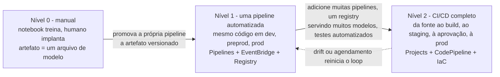
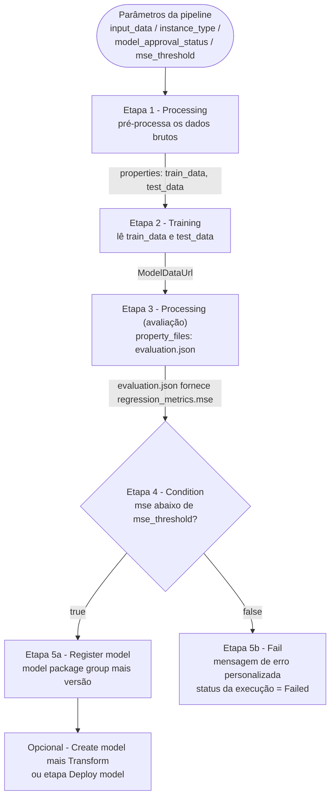
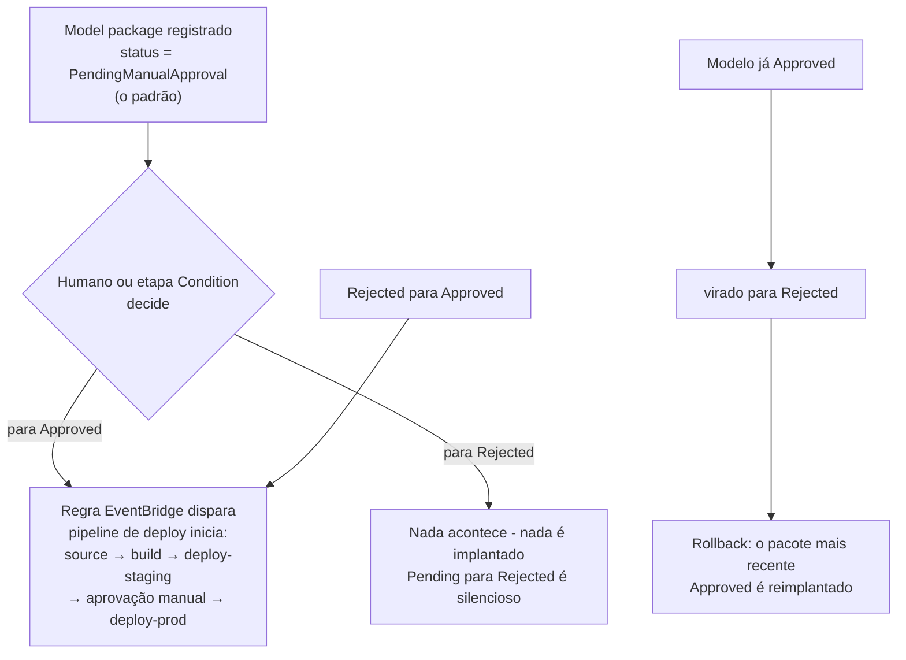
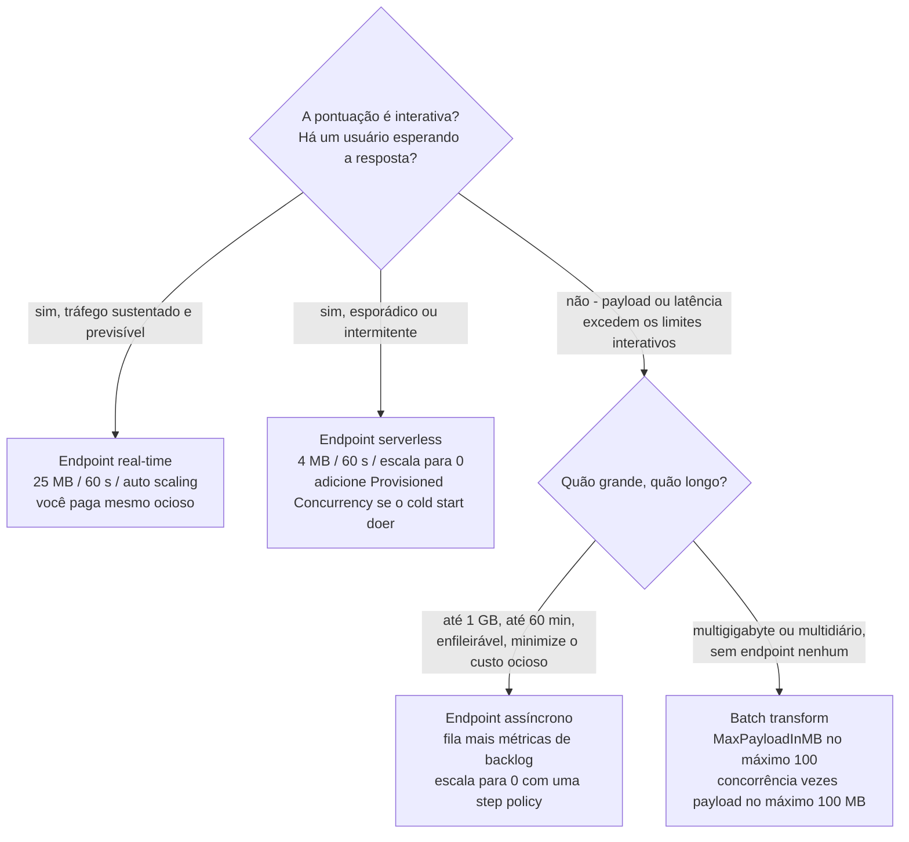
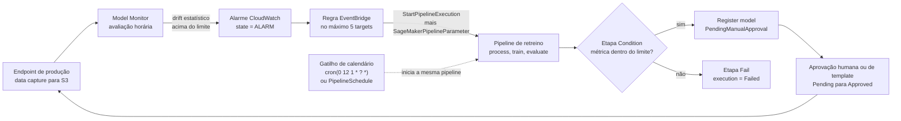

# MLOps e escalonamento na AWS

Um modelo que funciona em um notebook não é um sistema. No momento em que um segundo engenheiro precisa reproduzir a execução de treinamento, no momento em que o tráfego dobra às 09h, e no momento em que os dados de treinamento mudam de distribuição seis meses depois, você para de fazer machine learning e começa a fazer **operações**: e a AWS lhe dá duas famílias distintas de ferramentas para isso: uma **camada de pipeline / registry / CI-CD** que decide *como um modelo chega à produção*, e uma **camada de escalonamento** que decide *quanta computação o serve*. O exame AIF-C01 testa se você consegue nomear cada ferramenta com precisão, citar seus limites e recusar as opções que soam plausíveis, mas estão documentadas para outro serviço.

```text
====================================================================
 LESSON 13 — MLOps & SCALING ON AWS
====================================================================
 MATURITY (AWS three-level standard)
   L0 manual ......... notebooks + manual CreateModel / endpoint
   L1 pipeline ....... ONE automated pipeline = the deployed artifact
   L2 full CI/CD ...... many pipelines + registry + automated testing
--------------------------------------------------------------------
 BUILD LAYER                          SERVE LAYER
   Pipelines = JSON DAG (16 types)    real-time ... <= 25 MB, 60 s
   Condition: if/else on eval.json    serverless .. <= 4 MB, 60 s
   Fail: end the run as Failed        async ....... <= 1 GB, 60 min
   Parallelism (per execution)        batch ....... GB, days, no EP
   Caching OFF by default (PT1H)
   Registry: group -> versions 1,2..  SCALING (App Auto Scaling)
   Approval: Approved / Rejected /    target tracking (target 70)
             PendingManualApproval    step scaling (+1 from zero)
   Projects: Service Catalog / CFN    scheduled actions
   Git via CodeConnections            high-res metric = 10 s
   MLflow tracking server (your S3)   cooldown default 300 s
--------------------------------------------------------------------
 AUTOMATION LAYER
   SageMaker -> EventBridge (near real-time)
   Monitor hourly -> CloudWatch alarm -> StartPipelineExecution
   <= 5 targets per rule / no schedule on custom or partner buses
====================================================================
```

> [!NOTE]
> **Como ler esta lição.** Três regras se aplicam do começo ao fim. (1) **Números são o exame**: tetos de payload, cooldowns, valores de destino, períodos de alarme e transições de aprovação são todos valores publicados, e são eles que são testados. (2) **A AWS documenta dois mecanismos de escalonamento por um motivo**: target tracking *mantém* um nível de carga, step scaling *acorda* um serviço, e apenas a combinação deles escala um endpoint assíncrono a partir de zero. (3) **Tudo que a AWS não confirma em primeira party é sinalizado**, nunca ensinado como material de memorização; os sinalizados são coletados no final da lição.

Ao final desta lição você será capaz de:

- posicionar uma prática de ML no **modelo de maturidade de três níveis da AWS** (0, 1, 2) e separá-lo das variantes Google, Azure e do blog da AWS do mesmo framework;
- ler um **SageMaker Pipeline** como um DAG JSON e dizer quais arestas carregam **dados** (`properties`) versus **apenas ordenação** (`DependsOn`);
- selecionar o **tipo de etapa** certo para uma tarefa, incluindo **Condition**, **Fail**, **Callback**, **Lambda**, **ClarifyCheck** e **QualityCheck**, e citar quantos tipos existem;
- configurar **`ParallelismConfiguration`** e **cache de etapas** (`ExpireAfter` em ISO 8601, apenas execuções bem-sucedidas) corretamente;
- dirigir o deployment através do **Model Registry**: numeração de versões, `ModelApprovalStatus` e as quatro **transições de aprovação** que iniciam (ou não) o CI/CD;
- construir ou adotar um **SageMaker Project** com **CodePipeline / Jenkins**, explicar por que os **modelos de CodeCommit desapareceram em 28 de outubro de 2024** e nomear a tag **CodeConnections** e as ações IAM necessárias para GitHub;
- escolher entre **Experiments (Studio Classic)** e **MLflow on SageMaker AI**, e dizer onde os dados de rastreamento e os artefatos fisicamente vivem;
- configurar **target tracking**, **step scaling** e **ações agendadas** com o `ServiceNamespace`, `ResourceId` e `ScalableDimension` corretos, e fazer a aritmética de capacidade com **divisão com arredondamento para cima**;
- acordar um endpoint **assíncrono** a partir de zero com uma **step policy mais um alarme `HasBacklogWithoutCapacity`**;
- escolher a **opção de inferência** correta a partir do payload, latência, duração e requisitos do endpoint, e defender a escolha em termos de custo;
- ligar o **flywheel de MLOps**: Model Monitor → CloudWatch → EventBridge → `StartPipelineExecution`;
- defender o **Veredito Comparativo**: MLOps gerenciado vs scripts DIY vs operações manuais.

---

## 1. Maturidade de MLOps: nível 0, nível 1, nível 2

### 1.1 O padrão de três níveis da AWS

A AWS enquadra o MLOps como um **modelo de maturidade de três níveis**, e o exame espera que você reconheça o nível a partir de uma descrição e nomeie as ferramentas que levam até lá. A questão que distingue nunca é "quanto de ML você faz": é **qual é o artefato implantado**.

| Nível | Nome | Características (AWS) | Ferramentas AWS |
|---|---|---|---|
| **0** | Fluxo de trabalho de ML manual | orientado pelo cientista; treinamento e implantação manuais; sem pipeline | SageMaker Studio notebooks; `CreateModel` manual e criação de endpoint |
| **1** | Automação de pipeline de ML (treinamento contínuo) | **Uma** pipeline automatizada roda recorrentemente, com a **mesma implementação** em desenvolvimento, pré-produção e produção; **a própria pipeline é o artefato implantado** | SageMaker Pipelines (DAG JSON, cache, paralelismo), EventBridge, Model Registry |
| **2** | Automação completa de CI/CD | **Múltiplas** pipelines, um **registry servindo muitos modelos**, testes automatizados e retreino-redeploy horário ou diário | SageMaker Projects + CodePipeline / CodeBuild / GitHub, Model Monitor → alarme → retreino, infrastructure as code |



> [!WARNING]
> **Não importe a numeração de outro framework.** AWS, Google e o blog de ML da AWS todos descrevem maturidade de MLOps, e eles **não** são intercambiáveis:
>
> | Framework | Escala | Marcos |
> |---|---|---|
> | **AWS (padrão do exame)** | **0, 1, 2** | L2 = registry + muitos modelos + CI/CD |
> | Blog de ML da AWS (2022) | Initial → Repeatable → Reliable → Scalable | multi-conta, templateizado, multi-equipe |
> | Google | 0, 1, 2 | mesma forma da AWS |
> | Azure | **0 to 4** | 1 = DevOps sem MLOps · 2 = treinamento automatizado · 3 = implantação automatizada · 4 = MLOps completo com retreino disparado por drift |
>
> Uma opção de exame que descreve "nível 3" ou "nível 4" de maturidade está descrevendo a escala do **Azure**, não a da AWS.

### 1.2 Onde isso aparece no exame

MLOps pertence ao **Domínio 1, Tarefa 1.3** do guia AIF-C01. O exame em si é de **65 questões = 50 pontuadas + 15 não pontuadas**, com **sem penalidade por chute** e pesos de domínio publicados de **20 / 24 / 28 / 14 / 14 %**. A AWS publica apenas os pesos de domínio: a contagem de questões por tarefa não é publicada, então trate qualquer dimensionamento por tarefa que você leia em outro lugar como orientação, não como orçamento.

- **📚 Você sabia?** As **15 questões não pontuadas** de um exame AIF-C01 são indistinguíveis para você enquanto você faz o teste: elas estão intercaladas com as 50 pontuadas e são usadas para coletar estatísticas antes que um item seja qualquer vez pontuado. A consequência prática é um ponto de estratégia, não de curiosidade: **nunca pule uma questão pensando "esta pode ser não pontuada"**. Cada questão consome o mesmo tempo, e apenas as 50 pontuadas decidem seu resultado, então o movimento racional é responder todas as 65 no máximo de sua capacidade.

---

## 2. SageMaker Pipelines: o contrato do DAG

### 2.1 O que é uma pipeline

Um SageMaker Pipeline é um **grafo acíclico direcionado expresso em JSON**. Cada nó é uma **etapa**, cada aresta é uma dependência, e ciclos são **rejeitados**, um DAG que dá laços não é uma pipeline mais lenta, é uma definição inválida. A definição segue o *SageMaker AI Pipeline Definition JSON Schema*, e ela pode ser produzida por **quatro** produtores equivalentes: o **editor visual** no Studio, o **SageMaker SDK**, **boto3** e **AWS CloudFormation**. As execuções da pipeline são cobradas como os jobs subjacentes (processing, training, transform) mais o uso do Studio, a camada de orquestração em si não é um SKU separado e pesado.

Existem dois tipos de aresta, e confundi-los é o erro arquitetural mais comum nesta área:

| Tipo de aresta | Escrito como | Carrega | Exemplo |
|---|---|---|---|
| **Aresta de dados** | `step.properties.*`, resolvida pela API `Describe*` correspondente | artefatos reais (URIs do S3, dados do modelo, JSON de avaliação) | Train lê a saída `train_data` de Process |
| **Aresta apenas de ordenação** | `DependsOn` / `add_depends_on(...)` | nada além de "rodar depois" | Train precisa esperar uma segunda etapa de preparação não relacionada |

A regra prática: **se o valor flui, é uma referência `properties`; se apenas o timing importa, é `DependsOn`.** `ParallelismConfiguration` não é um mecanismo de ordenação: ela limita quantas etapas já elegíveis rodam ao mesmo tempo.

### 2.2 O DAG da pipeline

Esta é a forma canônica que o exame descreve: pré-processar → treinar → avaliar → registrar apenas se a métrica passar, caso contrário falhar com uma mensagem.



### 2.3 Exemplo resolvido 1, o gate de MSE, ponta a ponta

Uma pipeline de regressão para um modelo tabular estilo abalone, construída com o SageMaker SDK:

1. **Parâmetros** são declarados uma vez e reutilizados em todo lugar: `processing_instance_count`, `instance_type`, `model_approval_status` (padrão `PendingManualApproval`), `input_data`, `batch_data`, `mse_threshold`.
2. **`Process`** produz as saídas `train_data` e `test_data`. A etapa de treinamento as consome com `step_process.properties.ProcessingOutputConfig.Outputs["train_data"].S3Output.S3Uri`: **essa string é a aresta do DAG**, não um comentário.
3. **`Eval`** é uma **etapa Processing com `property_files`**, então sua saída `evaluation.json` (contendo `regression_metrics.mse`) é exposta às etapas posteriores como uma propriedade estruturada, e não como um caminho no S3 que você precisa analisar sozinho.
4. **`MSECond`** é uma **etapa Condition**: `if_steps = [RegisterModel]`, `else_steps = [Fail]`. A etapa Fail carrega uma mensagem composta como `"MSE above threshold " + mse_threshold` e termina a execução com status **Failed**: a execução não "termina com um aviso".
5. **`.start()`** a executa. Passar `ModelApprovalStatus="Approved"` como valor de parâmetro torna o registro imediatamente implantável (um atalho de desenvolvimento/teste), e `CacheConfig(enable_caching=True, expire_after="PT1H")` permite que etapas inalteradas reutilizem suas saídas anteriores.

> [!NOTE]
> **Por que uma etapa Fail em vez de apenas deixar a condição ser falsa?** Uma etapa Condition com `else_steps` vazio silenciosamente não faz nada: a execução reporta **Succeeded** enquanto nenhum modelo foi registrado. A etapa **Fail** existe precisamente para que "a métrica estava ruim" seja registrado como uma **execução Failed com mensagem personalizada**, que é o que uma regra do EventBridge ou um sistema de CI/CD precisa para abrir um incidente em vez de comemorar um build verde.

---

## 3. Os 16 tipos de etapa, e os dois que decidem os resultados

### 3.1 O mapa completo de etapas

A AWS documenta **16 tipos de etapa**. Aprenda a tabela pela coluna "gancho de exame": o exame raramente pergunta "o que uma etapa Training faz", ele pergunta *qual etapa deve ser usada para X*.

| Tipo de etapa | Roda | Config-chave | Gancho de exame |
|---|---|---|---|
| **Processing** | preparação, **avaliação**, baseline | URIs de saída no S3, `property_files` | "qual etapa avalia o modelo?" → Processing |
| **Training** / **Tuning** / **AutoML** | job de treinamento / HPO / AutoML | hiperparâmetros, canais de uma etapa anterior, intervalos de busca, métrica alvo | precisa de dados de treino e validação |
| **Model (Create model)** | `CreateModel` | imagem do container, `ModelDataUrl` | pré-requisito para Transform / Deploy |
| **Register model** | **versão do model package** | grupo, status de aprovação, listas de instância | versionamento mais aprovação |
| **Deploy model** | criação/atualização de endpoint | config do endpoint, variantes | blue/green = uma **atualização** de endpoint |
| **Transform** | batch transform | `MaxPayloadInMB`, `MaxConcurrentTransforms` | pontuação offline, **sem endpoint** |
| **Condition** | ramificação | `if_steps` / `else_steps` | gate → registrar **ou** Fail |
| **Fail** | interrompe a execução como **Failed** | `error_message` personalizado | "terminar com um motivo" |
| **Callback** | espera um callback token | token | aprovação externa ou de Step Functions |
| **Lambda** | uma função Lambda | ARN / helper do SDK | **no máximo 10 min, padrão 2 min**; hooks de deploy leves |
| **ClarifyCheck** / **QualityCheck** | viés e explicabilidade, qualidade de dados e modelo | estatísticas e restrições de baseline, `skip_check`, `register_new_baseline` | gate de drift mais baseline |
| **EMR** / **Notebook Job** | etapa EMR / notebook agendado | cluster e argumentos / computação e cron | preparação de big data / análises agendadas |

### 3.2 Condition e Fail como gate de avaliação

O padrão documentado é mecânico e vale a pena memorizar:

1. A etapa Processing de avaliação declara `property_files=["evaluation.json"]`.
2. A etapa Condition lê `evaluation.json` e compara um escalar: por exemplo `regression_metrics.mse` contra o parâmetro da pipeline `mse_threshold`.
3. **Ramificação true → Register model** (opcionalmente precedida por `Create model`, e seguida por uma etapa `Transform` para uma passagem de sanidade em lote).
4. **Ramificação false → Fail** com um `error_message` composto via `Join(...)`, produzindo um status de execução **Failed**.

Uma segunda variante, igualmente comum, coloca uma etapa **QualityCheck** ou **ClarifyCheck** antes do registro: a baseline é produzida com `register_new_baseline=true` e `skip_check=true` na primeira execução, e execuções posteriores comparam contra aquela baseline. Mesma forma: um gate cuja ramificação falsa é uma etapa Fail.

- **📚 Você sabia?** A etapa **Fail** não é uma falha bruta: é uma interrupção *controlada*. A etapa em si conclui com sucesso o trabalho dela, e é a **execução da pipeline** que termina como `Failed`, com sua mensagem anexada. Essa distinção importa quando você constrói uma regra do EventBridge: você reage ao status da execução, não a uma exceção lançada no seu código Python, então uma etapa Fail lhe dá um sinal limpo e estável em schema que um `exit 1` de script de shell não dá.

---

## 4. Paralelismo e cache: as duas alavancas que mudam o custo de execução

### 4.1 O paralelismo é por execução, não por pipeline

Etapas independentes rodam **em paralelo** por padrão: qualquer uma que esteja elegível roda. Você limita isso com **`ParallelismConfiguration(MaxParallelExecutionSteps)`**. Duas propriedades desta configuração importam para o exame:

- ela se aplica **por execução**: o exemplo documentado de **50** significa que uma execução roda no máximo 50 etapas concorrentemente, e **duas execuções concorrentes podem portanto rodar 100** etapas ao mesmo tempo;
- ela pode ser **sobrescrita no start, no retry e na atualização**, então é um padrão de política, não uma propriedade imutável da pipeline.

Paralelismo **não** é um mecanismo de dependência. Definir `MaxParallelExecutionSteps = 2` não faz a etapa B esperar a etapa A; apenas limita quantas etapas prontas executam simultaneamente.

### 4.2 O cache é opt-in, ISO 8601 e apenas para execuções bem-sucedidas

| Propriedade | Comportamento verificado |
|---|---|
| Padrão | **Desligado**: cada execução reexecuta cada etapa |
| Ativar | `CacheConfig { Enabled, ExpireAfter }` na etapa |
| Formato do `ExpireAfter` | **duração ISO 8601**, por exemplo **`PT1H`**: não um timestamp Unix |
| Quais execuções são reutilizadas | **apenas as bem-sucedidas**; uma execução falhada nunca é fonte de cache |
| Resolução de correspondência | a execução bem-sucedida correspondente **mais recente** vence |
| O que invalida | atributos que afetam a **saída**: localização dos dados, hiperparâmetros e **código** local (o SDK faz hash do código local no S3) |
| O que ainda pode acertar | mudanças em atributos que **não** afetam a saída: `instance_type` ainda pode acertar |

O uso prático é um loop de desenvolvimento: você reexecuta uma pipeline de cinco etapas após tocar apenas no relatório, e `PT1H` deixa Process, Train e Eval devolverem seus artefatos anteriores em segundos enquanto a etapa alterada executa de verdade.

> [!WARNING]
> **Cache desligado por padrão é a armadilha, não o recurso.** Um candidato que assume "pipelines pulam trabalho inalterado automaticamente" vai malinterpretar toda pergunta de custo sobre execuções repetidas. Nada é colocado em cache até você definir `CacheConfig`, a entrada precisa ter **sucedido**, e ela precisa estar **não expirada**. Inversamente, um candidato que assume "cache significa modelos obsoletos" está errado pelo motivo oposto: mudanças de dados, hiperparâmetros e código todas **erram** o cache por design.

---

## 5. Model Registry: versões e a aprovação que direciona o deploy

### 5.1 Estrutura do registry

O registry organiza modelos em **model groups**, e um grupo contém **pacotes/versões**. As versões são simples e estritamente ordenadas: elas **começam em 1** e **incrementam em 1** para cada pacote adicionado ao grupo. Um pacote versionado **precisa** pertencer a um grupo, e seu ARN carrega as coordenadas: `…:model-package-group/name/version`.

### 5.2 ModelApprovalStatus

Cada model package carrega um status extraído de exatamente três valores:

```text
ModelApprovalStatus = Approved | Rejected | PendingManualApproval
```

Um **modelo versionado precisa estar `Approved` para ser implantado.** O status pode ser definido através de `update_model_package`, através do Studio, através de uma **etapa Condition** dentro de uma pipeline, ou passado como um **parâmetro da pipeline** cujo padrão é `PendingManualApproval`.

### 5.3 As quatro transições de aprovação

Esta é a tabela de maior rendimento da lição, porque o exame pergunta "qual ação inicia o deployment?":

| Transição | Efeito em um template de SageMaker Project |
|---|---|
| `PendingManualApproval` → **`Approved`** | **Inicia o CI/CD**: a pipeline de deploy começa |
| `PendingManualApproval` → `Rejected` | **Nada acontece** |
| `Rejected` → **`Approved`** | **Inicia o CI/CD** |
| `Approved` → `Rejected` | **Reimplanta o modelo `Approved` mais recente** (semântica de rollback) |



### 5.4 Exemplo resolvido 2: da aprovação à produção

1. Um **SageMaker Project** é criado a partir do template *"Model building, training, and deployment with third-party Git repositories using CodePipeline"*, com **dois repositórios GitHub** e um **ARN do CodeConnections com a tag `sagemaker=true`**.
2. Um commit no repositório de modelagem dispara a ação de fonte (`DetectChanges`), que executa **`source → build`**: o CodeBuild cria ou atualiza o SageMaker Pipeline e o inicia.
3. A pipeline registra a **versão 7** com `ModelApprovalStatus = PendingManualApproval`.
4. Um revisor vira a v7 para **`Approved`** (Studio, CLI ou uma etapa Condition alimentada por um parâmetro de aprovação).
5. A **regra EventBridge** do template inicia a pipeline de deploy: **`source → build → deploy-staging`** (stack do CloudFormation) → **aprovação manual** → **`deploy-prod`**.
6. Se o staging revelar um defeito e a v7 for virada de **`Approved` → `Rejected`**, o pacote ainda `Approved` mais recente é reimplantado: esse é o rollback documentado. Em um loop puro de dev/teste, você contorna as etapas 4 to 5 passando `ModelApprovalStatus="Approved"` como parâmetro da pipeline.

---

## 6. SageMaker Projects, Git e CI/CD

### 6.1 O que um Project realmente é

SageMaker Projects são **produtos do AWS Service Catalog suportados por CloudFormation**. Criar um provisiona, como uma unidade única: **repositórios Git, um SageMaker Pipeline, CodePipeline ou Jenkins, um model group, um bucket S3, um registry ECR e regras do EventBridge**. Existem duas formas canônicas:

| Forma do Project | Caminho da pipeline |
|---|---|
| **Build** | `source → build` |
| **Deploy** | `source → build → deploy-staging → aprovação manual → deploy-prod` |

As famílias de template fornecidas cobrem **build/train/deploy com Git de terceiros** (CodePipeline **ou** Jenkins), **Model Monitor** e **construção de imagens** (ECR + CodeBuild + EventBridge).

### 6.2 A mudança de CodeCommit de 28 de outubro de 2024

> [!WARNING]
> **Templates de projeto baseados em CodeCommit foram removidos em 28 de outubro de 2024.** Qualquer opção de exame que afirme que você pode iniciar um novo SageMaker Project a partir de um template de CodeCommit "a partir de hoje" está errada. O caminho suportado é **GitHub / GitHub Enterprise / GitLab / Bitbucket**, e templates personalizados são construídos como **CloudFormation no Service Catalog** ou, recomendado pela AWS, **templates hospedados no S3** consumidos através de `CfnTemplateProvider`.

A mecânica da ação de fonte do GitHub vale a pena citar com precisão:

- a ação do CodePipeline é **`CodeStarSourceConnection`**;
- a conexão deve ser uma conexão **CodeConnections** **com a tag `sagemaker=true`**;
- o role da pipeline precisa de **ambas** `codestar-connections:UseConnection` **e** `codeconnections:UseConnection`;
- a detecção de mudanças é `DetectChanges` no commit, então o build começa sem um gatilho manual;
- o CloudFormation de um template personalizado deve declarar **`SageMakerProjectName`** e **`SageMakerProjectId`**.

- **📚 Você sabia?** "CodeStar" sobrevive no **nome da ação** (`CodeStarSourceConnection`) muito tempo depois que o produto foi substituído pelo **CodeConnections**. É por isso que a política IAM precisa de *duas* ações quase idênticas: uma para o namespace legado e uma para o serviço atual. Candidatos que memorizam apenas uma das duas consistentemente falham neste item, e os próprios walkthroughs da AWS listam ambas.

---

## 7. Experiments e MLflow: onde o rastreamento de execuções vive hoje

### 7.1 A migração

A API SageMaker Experiments, `CreateExperiment`, **Trials** como *grupos* de execução, **trial components** como *execuções* individuais, é documentada como **disponível apenas no Studio Classic**. Para a nova experiência do Studio, a AWS recomenda **MLflow on SageMaker AI**. Em termos de exame: uma opção que descreve Trials e trial components como a maneira atual e recomendada de rastrear execuções está descrevendo uma superfície **legada**.

| | SageMaker Experiments (SDK) | **MLflow on SageMaker AI** |
|---|---|---|
| Status | apenas Studio **Classic** | recomendação atual (GA) |
| Tracking URI | Experiments API | `mlflow.set_tracking_uri(<tracking server ARN>)` |
| Credenciais | role de execução do SageMaker | plugin AWS, assinatura **SigV4** |
| Backend store | metadata store do Experiments | na **conta de serviço do SageMaker** |
| Artifact store | gerenciado pela SageMaker | **seu próprio bucket S3** |
| Tamanhos / limites |: | **Small / Medium / Large**, criados em **no máximo 25 minutos** |
| Auditoria | CloudTrail nas APIs do SageMaker | CloudTrail sob **`CallMlflowApp`** para `AWS::SageMaker::MlflowApp` |

A divisão é o ponto do exame: **a computação e o backend store rodam na conta de serviço do SageMaker, mas os artefatos vivem em um S3 que você possui e paga**: que é exatamente o que um revisor de conformidade quer ouvir sobre reprodutibilidade.

---

## 8. Auto scaling de endpoints: target tracking, step scaling, ações agendadas

### 8.1 Os identificadores

O escalonamento de endpoints roda através do **Application Auto Scaling** (`RegisterScalableTarget` mais `PutScalingPolicy`) ou através do assistente do console. Cite as coordenadas com exatidão:

| Campo | Valor |
|---|---|
| `ServiceNamespace` | **`sagemaker`** |
| `ResourceId` | **`endpoint/{endpoint-name}/variant/{variant-name}`** |
| `ScalableDimension` | **`sagemaker:variant:DesiredInstanceCount`** |
| Métrica do assistente do console | fixa em **`SageMakerVariantInvocationsPerInstance`** |

A AWS oferece três estratégias, **target tracking (recomendado)**, **step scaling** e **ações agendadas** (CLI/API), e, para o target tracking, **a AWS gerencia os alarmes para você**.

### 8.2 As métricas

| Métrica | Tipo | Alvo | Período |
|---|---|---|---|
| `SageMakerVariantInvocationsPerInstance` | **Predefinida** (padrão recomendado) | **70** invocações/instância/min | 1 min |
| `ConcurrentRequestsPerModelHighResolution` | custom de alta resolução | **5** requisições concorrentes/modelo | **10 s** |
| `InferenceComponentConcurrentRequestsPerCopyHighResolution` | alta resolução (inference components) | **5** | **10 s** |
| `CPUUtilization`, `ExplanationsPerInstance` | custom | sua escolha (por exemplo 50) | 1 min |
| `ApproximateBacklogSizePerInstance` | assíncrona | **5** | 1 min |

### 8.3 Exemplo resolvido 3: aritmética de capacidade do target tracking

A capacidade sempre **arredonda para cima**: esse é o comportamento de ajuste documentado, e é aritmética examinável:

1. Teste de carga mostra **210 invocações/min**, alvo **70** → 210 / 70 = **3 instâncias**.
2. O tráfego sobe para **351/min** → 351 / 70 = 5,01, arredondado para cima → **6 instâncias** (nunca 5).
3. Registre o destino:
   `register_scalable_target(ServiceNamespace="sagemaker", ResourceId="endpoint/prod/variant/AllTraffic", ScalableDimension="sagemaker:variant:DesiredInstanceCount", MinCapacity=1, MaxCapacity=10)`.
4. Anexe a política:
   `put_scaling_policy(PolicyType="TargetTrackingScaling", {"TargetValue": 70.0, "PredefinedMetricSpecification": {"PredefinedMetricType": "SageMakerVariantInvocationsPerInstance"}, "ScaleInCooldown": 600, "ScaleOutCooldown": 300})`.
5. Efeito: scale-out dentro de cerca de **um minuto**; o cooldown de scale-in de **600 s** suprime o flapping após um burst, e o cooldown de scale-out de **300 s** evita over-provisioning durante um trem de picos.

### 8.4 Exemplo resolvido 4: aritmética de concorrência em alta resolução

1. Com `ConcurrentRequestsPerModelHighResolution` no alvo **5**, uma carga de **18 requisições concorrentes** → 18 / 5 = 3,6, arredondado para cima → **4 instâncias**.
2. A métrica emite a cada **10 segundos** em vez de a cada **1 minuto**: detecção **~6× mais rápida** para o **scale-out**; o timing de scale-in não muda.
3. Usando inference components? A métrica vira `InferenceComponentConcurrentRequestsPerCopyHighResolution`.
4. Múltiplas políticas de target tracking podem compartilhar **um** único destino escalável: adicione uma segunda política em `CPUUtilization` com `TargetValue = 50`, e ambas mantêm seus próprios alvos contra o mesmo `DesiredInstanceCount`.

### 8.5 A comparação das estratégias de escalonamento

| Dimensão | **Target tracking** (recomendado) | **Step scaling** | **Ações agendadas** | **Serverless (totalmente gerenciado)** |
|---|---|---|---|---|
| Gatilho | métrica vs alvo | alarme violado | cron/data | o próprio tráfego |
| Métricas | predefinida `InvocationsPerInstance`, alta res. `ConcurrentRequestsPer*`, custom `CPUUtilization` / `ExplanationsPerInstance`, assíncrona `ApproximateBacklogSizePerInstance` | qualquer métrica de alarme |, |, |
| Granularidade | 1 min, ou **10 s** em alta resolução | o período do seu alarme | horários fixos | automático |
| Ajuste | mantido no alvo, **arredonda para cima** | exato (por exemplo **+1**) | absoluto ou percentual | opaco |
| Cooldowns | `ScaleInCooldown` / `ScaleOutCooldown` (padrão do SageMaker **300 s**) | `Cooldown` (exemplo 300) |, |, |
| Escala para 0 | não para variantes real-time; assíncrona apenas **com** uma step policy e alarme extras | ✅ o mecanismo from-zero | ✅ se `MinCapacity = 0` | ✅ sempre |
| Melhor para | carga sustentada | picos precisos, zero acordamentos | picos conhecidos | tráfego intermitente |

> [!IMPORTANT]
> **Cooldowns são em segundos e se aplicam em ambas as direções.** `ScaleInCooldown` e `ScaleOutCooldown` são valores separados (o exemplo documentado usa **600** e **300**), o padrão da variante SageMaker é **300 segundos**, e os ajustes **arredondam para cima**: então uma política de target tracking nunca escala para uma fração de instância e nunca escala para baixo mais rápido do que seu cooldown permite. Uma questão que define cooldowns em minutos, ou que afirma que scale-in e scale-out compartilham um único valor, está errada.

---

## 9. Inferência assíncrona: escalonamento a partir de zero

### 9.1 Por que a assíncrona é especial

Endpoints assíncronos têm uma **fila** na frente deles, o que significa que o backlog, não a taxa de requisições, é o sinal que importa. A AWS documenta estas métricas de fila:

| Métrica | Significado | Uso típico |
|---|---|---|
| `ApproximateBacklogSizePerInstance` | requisições enfileiradas divididas por instâncias | **target tracking**, alvo **5** |
| `ApproximateBacklogSize` | profundidade absoluta da fila | alarmes custom |
| `ApproximateAgeOfOldestRequest` | latência da fila | SLO de frescor |
| **`HasBacklogWithoutCapacity`** | **1** quando a fila não está vazia **e** instâncias = 0 | **o alarme de escala from-zero** |

### 9.2 O design de escalonamento a partir de zero

> [!WARNING]
> **Target tracking não consegue acordar um serviço que tem zero capacidade.** Com `MinCapacity = 0`, uma política de target tracking não tem instâncias contra as quais computar uma métrica `…PerInstance`, então ela não escalará a partir de zero. A resposta documentada da AWS é uma **combinação**: uma **step scaling policy** com `ScalingAdjustment = +1` e um **cooldown de 300 segundos**, dirigida por um alarme em **`HasBacklogWithoutCapacity`** com **threshold 1**, **EvaluationPeriods = 2** (DatapointsToAlarm 2) e **Period 60 s**. O target tracking assume o controle uma vez que a capacidade existe.

### 9.3 Exemplo resolvido 5: aritmética da fila e o despertar

1. Configure `MinCapacity=0, MaxCapacity=5` e uma política de target tracking em `ApproximateBacklogSizePerInstance` com `TargetValue = 5`.
2. Um burst enfileira **27 requisições** em 1 instância em execução → 27 / 5 = 5,4, arredondado para cima → 6 → **limitado a `MaxCapacity` = 5**.
3. O tráfego para; o scale-in devolve o endpoint a **0 instâncias** e o gasto ocioso vai a **zero**. Requisições que chegam nesse meio-tempo são **enfileiradas, não perdidas**: `ApproximateAgeOfOldestRequest` reporta há quanto tempo a mais antiga espera.
4. A próxima requisição após o idle: `HasBacklogWithoutCapacity` vira para **1**, mantém por **2 períodos de avaliação de 60 s**, dispara o alarme, a step policy adiciona **+1** instância após o cooldown de **300 s**, e o target tracking retoma.

---

## 10. Escolhendo a opção de inferência

### 10.1 As quatro opções e seus limites rígidos

| | **Real-time** | **Serverless** | **Assíncrona** | **Batch transform** |
|---|---|---|---|---|
| Endpoint | REST persistente | gerenciado, escala para **0** | **fila** persistente, escala para **0** | **nenhum** (apenas job) |
| Limite de payload | **25 MB** | **4 MB** | **1 GB** | datasets na escala de GB |
| Tempo de processamento | **60 s** (8 min com streaming) | **60 s** | **60 minutos** | **dias** |
| Controle de escalonamento | políticas de auto scaling (seção 8) | totalmente gerenciado (+ **Provisioned Concurrency** opcional) | métricas de backlog mais step scaling a partir de 0 | `MaxConcurrentTransforms`, contagem de instâncias |
| Forma do custo | paga por instâncias provisionadas **incluindo ociosas** | paga por duração da requisição e dados | paga enquanto processa, **0 ocioso** | paga por instância-hora do job |
| Melhor ajuste | sustentada, baixa latência, previsível | tráfego esporádico ou intermitente tolerante a cold starts | payloads grandes, enfileiráveis, sensíveis a custo | pontuação em massa offline |
| Monitoramento | Model Monitor mais data capture ✅ | **nenhum suportado** ❌ | SNS sucesso/erro → S3 | `BatchTransformInput` |

**Específicos do batch transform:** `MaxPayloadInMB` no máximo **100**, e `MaxConcurrentTransforms × MaxPayloadInMB` no máximo **100 MB**.

**Exclusões do serverless (memorize a lista):** sem **GPUs**; sem imagens de Marketplace ou de registry privado; sem **multi-model endpoints**; sem configuração de **VPC**; sem **data capture**; sem **Model Monitor**; sem **múltiplas variantes**; sem **inference pipelines**; imagem do container no máximo **10 GB**; converter um **endpoint real-time existente para serverless é rejeitado**; **Provisioned Concurrency** é opcional.

### 10.2 A decisão



### 10.3 Exemplo resolvido 6: 40 GB, toda noite, sem usuários

Uma equipe de fraude pede "um endpoint real-time para o nosso job de pontuação noturno de 40 GB". A resposta correta é **batch transform**:

1. **Sem tráfego interativo** → a única vantagem do real-time (latência) não tem valor, e sua forma de custo, pagar por instâncias provisionadas **incluindo horas ociosas**, é desperdício puro para um job que roda uma vez por dia.
2. **40 GB passa do** teto de **4 MB** do serverless e do teto de **1 GB** do assíncrono; é território firme de "dados na escala de GB ao longo de dias".
3. O batch transform roda **instâncias apenas para o job**: `MaxPayloadInMB ≤ 100` e `MaxConcurrentTransforms × MaxPayloadInMB ≤ 100 MB` mantêm cada requisição dentro dos limites, `S3Output` coleta os registros pontuados, e **nenhum endpoint existe** entre execuções: então nada é cobrado às 03h.
4. O monitoramento usa `BatchTransformInput` em vez do Model Monitor; se a equipe mais tarde quiser detecção de drift, essa é uma decisão separada sobre um endpoint real-time ou assíncrono.

- **📚 Você sabia?** A orientação de otimização de custos da AWS para inferência se resume a uma frase: **combine a opção com a forma do tráfego**. A assíncrona é dimensionada para uma *taxa de processamento ótima* **mais escala para zero**; o serverless é *por requisição*; o real-time é *capacidade provisionada*; e em todas elas **SageMaker Savings Plans** podem ser comprados por **1 ou 3 anos** e se aplicam sobre Studio, processing, training, inferência real-time e batch transform. Comprar um Savings Plan para um job que roda 20 minutos por noite é o desalinhamento clássico: o plano desconta uso *comprometido*, e um lote noturno quase não tem.

---

## 11. EventBridge e o flywheel de MLOps

### 11.1 O que a AWS envia, e para quê

O SageMaker emite eventos para o **EventBridge em quase tempo real** para **jobs, endpoints, model packages, execuções e etapas de pipeline, e mudanças de imagem**. Os alvos incluem **Lambda, Step Functions, Kinesis e SNS**: e, criticamente, **o próprio SageMaker Pipelines é um alvo**:

| Configuração | Valor |
|---|---|
| Alvo | SageMaker Pipeline |
| Ação do role | **`SageMaker::StartPipelineExecution`** |
| Mapeamento de parâmetro | **`SageMakerPipelineParameter`** |
| Máximo de alvos por regra | **5** |
| Agendamentos em **buses custom / de parceiros** | **não suportado** |
| Agendamento programático | SDK **`PipelineSchedule`** (`rate` / `cron`) |
| Gatilhos de retreino (lista completa) | **agendamento** (`rate` / `cron`, `PipelineSchedule`) e **evento** (alarme CloudWatch, `ModelPackageStateChange`, S3 `ObjectCreated`) |

### 11.2 O flywheel



### 11.3 Exemplo resolvido 7: monitorar, alarmar, retreinar, aprovar, implantar

1. Habilite **data capture** no endpoint de produção para que requisições e respostas aterrissem no S3, e agende o **Model Monitor de hora em hora** (`CronExpressionGenerator.hourly()`).
2. Produza a baseline com uma **etapa `QualityCheck`** usando `register_new_baseline=true` e `skip_check=true` na primeira execução; execuções posteriores comparam contra ela.
3. Quando o drift exceder a restrição, o alarme do CloudWatch entra em **ALARM** → a **regra EventBridge** dispara → alvo = **SageMaker Pipeline**, invocando **`StartPipelineExecution`** com um `SageMakerPipelineParameter` mapeado.
4. A pipeline retreina, avalia, passa pela etapa **Condition**, registra uma nova versão como **`PendingManualApproval`** → a aprovação a vira para **`Approved`** → a regra do template de deploy atualiza o endpoint.
5. Execute o **gatilho de calendário ao lado** do gatilho de drift: `cron(0 12 1 * ? *)` retreina no dia 1 de cada mês às 12:00 UTC, ou use `PipelineSchedule(name, cron="15 10 ? * 6L 2022-2023")` para um agendamento com limite de tempo. Lembre-se de **no máximo 5 alvos por regra** e de **nenhum agendamento em buses de eventos custom ou de parceiros**.

### 11.4 Infrastructure as code para a stack inteira

Tudo nesta lição é descritível como código, e a orientação da AWS aponta para o CloudFormation diretamente ou através do **AWS CDK**: `cdk synth` emite um template do CloudFormation por stack, e os constructs L1 `Cfn*` cobrem a superfície: `sagemaker.CfnEndpointConfig` (incluindo `AsyncInferenceConfig`), `sagemaker.CfnPipeline`, mais os nativos `AWS:SageMaker:Domain`, `AWS:SageMaker:UserProfile` e `AWS:SageMaker:Pipeline`.

Codifique, no mínimo: VPC, KMS, o bucket S3, o role de execução da pipeline, o **Model Package Group**, CodePipeline + CodeBuild + CodeConnections, regras do EventBridge e o destino escalável com suas políticas. Para templates de projeto, a AWS prefere **templates hospedados no S3 via `CfnTemplateProvider`** a portfólios do Service Catalog, e um template personalizado deve expor **`SageMakerProjectName`** e **`SageMakerProjectId`**. Dividir a stack em `DevStack` e `ProdStack` permite testar a infraestrutura com unit tests antes que ela toque a produção.

### 11.5 Atualizações de 2026 (em outubro de 2026)

Três mudanças verificadas de 2025 to 2026 tocam o material das seções 8 até 13, e a AWS agora as anuncia através de **vocabulário de ciclo de vida** em vez de aposentadorias silenciosas. Todas as três são documentadas, datadas e examináveis.

**1. O nome do produto mudou.** A AWS documenta que "o Amazon SageMaker atual foi renomeado para **Amazon SageMaker AI**" (3 de dezembro de 2024), ao lado de uma geração separada de *next-generation SageMaker* (Unified Studio, Catalog, Lakehouse, zero-ETL). Uma opção de exame dizendo **SageMaker AI** é atual, não exótica: e os identificadores que você cita da seção 8 **não** mudaram com a renomeação: `ServiceNamespace = sagemaker`, `ResourceId = endpoint/…/variant/…`, `SageMakerVariantInvocationsPerInstance` e a ação do role `SageMaker:StartPipelineExecution` ainda são todos escritos do jeito antigo.

**2. Model Monitor e Clarify estão em manutenção.** O SageMaker AI End of Support Notice lista **Model Monitor** e **Clarify**: junto com Ground Truth, A2I, Studio Lab, Debugger, Role Manager, Geospatial e Mechanical Turk: como **"não mais aberto a novos clientes a partir de 30 de julho de 2026"**. Leia essa frase com precisão: o status é **manutenção** = nenhum cliente novo, nenhum recurso novo, **clientes existentes continuam usando-os**. **Não** é um desligamento completo, e **não** é um rebranding para Bedrock Model Evaluations. O flywheel de drift de 11.2 portanto ainda roda para clientes existentes; para trabalho novo a AWS aponta para **métricas e anomaly detection do CloudWatch, CloudWatch Evidently, EventBridge + Lambda, SHAP** e, no lado generativo, **Bedrock Model Evaluations**: que é exatamente por que o exemplo 4.2.2 do guia do exame agora lê "Clarify **plus** Bedrock Model Evaluations".

**3. O guia do exame mudou.** O histórico de mudanças da AWS lista **v1.0 publicada em 26 de março de 2026** e **v1.1 publicada em 30 de abril de 2026**, e afirma que atualizações aparecem no exame **cerca de um mês após a publicação** (trate a **v1.1** como a âncora confiável; a data da v1.0 é uma republicação de documentação). Exemplos alterados que tocam esta lição: **1.1.3 (inferência assíncrona e serverless)**, **1.3.4 (Bedrock, Amazon Quick, Kiro, SageMaker AI)** e **4.2.2 (Clarify mais Bedrock Model Evaluations)**. Inalterados, e portanto seguros de continuar citando: **65 questões (50 pontuadas + 15 não pontuadas)**, **90 minutos**, **aprovação 700 / 1.000**, **validade de 3 anos**, domínios **20 / 24 / 28 / 14 / 14 %**.

| Data (verificada) | Mudança | O que isso significa no exame |
|---|---|---|
| 3 de dezembro de 2024 | Amazon SageMaker renomeado **Amazon SageMaker AI** | o novo nome é atual; identificadores de serviço, métrica e API inalterados |
| 26 de março de 2026 | Guia do exame **v1.0** listado no histórico de mudanças | linha de base do conjunto de conteúdo de 2026 |
| 30 de abril de 2026 | Guia do exame **v1.1** publicado | no ar no exame a partir de cerca de **finais de maio de 2026**; exemplos alterados 1.1.3, 1.3.4, 4.2.2 |
| 30 de junho de 2026 | Ground Truth Plus **fim do suporte**; Amazon Kendra entra em **manutenção** | datas de distrator, não respostas de MLOps |
| **30 de julho de 2026** | **Model Monitor, Clarify, Ground Truth, A2I, Studio Lab, Debugger, Role Manager, Geospatial, Mechanical Turk** e **Kendra** fechados para novos clientes | **manutenção ≠ desligamento ≠ rebranding**: cite o estado, não um boato |
| 30 de setembro de 2026 | Mechanical Turk **fim do suporte** (o post What's New diz 29 de setembro, o digest sinaliza o conflito) | não cite o dia |
| 24 de setembro de 2026 | Referência do AWS Service Lifecycle publicada | use o vocabulário de três palavras abaixo |

**Vocabulário de ciclo de vida (AWS General Reference):** **Maintenance** = nenhum cliente novo, nenhum recurso novo, ainda suportado · **Sunset** = fim de operações planejado, tipicamente cerca de 12 meses · **Full Shutdown** = removido do portfólio.

- **📚 Você sabia?** A AWS afirma que mudanças no guia do exame aparecem no exame no ar **cerca de um mês após a publicação**: então o material da **v1.1 (30 de abril de 2026)** era examinável a partir de **finais de maio de 2026**. O corolário corre nas duas direções: um recurso anunciado *depois* da versão do seu guia não é automaticamente testável, enquanto um **exemplo alterado** como **4.2.2 → Clarify mais Bedrock Model Evaluations** é testável muito antes de qualquer data de aposentadoria importar. Leia o histórico de mudanças, não o blog de release.

---

## 12. Veredito comparativo: MLOps gerenciado vs scripts DIY vs manual

> [!IMPORTANT]
> **Veredito Comparativo: MLOps gerenciado (SageMaker Pipelines / Registry / Projects) vs scripts DIY (código cola no CodeBuild) vs operações manuais (notebooks e cliques no console)**
> - **Operações manuais.** Um cientista treina em um notebook, exporta um arquivo de modelo, e uma segunda pessoa clica através da criação do endpoint. É **rápido para uma pessoa e um modelo**, não precisa de design de IAM nem de role de pipeline: e falha em toda pergunta auditável: sem versionamento (versões do registry começam em **1** e não existe um passo 2), sem registro de aprovação (`ModelApprovalStatus` nunca existiu), sem reprodutibilidade (dados, hiperparâmetros e código são o que o estado do notebook fosse), e sem caminho para a maturidade de Nível 1. Use-o apenas para exploração.
> - **Scripts DIY.** Código cola de shell ou Python no CodeBuild que chama `training.py`, `evaluate.py`, `upload_model.py`. É **totalmente customizável e portátil**: você pode acoplar qualquer sistema de CI e qualquer framework de teste, e nenhum limite de serviço o constrange. Seus modos de falha são **os que você agora precisa inventar sozinho**: ordenação de etapas (você constrói o DAG à mão), cache (você escreve a própria reutilização de artefatos), semântica de falha (uma métrica ruim precisa virar um build *falhado* com mensagem), gates de aprovação (você implementa a máquina de estados), limites de paralelismo, retries e a trilha de evidência do CloudTrail. Você está reimplementando 16 tipos de etapa, e o gabarito do exame é o gerenciado.
> - **MLOps gerenciado.** O SageMaker Pipelines dá um **DAG JSON com 16 tipos de etapa**, gates **Condition** e **Fail**, **paralelismo por execução** e **cache opt-in**; o Model Registry dá **grupos, versões a partir de 1, e as transições de aprovação que iniciam o CI/CD**; os Projects dão provisionamento de repos, pipeline, model group, bucket, ECR e regras do EventBridge via **CloudFormation / Service Catalog**; o EventBridge dá o loop de retreino em **quase tempo real** com **no máximo 5 alvos por regra**. Seus limites: tudo tem a forma do SageMaker (um job de treinamento não-SageMaker precisa de uma etapa custom ou Lambda), a escolha de templates é finita (**templates de CodeCommit removidos em 28 de out de 2024**), e **o rastreamento de experimentos mudou para o MLflow**, com o Studio Classic como superfície legada.
> - **Regra prática para o exame:** *a pergunta pede como um modelo chega à produção, com versionamento, um gate de aprovação e uma trilha de auditoria →* **MLOps gerenciado (Pipelines + Registry + Projects)**. *A pergunta pede uma ferramenta sob medida ou um sistema de CI não-AWS existente →* **scripts DIY, mas mantenha o registry como o ponto de transferência**. *A pergunta descreve um cientista único iterando em um protótipo →* **manual é aceitável, e só então**: e se a opção mencionar retreino disparado por drift, a resposta é o loop **EventBridge → `StartPipelineExecution`**, não um script cron.

| Sinal de decisão | Manual | Scripts DIY | **MLOps gerenciado** |
|---|---|---|---|
| Definição de execução reprodutível | Não | Apenas se você escrever | **Sim** (DAG JSON, verificado por schema) |
| Semântica de falha em nível de etapa | Não | DIY | **Sim** (etapa Fail mais mensagem personalizada) |
| Registry de modelos versionado | Não | DIY | **Sim** (grupos, versões a partir de **1**) |
| Aprovação que inicia o deploy | Não | DIY | **Sim** (`Pending → Approved` inicia o CI/CD) |
| Limite de paralelismo por execução | n/d | DIY | **Sim** (`ParallelismConfiguration`) |
| Cache de resultados de etapas | Não | DIY | **Sim** (opt-in, `PT1H`, apenas execuções bem-sucedidas) |
| Provisionado por infrastructure as code | Não | Sim | **Sim** (Projects = Service Catalog / CloudFormation) |
| Retreino disparado por drift | Não | DIY | **Sim** (Monitor → alarme → EventBridge → pipeline) |
| Funciona fora do SageMaker | n/d | **Sim** | Parcialmente (etapas custom e Lambda) |
| Evidência de auditoria | histórico do notebook | seus logs | CloudTrail mais registry mais histórico de execuções da pipeline |

---

## 13. Armadilhas do exame e os números que valem a pena memorizar

> [!WARNING]
> **As armadilhas que custam pontos exatamente neste material:**
> 1. **"A SDK Experiments é a maneira atual de rastrear execuções."** Ela é **apenas Studio Classic**; a AWS recomenda **MLflow on SageMaker AI** para a nova experiência do Studio.
> 2. **"Iniciar um SageMaker Project a partir de um template de CodeCommit."** Esses templates foram **removidos em 28 de outubro de 2024**: use GitHub, GitLab ou Bitbucket através do **CodeConnections** (`CodeStarSourceConnection`, com a tag `sagemaker=true`).
> 3. **"Definir `ALBRequestCountPerTarget` em um endpoint SageMaker."** Essa é uma métrica **genérica** do Application Auto Scaling que precisa de um **`ResourceLabel` de ALB**; a métrica do SageMaker é **`SageMakerVariantInvocationsPerInstance`**.
> 4. **"`PendingManualApproval → Rejected` implanta o modelo anterior."** Ela **não faz nada**; apenas **`Approved → Rejected`** reimplanta o pacote `Approved` mais recente.
> 5. **"Target tracking sozinho escala a assíncrona a partir de zero."** Ele não consegue: você precisa de uma **step policy (+1, cooldown 300)** mais um alarme **`HasBacklogWithoutCapacity`** (threshold **1**, **2 × 60 s**).
> 6. **"`ExpireAfter` é um timestamp Unix, e execuções em cache incluem falhas."** Ele é **ISO 8601** (`PT1H`) e **apenas execuções bem-sucedidas** são reutilizadas.
> 7. **"Paralelismo força ordenação."** `MaxParallelExecutionSteps` limita a concorrência **por execução**; a ordenação é `properties` (dados) ou `DependsOn` (timing).
> 8. **"Serverless suporta VPC, Model Monitor e multi-model endpoints."** Ele não suporta **nenhum** deles, limita payloads a **4 MB** e imagens a **10 GB**, e GPUs não estão disponíveis.
> 9. **"Agendamentos cron podem ser anexados a qualquer event bus."** **Nenhum agendamento em buses custom ou de parceiros**, e uma regra tem **no máximo 5 alvos**.
> 10. **"Um modelo versionado pode ser implantado em qualquer estado de aprovação."** Ele precisa estar **`Approved`**.

| Número testável | Valor |
|---|---|
| Tipos de etapa da pipeline | **16** (incl. Fail, Condition, Lambda, Callback, ClarifyCheck, QualityCheck) |
| Exemplo de `ParallelismConfiguration` | **50**, **por execução** (2 execuções ⇒ 100) |
| Cache de etapas | **desligado por padrão** · `ExpireAfter` ISO 8601 (`PT1H`) · apenas execuções bem-sucedidas |
| Versões de model package | começam em **1**, +1 por pacote no grupo |
| `ModelApprovalStatus` | `Approved` / `Rejected` / `PendingManualApproval` |
| Transições de aprovação que iniciam CI/CD | `Pending → Approved`, `Rejected → Approved` |
| Alvos do EventBridge por regra | **5** no máximo |
| Alvos de destino / concorrência / backlog | **70** inv/instância/min · **5** concorrentes/modelo · **5** backlog/instância |
| Período da métrica | padrão **1 min** vs alta resolução **10 s** |
| Alarme `HasBacklogWithoutCapacity` | threshold **1** · Evaluation e Datapoints **2** · Period **60 s** · step **+1** · Cooldown **300** |
| Cooldowns | `ScaleIn` 600 / `ScaleOut` 300 (exemplo); padrão do SageMaker **300 s**; ajustes **arredondam para cima** |
| Limites de payload | real-time **25 MB** · serverless **4 MB** · assíncrona **1 GB** |
| Tempos de processamento | real-time **60 s** (8 min streaming) · serverless **60 s** · assíncrona **60 min** · batch dias |
| Payload do batch transform | `MaxPayloadInMB` ≤ **100**; `MaxConcurrentTransforms × MaxPayloadInMB` ≤ **100 MB** |
| Tamanho da imagem serverless | ≤ **10 GB** |
| Tamanhos/criação do servidor MLflow | Small, Medium, Large · ≤ **25 min** |
| Templates de CodeCommit removidos | **28 de outubro de 2024** |
| Timeout da etapa Lambda | ≤ **10 min**, padrão **2 min** |
| Questões/domínios do AIF-C01 | **65** (50 pontuadas + 15 não pontuadas) · **20 / 24 / 28 / 14 / 14 %** |

**Sinalizado como não verificado nesta lição** (não os afirme no exame): a frase **"requisições por destino"** como ela aparece em alguns dumps de estudo, ela mapeia para o `ALBRequestCountPerTarget` genérico, que **não** é documentado para endpoints SageMaker, então trate-a como `InvocationsPerInstance`, a menos que haja um ALB na arquitetura; a **contagem exata de templates de projeto fornecidos** (a AWS enumera famílias, não uma lista numerada); o **roadmap de multi-model endpoint** (docs vivos e não descontinuados em outubro de 2026, mas sem página de roadmap pública); o **peso das questões de MLOps especificamente** (apenas pesos de domínio são publicados); qualquer **data de fim de suporte do Experiments no Studio Classic**; **preços do servidor MLflow**; os **tamanhos de memória e concorrência máxima de endpoints serverless**; **quotas de endpoint** (instâncias por variante, variantes por endpoint); o **padrão numérico de `MaxParallelExecutionSteps`** (docs mostram como defini-lo, exemplo 50, mas não publicam um padrão); e **GitHub Actions como resposta de exame**, ele aparece apenas em um blog e em um template personalizado de `aws-samples`, enquanto as respostas seguras são **CodePipeline / CodeBuild** e **Jenkins**.

- **📚 Você sabia?** A **etapa Lambda** do SageMaker tem um timeout padrão de **2 minutos** e permite até **10 minutos**: um teto deliberadamente pequeno, porque a etapa existe para trabalho de orquestração leve (virar uma aprovação, chamar uma API, mover um arquivo), não para rodar um job de treinamento. Se a sua "etapa" precisa de uma hora, é uma etapa Processing fantasiada.

---

## 14. Casos Reais

A AWS publica histórias de clientes porque cada uma é uma versão documentada de uma decisão que esta lição ensinou no abstrato. Os cinco abaixo são os casos **relevantes para MLOps, pipelines e inferência**, citados com os serviços AWS exatos, os números exatos impressos e a página de origem: uma porcentagem sem origem é marketing, e uma porcentagem sem "antes" é pior.

> [!WARNING]
> **Como citar um estudo de caso em uma resposta de exame.** Cada número nesta seção é **alegado pelo cliente ou pela AWS e não auditado**; apenas a **Sun Finance** divulga uma base amostral (**585 imagens**) e apenas a **Adobe** divulga seu próprio conjunto de teste. Leia **"de até"** como um **teto**, nunca como uma média. A AWS publica exatamente **uma** taxa de resultado de projeto, **65%** dos projetos do Generative AI Innovation Center chegaram à produção em 2025, de **mais de 1.000** implementações, então uma opção afirmando que "todos" ou "a maioria" dos projetos de IA da AWS vão a produção está errada, e a armadilha inversa (afirmar uma taxa de falha publicada) também está errada. **Não** cite os números não recuperados que circulam: taxas de estagnação de pilotos de agentes e alegações de terceiros de que **"95% dos pilotos de GenAI falham"** não são documentadas pela AWS.

### 14.1 Forethought: inferência é uma decisão de pipeline com uma conta anexada

- **Serviços:** **multi-model endpoints** do SageMaker, **Serverless Inference** e Model Deployment, substituindo um **Amazon EKS** auto-gerenciado.
- **Números:** **−66%** no custo de inferência com multi-model endpoints *e melhor latência*; **≈ −80%** no Serverless Inference (manchete **de até −80%**); **mais de 80% da inferência de GPU** agora roda no SageMaker; **30 M de interações/ano**; uma equipe de **3 pessoas** que já não conseguia rodar os modelos *e* o Kubernetes (exceções de memória, indisponibilidades).
- **Origem:** `aws.amazon.com/solutions/case-studies/forethought-technologies-case-study` (a página não traz chip de ano: trate a data como não declarada).
- **Ângulo de exame:** esta é a seção 10 com uma fatura anexada. Capacidade de GPU compartilhada → **multi-model endpoints**; classificadores pequenos e esporádicos → **serverless**. O custo que eles apagaram foi o **imposto de serving DIY**: a coluna "scripts DIY" do Veredito Comparativo, aplicada à inferência em vez de ao CI/CD.

### 14.2 HAYAT HOLDING: treinamento e tuning gerenciados em vez de ambientes construídos à mão

- **Serviços:** **AWS IoT Greengrass** (SiteWise Edge Gateway) → SageMaker **Model Training** + **Automatic Model Tuning** + **Model Deployment**, com o **SageMaker Edge Manager** servindo o modelo no dispositivo.
- **Números:** **194 sensores** transmitidos via OPC-UA; ambientes de ML auto-construídos eram "demorados e complicados"; resultado documentado de **US$ 300.000 por ano** economizados mais qualidade de painel maior.
- **Origem:** `aws.amazon.com/blogs/machine-learning/hayat-holding-uses-amazon-sagemaker-to-increase-product-quality-and-optimize-manufacturing-output-saving-300000-annually` (2023).
- **Ângulo de exame:** esta é **maturidade de Nível 1** em uma fábrica: uma pipeline automatizada do sensor ao modelo ajustado, com o **Automatic Model Tuning** substituindo a varredura manual de hiperparâmetros em 194 entradas e o **Edge Manager** dono do caminho de deployment no dispositivo.

### 14.3 RareJob: treinamento spot resolveu um problema de fila, não de modelo

- **Serviços:** treinamento **SageMaker** em **managed spot**, alimentado por **AWS Glue** e **Amazon Athena**, substituindo um PC local e depois uma configuração EC2/ECS com gargalo.
- **Números:** **−25%** no tempo de treinamento, **mais de 10×** de eficiência de desenvolvimento, **100 horas por mês** economizadas, resultados de pontuação em **2 to 3 minutos**; um modelo por desenvolvedor era o teto antes da mudança.
- **Origem:** `aws.amazon.com/solutions/case-studies/rare-job-case-study` (2020).
- **Ângulo de exame:** o gargalo era o **throughput de experimentos**, não a precisão. Jobs de spot paralelos são a alavancagem de custo documentada para treinamento: e a mesma lógica de "pagar por capacidade interrompida com desconto" que torna um Savings Plan ou estratégia de spot uma resposta do Domínio 4 (custo).

### 14.4 Chronomics: quatro meses de DIY contra três semanas de AutoML gerenciado

- **Serviços:** **Amazon Rekognition Custom Labels** (AutoML), pontuado com `DetectCustomLabels`.
- **Números:** **4 meses** de visão computacional custom in-house **nunca atingiram a meta**; Custom Labels entregue em **3 to 4 semanas** com **96,5% de precisão / F1 de 97,9%**. Elevar o limiar de confiança para **0,99** dá **99,6%** de precisão enquanto **descarta 5%** das previsões; **0,999** dá **99,87%** enquanto descarta **27%**.
- **Origem:** `aws.amazon.com/blogs/machine-learning/chronomics-detects-covid-19-test-results-with-amazon-rekognition-custom-labels` (2022).
- **Ângulo de exame:** duas lições. Primeiro, para uma **tarefa de visão estreita**, o nível gerenciado supera uma construção in-house: o padrão de falha documentado é CV DIY. Segundo, cada limiar que você eleva cria uma **cauda descartada** que precisa de um caminho humano (a razão pela qual o A2I existe), então uma questão de precisão é sempre também uma questão de *cobertura*.

### 14.5 Sun Finance: uma pipeline multi-etapas cujo primeiro protótipo foi rejeitado

- **Serviços:** **Amazon Textract** (OCR) → **Amazon Rekognition** (fallback e checagens de rosto) → **Claude Sonnet 4** (apenas estruturamento) → regras de validação → **Amazon Titan Multimodal Embeddings** em **S3 Vectors** para similaridade de fraude; construído com o AWS Generative AI Innovation Center, avaliado em **585 imagens**.
- **Números:** precisão **79,73% → 90,80%** (número de ID **74,32 → 89,40%**, tipo de documento **78,43 → 96,40%**), **−91%** no custo por documento, **20 horas → menos de 5 segundos**, detecção de fraude **81%**. **Tentativa 1, apenas Claude Sonnet 4, pontuou 61,8% no geral e 43% no número de ID e foi rejeitada.**
- **Origem:** `aws.amazon.com/blogs/machine-learning/sun-finance-automates-id-extraction-and-fraud-detection-with-generative-ai-on-aws` (2026).
- **Ângulo de exame:** esta é uma **mentalidade de etapa Condition em forma de produção**: construa a baseline, meça, rejeite a tentativa que falha, re-arquitete (separe **OCR** de **raciocínio**), meça novamente. Avaliação é uma fase, não uma caixa de seleção: e a extração de PII só com LLM é o protótipo falhado documentado.

**Tabela 14-A: Antes / depois, exatamente como a AWS imprimiu**

| Caso | Métrica | Antes | Depois | Movimento |
|---|---|---|---|---|
| Sun Finance | precisão geral do documento | 79,73% | **90,80%** | **+11,07 pp** |
| Sun Finance | custo por documento · tempo de manuseio | linha de base · até 20 h | **−91%** · **< 5 s** | ~1.000× mais rápido |
| Sun Finance | *primeira tentativa, só com LLM* |: | *61,8% (número de ID 43%)* | **rejeitada** |
| Chronomics | tempo até um modelo funcional | **4 meses** DIY, meta perdida | **3 to 4 semanas** | ~4× mais rápido |
| Chronomics | precisão / F1 | meta nunca alcançada | **96,5% / 97,9%** | entregue |
| RareJob | tempo de treinamento · eficiência do dev | linha de base · 1 modelo/dev | **−25%** · **> 10×** | +100 h/mês |
| HAYAT | custo anual de infraestrutura | ambientes de ML auto-construídos | **US$ 300.000/ano** economizados | 194 sensores |
| Forethought | custo de inferência | Amazon EKS auto-gerenciado | **−66%** MME · **≈ −80%** serverless | >80% da inferência de GPU |

**Tabela 14-B: Escolhendo o nível: pré-construído → custom gerenciado → generativo**

| Nível | Quando a AWS diz para usá-lo | Casos e números | Serviços |
|---|---|---|---|
| **Serviço de IA pré-construído** | tarefa estreita e estruturada; "sem experiência em ML necessária" | Anthem **80%** do fluxo de trabalho de claims automatizado (meta **90%+**, 20 min/claim antes); Chronomics **96,5%** em **3 to 4 semanas** | Amazon Textract, Rekognition Custom Labels |
| **ML custom gerenciado** | seus dados e seu modelo, mas você se recusa a ser dono da infraestrutura | HAYAT **US$ 300 mil/ano**; RareJob **10×** de eficiência; Forethought **−66% / −80%** | treinamento SageMaker, managed spot, Automatic Model Tuning, multi-model endpoints, Serverless Inference, Edge Manager |
| **IA generativa + RAG** | raciocínio, sumarização e recuperação sobre documentos | Sun Finance **90,8%**; Nippon India **> 95%** de precisão com alucinação **−90 to 95%**; Adobe **+ 20%** de precisão de recuperação; Bynder **− 75%** no tempo de busca | Amazon Bedrock, Knowledge Bases, Guardrails, embeddings em S3 Vectors |

- **📚 Você sabia?** A AWS publica exatamente um número de taxa de produção para o próprio trabalho de IA generativa: **65%** dos projetos do Generative AI Innovation Center chegaram à produção em **2025**, de **mais de 1.000** implementações, com o mais rápido em **45 dias**: e a AWS enquadra o método como os **Cinco Vs**: **Value → Visualize → Validate → Verify → Venture**. O número que vale a pena internalizar é os outros **35%**: a AWS espera que você planeje para projetos que estagnam, e é por isso que *baseline antes de construir* e *avaliação como fase* aparecem em cada caso acima.

---

## Perguntas de Prática (Practice Questions)

```question
{
  "id": "aid-13-q1",
  "type": "multiple-choice",
  "question": "Uma pipeline deve pré-processar dados, treinar um modelo, avaliá-lo, registrar o modelo apenas quando o MSE da avaliação estiver abaixo de um limite e, caso contrário, terminar a execução com uma mensagem personalizada. Qual conjunto de etapas está correto?",
  "options": [
    "Processing, Training, Processing (avaliação), Condition, Register model ou Fail",
    "Training, Tuning, Deploy model, Callback",
    "Processing, AutoML, QualityCheck, Transform",
    "Lambda, Condition, EMR, Deploy model"
  ],
  "correct": 0,
  "explanation": "O padrão documentado é uma etapa Processing para pré-processamento, uma etapa Training, uma segunda etapa Processing declarada com property_files para produzir evaluation.json, uma etapa Condition que ramifica no MSE, uma etapa Register model na ramificação true e uma etapa Fail com mensagem de erro personalizada na ramificação false. Tuning, AutoML, Callback e EMR não fazem parte deste gate, e uma etapa QualityCheck compara contra uma baseline armazenada, não contra um limite da pipeline."
}
```

```question
{
  "id": "aid-13-q2",
  "type": "multiple-choice",
  "question": "Qual afirmação sobre cache de etapas no SageMaker Pipelines é VERDADEIRA?",
  "options": [
    "O cache está ligado por padrão e reutiliza a execução mais recente independentemente do resultado",
    "O cache é opt-in através de CacheConfig com Enabled e ExpireAfter expressos em ISO 8601 como PT1H, reutiliza apenas execuções bem-sucedidas e ignora atributos que não afetam a saída da etapa",
    "Execuções falhadas são reutilizadas sempre que suas entradas correspondem à execução atual",
    "ExpireAfter é um timestamp Unix expresso em segundos"
  ],
  "correct": 1,
  "explanation": "O cache está desligado por padrão, ExpireAfter é uma duração ISO 8601 como PT1H, e apenas execuções bem-sucedidas são elegíveis como fonte de cache, com a correspondência mais recente vencendo. As chaves são relevantes para a saída: mudar dados, hiperparâmetros ou código local (que recebe hash no S3 pelo SDK) causa um miss, enquanto um atributo como instance_type ainda pode acertar."
}
```

```question
{
  "id": "aid-13-q3",
  "type": "multiple-choice",
  "question": "Uma etapa de treinamento precisa consumir a saída da etapa 1 como dados, mas também precisa esperar a etapa 2, que não produz nada de que o treinador precise. Qual é a abordagem correta?",
  "options": [
    "Passar as saídas das duas etapas para a etapa de treinamento como dois canais de dados",
    "Referenciar as properties da etapa 1 para o canal de dados e chamar add_depends_on com a etapa 2 apenas para ordenação",
    "Definir ParallelismConfiguration como 2 para que as duas etapas terminem primeiro",
    "Envolver as duas etapas de processing dentro de uma etapa Condition"
  ],
  "correct": 1,
  "explanation": "Uma aresta de dados é expressa como uma referência step.properties que carrega o artefato, enquanto dependências apenas de ordenação usam DependsOn ou add_depends_on. ParallelismConfiguration limita etapas concorrentes por execução e não tem efeito na ordenação, e uma etapa Condition ramifica o controle de fluxo em vez de sequenciar etapas independentes."
}
```

```question
{
  "id": "aid-13-q4",
  "type": "multiple-choice",
  "question": "Em um template de SageMaker Project, qual transição de aprovação inicia o deployment de CI/CD?",
  "options": [
    "PendingManualApproval para Rejected",
    "Approved para PendingManualApproval",
    "PendingManualApproval para Approved",
    "Rejected para PendingManualApproval"
  ],
  "correct": 2,
  "explanation": "PendingManualApproval para Approved inicia o CI/CD, e o mesmo vale para Rejected para Approved. PendingManualApproval para Rejected não faz nada, enquanto Approved para Rejected reimplanta o modelo Approved mais recente como um rollback. Approved para PendingManualApproval e Rejected para PendingManualApproval não fazem parte do conjunto documentado de transições."
}
```

```question
{
  "id": "aid-13-q5",
  "type": "multiple-choice",
  "question": "Um model package que é a versão 7 em um model package group precisa ser implantado em um endpoint de produção. Qual afirmação está correta?",
  "options": [
    "Qualquer ModelApprovalStatus pode ser implantado porque a aprovação é apenas informativa",
    "O ModelApprovalStatus deve estar Approved antes que o modelo versionado possa ser implantado",
    "O número da versão deve ser redefinido para 1 antes do deployment",
    "O modelo deve ser registrado novamente como um pacote não versionado para pular a aprovação"
  ],
  "correct": 1,
  "explanation": "Modelos versionados devem carregar ModelApprovalStatus = Approved para serem implantados, e o status assume um de exatamente três valores: Approved, Rejected ou PendingManualApproval. As versões começam em 1 e aumentam em 1 por pacote dentro de um grupo, e um pacote versionado deve pertencer a um grupo, então nem redefinir a versão nem abandonar o versionamento é possível."
}
```

```question
{
  "id": "aid-13-q6",
  "type": "multiple-choice",
  "question": "Um endpoint real-time deve manter invocações médias perto de 70 por instância por minuto. Qual configuração alcança isso?",
  "options": [
    "Step scaling em CPUUtilization combinado com uma ação de escalonamento agendada",
    "Target tracking em SageMakerVariantInvocationsPerInstance com TargetValue 70",
    "Target tracking em ALBRequestCountPerTarget usando o nome do endpoint como ResourceLabel",
    "Uma função Lambda chamando UpdateEndpoint a cada cinco minutos"
  ],
  "correct": 1,
  "explanation": "Target tracking é a estratégia recomendada, e a métrica predefinida SageMakerVariantInvocationsPerInstance com um alvo de 70 é a maneira documentada de manter essa média. ALBRequestCountPerTarget é uma métrica genérica do Application Auto Scaling que requer um ResourceLabel de ALB e não é uma métrica do SageMaker; CPUUtilization mede a carga do host, não a taxa de requisições, e atualizar um endpoint repetidamente não é um mecanismo de escalonamento."
}
```

```question
{
  "id": "aid-13-q7",
  "type": "multiple-choice",
  "question": "Um endpoint assíncrono vê bursts separados por longos períodos ociosos. Requisitos: custo ocioso zero e um acordamento rápido na primeira requisição após o idle. Qual design está correto?",
  "options": [
    "Apenas target tracking com MinCapacity definido como 0",
    "Target tracking em ApproximateBacklogSizePerInstance com um alvo de 5, mais uma step policy que adiciona uma instância com cooldown de 300 segundos dirigida por um alarme HasBacklogWithoutCapacity",
    "Ações de escalonamento agendadas em cada minuto do dia, porque bursts são imprevisíveis",
    "Um endpoint serverless com Provisioned Concurrency definido como 0"
  ],
  "correct": 1,
  "explanation": "Target tracking não consegue escalar uma variante a partir de zero porque não há instância contra a qual computar uma métrica por instância. A AWS documenta a combinação: uma step scaling policy de +1 com cooldown de 300 segundos, disparada por um alarme em HasBacklogWithoutCapacity com threshold 1 avaliado sobre dois períodos de 60 segundos. MinCapacity 0 então mantém o custo ocioso em zero enquanto requisições são enfileiradas em vez de perdidas."
}
```

```question
{
  "id": "aid-13-q8",
  "type": "multiple-choice",
  "question": "Qual afirmação sobre métricas de escalonamento de endpoints SageMaker está correta?",
  "options": [
    "ConcurrentRequestsPerModel é uma métrica padrão de um minuto com um alvo de 70",
    "As variantes em alta resolução ConcurrentRequestsPerModel e InferenceComponentConcurrentRequestsPerCopy emitem a cada 10 segundos em vez de a cada 1 minuto, então o scale-out reage mais rápido, com um alvo de 5",
    "ExplanationsPerInstance é utilizável apenas com jobs de batch transform",
    "SageMakerVariantInvocationsPerInstance não pode ser usado com multi-model endpoints"
  ],
  "correct": 1,
  "explanation": "As variantes em alta resolução emitem a cada 10 segundos em vez de a cada minuto, o que acelera a detecção de scale-out deixando o scale-in inalterado, e o alvo documentado delas é de 5 requisições concorrentes. A métrica predefinida de invocations é de um minuto com alvo 70, ExplanationsPerInstance é uma métrica custom de endpoint, e nada na documentação restringe métricas de invocations a endpoints que não sejam multi-model."
}
```

```question
{
  "id": "aid-13-q9",
  "type": "multiple-choice",
  "question": "Uma equipe precisa pontuar um dataset de 40 GB toda noite. Não há tráfego interativo e nenhum usuário está esperando uma resposta. Qual opção é a MELHOR?",
  "options": [
    "Um endpoint real-time com auto scaling, porque oferece a menor latência",
    "Batch transform, porque instâncias rodam apenas para o job e nenhum endpoint é criado",
    "Um endpoint serverless, porque payloads acima de 1 GB são suportados",
    "Um endpoint assíncrono com MinCapacity 0, porque ele sempre escala para zero"
  ],
  "correct": 1,
  "explanation": "Pontuação em massa offline sem requisito de endpoint é exatamente para o que o batch transform serve: o job provisiona instâncias, roda MaxConcurrentTransforms com MaxPayloadInMB no máximo 100 (e o produto deles no máximo 100 MB), escreve os resultados no S3 e termina. O real-time limita payloads a 25 MB e cobra capacidade ociosa, o serverless limita payloads a 4 MB, e o assíncrono limita payloads a 1 GB."
}
```

```question
{
  "id": "aid-13-q10",
  "type": "multiple-choice",
  "question": "Qual par de afirmações sobre templates pré-construídos do SageMaker Projects está correto?",
  "options": [
    "Templates baseados em CodeCommit ainda são oferecidos para novos projetos, e a pipeline de deploy não tem estágio de aprovação",
    "Os templates são produtos do Service Catalog suportados por CloudFormation que provisionam repositórios Git, uma pipeline, CodePipeline ou Jenkins e um model group, enquanto a pipeline de deploy tem uma aprovação manual entre staging e produção",
    "Fontes GitHub usam um token OAuth simples, e templates de CodeCommit permanecem o padrão recomendado",
    "Templates personalizados são escritos apenas em Terraform, e a pipeline de deploy pula o CloudFormation"
  ],
  "correct": 1,
  "explanation": "SageMaker Projects são produtos do Service Catalog suportados por CloudFormation que provisionam repos Git, um SageMaker Pipeline, CodePipeline ou Jenkins, um model group, um bucket, ECR e regras do EventBridge, e o caminho de deploy é source → build → deploy-staging → aprovação manual → deploy-prod. Templates de CodeCommit foram removidos em 28 de outubro de 2024, GitHub usa uma conexão CodeConnections com a tag sagemaker=true, e templates personalizados são CloudFormation (Service Catalog ou hospedados no S3 via CfnTemplateProvider)."
}
```

```question
{
  "id": "aid-13-q11",
  "type": "multiple-choice",
  "question": "Um engenheiro quer que o drift do Model Monitor dispare uma pipeline de retreino automaticamente. Qual arquitetura está correta?",
  "options": [
    "Agendar uma regra cron do EventBridge diretamente em um bus de eventos custom que invoque a pipeline a cada hora",
    "Habilitar data capture, rodar Model Monitor de hora em hora, levantar um alarme CloudWatch sobre o drift e usar uma regra do EventBridge cujo alvo é o SageMaker Pipeline através de StartPipelineExecution com um SageMakerPipelineParameter",
    "Armazenar métricas de drift no S3 e ter uma função Lambda atualizando o status de aprovação do model package para Approved",
    "Usar uma ação de escalonamento agendada no endpoint para reiniciar o treinamento sempre que o tráfego cair"
  ],
  "correct": 1,
  "explanation": "O flywheel documentado é data capture para S3, avaliação horária do Model Monitor contra uma baseline, um alarme CloudWatch e uma regra do EventBridge com alvo StartPipelineExecution com mapeamentos SageMakerPipelineParameter. Agendamentos não são suportados em buses de eventos custom ou de parceiros, uma regra suporta no máximo 5 alvos, e mudanças de status de aprovação nunca iniciam treinamento."
}
```

```question
{
  "id": "aid-13-q12",
  "type": "multiple-choice",
  "question": "Qual configuração de endpoint de inferência serverless é válida?",
  "options": [
    "Uma instância GPU anexada ao endpoint gerenciado com configuração de VPC e Model Monitor habilitado",
    "Um multi-model endpoint com data capture habilitado para detecção de drift",
    "Uma imagem de container de 9 GB usando um inference pipeline com duas variantes",
    "Uma imagem de container de 9 GB sem configuração de VPC, sem data capture e sem Model Monitor, usando Provisioned Concurrency para reduzir cold starts"
  ],
  "correct": 3,
  "explanation": "Endpoints serverless excluem GPUs, imagens de Marketplace e de registry privado, multi-model endpoints, configuração de VPC, data capture, Model Monitor, múltiplas variantes e inference pipelines, e limitam a imagem do container a 10 GB. Provisioned Concurrency é um recurso opcional para mitigar cold starts, e converter um endpoint real-time existente para serverless é rejeitado."
}
```

```question
{
  "id": "aid-13-q13",
  "type": "multiple-choice",
  "question": "Em 30 de julho de 2026, qual é o status documentado do SageMaker Model Monitor e do SageMaker Clarify?",
  "options": [
    "Ambos estão em desligamento completo e indisponíveis para todos os clientes",
    "Ambos estão fechados para novos clientes e em manutenção: clientes existentes continuam usando-os, nenhum recurso novo está planejado, e nenhum dos dois foi rebrandado como Amazon Bedrock Model Evaluations",
    "Ambos permanecem totalmente abertos a novos clientes com novos recursos planejados para 2027",
    "Ambos foram renomeados Amazon Bedrock Model Evaluations e suas APIs foram removidas"
  ],
  "correct": 1,
  "explanation": "O SageMaker AI End of Support Notice lista Model Monitor e Clarify, com Ground Truth, A2I, Studio Lab, Debugger, Role Manager, Geospatial e Mechanical Turk, como não mais abertos a novos clientes a partir de 30 de julho de 2026. O estado é manutenção, o que significa nenhum cliente novo e nenhum recurso novo enquanto clientes existentes continuam usando o serviço. Não é nem um desligamento completo nem um rebranding, e os caminhos documentados da AWS para trabalho novo são métricas e anomaly detection do CloudWatch, CloudWatch Evidently, EventBridge mais Lambda, SHAP e Bedrock Model Evaluations no lado generativo."
}
```

```question
{
  "id": "aid-13-q14",
  "type": "multiple-choice",
  "question": "Uma equipe de suporte SaaS de três pessoas atualmente auto-gerencia inferência de GPU no Amazon EKS, com exceções de memória e indisponibilidades, servindo 30 milhões de interações por ano com vários modelos por cliente. Qual resultado corresponde ao estudo de caso publicado pela AWS?",
  "options": [
    "Multi-model endpoints cortaram o custo de inferência em 66% com latência melhor, e o Serverless Inference o cortou em cerca de 80%, com mais de 80% da inferência de GPU migrando para o SageMaker",
    "Batch transform cortou o custo por documento em 91% e removeu todos os endpoints",
    "Endpoints real-time com target tracking mantido em 70 invocações por instância cortaram o tempo de busca em 75%",
    "Amazon Bedrock Knowledge Bases cortaram o custo de inferência em 66% enquanto melhoravam a precisão de recuperação em 20%"
  ],
  "correct": 0,
  "explanation": "O estudo de caso da Forethought reporta uma economia de 66% com multi-model endpoints do SageMaker com latência melhor, cerca de 80% no Serverless Inference com uma manchete de até 80%, e mais de 80% da inferência de GPU rodando no SageMaker, tudo entregue por uma equipe de três pessoas que abandonou sua própria infraestrutura de EKS. O número de 91% pertence ao custo de documento da Sun Finance, o número de 75% ao tempo de busca da Bynder, e nem Knowledge Bases nem target tracking a 70 fazem parte do resultado publicado da Forethought."
}
```

```fillblank
{
  "question": "Preencha os números verificados dos estudos de caso e das atualizações de 2026 desta lição:",
  "template": "A Forethought cortou o custo de inferência em {{1}} com multi-model endpoints e cerca de {{2}} com Serverless Inference. A Chronomics entregou um modelo Rekognition Custom Labels em {{3}} semanas com 96,5% de precisão. O SageMaker Model Monitor e o SageMaker Clarify foram fechados para novos clientes em {{4}} de 2026.",
  "answers": {
    "1": "66%",
    "2": "80%",
    "3": "3-4",
    "4": "30 de julho"
  },
  "distractors": ["25%", "91%", "8", "30 de junho", "28 de outubro de 2024"],
  "explanation": "A Forethought publicou 66% com multi-model endpoints e cerca de 80% com Serverless Inference; os 25% da RareJob são um número de tempo de treinamento e os 91% da Sun Finance são custo por documento. A Chronomics foi de quatro meses de DIY para um modelo em 3-4 semanas com 96,5% de precisão e F1 de 97,9%. Model Monitor e Clarify foram listados como não mais abertos a novos clientes a partir de 30 de julho de 2026, o que é manutenção e não desligamento; 30 de junho de 2026 é o fim do suporte do Ground Truth Plus e 28 de outubro de 2024 é a data da remoção dos templates de CodeCommit."
}
```

```matching
{
  "question": "Relacione cada conceito de MLOps ou escalonamento ao seu valor AWS verificado:",
  "pairs": [
    {"left": "Tipos de etapa da pipeline", "right": "16 tipos documentados, incluindo Processing, Training, Tuning, AutoML, Model, Register, Deploy, Transform, Condition, Callback, Lambda, ClarifyCheck, QualityCheck, EMR, Notebook Job e Fail"},
    {"left": "Versões de model package", "right": "Começam em 1 e aumentam em 1 por pacote dentro de um model package group; um pacote versionado deve pertencer a um grupo"},
    {"left": "Alvo de invocações do target tracking", "right": "SageMakerVariantInvocationsPerInstance mantido em 70 invocações por instância por minuto, com capacidade arredondada para cima"},
    {"left": "Alarme de escala from-zero", "right": "HasBacklogWithoutCapacity com threshold 1 sobre dois períodos de 60 segundos, dirigindo uma step policy de +1 com cooldown de 300 segundos"},
    {"left": "Tetos de payload assíncrono e serverless", "right": "A assíncrona aceita até 1 GB com janela de processamento de 60 minutos; o serverless aceita até 4 MB com janela de 60 segundos"},
    {"left": "Alvos do EventBridge por regra", "right": "No máximo 5 alvos, nenhum agendamento em buses custom ou de parceiros, e Pipelines como alvo via StartPipelineExecution"}
  ],
  "explanation": "Cada um destes é um número publicado: 16 tipos de etapa, versões a partir de 1, um alvo de 70 para invocações e 5 para concorrência ou backlog, um período de alta resolução de 10 segundos, tetos de payload de 25 MB, 4 MB e 1 GB, e 5 alvos do EventBridge por regra. Misturá-los é como candidatos perdem marcas de outra forma fáceis no Domínio 1."
}
```

```dragdrop
{
  "question": "Ordene as etapas do flywheel de retreino disparado por drift, do tráfego de produção a um modelo reimplantado:",
  "items": [
    "Endpoint de produção captura requisições e respostas no S3",
    "Model Monitor avalia os dados capturados horariamente contra a baseline",
    "Alarme CloudWatch entra em ALARM quando o drift excede a restrição",
    "Regra EventBridge invoca StartPipelineExecution na pipeline de retreino",
    "Pipeline retreina, avalia, passa pela etapa Condition e registra uma nova versão como PendingManualApproval",
    "Aprovação vira a versão para Approved e o template de deploy atualiza o endpoint"
  ],
  "correctOrder": [
    "Endpoint de produção captura requisições e respostas no S3",
    "Model Monitor avalia os dados capturados horariamente contra a baseline",
    "Alarme CloudWatch entra em ALARM quando o drift excede a restrição",
    "Regra EventBridge invoca StartPipelineExecution na pipeline de retreino",
    "Pipeline retreina, avalia, passa pela etapa Condition e registra uma nova versão como PendingManualApproval",
    "Aprovação vira a versão para Approved e o template de deploy atualiza o endpoint"
  ],
  "explanation": "A ordem é causal: captura precede o monitoramento, monitoramento precede o alarme, o alarme precede a invocação do EventBridge, a pipeline precisa registrar antes que qualquer coisa possa ser aprovada, e apenas um model package Approved chega ao estágio de deploy. Inverter quaisquer dois elos produz uma arquitetura que ou treina em dados obsoletos ou implanta uma versão não aprovada."
}
```

---

> [!WARNING]
> **Armadilhas da lição para revisar antes de seguir em frente:**
> - **A SDK Experiments é apenas Studio Classic**: a orientação atual é **MLflow on SageMaker AI**, com artefatos no **seu** S3;
> - **Templates de projeto de CodeCommit foram removidos em 28 de outubro de 2024**: fluxos GitHub usam **CodeConnections**, a ação `CodeStarSourceConnection`, a tag `sagemaker=true` e **ambas** as ações IAM;
> - **Target tracking é recomendado, mas não consegue escalar a partir de zero**: o acordamento assíncrono precisa de uma **step policy (+1, cooldown 300)** mais um alarme **`HasBacklogWithoutCapacity`**;
> - **a aprovação dirige o CI/CD**: `PendingManualApproval → Approved` e `Rejected → Approved` iniciam a pipeline de deploy, `Pending → Rejected` não faz nada, e `Approved → Rejected` reimplanta o modelo Approved mais recente;
> - **modelos versionados precisam estar `Approved`**, versões começam em **1**, e um pacote versionado deve estar em um grupo;
> - **o cache está desligado por padrão**, `ExpireAfter` é ISO 8601 (`PT1H`), e **apenas execuções bem-sucedidas** são reutilizadas;
> - **o paralelismo é por execução** e nunca estabelece ordenação;
> - **tetos de payload são 25 MB / 4 MB / 1 GB** para real-time / serverless / assíncrona, e **o batch transform não tem endpoint nenhum**;
> - **uma regra do EventBridge aceita no máximo 5 alvos** e **não pode carregar um agendamento em um bus custom ou de parceiro**.

> [!SUCCESS]
> **Pontos Principais (Key Takeaways):**
> 1. **Maturidade:** a AWS usa um modelo de **três níveis**, L0 manual, L1 **uma pipeline automatizada** (a pipeline é o artefato implantado), L2 **CI/CD completo** com um registry servindo muitos modelos e testes automatizados, e não é a escala 0 to 4 do Azure nem o enquadramento Initial→Repeatable→Reliable→Scalable do blog da AWS; MLOps mapeia para a **Tarefa 1.3 do Domínio 1** de um exame de **65 questões (50 pontuadas + 15 não pontuadas)** com pesos **20 / 24 / 28 / 14 / 14 %**.
> 2. **Pipelines:** um SageMaker Pipeline é um **DAG JSON** (verificado por schema, ciclos rejeitados) produzido pelo editor visual, SDK, boto3 ou CloudFormation, com **16 tipos de etapa**; **arestas de dados usam `properties`**, arestas apenas de ordenação usam **`DependsOn`**, **`ParallelismConfiguration`** limita a concorrência **por execução** (exemplo **50**), e **o cache é opt-in** via `CacheConfig` com `ExpireAfter` ISO 8601 (`PT1H`) para **apenas execuções bem-sucedidas**.
> 3. **Gates e aprovação:** uma etapa **Condition** ramifica em `evaluation.json` via `property_files` para **Register model**, e a etapa **Fail** termina a execução como **Failed** com mensagem personalizada; no registry, versões **começam em 1**, `ModelApprovalStatus` ∈ {`Approved`, `Rejected`, `PendingManualApproval`}, **apenas `Approved` implanta**, `Pending → Approved` e `Rejected → Approved` **iniciam o CI/CD**, `Pending → Rejected` é silencioso, e `Approved → Rejected` **reimplanta o modelo Approved mais recente**.
> 4. **Projects e Git:** SageMaker Projects são produtos **Service Catalog / CloudFormation** que provisionam repos, pipeline, CodePipeline ou Jenkins, model group, bucket, ECR e regras do EventBridge; **templates de CodeCommit foram removidos em 28 de out de 2024**, então GitHub usa **CodeConnections** (`CodeStarSourceConnection`, tag `sagemaker=true`, IAM `codestar-connections:UseConnection` **e** `codeconnections:UseConnection`), e templates personalizados precisam de `SageMakerProjectName` / `SageMakerProjectId`.
> 5. **Escalonamento:** use **target tracking** (recomendado) em `ServiceNamespace=sagemaker`, `ResourceId=endpoint/{name}/variant/{variant}`, `ScalableDimension=sagemaker:variant:DesiredInstanceCount`, com **`SageMakerVariantInvocationsPerInstance` em 70** ou métricas de concorrência em alta resolução **emitindo a cada 10 s com alvo 5**; ajustes **arredondam para cima**, cooldowns são em **segundos** (padrão **300**, exemplo **600 / 300**), e a escala **from-zero assíncrona = step policy +1 com cooldown de 300 s dirigida por `HasBacklogWithoutCapacity` com threshold 1 sobre 2 × 60 s**.
> 6. **Escolhas de serving:** real-time **25 MB / 60 s (8 min streaming)**, serverless **4 MB / 60 s** sem GPUs, VPC, data capture, Model Monitor, MME, múltiplas variantes ou inference pipelines e imagens ≤ **10 GB**, assíncrona **1 GB / 60 min** escalando para 0, batch **na escala de GB ao longo de dias sem endpoint** (`MaxPayloadInMB` ≤ 100 e concorrência × payload ≤ **100 MB**): escolha pela **forma do tráfego** e precifique com **SageMaker Savings Plans de 1 ou 3 anos** onde o uso é estável.
> 7. **O flywheel:** **Model Monitor de hora em hora → alarme CloudWatch → EventBridge → `StartPipelineExecution`** (ação do role `SageMaker:StartPipelineExecution`, parâmetros via `SageMakerPipelineParameter`, **≤ 5 alvos por regra**, **nenhum agendamento em buses custom/de parceiros**, SDK `PipelineSchedule`, exemplo de calendário `cron(0 12 1 * ? *)`), com **CDK/CloudFormation** codificando a stack inteira: e **MLOps gerenciado supera scripts DIY e cliques manuais** sempre que versionamento, um gate de aprovação e uma trilha de auditoria forem exigidos.
