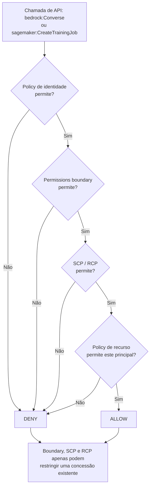
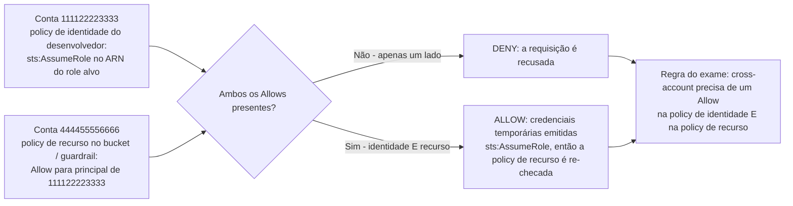
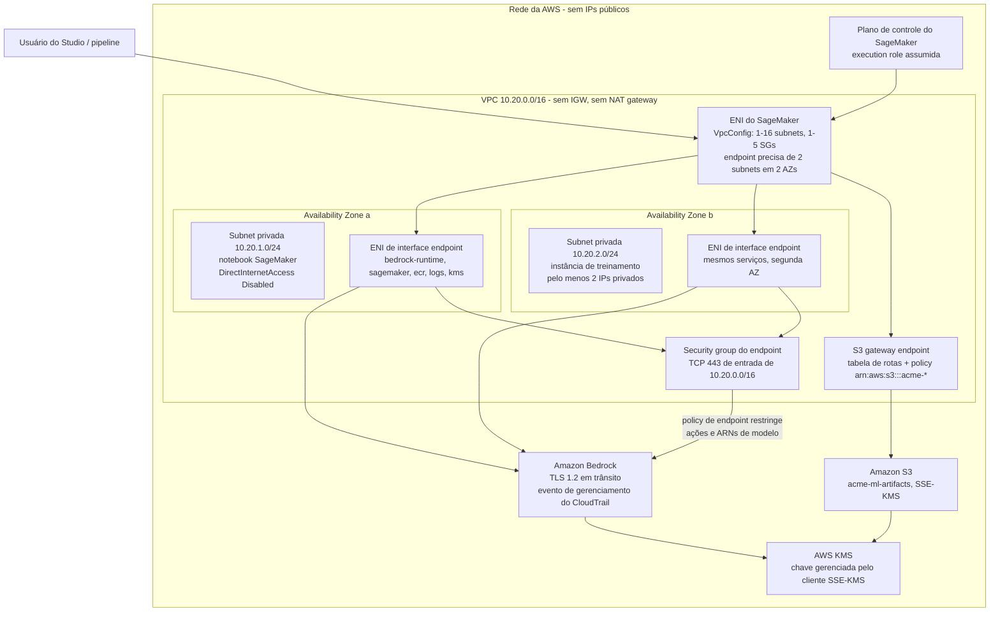
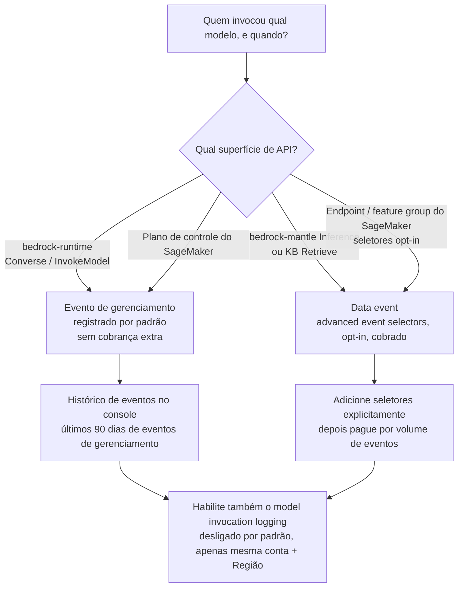
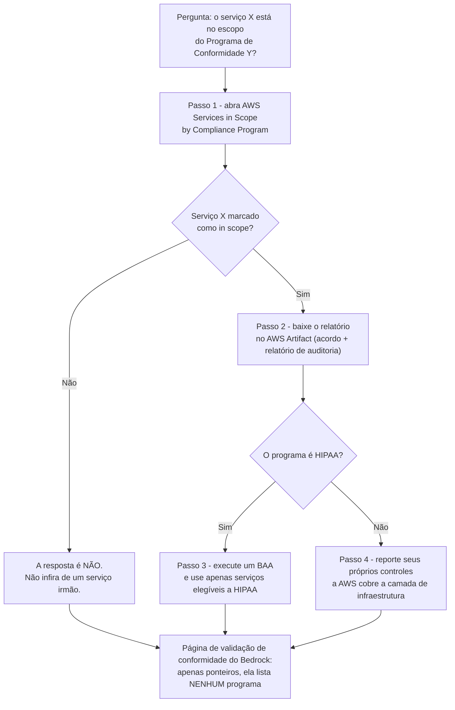

# Segurança, IAM e conformidade para cargas de trabalho de IA

Segurança é o segundo domínio mais pesado do exame AIF-C01: **o Domínio 2 "Segurança, Conformidade e Governança" carrega 24%** da pontuação, de um exame de **65 questões** (50 pontuadas + 15 não pontuadas) sem penalidade por chute. O que o torna difícil não é o vocabulário: é que a AWS enquadra o *mesmo* requisito em quatro lugares diferentes, e o exame recompensa você por saber qual lugar é autoritativo. "O Bedrock é compatível com HIPAA?" tem uma resposta correta diferente dependendo de se você lê uma página de marketing, a documentação do próprio serviço ou a tabela AWS Services in Scope.

```text
====================================================================
 SECURITY DECISION MAP FOR AI/ML ON AWS        (digest 06 Oct 2026)
====================================================================
 WHO CAN DO WHAT ....... IAM identity policy + resource policy
                         + permissions boundary + SCP/RCP
                         -> all FOUR cap; NONE of them grants
 WHO ASSUMES THE ROLE ... SageMaker execution / pipeline /
                         service / service-linked (Studio Classic)
                         Bedrock service role (+ aws:SourceAccount)
 WHERE DOES DATA LIVE ... VPC: 1-16 subnets, 1-5 security groups,
                         >=2 subnets in >=2 AZs for an endpoint
                         7 Bedrock PrivateLink services, TCP 443
                         S3 gateway endpoint = free
 HOW IS IT ENCRYPTED ... in transit: TLS 1.2 minimum
                         at rest: SSE-S3 default, SSE-KMS CMK option
                         cross-account S3 -> YOUR customer key
 HOW IS IT LOGGED ...... CloudTrail management events = default/free
                         data events = opt-in, charged
                         model invocation logging = OFF by default
 IS IT COMPLIANT ....... AWS Services in Scope + AWS Artifact
                         HIPAA-eligible service + BAA (never "certified")
                         Bedrock: ISO, SOC, CSA STAR L2, GDPR,
                         HIPAA eligible, FedRAMP High (GovCloud US-West)
====================================================================
```

> [!NOTE]
> **Como ler esta lição.** Três regras se aplicam do começo ao fim. (1) **Números são examináveis**: `1–16` subnets, `1–5` security groups, **7** serviços PrivateLink, **90 dias** de histórico de eventos do CloudTrail, corpo do log de invocação de **100 KB**, **≤30 dias** de retenção do `aws_review`, **50%** de confiança do Rekognition. (2) **A redação é examinável**: "elegível para HIPAA" nunca é "certificado HIPAA", e uma página que *aponta* para programas de conformidade não é uma página que *os lista*. (3) **Tudo que a AWS não confirma em primeira party é sinalizado**, nunca ensinado como material de memorização: os sinalizados são coletados no final da lição.

Ao final desta lição você será capaz de:

- nomear cada tipo de role de IAM que uma carga de trabalho de IA pode usar e dizer quem o assume;
- escrever um SageMaker execution role de mínimo de privilégio e explicar por que `AmazonSageMakerFullAccess` ainda precisa de um segundo statement de S3;
- aplicar a regra de cross-account corretamente: um Allow é necessário **tanto** na policy de identidade **quanto** na policy de recurso;
- escolher entre **SSE-S3** e **SSE-KMS** (e saber quando apenas um é possível);
- projetar uma VPC privada de ML: gateway endpoint vs. interface endpoint vs. NAT, e por que endpoints SageMaker precisam de **duas subnets em duas Availability Zones**;
- separar os eventos de **gerenciamento** do CloudTrail dos **data events** para `bedrock-runtime`, `bedrock-mantle` e SageMaker;
- provar uma afirmação de conformidade do jeito da AWS: Services in Scope → **AWS Artifact** → BAA para serviços elegíveis a HIPAA;
- defender o **veredito comparativo**: IAM vs. chaves compartilhadas, VPC endpoint vs. NAT, SSE-KMS vs. SSE-S3.

---

## 1. Responsabilidade compartilhada, e o que a "segurança de IA" adiciona

### 1.1 A frase que a AWS realmente publica

A própria documentação de segurança do Amazon Bedrock não lhe entrega uma checklist. Ela diz que a responsabilidade *"é determinada pela sensibilidade dos seus dados, pelos objetivos de conformidade da sua empresa e pelas leis e regulamentações aplicáveis"*. Essa frase é a filosofia inteira: a AWS protege a infraestrutura e o serviço, você protege **o que você coloca nele e quem tem permissão para tocá-lo**: e a sensibilidade de uma carga de trabalho de IA (prompts, embeddings, dados de fine-tuning, saídas do modelo) é a variável que o exame continua testando.

### 1.2 A divisão, camada por camada

| Camada | A AWS é responsável por | Você é responsável por | Gancho de exame |
|---|---|---|---|
| **Física / host** | Regiões, disponibilidade, hardware | Colocação e escolha de Região | Residência de dados começa aqui |
| **Identidade** | o próprio serviço IAM | policies de confiança do role, mínimo de privilégio, `iam:PassRole`, boundaries, SCPs | "Todos os quatro limitam, nenhum concede" |
| **Rede** | encanamento do VPC, fabric do PrivateLink | subnets, rotas de roteamento, security groups, policies de endpoint | Sem internet ⇒ endpoints, não NAT |
| **Dados em repouso** | serviço KMS, serviço S3 | escolha da chave (SSE-S3 vs SSE-KMS), policies de chave, grants | Cross-account ⇒ **seu** CMK |
| **Dados em trânsito** | término do TLS nos serviços da AWS | TLS 1.2 mínimo nos seus caminhos de cliente e VPC | "1.2" é o número |
| **Conteúdo de IA** | comportamento do serviço Bedrock | Guardrails, filtros PII, moderação, seleção de modelo | Modere **ambas** as direções |
| **Auditoria** | serviços CloudTrail, Config, GuardDuty | ligá-los, seletores, retenção, destinos de log | O log de invocação de modelo está **desligado** por padrão |
| **Conformidade** | relatórios, escopo, Artifact | quais serviços você usa, e seus próprios controles | Evidência vive no **AWS Artifact** |

- **📚 Você sabia?** A AWS publica **143 ofertas de conformidade** em seus serviços. A contagem é um distrator de propósito: o exame nunca pergunta o total, ele pergunta se *este serviço específico* está *no escopo deste programa específico*: e a única resposta autoritativa é a tabela **AWS Services in Scope by Compliance Program**, não uma página de marketing do serviço.

### 1.3 A primeira armadilha: "certificado HIPAA" não existe

**Não existe certificação HIPAA** para a AWS, para o Amazon Bedrock, para o SageMaker, ou para qualquer provedor de serviço em nuvem. A redação correta, e a redação que o exame usa, é:

1. assine um **Business Associate Agreement (BAA)** com a AWS, e
2. use apenas **serviços elegíveis a HIPAA** para armazenar ou processar informações de saúde protegidas (PHI).

A AWS ainda mapeia a HIPAA Security Rule para **FedRAMP** e **NIST SP 800-53** (orientação para a qual é SP 800-66), e é por isso que esses dois nomes aparecem juntos em toda opção correta de HIPAA.

---

## 2. Identidade: os roles atrás de cada job de IA

### 2.1 Os tipos de role, em uma tabela

O próprio SageMaker documenta quatro tipos de role, e o Bedrock adiciona mais dois. Aprenda quem *assume* cada um: é isso que a questão sempre testa.

| Tipo de role | Assumido por | Principal de confiança | Permissões-chave |
|---|---|---|---|
| **SageMaker execution role (job)** | SageMaker em runtime do job | `sagemaker.amazonaws.com` | S3 in/out, pull do ECR, logs do CloudWatch, KMS |
| **Role de domínio / espaço / usuário** | SageMaker para uma identidade do Studio | `sagemaker.amazonaws.com` | por persona via Role Manager (**3 personas**) |
| **Pipeline execution role** | Pipelines → cada etapa | `sagemaker.amazonaws.com` | APIs da etapa + S3 `JsonGet`; criador precisa de `iam:PassRole` |
| **Service-linked role** | SageMaker automaticamente | gerenciado pela AWS | estreito, fixo: **apenas Studio Classic** |
| **Bedrock service role** (customização, agents, KB, Flows, evals) | `bedrock.amazonaws.com` | `bedrock.amazonaws.com` + `aws:SourceAccount` | seus buckets S3 + KMS |
| **Role cross-account** | outras contas via `sts:AssumeRole` | outra conta / `AWS:PrincipalArn` | limitado pela policy de identidade **e** de recurso |
| **Role com boundary anexada** | como role base | inalterado | **limitado** pela boundary |
| **Projeto Bedrock / bearer token** | app usando uma API key |: | `bedrock-mantle:*` com escopo de um ARN de projeto |

Dois detalhes que valem a pena memorizar:

- **`ExecutionRoleSessionNameMode = USER_IDENTITY`** coloca o *usuário final* (não um nome de job compartilhado) no CloudTrail: a configuração que transforma "o job fez isso" em "as credenciais de Priya fizeram isso".
- As personas do **Role Manager** são **Data scientist**, **MLOps** e **SageMaker AI compute**: três roles, não uma lista de texto livre.

### 2.2 Exemplo 1: um SageMaker execution role de mínimo de privilégio

```json
{"Version":"2012-10-17","Statement":[
 {"Effect":"Allow","Principal":{"Service":"sagemaker.amazonaws.com"},"Action":"sts:AssumeRole"},
 {"Effect":"Allow","Action":["sagemaker:CreateTrainingJob","sagemaker:DescribeTrainingJob",
  "sagemaker:CreateModel","sagemaker:CreateEndpoint","sagemaker:InvokeEndpoint"],
  "Resource":"arn:aws:sagemaker:us-east-1:111122223333:*"},
 {"Effect":"Allow","Action":["s3:GetObject","s3:PutObject","s3:ListBucket"],
  "Resource":["arn:aws:s3:::acme-ml-artifacts","arn:aws:s3:::acme-ml-artifacts/*"]},
 {"Effect":"Allow","Action":["logs:CreateLogGroup","logs:PutLogEvents"],
  "Resource":"arn:aws:logs:us-east-1:111122223333:log-group:/aws/sagemaker/*"}]}
```

Quatro statements, uma conta (`111122223333`), um bucket (`acme-ml-artifacts`), uma Região (`us-east-1`). Compare isto com a managed policy da próxima subseção: a diferença *é* a resposta do exame.

### 2.3 A ressalva de S3 do `AmazonSageMakerFullAccess`

A AWS documenta uma restrição específica dentro do `AmazonSageMakerFullAccess`: **certas ações de S3 são concedidas apenas em buckets e objetos cujos nomes contêm `SageMaker`, `Sagemaker`, `sagemaker` ou `aws-glue`**, além de uma lista curta de ações que se aplicam a qualquer recurso S3. Consequências:

- um bucket chamado `acme-ml-artifacts` **não** é coberto: você precisa anexar uma segunda policy, exatamente como no Exemplo 1;
- uma opção afirmando que "FullAccess concede `s3:*` em cada bucket da conta" é **falsa**;
- uma opção afirmando que "FullAccess não concede permissões de S3" é igualmente falsa.

A lição prática é mais ampla que o S3: **uma managed policy é um ponto de partida, não um design**. O exame recompensa repetidamente o candidato que diz "policy gerenciada pelo cliente com escopo no ARN do recurso".

### 2.4 Exemplo 2: permitir uma família de modelo, negar outra

```json
{"Version":"2012-10-17","Statement":[
 {"Sid":"Allow","Effect":"Allow",
  "Action":["bedrock:InvokeModel","bedrock:InvokeModelWithResponseStream",
            "bedrock:Converse","bedrock:ConverseStream"],
  "Resource":["arn:aws:bedrock:us-east-1::foundation-model/anthropic.claude-*",
              "arn:aws:bedrock:us-east-1:111122223333:inference-profile/us.*"]},
 {"Sid":"Deny","Effect":"Deny",
  "Action":["bedrock:InvokeModel","bedrock:InvokeModelWithResponseStream"],
  "Resource":"arn:aws:bedrock:*::foundation-model/meta.*"}]}
```

Note o acoplamento: negar `InvokeModel` **mais** `InvokeModelWithResponseStream` também nega `Converse`/`ConverseStream`, porque os últimos são construídos sobre os primeiros. Para impor isso em toda a organização você sai do limite da conta e escreve um **SCP** sobre `bedrock:Invoke*`, `bedrock:Converse*` e `sagemaker:InvokeEndpoint*`.

### 2.5 Exemplo 3: um Bedrock service role de customização que resiste ao confused deputy

```json
{"Version":"2012-10-17","Statement":[
 {"Sid":"AllowBedrockServicePrincipalUnderConditions","Effect":"Allow",
  "Principal":{"Service":"bedrock.amazonaws.com"},"Action":"sts:AssumeRole",
  "Condition":{"StringEquals":{"aws:SourceAccount":"111122223333"}}},
 {"Effect":"Allow","Action":["s3:GetObject","s3:ListBucket"],
  "Resource":["arn:aws:s3:::acme-train","arn:aws:s3:::acme-train/*"]},
 {"Effect":"Allow","Action":["s3:PutObject"],"Resource":"arn:aws:s3:::acme-metrics/*"},
 {"Effect":"Allow","Action":["kms:Decrypt","kms:GenerateDataKey"],
  "Resource":"arn:aws:kms:us-east-1:111122223333:key/1234-abcd"}]}
```

Três hábitos estão empacotados nesta policy:

1. **`aws:SourceAccount`** na policy de confiança: o guarda de confused-deputy que a AWS recomenda para todo Bedrock service role (customização, importação, lote, agents, knowledge bases, Flows, avaliações);
2. **`aws:SourceArn`** por cima dele para escopo em nível de job;
3. para o Bedrock especificamente, **`iam:PassedToService = bedrock.amazonaws.com`** onde o chamador passa um role: e um statement correspondente de **policy de chave** para que o KMS realmente permita o job.

### 2.6 Como uma requisição é avaliada: tudo limita, nada concede



A regra que o exame continua reenunciando: **uma permissions boundary, uma service control policy (SCP) e uma resource control policy (RCP) todas limitam as permissões máximas possíveis: nenhuma delas concede nada.** Uma boundary sem nenhuma policy de identidade anexada dá a um usuário permissões efetivas *zero*, não as permissões da boundary.

### 2.7 Exemplo 4: uma permission boundary limitando um desenvolvedor de ML

```json
{"Version":"2012-10-17","Statement":[
 {"Effect":"Allow","Action":["sagemaker:*","s3:*","logs:*","ecr:*"],"Resource":"*"},
 {"Effect":"Deny","Action":["sagemaker:DeleteModel","sagemaker:DeleteEndpoint"],"Resource":"*"}]}
```

Permissão efetiva = policy de identidade **∩** boundary. O desenvolvedor mantém o que quer que a policy de identidade dele permita, mas nunca pode exceder estes quatro serviços, e nunca pode deletar um modelo ou um endpoint mesmo que a policy de identidade diga `sagemaker:*`.

**Ordene as etapas de construir esse role:**

```dragdrop
{
  "question": "Ordene as etapas de construir um SageMaker execution role de mínimo de privilégio, do jeito que a AWS documenta:",
  "items": [
    "Etapa 3: anexe a policy gerenciada pelo cliente que limita o S3 a arn:aws:s3:acme-ml-artifacts",
    "Etapa 1: crie a role de IAM com policy de confiança Principal sagemaker.amazonaws.com e sts:AssumeRole",
    "Etapa 2: decida as necessidades reais do job: quais APIs do SageMaker, qual bucket, qual log group, qual chave KMS",
    "Etapa 4: opcionalmente anexe uma permission boundary que limita o role a sagemaker, s3, logs e ecr",
    "Etapa 5, passe o role ao job com iam:PassRole e verifique o nome da sessão no CloudTrail"
  ],
  "correctOrder": [
    "Etapa 1: crie a role de IAM com policy de confiança Principal sagemaker.amazonaws.com e sts:AssumeRole",
    "Etapa 2: decida as necessidades reais do job: quais APIs do SageMaker, qual bucket, qual log group, qual chave KMS",
    "Etapa 3: anexe a policy gerenciada pelo cliente que limita o S3 a arn:aws:s3:acme-ml-artifacts",
    "Etapa 4: opcionalmente anexe uma permission boundary que limita o role a sagemaker, s3, logs e ecr",
    "Etapa 5, passe o role ao job com iam:PassRole e verifique o nome da sessão no CloudTrail"
  ],
  "explanation": "A confiança vem primeiro, depois o inventário honesto do que o job precisa, depois a policy com escopo, depois o limite opcional, e então o passe de fato. Candidatos que começam com o AmazonSageMakerFullAccess falham na etapa 3: essa managed policy não cobre um bucket chamado acme-ml-artifacts, então um segundo statement de S3 é obrigatório."
}
```

---

## 3. Identidade no Bedrock: policies gerenciadas, policies de recurso e cross-account

### 3.1 Sete policies gerenciadas, e suas datas

O Amazon Bedrock entrega **7 policies gerenciadas pela AWS**, e o exame gosta da linha do tempo:

| Policy gerenciada | Papel | GA / nota |
|---|---|---|
| `AmazonBedrockFullAccess` | acesso amplo ao Bedrock | limita `iam:PassRole` + `iam:PassedToService` |
| `AmazonBedrockReadOnly` | somente leitura | auditorias e revisores |
| `AmazonBedrockLimitedAccess` | linha de base de atividade central | **GA 13 de junho de 2025** |
| `AmazonBedrockMarketplaceAccess` | modelos de marketplace | **GA 13 de junho de 2025** |
| `AmazonBedrockMantle*` (×3) | acesso a projetos `bedrock-mantle` | **GA 3 de dezembro de 2025** |

### 3.2 Baseada em identidade e baseada em recurso, e por que guardrails precisam de ambas

O Bedrock aceita **policies baseadas em identidade** (quem você é) *e* **policies baseadas em recurso** (qual objeto está sendo tocado). **Guardrails e inference profiles aceitam policies de recurso**, e a AWS afirma que uma policy de recurso é **obrigatória** para aplicação em nível de organização: para impedir que uma organização inteira invoque um modelo sem um guardrail anexado, você anexa uma policy de recurso avaliada com `bedrock:GuardrailIdentifier` e a sustenta com um SCP. Uma policy de identidade sozinha não pode expressar "este guardrail deve estar presente".

### 3.3 Cross-account: o Allow deve existir nos dois lados



Concretamente, para um bucket S3 compartilhado **e** um guardrail compartilhado:

1. A conta B (`444455556666`) cria `role/CrossAccountBedrock` confiando em `{"AWS":"arn:aws:iam::111122223333:root"}` **e** coloca uma policy de recurso no bucket/guardrail permitindo a conta A;
2. A conta A anexa uma policy de identidade com `{"Action":"sts:AssumeRole","Resource":"arn:aws:iam::444455556666:role/CrossAccountBedrock"}`;
3. ambos os Allows são necessários: para KMS você deve passar **seu próprio CMK**, porque uma policy de chave S3 gerenciada pela AWS não pode ser compartilhada daquela forma.

**Exemplo 5: a metade que falta: a policy de recurso no bucket da conta B.**

```json
{"Version":"2012-10-17","Statement":[
 {"Sid":"AllowAccountAIdentity","Effect":"Allow",
  "Principal":{"AWS":"arn:aws:iam::111122223333:root"},
  "Action":["s3:GetObject","s3:ListBucket"],
  "Resource":["arn:aws:s3:::acme-shared","arn:aws:s3:::acme-shared/*"],
  "Condition":{"StringEquals":{"aws:PrincipalOrgID":"o-a1b2c3d4e5","s3:ExistingObjectTag/classification":"internal"}}},
 {"Sid":"DenyUnencryptedTransport","Effect":"Deny",
  "Principal":"*","Action":"s3:*",
  "Resource":["arn:aws:s3:::acme-shared","arn:aws:s3:::acme-shared/*"],
  "Condition":{"Bool":{"aws:SecureTransport":"false"}}}]}
```

A conta `111122223333` (identidade) mais este statement em `444455556666` (recurso) = os dois Allows que a regra exige; o segundo statement ainda impõe TLS em trânsito no bucket.

### 3.4 Permission boundaries, SCPs e RCPs comparados

| Controle | Anexado a | Aplica-se a | Efeito | Concede algo? |
|---|---|---|---|---|
| **Permissions boundary** | um role/identidade de IAM | aquela identidade | permissões máximas possíveis | **Não** |
| **SCP (OU/conta)** | a estrutura da organização | principais na conta | permissões máximas possíveis | **Não** |
| **RCP** | recursos na organização | requisições chegando àqueles recursos | permissões máximas possíveis | **Não** |
| **Policy de identidade** | uma identidade de IAM | aquela identidade | a concessão real | **Sim** |
| **Policy de recurso** | um recurso (bucket, guardrail, chave) | principais chegando a ele | concessão + condições | **Sim** |

- **📚 Você sabia?** O recurso **Role Manager** e o caminho do **service-linked role** estão ambos ligados ao **Studio Classic**. No Studio (a experiência atual) você atribui **roles de domínio, espaço e usuário** por persona: e é por isso que uma opção descrevendo "deixar o SageMaker criar o role automaticamente" é uma resposta de Studio Classic, e uma opção descrevendo três personas é uma resposta de Role Manager.

---

## 4. Criptografia: em repouso e em trânsito

### 4.1 Em trânsito: TLS 1.2 é o número

A AWS declara **TLS 1.2** como o mínimo em trânsito para estes serviços. No CloudTrail você pode verificar a versão negociada através de `tlsDetails.tlsVersion`. Qualquer opção oferecendo "TLS 1.0 ou superior", "SSL" ou "apenas TLS 1.3" está errada em direções opostas.

### 4.2 Em repouso: padrões, opções e as duas exceções

| Ativo | Em repouso: padrão | Opção do cliente | Em trânsito |
|---|---|---|---|
| Notebooks, artefatos, saída de job do SageMaker | **SSE-S3** | **SSE-KMS CMK** | TLS |
| Volumes de armazenamento ML do SageMaker | **chave transitória, descartada após criptografar** | `VolumeKmsKeyId` | n/a |
| Volumes de SO da instância | **chave KMS gerenciada pela AWS** | não selecionável | n/a |
| Modelos custom / importados do Bedrock | **chaves possuídas pela AWS** | **CMK** (`GenerateDataKey`) | **TLS 1.2** |
| Logs de invocação do Bedrock | n/a até você habilitá-los | seu S3/CloudWatch + CMK | TLS 1.2 |
| Dados de treino / validação do Bedrock | seu padrão do S3 | CMK + grant de policy de chave | TLS 1.2 |
| Saída SageMaker do **S3 Express One Zone** | **apenas SSE-S3** | **SSE-KMS não suportado** | TLS |
| Payloads de inferência cross-Region | conforme política de retenção |: | **criptografados entre Regiões** |

Duas exceções carregam peso desproporcional no exame:

1. **Um volume SageMaker sem chave recebe uma chave transitória que é descartada após a criptografia**: então "volumes do SageMaker são não criptografados" é falso, e "você deve fornecer uma chave KMS" também é falso.
2. **Acesso cross-account ao S3 precisa do *seu* CMK.** Se a conta A lê o bucket da conta B, a política de chave padrão gerenciada pela AWS da conta B não vai cooperar; a conta A deve fornecer e controlar uma chave gerenciada pelo cliente.

### 4.3 Escolhendo entre SSE-KMS e SSE-S3 em uma frase

**SSE-S3** é o padrão, não tem sobrecarga de gerenciamento de chave e não tem cobranças de requisição do KMS; **SSE-KMS** lhe dá uma chave gerenciada pelo cliente com uma trilha de auditoria no CloudTrail, policies e grants de chave e rotação por chave: e é a única maneira de satisfazer um requisito cross-account ou uma política que exige aplicação de CMK. Regras do AWS Config como `sagemaker-endpoint-config-kms-key-required` e `sagemaker-featuregroup-encryption-at-rest` existem precisamente para *detectar* quando você manteve o padrão.

---

## 5. Isolamento de rede: VPCs, gateway endpoints e PrivateLink

### 5.1 O contrato do `VpcConfig`

O `VpcConfig` do SageMaker aceita **1 to 16 subnets** e **1 to 5 security groups**, e o SageMaker cria **elastic network interfaces (ENIs)** em cada subnet. A regra rígida que os candidatos perdem:

> **Um endpoint SageMaker precisa de pelo menos 2 subnets em pelo menos 2 Availability Zones: mesmo que você lance uma única instância.**

Jobs de treinamento precisam de **pelo menos 2 IPs privados** por instância (**pelo menos 5 com EFA**), e o security group deve permitir **TCP 443 de entrada** no caminho da ENI.

### 5.2 Os sete serviços PrivateLink do Bedrock

| # | Serviço de endpoint VPC |
|---|---|
| 1 | `com.amazonaws.<region>.bedrock` |
| 2 | `com.amazonaws.<region>.bedrock-runtime` |
| 3 | `com.amazonaws.<region>.bedrock-agent` |
| 4 | `com.amazonaws.<region>.bedrock-agent-runtime` |
| 5 | `com.amazonaws.<region>.bedrock-fips` |
| 6 | `com.amazonaws.<region>.bedrock-runtime-fips` |
| 7 | `com.amazonaws.<region>.bedrock-mantle` |

Com PrivateLink você obtém: **sem internet gateway, sem NAT, sem requisito de VPN ou Direct Connect, e sem IPs públicos**. DNS privado **habilitado** significa que seu código não muda; DNS privado **desabilitado** significa que você reescreve as chamadas para `{vpce-id}.bedrock-runtime.{region}.vpce.amazonaws.com`. O security group do endpoint deve permitir **443 de entrada**, e você pode anexar uma **policy de endpoint custom** para restringir quais ações ou ARNs de modelo são alcançáveis.

### 5.3 Quatro padrões VPC e o que eles custam

| Padrão | Componentes | Use quando | Nota de custo |
|---|---|---|---|
| **A: subnets privadas + gateway endpoint S3** | ≥2 AZs, gateway endpoint + policy, SG 443, sem IGW/NAT | apenas S3 + APIs da AWS | gateway endpoint **gratuito**; interface endpoints por hora + por GB |
| **B: + interface endpoints (PrivateLink)** | `bedrock`, `bedrock-runtime`, `sagemaker`, `ecr`, `logs`, `kms` por subnet | Bedrock/SageMaker sem internet | por hora + processamento; **substitui o NAT** |
| **C: + subnets públicas & NAT gateway** | IGW, subnets públicas, **NAT gateway** + Elastic IP | uma dependência **sem interface endpoint**, alvos não-AWS | NAT por hora + por GB + EIP |
| **D: totalmente sem internet** | A ou B, espelho de pacotes privado / ECR, sem IGW | cargas de trabalho reguladas / de residência de dados | remove o custo de NAT + IGW |
| **Aplicação** | `sagemaker:VpcSubnets`; Config `…-instance-inside-vpc`, `…-no-direct-internet-access` | todos os acima |: |

### 5.4 Exemplo 6: um layout funcional de Bedrock + SageMaker privado (Padrão B)

1. `10.20.0.0/16` com privada `10.20.1.0/24` (AZ-a) e `10.20.2.0/24` (AZ-b); **sem rota de IGW, sem NAT**;
2. **S3 gateway endpoint** anexado a ambas as tabelas de rotas, com uma policy de endpoint limitada a `arn:aws:s3:::acme-*`;
3. **interface endpoints** em ambas as subnets para `bedrock-runtime`, `bedrock`, `sagemaker`, `sagemaker.api`, `sagemaker.runtime`, `ecr.api`, `ecr.dkr`, `logs` e `kms`; security group do endpoint com **443 de entrada de `10.20.0.0/16`**;
4. `VpcConfig = {Subnets:[a,b], SecurityGroupIds:[sg-ml]}`; egress de `sg-ml` limitado a 443 em direção ao security group do endpoint; notebook `DirectInternetAccess = Disabled`;
5. **fluxo**: usuário do Studio → ENI do SageMaker → ENI do endpoint → Bedrock runtime pela rede da AWS com TLS 1.2. O CloudTrail registra a chamada como um evento de **gerenciamento** na Região de origem, e o GuardDuty AI Protection o lê através de seu canal service-linked. **Fallback** (Padrão C) adiciona um IGW, subnets públicas e um **NAT gateway** apenas quando uma dependência não tem interface endpoint.

### 5.5 A arquitetura segura de VPC / ML



> [!WARNING]
> **Duas armadilhas de rede que custam marcas em toda sessão.**
> 1. **Um endpoint precisa de ≥2 subnets em ≥2 AZs mesmo para uma instância.** Uma opção oferecendo "uma subnet é suficiente para um endpoint de uma única instância" está sempre errada: o requisito de AZ está no contrato da API, não em uma best practice.
> 2. **"Usar um NAT gateway para manter o tráfego privado" está ao contrário.** Um NAT gateway roteia tráfego para a internet através da AWS; um design sem internet usa **gateway endpoints (S3, gratuito)** e **interface endpoints / PrivateLink**, com NAT apenas como **fallback** para dependências que não expõem interface endpoint. O inbound do security group no caminho da ENI é **443**, não 80.

---

## 6. Auditoria: CloudTrail, log de invocações, GuardDuty e Config

### 6.1 Eventos de gerenciamento vs. data events: a linha grátis/pago

| Chamada | Tipo de evento do CloudTrail | Custo |
|---|---|---|
| APIs do plano de controle do SageMaker (padrão) | **gerenciamento** | incluído |
| Data events opt-in do SageMaker (`AWS::SageMaker::Endpoint`, `FeatureGroup`, …) | **data** | opt-in, **cobrado** |
| `bedrock-runtime` → `Converse`, `InvokeModel` | **gerenciamento** | **gratuito** |
| `bedrock-mantle` → `Inference` | **data** | opt-in, **cobrado** |
| `Retrieve` de knowledge base | **data** | opt-in, **cobrado** |



**Eventos de gerenciamento são gratuitos e ligados por padrão; data events são opt-in e cobrados.** O **histórico de eventos** do CloudTrail retém **90 dias** de eventos de gerenciamento no console.

### 6.2 O log de invocação de modelo é uma chave separada, e está desligado

O **model invocation logging do Bedrock está desligado por padrão**. Quando você o habilita:

- os destinos são **CloudWatch Logs e/ou S3**, e eles devem estar na **mesma conta e na mesma Região**;
- um corpo inline de prompt/conclusão de **≤100 KB** é armazenado inline: corpos maiores vão para um prefixo S3 sob `data/`;
- o log *não* é CloudTrail: o CloudTrail lhe diz *quem chamou o quê*, o log de invocação lhe diz *o que foi dito*.

### 6.3 GuardDuty AI Protection

O **AI Protection** do GuardDuty lê **data events** do Bedrock, AgentCore e SageMaker mais eventos de gerenciamento, através de um **canal service-linked do CloudTrail que o GuardDuty cria para você**. Achados notáveis:

| Achado / comportamento | Significado |
|---|---|
| `Impact:IAMUser/AnomalousModelInvocation` | padrão incomum de chamada de modelo |
| `…/CostHarvesting` | recurso drenado por custo de tokens |
| `Impact:IAMUser/PromptInjection.Direct` | guardrail interveio em uma entrada |
| MITRE ATLAS **AML.T0040** | a técnica mapeada |
| Plano Foundational | sinaliza remoção de guardrail, mudanças na fonte de dados de treino, **log de invocação desabilitado**, criação anômala de notebook/job de treino, credenciais EC2 exfiltradas |
| Lambda Protection | cobre **agents** do Bedrock |

Estes são **achados e alertas**, não bloqueios: o GuardDuty lhe diz que um guardrail foi intervido; apenas o próprio guardrail bloqueia conteúdo.

### 6.4 AWS Config: regras e packs para IA

Regras do Config com prefixo `sagemaker-` incluem:

- `sagemaker-notebook-no-direct-internet-access`
- `sagemaker-notebook-instance-inside-vpc`
- `sagemaker-endpoint-config-kms-key-required`
- `sagemaker-featuregroup-encryption-at-rest`

E há três conformance packs voltados para IA: **Best Practices for Amazon Bedrock**, **Best Practices for Amazon SageMaker AI** e **Best Practices for AI/ML Supporting Infrastructure**. O controle **3.1.1** do NIST SP 800-171 mapeia para `sagemaker-notebook-no-direct-internet-access`, e a AWS afirma que templates de exemplo **não garantem passar** em uma auditoria de conformidade.

- **📚 Você sabia?** Uma **remoção de Guardrail** e uma **virada do log de invocação de modelo para desabilitado** são ambos tratados como eventos de segurança pelo plano Foundational do GuardDuty. Isso é incomum, a maioria do "configuration drift" só é visível no Config, e é uma forte dica de que o exame considera "desligar discretamente sua rede de segurança" um ato de ataque, não uma tarefa de administração.

### 6.5 Painel de status (outubro de 2026)

| Controle / recurso | Status | Nota |
|---|---|---|
| **AI Protection** do GuardDuty | GA | data events de Bedrock + AgentCore + SageMaker |
| Pack do Config *Best Practices for Amazon Bedrock* | GA | implante ao lado do pack de infraestrutura |
| Endpoints PrivateLink do Bedrock | GA | incluindo `bedrock-mantle` |
| Modos de retenção do Bedrock + condition keys | GA (API/SDK) | **sem UI de console no lançamento** |
| `AmazonBedrockLimitedAccess` | GA **13 de junho de 2025** | linha de base de atividade central |
| Policies `AmazonBedrockMantle*` | GA **3 de dezembro de 2025** | 3 policies |
| **FedRAMP High** do Bedrock | Authorized: **GovCloud (US-West)** | matriz por modelo rastreada separadamente |
| **HIPAA eligible** do Bedrock | Eligible | BAA necessário; "eligible" ≠ "certified" |
| Escopo **PCI DSS** do Bedrock | **não declarado nas próprias páginas do Bedrock** | não afirme |
| Saída SageMaker do S3 Express One Zone | **apenas SSE-S3** | SSE-KMS não suportado |

---

## 7. Conformidade: HIPAA, AWS Artifact e o que o Bedrock realmente publica

### 7.1 A única cadeia autoritativa



Três regras saem desse diagrama:

1. **AWS Services in Scope** é a única tabela autoritativa de "está coberto": ✓ significa in scope nos relatórios atuais;
2. **AWS Artifact** é onde os relatórios reais de SOC / ISO / FedRAMP vivem: nunca uma página de serviço, nunca um link de console rotulado "Compliance";
3. para HIPAA você precisa de um **BAA** mais **serviços elegíveis a HIPAA**; a AWS mapeia a Security Rule para **FedRAMP + NIST 800-53**.

### 7.2 O que o Amazon Bedrock publica

O conjunto de conformidade publicado do Amazon Bedrock é: **ISO**, **SOC**, **CSA STAR Level 2**, **GDPR**, **HIPAA eligible** e **FedRAMP High no AWS GovCloud (US-West)**: mais uma **matriz FedRAMP por modelo (publicada em 18 de setembro de 2026)** cobrindo modelos Classe C/D e **IL4/IL5**.

> [!WARNING]
> **A armadilha da página de conformidade.** O `compliance-validation.html` do Bedrock **não lista nenhum programa de conformidade**, ele contém apenas *ponteiros* para a tabela AWS Services in Scope e para o **AWS Artifact**. Uma opção afirmando que "a página de conformidade do Bedrock enumera cada programa no qual o serviço está no escopo" está testando se você realmente abriu a página. Igualmente, **PCI DSS não aparece em lugar nenhum na própria página de segurança-conformidade do Bedrock**, uma apresentação de conferência de 2024 e a página do *AgentCore* mencionam PCI, nenhuma das quais prova o escopo do Bedrock. **Não afirme isso.**

### 7.3 Números que valem a pena carregar para o exame

| Item | Valor |
|---|---|
| Ofertas de conformidade da AWS | **143** |
| Programas publicados do Bedrock | **ISO · SOC · CSA STAR Level 2 · GDPR · HIPAA eligible · FedRAMP High (GovCloud US-West)** |
| Matriz FedRAMP por modelo | publicada em **18 de setembro de 2026** (Classe C/D, IL4/IL5) |
| Certificação HIPAA para qualquer PSP | **não existe** |
| Mapeamento HIPAA | Security Rule → **FedRAMP + NIST 800-53** (SP 800-66) |
| Onde os relatórios vivem | **AWS Artifact** |
| Histórico de eventos do CloudTrail | **90 dias** de eventos de gerenciamento |
| Peso do Domínio 2 do AIF-C01 | **24%** de **65** questões |

- **📚 Você sabia?** A frase "in scope" tem um significado preciso: ela diz que o *serviço* foi incluído no relatório do auditor para aquele período: não que a sua *carga de trabalho* está em conformidade. É por isso que toda opção de conformidade que diz "habilitar o GuardDuty alcança conformidade com HIPAA" é falsa: você pode estar in scope e ainda falhar com suas próprias obrigações sob o modelo de responsabilidade compartilhada.

---

## 8. Governança de dados: retenção, residência e moderação de conteúdo

### 8.1 Modos de retenção do Bedrock

Os modos de retenção são `none`, `default`, `aws_review`, `provider_data_share` e `inherit`, com o escopo fluindo **projeto → conta → padrão do modelo**, **por Região, sem propagação entre Regiões**. Os fatos examináveis:

- **`aws_review` mantém os dados dentro do limite da AWS por ≤30 dias** e ele **nunca é dado ao provedor do modelo**;
- as condition keys do plano de controle são `bedrock:DataRetentionMode` / `bedrock-mantle:DataRetentionMode`, aplicáveis com SCP e IAM;
- **dados de fine-tuning são usados apenas para fazer fine-tuning**, nunca para treinar os modelos Titan base, e **nada é armazenado após o job**, mas o modelo com fine-tuned ainda pode **replay**-los, então filtre ou delete linhas sensíveis antes de começar;
- no lançamento **não há UI de console** para modos de retenção: apenas API/SDK.

### 8.2 Exemplo 7: aplicando retenção zero de dados em toda a organização (SCP)

```json
{"Version":"2012-10-17","Statement":[
 {"Effect":"Deny","Action":["bedrock-mantle:PutAccountDataRetention",
 "bedrock-mantle:CreateProject","bedrock-mantle:UpdateProject"],
 "Resource":"*","Condition":{"StringNotEquals":{"bedrock-mantle:DataRetentionMode":"none"}}}]}
```

Efeito: apenas `none` pode ser definido; um modelo que *requer* `aws_review` então retorna `ValidationException` / `status: unavailable`. A variante do plano de controle troca para `bedrock:PutAccountDataRetention` e `bedrock:DataRetentionMode`.

### 8.3 Inferência cross-Region: Geographic vs Global

| Modo | Onde o processamento roda | Preço | Requisito |
|---|---|---|---|
| Inferência cross-Region **Geographic** | fica dentro da geografia (US / EU / APAC) | padrão | resposta de residência de dados |
| Inferência cross-Region **Global** | qualquer Região comercial mundial | **~10% mais barato** em tokens | SCP deve permitir `aws:RequestedRegion = "unspecified"` |

O CloudTrail registra a chamada na **Região de origem**. Nenhum dos modos adiciona um sobrepreço de roteamento, e nenhum suporta Provisioned Throughput.

### 8.4 Moderação de conteúdo: a caixa de ferramentas completa

| Mecanismo | Escopo | Ação |
|---|---|---|
| **Filtros de conteúdo dos Guardrails** | texto **e** imagens; texto do usuário, do sistema e do modelo | `BLOCK` ou `NONE`; forças `NONE/LOW/MEDIUM/HIGH` |
| **Denied topics / word filters** | entradas + saídas | bloquear |
| **Filtro de informação sensível (PII)** | entradas + saídas | **bloquear ou mascarar**; entidades predefinidas ou **regex custom** |
| **Contextual grounding check** | respostas vs. fonte | bloquear ou sinalizar respostas sem fundamentação |
| **`DetectModerationLabels` do Rekognition** | **apenas imagens** JPEG/PNG | labels + confiança (`MinConfidence` padrão **50%**), revisão A2I |
| **`Start/GetContentModeration` do Rekognition** | **vídeos** armazenados | moderação assíncrona |
| **`…PromptInjection.Direct` do GuardDuty** | intervenção de guardrail em entradas | **achado/alerta**, não um bloqueio |

Específicos dos Guardrails do digest: **6 categorias de filtro**, Hate, Insults, Sexual, Violence, Misconduct e **Prompt Attack**, mais o tier `CLASSIC|STANDARD` e mensagens de resposta bloqueada de **1 to 500 caracteres**. A detecção de PII é **ML probabilística**, e é exatamente por isso que você pode escolher **mascarar** em vez de **bloquear**.

### 8.5 Limites de moderação do Rekognition

`DetectModerationLabels` aceita **apenas JPEG e PNG**, usa uma **taxonomia de 3 níveis** com `MinConfidence` padrão de **50%**, e funciona com o Amazon A2I para revisão humana. O limite rígido que a AWS declara por escrito: as APIs **não detectam conteúdo ilegal como CSAM**: nenhum limiar de confiança conserta isso, e nenhuma opção de exame deve afirmar o contrário.

- **📚 Você sabia?** A própria orientação de guardrails da AWS diz: *"Desabilite o Invocation Logs se você não quiser que conteúdo bloqueado apareça como texto simples nos logs."* Em outras palavras, o log que você habilita para auditoria pode se tornar o lugar onde o próprio conteúdo que você bloqueou é armazenado verbatim: um trade-off de design genuíno, e um caso raro em que a AWS recomenda explicitamente desligar um recurso de log.

---

## 9. Veredito comparativo

> [!IMPORTANT]
> **Veredito Comparativo: roles de IAM vs. chaves compartilhadas de longa duração, VPC endpoint vs. NAT gateway, SSE-KMS vs. SSE-S3**
> - **Role de IAM (credenciais STS temporárias) vs. access keys de longa duração / credenciais compartilhadas.** O role é sempre a resposta para cargas de trabalho de IA: um execution role é *assumido pelo serviço* com uma policy de confiança, sua sessão pode ser nomeada (`ExecutionRoleSessionNameMode = USER_IDENTITY`) para que o CloudTrail mostre o usuário final, e as credenciais expiram sozinhas. Chaves de longa duração vazam através de notebooks, histórico de git e logs de CI, não podem ser limitadas por policy de confiança, não podem expressar proteção confused-deputy com `aws:SourceAccount`, e dão a um atacante uma credencial sem sessão para revogar. Se uma opção propõe "dar ao cientista uma access key para que o job de treinamento alcance o S3", ela falhou em todo eixo que a AWS documenta.
> - **VPC endpoint (gateway para S3, interface/PrivateLink para Bedrock & SageMaker) vs. NAT gateway.** O endpoint mantém o tráfego **dentro da rede da AWS sem IPs públicos, sem IGW e sem NAT**; o **gateway endpoint do S3 é gratuito**, interface endpoints custam por hora mais processamento e *substituem* o NAT para aqueles serviços. Um NAT gateway é um **fallback** para dependências que não expõem interface endpoint: ele cobra por hora, por GB e por Elastic IP, e ainda envia tráfego para fora em direção à internet. Para um design sem internet e de residência de dados, endpoints são a arquitetura; NAT é a exceção que você documenta, não o objetivo que você persegue.
> - **SSE-KMS (chave gerenciada pelo cliente) vs. SSE-S3 (padrão SSE-S3).** O SSE-S3 é o padrão do SageMaker para notebooks, artefatos e saída de job: zero de gerenciamento de chave, sem cobranças de requisição do KMS, totalmente criptografado. O SSE-KMS adiciona um CMK que você controla, policies de chave, grants, rotação e auditoria no CloudTrail por chave: e ele se torna **obrigatório** quando você precisa de **acesso cross-account** (uma policy de chave gerenciada pela AWS não pode ser compartilhada), quando uma regra do Config como `sagemaker-endpoint-config-kms-key-required` o impõe, ou quando sua política exige criptografia gerenciada pelo cliente. Note as duas exceções documentadas onde a escolha desaparece: **a saída do S3 Express One Zone suporta apenas SSE-S3**, e **volumes de armazenamento ML do SageMaker usam uma chave transitória que é descartada após a criptografia**, a menos que você defina `VolumeKmsKeyId`.

| Se a pergunta diz… | Resposta | Por que as outras falham |
|---|---|---|
| "…o job deve ler exatamente um bucket S3" | **Execution role gerenciada pelo cliente com escopo no ARN do bucket** | `AmazonSageMakerFullAccess` é limitado por padrão de nome; service-linked roles são apenas Studio Classic |
| "…credenciais vazaram de um notebook" | **Role + STS, delete a chave** | uma boundary ou SCP não revoga um segredo vazado |
| "…nenhum prompt pode sair da geografia da UE" | **Inferência cross-Region Geographic** | o modo Global roteia mundialmente (~10% mais barato) |
| "…o tráfego nunca deve tocar a internet" | **Gateway S3 + interface endpoints Bedrock/SageMaker** | NAT gateway é voltado para a internet; um gateway endpoint sozinho não alcança o Bedrock |
| "…leitura cross-account de bucket para dados de treino" | **Seu próprio SSE-KMS CMK + ambos os Allows** | SSE-S3 não pode ser compartilhado; policy de um lado só falha |
| "…provar quem invocou o Claude, de graça" | **CloudTrail no `bedrock-runtime` (eventos de gerenciamento)** | a inferência `bedrock-mantle` é um data event cobrado |
| "…encontrar o relatório SOC do Bedrock" | **AWS Artifact** | a página de conformidade do Bedrock não lista nenhum programa |
| "…armazenar PHI com o Bedrock" | **BAA + serviços elegíveis a HIPAA** | "certificado HIPAA" não existe para nenhum PSP |

---

## 10. Armadilhas do exame e os números que valem a pena memorizar

> [!WARNING]
> **As armadilhas que custam pontos exatamente neste material:**
> 1. **"Certificado HIPAA" não existe**: para a AWS ou qualquer provedor em nuvem. O par correto é **BAA + serviço elegível a HIPAA**, e a AWS mapeia a Security Rule para **FedRAMP + NIST 800-53**.
> 2. **O `compliance-validation.html` do Bedrock não lista nenhum programa**: apenas ponteiros para *Services in Scope* e **AWS Artifact**. PCI DSS **não** é declarado nas próprias páginas do Bedrock; não afirme isso.
> 3. **`Converse` / `InvokeModel` no `bedrock-runtime` são eventos de GERENCIAMENTO do CloudTrail (gratuitos)**; **Inference** do `bedrock-mantle` é um **DATA event (opt-in, cobrado)**: a superfície decide, não o verbo.
> 4. **O model invocation logging está DESLIGADO por padrão**: e ele não é o CloudTrail. Os destinos devem estar na **mesma conta e Região**; corpos inline são de **≤100 KB**.
> 5. **Cross-account precisa de um Allow em AMBOS a policy de identidade E a policy de recurso.** Um lado só é sempre um deny.
> 6. **Endpoints SageMaker precisam de ≥2 subnets em ≥2 AZs**, mesmo para uma única instância; `VpcConfig` aceita **1 to 16 subnets** e **1 to 5 security groups**.
> 7. **Boundaries, SCPs e RCPs limitam: eles nunca concedem.** Uma boundary sozinha produz permissões zero.
> 8. **`AmazonSageMakerFullAccess` não alcança buckets arbitrários**: apenas nomes contendo `SageMaker`/`Sagemaker`/`sagemaker`/`aws-glue`, além de uma lista curta de qualquer recurso.
> 9. **NAT é um fallback, não um objetivo de design**; a resposta sem internet é gateway + interface endpoints, com **TCP 443** de entrada no security group do endpoint.
> 10. **O GuardDuty AI Protection cria seu próprio canal service-linked do CloudTrail**, você não configura um, e `PromptInjection.Direct` é um **achado**, não um bloqueio.

### 10.1 Os números testáveis

| Métrica | Valor |
|---|---|
| `VpcConfig` | subnets **1 to 16**, security groups **1 to 5** |
| AZs do endpoint / IPs privados de treino | **≥2 AZs** / **≥2** (**≥5 com EFA**) |
| Serviços PrivateLink do Bedrock / SG da ENI | **7** / **TCP 443** |
| Corpo inline do log de invocação | **≤100 KB** (senão S3 `data/`) |
| Model invocation logging | **desligado por padrão** |
| Histórico de eventos do CloudTrail | **90 dias** de eventos de gerenciamento |
| Inferência `bedrock-runtime` / `bedrock-mantle` | **gerenciamento, gratuito** / **data, cobrado** |
| Janela de retenção `aws_review` | **≤30 dias** dentro do limite da AWS |
| `MinConfidence` padrão do Rekognition | **50%** |
| Ofertas de conformidade da AWS | **143** |
| Policies gerenciadas do Bedrock / personas do Role Manager | **7** / **3** |
| Questões AIF-C01 / peso do Domínio 2 | **65** / **24%** |
| Mínimo em trânsito | **TLS 1.2** |
| Economia da inferência cross-Region Global | **~10%** |

### 10.2 Sinalizado como não verificado nesta lição

Para evitar que uma lacuna de pesquisa vire uma resposta errada: **escopo PCI DSS do Amazon Bedrock** (ausente das próprias páginas do Bedrock); **elegibilidade HIPAA do SageMaker** (a HIPAA Eligible Services Reference não foi recuperada); **disponibilidade por Região do GuardDuty AI Protection**; **conteúdo por regra dos três conformance packs de IA**; **preços exatos** para NAT gateways, interface endpoints, PrivateLink e GuardDuty AI Protection (as afirmações de custo aqui são direcionais); **pesos por tópico do AIF-C01** (apenas os pesos de domínio 20/24/28/14/14 são publicados); e **disponibilidade do Role Manager para novos clientes**. Trate cada um deles como "verifique a página de origem antes de afirmar".

---

## Casos Reais

Cinco histórias de clientes publicadas pela AWS, recuperadas para este curso em 6 de outubro de 2026, exercitam controles do Domínio 2 em produção. Leia-as como **evidência, não marketing**: toda porcentagem abaixo é um número **alegado pelo cliente/pela AWS, não auditado**, e apenas a Sun Finance (**n = 585** imagens) e a Adobe (seu próprio conjunto de teste) divulgam uma base amostral. O exame não pedirá que você memorize estes números: ele pede que você reconheça qual **controle** cada um deles prova.

### Evidência de estudos de caso para o Domínio 2

| # | Caso (origem) | Controle do Domínio 2 exercitado | Serviços AWS | Resultado documentado |
|---|---|---|---|---|
| 1 | **Epilot** (software de energia, Colônia): `aws.amazon.com/solutions/case-studies/epilot-genai-case-study` | **residência de dados** + aprovação humana no loop | Bedrock (Claude Sonnet), AWS Lambda, Amazon SQS, Bedrock Evaluations | **−87%** no tempo de manuseio de e-mails; **55.000** resumos/mês; MVP em **2 meses**; dados processados mantidos em uma **Região da UE** |
| 2 | **Alnylam Pharmaceuticals** (biotecnologia): `aws.amazon.com/solutions/case-studies/alnylam-case-study` | **auditabilidade GxP**: cada resposta carrega links de fonte | Bedrock, Amazon S3, Amazon Q Business | triagem **3 dias → horas**; busca **15 min → 30 s**; **2.000 funcionários + 1.000 contratados**; **250+** casos de uso |
| 3 | **Nippon India Mutual Fund** (serviços financeiros): ML Blog `blogs/machine-learning/how-nippon-india-mutual-fund-improved-the-accuracy-of-ai-assistant-responses-using-advanced-rag-methods-on-amazon-bedrock` | **Guardrails + grounding** como controle de alucinação | Bedrock Knowledge Bases, Bedrock Guardrails, Claude 3 Sonnet, reranker | precisão **+>95%**; alucinação **−90 to 95%**; relatórios **2 dias → ~10 minutos** |
| 4 | **Sun Finance** (fintech de empréstimos, 9 países): ML Blog `blogs/machine-learning/sun-finance-automates-id-extraction-and-fraud-detection-with-generative-ai-on-aws` | **PII não é trabalho de um LLM**: OCR e raciocínio são separados | Amazon Textract, Amazon Rekognition, Bedrock (Claude Sonnet 4), Lambda, Step Functions, S3 Vectors | precisão **79,73 → 90,80%**; **−91%** de custo/documento; **20 h → <5 s**; fraude **81%** |
| 5 | **Chronomics** (health-tech): ML Blog `blogs/machine-learning/chronomics-detects-covid-19-test-results-with-amazon-rekognition-custom-labels` | **caminho humano para saída de baixa confiança** (A2I) | Amazon Rekognition Custom Labels | **4 meses → 3 to 4 semanas**; **96,5%** de precisão / F1 de **97,9%**; limiar **0,99** descarta **5%** das previsões |

### O que os casos realmente provam

| Pergunta de controle | Evidência do caso | O número ou a configuração que a responde |
|---|---|---|
| **Onde os dados vivem?** | Epilot | uma **Região da UE**, sob a postura de retenção zero padrão do Bedrock: residência é uma escolha de design, não uma reflexão tardia de conformidade |
| **Quem tem permissão para escrever?** | Epilot | um agente posterior grava registros **apenas após humanos verificarem**: a opção "age sem supervisão" está errada |
| **A resposta é auditável?** | Alnylam | **links de fonte em cada resposta**; GxP quer um playbook, não uma caixa-preta |
| **Recuperação + guardrails consertam alucinação?** | Nippon India | alucinação de **−90 to 95%**, de *engenharia de recuperação* em vez de um modelo maior |
| **Um modelo de fundação pode ler PII diretamente?** | Sun Finance | **Não.** A primeira tentativa só com LLM pontuou **61,8%** no geral (**43%** no número de ID) e foi **rejeitada**; Textract + Rekognition + Claude atingiram **90,80%** |
| **O que acontece com saída de baixa confiança?** | Chronomics | **5%** das previsões são descartadas no limiar **0,99** (27% em 0,999): alguém precisa ser dono daquela cauda: **Amazon A2I** ou um caminho humano equivalente |

Os padrões de falha são tão examináveis quanto os sucessos: **inferência DIY** (a Forethought abandonou sua própria stack Amazon EKS por multi-model endpoints do SageMaker em **−66%** e Serverless Inference em **≈−80%**), **OCR só com LLM** (Sun Finance, acima) e **visão computacional custom in-house** (Chronomics, quatro meses contra três a quatro semanas). Cada um é uma questão sobre *escolher o nível certo*, que é Domínio 1: mas cada um também tem uma cauda do Domínio 2: quem é dono das credenciais, onde os dados ficam, e que evidência você pode produzir depois.

- **📚 Você sabia?** A AWS publica exatamente **uma** taxa de resultado de projeto: **65%** dos projetos do Generative AI Innovation Center chegaram à produção em 2025 (alguns em apenas **45 dias**), de **mais de 1.000** implementações e organizadas em torno do framework dos **Cinco Vs**: *Value → Visualize → Validate → Verify → Venture*. Os outros **35%** não foram a produção. Qualquer opção afirmando que "todos os pilotos de IA generativa da AWS têm sucesso" contradiz o próprio blog da AWS.

```fillblank
{
  "question": "Complete a afirmação de governança que todos os cinco casos sustentam:",
  "template": "Compartilhamento cross-account precisa de um Allow na policy de {{1}} E na policy de {{2}}; residência é escolhida com inferência cross-Region {{3}}; e saída de modelo de baixa confiança deve ser roteada para um caminho humano como {{4}}.",
  "answers": {
    "1": "identidade",
    "2": "recurso",
    "3": "Geographic",
    "4": "Amazon A2I"
  },
  "distractors": ["permissions boundary", "SCP", "Global", "AWS Artifact"],
  "explanation": "A regra cross-account sempre precisa de um Allow tanto na policy de identidade quanto na policy de recurso; residência de dados dentro da geografia da UE, dos EUA ou do APAC é o trabalho da inferência cross-Region Geographic (o modo Global roteia mundialmente por cerca de 10% a menos); e a cauda descartada de baixa confiança que a Chronomics mediu é exatamente o que o Amazon A2I existe para absorver. Uma permission boundary e um SCP apenas limitam permissões: eles nunca concedem, e o AWS Artifact é onde os relatórios de auditoria vivem, não um mecanismo de revisão humana."
}
```

---

## Regulação e mudanças de serviços AWS

### Atualizações de 2026 (em outubro de 2026)

Tudo abaixo foi verificado para este curso em 6 de outubro de 2026 e vem de fontes de primeira party: a página de framework regulatório da Comissão Europeia, os próprios avisos de certificação e disponibilidade de serviços da AWS e as páginas de produto da AWS. As datas são **escalonadas**, e colapsá-las é o jeito clássico de perder esta marca.

| Data | Mudança (fonte) | Por que o Domínio 2 se importa |
|---|---|---|
| **1 de fev de 2024 → 1 de ago de 2024** | EU AI Act (Reg. (UE) 2024/1689) **entra em vigor** | o relógio começa; obrigações entram em fases ao longo de 2025 to 2028 |
| **2 de fev de 2025** | práticas proibidas + obrigações de **AI literacy** se aplicam | o screening de usos proibidos vira um dever de governança ativo |
| **10 de jul de 2025** | **GPAI Code of Practice** da UE final (voluntário) | a boa prática de referência para modelos de propósito geral |
| **2 de ago de 2025** | obrigações de **GPAI + estrutura de governança + penalidades** se aplicam; limiar de risco sistêmico **10²⁵ FLOP** | os deveres recaem sobre *provedores de modelo*, não sobre todo cliente |
| **13 de out de 2025** | **Amazon Bedrock AgentCore GA** (9 Regiões, VPC, PrivateLink, autenticação IAM) | uma nova superfície de identidade e auditoria para agents |
| **2 de dez de 2025** | AgentCore **Policy / Evaluations / Memory** anunciado | Policy intercepta chamadas de ferramenta do Gateway com **Cedar** ou linguagem natural, *fora* do loop de raciocínio |
| **3 de mar de 2026 / 31 de mar de 2026** | AgentCore **Policy GA** / **Evaluations GA** (13 avaliadores) | política de agent aplicável e qualidade mensurável |
| **30 de abr de 2026** | **guia do exame AIF-C01 v1.1** publicado (v1.0 foi 26 de mar de 2026); a AWS afirma que conteúdo novo aparece no exame **~1 mês depois** | adiciona IA agêntica, **MCP**, engenharia de contexto, preços baseados em tokens e grounding; adiciona AgentCore, Kiro, Strands Agents; **remove Amazon MemoryDB** |
| **27 de jul de 2026** | **Digital Omnibus**, Reg. (UE) 2026/1744, em vigor (JO 24 de jul de 2026) | emenda o cronograma do AI Act; adia a data do Anexo III de alto risco |
| **30 de jul de 2026** | **Model Monitor, Clarify, Ground Truth, A2I, Debugger, Role Manager, Geospatial, Studio Lab** do SageMaker fechados para novos clientes (**manutenção**); **Amazon Kendra** fechado, → **Bedrock Managed Knowledge Base** | **Role Manager** é ensinado na §2.1 desta lição; Clarify é superado para trabalho novo pelo **Bedrock Model Evaluations** |
| **2 de ago de 2026** | **aplicação geral** da UE: deveres de transparência do Artigo 50 + **fiscalização de GPAI pela AI Office** começa | transparência e aplicação agora estão ativas |
| **2 de dez de 2026** | prazo de **marking** do Art. 50(2) para sistemas já no mercado | conteúdo gerado por IA deve ser identificável |
| **2 de dez de 2027 / 2 de ago de 2028** | obrigações de alto risco do **Anexo III** / **Anexo I** | adiadas pelo Digital Omnibus: não 2 de ago de 2026 |

**Tetos de penalidade sob o EU AI Act:**

| Violação | Multa máxima |
|---|---|
| Práticas proibidas (Art. 5) | **€35 M ou 7%** do faturamento anual global, o que for maior |
| A maioria das outras violações (incl. GPAI Art. 101) | **€15 M ou 3%** |
| Fornecer informações enganosas à AI Office | **€7,5 M ou 1%** |

Dois frameworks de governança ficam atrás destas datas e ainda são voluntários: o **NIST AI Risk Management Framework** (AI 100-1, jan de 2023: **Govern, Map, Measure, Manage**, **19 categorias / 72 subcategorias**) com seu **Generative AI Profile NIST AI 600-1** (jul de 2024, **12 riscos**), e **ISO/IEC 42001:2023** (dez de 2023), o **primeiro Sistema de Gestão de IA certificável**. A posição da AWS sobre tudo isso é inalterada: evidência de conformidade vem de **AWS Services in Scope** e **AWS Artifact**, e HIPAA ainda significa **BAA + serviços elegíveis a HIPAA**.

- **📚 Você sabia?** A AWS define um ciclo de vida de serviço de três palavras que aparece em opções de exame: **Maintenance** (nenhum cliente novo, nenhum recurso novo, ainda suportado), **Sunset** (fim de operações planejado, tipicamente 12 meses) e **Full Shutdown** (removido do portfólio). Em **30 de jul de 2026** um grande bloco de recursos do SageMaker, incluindo **Role Manager**, mudou para *manutenção*, e é por isso que notas de estudo antigas descrevendo-os como "o caminho atual para uma nova carga de trabalho" já estão erradas.

> [!WARNING]
> **Duas mudanças de 2026 que invalidam notas de estudo mais antigas.**
> 1. **Model Monitor, Clarify, Ground Truth, A2I, Debugger, Role Manager, Geospatial, Studio Lab e Mechanical Turk do SageMaker fecharam para novos clientes em 30 de julho de 2026.** O status é **manutenção**, não um desligamento, não um rebranding: clientes existentes os mantêm, nenhum recurso novo está planejado. Uma opção propondo "habilitar SageMaker Clarify para uma carga de trabalho Bedrock totalmente nova" é uma resposta datada; os caminhos atuais são **Bedrock Model Evaluations** e **Bedrock Guardrails**. Igualmente, **Amazon Kendra** (manutenção em 30 de jun de 2026, fechado para novos clientes em 30 de jul de 2026) roteia novas cargas de trabalho de busca para **Bedrock Managed Knowledge Base**. Note a armadilha na direção oposta: **Ground Truth Plus** encerra o suporte em **30 de jun de 2026** e Mechanical Turk em **30 de set de 2026**, "manutenção" e "fim do suporte" são palavras diferentes para coisas diferentes.
> 2. **As datas do EU AI Act são escalonadas, não as colapse.** Proibições **2 de fev de 2025**; GPAI + penalidades **2 de ago de 2025**; transparência do Artigo 50 + aplicação **2 de ago de 2026**; alto risco do Anexo III **2 de dez de 2027**; alto risco do Anexo I **2 de ago de 2028**. "O AI Act se aplicou integralmente em 1 de agosto de 2024" e "os deveres de alto risco começaram em 2 de agosto de 2026" estão ambos errados, e lembre-se de que o Digital Omnibus (Reg. (UE) 2026/1744, em vigor em **27 de jul de 2026**) é a razão pela qual a data do Anexo III mudou.

---

## Perguntas de Prática (Practice Questions)

```question
{
  "id": "aid-14-q1",
  "type": "multiple-choice",
  "question": "Um cientista de dados deve executar jobs de treinamento do SageMaker que leem de exatamente um bucket S3 chamado acme-ml-artifacts. Qual é a abordagem MELHOR?",
  "options": [
    "Anexar AmazonSageMakerFullAccess, porque ele já limita o S3 corretamente",
    "Criar uma execution role gerenciada pelo cliente cuja policy permite apenas as ações de que o job precisa e é limitada àquele ARN de bucket, confiada por sagemaker.amazonaws.com",
    "Usar um service-linked role do SageMaker assumido pelo cientista",
    "Anexar uma permission boundary sem nenhuma policy de identidade anexada"
  ],
  "correct": 1,
  "explanation": "Mínimo de privilégio significa uma policy gerenciada pelo cliente com escopo em arn:aws:s3:::acme-ml-artifacts. O AmazonSageMakerFullAccess restringe muitas ações de S3 a buckets/objetos chamados SageMaker, Sagemaker, sagemaker ou aws-glue, então acme-ml-artifacts não seria coberto; service-linked roles são um caminho de Studio Classic, não o role de um job de cientista; e uma permission boundary sozinha não concede nada."
}
```

```question
{
  "id": "aid-14-q2",
  "type": "multiple-choice",
  "question": "Qual afirmação sobre AmazonSageMakerFullAccess e Amazon S3 é VERDADEIRA?",
  "options": [
    "Ele concede s3:* em cada bucket da conta",
    "Ele concede certas ações de S3 apenas em buckets ou objetos chamados SageMaker, Sagemaker, sagemaker ou aws-glue, além de uma lista curta de ações em qualquer recurso",
    "Ele não concede nenhuma permissão de S3",
    "Ele concede acesso ao S3 apenas através de uma policy de gateway endpoint"
  ],
  "correct": 1,
  "explanation": "Esta é a ressalva documentada da AWS verbatim: os statements de S3 da managed policy são limitados por padrão de nome, então qualquer bucket fora daqueles padrões de nome precisa de um segundo statement gerenciado pelo cliente. Ele concede algumas permissões de S3 (então 'nenhuma permissão de S3' é falso), ele não concede s3:* em todo lugar, e policies de endpoint são um controle de rede, não o mecanismo por trás da managed policy."
}
```

```question
{
  "id": "aid-14-q3",
  "type": "multiple-choice",
  "question": "Qual par de afirmações sobre HIPAA na AWS está correto?",
  "options": [
    "A AWS é certificada HIPAA, então qualquer serviço da AWS pode processar PHI",
    "Não existe certificação HIPAA de nenhum provedor em nuvem; você assina um BAA e usa apenas serviços elegíveis a HIPAA, e a AWS mapeia a HIPAA Security Rule para FedRAMP e NIST SP 800-53",
    "Habilitar GuardDuty torna a conta compatível com HIPAA",
    "A elegibilidade HIPAA se aplica a contas inteiras, não a serviços individuais"
  ],
  "correct": 1,
  "explanation": "Não existe certificação HIPAA para a AWS ou qualquer PSP. O construto correto é um Business Associate Agreement mais serviços elegíveis a HIPAA, com a Security Rule mapeada para FedRAMP e NIST SP 800-53 (orientação SP 800-66). GuardDuty é um controle detectivo que sustenta suas próprias obrigações, mas nunca confere conformidade, e a elegibilidade é concedida por serviço, não por conta."
}
```

```question
{
  "id": "aid-14-q4",
  "type": "multiple-choice",
  "question": "Onde você baixa o relatório de auditoria SOC ou ISO que cobre o Amazon Bedrock?",
  "options": [
    "Console do Amazon Bedrock, na aba Compliance",
    "A página de documentação de validação de conformidade do Bedrock",
    "AWS Artifact",
    "A página de marketing de Compliance Programs da AWS"
  ],
  "correct": 2,
  "explanation": "AWS Artifact é o repositório de acordos de conformidade e relatórios de auditoria (SOC, ISO, FedRAMP e outros). A página de validação de conformidade do Bedrock não lista nenhum programa: ela apenas aponta para a tabela Services in Scope e para o Artifact, e o console não tem aba de relatório de conformidade, enquanto a página de marketing lista programas genericamente sem relatórios."
}
```

```question
{
  "id": "aid-14-q5",
  "type": "multiple-choice",
  "question": "Uma carga de trabalho nunca deve enviar prompts para fora da geografia da UE. Qual configuração deve ser usada, e qual é o trade-off?",
  "options": [
    "Inferência cross-Region Global: opção mais barata, mas ela roteia mundialmente",
    "Inferência cross-Region Geographic: o processamento fica dentro da geografia; o Global em vez disso economizaria cerca de 10% nos preços de tokens",
    "Um application inference profile com aws:RequestedRegion definido como unspecified",
    "Model invocation logging para um bucket S3 em eu-west-1"
  ],
  "correct": 1,
  "explanation": "A inferência cross-Region Geographic mantém o processamento dentro da geografia (EUA, UE ou APAC), que é a resposta de residência de dados. O modo Global é cerca de 10% mais barato, mas pode chamar qualquer Região comercial, e é o modo que requer um SCP permitindo aws:RequestedRegion = unspecified. Logar para S3 registra dados, não restringe onde a inferência roda."
}
```

```question
{
  "id": "aid-14-q6",
  "type": "multiple-choice",
  "question": "Você precisa provar quem invocou qual modelo e quando, usando bedrock-runtime, sem custo adicional de CloudTrail. Qual afirmação torna isso possível?",
  "options": [
    "Converse e InvokeModel no bedrock-runtime são registrados como eventos de gerenciamento por padrão, sem cobrança adicional",
    "A inferência bedrock-runtime é um data event que requer advanced event selectors",
    "Nada é logado a menos que o model invocation logging seja habilitado",
    "Amazon Bedrock não integra com AWS CloudTrail"
  ],
  "correct": 0,
  "explanation": "No bedrock-runtime, Converse e InvokeModel são eventos de gerenciamento do CloudTrail: registrados por padrão e gratuitos, e o histórico de eventos do console mantém 90 dias deles. Advanced data-event selectors são o que o Inference do bedrock-mantle (e o Retrieve de knowledge base) precisa: esses são opt-in e cobrados. O model invocation logging é um recurso separado, desligado por padrão, que captura o conteúdo do prompt em vez da identidade, e o Bedrock integra sim com o CloudTrail."
}
```

```question
{
  "id": "aid-14-q7",
  "type": "multiple-choice",
  "question": "Qual controle impede um notebook SageMaker de alcançar a internet, e como isso é verificado?",
  "options": [
    "Uma policy de endpoint VPC, verificada pelo GuardDuty S3 Protection",
    "DirectInternetAccess = Disabled dentro de uma subnet privada, verificado pela regra do Config sagemaker-notebook-no-direct-internet-access",
    "Um Deny em s3:GetObject de 0.0.0.0/0",
    "Data events do CloudTrail para AWS::SageMaker::NotebookInstance"
  ],
  "correct": 1,
  "explanation": "A configuração do notebook é DirectInternetAccess = Disabled e ele deve rodar em uma subnet privada sem rota de internet gateway; a regra do Config sagemaker-notebook-no-direct-internet-access é a checagem de conformidade documentada (e mapeia para o controle 3.1.1 do NIST SP 800-171). Policies de endpoint restringem quais recursos da AWS são alcançáveis, não o egress de internet; um Deny no S3 endereça um bucket; e data events do CloudTrail auditam chamadas em vez de bloquear caminhos de rede."
}
```

```question
{
  "id": "aid-14-q8",
  "type": "multiple-choice",
  "question": "Qual afirmação é VERDADEIRA sobre a história de auditoria do Amazon Bedrock?",
  "options": [
    "O model invocation logging está habilitado por padrão em toda conta",
    "O model invocation logging está desligado por padrão e seu destino CloudWatch ou S3 deve estar na mesma conta e Região; o GuardDuty AI Protection usa um canal service-linked do CloudTrail que o GuardDuty cria para você",
    "Data events do CloudTrail para inferência do Bedrock são sempre gratuitos",
    "A página de validação de conformidade do Bedrock enumera cada programa no qual o serviço está no escopo"
  ],
  "correct": 1,
  "explanation": "O log de invocação está desligado por padrão, os destinos devem corresponder à conta e Região, e corpos inline são limitados a 100 KB (payloads maiores vão para um prefixo data/ do S3). O GuardDuty AI Protection cria seu próprio canal service-linked do CloudTrail, então você não configura um. Data events são cobrados (não gratuitos), e a página de validação de conformidade não lista nenhum programa: ela apenas aponta para Services in Scope e AWS Artifact."
}
```

```question
{
  "id": "aid-14-q9",
  "type": "multiple-choice",
  "question": "Um assistente de call center deve remover SSNs e números de telefone TANTO dos prompts quanto das respostas do modelo. Qual configuração está correta?",
  "options": [
    "Filtro de informação sensível (PII) dos Guardrails definido como mascarar na entrada e na saída, com log de invocação desabilitado para que conteúdo bloqueado não seja armazenado como texto simples",
    "DetectModerationLabels do Rekognition aplicado à transcrição",
    "Um achado do GuardDuty AI Protection com severidade 7 ou maior",
    "A regra do Config sagemaker-endpoint-config-kms-key-required"
  ],
  "correct": 0,
  "explanation": "O filtro de informação sensível roda em entradas e saídas e pode bloquear ou mascarar, com entidades predefinidas ou regex custom: mascarar remove o SSN enquanto ainda deixa a conversa continuar. A moderação do Rekognition lida com imagens JPEG/PNG e vídeo, não transcrições de texto; o GuardDuty reporta eventos de prompt-injection como achados em vez de redigir conteúdo; e a regra do Config de KMS é uma checagem de criptografia."
}
```

```question
{
  "id": "aid-14-q10",
  "type": "multiple-choice",
  "question": "Qual afirmação descreve MELHOR o status de conformidade publicado do Amazon Bedrock?",
  "options": [
    "FedRAMP High autorizado no AWS GovCloud (US-West), e HIPAA eligible com ISO, SOC e CSA STAR Level 2 no escopo",
    "Detém uma certificação HIPAA global e é certificado PCI DSS segundo sua página de conformidade",
    "A certificação HIPAA se aplica porque GuardDuty e Config estão habilitados na conta",
    "Sua página de validação de conformidade lista 143 programas incluindo PCI DSS"
  ],
  "correct": 0,
  "explanation": "O conjunto publicado do Bedrock é ISO, SOC, CSA STAR Level 2, GDPR, HIPAA eligible e FedRAMP High no AWS GovCloud (US-West), complementado por uma matriz FedRAMP por modelo publicada em 18 de setembro de 2026. Nenhum PSP detém certificação HIPAA, PCI DSS não é declarado nas próprias páginas do Bedrock (então não deve ser afirmado), e 143 é a contagem de ofertas de conformidade da AWS em todos os serviços: não programas listados em qualquer página de serviço única."
}
```

```question
{
  "id": "aid-14-q11",
  "type": "multiple-choice",
  "question": "Uma equipe está iniciando UMA NOVA carga de trabalho em outubro de 2026 e planeja usar SageMaker Clarify para viés e SageMaker Model Monitor para drift, porque suas notas de estudo de 2024 recomendam ambos. Qual é a orientação correta de 2026?",
  "options": [
    "Ambos permanecem totalmente abertos a novos clientes, com novos recursos planejados",
    "Ambos estão em desligamento completo e indisponíveis para todos",
    "Ambos fecharam para novos clientes em 30 de julho de 2026: status é manutenção, não desligamento: então uma nova carga de trabalho deve usar Bedrock Model Evaluations e Bedrock Guardrails em vez disso",
    "Ambos foram simplesmente rebrandados como Bedrock Model Evaluations, então os nomes antigos ainda funcionam"
  ],
  "correct": 2,
  "explanation": "O aviso de disponibilidade da AWS lista Model Monitor, Clarify, Ground Truth, A2I, Debugger, Role Manager, Geospatial, Studio Lab e Mechanical Turk como não mais abertos a novos clientes a partir de 30 de julho de 2026. Manutenção significa que clientes existentes os mantêm sem novos recursos: não é nem um desligamento nem uma renomeação: então para uma nova carga de trabalho a AWS aponta para Bedrock Model Evaluations e Bedrock Guardrails. Relacionado: Amazon Kendra fechou para novos clientes no mesmo dia e direciona novas cargas de trabalho de busca para Bedrock Managed Knowledge Base."
}
```

```question
{
  "id": "aid-14-q12",
  "type": "multiple-choice",
  "question": "Sob o EU AI Act conforme emendado pelo Digital Omnibus (Reg. (UE) 2026/1744), quando os deveres de transparência do Artigo 50 se aplicam, e qual é o teto de penalidade para práticas proibidas?",
  "options": [
    "2 de fevereiro de 2025; €7,5 milhões ou 1% do faturamento anual global",
    "2 de agosto de 2026, com prazo de marking de 2 de dezembro de 2026 para sistemas já no mercado; €35 milhões ou 7% do faturamento anual global",
    "2 de dezembro de 2027; €15 milhões ou 3% do faturamento anual global",
    "2 de agosto de 2025; €35 milhões ou 7% do faturamento anual global"
  ],
  "correct": 1,
  "explanation": "O Act entrou em vigor em 1 de agosto de 2024 e entra em fases: proibições e AI literacy em 2 de fev de 2025, obrigações de GPAI e penalidades em 2 de ago de 2025, aplicação geral com deveres de transparência do Artigo 50 e fiscalização de GPAI pela AI Office em 2 de ago de 2026 (prazo de marking em 2 de dez de 2026 para sistemas já no mercado), alto risco do Anexo III em 2 de dez de 2027 e alto risco do Anexo I em 2 de ago de 2028. O Digital Omnibus adiou apenas as datas de alto risco. Práticas proibidas carregam o tier de topo: EUR 35 milhões ou 7% do faturamento anual global: enquanto a maioria das outras violações é EUR 15 milhões ou 3% e informações enganosas à AI Office são EUR 7,5 milhões ou 1%."
}
```

```matching
{
  "question": "Relacione cada controle de segurança à camada que ele protege e seu número documentado:",
  "pairs": [
    {"left": "Permissions boundary / SCP / RCP", "right": "Camada de identidade: limita permissões máximas, não concede nada"},
    {"left": "S3 gateway endpoint + interface endpoints PrivateLink", "right": "Camada de rede - 7 serviços de endpoint Bedrock, TCP 443 de entrada, gateway endpoint gratuito"},
    {"left": "Chave gerenciada pelo cliente SSE-KMS", "right": "Camada de dados em repouso: obrigatório para S3 cross-account, SSE-KMS não suportado no S3 Express One Zone"},
    {"left": "TLS 1.2", "right": "Camada de dados em trânsito: mínimo da AWS, visível como tlsDetails.tlsVersion no CloudTrail"},
    {"left": "Eventos de gerenciamento do CloudTrail", "right": "Camada de auditoria: ligados por padrão, 90 dias de histórico de eventos, inferência bedrock-runtime gratuita"},
    {"left": "GuardDuty AI Protection", "right": "Camada detectiva: canal service-linked do CloudTrail, MITRE ATLAS AML.T0040, achados e não bloqueios"}
  ],
  "explanation": "Cada controle fica em uma camada diferente da divisão de responsabilidade compartilhada, e o exame testa se você consegue posicioná-lo: boundaries e SCPs limitam identidade, endpoints removem dependência de internet, SSE-KMS lhe dá uma chave de cliente compartilhável, TLS 1.2 é o piso em trânsito, eventos de gerenciamento são o padrão gratuito no CloudTrail, e o GuardDuty AI Protection é um serviço detectivo que cria seu próprio canal do CloudTrail."
}
```

---

> [!WARNING]
> **Armadilhas desta lição:**
> - **"Certificado HIPAA" nunca existe**: a resposta é sempre **BAA + serviços elegíveis a HIPAA**, sustentado por FedRAMP e NIST 800-53;
> - **AWS Artifact é onde a evidência vive**, nunca uma página de serviço: e o `compliance-validation.html` do Bedrock lista **nenhum programa**, apenas ponteiros;
> - **inferência `bedrock-runtime` = eventos de gerenciamento (gratuitos)**; **`bedrock-mantle` Inference = data events (opt-in, cobrados)**;
> - **model invocation logging está desligado por padrão** e não é o CloudTrail: mesma conta, mesma Região, corpo inline de **≤100 KB**;
> - **cross-account requer um Allow nos dois lados**, policy de identidade **e** policy de recurso, mais **seu próprio CMK** para KMS;
> - **um endpoint precisa de ≥2 subnets em ≥2 AZs mesmo para uma instância**; `VpcConfig` = **1 to 16 subnets, 1 to 5 security groups**, inbound da ENI **443**;
> - **boundaries, SCPs e RCPs limitam, eles nunca concedem**: e o `AmazonSageMakerFullAccess` ainda erra buckets fora dos padrões de nome `SageMaker`/`aws-glue`;
> - **NAT é um fallback**, não o design privado: gateway + interface endpoints são a resposta sem internet;
> - **o filtro PII roda em entradas *e* saídas** (bloquear ou mascarar), a moderação do Rekognition é **apenas JPEG/PNG** com confiança padrão de **50%**, e o sinal de prompt-injection do GuardDuty é um **achado**, não um bloqueio.

> [!SUCCESS]
> **Pontos Principais (Key Takeaways):**
> 1. **Identidade primeiro:** cargas de trabalho de IA usam roles **execution**, **de domínio/espaço/usuário**, **de pipeline**, **service-linked (Studio Classic)**, **de serviço do Bedrock** (com `aws:SourceAccount` + `aws:SourceArn`) e roles cross-account; o **Role Manager** oferece **3 personas**, e `ExecutionRoleSessionNameMode = USER_IDENTITY` coloca o usuário final no CloudTrail.
> 2. **Mínimo de privilégio é a resposta padrão:** limite policies a ARNs (bucket `acme-ml-artifacts`, log group `/aws/sagemaker/*`, conta `111122223333`), lembre da **ressalva de S3 por padrão de nome do `AmazonSageMakerFullAccess`**, e saiba que **boundaries, SCPs e RCPs limitam: nenhum deles concede**.
> 3. **Cross-account e identidade no Bedrock:** um Allow é necessário na **policy de identidade E na policy de recurso**; o Bedrock entrega **7 policies gerenciadas** (`LimitedAccess` e `MarketplaceAccess` em **13 de jun de 2025**, três policies `Mantle*` em **3 de dez de 2025**), e **guardrails/inference profiles aceitam policies de recurso, obrigatórias para aplicação em nível de organização**.
> 4. **Criptografia:** em trânsito **TLS 1.2** mínimo; em repouso **SSE-S3** é o padrão do SageMaker e **SSE-KMS CMK** é a opção cross-account e imposta pelo Config: com duas exceções: **a saída do S3 Express One Zone é apenas SSE-S3**, e um volume ML sem chave recebe uma **chave transitória descartada após a criptografia**.
> 5. **Rede:** `VpcConfig` = **1 to 16 subnets, 1 to 5 SGs**; endpoints precisam de **≥2 subnets em ≥2 AZs**; treino precisa de **≥2 IPs privados (≥5 com EFA)**; Bedrock expõe **7 serviços PrivateLink**; o **gateway endpoint do S3 é gratuito**, interface endpoints **substituem o NAT**, e NAT é apenas um fallback.
> 6. **Auditoria:** **eventos de gerenciamento do CloudTrail são padrão e gratuitos** (90 dias de histórico de eventos), **data events são opt-in e cobrados** (`Inference` do `bedrock-mantle`, `Retrieve` de KB, seletores de endpoint/feature-group do SageMaker); **model invocation logging está desligado por padrão** (mesma conta + Região, **≤100 KB** inline); **GuardDuty AI Protection** cria seu próprio canal service-linked e sinaliza remoção de guardrail, desabilitação de log e `PromptInjection.Direct`.
> 7. **Conformidade:** evidência vem de **AWS Services in Scope + AWS Artifact**; **HIPAA = BAA + serviços elegíveis a HIPAA** (nunca "certificado"), mapeado para FedRAMP + NIST 800-53; Bedrock publica **ISO, SOC, CSA STAR Level 2, GDPR, HIPAA eligible e FedRAMP High no GovCloud (US-West)**: e **PCI DSS não é declarado**, então não afirme.
> 8. **Veredito comparativo:** roles de IAM sobre chaves compartilhadas; **VPC endpoints sobre NAT** para designs sem internet; **SSE-KMS quando compartilhamento ou aplicação o exige, SSE-S3 quando o padrão é suficiente**: e sempre verifique qual das duas exceções documentadas se aplica.
