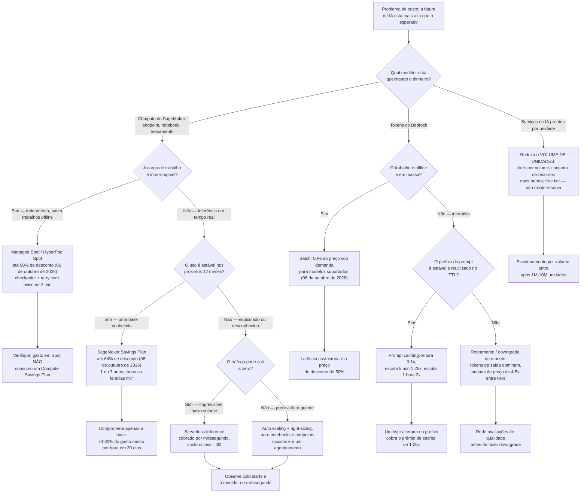
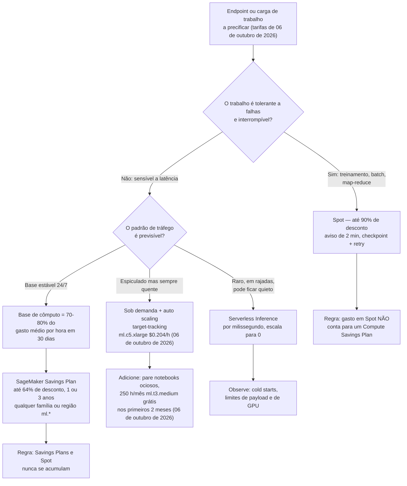
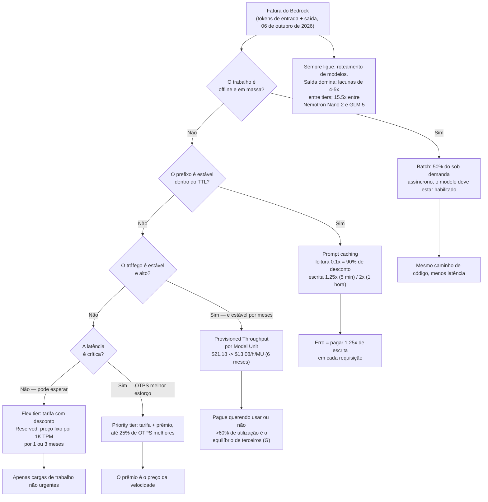
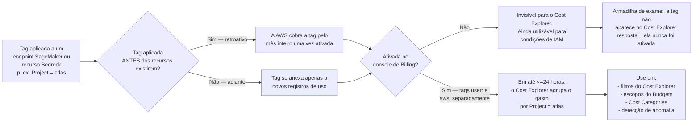
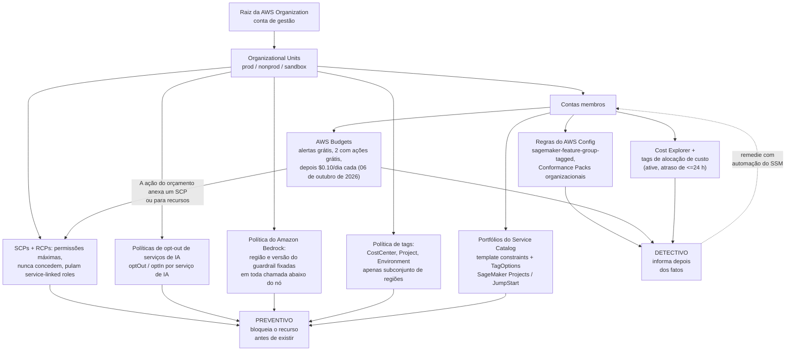

# Otimização de custos e governança para cargas de trabalho de IA

Custo é onde o exame AIF-C01 para de ser abstrato. Todos os outros domínios podem ser respondidos com uma definição; este pede que você **calcule**, e depois escolha o controle que **previne** o gasto excessivo em vez do que apenas o reporta. A boa notícia é que a aritmética é rasa — multiplicação e porcentagens —, e as armadilhas são poucas, afiadas e repetidamente testadas.

```text
====================================================================
 COST MAP FOR AI/ML ON AWS                    (digest 06 Oct 2026)
====================================================================
 SAGEMAKER AI ........... per instance-hour (per-second in most
                          regions) + EBS GB-month
                          ml.c5.xlarge    $0.204 /hr
                          ml.m5.4xlarge   $0.922 /hr
                          ml.g5.24xlarge  $10.18 /hr
                          EBS gp           $0.14 /GB-month
                          from 07 Oct 2026: ml.p6-b300.48xlarge
                          $148.54 /hr, ml.p5en.48xlarge $72.63 /hr
 BEDROCK ................ per 1M input tokens + per 1M output
                          tokens; Batch = 50% of on-demand;
                          cache read = 0.1x, cache write = 1.25x
                          (5-min TTL) or 2x (1-hour TTL)
 AI SERVICES ............ Rekognition image/minute, Textract page,
                          Comprehend 100-char unit, Transcribe
                          minute, Polly 1M chars, Lex request
 LEVERS ................. Spot <=90% | EC2 SP <=72% |
                          Compute SP <=66% | SageMaker SP <=64% |
                          Batch 50% | cache read 90% | Database SP <=35%
 GOVERNANCE ............. SCP/RCP/opt-out/tag policy/Bedrock policy
                          (prevent, free) | Service Catalog |
                          AWS Config (detect) | Budgets (alert free,
                          2 action-enabled budgets free, then
                          $0.10/day each) | Cost Explorer
====================================================================
```

> [!NOTE]
> **As cinco armadilhas de topo desta lição.** (1) **SCPs nunca concedem** — eles limitam permissões e **pulam as service-linked roles**. (2) Uma **tag de alocação de custo precisa ser ativada** no console de Billing (até **24 horas** para aparecer) antes de o Cost Explorer agrupar por ela. (3) **Spot é até 90 % de desconto com dois minutos de aviso**, e **o gasto em Spot não conta para o compromisso de um Compute Savings Plan**. (4) **Alertas de orçamento são gratuitos; *ações* de orçamento são gratuitas apenas para os dois primeiros orçamentos com ações habilitadas**, depois **$0.10/dia cada** (06 de outubro de 2026). (5) **O Bedrock cobra entrada e saída separadamente**, e os tokens de saída tipicamente **custam 4–5× o preço dos tokens de entrada**, então `max_tokens` é um controle de custo, não apenas de latência.

Ao final desta lição você será capaz de:

- ler as **três famílias de medidores** que a AWS usa para IA (instância-horas, tokens, unidades de requisição) e dizer qual delas uma questão está cobrando;
- calcular o custo mensal de um endpoint, de uma carga de tokens ou de um pipeline de processamento de documentos **com preços datados**;
- escolher entre **sob demanda, Spot, Savings Plans e Serverless Inference** usando os tetos publicados (≤90 %, ≤72 %, ≤66 %, ≤64 %);
- aplicar as **alavancas específicas do Bedrock**: Batch (50 %), cache de prompts (leituras a 0,1×), Provisioned Throughput, service tiers e roteamento de modelos;
- converter **cotas de free tier em dólares** para dimensionar uma prova de conceito;
- distinguir **controles preventivos** (SCP, RCP, opt-out, política do Bedrock, política de tags, Service Catalog, ações de orçamento) dos **detectivos** (Cost Explorer, AWS Config, tags de alocação de custo);
- evitar toda armadilha de preço datado e de compromisso pela qual este domínio é conhecido.

---

## 1. As três famílias de medidores: o que você realmente é cobrado

### 1.1 Família de medidores 1 — SageMaker AI: instância-horas mais armazenamento

O SageMaker AI cobra **por instância-hora** (por segundo na maioria das regiões) por treinamento, processamento, notebooks e endpoints hospedados, mais **gigabyte-meses de EBS**. Sob demanda **não tem mínimo nem compromisso adiantado** (aws.amazon.com/sagemaker/ai/pricing, verificado em 06 de outubro de 2026).

| Instância (SageMaker) | Sob demanda $/hora | Verificado |
|---|---|---|
| `ml.c5.xlarge` | **$0.204** | 06 de outubro de 2026 |
| `ml.m5.4xlarge` | **$0.922** | 06 de outubro de 2026 |
| `ml.g5.24xlarge` | **$10.18** | 06 de outubro de 2026 |
| EBS General Purpose SSD | **$0.14 / GB-mês** | 06 de outubro de 2026 |
| `ml.p5.4xlarge` | **$6.86** | lista de preços de 07 de outubro de 2026 |
| `ml.p5en.48xlarge` | **$72.63** | lista de preços de 07 de outubro de 2026 |
| `ml.p6-b300.48xlarge` | **$148.54** | lista de preços de 07 de outubro de 2026 |

> [!WARNING]
> **A linha do acelerador muda a aritmética em uma ordem de grandeza.** A partir de **07 de outubro de 2026** a AWS lista o `ml.p6-b300.48xlarge` a **$148.54/hora** e o `ml.p6-b200.48xlarge` a **$130.71/hora** — contra o `ml.p5.4xlarge` a **$6.86/hora**. Um dia de um `ml.p6-b300.48xlarge` deixado ligado (**24 × $148.54 = $3.564,96**, lista de preços de 07 de outubro de 2026) custa mais do que um mês inteiro de dois endpoints `ml.c5.xlarge`. As questões de exame testam rotinariamente se você percebe que **a família de instância, não a lista de funcionalidades, domina a fatura**.

### 1.2 Família de medidores 2 — Amazon Bedrock: tokens de entrada e tokens de saída

O Bedrock sob demanda cobra **por token de entrada e por token de saída separadamente** (aws.amazon.com/bedrock/pricing, verificado em 06 de outubro de 2026). Como a saída é gerada um token de cada vez, as taxas de saída ficam em torno de **4–5× as taxas de entrada** em modelos de pesos abertos — e muito mais em modelos premium.

| Modelo (Amazon Bedrock) | Entrada $/1M tokens | Saída $/1M tokens | Nota de Região | Verificado |
|---|---|---|---|---|
| NVIDIA Nemotron Nano 2 / 3 Nano 30B A3B | **$0.06 / $0.06** | **$0.23 / $0.24** | — | 06 de outubro de 2026 |
| NVIDIA Nemotron 3 Super 120B A12B / Nano 2 VL | **$0.15 / $0.20** | **$0.65 / $0.60** | — | 06 de outubro de 2026 |
| OpenAI `gpt-oss-safeguard-20b` / `120b` | **$0.07 / $0.15** | **$0.20 / $0.60** | us-east-1/2, us-west-2 | 06 de outubro de 2026 |
| OpenAI `gpt-oss-20b` / `120b` | **$0.1262 / $0.2704** | **$0.5408 / $1.0815** | GovCloud (US) | 06 de outubro de 2026 |
| Z AI GLM 5 | **$1.00** | **$3.20** | us-east-1/2, us-west-2 | 06 de outubro de 2026 |
| Fine-tune Llama 2 13B | **$1.49 / 1M treinado** + armazenamento **$1.95/mês** | inferência, sem compromisso: **$23.50/hora/MU** | — | 06 de outubro de 2026 |
| Provisioned Throughput Llama 2 13B | **$21.18/hora/MU** (1 mês) | **$13.08/hora/MU** (6 meses) | −38,3 % vs. 1 mês | 06 de outubro de 2026 |

**Alavancas do Bedrock fora dos tokens** (todas verificadas em 06 de outubro de 2026, salvo indicação): **Batch = 50 % do preço de tokens sob demanda** para os modelos de fundação suportados · leitura de cache **= 0,1×**, escrita de cache **= 1,25×** (TTL de 5 minutos) ou **2×** (TTL de 1 hora) · Bedrock Guardrails nas páginas de preços europeias da AWS a **€0.2587283 por 1.000 unidades de texto** (filtros de conteúdo, tópicos negados) e **€0.1724855 por 1.000** (informações sensíveis, ancoragem contextual), com filtros de regex e de palavras **gratuitos** (lista aws.eu, 07 de agosto de 2026 — o equivalente em USD não foi recuperado, então trate-o como **(G)**).

### 1.3 Família de medidores 3 — serviços de IA prontos: uma unidade por requisição

Rekognition, Textract, Comprehend, Transcribe, Polly e Lex cobram **por unidade de requisição**, com **escalonamento por volume** após os primeiros 1–10 milhões de unidades (aws.amazon.com/*/pricing, verificado em 06 de outubro de 2026).

| Serviço | Unidade de cobrança | Preço (primeiro tier) | Verificado |
|---|---|---|---|
| Rekognition imagens | imagem | **$0.0010** primeiros 1M/mês, **$0.0008** nos 1,5M seguintes | 06 de outubro de 2026 |
| Rekognition vídeo armazenado (labels, moderação, texto, faces, celebridades, busca de faces) | minuto | **$0.10** | 06 de outubro de 2026 |
| Rekognition shot / technical cues; armazenamento de metadados de face | minuto; face/mês | **$0.05**; **$0.00001** | 06 de outubro de 2026 |
| Textract `DetectDocumentText` | página | **$0.0015** primeiros 1M/mês, **$0.0006** depois (us-west-2) | 06 de outubro de 2026 |
| Textract `AnalyzeDocument` Tables / Forms / Tables+Forms+Queries | página | **$0.015 / $0.05 / $0.070** primeiros 1M (**$0.010 / $0.040 / $0.055** depois) | 06 de outubro de 2026 |
| Comprehend NLP padrão | unidade de 100 caracteres (mínimo de 300 caracteres) | **$0.0001** primeiros 10M/mês, **$0.00005** 10–50M, **$0.000025** acima de 50M | 06 de outubro de 2026 |
| Transcribe batch / streaming | minuto | **$0.006** / **$0.01** | 06 de outubro de 2026 |
| Transcribe content redaction | minuto | **$0.0024** T1 (250K), **$0.0015** T2 (750K), **$0.00102** T3 (4M) | 06 de outubro de 2026 |
| Polly Standard / Neural / Generative / Long-Form | 1M de caracteres | **$4.00 / $16.00 / $30.00 / $100.00** | 06 de outubro de 2026 |
| Lex entrada de fala / entrada de texto | requisição | **$0.004** / **$0.00075** | 06 de outubro de 2026 |
| Lex treinamento de designer de chatbot | minuto | **$0.50** | 06 de outubro de 2026 |
| Revisão humana do Augmented AI | página | **$0.03** primeiros 100K, **$0.02** nos 100K seguintes | 06 de outubro de 2026 |

### 1.4 Exemplo resolvido 1 — dois endpoints ociosos, 1.488 horas

Dois endpoints em tempo real `ml.c5.xlarge` rodando 24×7 em um mês de 31 dias a **$0.204/hora** (06 de outubro de 2026):

$$
2 \times 24 \times 31 = 1{,}488 \text{ hours}, \qquad 1{,}488 \times \$0.204 = \$303.55/\text{month}
$$

**$303.55/mês independentemente do tráfego.** Três formas de mudar isso:

| Alavanca aplicada | Horas cobradas | Custo mensal | Economia vs. linha de base |
|---|---|---|---|
| Nada (2 instâncias, sempre ligadas) | 1.488 | **$303.55** | — |
| (a) Escalar automaticamente para uma média de 1 instância | 744 | **$151.78** | **−50,0 %** |
| (b) Parar 8 horas por dia (2 instâncias) | 960 | **$195.84** | **−35,5 %** |
| (c) Ambas (1 instância, parada 8 h/dia) | 480 | **$97.92** | **−67,7 %** |

A lição não são as porcentagens — é que **um endpoint ocioso cobra o mesmo que um ocupado**. Nada no medidor sabe se alguém enviou uma requisição.

- **📚 Você sabia?** A página de preços da AWS do SageMaker cobra **por segundo** na maioria das regiões com **mínimo de um minuto**, então um pico de inferência de 90 segundos custa um minuto, não uma hora — mas um *notebook* ou *endpoint* é cobrado por todo o tempo em que existe, da criação até a exclusão. É por essa assimetria que as questões de opção mais barata do exame quase sempre têm "pare em um agendamento" ou "use serverless" como resposta.

---

## 2. O framework de decisão de alavancas de custo

### 2.1 A matriz de impacto das alavancas

Nem todas as alavancas são iguais, e algumas são frequentemente superestimadas. A AWS publica as porcentagens abaixo; onde a AWS não publica nada, esta lição diz isso.

| # | Alavanca | Aplica-se a | Impacto publicado | Trade-off | Imposto / observado por |
|---|---|---|---|---|---|
| 1 | **Right-sizing** | endpoints, notebooks | nenhuma porcentagem publicada pela AWS → **(G)** | risco de latência; use o Inference Recommender | Cost Explorer + CloudWatch |
| 2 | **Auto scaling** | endpoints em tempo real | remove o superprovisionamento | cooldowns de scale-in, capacidade fria | Application Auto Scaling (target tracking) |
| 3 | **Scale-to-zero / serverless** | tráfego imprevisível | custo ocioso → **$0** | cold starts, limites de payload e de GPU | SageMaker Serverless Inference |
| 4 | **Parar endpoints / notebooks ociosos** | qualquer recurso sempre ligado | até **100 % da porção ociosa** | indisponibilidade do serviço | ações de orçamento / EventBridge |
| 5 | **Spot** | treinamento e batch tolerantes a falhas | **até 90 %** | interrupção de 2 minutos → checkpoint e retry | Managed Spot Training |
| 6 | **Savings Plans do SageMaker** | uso `ml.*` estável | **até 64 %** | $/hora comprometidos por 1 ou 3 anos | recomendações do Cost Explorer |
| 7 | **Compute Savings Plans** | EC2 / Fargate / Lambda estáveis | **até 66 %** | lock-in; **exclui o gasto em Spot** | Cost Explorer |
| 8 | **Bedrock Batch** | inferência em lote offline | **50 %** | latência assíncrona; o modelo deve estar habilitado para batch | Bedrock Batch |
| 9 | **Cache de prompts do Bedrock** | prompts e documentos repetidos | **~90 % na entrada em cache** | escritas custam **1,25×**; um prefixo instável destrói o efeito | logs de uso do Bedrock |
| 10 | **Downgrade / roteamento de modelo** | cargas de trabalho generativas | a saída domina; lacunas de **4–5×** entre tiers | avaliações de qualidade obrigatórias | avaliação de modelos do Bedrock |
| 11 | **Bedrock Flex tier** | cargas de trabalho não urgentes | taxa padrão com desconto | latência maior | configuração de service tier |
| 12 | **Bedrock Reserved tier** | tokens por minuto garantidos | preço fixo por 1K TPM | compromisso de 1 ou 3 meses | service tiers |

> [!IMPORTANT]
> **Cuidado com o folclore de que "right-sizing economiza 30–60 %".** Não existe nenhuma cifra publicada pela AWS para a economia de right-sizing — esse número circula apenas em blogs de terceiros, e é uma afirmação **(G)** (não verificada). No exame, uma opção que cita uma porcentagem precisa de right-sizing está testando se você sabe que a AWS não publica nenhuma. Os tetos **publicados** que você pode citar são: Spot **≤90 %**, EC2 Instance Savings Plans **≤72 %**, Compute Savings Plans **≤66 %**, SageMaker AI Savings Plans **≤64 %**, Bedrock Batch **50 %**, leituras de cache do Bedrock **90 %**, Provisioned Throughput de 6 meses do Bedrock **38,3 %** na unidade de modelo Llama 2 13B (todos em aws.amazon.com / docs.aws.amazon.com, verificados em 06 de outubro de 2026).

### 2.2 O fluxo de decisão das alavancas de custo

Este é o diagrama que o exame realmente pede que você percorra. Comece por **o que está queimando dinheiro** e, a partir daí, por **o que a carga de trabalho tolera**.



### 2.3 O que cada alavanca não pode fazer

Três fatos "não pode" são ouro de exame:

1. **Savings Plans não se acumulam sobre Spot, e o gasto em Spot não consome um compromisso de Compute Savings Plan** (docs.aws.amazon.com, 2026). Uma pergunta que oferece "cobrir o uso de Spot com um Savings Plan" está errada nas duas metades da frase.
2. **Os serviços de IA prontos não têm nenhuma opção publicada de reserva ou Savings Plan** — você os otimiza reduzindo o **volume de unidades** (escolha OCR antes de Forms, transcrição simples antes de redaction) e usando o free tier, não por compromisso.
3. **Uma ação de orçamento não é um controle em tempo real.** Os alertas podem ser baseados em previsão ou em valores reais, mas a execução atrasa, então o gasto excessivo ainda é possível entre o limite e a ação.

```matching
{
  "question": "Associe cada alavanca de custo ao seu teto ou regra publicada pela AWS (tudo verificado em 06 de outubro de 2026):",
  "pairs": [
    {"left": "EC2 / SageMaker Spot", "right": "Até 90% de desconto com aviso de interrupção de 2 minutos; frequência média histórica de interrupção abaixo de 5%"},
    {"left": "EC2 Instance Savings Plans", "right": "Até 72% de desconto, mas preso a uma família de instância em uma região por 1 ou 3 anos"},
    {"left": "Compute Savings Plans", "right": "Até 66% de desconto em EC2 de qualquer família/região/SO mais Fargate e Lambda; exclui o gasto em Spot"},
    {"left": "SageMaker AI Savings Plans", "right": "Até 64% de desconto, flexível em todas as famílias, tamanhos, regiões e componentes ml.* por 1 ou 3 anos"},
    {"left": "Database Savings Plans", "right": "Até 35% de desconto, apenas com termo de 1 ano"},
    {"left": "Amazon Bedrock Batch", "right": "50% do preço dos tokens sob demanda para modelos suportados, apenas assíncrono"},
    {"left": "Amazon Bedrock prompt cache read", "right": "0.1x o preço de entrada — um desconto de 90% dentro do TTL quando o prefixo corresponde"}
  ],
  "explanation": "Cada número pertence a um formato de compromisso diferente: Spot é interrompível e não tem compromisso, os EC2 Instance SPs compram profundidade e perdem flexibilidade, os Compute SPs compram amplitude, os SageMaker SPs compram flexibilidade em ml.*, os Database SPs são só de 1 ano e as alavancas do Bedrock têm forma de carga de trabalho, não de computação. Misturá-las — por exemplo, citar 66% para o SageMaker ou 64% para o EC2 — é o distrator clássico."
}
```

---

## 3. SageMaker AI: sob demanda vs. Spot vs. Savings Plans vs. serverless

### 3.1 Sob demanda: o padrão sem compromisso

Sob demanda é **por instância-hora, sem mínimo e sem pagamento adiantado** (aws.amazon.com/sagemaker/ai/pricing, verificado em 06 de outubro de 2026). É a resposta correta quando o exame diz *protótipo*, *de curta duração*, *imprevisível* ou *primeiros dois meses* (o free tier do SageMaker concede **250 horas/mês de notebooks `ml.t3.medium` durante os primeiros dois meses**, verificado em 06 de outubro de 2026).

### 3.2 Spot: até 90 % de desconto, com aviso de dois minutos

EC2 Spot — e portanto SageMaker Spot e SageMaker HyperPod Spot — é anunciado com **até 90 % de desconto** sobre sob demanda, com **aviso de interrupção de dois minutos** e **frequência média histórica de interrupção abaixo de 5 %** (aws.amazon.com/ec2/spot, 2025–26). **HyperPod Spot costuma ter até 90 % de desconto** sobre o HyperPod sob demanda, precificado pelo EC2 sem pagamento adiantado (aws.amazon.com/sagemaker/ai/pricing, 06 de outubro de 2026).

Spot só é correto quando o trabalho **pode ser interrompido**: treinamento com checkpoints, batch transform, processamento offline. O padrão de resposta do exame é sempre o mesmo par — *Spot* mais *checkpoint e retry*.

### 3.3 Savings Plans: três descontos diferentes

| Savings Plan | Teto publicado | Escopo | Termo | Verificado |
|---|---|---|---|---|
| **EC2 Instance Savings Plans** | **até 72 %** | uma **família** de instância, uma **região** | 1 ou 3 anos | 06 de outubro de 2026 |
| **Compute Savings Plans** | **até 66 %** | EC2 de **qualquer** família, região e SO + Fargate + Lambda | 1 ou 3 anos | 06 de outubro de 2026 |
| **SageMaker AI Savings Plans** | **até 64 %** | **todas as famílias, tamanhos, regiões e componentes `ml.*`** (notebook, treinamento, processamento, inferência) | 1 ou 3 anos, $/hora | 06 de outubro de 2026 |
| **Database Savings Plans** | **até 35 %** | cargas de trabalho de banco de dados | **apenas 1 ano** | 06 de outubro de 2026 |

Savings Plans do SageMaker são o flexível: como abrangem **todas as famílias de instância `ml.*` em todas as regiões**, você pode ir de `ml.c5.xlarge` para `ml.g5.24xlarge` e manter o desconto. O Cost Explorer apresenta a recomendação; o compromisso deve cobrir apenas a sua **base — 70–80 % do seu gasto médio por hora em 30 dias** —, não o pico.

### 3.4 Serverless Inference: o medidor que chega a zero

SageMaker **Serverless Inference escala para zero** quando ocioso, então você paga apenas pelo computo que usa, **cobrado por milissegundo**, mais os dados processados. A **Provisioned Concurrency** opcional é cobrada por memória, duração e concorrência (docs.aws.amazon.com/sagemaker/latest/dg/serverless-endpoints.html, 2026). É a resposta correta sempre que o tráfego for **imprevisível e baixo** — um protótipo que recebe algumas requisições por dia, ou nenhuma durante uma semana.

> [!WARNING]
> **Serverless não é "gratuito quando ocioso" por acidente — é um contrato de design.** Você troca a conta sempre ligada por **cold starts**, limites de payload e restrições de GPU. E observe que páginas de terceiros citam tarifas de serverless (por exemplo **$0.0000667/segundo por GB** mais **$0.20/1M requisições**, cold start de 1–5 segundos, máximo de 6 GB) que **não foram confirmadas na página de preços da AWS** em 06 de outubro de 2026 — trate esses números como **(G)**. Em uma opção de exame, uma tarifa de serverless sem atribuição costuma ser um distrator; o que é testado é o *comportamento* (escala para zero, cobrança por milissegundo).

### 3.5 Exemplos resolvidos — aritmética do SageMaker

**Exemplo resolvido 2 — uma frota de GPU sempre ligada (exemplo resolvido pela AWS).**
Quatro instâncias `ml.g5.24xlarge` a **$10.18/hora** (06 de outubro de 2026) rodam 720 horas em um mês, com 100 GB de EBS cada a **$0.14/GB-mês** (06 de outubro de 2026):

$$
4 \times 720 \times \$10.18 = \$29{,}318.40, \qquad 4 \times 100 \times \$0.14 = \$56.00
$$

**$29.318,40 + $56,00 = $29.374,40 por mês.** A **30 % de utilização** a frota pode cair para cerca de **1,2 instância ≈ $8.812/mês**, economizando aproximadamente **$20.560/mês** — e *depois* um SageMaker Savings Plan (≤64 %, 06 de outubro de 2026) se aplica por cima da menor pegada. Right-sizing primeiro, compromisso segundo; ao contrário, você compromete uma base inchada por três anos.

**Exemplo resolvido 3 — a queima de um endpoint personalizado ocioso.**
Um endpoint de NLP personalizado a **$0.0005 por unidade-de-inferência-segundo** (tarifa de terceiros, cloudzero.com, 04 de maio de 2026 — **(G)**) queima:

$$
\$0.0005 \times 60 = \$0.03/\text{min} \;\Rightarrow\; \$1.80/\text{hour} \;\Rightarrow\; \$43.20/\text{day} \;\Rightarrow\; \$1{,}296/30\text{ days}
$$

Cobrado **da criação do endpoint até a exclusão, mesmo com zero tráfego**. Correção: agende ligado e desligado com o EventBridge, ou use async/serverless para que o medidor pare.

**Exemplo resolvido 4 — o teto de 64 % do Savings Plan.**
Uma instância de classe `ml.m5.xlarge` a **$0.23/hora** (tarifa usada neste exemplo, 06 de outubro de 2026) por 730 horas:

| Cenário | Tarifa | Mensal | Anual | 3 anos |
|---|---|---|---|---|
| Sob demanda | $0.23 × 730 h | **$167.90** | $2.014,80 | $6.044,40 |
| SageMaker SP com 64 % de desconto (06 de outubro de 2026) | $0.0828 × 730 h | **$60.44** | $725,28 | $2.175,84 |
| **Economia** | | **$107.46/mês** | **$1.289,52/ano** | **$3.868,56 em 3 anos** |

- **📚 Você sabia?** O desconto do SageMaker Savings Plan da AWS de **até 64 %** (06 de outubro de 2026) é *menor* que o teto do EC2 Instance Savings Plan de **até 72 %** (06 de outubro de 2026) — ainda assim o plano do SageMaker costuma ser a melhor compra para equipes de IA, porque o plano do EC2 está preso a **uma família de instância em uma região**, enquanto o plano do SageMaker acompanha você em **todas as famílias, tamanhos, regiões e componentes `ml.*`**. Uma diferença de 8 pontos de desconto costuma valer menos do que a liberdade de trocar de CPU para GPU sem recomprar um compromisso.

### 3.6 Modelo de precificação para um endpoint



### 3.7 Veredito comparativo

> [!IMPORTANT]
> **Veredito Comparativo — sob demanda vs. Spot vs. Savings Plans vs. serverless**
> - **Sob demanda** (por instância-hora, sem mínimo, sem adiantado — p. ex. `ml.c5.xlarge` a **$0.204/hora**, 06 de outubro de 2026) é a resposta para **protótipos, experimentos de curta duração, os primeiros dois meses de notebooks** (250 h/mês `ml.t3.medium`, 06 de outubro de 2026) e qualquer coisa cujo formato você ainda não conhece. Seu modo de falha é a **cobrança por tempo de capacidade ociosa**: $303.55/mês por dois endpoints que podem nunca receber uma requisição.
> - **Spot** (**até 90 % de desconto**, aviso de interrupção de **2 minutos**, frequência média histórica de interrupção **abaixo de 5 %** — aws.amazon.com/ec2/spot, 2025–26) é a resposta para **treinamento, batch transform e trabalhos offline que fazem checkpoint**. Seu modo de falha é a **interrupção**: inferência em tempo real sensível a latência em Spot está sempre errada, e o gasto em Spot **não** abate um compromisso de Compute Savings Plan (docs.aws.amazon.com, 2026). Use-o na camada de *explosão*, nunca na camada de *sempre quente*.
> - **Savings Plans** (Compute **≤66 %**, EC2 Instance **≤72 %**, SageMaker AI **≤64 %**, 1 ou 3 anos — 06 de outubro de 2026) são a resposta para uma **base conhecida e estável que você não vai abandonar**. SageMaker AI Savings Plans são a escolha nativa de IA porque valem em **todas as famílias, tamanhos, regiões e componentes `ml.*`**; Compute Savings Plans são a escolha certa quando a base também inclui EC2, Fargate ou Lambda. Seu modo de falha é o **supercomprometimento**: comprometa 70–80 % do seu gasto médio por hora em 30 dias, nunca o pico, e lembre-se de que **não se acumulam com Spot**.
> - **Serverless Inference** (computo por milissegundo, **escala para 0**, Provisioned Concurrency opcional cobrada por memória, duração e concorrência — docs.aws.amazon.com, 2026) é a resposta para tráfego **imprevisível e de baixo volume** em que um dia ocioso deve custar **$0**. Seu modo de falha é **cold starts mais limites de capacidade** — e observe que as tarifas por segundo publicadas em circulação (**$0.0000667/segundo por GB** + **$0.20/1M requisições**, páginas de terceiros de 06 de outubro de 2026) são **(G)**, não confirmadas na página de preços da AWS.
> - **Regra prática para o exame:** *tolerante a falhas e interrompível* → **Spot**; *base estável por 1–3 anos* → **Savings Plan** (SageMaker SP para `ml.*`, Compute SP para um patrimônio misto); *imprevisível e esparso* → **serverless**; *todo o resto, ou qualquer coisa que você ainda não mediu* → **sob demanda mais auto scaling e parada agendada**. O distrator é sempre a opção que compromete dinheiro com uma carga de trabalho que a pergunta descreve como experimental.

---

## 4. Amazon Bedrock: tokens, Batch, cache, throughput e tiers

### 4.1 Exemplo resolvido 5 — a conta de tokens, e por que a escolha do modelo vence o volume

Uma carga de trabalho envia **300M tokens de entrada** e produz **60M tokens de saída** por mês.

| Modelo (tarifas verificadas em 06 de outubro de 2026) | Custo de entrada | Custo de saída | Total mensal |
|---|---|---|---|
| Nemotron Nano 2 — $0.06 / $0.23 por 1M | 300 × $0.06 = **$18.00** | 60 × $0.23 = **$13.80** | **$31.80** |
| Z AI GLM 5 — $1.00 / $3.20 por 1M | 300 × $1.00 = **$300.00** | 60 × $3.20 = **$192.00** | **$492.00** |

O **mesmo volume de tokens** custa **15,5× mais** no GLM 5. Selecionar o modelo, e não reduzir o uso, é a alavanca dominante para cargas generativas — e é por isso que toda pergunta de "reduzir custo" que oferece "trocar por um modelo menor" costuma estar certa, **desde que** avaliações de qualidade sejam mencionadas.

Observe também que a saída custa **~4× a entrada** por token no Nemotron Nano 2 ($0.23 contra $0.06, 06 de outubro de 2026): limitar `max_tokens`, pedir respostas concisas e retornar saída estruturada em vez de prosa cortam todos a metade cara do medidor.

### 4.2 Exemplo resolvido 6 — Batch: 50 % de desconto para trabalho assíncrono

Um trabalho de classificação de documentos noturno custa **$800/mês** no Bedrock sob demanda; o modelo tem batch habilitado e ninguém lê os resultados antes de manhã.

$$
\$800 \times 50\% = \$400/\text{month} \quad\Rightarrow\quad \$400/\text{month saved} = \$4{,}800/\text{year}
$$

**Bedrock Batch = 50 % do preço dos tokens sob demanda** para modelos suportados (aws.amazon.com/bedrock/pricing, 06 de outubro de 2026). O custo do desconto é a **latência assíncrona** — e o modelo precisa, no mínimo, suportar batch.

### 4.3 Exemplo resolvido 7 — cache de prompts: ~90 % de desconto, com prêmio de escrita

Esta é a aritmética de maior rendimento do domínio. Usando as tarifas publicadas em um post do AWS Builder Center para o Sonnet 4.6 no Bedrock — **$3.00 por 1M de tokens de entrada, $3.75 de escrita em cache, $0.30 de leitura de cache** (2026; *não* confirmado na página oficial de preços, veja a seção 10) — um prompt de sistema estável de **33.000 tokens** enviado **1.000 vezes/dia** por 30 dias:

**Sem cache:**

$$
33{,}000 \times 1{,}000 = 33\text{ MTok/day} \times \$3.00 = \$99/\text{day} \;\Rightarrow\; \$2{,}970/\text{month}
$$

**Com cache (TTL de 5 minutos: escrita 1.25×, leitura 0.1×):**

| Componente | Tokens | Tarifa | Custo diário |
|---|---|---|---|
| 1 escrita de cache por dia | 33.000 × 1.25 = **41.250** | $3.75/MTok | **$0.155** |
| 999 leituras de cache por dia | 33.000 × 999 = 32,967 MTok | $0.30/MTok | **$9.89** |
| **Total** | | | **$10.05/dia → $301.42/mês** |

**Economia ≈ $2.668/mês (≈ 89,9 %).** O mecanismo (todas as documentações de cache do Bedrock, 2026): **leituras de cache custam 0.1×** o preço de entrada (**90 % de desconto**), **escritas de cache custam 1.25×** no TTL padrão de **5 minutos** e **2×** no TTL opcional de **1 hora**, o TTL padrão é de **5 minutos**, o TTL de 1 hora é opt-in por checkpoint de cache, mínimo de **512–4.096 tokens por modelo** e máximo de **4 checkpoints**.

> [!WARNING]
> **Um byte alterado no prefixo destrói o cache.** Se o prompt de sistema difere entre requisições — um timestamp, um request ID, uma variável de ambiente de CI, uma quebra de linha final —, toda chamada erra e você paga o **prêmio de escrita de 1,25× em cada requisição** em vez de uma escrita mais 999 leituras baratas. Este é o falha clássica de loop sem cabeçalho/CI, e é exatamente o que o exame testa com a opção "*o prefixo do prompt precisa corresponder byte a byte dentro do TTL*". Os modelos GPT-5.6 no Bedrock adicionam cache implícito por padrão para um prefixo estável de **≥1.024 tokens** com TTL de **30 minutos**, leituras com **90 % de desconto** e escritas a **1.25×** (AWS ML blog, 30 de julho de 2026).

### 4.4 Provisioned Throughput e service tiers

| Mecanismo do Bedrock | Como cobra | Compromisso | Notas (verificado em 06 de outubro de 2026) |
|---|---|---|---|
| **Sob demanda** | por 1M de entrada + por 1M de saída de tokens | nenhum | padrão; volume espiculado ou baixo |
| **Batch** | **50 %** do preço dos tokens sob demanda | nenhum | assíncrono; o modelo deve estar habilitado para batch |
| **Provisioned Throughput** | por hora por **Model Unit (MU)** | **nenhum / 1 mês / 6 meses** | mais longo = mais barato; **modelos personalizados exigem**; MUs solicitadas via AWS Support |
| **Priority tier** | tarifa sob demanda **+ prêmio**, até **25 %** de tokens-por-segundo sob demanda melhores | nenhum | latência em primeiro lugar |
| **Standard tier** | tarifa sob demanda | nenhum | padrão |
| **Flex tier** | tarifa padrão com desconto | nenhum | cargas de trabalho não urgentes, latência maior |
| **Reserved tier** | preço fixo por **1K tokens-por-minuto**, cobrado mensalmente | **1 ou 3 meses** | TPM garantida |

Números concretos de Provisioned Throughput para Llama 2 13B (06 de outubro de 2026): **$21.18/hora/MU** em um compromisso de 1 mês contra **$13.08/hora/MU** em um compromisso de 6 meses — uma **redução de 38,3 %** —, enquanto a inferência sem compromisso é **$23.50/hora/MU**. A armadilha: **você paga pela MU quer usá-la ou não**, então Provisioned Throughput só é certo acima de cerca de 60 % de utilização (um número de equilíbrio de terceiros, **(G)**, não publicado pela AWS).

### 4.5 O consumo de cota não é contagem de tokens

O consumo de cota do Bedrock é **ponderado**, e os pesos são específicos de cada modelo (docs.aws.amazon.com, 2026):

| Família de modelo | Peso dos tokens de saída contra a cota |
|---|---|
| Claude v4.8 | saídas queimam **15×** |
| Família Claude 5, GPT-5.6 Sol / Terra / Luna | saídas queimam **10×** |
| Claude ≤ v4.7 | saídas queimam **5×** |
| Todo o resto | **1:1** |

Então "por que sou limitado quando minha contagem de tokens parece bem?" é respondida por **saídas longas em um modelo de 15×**, não pelo volume de entrada.

### 4.6 O mapa de alavancas de custo do Bedrock



- **📚 Você sabia?** O Bedrock **não tem tabela de free tier publicada pela AWS** (06 de outubro de 2026) — uma afirmação que você encontrará em blogs de fornecedores dizendo "sem free tier" ou citando um "desconto de 30–50 % no Provisioned Throughput" é **(G)**, porque a AWS publica nenhuma das duas. O que a AWS *publica* é um **desconto de 50 % no Batch**, um **desconto de 90 % na leitura de cache** e o **teto de 64 % do SageMaker SP**; esses são os números que você pode citar no exame.

---

## 5. Serviços de IA prontos: unidades, tiers e free tier

### 5.1 Como otimizar um medidor por unidade

Não existe reserva para Rekognition, Textract, Comprehend, Transcribe, Polly ou Lex. As três alavancas são:

1. **Conjunto de recursos mais barato que retorna o que você lê** — Textract `DetectDocumentText` a **$0.0015/página** (06 de outubro de 2026) contra `AnalyzeDocument` Forms a **$0.05/página** (06 de outubro de 2026) é um **prêmio de 33×** pela estrutura. Leia o OCR primeiro; invoque Forms apenas quando precisar dos pares chave-valor.
2. **Escalonamento por volume** — Comprehend cai de **$0.0001** para **$0.00005** (10–50M unidades) e para **$0.000025** (acima de 50M) por unidade de 100 caracteres (06 de outubro de 2026); Textract `DetectDocumentText` cai de **$0.0015** para **$0.0006** após o primeiro milhão de páginas no mês (06 de outubro de 2026).
3. **Free tier** — de 3 a 12 meses de cotas, convertidas em dólares na seção 5.4.

### 5.2 Exemplo resolvido 8 — a aritmética de tiers do Textract

| Volume | Cálculo | Total | Preço unitário misturado |
|---|---|---|---|
| 100.000 páginas `DetectDocumentText` | 100.000 × $0.0015 | **$150/mês** | $0.0015 (tarifas de 06 de outubro de 2026) |
| 2.000.000 páginas `DetectDocumentText` | 1M × $0.0015 + 1M × $0.0006 | **$2.100** | **$0.00105 (−30 %)** |
| 5.000 páginas Forms + Tables | 5.000 × $0.015 + 5.000 × $0.05 | **$325** | $0.065/página |

Mesma API, três faturas. A terceira linha é a que surpreende as equipes: **a escolha de recursos pesa mais que o volume**.

### 5.3 Exemplo resolvido 9 — Transcribe: batch, não streaming, e redaction como adicional

Dois milhões de minutos de áudio por mês (tarifas verificadas em 06 de outubro de 2026):

| Modo | Tarifa | Mensal |
|---|---|---|
| Streaming | $0.01/min | **$20.000** (exemplo da AWS) |
| Batch | $0.006/min | **$12.000** |
| **Economia ao escolher batch** | | **$8.000/mês (40 %)** |

E se o mesmo trabalho acrescentar **content redaction** em 2M de minutos (escalonado: 250K a $0.0024, 750K a $0.0015, 1M a $0.00102):

$$
(250{,}000 \times 0.0024) + (750{,}000 \times 0.0015) + (1{,}000{,}000 \times 0.00102) = 600 + 1{,}125 + 1{,}020 = +\$2{,}745/\text{month}
$$

Redaction é um **medidor opt-in**, cobrado por cima do minuto de transcrição — as perguntas de "pipeline de precisão mais barato" do exame giram em torno de perceber isso.

### 5.4 O free tier de IA, convertido em dólares

| Produto | Cota gratuita | Duração | Valor pago da cota | Verificado |
|---|---|---|---|---|
| Créditos do plano gratuito AWS Free plan | **$100 imediatamente + até mais $100 = $200** | **6 meses** (desde 15 de julho de 2025) | $200 | 06 de outubro de 2026 |
| Notebooks / Studio do SageMaker | **250 h/mês `ml.t3.medium`** | primeiros 2 meses | — | 06 de outubro de 2026 |
| Regras integradas do SageMaker Model Monitor | **30 horas de monitoramento grátis** | contínuo | — | 06 de outubro de 2026 |
| SageMaker Catalog | **4.000 requisições + 20 MB + 0.2 unidades de computo/mês** | mensal | — | 06 de outubro de 2026 |
| Textract `DetectDocumentText` | **1.000 páginas/mês** | primeiros 3 meses | **$1.50** | 06 de outubro de 2026 |
| Textract Forms / Tables / Layout, Expense, ID | **100 páginas/mês cada** | primeiros 3 meses | $0.05–$0.10 cada (tarifas de 06 de outubro de 2026) | 06 de outubro de 2026 |
| Textract Analyze Lending | **2.000 páginas/mês** | primeiros 3 meses | — | 06 de outubro de 2026 |
| Comprehend (cada API de NLP) | **50.000 unidades (5M de caracteres)/mês** + 5 trabalhos de modelagem de tópicos ≤ 1 MB | primeiros 12 meses | **$5.00** | 06 de outubro de 2026 |
| Transcribe | **60 minutos/mês** | primeiros 12 meses | **$0.36 batch / $0.60 streaming** | 06 de outubro de 2026 |
| Polly Standard / Neural / Long-Form / Generative | **5M / 1M / 500K / 100K caracteres por mês** | primeiros 12 meses | **$20.00 / $16.00 / $5.00 / $3.00** (tarifas de 06 de outubro de 2026) | 06 de outubro de 2026 |
| Amazon Kendra / Amazon Personalize | **750 h nos primeiros 30 dias** / teste de 2 meses | 30 dias / 2 meses | — | 06 de outubro de 2026 |

**Exemplo resolvido 10 — o teto do free tier para um piloto.**
Polly Standard 5M de caracteres = **$20.00** mais Neural 1M de caracteres = **$16.00** (tarifas de 06 de outubro de 2026) → **$36/mês por 12 meses** de saída de voz; Comprehend 50K unidades = **$5.00 por API por mês** (06 de outubro de 2026); Textract 1.000 páginas = **$1.50** (06 de outubro de 2026); Transcribe 60 minutos = **$0.60** em streaming (06 de outubro de 2026). Um piloto de voz + extração de entidades de seis meses pode, portanto, rodar com **$0 de computo** — *desde que* você fique dentro da cota, porque o free tier não avisa antes de parar.

- **📚 Você sabia?** O **plano gratuito AWS Free plan** introduzido em **15 de julho de 2025** concede até **$200 em créditos ($100 imediatamente mais até mais $100) ao longo de 6 meses** (aws.amazon.com/free, 06 de outubro de 2026) — separado dos free tiers de *serviço* que duram 3, 12 ou 24 meses. As opções de exame frequentemente confundem "créditos grátis" com "free tier"; os créditos expiram em um **calendário**, os free tiers expiram no **uso**.

---

## 6. Visibilidade de custo: Cost Explorer, tags de alocação de custo e orçamentos

Visibilidade é **detectiva**, não preventiva — mas sem ela você não pode definir um limite, e sem um limite uma ação de orçamento nunca dispara.

### 6.1 Cost Explorer

| Capacidade | Preço / comportamento | Verificado |
|---|---|---|
| Console e relatórios padrão | **Grátis** | 06 de outubro de 2026 |
| **API** do Cost Explorer | **$0.01 por requisição** | 06 de outubro de 2026 |
| **Granularidade por hora** (retrospectiva de 14 dias) | ≈ **$0.01 por 1.000 registros de uso por mês** | 06 de outubro de 2026 |
| Recomendações | recomendações de Savings Plans e Reserved Instance, filtros de tags, previsões | 06 de outubro de 2026 |
| Atraso de dados | até **24 horas** | 06 de outubro de 2026 |

> [!WARNING]
> **`$0.01/requisição` é a tarifa da API do Cost Explorer, não um preço de orçamento.** O monitoramento e os alertas de orçamento são **gratuitos** (aws.amazon.com/aws-cost-management/aws-budgets/pricing, 06 de outubro de 2026). Uma pergunta que associa "$0.01 por requisição" ao AWS Budgets está testando exatamente essa confusão.

### 6.2 Tags de alocação de custo precisam ser ativadas

As tags de alocação de custo vêm em duas variedades e são **ativadas separadamente** no console de Billing antes que o Cost Explorer possa agrupar por elas (docs.aws.amazon.com, 2026):

| Tipo de tag | Prefixo | Ativação | Aparece no Cost Explorer |
|---|---|---|---|
| **Gerada pela AWS** | `aws:` | ative no console de Billing | dentro de **≤24 horas** |
| **Definida pelo usuário** | `user:` | **ative separadamente** das geradas pela AWS | dentro de **≤24 horas** |
| Qualquer outra tag | — | não ativada | **nunca** (é apenas uma tag de recurso) |



**O sintoma clássico:** um engenheiro aplica uma tag `CostCenter` a todos os recursos ontem e ela ainda não aparece no Cost Explorer. A causa quase nunca é "tags não funcionam com serviços de IA" ou "a chave precisa começar com `aws:`" — é que a **tag de alocação de custo definida pelo usuário não foi ativada** (e pode levar até **24 horas** para aparecer).

### 6.3 AWS Budgets: alertas gratuitos, depois $0.10/dia por ação extra

| Recurso do Budgets | Preço (verificado em 06 de outubro de 2026) |
|---|---|
| Monitoramento e notificações (alertas) | **Grátis** |
| Primeiros **dois** orçamentos com ações habilitadas por conta | **Grátis por mês** |
| Cada orçamento adicional com ações habilitadas | **$0.10/dia** (≈ **$3.00/mês**) |
| Gatilhos | limites baseados em previsão ou em valores reais |

**Exemplo resolvido 11 — o portão do orçamento.** Uma equipe define um orçamento de **$5.000/mês** com alertas em **80 %** e **100 %** mais ações automáticas (anexar um SCP, parar instâncias de não produção):

- monitoramento e alertas: **$0**;
- ações nos **primeiros dois** orçamentos com ações habilitadas: **$0**;
- um **terceiro** orçamento com ações habilitadas: **$0.10/dia ≈ $3.00/mês** (06 de outubro de 2026).

A resposta de "custo mínimo de recursos" do exame é, portanto: **alertas grátis, dois orçamentos com ações habilitadas grátis, depois $0.10/dia cada** — e lembre-se de que uma ação de orçamento é aplicada **depois** do limite, então é um freio, não um muro.

- **📚 Você sabia?** O AWS Budgets suporta **ações de orçamento que anexam um SCP ou uma política de IAM, ou param recursos**, o que o torna a única ferramenta de custo que *faz* algo preventivo — mas somente depois que o limite é cruzado e a ação executa. É por isso que o exame o associa a SCPs: o orçamento detecta, o SCP aplica.

---

## 7. Governança: prevenir o gasto em vez de reportá-lo

### 7.1 A pilha preventiva no AWS Organizations

| Controle | O que aplica | Escopo | Prevenir / detectar | Custo | Armadilha principal (docs.aws.amazon.com, 2026) |
|---|---|---|---|---|---|
| **SCP** | permissões máximas — negar APIs de IA ou regiões fora de uma lista de permitidos | raiz / OU / conta | **Prevenir** | grátis | **nunca concede**; **pula as service-linked roles**; uma lista de negados ainda precisa de uma política de permitidos anexada |
| **RCP** | permissões máximas em **recursos**, independentemente do chamador | org / OU / conta | Prevenir | grátis | o lado de recursos da mesma interseção |
| **Política de opt-out de serviços de IA** | `optOut` / `optIn` organizacional por serviço de IA para uso de dados | por serviço | Prevenir (uso de dados) | grátis | **não** remove acesso a recursos |
| **Política do Amazon Bedrock** | aplica um **Guardrail com região e versão fixados** a toda chamada do Bedrock abaixo do nó | por região | Prevenir | grátis | o guardrail deve existir **naquela região**; sem políticas de raciocínio automatizado |
| **Política de tags** | padroniza chaves de tag (`CostCenter`, `Project`, `Environment`) | org / OU | Prevenir | grátis | suportada apenas em um **subconjunto de regiões** |
| **Service Catalog** | apenas produtos aprovados são lançados; **template constraints** limitam região/tipo de instância; **TagOptions** aplicam tags automaticamente | portfólio → produto → usuário | Prevenir (provisionamento) | serviço grátis; os recursos são cobrados | SageMaker Projects e JumpStart **dependem dele** |
| **AWS Config** | conformidade: `sagemaker-*-tagged`, criptografia, logging; **Conformance Packs** organizacionais | conta / região | **Detectar** (+ remediação com SSM) | regras grátis; itens de configuração são cobrados | apenas detecção, a menos que haja remediação; chaves de tag são **sensíveis a maiúsculas** e não podem usar o prefixo `aws:` |

**Crescimento de regras do AWS Config:** a AWS adicionou **75 novas regras em novembro de 2025** e **191 mais em julho de 2026** (AWS news, 2025–26), e os Conformance Packs implantam grupos de regras em toda uma organização — a resposta sempre que uma pergunta pede como *detectar* desvio em escala.

### 7.2 Exemplo resolvido 12 — o controle certo para cada requisito

| Requisito | Controle correto | Por que os outros falham |
|---|---|---|
| "Os usuários não podem criar endpoints SageMaker fora de `us-east-1` e `us-west-2`" | **SCP na OU negando aquelas APIs/regiões fora da lista de permitidos** | Config apenas **detecta depois**; Service Catalog governa só o que passa por ele; ações de orçamento são acionadas por custo |
| "Engenheiros só podem lançar pilhas de inferência pré-aprovadas de uma pequena lista de permitidos de instâncias" | **Produto do AWS Service Catalog com template constraints** | Tags não são aplicadas no lançamento; Config reporta em vez de prevenir; um SCP não pode enumerar templates aprovados |
| "Toda chamada do Bedrock abaixo do nó da org deve usar a versão X do Guardrail em eu-west-1" | **Política do Amazon Bedrock no Organizations** | SCPs não carregam versões de guardrail; Config só detectaria um guardrail ausente |
| "`CostCenter` deve aparecer automaticamente em todos os recursos de IA" | **TagOptions do Service Catalog** + **política de tags** | Uma tag de recurso comum não é automaticamente uma tag de **alocação de custo**; ela ainda precisa ser ativada (seção 6.2) |
| "Pare a hemorragia quando o gasto ultrapassar $5.000" | **AWS Budgets com uma ação de orçamento** | Cost Explorer nunca age; Config nunca age sobre gasto |

### 7.3 Service Catalog vs. SageMaker Catalog — não os confunda

| | **AWS Service Catalog** | **SageMaker Catalog** |
|---|---|---|
| O que governa | **produtos** aprovados (portfólios de CloudFormation) | **ativos de dados e de IA** aprovados, linhagem e permissões |
| Aplicação | **template constraints** em parâmetros, **TagOptions** com aplicação automática de tags | controle de acesso em ativos do catálogo |
| Preços (06 de outubro de 2026) | o próprio serviço é grátis; os recursos lançados são cobrados | **$10 por 100K requisições**, **$0.40/GB**, **$1.776/unidade de computo**; recomendações **$0.015/1K tokens de entrada + $0.075/1K de saída** |
| Cota gratuita (06 de outubro de 2026) | — | **4.000 requisições, 20 MB, 0.2 unidades de computo/mês** |
| Dependência | SageMaker **Projects e JumpStart provisionam por meio dele** | produto distinto; **não** é o mesmo serviço |

### 7.4 Diagrama da camada de governança



> [!WARNING]
> **"SCP que permite apenas us-east-1" não funciona como as pessoas pensam.** Um SCP **nunca concede** — ele apenas define as permissões *máximas* que os usuários e funções de IAM (incluindo o root) das contas membros podem ter, e **não afeta as service-linked roles** (docs.aws.amazon.com, 2026). Então (a) um SCP de lista de negados ainda requer uma política de **permitidos** anexada ao mesmo elemento para que qualquer coisa funcione, e (b) uma service-linked role ainda poderá agir dentro de suas próprias permissões de serviço mesmo que você tenha "bloqueado" a conta. No exame, sempre que uma opção diz que um SCP "concede acesso ao SageMaker", ela está errada.

---

## 8. Savings Plans, Spot e TCO: os números que você pode citar

### 8.1 Porcentagens de economia publicadas (todas oficiais, verificadas em 06 de outubro de 2026)

| Alavanca | Afirmação da AWS | Condição / risco |
|---|---|---|
| EC2 e SageMaker **Spot** | **até 90 %** | aviso de 2 minutos; interrupções históricas médias **< 5 %** |
| **EC2 Instance Savings Plans** | **até 72 %** | 1 ou 3 anos, **uma família + uma região** |
| **Compute Savings Plans** | **até 66 %** | 1 ou 3 anos, EC2 / Fargate / Lambda, qualquer região |
| **SageMaker AI Savings Plans** | **até 64 %** | 1 ou 3 anos, todas as famílias e regiões `ml.*` |
| **Database Savings Plans** | **até 35 %** | **apenas 1 ano** |
| **Bedrock Batch** | **50 %** de desconto no preço dos tokens | assíncrono; o modelo deve estar habilitado para batch |
| **Leitura de cache do Bedrock** | **90 %** de desconto no preço de entrada | prefixo idêntico dentro do TTL |
| **Provisioned Throughput do Bedrock de 6 meses** | MU do Llama 2 13B **$21.18 → $13.08 = 38,3 %** | pague querendo usar ou não |
| **TCO de 3 anos do SageMaker** | **≥ 54 % menor** que EC2/EKS autogerenciado | inclui infraestrutura, operações e mão de obra de segurança |

### 8.2 TCO do SageMaker: o número da organização inteira

A comparação de TCO publicada pela AWS (AWS ML blog e resumo executivo de TCO, 2020, ainda citado em 2026) afirma que o TCO de 3 anos do SageMaker é **≥ 54 % menor** que o EC2 ou EKS autogerenciado, e detalha por tamanho de equipe: **5 cientistas de dados −90 %**, **15 cientistas de dados −87 % / −85 %**, **50 cientistas de dados −79 % / −65 %**, **250 cientistas de dados −77 % / −54 %** (EC2 / EKS respectivamente). O ponto da tabela é que **mão de obra, segurança e sobrecarga operacional dominam** para equipes pequenas, enquanto a infraestrutura domina à medida que a equipe cresce.

> [!WARNING]
> **Nunca importe uma porcentagem de Savings Plan da região da China.** Existem afirmações de economia de **81 %–84 %** em savings plans apenas para regiões AWS China; as respostas do exame são sempre os tetos das regiões comerciais: **90 / 72 / 66 / 64 / 35 %** (06 de outubro de 2026). Do mesmo modo, "right-sizing economiza 30–60 %" **não tem nenhuma fonte publicada pela AWS** — trate-o como **(G)**.

### 8.3 Regras de segurança de compromisso

1. **Comprometa a base, não o pico:** 70–80 % do gasto médio por hora em 30 dias.
2. **Nunca comprometa com Spot:** Savings Plans não se acumulam sobre Spot, e o gasto em Spot não consome um compromisso de Compute Savings Plan (docs.aws.amazon.com, 2026).
3. **Prefira o plano flexível quando seu patrimônio mistura CPU e GPU:** o SageMaker AI Savings Plan abrange todas as famílias, tamanhos, regiões e componentes `ml.*` (06 de outubro de 2026).
4. **Reavalie antes da renovação:** um Compute Savings Plan de 1 ano em uma carga de trabalho que vai para o serverless no mês 6 é dinheiro queimado.
5. **Provisioned Throughput é uma aposta de volume:** você paga por Model Unit por hora querendo usar ou não — passe de cerca de **60 % de utilização** (número de terceiros, **(G)**) antes de se comprometer, e lembre-se de que modelos personalizados **exigem** Provisioned Throughput no mínimo.

```text
COMMITMENT LADDER (what you may quote, all verified 06 Oct 2026)
------------------------------------------------------------------
 no commitment
   on-demand ......... ml.c5.xlarge $0.204/hr  (always-on risk)
   serverless ........ per millisecond, scales to 0
   Bedrock on-demand . per 1M in + per 1M out tokens
   Bedrock Batch ..... 50% of on-demand (async)
   Bedrock Flex ...... discounted, non-urgent
------------------------------------------------------------------
 short commitment
   Database SP ....... up to 35%, 1 year only
   Bedrock Reserved .. fixed price per 1K TPM, 1 or 3 months
   Bedrock PT 1-mo ... $21.18/hr/MU (Llama 2 13B)
------------------------------------------------------------------
 long commitment
   SageMaker SP ...... up to 64%, 1 or 3 yr, all ml.*
   Compute SP ........ up to 66%, EC2 + Fargate + Lambda
   EC2 Instance SP ... up to 72%, one family, one region
   Bedrock PT 6-mo ... $13.08/hr/MU (-38.3%)
------------------------------------------------------------------
 interruptible (never a commitment)
   Spot .............. up to 90%, 2-min notice, <5% avg interrupts
------------------------------------------------------------------
```

```fillblank
{
  "question": "Preencha os tetos de desconto publicados pela AWS (tudo verificado em 06 de outubro de 2026):",
  "template": "O Spot tem até {{1}}% de desconto, os Compute Savings Plans até {{2}}%, os SageMaker AI Savings Plans até {{3}}%, os Database Savings Plans até {{4}}% (apenas termo de 1 ano) e o Amazon Bedrock Batch cobra {{5}}% do preço dos tokens sob demanda.",
  "answers": {
    "1": "90",
    "2": "66",
    "3": "64",
    "4": "35",
    "5": "50"
  },
  "distractors": ["72", "60", "40", "25", "80"],
  "explanation": "Spot 90%, Compute Savings Plans 66%, SageMaker AI Savings Plans 64%, Database Savings Plans 35% e Bedrock Batch 50% são os números que a AWS publica (aws.amazon.com e docs.aws.amazon.com, verificados em 06 de outubro de 2026). 72% é um teto real, mas pertence aos EC2 Instance Savings Plans, não a nenhuma destas cinco alavancas, e 60/40/25/80 não são tetos publicados pela AWS — são as porcentagens de folclore contra as quais esta lição alerta."
}
```

---

## 9. Governança e custo em um único ritmo operacional

Junte tudo no ciclo que o exame espera que você descreva:

1. **Tag primeiro** — aplique `Project`, `Environment`, `CostCenter`; **ative** tags de alocação de custo definidas pelo usuário *e* geradas pela AWS separadamente (≤24 h).
2. **Meça** — Cost Explorer (console grátis, API **$0.01/requisição**, por hora ≈ **$0.01/1.000 registros/mês**, 06 de outubro de 2026).
3. **Limite** — alertas do AWS Budgets (gratuitos) em 80 %/100 %, por previsão ou valores reais.
4. **Aja** — ações de orçamento (os primeiros dois orçamentos com ações habilitadas grátis, depois **$0.10/dia**, 06 de outubro de 2026): anexe um SCP, ou pare recursos de não produção.
5. **Previna** — SCPs/RCPs para listas de permitidos de região e API, template constraints + TagOptions do Service Catalog para aplicação no lançamento, políticas do Bedrock para guardrails fixados, políticas de tags para padronização de chaves.
6. **Detecte** — regras do AWS Config e Conformance Packs (`sagemaker-feature-group-tagged`, criptografia, logging) com remediação via SSM.
7. **Otimize continuamente** — faça right-sizing, pare ociosos, adicione Spot para trabalho tolerante a falhas, adicione um Savings Plan apenas para a base medida e aplique as alavancas específicas do Bedrock (Batch, cache, roteamento, tiers).

- **📚 Você sabia?** `sagemaker-feature-group-tagged` é uma regra gerenciada real do AWS Config — e as chaves de tag no Config são **sensíveis a maiúsculas** e **não podem usar o prefixo `aws:`**. Uma regra escrita para `Project` não dispara em `project`, e uma tentativa de registrar uma tag de usuário começando com `aws:` é rejeitada. Esse único detalhe explica um gênero inteiro de incidentes de "a regra mostra conformidade mas o gasto está sem atribuição".

---

## 10. O que é verificado, o que é de terceiros e o que conflita

O exame recompensa **números datados e com fonte**. Isto é exatamente o que esta lição não afirma sem data:

| Afirmação que você pode encontrar | Status em 06 de outubro de 2026 |
|---|---|
| Tarifas do Claude no Bedrock (Opus 4.6 **$15/$75**, Sonnet 4.6 **$3/$15**, Haiku 4.5 **$0.80/$4** por 1M) | **Terceiros** — costbench.com (03 de agosto de 2026); Sonnet 4.6 **$3.00 / $3.75 escrita / $0.30 leitura** também em um post do AWS Builder Center, **não** em `aws.amazon.com/bedrock/pricing` |
| Amazon Nova Micro **$0.035/$0.14** vs. **$0.04/$0.14** | Fontes de terceiros **conflitantes** (06 de outubro de 2026) |
| Provisioned Throughput "30–50 % de desconto", "equilíbrio acima de 60 % de utilização", "sem free tier no Bedrock" | **Apenas blogs de fornecedores** (março de 2026) — a AWS publica nada disso |
| Serverless Inference **$0.0000667/seg por GB** + **$0.20/1M requisições**, cold start de 1–5 s, máx. 6 GB | **Terceiros** (15 de março de 2026), não confirmado na página da AWS |
| Tiers do Rekognition 3–4 (**$0.0006** >5M, **$0.0004** >35M) e free tier de 5.000 imagens + 1.000 IDs de faces/12 meses | **Terceiros** (31 de agosto de 2026); a página da AWS confirma apenas **$0.0010** nos primeiros 1M e **$0.0008** nos 1,5M seguintes (06 de outubro de 2026) |
| Free tier do Amazon Lex (10K texto + 5K voz/mês, 2 meses) | **Não confirmado** nas páginas de 2026 da AWS |
| Comprehend **$3.00/hora** de treinamento e **$0.0005/IU-segundo** | **Terceiros** (04 de maio de 2026) |
| Bedrock Guardrails **€0.2587283 / €0.1724855 por 1.000 unidades de texto** | Oficial, mas em **EUR** (aws.eu, 07 de agosto de 2026); equivalente em USD não recuperado → **(G)** |
| Promoção GPT-6 Sol **$4/$20 por 1M** até 21 de novembro de 2026 | **Agregador**, não a AWS (22 de agosto de 2026) |
| "Right-sizing economiza 30–60 %" | **Não existe número publicado pela AWS** |

---

## 11. Atualizações de 2026 (em outubro de 2026)

Os preços e as ferramentas de suporte deste domínio não ficaram parados entre meados de 2025 e o fim de 2026. Cada mudança abaixo carrega uma data, porque um número sem data é inutilizável neste exame — e porque várias linhas aposentam ferramentas que guias de estudo antigos ainda recomendam pagar.

**Tabela A — mudanças de preços, de ferramentas de custo e de disponibilidade, cada uma com sua data (pesquisado em 06 de outubro de 2026):**

| Data | Mudança | Relevância de custo / governança |
|---|---|---|
| **16 de julho de 2025** → **13 de outubro de 2025** | **Amazon Bedrock AgentCore** em preview → **GA** (9 regiões, VPC, PrivateLink, MCP no Gateway, IAM) | um runtime de agente medido — precificado por uso **sem compromisso de capacidade**, o oposto do Provisioned Throughput (aws.amazon.com/about-aws/whats-new/2025/10/amazon-bedrock-agentcore-available/, 13 de outubro de 2025) |
| **09 de outubro de 2025** | **Amazon QuickSight → Amazon Quick Suite** | preço do assento Author Pro cortado de **$50 para $40** (aws.amazon.com/blogs/aws/reimagine-the-way-you-work-with-ai-agents-in-amazon-quick-suite/, 09 de outubro de 2025) |
| **02 de dezembro de 2025** | **Nova 2 Sonic GA** (`amazon.nova-2-sonic-v1:0`, 7 idiomas) e **Nova 2 Omni em preview** | novos medidores de fala e geração multimodal entram na alavanca de escolha de modelo (AWS What's New, 02 de dezembro de 2025) |
| **01 de fevereiro de 2026** | Seis modelos de pesos abertos no Bedrock — **DeepSeek V3.2, MiniMax M2.1, GLM 4.7 / 4.7 Flash, Kimi K2.5, Qwen3 Coder Next** — no **Project Mantle** | mais alvos baratos de roteamento e downgrade para a alavanca "downgrade com avaliações" (aws.amazon.com/about-aws/whats-new/2026/02/amazon-bedrock-adds-support-six-open-weights-models/, 01 de fevereiro de 2026) |
| **17 de fevereiro de 2026** | **Claude Sonnet 4.6** no Bedrock (contexto de 1M, saída de 64K) | uma nova tarifa de tokens para datar sua aritmética — nunca a cite sem data (docs.aws.amazon.com model card, 17 de fevereiro de 2026) |
| **30 de abril de 2026** | **Guia do exame v1.1** publicado (v1.0 foi 26 de março de 2026) | adiciona o objetivo **2.1.4 — o modelo de preços baseado em tokens e seu efeito no custo e no desempenho da inferência**; a AWS diz que atualizações do guia aparecem no exame cerca de **um mês** após a publicação (docs.aws.amazon.com/aws-certification/latest/ai-practitioner-01/, 30 de abril de 2026) |
| **15 de maio de 2026** | **Inscrições do Amazon Q Developer encerradas**; IDE e tiers pagos com **fim de suporte em 30 de abril de 2027** | uma ferramenta cobrada em pôr-do-sol — não construa um modelo de custo multianual sobre ela (aws.amazon.com/blogs/devops/amazon-q-developer-end-of-support-announcement/, 15 de maio de 2026) |
| **30 de junho de 2026** | **Amazon Kendra** entra em modo de manutenção; fim de suporte do **Ground Truth Plus** | orçamentos de pesquisa empresarial e de rotulagem migram para sucessores (docs.aws.amazon.com/kendra/latest/dg/kendra-availability-change.html, 30 de junho de 2026) |
| **30 de julho de 2026** | **SageMaker Model Monitor, Clarify, Ground Truth, A2I, Debugger, Role Manager, Geospatial, Studio Lab** e **Amazon Kendra** fechados para novos clientes | planos de custo de monitoramento e pesquisa devem mirar **métricas do CloudWatch e detecção de anomalias**, **Bedrock Model Evaluations** e **Bedrock Managed Knowledge Base** (docs.aws.amazon.com, 30 de julho de 2026) |
| **07 de setembro de 2026** | **Política de ciclo de vida de modelos** do Bedrock: Active → Legacy → EOL, a maioria dos modelos ganha uma janela de **6 meses em Legacy** | Legacy bloqueia novos clientes **e novo Provisioned Throughput** — um compromisso de 1 ou 3 anos pode sobreviver ao modelo para o qual foi comprado (docs.aws.amazon.com/bedrock/latest/userguide/model-lifecycle.html, 07 de setembro de 2026) |
| **08 de setembro de 2026** / **05 de outubro de 2026** | **OpenAI GPT-6 Astra GA** / **Z.ai GLM 5.3 GA** (753B total, 40B ativo) no Bedrock | novas tarifas de tokens de tier premium — reconfira a lacuna saída-vs-entrada antes de rotear tráfego |
| **15 de outubro de 2026** | Idiomas **italiano e alemão** do AIF-C01 aposentados | mudança apenas de administração do exame; continua AIF-C01, **65 perguntas**, **90 minutos**, aprovação **700/1000** (aws.amazon.com/certification, 06 de outubro de 2026) |

**Tabela B — as tarifas das alavancas de custo do Bedrock que você pode citar para 2025–2026 (aws.amazon.com/bedrock/pricing e blogs da AWS, verificado em 06 de outubro de 2026):**

| Alavanca | Tarifa ou regra publicada | Data |
|---|---|---|
| **Leitura** de cache de prompt (classe Claude / GPT) | **−90 %** do preço de entrada | 06 de outubro de 2026 |
| **Leitura** de cache de prompt (classe Nova) | **−75 %** | 06 de outubro de 2026 |
| **Escrita** de cache de prompt | **+25 % (1.25×)** no TTL de 5 minutos, **+100 % (2×)** no TTL de 1 hora; o TTL é renovado **grátis por acerto** | 06 de outubro de 2026 |
| **Inferência em Batch** | **−50 %** do sob demanda — e **nunca combinável com cache de prompt** | 06 de outubro de 2026 |
| **Intelligent Prompt Routing** | **$1.00 por 1.000 requisições** (cobrado por requisição, não por token), até **30 %** mais barato | 06 de outubro de 2026 |
| **Simple Prompt Optimizer** | **$0.03 por 1.000 tokens** | 06 de outubro de 2026 |
| **Model Distillation** | **75 % mais barato**, "500 % mais rápido", **≤ 2 % de perda de precisão** | 06 de outubro de 2026 |
| Nova Micro / Nova Lite / Nova Pro | **$0.035 / $0.14**, **$0.06 / $0.24**, **$0.80 / $3.20** por 1M de tokens de entrada / saída | 06 de outubro de 2026 |
| Assento Author Pro do Quick Suite | **$50 → $40** | 09 de outubro de 2025 |

> [!WARNING]
> **"Fechado para novos clientes" não é "desligado", e não é um rebranding.** O vocabulário de ciclo de vida de serviços da AWS (docs.aws.amazon.com/general/latest/gr/service-lifecycle.html, 24 de setembro de 2026) é exato: **Maintenance** = sem novos clientes, sem novos recursos, ainda suportado; **Sunset** = fim planejado das operações, tipicamente cerca de 12 meses adiante; **Full Shutdown** = removido do portfólio. Em **30 de julho de 2026**, SageMaker **Model Monitor** e **Clarify** entraram em *maintenance* — clientes existentes os mantêm e nada é excluído —, enquanto **Amazon Kendra** ficou fechado para novos clientes no mesmo dia e aponta para **Bedrock Managed Knowledge Base**. Opções de exame alegando que essas ferramentas foram "rebrandadas como Bedrock Model Evaluations" ou "desabilitadas para todos" estão ambas erradas; a resposta correta é *ainda utilizável por clientes existentes, sem novos recursos planejados*.

- **📚 Você sabia?** O **guia do exame AIF-C01 v1.1**, publicado em **30 de abril de 2026**, adicionou sete objetivos — entre eles **2.1.4 (preços baseados em tokens e seu efeito em custo e desempenho)**, **2.1.5 (engenharia de contexto)** e **2.1.6 (IA agêntica: MCP, gerenciamento de memória, uso de ferramentas, orquestração)** —, enquanto **Amazon MemoryDB** foi removido do escopo (docs.aws.amazon.com/aws-certification/latest/ai-practitioner-01/, 30 de abril de 2026). Então a aritmética de custo que você vem praticando nesta lição não é um tópico legado: a AWS a escreveu no próprio guia do exame, cerca de um mês antes de esses objetivos começarem a aparecer em perguntas ao vivo.

---

## Casos Reais

Uma página de preços é uma abstração; estes são as mesmas alavancas com o nome de um cliente anexado. Todos os números abaixo são **afirmações do cliente ou da AWS e não auditados** — apenas Sun Finance (n = 585 imagens) e Adobe (próprio conjunto de testes) divulgam uma base de amostra —, e "**até**" é sempre um **teto**, nunca uma média.

| Caso (fonte, ano) | Serviços AWS | Resultado de custo / eficiência |
|---|---|---|
| **Forethought** — suporte de cliente SaaS, 30M de interações/ano, equipe de 3 pessoas (aws.amazon.com/solutions/case-studies/forethought-technologies-case-study; **sem ano na página → (G)**) | **SageMaker multi-model endpoints**, **Serverless Inference**, Model Deployment — migrou **de Amazon EKS autogerenciado** | **−66 %** com multi-model endpoints, **≈−80 %** com Serverless (manchete **até −80 %**); **>80 %** da inferência de GPU no SageMaker |
| **Sun Finance** — fintech de crédito, 9 países (aws.amazon.com/blogs/machine-learning/sun-finance-automates-id-extraction-and-fraud-detection-with-generative-ai-on-aws, 30 de abril de 2026) | OCR **Textract** → fallback **Rekognition** → estruturação com **Claude Sonnet 4** → **Titan Multimodal Embeddings** no **S3 Vectors** | **−91 %** de custo por documento; precisão **79,73 % → 90,80 %**; **20 h → <5 s**; detecção de fraude **81 %** |
| **HAYAT HOLDING** — fabricação de painéis MDF, 194 sensores (aws.amazon.com/blogs/machine-learning/hayat-holding-uses-amazon-sagemaker-to-increase-product-quality-and-optimize-manufacturing-output-saving-300000-annually, 2023) | **AWS IoT Greengrass** (SiteWise Edge Gateway) + **SageMaker** treinamento, **Automatic Model Tuning**, implantação, **Edge Manager** | **$300.000 por ano** economizados |
| **RareJob** — EdTech, pontuação de teste de fala (aws.amazon.com/solutions/case-studies/rare-job-case-study, 2020) | **SageMaker managed spot training** + **AWS Glue** + **Amazon Athena** | **−25 %** no tempo de treinamento, **>10×** de eficiência dos desenvolvedores, **100 horas/mês** economizadas, pontuações em 2–3 minutos |
| **Prime Focus Technologies** — localização de mídia, mais de 14M de ativos (aws.amazon.com/solutions/case-studies/prime-focus-case-study, 2025) | **Amazon Bedrock** + agentes do **AWS Lambda** | localização com **custo −20–30 %**, precisão **+20–30 %**, tempo de giro **−30–40 %** |

**Forethought — o imposto do faça-você-mesmo.** Uma equipe de três pessoas rodava modelos *e* Kubernetes; sair do próprio Amazon EKS para **multi-model endpoints** consolidou a capacidade de GPU (**−66 %** *com latência melhor*), e o **Serverless Inference** levou a conta do endpoint ocioso a cerca de **−80 %** para os classificadores pequenos. São exatamente as duas alavancas das seções 3.4 e 2.1 — consolidação, depois escala para zero. Observe o que o caso **não** publica: nenhum número de Spot, nenhum número de Savings Plan. Não importe os tetos de 90 %/64 % desta lição para um caso que nunca os alegou.

**Sun Finance — pague cada medidor pelo trabalho em que ele é melhor.** O Textract cobra **por página** ($0.0015–$0.070 por página, 06 de outubro de 2026) enquanto o Claude cobra **por token**; separar OCR de estruturação cortou o custo por documento em **91 %** e elevou a precisão de **79,73 %** para **90,80 %** em um conjunto de avaliação de **585 imagens**. A primeira tentativa documentada — Claude Sonnet 4 sozinho — pontuou **61,8 %** no geral e **43 %** em números de documento de identidade e foi **rejeitada**, porque as proteções de privacidade da AWS bloqueiam extração direta de PII. Extração só com LLM não é a opção barata; é um protótipo falhado com uma conta de tokens anexada.

**HAYAT HOLDING — gerenciado vence autossuficiente.** Ambientes de ML "demorados e trabalhosos" construídos internamente deram lugar ao **Automatic Model Tuning** sobre 194 fluxos de sensores OPC-UA, com o **SageMaker Edge Manager** executando modelos no dispositivo, para uma economia publicada de **$300.000 por ano** (2023). A alavanca aqui não é uma porcentagem de desconto — é **remover a mão de obra** que a tabela de TCO da seção 8.2 diz dominar em equipes pequenas.

**RareJob — right-sizing e serviço gerenciado primeiro, desconto segundo.** A equipe foi de PC local → EC2/ECS (ainda caro demais) → **SageMaker managed spot training** alimentado por Glue e Athena: **−25 %** no tempo de treinamento, **>10×** de eficiência dos desenvolvedores e **100 horas por mês** de volta (2020). O teto publicado do Spot é **até 90 % de desconto com aviso de dois minutos** (06 de outubro de 2026), mas os próprios números do caso são vazão e mão de obra, não preço por hora — cite-os dessa forma.

**Tabela — os números publicados pela AWS das alavancas do Bedrock por trás desses resultados (AWS News Blog, 2024; AWS Cloud Financial Management, 2025; tudo reverificado em 06 de outubro de 2026):**

| Alavanca | Número publicado pela AWS |
|---|---|
| **Cache de prompt** | **−90 %** de custo, **−85 %** de latência |
| **Roteamento inteligente de prompts** | **−30 %** |
| **Destilação de modelo** | **−75 %** com **≤ 2 % de perda de precisão** |
| **Inferência em Batch** | **−50 %** |
| **Provisioned Throughput** (right-sized) | **40–60 %** |

- **📚 Você sabia?** A AWS publica exatamente **uma** taxa de produção em todo o seu corpus de casos de IA generativa: **65 %** dos projetos do Generative AI Innovation Center chegaram à produção em 2025 — alguns em apenas **45 dias** —, de **mais de 1.000** implementações, usando o framework das **Cinco Vs** (Value → Visualize → Validate → Verify → Venture) (aws.amazon.com/blogs/machine-learning/beyond-pilots-a-proven-framework-for-scaling-ai-to-production, 2025). Os outros **35 %** implícitos é a parte que as páginas de histórias de clientes omitem, e a própria AWS nunca alega um número maior.

> [!WARNING]
> **Três armadilhas dentro dos números de estudos de caso.** (1) Os selos de ano em `aws.amazon.com/solutions/case-studies/*` são renderizados no cliente, então várias páginas (Forethought, Bynder, Prime Focus, Alnylam) mostram **sem ano** no HTML → **(G)** — cite o caso, não um ano que você não vê. (2) Toda porcentagem é **afirmação do cliente/AWS e não auditada**; apenas Sun Finance (n = 585) e Adobe (próprio conjunto de testes) divulgam uma base de amostra. (3) "**Até**" é um teto: a manchete do Forethought é *até* **−80 %**, não *uma média de* **−80 %** — e uma opção de exame que transforma um teto de estudo de caso em garantia está errada mesmo quando o número em si é real.

---

## Perguntas de Prática (Practice Questions)

```question
{
  "id": "aid-15-q1",
  "type": "multiple-choice",
  "question": "Dois endpoints de tempo real ml.c5.xlarge rodam 24 horas por dia durante um mês de 31 dias a $0.204 por hora (tarifa verificada em 06 de outubro de 2026). Qual é o custo mensal de computo?",
  "options": [
    "$151.78",
    "$303.55",
    "$607.10",
    "$1,214.21"
  ],
  "correct": 1,
  "explanation": "2 x 24 x 31 = 1.488 instância-horas, e 1.488 x $0.204 = $303.55 por mês (exemplo resolvido pela AWS, tarifa verificada em 06 de outubro de 2026). $151.78 é uma instância só, e $607.10 / $1.214.21 dobram ou quadruplicam a tarifa em vez do número de instâncias ou das horas."
}
```

```question
{
  "id": "aid-15-q2",
  "type": "multiple-choice",
  "question": "Um aplicativo usa 100 milhões de tokens de entrada e 20 milhões de tokens de saída por mês em um modelo precificado a $0.06 por 1M de tokens de entrada e $0.23 por 1M de tokens de saída (Amazon Bedrock, verificado em 06 de outubro de 2026). Qual é a cobrança mensal?",
  "options": [
    "$8.20",
    "$10.60",
    "$29.00",
    "$1.06"
  ],
  "correct": 1,
  "explanation": "(100 x $0.06) + (20 x $0.23) = $6.00 + $4.60 = $10.60 por mês (06 de outubro de 2026). O Bedrock cobra entrada e saída separadamente, e neste modelo a saída custa cerca de 4x a entrada por token, e é por isso que limitar max_tokens é um controle de custo. $29.00 é o que você obtém se cobrar erradamente 100M pela tarifa de saída."
}
```

```question
{
  "id": "aid-15-q3",
  "type": "multiple-choice",
  "question": "Um trabalho de classificação noturno custa $800 por mês no Bedrock sob demanda. Ele não tem requisito de latência e o modelo suporta batch. Qual são o custo em batch e a economia?",
  "options": [
    "$800 e 0%",
    "$400 e 50%",
    "$480 e 40%",
    "$720 e 10%"
  ],
  "correct": 1,
  "explanation": "O Amazon Bedrock Batch é precificado a 50% do preço dos tokens sob demanda para modelos de fundação suportados (aws.amazon.com/bedrock/pricing, verificado em 06 de outubro de 2026), então $800 vira $400 e economiza $400 por mês ($4.800 por ano). O trade-off é a latência assíncrona e o requisito de que o modelo esteja habilitado para batch."
}
```

```question
{
  "id": "aid-15-q4",
  "type": "multiple-choice",
  "question": "Uso estável do SageMaker de $0.23 por hora em um mês de 730 horas. Usando o teto publicado do SageMaker AI Savings Plan de 64% de desconto (verificado em 06 de outubro de 2026), qual é a economia MENSAL aproximada?",
  "options": [
    "$10.74",
    "$107.46",
    "$167.90",
    "$1,074.60"
  ],
  "correct": 1,
  "explanation": "Sob demanda é $0.23 x 730 = $167.90/mês. Com 64% de desconto a tarifa vira $0.0828, então $0.0828 x 730 = $60.44/mês, dando uma economia de cerca de $107.46 por mês ($1.289,52 por ano, $3.868,56 em três anos). $167.90 é a fatura cheia de sob demanda, e $1.074,60 confunde os números anual e mensal."
}
```

```question
{
  "id": "aid-15-q5",
  "type": "multiple-choice",
  "question": "Você deve impedir que os usuários da conta criem endpoints SageMaker fora de us-east-1 e us-west-2. Qual controle é o MAIS direto?",
  "options": [
    "Um conformance pack do AWS Config",
    "Uma template constraint do Service Catalog",
    "Um SCP na unidade organizacional negando aquelas APIs e regiões fora da lista de permitidos",
    "Uma ação do AWS Budget"
  ],
  "correct": 2,
  "explanation": "SCPs definem as permissões máximas para todos os principais das contas membros, incluindo o root, e são preventivos e organizacionais (docs.aws.amazon.com, 2026). O AWS Config detecta desvio apenas depois dos fatos, o Service Catalog governa só o que passa por ele, e as ações de orçamento disparam em limites de custo, não na escolha da região. Lembre-se das duas ressalvas dos SCPs: eles nunca concedem, e não afetam as service-linked roles."
}
```

```question
{
  "id": "aid-15-q6",
  "type": "multiple-choice",
  "question": "Os engenheiros só podem lançar pilhas de inferência pré-aprovadas cujos tipos de instância venham de uma pequena lista de permitidos. Qual mecanismo aplica isso NO LANÇAMENTO?",
  "options": [
    "Tags de alocação de custo",
    "Uma regra do AWS Config",
    "Um produto do AWS Service Catalog com template constraints",
    "Uma política do Amazon Bedrock no AWS Organizations"
  ],
  "correct": 2,
  "explanation": "As template constraints do Service Catalog restringem parâmetros do CloudFormation como região e tipo de instância no provisionamento, e as TagOptions aplicam tags automaticamente ao recurso lançado (aws.amazon.com/servicecatalog/faqs, 2025–26). Tags de alocação de custo são rótulos, o AWS Config reporta depois em vez de prevenir, e uma política do Bedrock aplica guardrails em chamadas de modelo, não no provisionamento de instâncias."
}
```

```question
{
  "id": "aid-15-q7",
  "type": "multiple-choice",
  "question": "Uma tag CostCenter foi aplicada a todos os recursos ontem mas não aparece no Cost Explorer. Qual é a causa MAIS provável?",
  "options": [
    "O Cost Explorer só mostra tags do Amazon EC2",
    "A chave da tag precisa começar com aws:",
    "A tag de alocação de custo definida pelo usuário não foi ativada no console de Billing, e a ativação pode levar até 24 horas",
    "Tags são incompatíveis com serviços de IA como SageMaker e Bedrock"
  ],
  "correct": 2,
  "explanation": "Tags de alocação de custo geradas pela AWS (aws:) e definidas pelo usuário (user:) são ativadas separadamente no console de Billing, e as tags ativadas levam até 24 horas para aparecer no Cost Explorer (docs.aws.amazon.com, 2026). Nada restringe o Cost Explorer ao EC2, o prefixo aws: é reservado para tags geradas pela AWS em vez de ser obrigatório, e os serviços de IA suportam tags."
}
```

```question
{
  "id": "aid-15-q8",
  "type": "multiple-choice",
  "question": "Uma líder de FinOps quer alertas de custo mais anexação automática de SCP quando um limite é ultrapassado, com custo mínimo de recursos. Qual afirmação está correta?",
  "options": [
    "Todo orçamento com ações habilitadas custa $0.10 por dia",
    "O monitoramento de orçamento custa $0.01 por requisição",
    "O monitoramento e os alertas são gratuitos, os primeiros dois orçamentos com ações habilitadas são gratuitos por mês, e cada orçamento adicional com ações habilitadas custa $0.10 por dia",
    "As ações de orçamento são gratuitas e os alertas custam $1 cada"
  ],
  "correct": 2,
  "explanation": "O monitoramento e as notificações do AWS Budgets são gratuitos, os primeiros dois orçamentos com ações habilitadas por conta são gratuitos por mês, e cada orçamento adicional com ações habilitadas custa $0.10 por dia (cerca de $3.00 por mês), verificado em 06 de outubro de 2026. O número de $0.01 por requisição é a tarifa da API do Cost Explorer, não um preço de orçamento."
}
```

```question
{
  "id": "aid-15-q9",
  "type": "multiple-choice",
  "question": "Um endpoint de protótipo recebe algumas requisições imprevisíveis por dia e às vezes nenhuma durante uma semana. Qual opção é a MAIS BARATA?",
  "options": [
    "Um endpoint de tempo real ml.m5.xlarge 24/7 a $0.922 por hora (verificado em 06 de outubro de 2026)",
    "Uma instância Spot mantida aberta para o endpoint",
    "Um trabalho de batch transform agendado",
    "SageMaker Serverless Inference"
  ],
  "correct": 3,
  "explanation": "O Serverless Inference escala para zero quando ocioso e cobra por milissegundo (docs.aws.amazon.com, 2026), então dias ociosos custam nada, enquanto um endpoint sob demanda cobra toda hora em que existe (1.488 horas x $0.204 = $303.55/mês para duas instâncias pequenas). O Spot serve para trabalhos interrompíveis e tolerantes a falhas, não para inferência sensível a latência, e um batch transform agendado ainda exige o trabalho agendado e os dados esperando."
}
```

```question
{
  "id": "aid-15-q10",
  "type": "multiple-choice",
  "question": "Um prompt de sistema de 33.000 tokens custa $99 por dia sem cache. Com cache de prompt (leituras a 0.1x, uma escrita de 1.25x por dia, tarifas de classe Sonnet de $3.00 por 1M de entrada, $3.75 por 1M de escrita em cache e $0.30 por 1M de leitura de cache de um post de 2026 do AWS Builder Center), qual é o novo custo diário e o requisito?",
  "options": [
    "$99 — não há mudança",
    "Cerca de $10 por dia — o prefixo do prompt precisa corresponder byte a byte dentro do TTL",
    "$0 — a entrada em cache vira gratuita",
    "Cerca de $9.90 — mas apenas quando o modo Batch também está habilitado"
  ],
  "correct": 1,
  "explanation": "33.000 x 999 = 32,967 MTok de leituras x $0.30 = $9.89, mais uma escrita de 41.250 tokens (33.000 x 1.25) x $3.75/MTok = $0.15, dando cerca de $10.05 por dia — aproximadamente 90% de redução a partir de $99 (tarifas de um post de 2026 do AWS Builder Center; a mecânica oficial de cache do Bedrock de leitura 0.1x, escrita de 5 minutos 1.25x e escrita de 1 hora 2x está documentada para 2026). A entrada em cache é descontada, não gratuita, um prefixo alterado cobra o prêmio de escrita de 1.25x em cada requisição, e o cache é independente do modo Batch."
}
```

```question
{
  "id": "aid-15-q11",
  "type": "multiple-choice",
  "question": "Um trabalho offline semanal envia 100 milhões de tokens de entrada ao Amazon Nova Pro a $0.80 por 1M de tokens de entrada (aws.amazon.com/bedrock/pricing, verificado em 06 de outubro de 2026). O modelo suporta Amazon Bedrock Batch a 50% do preço dos tokens sob demanda. Qual é a economia ANUAL de trocar o trabalho para Batch?",
  "options": [
    "$2,080",
    "$1,040",
    "$80",
    "$4,160"
  ],
  "correct": 0,
  "explanation": "100M de tokens de entrada x $0.80 por 1M = $80.00 por semana sob demanda; o Amazon Bedrock Batch cobra 50% do preço dos tokens sob demanda para modelos suportados (aws.amazon.com/bedrock/pricing, verificado em 06 de outubro de 2026), então o trabalho custa $40.00 por semana. A economia semanal de $40.00 x 52 semanas = $2.080.00 por ano. $1.040 é apenas metade disso (um ano de 26 semanas), $80 é uma semana da fatura de sob demanda sem nenhum desconto aplicado, e $4.160 conta duplamente ao descontar a economia de novo. O preço do desconto é a latência assíncrona, e o cache de prompt não pode ser acumulado sobre o Batch."
}
```

```question
{
  "id": "aid-15-q12",
  "type": "multiple-choice",
  "question": "Forethought, uma equipe de suporte SaaS de três pessoas que processa 30 milhões de interações por ano, migrou de sua pilha de inferência Amazon EKS autogerenciada. Qual par de resultados documentados corresponde ao estudo de caso da AWS?",
  "options": [
    "66% menos custo com multi-model endpoints do SageMaker e cerca de 80% menos custo com Serverless Inference",
    "90% menos custo com treinamento em Spot e 64% menos custo com um Savings Plan do SageMaker",
    "50% menos custo com Bedrock Batch e 90% menos custo com cache de prompt",
    "72% menos custo com um EC2 Instance Savings Plan e 66% menos custo com um Compute Savings Plan"
  ],
  "correct": 0,
  "explanation": "O estudo de caso da AWS relata -66% com multi-model endpoints do SageMaker (com latência melhor) e aproximadamente -80% (manchete de até -80%) com Serverless Inference, com mais de 80% da inferência de GPU rodando no SageMaker (aws.amazon.com/solutions/case-studies/forethought-technologies-case-study). As outras opções citam tetos reais da AWS — Spot 90%, SageMaker SP 64%, Batch 50%, leitura de cache 90%, EC2 Instance SP 72%, Compute SP 66% (todos verificados em 06 de outubro de 2026) —, mas este caso não publica nenhum deles: uma opção de exame que anexa um número genérico de desconto a um resultado de cliente que nunca o alegou está errada."
}
```

```matching
{
  "question": "Associe cada controle da AWS a se ele PREVINE ou DETECTA, e à sua principal armadilha (verificado em 06 de outubro de 2026):",
  "pairs": [
    {"left": "Service Control Policy (SCP)", "right": "PREVINE - define permissões máximas, nunca concede e não afeta as service-linked roles"},
    {"left": "Service Catalog template constraint", "right": "PREVINE - restringe parâmetros do CloudFormation no lançamento, com TagOptions aplicando tags automaticamente"},
    {"left": "Amazon Bedrock policy no Organizations", "right": "PREVINE - fixa a região e a versão de um guardrail em toda chamada do Bedrock abaixo do nó"},
    {"left": "AWS Config conformance pack", "right": "DETECTA - reporta desvio em toda a organização, a menos que pareado com remediação via SSM"},
    {"left": "AWS Budgets action", "right": "AGE DEPOIS DO LIMITE - alertas grátis, primeiros dois orçamentos com ações grátis, depois $0.10/dia"},
    {"left": "Tags de alocação de custo", "right": "DETECTA - precisam ser ativadas separadamente (aws: e user:) e levam até 24 horas para aparecer"}
  ],
  "explanation": "O exame classifica os controles em preventivos (SCPs, RCPs, políticas de opt-out e do Bedrock, políticas de tags, Service Catalog) e detectivos (AWS Config, Cost Explorer, tags de alocação de custo), com o AWS Budgets como o híbrido que só age depois de um limite. Errar a categoria — por exemplo chamar um SCP de controle detectivo, ou esperar que o Config pare um lançamento não conforme — é a falha mais comum neste domínio."
}
```

---

> [!WARNING]
> **Armadilhas da lição — os erros de custo e governança que custam pontos:**
> - **SCPs nunca concedem** — eles limitam as permissões de usuários e funções de IAM (incluindo o root) e **pulam as service-linked roles**; um SCP de lista de negados ainda precisa de uma política de **permitidos** anexada (docs.aws.amazon.com, 2026);
> - **Tags de alocação de custo precisam ser ativadas** — as geradas pela AWS (`aws:`) e as definidas pelo usuário (`user:`) são ativadas **separadamente**, e levam **até 24 horas** para chegar ao Cost Explorer;
> - **Spot e Savings Plans não se acumulam** — o gasto em Spot **não** consome um compromisso de Compute Savings Plan (docs.aws.amazon.com, 2026);
> - **Alertas de orçamento são gratuitos; as ações são gratuitas apenas para os primeiros dois orçamentos com ações habilitadas**, depois **$0.10/dia cada** (06 de outubro de 2026) — e **$0.01/requisição é a tarifa da API do Cost Explorer**, não um preço de orçamento;
> - **O Bedrock cobra entrada e saída separadamente**, a saída corre **4–5× a entrada** em modelos abertos, e o consumo de cota é **ponderado** (15× para Claude v4.8, 10× para Claude 5 e GPT-5.6 Sol/Terra/Luna, 5× para Claude ≤ v4.7);
> - **Leituras de cache são 0.1× mas escritas custam 1.25× (5 min) ou 2× (1 hora)** — um byte alterado no prefixo e você paga o prêmio de escrita em cada chamada;
> - **Service Catalog ≠ SageMaker Catalog** — o primeiro governa *produtos* no lançamento, o segundo governa *ativos de dados e de IA* e cobra **$10/100K requisições, $0.40/GB, $1.776/unidade de computo** (06 de outubro de 2026);
> - **"Right-sizing economiza 30–60 %" não tem fonte da AWS**, e as afirmações de savings plans de 81 %–84 % na região da China nunca se aplicam às regiões comerciais;
> - **Tarifas publicadas carregam datas por um motivo**: `ml.p6-b300.48xlarge` é **$148.54/hora a partir de 07 de outubro de 2026** — cite a data junto com o número.

> [!SUCCESS]
> **Pontos Principais (Key Takeaways):**
> 1. **Três famílias de medidores:** o SageMaker cobra **instância-horas + EBS GB-mês** (`ml.c5.xlarge` **$0.204/hora**, `ml.g5.24xlarge` **$10.18/hora**, EBS **$0.14/GB-mês**, todos em 06 de outubro de 2026); o Bedrock cobra **por 1M de entrada e por 1M de saída de tokens**; os serviços de IA prontos cobram **por unidade** (imagem, página, unidade de 100 caracteres, minuto, 1M de caracteres, requisição) — identifique sempre o medidor antes de calcular.
> 2. **Os tetos publicados que você pode citar (06 de outubro de 2026):** Spot **≤90 %** com aviso de **2 minutos** e interrupções médias **<5 %**, EC2 Instance Savings Plans **≤72 %**, Compute Savings Plans **≤66 %**, SageMaker AI Savings Plans **≤64 %**, Database Savings Plans **≤35 %**, Bedrock Batch **50 %**, leituras de cache do Bedrock **90 %**, Provisioned Throughput do Bedrock de 6 meses **38,3 %**; right-sizing **não tem porcentagem publicada pela AWS**.
> 3. **Escolha pela forma da carga de trabalho:** interrompível → **Spot**; base estável de 1–3 anos → **Savings Plan** (SageMaker SP para `ml.*`, Compute SP para patrimônio misto, comprometa apenas 70–80 % da sua média de 30 dias); imprevisível e esparso → **Serverless Inference (escala para 0, cobrança por milissegundo)**; desconhecido → **sob demanda mais auto scaling e parada agendada** — e lembre de que **Spot nunca se acumula com um Savings Plan**.
> 4. **As alavancas próprias do Bedrock:** Batch **50 %** para trabalho offline em massa; cache de prompt **leitura 0.1× / escrita 1.25× (5 min) ou 2× (1 hora)** com prefixo idêntico dentro do TTL; Provisioned Throughput por Model Unit a **$21.18 → $13.08/hora/MU** de 1 → 6 meses no Llama 2 13B (06 de outubro de 2026) com **modelos personalizados exigindo-o**; tiers Priority (+prêmio, até 25 % de OTPS melhores) / Standard / Flex / Reserved (1 ou 3 meses).
> 5. **A escolha do modelo domina o volume:** os mesmos 300M de entrada + 60M de saída de tokens custam **$31.80** no Nemotron Nano 2 e **$492.00** no GLM 5 (06 de outubro de 2026) — uma lacuna de **15,5×** —, então roteie e faça downgrade com avaliações antes de otimizar qualquer outra coisa.
> 6. **Free tier em dólares:** créditos do plano AWS Free **$200 em 6 meses** (desde 15 de julho de 2025); SageMaker **250 h/mês de `ml.t3.medium` por 2 meses**; Textract **1.000 páginas = $1.50**, Comprehend **50K unidades = $5.00**, Transcribe **60 min = $0.60**, Polly **5M padrão = $20.00 + 1M neural = $16.00** (todos em 06 de outubro de 2026).
> 7. **Visibilidade é detectiva, ações atrasam:** Cost Explorer console grátis e API **$0.01/requisição**, por hora ≈ **$0.01/1.000 registros/mês**; tags precisam de **ativação separada** com atraso de **≤24 h**; alertas do Budgets grátis, **primeiros dois orçamentos com ações habilitadas grátis, depois $0.10/dia** (06 de outubro de 2026).
> 8. **A governança se divide em preventiva e detectiva:** preventiva = **SCPs, RCPs, opt-out de serviços de IA, políticas do Bedrock (guardrail fixado), políticas de tags, template constraints + TagOptions do Service Catalog**; detectiva = **regras do AWS Config e Conformance Packs** (`sagemaker-feature-group-tagged`, 75 regras em novembro de 2025 + 191 em julho de 2026); e a regra de uma linha para o exame — **SCPs nunca concedem e pulam as service-linked roles**.
