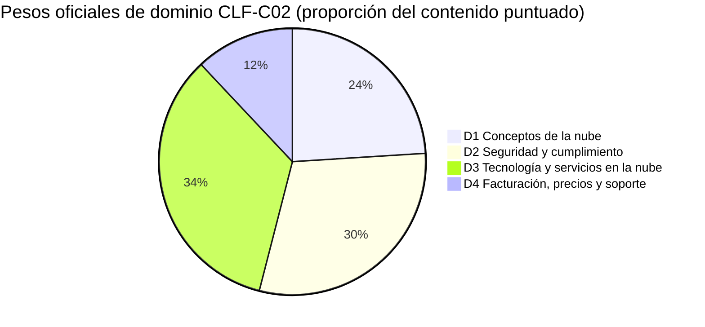
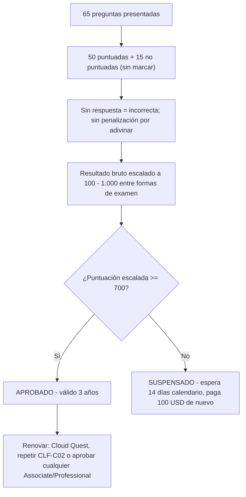
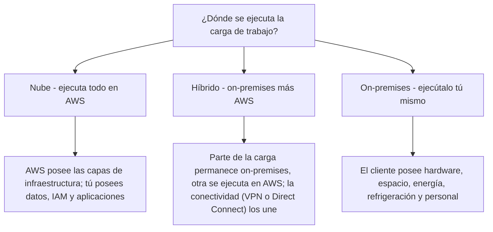
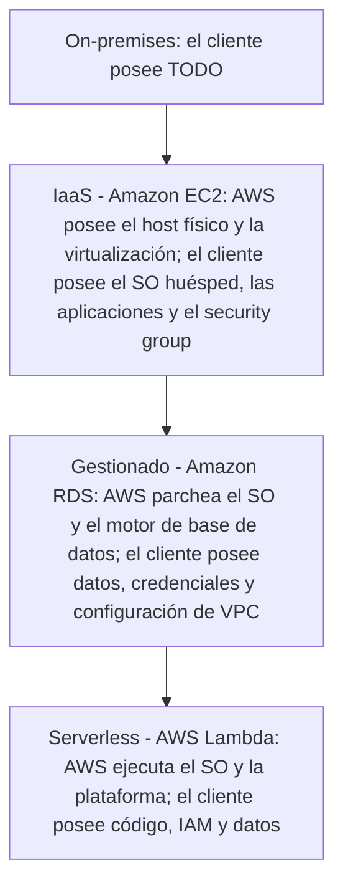

# Guía del examen CLF-C02 y conceptos de la nube

Toda certificación de AWS comienza con un documento: la **guía oficial del examen**. Para CLF-C02 ese único documento cumple dos trabajos a la vez: te dice exactamente *cómo* está construido el examen (códigos, minutos, preguntas, nota de corte, pesos) y define el *vocabulario de la nube* que debes dominar en el Dominio 1 (Conceptos de la nube, 24% del contenido puntuado). Los candidatos que se saltan la guía y van directo a las tarjetas de memorización caen en las mismas tres trampas: calculan mal el presupuesto de tiempo, confunden una **puntuación escalada** con un porcentaje y no logran separar lo que está **dentro del alcance** de lo que solo suena a trabajo real de nube.

```text
=====================================================================
 CLF-C02 — AWS CERTIFIED CLOUD PRACTITIONER (FOUNDATIONAL)
=====================================================================
  Código .............. CLF-C02          Nivel ..... Foundational
  Duración ............ 90 minutos       Preguntas . 65 presentadas
  Ítems puntuados ..... 50               No pun. .... 15 (no identificados)
  Escala .............. 100 - 1.000      Corte ...... 700
  Puntuación .......... compensatoria (solo global, sin aprobación por dominio)
  Coste ............... 100 USD (en octubre de 2026, pueden aplicarse impuestos)
  Validez ............. 3 años           Aplicación . centro Pearson VUE
                                         o proctor en línea
  Idiomas ............. 12 (italiano y alemán se retiran después del
                          31 de diciembre de 2026)
---------------------------------------------------------------------
  DOMINIO                                    PESO   ÍTEMS (50 x w)
  1. Conceptos de la nube                    24%          12
  2. Seguridad y cumplimiento                30%          15
  3. Tecnología y servicios en la nube       34%          17
  4. Facturación, precios y soporte          12%           6
                                              ------         -----
                                              100%           50
---------------------------------------------------------------------
  TIPOS DE PREGUNTA: opción múltiple | respuesta múltiple
                     (sin penalización por adivinar; en blanco = incorrecta)
  NOTA: el recuento de ítems de arriba es 50 x peso — aritmética, NO
        publicada por AWS. Solo los porcentajes son oficiales.
=====================================================================
```

> [!NOTE]
> **La guía es el contrato.** Cualquier cosa que no esté en la guía del examen, por popular que sea en entradas de blog, no tiene garantía de aparecer. AWS etiqueta explícitamente sus dos listas de servicios como **«no exhaustivas y sujetas a cambios»**, así que trata la guía como el suelo de lo que debes saber, no como el techo.

En esta lección vas a:

- leer la guía del examen como la leería quien redacta el examen: código, tiempo, coste, puntuación, idiomas;
- convertir los **pesos de dominio** en un presupuesto concreto de horas de estudio;
- mapear las **19 declaraciones de tarea** en los cuatro dominios de contenido;
- dominar los **dos tipos de pregunta** y el modelo de puntuación compensatoria;
- separar la **lista de servicios dentro del alcance** de la **lista fuera del alcance** que alimenta los distractores;
- definir la computación en la nube y contrastar **on-premises frente a la nube** con la terminología de la propia guía;
- reconocer los tres **modelos de despliegue** (nube, híbrido, on-premises) y la escalera de modelos de servicio;
- explicar **elasticidad, escalabilidad, alta disponibilidad y agilidad** sin confundirlos;
- enunciar los **seis ventajas de la computación en la nube** y la propuesta de valor de AWS;
- aplicar los pilares del **Well-Architected Framework** y sus seis principios generales de diseño;
- trabajar la economía de la nube: **coste fijo frente a variable, rightsizing, BYOL, automatización**;
- estudiar **cuatro casos de estudio reales de clientes de AWS**: servicios, números y fuentes;
- leer el **recuadro de actualizaciones de octubre de 2026**: qué datos de la guía cambiaron y cuáles no;
- practicar con **12 preguntas estilo examen** más tres comprobaciones interactivas.

---

## 1. Qué mide el examen CLF-C02

### 1.1 El candidato objetivo

CLF-C02 es una credencial **Foundational**, y el propio material de AWS describe a su audiencia como **profesionales no tecnológicos**, de ventas, producto y gestión de proyectos, que necesitan **alfabetización en la nube**, no ingeniería de la nube. Nadie espera que construyas infraestructura. Se te examina de **criterio, vocabulario, selección de servicios y conciencia de coste**.

| Atributo del candidato | Lo que dice la guía | Qué significa para tu preparación |
|---|---|---|
| Código y nivel | CLF-C02 / **Foundational** | Amplitud de vocabulario, no profundidad de implementación |
| Audiencia | Roles no tecnológicos que necesitan alfabetización en la nube | Conceptual, no resolución de problemas hands-on |
| Programación | **Fuera del alcance** | Sin scripts, sin memorizar sintaxis de CLI |
| Diseño de arquitectura | **Fuera del alcance** | Reconoces principios; no dibujas diseños |
| Pruebas de carga y rendimiento | **Fuera del alcance** | Sabes *que* existen, no *cómo* ejecutarlas |

### 1.2 Las tareas laborales fuera del alcance: textualmente

La guía traza una línea dura, y vale la pena memorizarla palabra por palabra:

> «La siguiente lista contiene tareas laborales que no se espera que el candidato objetivo sepa realizar. Esta lista no es exhaustiva. Estas tareas están fuera del alcance del examen: **Programación / Diseñar arquitectura de la nube / Resolver problemas / Implementación / Pruebas de carga y rendimiento**»

Esta lista no es decoración. Los ítems de ella aparecen como **distractores**, porque un distractor que suena a «trabajo real de nube» es la respuesta incorrecta más tentadora de todas.

> [!WARNING]
> **⚠️ La paradoja del alcance: fuera del alcance no significa que nunca se mencione.**
> - *«Diseñar arquitectura de la nube»* está fuera del alcance, pero la Tarea 1.2 aun así te pide nombrar los **pilares del Well-Architected**: principios, no dibujos.
> - *«Implementación»* está fuera del alcance, pero la Tarea 3.1 aun así te pide **elegir** entre la consola, la CLI, los SDK y la infraestructura como código: una decisión, no una construcción.
> - *«Resolver problemas»* está fuera del alcance, pero la Tarea 3.8 aun así nombra «herramientas para desarrollar, desplegar y **resolver problemas** de aplicaciones»: debes conocer el *papel* de una herramienta, no los pasos de depuración.
> El examen quiere **selección y reconocimiento**; cualquier opción que te pida escribir, construir o depurar está probando si detectaste una tarea fuera del alcance.

### 1.3 Apéndice A: la lista de tecnologías y conceptos

Junto a los dominios, la guía incluye un apéndice de **28 tecnologías y conceptos** que «podrían aparecer en el examen», explícitamente **sin indicación de su peso relativo**. Las entradas del Dominio 1 son beneficios de la migración a la nube, el AWS Cloud Adoption Framework (CAF), la gestión de costes, la infraestructura global, la infraestructura como código, la migración y la transferencia de datos, AWS Prescriptive Guidance, AWS Pricing Calculator, AWS Professional Services, AWS Partner Network, los arquitectos de soluciones y el Well-Architected Framework. Léelo como una *lista de vocabulario*, nunca como un peso.

- **📚 ¿Sabías que…?** El examen tiene **dos artefactos oficiales de la guía** que discrepan de verdad: una guía HTML en `docs.aws.amazon.com` y un PDF más antiguo con el sello «Version 1.0 CLF-C02» en `d1.awsstatic.com`. **13 de las 19 declaraciones de tarea difieren** entre ellos (comprobado en octubre de 2026). La regla que implica la propia estructura de AWS: **la guía HTML gana** sobre cualquier PDF antiguo, entrada de blog o simulado de terceros.

---

## 2. Logística del examen: los números que cambian tu estrategia

### 2.1 La tabla de logística

Cada fila de abajo proviene de la guía del examen, del «Exam overview» de la página de certificación o de las preguntas frecuentes de AWS Certification, todas consultadas en **octubre de 2026**.

| Atributo | Valor | Dónde se declara |
|---|---|---|
| Código / nivel | CLF-C02 / Foundational | Guía del examen |
| Duración | **90 minutos** | Exam overview |
| Preguntas presentadas | **65** (opción múltiple o respuesta múltiple) | Exam overview |
| Puntuadas / no puntuadas | **50 afectan tu puntuación / 15 no**: las 15 **no están identificadas** en el examen | Guía del examen |
| Tipos de respuesta | OM: 1 correcta + 3 distractores · RM: 2+ correctas de 5+ opciones | Guía del examen |
| Política de adivinanza | Sin respuesta = **incorrecta**; **sin penalización** por adivinar | Guía del examen |
| Escala de puntuación | Escalada **100 to 1.000**; aprobación mínima **700** | Guía del examen |
| Modelo de puntuación | **Compensatorio**: solo el resultado global debe aprobar | Guía del examen |
| Tarifa | **100 USD** en octubre de 2026 (exámenes de nivel Foundational; pueden aplicarse impuestos como el IVA) | Preguntas frecuentes de certificación |
| Aplicación | Centro de pruebas Pearson VUE **o** examen con proctor en línea | Exam overview |
| Idiomas | **12**: árabe, inglés, francés (Francia), alemán, italiano, japonés, coreano, portugués (Brasil), español (Latinoamérica), español (España), chino simplificado, chino tradicional | Exam overview |
| Retiro de idiomas | **El italiano y el alemán se retiran después del 31 de diciembre de 2026** | Exam overview |
| Validez | **3 años** | Página de certificación |
| Renovación | Cloud Quest Recertify Cloud Practitioner (sin examen), volver a aprobar CLF-C02 o aprobar **cualquier** examen de nivel Associate o Professional | Página de recertificación |
| Repetición tras un fallo | Espera de **14 días calendario**; **sin límite** de intentos; **tarifa completa cada vez** | Preguntas frecuentes de certificación |
| Repetición tras una aprobación | Bloqueado durante **2 años** (salvo que AWS publique una nueva guía y un nuevo código de serie) | Preguntas frecuentes de certificación |

### 2.2 Ejemplo resuelto E1: el presupuesto de tiempo por pregunta

El número más útil de toda la guía es una aritmética que nadie publica:

$$
t = \frac{90 \times 60}{65} = \frac{5{,}400}{65} \approx 83.1 \text{ segundos por pregunta}
$$

Reserva **10 minutos** para la revisión y el presupuesto real se convierte en $80 \times 60 / 65 \approx$ **73,8 segundos** por ítem. Regla práctica: responde rápido al principio y luego dedica el excedente a los ítems de respuesta múltiple, que son más lentos.

### 2.3 Ejemplo resuelto E2: puntuadas frente a no puntuadas

$$
65 = 50 + 15 \qquad \frac{15}{65} = 23.1\% \text{ of the exam does not affect your score}
$$

Casi una cuarta parte del examen es material de prueba invisible, y **no puedes saber cuáles son esas 15**. La única estrategia sensata es tratar cada ítem como puntuado.

### 2.4 Ejemplo resuelto E3: el coste de repetir

| Evento | Día calendario | Cartera |
|---|---|---|
| Primer intento (fallo) | Día 0 | 100 USD (en octubre de 2026) |
| Elegible para repetir | Día 14 |: |
| Segundo intento (fallo) | Día 14 o posterior | +100 USD |
| Tercer intento | +14 días tras el segundo fallo | +100 USD |
| **Total tras tres intentos fallidos** |: | **300 USD** |

Tres intentos cuestan **300 USD** en octubre de 2026 más al menos **28 días calendario** de espera entre ellos. Una **cita perdida** es distinta: pierdes la tarifa pero **no** cuenta como intento fallido.

- **📚 ¿Sabías que…?** Una validez de **3 años no significa un examen de reciclaje obligatorio**. AWS lista tres vías de renovación, y una de ellas, **Cloud Quest Recertify Cloud Practitioner**, no requiere examen alguno; alternativamente, aprobar *cualquier* examen de nivel Associate o Professional la renueva. Así que un candidato que planea continuar por la ruta de AWS puede dejar expirar CLF-C02 deliberadamente.

---

## 3. Los cuatro dominios y sus pesos

### 3.1 Pesos oficiales

La guía declara cuatro dominios de contenido, y los porcentajes son proporciones del **contenido puntuado únicamente**:

| Dominio | Peso oficial |
|---|---|
| **1. Conceptos de la nube** | **24%** |
| **2. Seguridad y cumplimiento** | **30%** |
| **3. Tecnología y servicios en la nube** | **34%** |
| **4. Facturación, precios y soporte** | **12%** |
| **Total** | **100%** |



### 3.2 Ejemplo resuelto E4: recuentos de ítems derivados (aritmética, no de AWS)

Multiplica los **50 ítems puntuados** por cada peso:

```text
Dominio   peso    50 x peso   interpretación
D1        24%         12      unos 12 ítems puntuados
D2        30%         15      unos 15 ítems puntuados
D3        34%         17      unos 17 ítems puntuados
D4        12%          6      unos  6 ítems puntuados
                                ------
                              50 ítems puntuados
```

> [!IMPORTANT]
> Los **pesos son oficiales** (guía del examen, octubre de 2026). Los **recuentos de ítems son aritmética**, 50 × peso, y **no los publica AWS**. El número de preguntas por dominio se desconoce, y como 15 de los 65 ítems son pilotos no puntuados, tu forma de examen real no coincidirá exactamente con esta cuadrícula. Úsala para **asignar tiempo de estudio**, nunca para predecir un número fijo de preguntas.

### 3.3 De CLF-C01 a CLF-C02

El examen se actualizó en septiembre de 2023 (CLF-C01 hasta el **18 de septiembre de 2023**; CLF-C02 desde el **19 de septiembre de 2023**), y el apéndice comparativo de la propia guía muestra cómo se movió el énfasis:

| Dominio | CLF-C01 | CLF-C02 |
|---|---|---|
| 1. Conceptos de la nube | 26% | **24%** |
| 2. Seguridad y cumplimiento | 25% | **30%** |
| 3. Tecnología → Tecnología y servicios en la nube | 33% | **34%** |
| 4. Facturación y precios → Facturación, precios y soporte | 16% | **12%** |

De esa tabla se siguen tres hechos: **la seguridad creció cinco puntos**; **la facturación se redujo cuatro**; y AWS declara **«No se eliminó contenido del examen»**: el contenido de siete declaraciones de tarea antiguas se **recategorizó** en las nuevas. La única adición genuina es la **Tarea 1.3**, que introdujo el **AWS Cloud Adoption Framework (CAF)**.

### 3.4 Ejemplo resuelto E5: convertir pesos en horas de estudio

Supón que tienes **40 horas** antes del día del examen. Los pesos se convierten directamente en horas:

```text
Dominio   peso    horas (40 h)   a dónde van las horas
D1        24%        9,6 h       beneficios, Well-Architected, CAF, economía
D2        30%       12,0 h       responsabilidad compartida, IAM, cumplimiento
D3        34%       13,6 h       infraestructura global, cómputo, almacenamiento,
                                 bases de datos, redes, IA/ML
D4        12%        4,8 h       modelos de precios, herramientas de coste, planes de soporte
                                ---------
                                40,0 h
```

Los dominios 2 + 3 son el **64% de la puntuación**. Un candidato que dedique todo su tiempo a los conceptos de la nube porque «ese es el tema del Cloud Practitioner» ha mal asignado dos tercios del examen.

---

## 4. El mapa de declaraciones de tarea: 4 dominios → 19 tareas

La guía no publica temas; publica **declaraciones de tarea**: cada una un par «Knowledge of» más «Skills in». Todo lo examinable cuelga de una de estas 19.

```mermaid
flowchart TD
    R["CLF-C02 - 19 declaraciones de tarea en 4 dominios"] --> D1["D1 Conceptos de la nube 24%"]
    R --> D2["D2 Seguridad y cumplimiento 30%"]
    R --> D3["D3 Tecnología y servicios en la nube 34%"]
    R --> D4["D4 Facturación, precios y soporte 12%"]
    D1 --> A1["1.1 Beneficios de la nube de AWS"]
    D1 --> A2["1.2 Principios de diseño de la nube de AWS"]
    D1 --> A3["1.3 Beneficios y estrategias de migración"]
    D1 --> A4["1.4 Economía de la nube"]
    D2 --> B1["2.1 Modelo de responsabilidad compartida"]
    D2 --> B2["2.2 Conceptos de seguridad, gobernanza y cumplimiento"]
    D2 --> B3["2.3 Capacidades de gestión de accesos"]
    D2 --> B4["2.4 Componentes y recursos de seguridad"]
    D3 --> C1["3.1 Despliegue y operación en la nube"]
    D3 --> C2["3.2 Infraestructura global"]
    D3 --> C3["3.3 Servicios de cómputo"]
    D3 --> C4["3.4 Servicios de bases de datos"]
    D3 --> C5["3.5 Servicios de red"]
    D3 --> C6["3.6 Servicios de almacenamiento"]
    D3 --> C7["3.7 Servicios de IA/ML y analítica"]
    D3 --> C8["3.8 Otras categorías de servicios en el alcance"]
    D4 --> E1["4.1 Comparar modelos de precios de AWS"]
    D4 --> E2["4.2 Facturación, presupuestos y gestión de costes"]
    D4 --> E3["4.3 Recursos técnicos y soporte de AWS"]
```



### 4.1 El Dominio 1 en detalle: las cuatro tareas con las que empieza este curso

| Tarea | Knowledge of | Skills in (lo que debes saber *hacer*) |
|---|---|---|
| **1.1 Definir los beneficios de la nube de AWS** | Propuesta de valor de la nube de AWS | Beneficios de la infraestructura global (velocidad de despliegue, alcance global); ventajas de la **alta disponibilidad, la elasticidad y la agilidad** |
| **1.2 Identificar principios de diseño** | AWS Well-Architected Framework | Los seis **pilares**; **diferencias entre los pilares** |
| **1.3 Beneficios y estrategias de migración** | Estrategias de adopción de la nube; recursos que acompañan el viaje | Componentes del **AWS CAF** (menor riesgo de negocio; mejor desempeño ESG; más ingresos; mayor eficiencia operativa); identificar estrategias de migración (por ejemplo, **replicación de bases de datos**) |
| **1.4 Conceptos de economía de la nube** | Aspectos de la economía de la nube; ahorro de costes de migrar a la nube | **Costes fijos frente a variables**; motores de coste on-premises; **BYOL frente a licencias incluidas**; **rightsizing**; beneficios de la **automatización**; **economías de escala** |

### 4.2 Las otras 15 tareas en una línea cada una

| Tarea | Enfoque en una línea |
|---|---|
| 2.1 | Responsabilidad compartida: AWS, cliente y controles compartidos, y cómo la línea **cambia según el servicio** (RDS, Lambda, EC2) |
| 2.2 | Cumplimiento y gobernanza: Artifact, cifrado, registros (CloudTrail, Config), monitorización con CloudWatch |
| 2.3 | Gestión de accesos: IAM, protección del usuario raíz, privilegio mínimo, MFA, IAM Identity Center, federación |
| 2.4 | Recursos de seguridad: WAF, Shield, GuardDuty, Inspector, terceros del Marketplace, Trusted Advisor |
| 3.1 | Formas de operar: acceso programático (APIs, SDKs, CLI) frente a consola frente a IaC; modelos de despliegue **nube, híbrido, on-premises** |
| 3.2 | Infraestructura global: Regiones, Availability Zones, ubicaciones de borde; alta disponibilidad multi-AZ |
| 3.3 | Cómputo: tipos de instancia de EC2, ECS/EKS, Fargate/Lambda, auto scaling, balanceadores de carga |
| 3.4 | Bases de datos: RDS, Aurora, DynamoDB, ElastiCache; migración con DMS y SCT |
| 3.5 | Redes: subnets y gateways de VPC, NACLs y security groups, Route 53, VPN y Direct Connect |
| 3.6 | Almacenamiento: objetos (clases de S3), bloques (EBS, instance store), ficheros (EFS, FSx), Storage Gateway, políticas de ciclo de vida, AWS Backup |
| 3.7 | IA/ML y analítica: SageMaker AI, Lex; Athena, Kinesis, Glue, Quick Sight |
| 3.8 | Otras categorías: EventBridge, SNS, SQS; Connect, SES; CodeBuild, CodePipeline, X-Ray; AppStream 2.0, WorkSpaces; Amplify; IoT Core; AWS Support |
| 4.1 | Modelos de precios: bajo demanda, reservados, Spot, Savings Plans, dedicados, Capacity Reservations; niveles de almacenamiento; transferencia de datos de entrada/salida |
| 4.2 | Herramientas de coste: Budgets, Cost Explorer, Pricing Calculator, facturación consolidada de Organizations, etiquetas de asignación de costes, el Cost and Usage Report |
| 4.3 | Soporte y recursos: whitepapers, Prescriptive Guidance, Knowledge Center, re:Post, planes de soporte, Trusted Advisor, Health Dashboard, Marketplace, Professional Services |

---

## 5. Tipos de pregunta y mecánica de puntuación

### 5.1 Exactamente dos tipos de pregunta

| Tipo | Estructura | Regla de crédito |
|---|---|---|
| **Opción múltiple** | Una respuesta correcta y **tres respuestas incorrectas (distractores)** | Selecciona la única mejor respuesta |
| **Respuesta múltiple** | **Dos o más respuestas correctas** de **cinco o más** opciones | Se requiere cada respuesta correcta para obtener el crédito |

No hay **ítems de ordenación, emparejamiento, arrastrar y soltar ni casos de estudio** en la guía CLF-C02: si un simulado te muestra esos, no sigue la guía de este examen.

### 5.2 La canalización de puntuación



**Compensatorio** significa una sola cosa: solo el resultado **global** debe superar los 700. **No** necesitas llegar a 700 dentro de cada dominio: un Dominio 4 débil puede ser sostenido por un Dominio 3 fuerte, y dominar un dominio no rescata una puntuación global por debajo del corte.

### 5.3 Ejemplo resuelto E6: 700 no es 70%

700 sobre 1.000 *parece* un 70%, y la conversión ingenua $0.70 \times 50 = 35$ respuestas correctas es aritméticamente limpia, y **falsa como hecho del examen**. La escala empieza en 100, así que el rango utilizable es $1{,}000 - 100 = 900$ puntos:

$$
\frac{700 - 100}{900} = \frac{600}{900} \approx 66.7\%
$$

AWS escala las puntuaciones **entre múltiples formas de examen que pueden diferir en dificultad**, así que el número bruto de respuestas correctas necesario para 700 **no es fijo** y no se publica. La única regla determinista es de comportamiento: **los ítems sin respuesta se puntúan como incorrectos**, así que responde las 65.

> [!WARNING]
> **Nunca dejes un ítem en blanco «por seguridad».** No hay **penalización por adivinar**: un fallo al adivinar no te cuesta nada más allá del punto que habrías perdido al saltártelo, mientras que un ítem en blanco garantiza cero. Hábito: elimina, comprométete, marca, sigue. A ~83 segundos por ítem, una pregunta a la que «pensabas volver» es el hábito más caro de este examen.

---

## 6. Servicios dentro y fuera del alcance

### 6.1 Dos listas, una regla

La guía publica una lista de **servicios de AWS dentro del alcance** que abarca **19 categorías**, y una lista separada de **servicios de AWS fuera del alcance**. Ambas están etiquetadas como **no exhaustivas y sujetas a cambios** (en octubre de 2026). La lista de dentro del alcance es lo que debes reconocer; la lista de fuera del alcance te dice qué nombres se usan como **anzuelos**.

| Categoría dentro del alcance (19 en total) | Nombres que lista la guía |
|---|---|
| Analítica | Athena, EMR, Glue, Kinesis, OpenSearch, Quick Sight, Redshift |
| Integración de aplicaciones | EventBridge, SNS, SQS, Step Functions |
| Gestión financiera en la nube | AWS Budgets, Cost and Usage Reports, Cost Explorer, AWS Marketplace |
| Cómputo | Batch, EC2, Elastic Beanstalk, Lightsail, Outposts |
| Contenedores | ECR, ECS, EKS |
| Bases de datos | Aurora, DocumentDB, DynamoDB, ElastiCache, Neptune, RDS |
| Machine learning | Comprehend, Lex, Polly, Q, Rekognition, SageMaker AI, Textract, Transcribe, Translate |
| Gestión y gobernanza | Auto Scaling, CloudFormation, CloudTrail, CloudWatch, Compute Optimizer, Config, Control Tower, Organizations, Trusted Advisor, **Well-Architected Tool**, … |
| Migración y transferencia | Application Discovery Service, Application Migration Service, DMS, Migration Evaluator, Migration Hub, SCT |
| Redes y entrega de contenido | API Gateway, CloudFront, Direct Connect, Global Accelerator, PrivateLink, Route 53, Transit Gateway, VPC, VPN |
| Seguridad, identidad y cumplimiento | Artifact, ACM, CloudHSM, Cognito, Detective, GuardDuty, **IAM**, **IAM Identity Center**, Inspector, KMS, Macie, RAM, Secrets Manager, Security Hub, Shield, WAF |
| Serverless | Fargate, Lambda |
| Almacenamiento | AWS Backup, EBS, EFS, Elastic Disaster Recovery, FSx, S3, S3 Glacier, Storage Gateway |

### 6.2 La lista de fuera del alcance: servicios que existen pero no son examinables

Amazon AppFlow · AWS Clean Rooms · AWS Data Exchange · Amazon DataZone · **Amazon MSK** · AWS AppFabric · Amazon WorkDocs · AWS Wavelength · AWS Copilot · Amazon GameLift · **AWS CloudShell** · **AWS CodeDeploy** · AWS CodeArtifact · AWS Device Farm · Amazon CodeGuru · AWS IoT Greengrass · Amazon Fraud Detector · Amazon Personalize · Amazon Lookout for Metrics · AWS Chatbot · **AWS Billing Conductor** · todos los servicios de medios AWS Elemental · **Amazon MemoryDB** · **AWS Network Firewall** · AWS RoboMaker · **Amazon FSx for Lustre** · AWS Transfer Family · AWS IQ · AWS Activate · AWS Managed Services (AMS) · Amazon Keyspaces · AWS Launch Wizard · AWS AppConfig · Amazon Data Lifecycle Manager · Amazon Elastic Transcoder · AWS Cloud Map · AWS Ground Station · Amazon VPC Lattice · Amazon Cloud Directory · AWS Migration Hub Refactor Spaces · AWS Network Access Analyzer · AWS IoT Device Defender · Amazon Monitron · AWS Application Composer · Amazon Interactive Video Service (Amazon IVS).

> [!IMPORTANT]
> **Que un servicio esté fuera del alcance no significa que sea falso, obsoleto o erróneo.** Son servicios reales y vigentes de AWS. Simplemente **no pueden ser la respuesta correcta** a una pregunta CLF-C02 mientras encaje un servicio dentro del alcance. Si la opción que mejor suena de una pregunta está en la lista de fuera del alcance, sigue leyendo: casi con certeza hay una opción mejor dentro del alcance.

### 6.3 Trampas de nombres en la lista de dentro del alcance

- La guía escribe **«Amazon Quick Sight»** (dos palabras): la página del producto dice QuickSight.
- La Tarea 4.2 dice «AWS Cost and Usage **Report**» mientras la lista de servicios dice **«AWS Cost and Usage Reports»** (plural).
- Es **«AWS IAM Identity Center»**: la redacción antigua «(AWS Single Sign-On)» ya no aparece.
- **AWS VPN**, **AWS Site-to-Site VPN** y **AWS Client VPN** se listan como **tres viñetas separadas**, no como un servicio con tres modos.
- El servicio es **Amazon SageMaker AI**: el nombre antiguo «SageMaker» sin «AI» es el que usan los simulados más antiguos.

### 6.4 Qué guía gana

| Artefacto | Estado (octubre de 2026) | Regla |
|---|---|---|
| Guía HTML en `docs.aws.amazon.com` | Vigente | **Usa esta** |
| PDF con sello «Version 1.0 CLF-C02» | Más antiguo; 13 de 19 declaraciones de tarea difieren | Solo como referencia |
| Simulados de terceros | Variados | Nunca autoritativos |

La versión HTML eliminó ítems como «AWS Snowball» y «AWS Audit Manager» de las declaraciones de tarea y cambió sustancialmente las listas de servicios: la lista de fuera del alcance pasó de 11 nombres en 3 categorías en el PDF a una lista mucho más larga en el HTML.

- **📚 ¿Sabías que…?** **AWS Snowball** es una trampa en *dos* direcciones a la vez: la guía PDF antigua aún lo nombra dentro de la Tarea 1.3, pero aparece **ni** en la lista actual de dentro del alcance **ni** en la de fuera del alcance, y la documentación de Snowball Edge lleva un banner que declara que el dispositivo **ya no está disponible para clientes nuevos** (en octubre de 2026). Ambas listas de servicios son no exhaustivas, así que AWS nunca reconciled la contradicción; no construyas tu plan de estudio alrededor de ella.

### Actualizaciones de 2026 (en octubre de 2026)

> [!NOTE]
> **Qué se movió de verdad entre la guía de la época del lanzamiento y la guía que descargas hoy**: cada línea de abajo está comprobada contra una fuente primaria de AWS en **octubre de 2026**, y cada una es examinable porque el examen prueba la guía *actual*:
> - **Los pesos de dominio no se han movido**: siguen en **24 / 30 / 34 / 12**, sin cambios desde que CLF-C02 entró en vigor el **19 de septiembre de 2023**. Cualquier página de preparación que afirme un cambio reciente de peso (por ejemplo «Seguridad 28% → 30%») está sin corroborar: PDF actual de la guía del examen, p. 3, consultado en octubre de 2026.
> - **Ambas listas de servicios se reconstruyeron**: las entradas dentro del alcance **128 → 111** en las mismas 19 categorías, las de fuera del alcance **11 → 55**: páginas oficiales de servicios dentro y fuera del alcance, consultadas en octubre de 2026.
> - **La Tarea 4.3 ahora enseña la alineación de soporte posterior a 2025**: su ejemplo dice «customer service and communities, **Basic Support, AWS Business Support+, AWS Enterprise Support, AWS Unified Operations**»; Developer, el Business clásico y Enterprise On-Ramp **no admitieron nuevas suscripciones después del 2 de diciembre de 2025** (Tarea 4.3 de la guía del examen; AWS News Blog, 2 de diciembre de 2025).
> - **La Tarea 4.2 eliminó AWS Billing Conductor**: la redacción actual es solo «AWS Budgets and AWS Cost Explorer», y Billing Conductor ahora está en la lista de **fuera del alcance**, donde solo puede ser un distractor (guía de la época del lanzamiento frente a la actual, consultada en octubre de 2026).
> - **La infraestructura global sigue creciendo**: **39 Regiones y 124 Availability Zones**, con **7 AZ más** y **2 Regiones más** (Reino de Arabia Saudita y Chile) anunciadas pero aún sin abrir (mapa de Regiones y AZs, consultado en octubre de 2026: verifica el estado actual antes de usarlo).
> - **Dos idiomas están en el reloj**: se ofrecen **12 idiomas**, pero **el italiano y el alemán se retiran después del 31 de diciembre de 2026** (página de certificación, consultada en octubre de 2026).

- **📚 ¿Sabías que…?** El PDF actual de la guía del examen **no lleva número de versión en absoluto**: solo imprime «Copyright © 2026», y el único artefacto con sello que sigue circulando es el de la época del lanzamiento, **«Version 1.0 CLF-C02»**. El `uiVersion=2024.10` que puedes ver en la URL de la documentación es la **versión del template del sitio de AWS Docs**, no una fecha de revisión de la guía (comprobado en octubre de 2026). Tampoco existe una página de changelog de AWS para esta guía, así que las afirmaciones del tipo «la guía se actualizó en marzo de 2026» son inverificables.

---

## 7. Fundamentos de la nube: qué es la nube y qué cambia cuando te mueves

### 7.1 Qué es la computación en la nube

En este examen, la computación en la nube se define por su **consecuencia más que por su hardware**: dejas de poseer y mantener infraestructura y en su lugar consumes un servicio medido, pagando solo mientras funciona. La propia página de ventajas de AWS resume todo el argumento económico en una línea:

> «Cambia el gasto fijo por gasto variable … paga solo cuando consumas recursos de cómputo»

AWS describe la plataforma como ofreciente de **más de 200 servicios con funcionalidades completas** (en octubre de 2026), y su página de orígenes declara que la intención fundacional era permitir a cualquiera «acceder a la misma tecnología potente que las empresas más grandes y sofisticadas del mundo». Las seis ventajas de la Sección 8 son lo que la Tarea 1.1 entiende por la **«propuesta de valor de la nube de AWS»**.

### 7.2 On-premises frente a la nube

| Dimensión | On-premises | Nube de AWS |
|---|---|---|
| Tipo de gasto | **Fijo / capital**, se compra antes de usarse | **Variable / operativo**, se mide mientras funciona |
| Decisión de capacidad | Se compra para el **pico**, ocioso el resto del tiempo | Crece o se reduce **con solo unos minutos de aviso** |
| Renovación | Ciclo de renovación de hardware de unos **5 años** (AWS, 2022) | Sin ciclo de renovación para el cliente |
| Compra | Típicamente **6 to 9 meses** por adelantado (AWS, 2022) | Minutos |
| Utilización típica | **Menos del 15%** en servidores de centros de datos on-premises (AWS, 2024) | Pagas por lo que consumes |
| Sobreaprovisionamiento | **20% to 50%** por encima del pico previsto (AWS, 2022) | No necesario: la elasticidad absorbe los picos |
| Trabajo del personal | Montar, apilar y dar corriente a los servidores | Se traslada a AWS |
| Alcance | Confinado a donde está el hardware | **Lleva tu negocio global en minutos** |

Las cuatro cifras on-premises de arriba son estimaciones de la industria publicadas por AWS (entradas de 2022 y 2024), vigentes en octubre de 2026: **verifica el estado actual antes de usarlas**.

### 7.3 Ejemplo resuelto E7: los costes on-premises que una lista de precios nunca muestra

Un despliegue hipotético pequeño de **10 servidores** en un horizonte de **cinco años**. Las cifras en dólares son **supuestos ilustrativos, no precios de AWS** (en octubre de 2026: verifica el estado actual antes de usarlos); la lección del ejemplo es qué suelen olvidarse:

```text
Concepto                                Coste a 5 años
Hardware del servidor                   $ 30.000
Mantenimiento anual (5 años)            $ 30.000
Energía y refrigeración  $25 x 10 x 60 meses  $ 15.000
Superficie útil                          $  6.000
0,25 FTE de administrador de sistemas   $ 112.500
                                        ----------
Subtotal (antes de licencias, renovación
  y coste del capital)                  $ 193.500
```

La lección no es el total: es que **cuatro de esas cinco líneas son invisibles** para quien compara el precio de etiqueta de un servidor con una tarifa por hora. La guía de AWS es explícita: las comparaciones defectuosas omiten mano de obra, renovación e instalaciones.

### 7.4 Modelos de despliegue

La Tarea 3.1 nombra exactamente **tres** modelos de despliegue:



Un modelo **híbrido** es la respuesta cuando parte del parque debe permanecer on-premises mientras se construye nueva capacidad en AWS; **on-premises** es la respuesta cuando nada se mueve; **nube** es la respuesta cuando se mueve todo.

### 7.5 La escalera de modelos de servicio: cuánto asume AWS

La guía no enumera IaaS/PaaS/SaaS en una declaración de tarea, pero *sí* prueba la idea subyacente a través del **cambio de responsabilidad compartida**: cuanto más gestionado es el servicio, menor es tu parte.

| Capa | On-premises | IaaS: Amazon EC2 | Gestionado: Amazon RDS | Serverless: AWS Lambda |
|---|---|---|---|---|
| Hardware físico, hipervisor | Cliente | **AWS** | **AWS** | **AWS** |
| Parcheo del sistema operativo huésped | Cliente | **Cliente** | AWS | AWS (sin SO del cliente) |
| Entorno de ejecución, capacidad, escalado | Cliente | Cliente | AWS | AWS |
| Security groups / configuración de red | Cliente | **Cliente** | **Cliente** | n/a |
| Código de la aplicación / función | Cliente | Cliente | Cliente | **Cliente** |
| Usuarios de IAM, roles, MFA | Cliente | Cliente | Cliente | **Cliente** |
| Datos, clasificación, cifrado | Cliente | Cliente | Cliente | **Cliente** |



**Constantes sin importar la posición en la escalera:** la seguridad física de la nube es **siempre de AWS**; los datos, el IAM y las decisiones de cifrado son **siempre del cliente**.

```dragdrop
{
  "question": "Ordena la escalera de modelos de servicio desde donde el CLIENTE asume más responsabilidad hasta donde AWS asume más:",
  "items": [
    "On-premises: el cliente posee hardware, espacio, energía, refrigeración y personal",
    "IaaS - Amazon EC2: AWS posee el host físico y el hipervisor; el cliente posee el SO huésped, las aplicaciones y los security groups",
    "Gestionado - Amazon RDS: AWS parchea el SO y el motor de base de datos; el cliente posee datos, credenciales y configuración de VPC",
    "Serverless - AWS Lambda: AWS ejecuta el SO y la plataforma; el cliente posee código, IAM y datos"
  ],
  "correctOrder": [
    "On-premises: el cliente posee hardware, espacio, energía, refrigeración y personal",
    "IaaS - Amazon EC2: AWS posee el host físico y el hipervisor; el cliente posee el SO huésped, las aplicaciones y los security groups",
    "Gestionado - Amazon RDS: AWS parchea el SO y el motor de base de datos; el cliente posee datos, credenciales y configuración de VPC",
    "Serverless - AWS Lambda: AWS ejecuta el SO y la plataforma; el cliente posee código, IAM y datos"
  ],
  "explanation": "Cada escalón de la escalera entrega una capa más sin diferenciación a AWS, y por eso el examen lee la escalera como una pregunta de responsabilidad compartida: el parcheo del SO huésped pasa del cliente (EC2) a AWS (RDS, Lambda), mientras que la clasificación de datos, los usuarios de IAM, los roles y el cifrado permanecen con el cliente en TODOS los escalones: incluido el serverless. On-premises va primero porque el cliente posee todo, incluida la capa física."
}
```

### 7.6 Cuatro palabras que el examen mantiene separadas

| Término | Definición en el examen |
|---|---|
| **Elasticidad** | Crece **y se reduce** automáticamente según cambia la demanda |
| **Escalabilidad** | La capacidad de **soportar crecimiento** |
| **Alta disponibilidad** | Sobrevivir a un **fallo de componente** (múltiples Availability Zones) |
| **Agilidad** | Velocidad de aprovisionamiento: **«de semanas a solo minutos»** |

```fillblank
{
  "question": "Completa las afirmaciones sobre conceptos de la nube usando el vocabulario de la propia guía del examen:",
  "template": "La nube cambia el gasto {{1}} por gasto {{2}}, así que pagas solo cuando {{3}} recursos de cómputo. Igualar el tamaño y el tipo de instancia a la utilización medida sin dejar de cumplir el rendimiento se llama {{4}}, y la ventaja estructural de precio que proviene de agregar la demanda de cientos de miles de clientes se llama {{5}} de escala.",
  "answers": {
    "1": "fijo",
    "2": "variable",
    "3": "consumas",
    "4": "rightsizing",
    "5": "economías"
  },
  "distractors": ["capital", "operativo", "aprovisionar", "sobreaprovisionamiento", "autoescalado", "elasticidad", "virtualización"],
  "explanation": "Las seis ventajas de AWS enuncian el cambio directamente: «Cambia el gasto fijo por gasto variable … paga solo cuando consumas recursos de cómputo» y «Benefíciate de enormes economías de escala». Rightsizing es la habilidad de la guía del examen de igualar tamaño y tipo a la utilización MEDIDA sin dejar de cumplir el rendimiento: no es lo mismo que elegir la instancia más barata."
}
```

---

## 8. Propuesta de valor de AWS: las seis ventajas

### 8.1 Las seis ventajas, con la redacción de AWS

La «propuesta de valor» de la Tarea 1.1 se examina a través de seis ventajas, y las preguntas citan frecuentemente una frase **textualmente**:

| # | Ventaja (redacción de AWS) | Qué elimina de on-premises |
|---|---|---|
| 1 | **«Cambia el gasto fijo por gasto variable»**: paga solo cuando consumas | Comprar para el pico |
| 2 | **«Benefíciate de enormes economías de escala»**: el uso de cientos de miles de clientes se agrega, produciendo precios de pago por uso más bajos | Pagar precio de tienda por un solo rack |
| 3 | **«Deja de adivinar la capacidad»**: escala hacia arriba o hacia abajo con solo unos minutos de aviso | Sobreaprovisionamiento del 20 to 50% |
| 4 | **«Aumenta la velocidad y la agilidad»**: de semanas a solo minutos | Compra con 6 to 9 meses de antelación |
| 5 | **«Deja de gastar dinero en operar y mantener centros de datos»**: el trabajo pesado de montar, apilar y dar corriente a los servidores | Instalaciones y mano de obra |
| 6 | **«Lleva tu negocio global en minutos»**: menor latencia para los usuarios finales | Construir en el extranjero |

La Tarea 1.1 añade los cuatro **beneficios** principales: beneficios de la **infraestructura global** (velocidad de despliegue, alcance global) y las ventajas de la **alta disponibilidad, la elasticidad y la agilidad**.

### 8.2 Ejemplo resuelto E8: por qué las economías de escala son estructurales, no una promoción

Dos clientes necesitan cada uno un pico de **10 unidades** de capacidad, pero sus ocurren en momentos distintos (anticorrelados):

```text
Sin agregación:   10 + 10 = 20 unidades de hardware en pico
Con agregación:   pico combinado = 12 unidades
Reducción:        (20 - 12) / 20 = 40% menos hardware con la misma demanda
```

Como AWS agrega la demanda, compra y opera **~40% menos hardware para el mismo pico total de los clientes**, y traslada el ahorro estructural como una **tasa variable más baja**. Eso es lo que significa «enormes economías de escala»: no es un descuento por tiempo limitado.

### 8.3 Ejemplo resuelto E9: veinte años del mismo unitario de precio

La retrospectiva de 20 años de S3 de AWS ofrece ambos extremos de la curva de precios: Amazon S3 se lanzó el **14 de marzo de 2006** a **15 centavos por gigabyte**, y la entrada de marzo de 2026 de AWS sitúa la cifra actual en **ligeramente más de 2 centavos por gigabyte**: aproximadamente una **reducción del 85%** (en octubre de 2026; verifica los precios actuales antes de usarlos). Con **100 TB** ($102{,}400$ GB):

$$
\text{2006: } 102{,}400 \times 0.15 \approx \$15{,}360/\text{mo} \qquad \text{2026: } 102{,}400 \times 0.02 \approx \$2{,}048/\text{mo}
$$

Mismo unitario, mismo servicio, misma API: el precio cayó porque la escala y la eficiencia se componen. El blog también señala que el código escrito para S3 en 2006 **sigue funcionando sin cambios**, lo cual es un argumento de durabilidad tanto como de precio.

### 8.4 El Well-Architected Framework: Tarea 1.2

El framework es el «conjunto de mejores prácticas de AWS para diseñar y operar cargas de trabajo seguras, fiables, eficientes, rentables y sostenibles». Una revisión es explícitamente **«una conversación constructiva … no un mecanismo de auditoría»**, y el **AWS Well-Architected Tool** que la realiza es **gratuito** y está en la lista de dentro del alcance.

| Pilar | Qué protege |
|---|---|
| **Excelencia operativa** | Ejecutar, monitorizar y mejorar continuamente: incluida la automatización |
| **Seguridad** | Proteger la información y los sistemas |
| **Confiabilidad** | Hacer lo que deben hacer y recuperarse rápidamente del fallo |
| **Eficiencia de rendimiento** | Usar el cómputo de forma eficiente según cambian la demanda y la tecnología |
| **Optimización de costos** | Evitar el coste innecesario |
| **Sostenibilidad** | Minimizar el impacto ambiental |

```matching
{
  "question": "Empareja cada pilar del AWS Well-Architected Framework con lo que protege en el examen CLF-C02:",
  "pairs": [
    {"left": "Excelencia operativa", "right": "Ejecutar, monitorizar y mejorar continuamente la carga de trabajo: incluida la automatización del cambio y la respuesta"},
    {"left": "Seguridad", "right": "Proteger la información y los sistemas: confidencialidad, integridad y disponibilidad"},
    {"left": "Confiabilidad", "right": "Hacer lo que la carga de trabajo debe hacer y recuperarse rápidamente del fallo"},
    {"left": "Eficiencia de rendimiento", "right": "Usar los recursos de cómputo de forma eficiente según cambian la demanda, la tecnología y los requisitos de negocio"},
    {"left": "Optimización de costos", "right": "Evitar el coste innecesario: el pilar que impulsa las conversaciones de TCO y rightsizing"},
    {"left": "Sostenibilidad", "right": "Minimizar el impacto ambiental de ejecutar cargas de trabajo en la nube"}
  ],
  "explanation": "Los seis pilares NO son intercambiables y se oponen entre ellos: la capacidad de reserva ayuda a la Confiabilidad mientras perjudica a la Optimización de costos, y por eso la tarea 1.2 también te pide identificar DIFERENCIAS entre los pilares. El Well-Architected Tool que ejecuta la revisión es gratuito y está en la lista de servicios dentro del alcance."
}
```

Los **seis principios generales de diseño** del framework hacen todos el mismo truco subyacente: convierten el gasto fijo, inicial y ocioso en gasto medido y bajo demanda: **deja de adivinar tus necesidades de capacidad**; **prueba los sistemas a escala de producción**; **automatiza con la experimentación arquitectónica en mente**; **considera arquitecturas evolutivas**; **impulsa las arquitecturas con datos**; **mejora mediante game days**.

- **📚 ¿Sabías que…?** Tres listas distintas de «seis/cinco» se confunden en este examen, y no son variantes entre sí: los **6 pilares del Well-Architected Framework** (calidad de la carga de trabajo), las **6 perspectivas del AWS Cloud Adoption Framework** (preparación organizativa: Business, People, Governance, Platform, Security, Operations) y los **5 pilares del Cloud Value Framework** (valor de negocio, del cual el ahorro de costes es solo el pilar 1). «Sostenibilidad» y «Coste» aparecen en más de una lista con **significados distintos**: lee el enunciado para saber qué lista está activa.

---

## 9. Economía de la nube: fijo, variable y a dónde va de verdad el dinero

### 9.1 La distinción central

- **Coste fijo** exista o no el servicio: hardware propio, superficie útil, personal asalariado.
- **Coste variable** sigue al consumo: recursos de la nube medidos.
- **Capex** (gasto de capital) compra un activo que posee y deprecia; **opex** (gasto operativo) paga lo que usas. La nube convierte el capex en opex: eso es la ventaja nº 1 enunciada como hecho contable.

### 9.2 Motores de coste on-premises que debes saber nombrar

Hardware **+ mantenimiento anual** · licencias del sistema operativo y de aplicaciones · **superficie, energía y refrigeración** · **mano de obra de TI** · el **ciclo de renovación de ~5 años** · **compra con 6 to 9 meses de antelación** · **sobreaprovisionamiento del 20 to 50%** · coste del capital · ancho de banda. Una comparación que solo cuenta el precio de compra del servidor frente a tarifas por hora es el modelo defectuoso del que AWS advierte.

### 9.3 Ejemplo resuelto E10: rightsizing

Un servidor está aprovisionado con **12 vCPU / 64 GB** pero mide una utilización de **25% de CPU y 25% de memoria** durante un mes representativo:

```text
Aprovisionado   12 vCPU / 64 GB   100%
Medido           3 vCPU / 16 GB    25%
Objetivo correcto 4 vCPU / 16 GB  - iguala la demanda medida, aún cumple el rendimiento
Capacidad eliminada = (12 - 4) / 12 = 66,7% de la instancia
```

**Rightsizing no es «elegir la instancia más barata».** Es igualar el tamaño y el tipo a la **utilización medida sin dejar de cumplir el rendimiento**, y el orden importa: **primero el right-sizing, después elige un modelo de compromiso o descuento.**

### 9.4 Licencias: BYOL frente a incluida

| | **Licencia incluida** | **BYOL (Bring Your Own License)** |
|---|---|---|
| Quién suministra la licencia | AWS la incluye en el precio de la instancia | Tú aportas la licencia **y** el medio |
| Quién posee el cumplimiento | **AWS** | **Tú** |
| Forma del coste | Pagas solo **mientras la instancia funciona** | Coste marginal de la licencia ≈ 0 |
| Mejor cuando | Tiempo de actividad variable o interrumpible | Alto tiempo de actividad más licencias descontadas existentes |

**AWS License Manager** es la herramienta dentro del alcance que rastrea licencias a través de AWS, on-premises y otras nubes.

### 9.5 Automatización y servicios gestionados

- **Automatización / infraestructura como código:** las plantillas se versionan, se revisan, se repiten y admiten rollback. El ejemplo de automatización con nombre de la guía es **AWS CloudFormation** (la representación PDF de la Tarea 1.4 lo nombra explícitamente; la guía HTML dice solo «benefits of automation»: acepta ambas formulaciones). Ten en cuenta la distinción: **automatización ≠ auto scaling**. CloudFormation hace repetible el aprovisionamiento; **Auto Scaling** aporta elasticidad. Ambos están en el alcance y responden a preguntas distintas.
- **Los servicios gestionados** absorben el trabajo sin diferenciación: Amazon RDS asume el parcheo del motor, las copias de seguridad y el failover; ECS y EKS asumen la plataforma; DynamoDB asume la capacidad y la operación. **RDS, ECS, EKS y DynamoDB** son los ejemplos de servicios gestionados con nombre (de nuevo, nombrados en la versión PDF de la Tarea 1.4).

- **📚 ¿Sabías que…?** AWS enmarca deliberadamente el coste como **solo el pilar 1 de 5** en su **Cloud Value Framework**: el coste total de propiedad es el primer pilar, no todo el argumento, y AWS lo empareja con investigaciones de terceros que afirman un **50% de reducción del coste de operaciones a cinco años** y un retorno de la inversión en **10 meses** (IDC para AWS, 2022, citado por AWS, en octubre de 2026). Son hallazgos de investigación sobre una base de clientes, nunca una garantía para ningún cliente individual.

---

## Casos Reales

AWS publica cómo se ven estas abstracciones en producción. Cada cifra de abajo es **afirmada por el cliente o por AWS y sin auditar**, con la fuente indicada para que puedas comprobarla: el punto examinable es el **patrón** (qué principio se aplicó, qué servicios hicieron el trabajo, qué número se movió), no el marketing.

### Caso A, Capital One: salir del centro de datos (migración y agilidad)

| Elemento | Detalle |
|---|---|
| Cliente | **Capital One**, banco (Fortune 100, industria regulada) |
| Desafío | Ocho centros de datos on-premises, ciclos de renovación de hardware y la necesidad de construir capacidad más rápido |
| Servicios | Más de 30 servicios de AWS, incluidos Amazon EC2, Amazon S3, Amazon RDS, AWS Lambda, Amazon ECS, AWS Step Functions, AWS Glue, Amazon Connect, Amazon SES |
| Resultados | **Salió de ocho centros de datos on-premises**; el **80%** de casi **2.000 aplicaciones** construidas en la nube **desde cero**; el tiempo medio para construir un entorno de desarrollo pasó de **3 meses a minutos**; el tiempo de pruebas de recuperación ante desastres **−70%**; la resolución de incidentes y los errores de transacción **−50%**; el coste de una aplicación **−90%** tras moverse a Lambda; **103 toneladas** de cobre y acero recicladas |
| Dominio del examen | **Dominio 1** (valor de negocio y agilidad) con conexiones al Dominio 3 (migración, serverless) |
| Fuente | `aws.amazon.com/solutions/case-studies/capital-one-all-in-on-aws` (consultado en octubre de 2026) |

> «Estamos realmente *all in* en la nube, y AWS ha sido instrumental para que podamos aprovechar al máximo los beneficios de estar en la nube.»: Chris Nims, SVP de ingeniería de nube y productividad, Capital One

> [!WARNING]
> **No mezcles las dos páginas de casos de estudio de Capital One.** La página de migración es la fuente de **8 centros de datos, 80% de ~2.000 aplicaciones, 3 meses → minutos, DR −70%**. Una página *distinta* de resiliencia informa **eventos de gravedad crítica −80 to 90%** y recuperación **horas → minutos**. Ambas son páginas reales de AWS; citarlas como un solo conjunto de números es cómo un dato «correcto» se vuelve incorrecto.

### Caso B, Box: optimización de costos con Well-Architected (el pilar de costes en la práctica)

| Elemento | Detalle |
|---|---|
| Cliente | **Box**, empresa SaaS empresarial (más de 120.000 empresas) |
| Desafío | Mejorar la eficiencia del gasto sin degradar la seguridad, la confiabilidad ni el rendimiento |
| Servicios | Revisiones del **AWS Well-Architected Framework** y de Solutions Architect; jerarquización de clases de almacenamiento Amazon S3 / S3 Glacier; higiene de volúmenes y snapshots de EBS; filtrado de eventos de AWS CloudTrail; rutas de tráfico rediseñadas en torno a los internet gateways |
| Resultados | **2,23 millones de dólares** en ahorros (en octubre de 2026), detallados abajo |
| Dominio del examen | **Dominio 4** (optimización de costos, niveles de almacenamiento, cargos por transferencia de datos) |
| Fuente | `aws.amazon.com/solutions/case-studies/box-case-study` (consultado en octubre de 2026) |

| Palanca | Ahorro publicado por AWS (en octubre de 2026) |
|---|---|
| Transferencia de datos entre Availability Zones | $438.000 |
| Salida a internet | $1,1 millones al año |
| Jerarquización de almacenamiento | más de $500.000 al año |
| Volumen de registros | $192.000 al año |
| **Total** | **$438.000 + $1.100.000 + $500.000 + $192.000 = $2.230.000 = $2,23 M** |

> «Nuestro uso de las mejores prácticas de AWS condujo a ahorros de más de 2 millones de dólares, estableciendo una nueva línea base…»: Clay Alvord, director de FinOps y SRE, Box

Observa el patrón: **ninguna de las cuatro palancas de Box fue una negociación con AWS.** Tres son arquitectónicas (adónde va el tráfico, qué clase de almacenamiento, cuánto se registra) y una es un proceso de revisión, y precisamente por eso el pilar de **Optimización de costos** del Well-Architected, y no un código de descuento, es el concepto del Dominio 4.

### Caso C, Philip Morris International: 400 aplicaciones en dos años (valor de la migración)

| Elemento | Detalle |
|---|---|
| Cliente | **Philip Morris International (PMI)**, fabricante de bienes de consumo regulado que pivota hacia productos sin humo y de venta directa al consumidor |
| Desafío | Vender primero sus propios centros de datos para que la opción de retroceso desaparezca, y luego migrar cumpliendo las obligaciones de **GDPR** y **PCI** en un reloj fijo de dos años |
| Servicios | **AWS Professional Services** con un partner (IBM), revisiones Well-Architected, **Amazon RDS**, la construcción de un data lake, pipelines automatizados de CI/CD |
| Resultados | **400 aplicaciones migradas en 2 años** desde **agosto de 2020**, y PMI se describe ahora como **«all in en AWS»**; rendimiento **+50%**; el **70%** de las aplicaciones en pipelines automatizados, por lo que los cambios se entregan **80% más rápido**; hasta un **50%** de ahorro en algunos costes de Amazon RDS; **más de 500** personas obteniendo certificaciones de AWS Cloud Practitioner |
| Dominio del examen | **Dominio 1** (beneficios de la migración y valor de la adopción de la nube, Tarea 1.3) con conexiones al Dominio 4 (ahorro de costes) y al Dominio 2 (cargas de trabajo reguladas) |
| Fuente | `aws.amazon.com/solutions/case-studies/philip-morris-case-study` (consultado en octubre de 2026) |

El punto examinable no es el recuento de aplicaciones: es que una empresa **regulada** compró la ventana de migración deshaciéndose primero del hardware, y que el propio texto de AWS registra que el intento inicial agresivo de **lift-and-shift** «produjo resultados subóptimos» antes de que el programa se apoyara en Professional Services, revisiones Well-Architected y automatización. Cada cifra de arriba está afirmada por el cliente/AWS y sin auditar (en octubre de 2026).

### Caso D, Canva: una cartera de modelos de precios (economía de la nube en la práctica)

| Elemento | Detalle |
|---|---|
| Cliente | **Canva**, plataforma de diseño en línea, cliente de AWS desde el primer día |
| Desafío | Escalar de forma rentable manteniendo los niveles de confiabilidad alineados con los planes de usuario gratis, Pro y empresarial |
| Servicios | **Amazon EC2 Spot** para proyectos tolerantes a fallos del free tier; **bajo demanda más Savings Plans** para la capacidad estable de usuarios Pro; **Reserved Instances** como alternativa; herramientas de gestión de costes de AWS |
| Resultados | Costes de cómputo **−46% en menos de dos años** (afirmado por el cliente, consultado en octubre de 2026); el caso de estudio cita los techos publicados por AWS de **hasta el 72%** para Reserved Instances y Savings Plans frente a bajo demanda, y **hasta el 90%** para Spot (en octubre de 2026: verifica los precios actuales antes de usarlos) |
| Dominio del examen | **Dominio 1** Tarea 1.4 (economía de la nube) que alimenta directamente el **Dominio 4** Tarea 4.1 (comparar modelos de precios de AWS) |
| Fuente | `aws.amazon.com/solutions/case-studies/canva-cost-optimization-case-study` (consultado en octubre de 2026) |

Lee Canva como el contraejemplo de «encuentra la opción más barata»: la respuesta que el examen quiere es una **mezcla ajustada a la forma de la carga de trabajo**, capacidad interrumpible para el trabajo interrumpible, compromiso para el trabajo estable, bajo demanda para lo que quede, que es exactamente el orden rightsizing → compromiso → Spot de la Sección 9.

| Caso | Principio que demuestra | Dominio |
|---|---|---|
| Capital One | Agilidad, velocidad de despliegue, economías de escala, migración | D1 Conceptos de la nube |
| Box | Optimización de costos, niveles de almacenamiento, cargos por transferencia de datos | D4 Facturación, precios y soporte |
| Philip Morris International | Beneficios de la migración en un negocio regulado, Professional Services, automatización | D1 Conceptos de la nube |
| Canva | Economía de la nube: mezclar bajo demanda, Savings Plans, reservados y Spot | D1 → D4 Facturación, precios y soporte |

- **📚 ¿Sabías que…?** El propio caso de estudio de Philip Morris de AWS es inusualmente candido: declara que el **lift-and-shift** inicial agresivo de la empresa «produjo resultados subóptimos»: una admisión publicada por AWS de que la *estrategia* de migración vence a la *velocidad* de migración. Por eso la Tarea 1.3 te pide identificar estrategias de migración (por ejemplo, **replicación de bases de datos**), no meramente nombrar una herramienta de rehosting, y por eso «solo muévelo todo, rápido» es un distractor clásico (fuente consultada en octubre de 2026).

---

## Preguntas de Práctica (Practice Questions)

```question
{
  "id": "clf-01-q1",
  "type": "multiple-choice",
  "question": "¿Qué dominio de contenido del CLF-C02 lleva la mayor proporción de contenido puntuado?",
  "options": [
    "Conceptos de la nube",
    "Seguridad y cumplimiento",
    "Tecnología y servicios en la nube",
    "Facturación, precios y soporte"
  ],
  "correct": 2,
  "explanation": "El Dominio 3 Tecnología y servicios en la nube lleva el 34% del contenido puntuado, por delante del Dominio 2 (30%), el Dominio 1 (24%) y el Dominio 4 (12%). El tiempo de estudio debe seguir los pesos, y el Dominio 3 solo es aproximadamente un tercio del examen."
}
```

```question
{
  "id": "clf-01-q2",
  "type": "multiple-choice",
  "question": "¿Cuál de los siguientes aparece en la lista de tareas laborales de la guía del examen CLF-C02 que NO se espera que el candidato objetivo sepa realizar?",
  "options": [
    "Explicar el modelo de responsabilidad compartida de AWS",
    "Comparar modelos de precios de AWS",
    "Diseñar arquitectura de la nube",
    "Identificar servicios de almacenamiento de AWS"
  ],
  "correct": 2,
  "explanation": "La lista de fuera del alcance dice: Programación / Diseñar arquitectura de la nube / Resolver problemas / Implementación / Pruebas de carga y rendimiento. Explicar la responsabilidad compartida, comparar modelos de precios e identificar servicios de almacenamiento son declaraciones de tarea con nombre (2.1, 4.1 y 3.6 respectivamente)."
}
```

```question
{
  "id": "clf-01-q3",
  "type": "multiple-choice",
  "question": "¿Qué afirmación sobre los tipos de pregunta del CLF-C02 es correcta?",
  "options": [
    "La opción múltiple tiene una respuesta correcta y tres distractores; la respuesta múltiple tiene dos o más respuestas correctas de cinco o más opciones",
    "El examen también incluye ítems de ordenación, emparejamiento y casos de estudio",
    "La respuesta múltiple otorga crédito parcial por seleccionar algunas de las opciones correctas",
    "Los ítems de opción múltiple siempre presentan cinco opciones de respuesta con dos respuestas correctas"
  ],
  "correct": 0,
  "explanation": "La guía define exactamente dos tipos: opción múltiple (1 correcta + 3 incorrectas) y respuesta múltiple (2+ correctas de 5+). CLF-C02 no lista ítems de ordenación, emparejamiento, arrastrar y soltar ni casos de estudio, y la respuesta múltiple requiere todas las respuestas correctas para el crédito."
}
```

```question
{
  "id": "clf-01-q4",
  "type": "multiple-choice",
  "question": "Hoy suspendes el CLF-C02 y luego suspendes un segundo intento. Suponiendo que cada intento cuesta 100 USD (en octubre de 2026), ¿cuánto has pagado y cuál es la espera mínima antes de cada repetición?",
  "options": [
    "200 USD en total; 14 días calendario entre intentos, con un número ilimitado de intentos permitidos",
    "200 USD en total; 7 días calendario entre intentos",
    "100 USD en total porque la repetición tiene descuento tras el primer fallo",
    "200 USD en total; puedes repetir inmediatamente después de recibir tu informe de resultados"
  ],
  "correct": 0,
  "explanation": "La tarifa se aplica íntegramente a cada intento (200 USD en octubre de 2026 para dos intentos, 300 USD para tres), la espera tras un fallo es de 14 días calendario y AWS declara que no hay límite de intentos. Tras un APROBADO, el mismo examen queda bloqueado durante dos años salvo que se publiquen una nueva guía y un nuevo código de serie."
}
```

```question
{
  "id": "clf-01-q5",
  "type": "multiple-choice",
  "question": "Un colega dice: «Dejaré en blanco las 15 preguntas no puntuadas para no perder tiempo en ellas». ¿Cuál es la interpretación correcta?",
  "options": [
    "Correcto: los ítems no puntuados se eliminan de la puntuación, así que saltártelos no cuesta nada",
    "Incorrecto: los 15 ítems no puntuados no están identificados en el examen, los ítems sin respuesta se puntúan como incorrectos y no hay penalización por adivinar, así que se debe intentar cada ítem",
    "Correcto solo si ya has respondido las 50 preguntas puntuadas",
    "Incorrecto: las preguntas no puntuadas sí se puntúan, pero valen solo medio punto"
  ],
  "correct": 1,
  "explanation": "AWS declara que el examen incluye 50 preguntas que afectan tu puntuación más 15 que no, y que estas preguntas no puntuadas no están identificadas en el examen. Las preguntas sin respuesta se puntúan como incorrectas y no hay penalización por adivinar: así que tratar cualquier ítem como saltable es una pérdida pura."
}
```

```question
{
  "id": "clf-01-q6",
  "type": "multiple-choice",
  "question": "Una empresa compra servidores para cubrir la demanda pico y los deja ociosos la mayor parte del año. ¿Qué frase de la propuesta de valor de AWS aborda directamente este problema?",
  "options": [
    "Lleva tu negocio global en minutos",
    "Cambia el gasto fijo por gasto variable: paga solo cuando consumas recursos de cómputo",
    "Benefíciate de enormes economías de escala",
    "Deja de gastar dinero en operar y mantener centros de datos"
  ],
  "correct": 1,
  "explanation": "Comprar para el pico crea coste fijo y capacidad ociosa; la ventaja que lo elimina es cambiar el gasto fijo por gasto variable para que pagues solo por lo que consumes. «Deja de adivinar la capacidad» está estrechamente relacionada, pero entre estas opciones el cambio de fijo a variable es la respuesta directa. Las economías de escala tratan de la demanda agregada, y la ventaja del centro de datos trata de instalaciones y mano de obra."
}
```

```question
{
  "id": "clf-01-q7",
  "type": "multiple-choice",
  "question": "¿Cuál de estos servicios está explícitamente en la lista de servicios FUERA DEL ALCANCE del CLF-C02?",
  "options": [
    "AWS Glue",
    "AWS Database Migration Service (AWS DMS)",
    "Amazon Managed Streaming for Apache Kafka (Amazon MSK)",
    "AWS Cost Explorer"
  ],
  "correct": 2,
  "explanation": "Amazon MSK aparece en la lista de fuera del alcance, así que no puede ser la respuesta correcta mientras encaje una opción dentro del alcance. AWS Glue (Analítica), AWS DMS (Migración y transferencia) y AWS Cost Explorer (Gestión financiera en la nube) están todos en la lista de dentro del alcance."
}
```

```question
{
  "id": "clf-01-q8",
  "type": "multiple-choice",
  "question": "¿Qué conjunto coincide con los modelos de despliegue en la nube nombrados en la Declaración de tarea 3.1 de la guía del examen CLF-C02?",
  "options": [
    "Pública, privada, comunitaria y multi-nube",
    "Nube, híbrido y on-premises",
    "IaaS, PaaS y SaaS",
    "Single-tenant, multi-tenant y bare metal"
  ],
  "correct": 1,
  "explanation": "La tarea 3.1 te pide identificar modelos de despliegue «por ejemplo, nube, híbrido, on-premises». La opción A lista modelos que la guía no nombra, la opción C describe modelos de servicio más que modelos de despliegue, y la opción D describe la tenencia, no un modelo de despliegue."
}
```

```question
{
  "id": "clf-01-q9",
  "type": "multiple-choice",
  "question": "¿Cuál de los siguientes NO es uno de los seis pilares del AWS Well-Architected Framework?",
  "options": [
    "Sostenibilidad",
    "Eficiencia de rendimiento",
    "Excelencia operativa",
    "Escalabilidad"
  ],
  "correct": 3,
  "explanation": "Los seis pilares son Excelencia operativa, Seguridad, Confiabilidad, Eficiencia de rendimiento, Optimización de costos y Sostenibilidad. La escalabilidad es un beneficio de la nube que se trata en el Dominio 1, pero no es un pilar: y los pilares no son intercambiables: la tarea 1.2 también te pide identificar diferencias entre ellos."
}
```

```question
{
  "id": "clf-01-q10",
  "type": "multiple-choice",
  "question": "Un administrador quiere reducir el gasto de una instancia aprovisionada con 12 vCPU / 64 GB que mide un 25% de utilización de CPU y un 25% de memoria. ¿Qué requiere el concepto de rightsizing del CLF-C02?",
  "options": [
    "Comprar una Reserved Instance del tamaño existente para reducir la tarifa por hora",
    "Moverse a Spot Instances para que la capacidad pueda interrumpirse en cualquier momento",
    "Igualar el tamaño y el tipo de instancia a la utilización medida sin dejar de cumplir el rendimiento, y luego elegir un modelo de compromiso o descuento",
    "Borrar la instancia y mover la carga de trabajo a un servidor on-premises"
  ],
  "correct": 2,
  "explanation": "Rightsizing significa igualar tamaño y tipo a la utilización MEDIDA sin dejar de cumplir el rendimiento: aquí una clase de 4 vCPU / 16 GB elimina aproximadamente el 66,7% de la capacidad aprovisionada. El orden correcto es primero el rightsizing, luego un modelo de compromiso o descuento; comprar un descuento con el tamaño equivocado, usar capacidad interrumpible para una carga de trabajo estable o volver a on-premises se desvían del punto."
}
```

```question
{
  "id": "clf-01-q11",
  "type": "multiple-choice",
  "question": "Un colega revisa el Dominio 4 a partir del PDF de la época del lanzamiento «Version 1.0 CLF-C02», que dice conocer «AWS Budgets, AWS Cost Explorer y AWS Billing Conductor» (Tarea 4.2) y «AWS Developer Support» (Tarea 4.3). ¿Qué afirmación es correcta en octubre de 2026?",
  "options": [
    "Ambas afirmaciones siguen siendo correctas: AWS nunca reescribe una guía del examen publicada",
    "La tarea 4.2 ahora nombra solo AWS Budgets y AWS Cost Explorer, AWS Billing Conductor está en la lista de fuera del alcance, y los ejemplos de opciones de soporte de la tarea 4.3 ahora incluyen Basic Support, AWS Business Support+ y AWS Unified Operations",
    "Las tareas 4.2 y 4.3 se eliminaron por completo, así que los planes de soporte y las herramientas de coste ya no son examinables",
    "El PDF más antiguo es autoritativo y la guía HTML es solo un resumen que omite detalles"
  ],
  "correct": 1,
  "explanation": "La guía actual (consultada en octubre de 2026) dice «Understanding the appropriate uses and capabilities of AWS Budgets and AWS Cost Explorer» - Billing Conductor se eliminó de la tarea 4.2 y pasó a la lista de fuera del alcance, donde solo puede ser un distractor. El ejemplo vigente de la tarea 4.3 es «customer service and communities, Basic Support, AWS Business Support+, AWS Enterprise Support, AWS Unified Operations», reflejando la reestructuración de planes de soporte del 2 de diciembre de 2025 que cerró Developer, el Business clásico y Enterprise On-Ramp a nuevas suscripciones. La guía que descargas hoy vence a cualquier PDF más antiguo."
}
```

```question
{
  "id": "clf-01-q12",
  "type": "multiple-choice",
  "question": "Canva, cliente de AWS desde el primer día, informa de una reducción del 46% en los costes de cómputo en menos de dos años (caso de estudio de AWS, consultado en octubre de 2026). ¿Qué mezcla de modelos de precios dice AWS que usó Canva para lograrlo?",
  "options": [
    "Solo Reserved Instances, con todas las necesidades de capacidad cubiertas por un compromiso de tres años todo por adelantado",
    "Spot Instances para proyectos tolerantes a fallos del free tier, bajo demanda más Savings Plans para la capacidad estable de usuarios Pro y Reserved Instances como alternativa",
    "Dedicated Hosts para cada carga de trabajo más un descuento privado negociado no disponible para otros clientes",
    "Un único Savings Plan que cubre el 100% de la capacidad, sin uso alguno de bajo demanda"
  ],
  "correct": 1,
  "explanation": "El caso de estudio de AWS sobre Canva describe una cartera, no una sola palanca: Spot para el trabajo interrumpible del free tier, bajo demanda más Savings Plans para la capacidad estable de usuarios Pro, Reserved Instances como alternativa: un 46% de reducción de cómputo afirmado por el cliente en menos de dos años (consultado en octubre de 2026), nunca una garantía. Los techos que cita el caso de estudio son cifras publicadas por AWS: hasta el 72% para Reserved Instances y Savings Plans frente a bajo demanda, y hasta el 90% para Spot, que es interrumpible por diseño (en octubre de 2026). Igualar el modelo a la forma de la carga de trabajo es exactamente el «comparar modelos de precios de AWS» de la tarea 4.1."
}
```

> [!IMPORTANT]
> **Veredicto comparativo: cómo se compara este tema el día del examen**
> - **Frente a on-premises:** on-premises es **fijo/capex** con una renovación de ~5 años, compra con 6 to 9 meses de antelación, sobreaprovisionamiento del 20 to 50% y utilización por debajo del 15%; la nube es **variable/opex**, medida, elástica y global. En el examen, la nube gana en agilidad, economía y alcance, pero on-premises sigue siendo la respuesta *correcta* siempre que el modelo de despliegue pedido sea on-premises. Nunca afirme que la nube siempre es la respuesta; afirma que lo es **para el requisito enunciado**.
> - **Frente a otras nubes:** la guía prueba **solo servicios de AWS**: nada en el CLF-C02 compara AWS con otro proveedor, y las dos listas de servicios son todo el universo de nombres examinables. Cualquier opción que pivote hacia una nube competidora, o hacia una estadística multinube de terceros sin verificar, está fuera del alcance por construcción. Responde con un servicio de AWS dentro del alcance o con un principio publicado por AWS.
> - **Frente a DIY / constrúyelo tú mismo:** programar, diseñar arquitectura de la nube, resolver problemas, implementar y probar carga están **explícitamente fuera del alcance**, y los ejemplos de servicios gestionados de AWS (RDS, ECS, EKS, DynamoDB) más la infraestructura como código (CloudFormation) muestran dónde está la preferencia del examen: **gestionado y repetible sobre hecho a medida y manual**. Elige la opción con menos trabajo manual y a medida: una opción que describe infraestructura construida a mano es un distractor, no una ventaja.
> - **Frente a un proceso manual y humano:** los $2,23 M de Box (en octubre de 2026) y el «3 meses → minutos» de Capital One son resultados *de principios* afirmados por el cliente (revisión, jerarquización, elasticidad), no garantías. Trata cada porcentaje publicado como «lo logró el cliente», nunca como «AWS lo garantiza».

> [!WARNING]
> ⚠️ **Trampas del día del examen para esta lección:**
> - **65 presentadas ≠ 65 puntuadas**: 50 ítems afectan tu puntuación, 15 no, y las 15 **no están identificadas**; trata cada ítem como puntuado.
> - **700/1.000 es una puntuación escalada, no un 70%**: la escala empieza en 100, y AWS no publica el corte bruto; el número exacto de respuestas correctas varía según la forma de examen.
> - **En blanco = incorrecto, adivinar es gratis**: nunca dejes un ítem sin respuesta.
> - **Los pesos son oficiales, los recuentos de ítems no**: 12/15/17/6 es aritmética sobre 50 ítems puntuados, solo para planificar.
> - **Puntuación compensatoria**: necesitas 700 **en global**, no en cada dominio; no hay mínimo por dominio.
> - **Fuera del alcance ≠ no existe**: Programación, Diseñar arquitectura de la nube, Resolver problemas, Implementación y Pruebas de carga son tareas que *tú* no realizarás; los servicios de *fuera* del alcance (MSK, CodeDeploy, Network Firewall, Billing Conductor, FSx for Lustre …) son distractores, no nombres ficticios.
> - **La guía HTML gana al PDF**: 13 de las 19 declaraciones de tarea difieren entre ellos; nunca memorices una viñeta de un PDF antiguo.
> - **14 días tras un fallo, 2 años tras una aprobación**, y los 100 USD íntegros (en octubre de 2026) se aplican a cada intento; una ausencia pierde la tarifa pero no es un fallo.
> - **Elasticidad ≠ escalabilidad ≠ alta disponibilidad ≠ agilidad**: reduce, crece, sobrevive al fallo, aprévisiona rápido.
> - **Automatización ≠ auto scaling**: CloudFormation hace repetible el aprovisionamiento; Auto Scaling aporta elasticidad.
> - **Los números de los casos de estudio son afirmaciones sin auditar del cliente**: las páginas de migración y de resiliencia de Capital One son dos conjuntos de datos distintos; «hasta» es un techo, no un promedio.

> [!SUCCESS]
> **Conclusiones Clave (Key Takeaways):**
> 1. CLF-C02 es un examen **Foundational, de 90 minutos, 65 preguntas (50 puntuadas + 15 no puntuadas), 100 USD** (en octubre de 2026) con una **puntuación escalada de corte de 700/1.000**, puntuación **compensatoria**, **sin penalización por adivinar**, **12 idiomas**, **validez de 3 años** y aplicación a través de **Pearson VUE** (centro de pruebas o proctor en línea).
> 2. Las tareas laborales fuera del alcance son **Programación, Diseñar arquitectura de la nube, Resolver problemas, Implementación y Pruebas de carga y rendimiento**: se te examina de **selección y reconocimiento**, nunca de construir o depurar.
> 3. Los pesos de dominio son **24 / 30 / 34 / 12**, así que los **dominios 2 + 3 son el 64% del examen**: un plan de 40 horas se convierte en **9,6 / 12 / 13,6 / 4,8 horas**.
> 4. La guía publica **19 declaraciones de tarea** (1.1 to 1.4, 2.1 to 2.4, 3.1 to 3.8, 4.1 to 4.3); todo lo examinable cuelga de una de ellas, y las 28 tecnologías del Apéndice A **no tienen peso declarado**.
> 5. Hay exactamente **dos tipos de pregunta**, opción múltiple (1 correcta + 3 distractores) y respuesta múltiple (2+ correctas de 5+), y **los ítems sin respuesta se puntúan como incorrectos**.
> 6. On-premises es **fijo/capex** (renovación de ~5 años, compra con 6 to 9 meses de antelación, sobreaprovisionamiento del 20 to 50%, utilización por debajo del 15%); la nube es **variable/opex**, agregada en **economías de escala** y elástica «con solo unos minutos de aviso».
> 7. Las **seis ventajas** son fijo→variable, economías de escala, dejar de adivinar la capacidad, velocidad y agilidad, sin mantenimiento de centros de datos, negocio global en minutos, y los **seis pilares del Well-Architected** son Excelencia operativa, Seguridad, Confiabilidad, Eficiencia de rendimiento, Optimización de costos y Sostenibilidad, revisados con el Well-Architected Tool **gratuito**.
> 8. Los **modelos de despliegue son nube, híbrido, on-premises**; la escalera de servicios va de on-premises → IaaS (EC2) → gestionado (RDS) → serverless (Lambda), mientras que **los datos, el IAM y el cifrado siguen siendo del cliente** en todos los niveles.
> 9. La economía de la nube = **fijo frente a variable**, motores de coste on-premises, **rightsizing** (primero la utilización medida, después el descuento: 12 vCPU al 25% → 4 vCPU, −66,7%), **BYOL frente a licencia incluida**, y automatización mediante **CloudFormation**.
> 10. Lee cada cifra de caso de estudio como una **afirmación del cliente**: Capital One salió de **8 centros de datos** con entornos de desarrollo reducidos de **3 meses a minutos**, y Box ingresó **$2,23 M** ($438 K + $1,1 M + $500 K + $192 K) mediante revisiones Well-Architected: patrones para razonar, nunca garantías para repetir.
> 11. Dos patrones más: **Philip Morris International** movió **400 aplicaciones en 2 años** en un negocio regulado (y la propia página de AWS admite que su primer lift-and-shift «produjo resultados subóptimos»), mientras que **Canva** redujo el cómputo **46% en menos de dos años** *mezclando* Spot, bajo demanda + Savings Plans y Reserved Instances (afirmaciones de clientes, consultado en octubre de 2026).
> 12. El **diff de la guía de octubre de 2026**: pesos sin cambios en **24/30/34/12**, **111** entradas dentro del alcance frente a **55** fuera, la tarea 4.2 ya no nombra **AWS Billing Conductor**, la tarea 4.3 ahora nombra **Basic Support, Business Support+, Enterprise, Unified Operations**, el mapa muestra **39 Regiones / 124 AZs**, y **el italiano y el alemán se retiran después del 31 de diciembre de 2026**.
