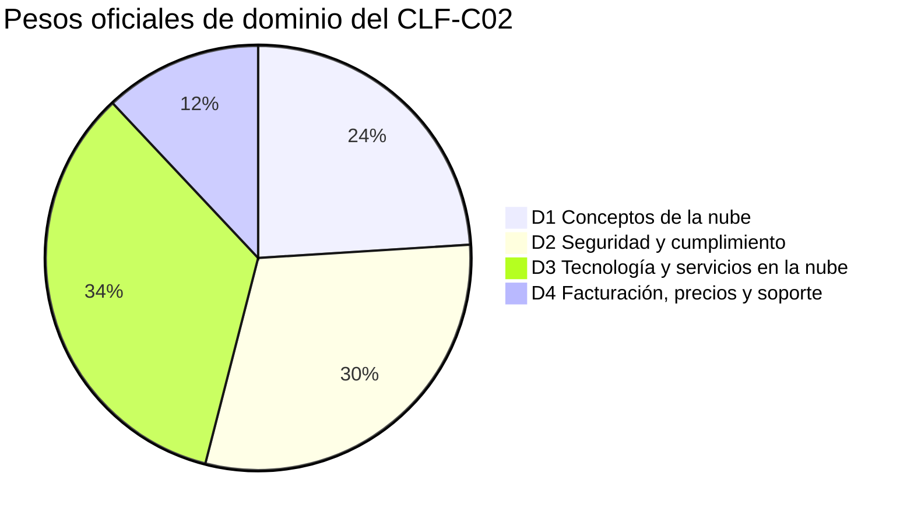
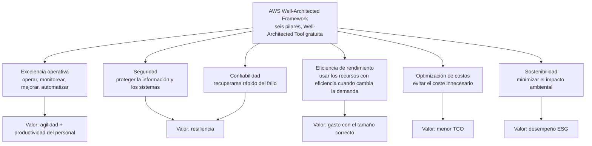
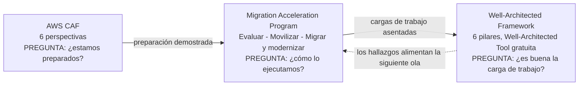
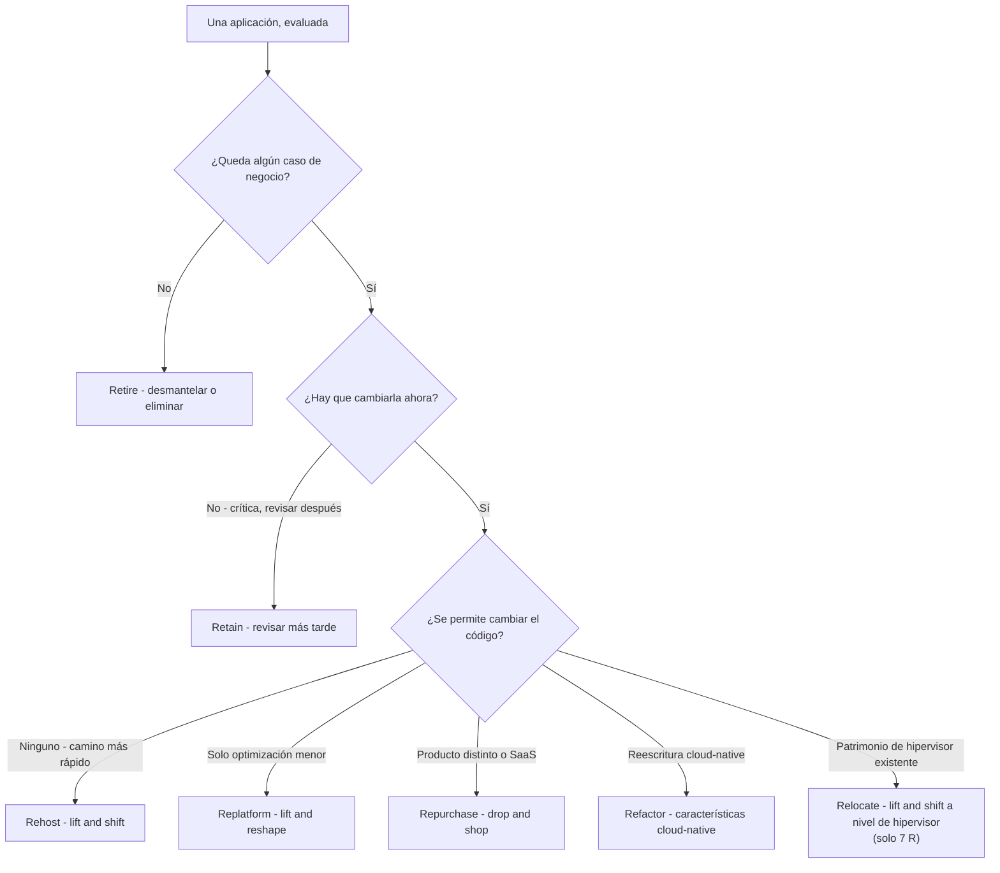
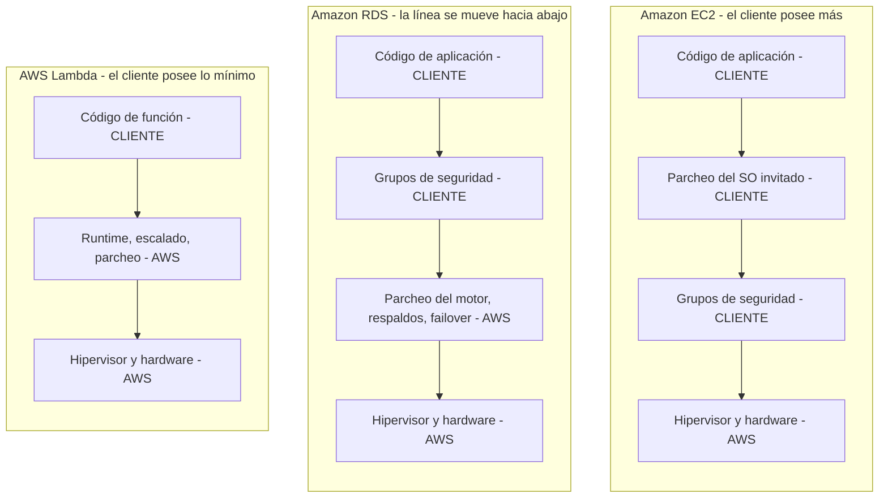

# Economía de la nube, estrategias de migración y el viaje a la nube

El Dominio 1 del examen CLF-C02 carga con el **24% del contenido puntuado**, el segundo dominio más grande del examen, y es el único dominio en el que AWS te pide razonar en el lenguaje de un **caso de negocio**, no en el de una característica de servicio. Todo lo demás del examen (seguridad, infraestructura global, servicios, facturación) da por supuesto que ya aceptas la premisa; el Dominio 1 *es* la premisa. Los candidatos que llegan con una larga lista de nombres de servicios pero sin vocabulario para el coste fijo frente al variable, el capex frente al opex, o el «por qué rehostear y luego replatformear» pierden puntos que nunca esperaron tener que defender.

```text
====================================================================
 CLF-C02 — DOMINIO 1: CONCEPTOS DE LA NUBE (24% DEL CONTENIDO PUNTUADO)
====================================================================
  TAREA 1.1  Definir los beneficios de la nube de AWS
             - propuesta de valor de la nube de AWS
             - velocidad de despliegue, alcance global
             - alta disponibilidad, elasticidad, agilidad
             - economías de escala (redacción de la guía PDF)
  TAREA 1.2  Identificar los principios de diseño de la nube de AWS
             - AWS Well-Architected Framework y sus pilares
             - identificar diferencias entre los pilares
  TAREA 1.3  Comprender los beneficios y las estrategias de migración
             - componentes del AWS CAF (menor riesgo de negocio,
               mejor desempeño ESG, más ingresos,
               mayor eficiencia operativa)
             - estrategias de migración (por ejemplo,
               replicación de bases de datos)
             - recursos que acompañan el viaje de migración
               a la nube
             - uso de AWS Snowball (redacción de la guía PDF)
  TAREA 1.4  Comprender los conceptos de economía de la nube
             - costes fijos frente a costes variables
             - costes asociados a los entornos on-premises
             - estrategias de licencias (BYOL frente a
               licencias incluidas)
             - rightsizing; beneficios de la automatización;
               economías de escala
             - AWS CloudFormation; servicios gestionados de AWS
               (redacción del PDF)
---------------------------------------------------------------------
  PESOS COMPLETOS DEL EXAMEN:  D1 24% | D2 30% | D3 34% | D4 12%
  FORMATO: 50 puntuados + 15 no puntuados | aprobación 700 (escala 100-1.000)
====================================================================
```



> [!NOTE]
> **Existen dos guías de examen y no coinciden.** La guía de examen en HTML y la guía de examen en PDF no son idénticas: el PDF añade **economías de escala** a la tarea 1.1, nombra **AWS Snowball** en la tarea 1.3 y añade **AWS CloudFormation** más **servicios gestionados de AWS (Amazon RDS, Amazon ECS, Amazon EKS, Amazon DynamoDB)** a la tarea 1.4. AWS no publica ninguna declaración que las reconcilie, así que esta lección enseña la **unión** de ambas: un objetivo que aparezca en cualquiera de las dos versiones es legítimo el día del examen.

En esta lección vas a:

- enunciar las **seis ventajas de la computación en la nube** con la redacción de la propia AWS;
- separar **economías de escala, alcance global, velocidad, elasticidad, escalabilidad y alta disponibilidad**;
- recorrer los **seis pilares del Well-Architected** y los seis principios generales de diseño, y mostrar cómo los pilares **se oponen** entre sí;
- mapear las **seis perspectivas del AWS CAF** con sus propietarios y con los cuatro resultados examinables;
- elegir entre las estrategias de migración de las **6 R y las 7 R** con un árbol de decisión, y nombrar las herramientas detrás de la **replicación de bases de datos**;
- situar el viaje **Evaluar → Movilizar → Migrar y modernizar** y sus recursos de apoyo en un solo mapa;
- convertir un patrimonio on-premises de coste fijo y capex en un modelo de nube de coste variable y opex;
- construir una **comparación de TCO y ROI** con aritmética resuelta que puedes reproducir en 90 segundos;
- decidir entre **BYOL y licencia incluida**, y ordenar el **rightsizing antes que los descuentos**;
- explicar cómo **se mueve la línea de responsabilidad** en EC2, RDS y Lambda;
- leer **dos casos de estudio reales de migración de AWS** y tratar sus números con honestidad;
- responder **10 preguntas estilo examen** más tres comprobaciones interactivas;
- ampliar después el conjunto de historias con **Netflix, Box y FarEye**, trabajar el **recuadro de actualizaciones de 2026** y practicar una comprobación de **emparejamiento de casos de estudio** más dos preguntas extra (**clf-02-q11**, **clf-02-q12**).

---

## 1. La propuesta de valor de la nube de AWS (tarea 1.1)

### 1.1 Las seis ventajas, textualmente

AWS publica seis ventajas de la computación en la nube en un whitepaper, y las preguntas de examen citan las frases casi palabra por palabra. Aprende la **frase gatillo en negrita** de cada fila: esa es la cadena que el enunciado de la pregunta va a reproducir.

| # | Ventaja (redacción de AWS) | La frase gatillo | Lo que elimina de on-premises |
|---|---|---|---|
| 1 | **Cambiar un gasto fijo por un gasto variable** | *«solo pagas cuando consumes recursos informáticos»* | Comprar hardware antes de necesitarlo |
| 2 | **Aprovechar enormes economías de escala** | el uso de *«cientos de miles de clientes»* se agrega → *«precios de pago por uso más bajos»* | Pagar al precio de un minorista por el volumen de una sola empresa |
| 3 | **Dejar de adivinar la capacidad** | aprovisionar *«bajo demanda»* con *«solo unos minutos de aviso»* | Sobreaprovisionar un 20 to 50% frente a un pronóstico de pico |
| 4 | **Aumentar la velocidad y la agilidad** | el tiempo de despliegue baja *«de semanas a solo minutos»* | Plazos de compra de 6 a 9 meses |
| 5 | **Dejar de gastar dinero en operar y mantener centros de datos** | dejar de pagar por *«montar en racks, apilar y alimentar servidores»* | Instalaciones, energía, refrigeración, mano de obra física |
| 6 | **Llegar a todo el mundo en minutos** | una *«huella mundial»* ofrece *«menor latencia»* | Construir tu propio centro de datos en el extranjero |

AWS también declara que opera **más de 200 servicios con todas las funciones** (en octubre de 2026): una cifra que vale la pena recordar porque distractores como «más de 1.000 servicios» son fáciles de eliminar.

### 1.2 Ejemplo E1: economías de escala, aritméticamente

Las economías de escala son **estructurales, no una promoción**. El proveedor de nube agrega la demanda de todos los clientes, así que compra energía, hardware y espacio en planta a un precio al que ninguna sola empresa puede llegar, y traspasa parte de esa diferencia en forma de una tarifa variable más baja.

Dos clientes, cada uno con un **pico de 10 unidades**, pero sus picos son **anticorrelacionados** (uno está ocupado cuando el otro está en calma):

```text
Propiedades separadas:   cliente A aprovisiona 10  +  cliente B aprovisiona 10  = 20 unidades
Agregación compartida:   los picos no coinciden, pico combinado = 12 unidades
Diferencia de hardware:  20 - 12 = 8 unidades ahorradas  ->  8/20 = 40% MENOS hardware
Resultado:               demanda idéntica, 40% menos infraestructura,
                         de donde salen los «precios de pago por uso más bajos»
```

### 1.3 Alcance global, velocidad de despliegue y agilidad

| Beneficio | Significado examinable | Cuidado con esto |
|---|---|---|
| **Alcance global** | *«Llegar a todo el mundo en minutos»*: desplegar en varias Regiones de AWS sin construir instalaciones | No es lo mismo que alta disponibilidad (eso son las Zonas de Disponibilidad) |
| **Velocidad de despliegue** | *«de semanas a solo minutos»*: infraestructura bajo demanda | Nunca lo cites como «segundos» |
| **Agilidad** | Los equipos experimentan e iteran porque el coste de un intento fallido está medido, no hundido | La agilidad es un beneficio organizativo, no un servicio |
| **Alta disponibilidad** | Sobrevivir al fallo de un componente abarcando varias **Zonas de Disponibilidad** | No es redundancia entre Regiones (eso es recuperación ante desastres) |
| **Elasticidad** | Crecer **y reducir** capacidad automáticamente con la demanda | Elasticidad ≠ escalabilidad |
| **Escalabilidad** | Absorber el crecimiento (escalar hacia fuera / escalar hacia arriba) | Solo crecimiento; sin mención de reducirse |

- **📚 ¿Sabías que…?** En octubre de 2026 AWS reporta **39 Regiones geográficas** y **124 Zonas de Disponibilidad**, y cada Región debe contar con un **mínimo de tres AZ aisladas, físicamente separadas**, todas dentro de **100 km (60 millas)** entre sí. Una Zona de Disponibilidad se define como *«uno o más centros de datos discretos, cada uno con energía, conectividad de red y conexión redundantes»*: así que una AZ no es un rack, y una Región no es una AZ.

### 1.4 Ejemplo E2: «dejar de adivinar la capacidad» en números

Un equipo pronostica un **pico de 100 vCPU**. La práctica on-premises es comprar un **20% to 50% por encima de la demanda pronosticada en el pico** para que el pronóstico no pueda morder:

```text
Pronóstico de pico .............. 100 vCPU
Sobreaprovisionamiento ......... +20% a +50%  ->  comprar de 120 a 150 vCPU
Utilización media típica de un servidor on-premises: 12% a 18%
Trabajo útil al 15% ............ 150 x 0.15  = 22.5 vCPU
Inactivo pero aún pagado ....... 150 - 22.5  = 127.5 vCPU  (~85% inactivo)
```

Eso es lo que significa *«dejar de adivinar la capacidad»*: en lugar de comprar para el pico y quedarte inactivo, aprovisionas según la demanda medida en minutos y dejas que la **elasticidad** absorba el pico. La misma lógica se repite en cada capa posterior de esta lección: la capacidad inactiva es el enemigo en el rightsizing, en las licencias y en la tabla de TCO.

---

## 2. Principios de diseño: el AWS Well-Architected Framework (tarea 1.2)

### 2.1 Qué es el Framework

El AWS Well-Architected Framework documenta **mejores prácticas para diseñar y operar cargas de trabajo seguras, fiables, eficientes, rentables y sostenibles**. El detalle del *proceso* relevante para el examen es este: una revisión Well-Architected es *«una conversación constructiva... no un mecanismo de auditoría»*: nunca se te pedirá «aprobar» una, y la **AWS Well-Architected Tool** que la ejecuta es **gratuita** y está en la lista de servicios dentro del alcance.

### 2.2 Los seis pilares

| Pilar | De qué trata (redacción de AWS) | El valor que aporta |
|---|---|---|
| **Excelencia operativa** | Operar, monitorear y **mejorar continuamente** procesos y procedimientos; **automatizar** | Agilidad y productividad del personal |
| **Seguridad** | Proteger la información y los sistemas: confidencialidad, integridad, disponibilidad | Resiliencia y cumplimiento |
| **Confiabilidad** | Hacer lo que deben hacer y **recuperarse rápido del fallo** | Resiliencia |
| **Eficiencia de rendimiento** | Usar los recursos informáticos **con eficiencia a medida que cambian la demanda y la tecnología** | Gasto con el tamaño correcto |
| **Optimización de costos** | **Evitar el coste innecesario** | Menor coste total de propiedad (TCO) |
| **Sostenibilidad** | **Minimizar el impacto ambiental** de ejecutar cargas de trabajo | Desempeño ESG |



### 2.3 Los seis principios generales de diseño

Los seis principios hacen el mismo movimiento subyacente: convierten el **gasto inicial, fijo e inactivo** en un **gasto medido, bajo demanda y guiado por evidencia**.

| Principio (redacción de AWS) | El hábito que reemplaza |
|---|---|
| **Dejar de adivinar tus necesidades de capacidad** | Comprar para un pico pronosticado |
| **Probar sistemas a escala de producción** | Probar solo en un pequeño conjunto de staging |
| **Automatizar pensando en la experimentación arquitectónica** | Cambios hechos a mano, irrepetibles |
| **Considerar arquitecturas evolutivas** | Diseños de gran batalla a cinco años |
| **Impulsar las arquitecturas con datos** | Opiniones en lugar de métricas |
| **Mejorar mediante días de simulación (game days)** | Esperar que el fallo nunca ocurra |

### 2.4 Ejemplo E3: los pilares *no* son intercambiables

La tarea 1.2 te pide explícitamente identificar **diferencias entre los pilares**. Se contradicen, y el examen comprueba si lo notas:

```text
Decisión: mantener tres instancias de reserva en caliente inactivas para que un
          fallo nunca llegue a los usuarios.
Confiabilidad ......... MEJORA  (la capacidad de reserva absorbe el fallo)
Optimización de costos .. EMPEORA  ($400/mes ilustrativo x 12 = $4,800/año pagados
                                 por capacidad que no hace nada; cifra docente,
                                 en octubre de 2026 - NO es un precio de lista de AWS)
```

No hay ningún pilar que gane automáticamente. La postura correcta en el examen es un **intercambio deliberado y medido**, no la afirmación de que un pilar es «el más importante». Observa también que **Sostenibilidad** y **Optimización de costos** hablan ambos de reducción, y **Seguridad** y **Confiabilidad** hablan ambos de resiliencia: palabras parecidas, pilares distintos, propietarios distintos.

```matching
{
  "question": "Empareja cada pilar del Well-Architected con el valor que aporta en el examen CLF-C02:",
  "pairs": [
    {"left": "Excelencia operativa", "right": "Agilidad y productividad del personal: operar, monitorear, mejorar continuamente y automatizar"},
    {"left": "Seguridad", "right": "Resiliencia y cumplimiento: proteger la información y los sistemas"},
    {"left": "Confiabilidad", "right": "Resiliencia: hacer lo que deben hacer y recuperarse rápido del fallo"},
    {"left": "Eficiencia de rendimiento", "right": "Gasto con el tamaño correcto: usar los recursos informáticos con eficiencia a medida que cambian la demanda y la tecnología"},
    {"left": "Optimización de costos", "right": "Menor coste total de propiedad: evitar el coste innecesario"},
    {"left": "Sostenibilidad", "right": "Desempeño ESG: minimizar el impacto ambiental de ejecutar cargas de trabajo"}
  ],
  "explanation": "Los pilares no son intercambiables y se oponen entre sí. Excelencia operativa se asocia a agilidad/productividad, los dos pilares de protección (Seguridad, Confiabilidad) se asocian a resiliencia, Eficiencia de rendimiento al gasto con el tamaño correcto, Optimización de costos al TCO y Sostenibilidad al desempeño ambiental (ESG)."
}
```

- **📚 ¿Sabías que…?** El Cloud Adoption Framework (sección 3), el Well-Architected Framework (esta sección) y el Cloud Value Framework (sección 6) son **tres listas distintas de cinco o seis elementos** que los candidatos fusionan sin cesar: Well-Architected tiene **6 pilares** sobre la *calidad de la carga de trabajo*, CAF tiene **6 perspectivas** sobre la *preparación organizativa*, y el Cloud Value Framework tiene **5 pilares** sobre el *valor de negocio*: de los cuales **el TCO es solo el pilar 1 de 5**.

---

## 3. El AWS Cloud Adoption Framework (tarea 1.3)

### 3.1 Seis perspectivas, seis propietarios

El AWS Cloud Adoption Framework (AWS CAF) agrupa sus capacidades en seis perspectivas. Cada perspectiva es una **conversación con una parte distinta de la organización**: por eso el examen te pide asociar una perspectiva con un interesado o con una preocupación.

| Perspectiva | Propietario típico | Qué cubre |
|---|---|---|
| **Business (Negocios)** | CEO, CFO, COO, CIO, CTO | Estrategia, oportunidades de transformación, materialización del valor |
| **People (Personas)** | RR. HH., líderes de cultura | Cultura, estructura organizativa, habilidades de la plantilla |
| **Governance (Gobernanza)** | Riesgo, finanzas, cumplimiento | Maximizar los beneficios y minimizar el riesgo; gestión de cartera |
| **Platform (Plataforma)** | Arquitectos | Plataforma híbrida escalable, modernización, fábrica de migración |
| **Security (Seguridad)** | CISO y equipos de seguridad | Confidencialidad, integridad y disponibilidad de datos y sistemas |
| **Operations (Operaciones)** | Operaciones de TI | Servicios entregados a los niveles de negocio acordados |

**Recuentos de capacidades publicados (en octubre de 2026):** People **7**, Governance **7**, Platform **7**, Security **9**, Operations **9**. AWS no publica un recuento de la perspectiva Business en las fuentes verificadas para esta lección, así que no memorices ningún total.

### 3.2 Los cuatro resultados examinables

La tarea 1.3 nombra los resultados que debes reconocer. Un programa dirigido por el CAF se juzga por:

1. **Menor riesgo de negocio**
2. **Mejor desempeño ambiental, social y de gobernanza (ESG)**
3. **Más ingresos**
4. **Mayor eficiencia operativa**

### 3.3 Un mapa: CAF → MAP → Well-Architected

Estos tres frameworks aparecen juntos en casi toda pregunta de migración. Responden a tres preguntas distintas, en este orden:



> [!WARNING]
> ⚠️ **Tres listas que nunca debes mezclar.** Well-Architected **6 pilares** = calidad de la carga de trabajo. AWS CAF **6 perspectivas** = preparación organizativa (Business, People, **Governance**, Platform, Security, Operations). Cloud Value Framework **5 pilares** = valor de negocio. Un distractor ofrecerá «Sostenibilidad» como perspectiva del CAF o «Governance» como pilar del Well-Architected, ambas son incorrectas. Por separado, el Migration Acceleration Program dice que su fase Evaluar identifica brechas de capacidad en **seis dimensiones** (negocio, proceso, personas, plataforma, operaciones, seguridad), y esas seis **no** son las seis del CAF, usa los nombres del CAF cuando la pregunta diga «perspectiva».

---

## 4. Estrategias de migración: las 6 R (tarea 1.3)

### 4.1 Las estrategias y sus glosas

El marco más antiguo y aún popular en el examen es el de las **6 R**, construido sobre las cinco R que Gartner esbozó. El marco actual de AWS Prescriptive Guidance es el de las **7 R**, que añade **Relocate**. Ambos aparecen en el material de estudio; la propia guía del examen nunca enumera ninguna de las dos listas.

| R | Glosa de AWS | Lo que realmente haces | Elígela cuando |
|---|---|---|---|
| **Rehost** | *«lift and shift»* | Mover la carga de trabajo sin cambios (máquinas virtuales a EC2) | No se permite cambiar código; el camino más rápido; primero las carteras grandes |
| **Replatform** | *«lift and reshape»* | Optimización menor sin cambiar la arquitectura central (por ejemplo, VM → base de datos gestionada) | Quieres un beneficio gestionado con esfuerzo limitado |
| **Repurchase** | *«drop and shop»* | Sustituir por un producto distinto, normalmente SaaS | El producto actual no es estratégico |
| **Refactor / re-architect** | *«características cloud-native»* | Reescribir para aprovechar capacidades cloud-native | Necesitas características cloud-native; lo más complejo y costoso |
| **Retire** | *«desmantelar o eliminar»* | Apagar la aplicación | No hay caso de negocio, o la aplicación no se usa |
| **Retain** | *«revisar»* | Dejarla donde está, con plan de cambiarla después | Crítica ahora, refactor después (residencia de datos, tiempos) |
| **Relocate** *(solo 7 R)* | *«lift and shift a nivel de hipervisor»* | Mover todo el patrimonio de plataforma/hipervisor a la nube | Ya operas un patrimonio de hipervisor soportado |

> [!NOTE]
> **6 R frente a 7 R: cómo responder.** El blog de estrategia de AWS de 2016 dice **6 R**; AWS Prescriptive Guidance hoy dice *«Existen siete estrategias de migración... conocidas como las 7 R»*. Si una pregunta pregunta «¿cuál **NO** es una de las 6 R?», **Relocate** es el cebo diseñado. Si pregunta por el conjunto actual de AWS, responde **7 R**.



### 4.2 Ejemplo E4: ordenar una cartera de 40 aplicaciones

Una empresa evalúa **40 aplicaciones**. Usando la propia guía de orden de magnitud de AWS de que *«hasta un 10% to 20% de la cartera de TI de una empresa ya no es útil y puede apagarse»*:

```text
Retire .........  4 aplicaciones  (10% de la cartera - apagadas, coste de migración cero)
Retain .........  6 aplicaciones  (críticas, revisar más tarde)
Rehost ......... 16 aplicaciones  (lo más rápido, sin cambio de código - hazlas primero)
Relocate .......  0 aplicaciones  (no hay plataforma de hipervisor que mover como unidad)
Repurchase .....  3 aplicaciones  (sustituidas por SaaS)
Replatform .....  8 aplicaciones  (base de datos gestionada / cambios de motor)
Refactor .......  3 aplicaciones  (reescritura cloud-native - el valor más alto, el coste más alto)
                         ------
                          40 aplicaciones
```

Regla de secuenciación para migraciones grandes: **primero rehost, replatform, relocate y retire; moderniza después.** Pagar una fábrica de migración para mover 40 aplicaciones en paralelo es como los programas descontrolan su presupuesto; retirar 4 de ellas antes de que alguien escriba una sola línea de código es como los programas se autofinancian.

### 4.3 Las dos herramientas con nombre detrás de las estrategias | Preocupación | Servicio | Función |
|---|---|---|
| **Replicación de bases de datos** (el ejemplo con nombre de la examen para la tarea 1.3) | **AWS Database Migration Service (AWS DMS)** | Replicación continua de la base de datos de origen al destino mientras la aplicación sigue funcionando |
| Diferencias de esquema entre motores | **AWS Schema Conversion Tool (AWS SCT)** | Convierte esquemas, código y procedimientos almacenados para que la replicación pueda aterrizar |
| Ejecución de **Rehost** | **AWS Application Migration Service (MGN)** | Lift and shift de servidores a EC2, automatizado y basado en agentes |
| Descubrir lo que posees | **AWS Application Discovery Service** | Mapea las dependencias antes de que elijas una R |

### 4.4 Ejemplo E5: el chequeo de realidad de Snowball

Para **transferencias a escala de petabytes sobre un enlace restringido**, la respuesta clásica es un dispositivo físico: un solo **Snowball Edge Storage Optimized** mueve **aproximadamente 210 TB** (en octubre de 2026; verifica las especificaciones actuales antes de usarlo), y un trabajo **debe completarse dentro de los 360 días siguientes a su preparación**.

Dos advertencias que debes sostener al mismo tiempo:

```text
HECHO A (guía del examen PDF) ..... la tarea 1.3 nombra «uso de AWS Snowball»
HECHO B (aviso de la documentación de AWS) ... «AWS Snowball Edge ya no está disponible
                                para clientes nuevos»
                                AWS redirige a los clientes nuevos a DataSync,
                                Data Transfer Terminal, soluciones de socios y Outposts
CONCLUSIÓN ....................... Snowball es una trampa DOS VECES - puede ser la
                                respuesta correcta de «enlace sin conexión / restringido»,
                                y también puede ser la respuesta obsoleta. Lee el
                                enunciado: ¿pide el mecanismo clásico o la
                                recomendación actual?
```

- **📚 ¿Sabías que…?** Snowball Edge Storage Optimized se envía con unos **210 TB de NVMe utilizables** (en octubre de 2026), mientras que la variante Compute Optimized cambia almacenamiento por silicio, alrededor de **28 TB de NVMe** frente a **416 GB de memoria**. El dispositivo está **ni** en la lista de servicios dentro del alcance **ni** en la de fuera del alcance para CLF-C02 (ambas listas son explícitamente *«no exhaustivas»*), así que si es examinable no puede verificarse, trátalo como conocimiento, no como certeza.

---

## 5. El viaje de migración a la nube y sus recursos (tarea 1.3)

### 5.1 Las tres fases

El programa de migración de AWS funciona en tres fases, y el examen pregunta por el orden:

```text
1. EVALUAR (ASSESS)        construir el caso de negocio, descubrir la cartera,
                           «identificar brechas de capacidad en seis dimensiones»
2. MIGRAR Y MODERNIZAR     ejecutar las olas, luego modernizar lo que aterrizó
3. (antes) MOVILIZAR       cerrar las brechas: financiación, gobernanza,
                           habilidades, herramientas
```

Léelo literalmente: **Evaluar → Movilizar → Migrar y modernizar**. Movilizar está *entre* el caso de negocio y la primera ola, porque las brechas encontradas en Evaluar tienen que cerrarse antes de que empiece la migración.

### 5.2 Los recursos que acompañan el viaje

| Recurso | Qué hace por ti |
|---|---|
| **Migration Acceleration Program (MAP)** | Herramientas, formación e **inversiones financieras** para el programa de tres fases. **Los créditos requieren etiquetado**; sin etiquetas, sin créditos |
| **AWS Migration Hub / Migration Hub Journeys** | Planificar, ejecutar y rastrear: **fases → módulos → tareas → subtareas** con el progreso visible en un solo lugar |
| **AWS Prescriptive Guidance** | Estrategias de migración probadas y guías paso a paso (fuente de las 7 R) |
| **Migration Evaluator** | **Caso de negocio y modelo de TCO** basados en datos antes de comprometerte |
| **AWS Professional Services** | Capacidad de entrega práctica para la propia migración |
| **AWS Partner Network (APN) + Migration Competency Partners** | Capacidad de entrega de terceros, evaluada según los criterios de competencia de AWS |
| **AWS Pricing Calculator** | Estimar la cadencia de gasto objetivo antes de mover nada |

```dragdrop
{
  "question": "Ordena las tres fases del Migration Acceleration Program (MAP) de AWS:",
  "items": [
    "Migrar y modernizar",
    "Evaluar",
    "Movilizar"
  ],
  "correctOrder": [
    "Evaluar",
    "Movilizar",
    "Migrar y modernizar"
  ],
  "explanation": "El MAP ejecuta primero Evaluar (caso de negocio, descubrimiento del patrimonio, brechas de capacidad en seis dimensiones), luego Movilizar (cerrar las brechas de financiación, gobernanza, herramientas y habilidades que expuso la evaluación) y solo después Migrar y modernizar (ejecutar las olas y modernizar). Primero rehost, replatform, relocate y retire; moderniza cuando la migración esté estable."
}
```

> [!WARNING]
> ⚠️ **MAP dice seis dimensiones; CAF dice seis perspectivas, y son listas distintas.** La fase Evaluar del MAP identifica brechas de capacidad en *negocio, proceso, personas, plataforma, operaciones y seguridad*. Las perspectivas del CAF son *Business, People, **Governance**, Platform, Security, Operations*. «Governance» sustituye a «proceso». Si la dice **perspectiva**, usa los nombres del CAF; nunca cites tampoco una cifra de crédito del MAP, AWS publica solo *«inversiones financieras»*, sin porcentajes publicados.

---

## 6. Economía de la nube (tarea 1.4)

### 6.1 Coste fijo frente a coste variable

El **coste fijo** existe exista o no el servicio: hardware propio, espacio en planta, personal con salario. El **coste variable** sigue al consumo. La frase más citada del Dominio 1 es: *«La nube cambia un gasto fijo por un gasto variable: solo pagas cuando consumes recursos informáticos.»*

**Ejemplo E6: doce meses, cifras ilustrativas (en octubre de 2026; solo números docentes, no precios de lista de AWS):**

| Periodo | On-premises (fijo) | AWS (variable) | Por qué se mueve la fila de la nube |
|---|---|---|---|
| T1: trimestre de lanzamiento | $6,000 | $4,200 | El tráfico con pico escala hacia arriba y luego hacia abajo |
| T2: actividad normal | $6,000 | $2,700 | Sigue la demanda medida |
| T3: trimestre tranquilo | $6,000 | $1,350 | Entorno de pruebas apagado a **$0** |
| T4: pico navideño | $6,000 | $3,900 | La elasticidad absorbe el pico sin una orden de compra |
| **Total** | **$24,000** | **$12,150** | **−$11,850 (−49.4%)** |

La fila on-premises es una línea plana porque lo pagaste en el año de capital: el tráfico no tiene nada que ver con ella. La fila de la nube puede caer a **cero** para una carga de trabajo que apagas.

### 6.2 Los motores de coste de un entorno on-premises

La tarea 1.4 pide específicamente los *«costes asociados a los entornos on-premises»*. Cada fila de abajo tiene que aparecer en un modelo de TCO o el modelo está mal:

| Motor | Lo que realmente cuesta |
|---|---|
| **Hardware** | Precio de compra de servidores, almacenamiento y red |
| **Mantenimiento anual** | Contrato de soporte, normalmente un porcentaje del hardware, cada año |
| **Licencias de sistema operativo e hipervisor** | Se pagan esté ocupado o inactivo el servidor |
| **Licencias de aplicación** | Igual, y a menudo la partida individual más grande |
| **Espacio, energía, refrigeración** | Alquiler de planta, electricidad, sobrecarga de refrigeración |
| **Mano de obra de TI** | Administradores para montar en racks, parchear, respaldar, monitorear, planificar |
| **Ciclo de renovación** | El equipo de capital tiene normalmente un **ciclo de renovación de cinco años** |
| **Plazo de compra** | El equipo se compra **seis a nueve meses por adelantado** |
| **Sobreaprovisionamiento** | **20% to 50% por encima de la demanda pronosticada en el pico** |
| **Coste del capital** | Dinero inmovilizado en activos en lugar del negocio |
| **Ancho de banda** | Conectividad para el patrimonio |

### 6.3 Ejemplo E7: las entradas ocultas de on-premises

La mayoría de los modelos on-premises fallan contando solo el hardware. Aquí van diez servidores durante cinco años, con todas las cifras ilustrativas (en octubre de 2026, números docentes, no precios de lista de AWS):

```text
Hardware de servidores (10 unidades) .............  $30,000
Mantenimiento de hardware a 5 años ...............  $30,000
Energía y refrigeración: $25 x 10 x 60 meses .....  $15,000
Espacio en planta (5 años) .......................   $6,000
Administración de TI: 0.25 FTE durante 5 años .... $112,500
                                            ------------
Subtotal, 5 años ........................... $193,500
ANTES: licencias de software, la renovación del año 5, coste del capital, ancho de banda
```

La propia guía de AWS para comparaciones precisas es directa: los gastos de capital suelen tener un **ciclo de renovación de cinco años**, el equipo se adquiere **seis a nueve meses por adelantado**, y los clientes **sobreaprovisionan un 20% to 50% por encima de la demanda pronosticada en el pico**. Un modelo que omite mano de obra, renovación e instalaciones resta valor al coste on-premises, y por eso el examen trata «comparar el precio de compra del servidor con una tarifa por hora» como el modelo de TCO clásico defectuoso.

### 6.4 De capex a opex

| | **Capex** (on-premises) | **Opex** (nube) |
|---|---|---|
| Forma | Pago inicial grande por un activo que posees | Consumo medido, de pago por uso |
| Contabilidad | Capitalizado y luego depreciado (ciclo de ~5 años) | Gasto reconocido en el periodo en que se incurre |
| Riesgo | Lo poseas lo uses o no | Dejas de pagar cuando dejas de consumir |
| Pronóstico | Basado en una suposición de capacidad | Basado en el uso medido |
| Frase de examen | *«gasto fijo»* | *«gasto variable»*: *«solo pagas cuando consumes»* |

### 6.5 Ejemplo E8: TCO y ROI, resueltos

El **TCO** es la comparación *a todo coste y plurianual* de los costes de adquisición **y** de operación, hardware, software, instalaciones, mano de obra y capital, on-premises frente a AWS. No es una lista de precios, y AWS lo encuadra explícitamente como solo **el pilar 1 de 5** del **Cloud Value Framework**.

> **Todas las cifras en dólares de la tabla de abajo son números docentes ilustrativos creados para esta lección (en octubre de 2026). NO son precios de lista de AWS y no deben citarse como tales.**

| Categoría de coste (5 años) | On-premises | AWS (ilustrativo) | Diferencia |
|---|---|---|---|
| Cómputo: equivalente a 10 servidores | $60,000 (hardware $30k + mantenimiento $30k) | $54,000 (media medida de $900/mes) | −$6,000 |
| Instalaciones: energía, refrigeración, planta | $21,000 ($15k energía + $6k espacio) | $0 (absorbido por el proveedor y priced en la tarifa) | −$21,000 |
| Mano de obra de TI: 0.25 FTE on-prem vs 0.10 FTE | $112,500 | $45,000 | −$67,500 |
| Licencias de software | $40,000 (propias y renovadas) | $18,000 (licencia incluida, pagada mientras corre) | −$22,000 |
| **Total** | **$233,500** | **$117,000** | **−$116,500 (−49.9%)** |

Ahora los dos números que un entrevistador (o un enunciado de examen) realmente quiere:

```text
Inversión de migración (ilustrativa) .......  $25,000
                                              (evaluación, esfuerzo de replatform,
                                               días de Professional Services)
Beneficio neto a 5 años ....................  $116,500 - $25,000 = $91,500
ROI simple = beneficio neto / inversión ....  $91,500 / $25,000 x 100 = 366%
Ahorro medio anual .........................  $116,500 / 5 = $23,300
Retorno simple = inversión / ahorro anual ..  $25,000 / $23,300 = 1.07 años
                                              ~= 13 meses
```

**Contraste de cordura con una cifra publicada:** AWS cita a IDC (2022) afirmando un **50% menor coste de operación a 5 años** en AWS: una afirmación citada por el cliente/AWS, sin auditar, y nuestro ilustrativo −49.9% cae en el mismo vecindario por construcción, no por coincidencia. Atribuye siempre tales cifras («IDC para AWS, 2022»), nunca las presentes como garantizadas.

### 6.6 Licencias: BYOL frente a licencia incluida

**Licencia incluida** significa instancias de Amazon EC2 que empaquetan el coste de la licencia dentro del coste de cómputo, **AWS es responsable del cumplimiento de la licencia**, y solo pagas mientras la instancia corre. **BYOL** significa que traes tu propia licencia **y tus propios medios**, **tú eres responsable del cumplimiento**. **AWS License Manager** es una herramienta **gratuita** que rastrea ambas cosas en AWS, on-premises y otras nubes.

**Ejemplo E9: carga de trabajo con 30% de actividad, tarifas ilustrativas (en octubre de 2026; solo cifras docentes):**

```text
Supuesto: tarifa total con licencia incluida = $0.75 / hora
          tarifa de cómputo BYOL             = $0.40 / hora
          licencia BYOL                      = $150 / mes (se paga use o no se use)
          mes = 730 horas

Al 30% de actividad (219 horas):
  Licencia incluida ... 219 x $0.75              = $164.25 / mes
  BYOL ................ $150 + (219 x $0.40)     = $237.60 / mes
  Ganador: LICENCIA INCLUIDA por $73.35 / mes

Al 100% de actividad (730 horas):
  Licencia incluida ... 730 x $0.75              = $547.50 / mes
  BYOL ................ $150 + (730 x $0.40)     = $442.00 / mes
  Ganador: BYOL por $105.50 / mes

Punto de equilibrio: $150 / ($0.75 - $0.40) = 428.6 horas ~= 59% de actividad
```

**Regla:** actividad variable o intermitente → **licencia incluida**; actividad alta y constante más licencias con descuento ya existentes → **BYOL**. Recuerda que una licencia de Windows puede representar el **50% o más del coste de cómputo** (AWS, 2022-04-28), así que esta no es una decisión de redondeo.

### 6.7 Rightsizing

El **rightsizing** significa igualar el tamaño y el tipo de instancia con la utilización **medida** *sin dejar de cumplir los requisitos de rendimiento*. No es «elegir la instancia más barata», y el orden de las operaciones importa.

**Ejemplo E10: de 12 vCPU a 4 vCPU, tarifa ilustrativa (en octubre de 2026; solo cifra docente: $0.06 por vCPU-hora):**

```text
Instancia actual ...... 12 vCPU / 64 GB
Utilización medida .... 25% CPU media, 25% RAM media
Requerido ............. 12 x 0.25 = 3 vCPU ; 64 x 0.25 = 16 GB
Clase ajustada ........ 4 vCPU / 16 GB (con margen incluido)
Capacidad inactiva pagada . 12 - 3 = 9 vCPU = 75% de lo que compras

Coste antiguo  12 x $0.06 = $0.72/h  x 730 h = $525.60 / mes
Coste nuevo     4 x $0.06 = $0.24/h  x 730 h = $175.20 / mes
Ahorro ................................ = $350.40 / mes
                                         = $4,204.80 / año
                                         = 66.7% menos gasto en cómputo
```

**AWS Compute Optimizer** *«te proporciona recomendaciones de rightsizing e identifica recursos inactivos»*. Solo **después** del rightsizing eliges un modelo de compromiso: porque comprometerte con un descuento sobre una instancia sobredimensionada solo compra un descuento sobre desperdicio. AWS documenta **Savings Plans** como *«hasta un 72% menos en algunos casos»* frente a bajo demanda y **Spot** como *«hasta un 90% de descuento sobre el precio bajo demanda»* (ambos de AWS, 2022-04-28; verifica las tarifas actuales antes de usarlas).

- **📚 ¿Sabías que…?** Las cifras de utilización publicadas son el núcleo económico de esta lección: los servidores on-premises promedian un **12% to 18%** de utilización, **más del 30% de los servidores corren por debajo del 10%** de utilización, y un centro de datos on-premises se describe como *«por debajo del 15%»* (blogs de AWS, 2022-04-28 y 2024-10-01). Por eso **primero rightsizing, después compromiso** es el orden canónico de FinOps en el examen.

```fillblank
{
  "question": "Completa las afirmaciones de economía de la nube con el vocabulario de la tarea 1.4:",
  "template": "La nube cambia el gasto {{1}} por el gasto {{2}}, así que solo pagas cuando consumes recursos. El gasto on-premises se registra como {{3}}, mientras que el gasto medido de la nube se registra como {{4}}. Igualar el tamaño de la instancia con la utilización medida sin dejar de cumplir el rendimiento se llama {{5}}, y debe ocurrir ANTES de elegir un modelo de compromiso o descuento. Traer tu propia licencia y medios es {{6}}, mientras que AWS empaqueta la licencia en el coste de cómputo (licencia incluida).",
  "answers": {
    "1": "fijo",
    "2": "variable",
    "3": "capex",
    "4": "opex",
    "5": "rightsizing",
    "6": "BYOL"
  },
  "distractors": ["pico", "gasto de capital", "elasticidad", "refactorización", "rehosting", "TCO", "Savings Plans", "gobernanza"],
  "explanation": "Fijo frente a variable y capex frente a opex son los dos encuadres del mismo cambio; rightsizing significa igualar tamaño y tipo con la utilización medida (AWS Compute Optimizer señala rightsizing y recursos inactivos) y viene primero, después el compromiso; BYOL significa que traes licencia y medios y eres responsable del cumplimiento, mientras que la licencia incluida significa que AWS lo empaqueta y es responsable del cumplimiento de licencias."
}
```

---

## 7. Automatización, servicios gestionados y el cambio de responsabilidad (tarea 1.4)

### 7.1 Beneficios de la automatización

La **infraestructura como código (IaC)** significa aprovisionar y dar soporte a la infraestructura informática **usando código en lugar de procesos y ajustes manuales**. El examen nombra **AWS CloudFormation**, que *«te permite crear y aprovisionar despliegues de infraestructura de AWS de forma predecible y repetitiva.»*

| Aprovisionamiento manual | Automatizado (CloudFormation / IaC) |
|---|---|
| Hecho a mano, único, difícil de reproducir | Las plantillas son **repetibles** entre entornos |
| Los cambios ocurren en silencio | **Versionados, revisables, auditables** (conjuntos de cambios) |
| El rollback es un pánico | **Se puede revertir**: elimina el pila y los recursos se van |
| Escala con la plantilla de personal | Escala con un pipeline |

> [!NOTE]
> **Automatización ≠ auto scaling.** El ejemplo de automatización de la tarea 1.4 es **CloudFormation** (infraestructura repetible). **Auto Scaling** es el mecanismo de *elasticidad* (crecer y reducir con la demanda). Ambos están en el alcance, responden a preguntas distintas, y un distractor los intercambiará.

### 7.2 Los servicios gestionados absorben el trabajo no diferenciado

La guía de examen PDF añade *«Identificar servicios gestionados de AWS (por ejemplo, Amazon RDS, Amazon ECS, Amazon EKS, Amazon DynamoDB)»* a la tarea 1.4. Cada uno saca trabajo de tu personal:

| Servicio gestionado | Qué asume AWS |
|---|---|
| **Amazon RDS** | Parcheo del motor, respaldos automatizados, failover |
| **Amazon ECS / Amazon EKS** | Operación de la plataforma de contenedores |
| **Amazon DynamoDB** | Gestión de capacidad y sobrecarga operativa |

Menos tareas no diferenciadas significa **menos tiempo del personal y menos software por licenciar**: una línea directa hacia la fila de mano de obra de la tabla de TCO de la sección 6.5.

### 7.3 El cambio de responsabilidad compartida: EC2 frente a RDS frente a Lambda

Cuanto más gestionado es el servicio, **menor es la cuota del cliente** en la pila. La línea se mueve; nunca desaparece.

| Capa | **Amazon EC2** (IaaS) | **Amazon RDS** (gestionado) | **AWS Lambda** (serverless) |
|---|---|---|---|
| Hardware físico e hipervisor | AWS | AWS | AWS |
| Parcheo del SO invitado | **Cliente** | AWS | AWS (sin SO del cliente) |
| Runtime, capacidad, escalado | Cliente | AWS | AWS |
| Grupos de seguridad / configuración de red | **Cliente** | **Cliente** | n/a |
| Código de aplicación o función | **Cliente** | **Cliente** | **Cliente** |
| Usuarios de IAM, roles, MFA | **Cliente** | **Cliente** | **Cliente** |
| Datos, clasificación, cifrado | **Cliente** | **Cliente** | **Cliente** |



**Constantes que nunca se mueven:** la seguridad física y la seguridad **de** la nube siempre son de AWS; las **decisiones de datos, IAM y cifrado** siempre son del cliente. Los **controles compartidos**, gestión de parches, gestión de configuración, concienciación y formación, los posee *cada parte para su propia capa*.

- **📚 ¿Sabías que…?** La redacción propia de AWS importa: para servicios abstractos como **Amazon S3 y Amazon DynamoDB**, *«los clientes son responsables de gestionar sus datos (incluidas las opciones de cifrado) y de usar las herramientas de IAM para aplicar los permisos adecuados.»* Y a medida que la infraestructura se moderniza, *«más responsabilidad se traslada al proveedor del servicio»*: lo cual es un desplazamiento de la **línea**, no una transferencia de tu responsabilidad sobre los datos. Serverless no es «problema de otro».

---

## Casos Reales

Toda cifra de abajo es **afirmada por el cliente o por AWS y sin auditar**, atribuida con su fuente para que puedas verificarla. El punto examinable es siempre el *patrón*, qué estrategia se eligió, qué palanca se movió, nunca el número de marketing.

### Capital One: «todo en AWS» (banca, regulada)

| Dimensión | Detalle |
|---|---|
| Desafío | Ocho centros de datos más una renovación continua de hardware; necesitaban escala para ML y personalización en tiempo real |
| Estrategia | Salida completa del patrimonio: predominantemente **rehost + replatform + refactor**, con adopción de serverless |
| Servicios | Más de 30, incluidos EC2, S3, RDS, Lambda, ECS/Fargate, Step Functions, Glue, Amazon Connect |
| Resultados (afirmados) | Salida de los **8 centros de datos** (el último en 2020); el **80%** de ~2,000 aplicaciones son ahora construidas en la nube; aprovisionamiento de entornos de desarrollo de **3 meses a minutos**; coste de DR **−70%**; resolución de incidentes y errores de transacción **−50%**; más de un tercio de las aplicaciones serverless; **una aplicación −90% de coste** en Lambda; **103 toneladas** de metales reciclados |
| Gancho de dominio | Propuesta de valor de la tarea 1.1 (agilidad) + economía de la tarea 1.4 |

> *«De verdad nos lanzamos por completo a la nube, y AWS ha sido fundamental para que podamos aprovechar al máximo los beneficios de estar en la nube.»*: Chris Nims, SVP de ingeniería de nube y productividad, Capital One (caso de estudio de AWS)

### Shutterfly / SBS: de VMware a AWS (impresión para comercio electrónico)

| Dimensión | Detalle |
|---|---|
| Desafío | VMware vSphere on-premises, pilas independientes, **más de 2,000 VMs**, evacuación de colocación |
| Estrategia | **Puente y luego nativo**: VMware Cloud on AWS primero (completado en agosto de 2022), luego migración nativa a ECS/EC2: una secuencia de manual de *relocate → replatform* |
| Servicios | VMware Cloud on AWS, Amazon ECS, EC2, FSx for NetApp ONTAP, CI/CD, S3 (**400 TB**) |
| Resultados (afirmados) | **2,000 → 1,200 VMs**; la migración nativa se entregó en **marzo de 2025, seis meses antes de lo previsto**; ~**800 sistemas / 400 TB** movidos; **~25% menos opex** por *evitar licencias más rightsizing*; **80%** de las cargas de trabajo en ECS; *«sin incidentes de alta gravedad»* |
| Gancho de dominio | Tarea 1.4: el rightsizing y las licencias se nombran literalmente como la fuente del ahorro |

> *«Hemos dado grandes pasos para derribar la deuda técnica y poder centrarnos en la transformación y movernos con la clase de agilidad que teníamos al principio.»*: Ian Wright, VP de Infraestructura, Shutterfly/SBS (caso de estudio de AWS)

```text
PATRÓN EN LOS DOS CASOS
  Capital One ........ agilidad primero, después coste   (aprovisionamiento 3 meses -> minutos)
  Shutterfly ......... coste primero, después agilidad   (evitar licencias + rightsizing -> ~25%)
  Común .............. la estrategia (qué R) se eligió ANTES de prometer cualquier número
```

- **📚 ¿Sabías que…?** Un tercer patrón de migración que vale la pena reconocer aparece en el mismo conjunto de investigación: **Bangkok Flight Services** usó **AWS Application Migration Service (MGN)** para un **rehost** puro, terminando en **7 meses** con *«sin rollback, sin interrupciones»*, reduciendo el tiempo de gestión de la infraestructura de TI en un **50%** y reemplazando un sitio de DR inexistente con un diseño multi-AZ: mientras **Philip Morris International** migró **400 aplicaciones en dos años** y el propio artículo de AWS registra que su primer lift and-shift agresivo *«produjo resultados subóptimos»*. Misma R, lección opuesta: el rehost es rápido, pero rehospedar todo es un error de estrategia.

### Netflix: streaming global a escala de AWS (entretenimiento)

| Dimensión | Detalle |
|---|---|
| Desafío | Entregar un servicio de streaming mundial cuyo tráfico pickea por hora del día y por título, sin comprar hardware para cada pico |
| Estrategia | **Construcción cloud-native más replatform/refactor**: elasticidad masiva primero, luego consolidación sobre una base de datos gestionada (no una mudanza de montacargas) |
| Servicios | Amazon EC2, Amazon S3, Amazon Aurora, Amazon EKS, Local Zones, auto scaling multi-Región |
| Resultados (afirmados) | Entrega **miles de millones de horas de contenido al mes**; AWS *«permite a Netflix desplegar rápidamente miles de servidores y terabytes de almacenamiento en minutos»*; consolidar su infraestructura de bases de datos relacionales en **Amazon Aurora** aportó **hasta un 75% mejor rendimiento y un 28% de ahorro de costes**; opera en **cuatro Regiones de AWS**; Aurora redujo la latencia de Policy Engine de **26.72 ms → 6.51 ms** y la de Front50 de **67.57 ms → 41.70 ms** (AWS Database Blog, 2025-11-27) |
| Gancho de dominio | Tarea 1.1 (elasticidad, alcance global) + tarea 1.3 (replatform / refactor) |

Todas las cifras de Netflix de arriba son publicadas por AWS y consultadas en octubre de 2026; cualquier cosa sobre la historia de caídas de Netflix anterior a AWS vive en el propio sitio de Netflix y no se enseña aquí como hecho de AWS.

### Box: optimización de costos con Well-Architected (SaaS empresarial)

| Dimensión | Detalle |
|---|---|
| Desafío | Mejorar la eficiencia del gasto en un gran patrimonio de AWS que atiende a más de 120,000 empresas sin degradar seguridad, confiabilidad ni rendimiento |
| Estrategia | **Primero la palanca gratuita**: una revisión del AWS Well-Architected Framework con AWS Solutions Architects, luego correcciones a nivel de arquitectura; sin necesidad de comprar compromisos |
| Servicios | Revisiones del Well-Architected Framework, jerarquización de Amazon S3 / S3 Glacier, higiene de volúmenes y instantáneas de EBS, filtrado de eventos de CloudTrail, enrutamiento de tráfico alrededor de las puertas de enlace de internet |
| Resultados (afirmados) | **$2.23 millones** desempaquetados = **$438,000** de transferencia entre AZ + **$1.1 millones al año** de egreso de internet + **más de $500,000 al año** de almacenamiento + **$192,000 al año** de registro de eventos (caso de estudio de AWS, consultado en octubre de 2026) |
| Gancho de dominio | Tarea 1.4: arquitectura, clases de almacenamiento y cargos por transferencia de datos como motores de coste con nombre |

> *«Nuestro uso de las mejores prácticas de AWS condujo a ahorros de más de 2 millones de dólares, estableciendo una nueva línea base…»*: Clay Alvord, director de FinOps y SRE, Box (caso de estudio de AWS)

### FarEye: Savings Plans + Spot + Graviton (logística SaaS)

| Dimensión | Detalle |
|---|---|
| Desafío | Márgenes finos de entrega de última milla y un negocio que necesita un gasto predecible |
| Estrategia | **Apilar las palancas de precios en el orden canónico**: right-size y pasar a Graviton primero, luego añadir compromiso (Compute Savings Plans) y capacidad interrumpible (Spot) |
| Servicios | Compute Savings Plans, Amazon EC2 Spot, instancias basadas en Graviton (más de 500 instancias Spot y bajo demanda) |
| Resultados (afirmados) | **$1 millón al año** de ahorro en costes de nube; costes de cómputo de AWS **−65%**; Graviton aportó **+30% de rendimiento** (caso de estudio de AWS, consultado en octubre de 2026) |
| Gancho de dominio | Tarea 1.4: precios de compromiso, Spot y precio-rendimiento en una sola historia |

```text
PATRÓN EN LOS TRES CASOS EXTRA
  Netflix ................. replatform / refactor, luego dejar que la elasticidad + Regiones lleven la carga
  Box ..................... PALANCA DE ARQUITECTURA - revisión Well-Architected, sin compra requerida
  FarEye .................. PALANCA DE COMPROMISO - rightsizing/Graviton, luego Savings Plans + Spot
  Los tres ............... cada porcentaje es un resultado de cliente publicado por AWS
                           (consultado en octubre de 2026), nunca una garantía de AWS
```

### Actualizaciones de 2026 (en octubre de 2026)

Seis cambios con fuente que afectan a la migración y a la economía de la nube desde la última vez que actualizaste tus notas: cada cifra con fecha, y los precios/límites derivan, así que **verifica lo actual antes de usarlo**:

- **El alcance de las herramientas de migración cambió.** **Migration Evaluator** se unió a la lista de servicios dentro del alcance (categoría Migración y transferencia) mientras **AWS Snow Family** pasó a la lista de fuera del alcance; las entradas dentro del alcance fueron de **128 → 111** y las de fuera del alcance de **11 → 55** (páginas oficiales dentro/fuera del alcance de CLF-C02, diff calculado en 2026-10). Ambas listas son explícitamente *«no exhaustivas y sujetas a cambios»*.
- **Llegó una nueva opción de compromiso: Database Savings Plans**, lanzada el **2025-12-02** y anunciada con **hasta un 35%** para un compromiso de 1 año sin pago inicial (hasta 35% en serverless, hasta 20% en provisioned). Compute y EC2 Instance Savings Plans siguen sin cambios, y la guía del examen aún nombra solo *«AWS Savings Plans»* (AWS News Blog y What's New, 2025-12-02).
- **La oferta de soporte se reescribió** el **2025-12-02**: **Business Support+** desde **29 USD/mes**, **AWS Enterprise** a **5,000 USD/mes** y **AWS Unified Operations** a **50,000 USD/mes**, con **Basic** gratuito; Developer, el Business clásico y Enterprise On-Ramp **no admitieron nuevas suscripciones después del 2025-12-02** (las existentes corren hasta **2027-01-01**), y la Tarea 4.3 del Dominio 4 de la guía actual del examen dice ahora *«Basic Support, AWS Business Support+, AWS Enterprise Support, AWS Unified Operations»* (AWS News Blog, 2025-12-02; guía del examen PDF, © 2026; precios en octubre de 2026).
- **Free Tier dependió de la antigüedad de la cuenta** (cambio efectivo el **2025-07-15**): las cuentas creadas en esa fecha o después reciben **6 meses** (o hasta agotar los créditos) más **100 USD de crédito de registro y hasta 100 USD más, hasta 200 USD**, en `t3.micro`, `t3.small`, `t4g.micro`, `t4g.small`, `c7i-flex.large`, `m7i-flex.large`; las cuentas creadas antes conservan el **12 meses** legado con `t2.micro` / `t3.micro` (AWS News Blog, 2025-07-15; tabla de la guía de usuario de Amazon EC2 *«antes y después del 15 de julio de 2025»*).
- **Las herramientas de coste siguen moviéndose aunque los nombres examinables no**: Cost Optimization Hub (**2023-11-26**), **RI/SP Group Sharing** disponible generalmente (**2025-11-19**), **Target Coverage en Savings Plans Purchase Analyzer** (**2026-06-09**) y la vista previa del **Well-Architected Agent** (**2026-10-01**, al que AWS llama *«la evolución de nueva generación de AWS Trusted Advisor y de la AWS Well-Architected Tool»*). El examen aún evalúa **Cost Explorer, AWS Budgets, AWS Pricing Calculator, Trusted Advisor y la AWS Well-Architected Tool**.
- **Los precios y el egreso siguen cambiando bajo el modelo de TCO**: **Amazon S3 Express One Zone** redujo el almacenamiento unos **31%** y los precios de peticiones GET hasta un **85%** (efectivo el **2025-04-10**) y las instancias **EC2 NVIDIA GPU** hasta un **45%** (**2025-06-05**); a la salida aún obtienes **100 GB al mes de transferencia de datos de salida gratuita** desde las Regiones de AWS (un cambio de **2021**, no de 2025) más una ventana aprobada de **90 días** para terminar de mover datos fuera de AWS cuando te vayas (preguntas frecuentes y blogs de AWS; en octubre de 2026).

- **📚 ¿Sabías que…?** La propia historia de precios de Amazon S3 es la ilustración publicada más limpia de las economías de escala: se lanzó el **14 de marzo de 2006 a $0.15 por GB al mes** sirviendo *«aproximadamente un petabyte de capacidad total de almacenamiento en unos 400 nodos de almacenamiento»*, y AWS reportó en marzo de 2026 que ahora cobra *«ligeramente más de 2 centavos por gigabyte»*: **una reducción de aproximadamente el 85% desde su lanzamiento**: mientras que el código escrito para S3 en 2006 *«sigue funcionando hoy, sin cambios»* (AWS News Blog, 2026-03-13; en octubre de 2026: verifica la precios actuales antes de citarlo).

- **📚 ¿Sabías que…?** Algunas historias de costes de AWS son más antiguas que el material de estudio de la mayoría de los candidatos: la NASA reportó ahorrar *«casi un millón de dólares en ahorro de costes cada año»* el **2012-06-11**, y el JPL de la NASA procesa hoy unos **4.4 TB de datos descendidos al día** (generando hasta **70 TB** de productos de datos finales) usando EC2 Auto Scaling con **Spot Instances de hasta un 90% de descuento frente al precio bajo demanda de Amazon EC2** (caso de estudio de AWS, consultado en octubre de 2026). Las fechas importan: nunca presentes una cifra de 2012 como actual.

```matching
{
  "question": "Empareja cada historia de cliente publicada por AWS con la estrategia de migración o la palanca de economía que mejor demuestra:",
  "pairs": [
    {"left": "Capital One", "right": "Salida completa del patrimonio, agilidad primero: los entornos de desarrollo pasaron de 3 meses a minutos y cerca del 80% de unos 2,000 aplicaciones están construidas en la nube"},
    {"left": "Shutterfly / SBS", "right": "Puente y luego nativo: VMware Cloud on AWS primero, luego ECS; ~25% menos opex por evitar licencias más rightsizing"},
    {"left": "Netflix", "right": "Replatform y refactor: consolidar las bases de datos relacionales en Amazon Aurora aportó hasta un 75% mejor rendimiento y un 28% de ahorro"},
    {"left": "Box", "right": "Palanca de arquitectura: una revisión Well-Architected produjo 2.23 millones de dólares entre transferencia entre AZ, egreso, almacenamiento y registro de eventos"},
    {"left": "FarEye", "right": "Palancas de compromiso y Spot - Compute Savings Plans más Spot más Graviton redujeron el cómputo un 65% por unos 1 millón de dólares al año"},
    {"left": "Bangkok Flight Services", "right": "Rehost con AWS Application Migration Service (MGN) - 7 meses, sin rollback, tiempo de gestión de infraestructura TI un 50% menor"}
  ],
  "explanation": "Cada historia muestra una palanca distinta. Capital One es una migración agilidad-primero y de por completo; Shutterfly usó VMware Cloud on AWS como puente antes del replatforming nativo; Netflix replatformó y refactorizó hacia una base de datos gestionada; Box es la palanca gratuita de arquitectura de una revisión Well-Architected; FarEye apila rightsizing y Graviton con precios de compromiso (Compute Savings Plans) y capacidad Spot interrumpible; Bangkok Flight Services es un rehost puro ejecutado con AWS Application Migration Service. Cada porcentaje es un resultado de cliente publicado por AWS (consultado en octubre de 2026), nunca una garantía."
}
```

> [!WARNING]
> ⚠️ **Cómo leer los números de los casos de estudio el día del examen:** (1) son **afirmados por el cliente y sin auditar**; (2) *«hasta»* es un **techo**, nunca un promedio; (3) atribuye la fuente y el año: «IDC para AWS, 2022», no «AWS demuestra»; (4) un caso nunca licencia una respuesta fuera del alcance; (5) una estrategia que funcionó para un banco regulado (salida completa del patrimonio) no es automáticamente correcta para una cartera en la que **Retain** o **Retire** es la respuesta.

---

## Preguntas de Práctica (Practice Questions)

```question
{
  "id": "clf-02-q1",
  "type": "multiple-choice",
  "question": "Un ejecutivo pregunta por qué la nube de AWS puede ofrecer precios de pago por uso más bajos que una empresa que construye su propio centro de datos. ¿Qué afirmación coincide MEJOR con la redacción de AWS?",
  "options": [
    "AWS traslada los descuentos por volumen porque el uso de cientos de miles de clientes se agrega en la nube, produciendo enormes economías de escala",
    "AWS cobra por debajo del coste el cómputo en horas de baja demanda",
    "AWS reutiliza hardware desmantelado de otros clientes sin garantía",
    "AWS evita pagar energía y refrigeración en Regiones donde la energía es barata"
  ],
  "correct": 0,
  "explanation": "Las seis ventajas afirman que el uso de cientos de miles de clientes se agrega en la nube, y que esto permite a AWS ofrecer precios de pago por uso más bajos: las economías de escala son estructurales, no una promoción. Las demás opciones inventan mecanismos que AWS no describe."
}
```

```question
{
  "id": "clf-02-q2",
  "type": "multiple-choice",
  "question": "Un equipo aprovisiona 150 vCPU frente a un pronóstico de pico de 100 vCPU y promedia un 15% de utilización. ¿Qué par de cifras ilustra esto?",
  "options": [
    "20%-50% de sobreaprovisionamiento frente a la demanda pronosticada en el pico, y 12%-18% de utilización típica on-premises: aproximadamente 85% de la flota inactiva",
    "La elasticidad funcionando como fue diseñada, con el 85% de la capacidad absorbida por el auto scaling",
    "Un rightsizing exitoso: un 15% de utilización significa que el patrimonio está bien dimensionado",
    "Un descuento de instancia Spot de hasta el 90% aplicado a la capacidad bajo demanda"
  ],
  "correct": 0,
  "explanation": "AWS documenta la adquisición on-premises como un 20%-50% por encima de la demanda pronosticada en el pico y una utilización media de servidores del 12%-18% (con «por debajo del 15%» citado para centros de datos on-premises). 150 x 0.15 = 22.5 vCPU de trabajo útil, así que unos 127.5 vCPU (85%) están inactivos pero aún se pagan: el argumento detrás de «dejar de adivinar la capacidad» y detrás del rightsizing."
}
```

```question
{
  "id": "clf-02-q3",
  "type": "multiple-choice",
  "question": "¿Qué afirmación sobre el AWS Well-Architected Framework es correcta?",
  "options": [
    "Una revisión Well-Architected es un mecanismo de auditoría que apruebas o suspendes, y la Well-Architected Tool se factura por revisión",
    "Documenta mejores prácticas para cargas de trabajo seguras, fiables, eficientes, rentables y sostenibles; la revisión es una conversación constructiva, y la Well-Architected Tool es gratuita",
    "Sus seis pilares son Business, People, Governance, Platform, Security y Operations",
    "Sus pilares deben cumplirse en orden, empezando por Optimización de costos"
  ],
  "correct": 1,
  "explanation": "AWS describe el Framework como mejores prácticas para cargas de trabajo seguras, fiables, eficientes, rentables y sostenibles, y afirma que una revisión es «una conversación constructiva ... no un mecanismo de auditoría». La Tool es gratuita y está en el alcance. La opción C enumera las perspectivas del AWS CAF, no los pilares del Well-Architected, y ningún pilar tiene prioridad."
}
```

```question
{
  "id": "clf-02-q4",
  "type": "multiple-choice",
  "question": "Mantener tres instancias de reserva en caliente inactivas para que un fallo nunca llegue a los usuarios, ¿cómo lo juzgarán los pilares del Well-Architected?",
  "options": [
    "Mejora la Confiabilidad mientras empeora la Optimización de costos: los pilares se oponen y no son intercambiables",
    "Mejora la Seguridad y la Optimización de costos simultáneamente",
    "Mejora la Sostenibilidad porque las instancias inactivas no consumen energía",
    "No tiene impacto en ningún pilar; la capacidad de reserva es una preocupación solo de operaciones"
  ],
  "correct": 0,
  "explanation": "La tarea 1.2 evalúa «identificar diferencias entre los pilares». La capacidad de reserva eleva la Confiabilidad (el fallo se absorbe) y reduce la Optimización de costos ($400/mes ilustrativo = $4,800/año en octubre de 2026: una cifra docente, no un precio de lista de AWS: y no compra nada). No hay ningún pilar que gane universalmente: el examen quiere un intercambio deliberado y medido."
}
```

```question
{
  "id": "clf-02-q5",
  "type": "multiple-choice",
  "question": "¿Qué lista nombra correctamente las seis perspectivas del AWS Cloud Adoption Framework (CAF)?",
  "options": [
    "Business, People, Governance, Platform, Security, Operations",
    "Business, People, Culture, Platform, Security, Operations",
    "Excelencia operativa, Seguridad, Confiabilidad, Eficiencia de rendimiento, Optimización de costos, Sostenibilidad",
    "Business, Process, People, Platform, Operations, Security"
  ],
  "correct": 0,
  "explanation": "El AWS CAF agrupa sus capacidades en seis perspectivas: Business, People, Governance, Platform, Security y Operations. La opción C es el conjunto de pilares del Well-Architected. La opción D son las seis dimensiones nombradas por la fase Evaluar del MAP: casi, pero «process» no es una perspectiva del CAF y falta «Governance»."
}
```

```question
{
  "id": "clf-02-q6",
  "type": "multiple-choice",
  "question": "Una carga de trabajo regulada no puede cambiarse todavía, pero debe revisarse de nuevo en dieciocho meses. ¿Qué estrategia de migración encaja, y de qué lista procede?",
  "options": [
    "Retire, de las 6 R",
    "Retain, de las 6 R (y de las 7 R)",
    "Relocate, de las 6 R",
    "Replatform, de las 7 R"
  ],
  "correct": 1,
  "explanation": "Retain significa «mantenerla y revisarla más tarde» - correcto para una carga de trabajo crítica que no puedes cambiar ahora. Retain está en AMBAS listas, las 6 R (blog de 2016) y las 7 R (Prescriptive Guidance actual). Relocate es la estrategia exclusiva de las 7 R, así que no puede venir de las 6 R; Retire significa desmantelamiento, y Replatform implica una optimización que acabas de descartar."
}
```

```question
{
  "id": "clf-02-q7",
  "type": "multiple-choice",
  "question": "Una pregunta pregunta: ¿cuál NO es una de las 6 R para migrar aplicaciones a la nube?",
  "options": [
    "Refactor",
    "Relocate",
    "Repurchase",
    "Replatform"
  ],
  "correct": 1,
  "explanation": "Las 6 R son Rehost, Replatform, Repurchase, Refactor, Retire y Retain. Relocate: el lift and shift a nivel de hipervisor: se añadió cuando AWS pasó a las 7 R en AWS Prescriptive Guidance. Es el cebo diseñado para este enunciado exacto."
}
```

```question
{
  "id": "clf-02-q8",
  "type": "multiple-choice",
  "question": "La guía del examen enumera la «replicación de bases de datos» como ejemplo de estrategia de migración. ¿Qué par de servicios la implementa?",
  "options": [
    "AWS Database Migration Service (DMS) para la replicación continua y AWS Schema Conversion Tool (SCT) para la conversión de esquemas",
    "AWS Application Migration Service (MGN) y AWS DataSync",
    "AWS Snowball Edge y AWS Storage Gateway",
    "AWS Migration Hub Refactor Spaces y AWS Transfer Family"
  ],
  "correct": 0,
  "explanation": "La replicación de bases de datos es DMS (replicación continua mientras la aplicación sigue funcionando) más SCT (conversión de esquema y código para que el destino la acepte). MGN es la herramienta de rehost, no una herramienta de bases de datos; Snowball es transferencia física de datos; Migration Hub Refactor Spaces y AWS Transfer Family están explícitamente FUERA DEL ALCANCE de este examen."
}
```

```question
{
  "id": "clf-02-q9",
  "type": "multiple-choice",
  "question": "Usando la tabla de TCO ilustrativa de esta lección (on-premises $233,500 frente a AWS $117,000 en cinco años, inversión de migración $25,000: cifras docentes, en octubre de 2026, no precios de lista de AWS), ¿cuáles son el ROI a cinco años y el periodo de retorno simple?",
  "options": [
    "ROI 366%; retorno de unos 13 meses",
    "ROI 49.9%; retorno de unos 5 años",
    "ROI 366%; retorno de unos 5 años",
    "ROI 49.9%; retorno de unos 13 meses"
  ],
  "correct": 0,
  "explanation": "Beneficio neto = $116,500 - $25,000 = $91,500; ROI = 91,500 / 25,000 x 100 = 366%. Ahorro medio anual = 116,500 / 5 = $23,300; retorno = 25,000 / 23,300 = 1.07 años, unos 13 meses. La cifra del 49.9% es el porcentaje de reducción del TCO (116,500 / 233,500), no el ROI: el examen confunde ambos deliberadamente."
}
```

```question
{
  "id": "clf-02-q10",
  "type": "multiple-choice",
  "question": "Una carga de trabajo Windows corre solo el 30% del mes. ¿Qué estrategia de licencias y qué regla de ordenamiento respalda la guía de AWS?",
  "options": [
    "BYOL, porque una licencia existente siempre gana a pagar por una: y el rightsizing debe hacerse después de elegir un modelo de compromiso",
    "Licencia incluida, porque solo pagas por la licencia empaquetada mientras la instancia corre: y el rightsizing debe hacerse ANTES de elegir un modelo de descuento o compromiso",
    "Cualquiera, porque las licencias no tienen efecto en la economía de la nube",
    "Licencia incluida, y el auto scaling debe aplicarse antes de cualquier rightsizing"
  ],
  "correct": 1,
  "explanation": "Al 30% de actividad gana la opción de licencia incluida porque AWS empaqueta la licencia y solo pagas mientras corre (y AWS es responsable del cumplimiento de licencias); BYOL solo gana por encima de ~59% de actividad en nuestro modelo ilustrativo. El orden canónico de FinOps es primero rightsizing: igualar la utilización medida: y luego elegir un compromiso/descuento como Savings Plans, porque comprometerse con un descuento sobre una instancia sobredimensionada compra un descuento sobre desperdicio."
}
```

```question
{
  "id": "clf-02-q11",
  "type": "multiple-choice",
  "question": "El caso de estudio de Box de AWS se titula «Unpacks over $2.23 Million in Savings». ¿Qué desglose de ese total coincide con la publicación de AWS (cifras tal como se publicaron, consultadas en octubre de 2026)?",
  "options": [
    "$438,000 de rightsizing + $1.1 millones de jerarquización de almacenamiento + $500,000 de egreso + $192,000 de registro de eventos",
    "$1,100,000 de transferencia entre AZ + $500,000 de egreso + $438,000 de almacenamiento + $192,000 de registro de eventos",
    "$438,000 de transferencia entre AZ + $1.1 millones al año de egreso de internet + más de $500,000 al año de almacenamiento + $192,000 al año de registro de eventos",
    "$2,230,000 de un solo compromiso de instancia Spot que cubre las cuatro categorías a la vez"
  ],
  "correct": 2,
  "explanation": "AWS publica los $2.23 millones de Box como cuatro conceptos de facturación separados: $438,000 de transferencia de datos entre AZ, $1.1 millones al año de egreso de internet, más de $500,000 al año de almacenamiento (jerarquización S3/S3 Glacier) y $192,000 al año de registro de eventos (caso de estudio de AWS, consultado en octubre de 2026). Los distractores mezclan los pares, y la opción D es errónea dos veces: los ahorros de Box vinieron de una revisión Well-Architected y correcciones de arquitectura: la palanca gratuita: no de una compra de capacidad interrumpible, y ningún mecanismo único produjo el total. Como todo caso de estudio, estas son cifras afirmadas por el cliente y sin auditar, nunca una garantía de AWS."
}
```

```question
{
  "id": "clf-02-q12",
  "type": "multiple-choice",
  "question": "Un colega actualizó sus notas en 2024. ¿Qué afirmación es VERDADERA en octubre de 2026?",
  "options": [
    "La tarea de soporte del Dominio 4 aún nombra Developer Support y Enterprise On-Ramp como las opciones de soporte de pago que los candidatos deben reconocer",
    "Toda cuenta de AWS obtiene el Free Tier legado de 12 meses con t2.micro, sin importar cuándo se creó la cuenta",
    "AWS Database Savings Plans reemplazó a Compute y EC2 Instance Savings Plans, así que la cifra de «hasta 72%» de Savings Plans ya no aplica",
    "Las cuentas creadas en o después del 2025-07-15 obtienen un Free Tier de 6 meses más hasta 200 USD en créditos, mientras que las creadas antes conservan el tier legado de 12 meses"
  ],
  "correct": 3,
  "explanation": "El cambio de Free Tier entró en vigor el 2025-07-15: las cuentas más nuevas reciben 6 meses (o hasta agotar los créditos) con 100 USD de crédito de registro más hasta 100 USD ganados, en t3.micro/t3.small/t4g.micro/t4g.small/c7i-flex.large/m7i-flex.large; las cuentas más antiguas conservan el tier legado de 12 meses (AWS News Blog, 2025-07-15; guía de usuario de EC2 «antes y después del 15 de julio de 2025»). La opción A está obsoleta: la Tarea 4.3 de la guía actual nombra Basic Support, AWS Business Support+, AWS Enterprise Support y AWS Unified Operations (Developer/Business/Enterprise On-Ramp clásicos cerrados a nuevas suscripciones después del 2025-12-02). La opción C es falsa: Database Savings Plans (lanzados el 2025-12-02, hasta 35% en un compromiso de 1 año) son un añadido, no un reemplazo. El comportamiento de Free Tier y de los planes de soporte tiene fecha: verifica lo actual antes de usarlo."
}
```

> [!IMPORTANT]
> **Veredicto comparativo: cómo se compara este tema el día del examen**
> - **Frente a on-premises:** on-premises es **fijo, capex, propio y adivinado**, renovación a cinco años, compra con 6 to 9 meses de antelación, 20 to 50% de sobreaprovisionamiento, 12 to 18% de utilización, mano de obra e instalaciones que nunca aparecen en un modelo que solo cuenta hardware. La nube es **variable, opex, medido y medida**, solo pagas cuando consumes y puedes llevar una carga de trabajo a $0. La respuesta por defecto del examen a «compara los dos» es el **TCO (a todo coste y plurianual)**, nunca un precio de hardware frente a una tarifa por hora.
> - **Frente a otras nubes:** CLF-C02 no te pide situar a AWS por delante de Azure o Google Cloud; te pregunta si tu modelo está *completo*. El diferencial que se evalúa es el **andamiaje específico de AWS**, seis ventajas, seis pilares del Well-Architected, seis perspectivas del CAF, 7 R, MAP, Cloud Value Framework, así que si una opción razona nombrando el descuento de otro proveedor, es un distractor.
> - **Frente a DIY / constrúyelo tú mismo:** cada R es una decisión sobre **quién posee el trabajo no diferenciado**. DIY (autogestionado, on-prem o herramientas hechas a mano) maximiza el control y la carga operativa, el cliente parchea el SO invitado, licencia la plataforma y cubre el pager. Los servicios gestionados y serverless mueven esa línea: **RDS** se lleva el parcheo del motor y el failover, **ECS/EKS** se llevan la plataforma, **Lambda** se lleva el runtime y el escalado, pero **el código, el IAM y los datos siguen siendo tuyos en todos los niveles**. Elige lo gestionado salvo que un requisito explícito obligue al control, y nunca asumas que «serverless» transfiere tu responsabilidad sobre los datos.

> [!WARNING]
> **Trampas del día del examen para esta lección:**
> - **6 R frente a 7 R**: las 6 R son Rehost, Replatform, Repurchase, Refactor, Retire, Retain; **Relocate** es la estrategia exclusiva de las 7 R y el cebo clásico de «¿cuál NO es una de las 6 R?»;
> - **Snowball es trampa dos veces**: la guía PDF lo nombra, pero **Snowball Edge ya no está disponible para clientes nuevos** y no aparece ni en la lista de dentro del alcance ni en la de fuera;
> - **Nunca mezcles las tres listas**: Well-Architected **6 pilares** (calidad de la carga de trabajo) ≠ AWS CAF **6 perspectivas** (preparación organizativa) ≠ Cloud Value Framework **5 pilares** (valor de negocio, TCO = pilar 1 de 5);
> - **Las seis dimensiones del MAP ≠ las seis perspectivas del CAF**: MAP dice *process*, CAF dice *Governance*;
> - **Elasticidad ≠ escalabilidad ≠ alta disponibilidad**: la elasticidad crece **y se reduce**, la escalabilidad maneja el crecimiento, la AD sobrevive al fallo de componentes a través de las **AZ**;
> - **La línea de responsabilidad se mueve, la responsabilidad no se transfiere**, el cliente parchea el SO invitado **en EC2**, AWS parchea el SO y el motor **en RDS**, **Lambda** no tiene SO gestionado por el cliente, pero las decisiones de datos, IAM y cifrado son **siempre** del cliente;
> - **Rightsizing antes que los descuentos**: comprométete con Savings Plans solo cuando la instancia tenga el tamaño correcto, o estarás descontando desperdicio;
> - **Automatización ≠ auto scaling**: el ejemplo de automatización de la tarea 1.4 es **CloudFormation** (IaC), no Auto Scaling;
> - **TCO ≠ precio ≠ porcentaje de ahorro**: el TCO es a todo coste y plurianual; un «50% de ahorro» es una afirmación fechada y atribuida (IDC para AWS, 2022), nunca una garantía;
> - **Dirección capex/opex**: on-premises = capex/fijo, nube = opex/variable; un distractor los invertirá.

> [!SUCCESS]
> **Conclusiones Clave (Key Takeaways):**
> 1. El Dominio 1 es el **24% del CLF-C02** y se evalúa en lenguaje de negocio: propuesta de valor, principios de diseño, migración, economía: tareas **1.1 → 1.4**;
> 2. Las **seis ventajas** con la redacción de la propia AWS son: cambiar el gasto **fijo por variable**, **enormes economías de escala** (uso agregado de *cientos de miles de clientes* → precios de pago por uso más bajos), **dejar de adivinar la capacidad**, **aumentar la velocidad y la agilidad** (*de semanas a solo minutos*), **dejar de operar centros de datos** (*montar en racks, apilar y alimentar servidores*), y **llegar a todo el mundo en minutos**;
> 3. Las economías de escala son **estructurales**: dos clientes con picos anticorrelacionados de 10 unidades necesitan **12 unidades combinadas, no 20**: **40% menos hardware** para la misma demanda;
> 4. Los **seis pilares del Well-Architected** son Excelencia operativa, Seguridad, Confiabilidad, Eficiencia de rendimiento, Optimización de costos y Sostenibilidad: **se oponen entre sí** (la capacidad de reserva ayuda a la Confiabilidad y perjudica la Optimización de costos), la revisión es *«una conversación constructiva, no un mecanismo de auditoría»*, y la **Well-Architected Tool es gratuita**;
> 5. Las **seis perspectivas del AWS CAF** son Business, People, Governance, Platform, Security y Operations, entregando **menor riesgo de negocio, mejor desempeño ESG, más ingresos y mayor eficiencia operativa**: el CAF mide la *preparación organizativa*, el Well-Architected mide la *calidad de la carga de trabajo*;
> 6. Las estrategias de migración son las **6 R** (Rehost, Replatform, Repurchase, Refactor, Retire, Retain) y las **7 R** actuales (añade **Relocate**); secuencia **primero rehost/replatform/relocate/retire, moderniza después**, y recuerda la propia guía de AWS de que **el 10% to 20% de una cartera puede simplemente retirarse**;
> 7. **Replicación de bases de datos = AWS DMS + AWS SCT**; **rehost = AWS Application Migration Service (MGN)**; **Snowball Edge ≈ 210 TB por dispositivo** (en octubre de 2026) pero está **cerrado a clientes nuevos**; el viaje corre **Evaluar → Movilizar → Migrar y modernizar**, rastreado en **Migration Hub Journeys** y financiado con **créditos del MAP que requieren etiquetado**;
> 8. Economía de la nube: **fijo frente a variable**, **capex → opex**, y la lista completa de motores on-premises (hardware, mantenimiento, licencias, espacio/energía/refrigeración, mano de obra, **renovación a 5 años**, **compra con 6 to 9 meses de antelación**, **20 to 50% de sobreaprovisionamiento**, coste del capital, ancho de banda): omite mano de obra, renovación o instalaciones y el modelo de TCO está mal;
> 9. Aritmética resuelta que debes reproducir (todas cifras docentes ilustrativas, **en octubre de 2026**, nunca precios de lista de AWS): entradas ocultas on-premises ≈ **$193,500 en 5 años** antes de licencias y renovación; TCO ilustrativo **$233,500 frente a $117,000 (−49.9%)**; **ROI 366%**; **retorno ≈ 13 meses**; rightsizing de 12 vCPU → 4 vCPU al 25% de utilización ahorra **66.7%**; punto de equilibrio de BYOL ≈ **59% de actividad** (licencia incluida por debajo, BYOL por encima);
> 10. **Licencia incluida** (AWS es responsable del cumplimiento, pagas mientras corre) frente a **BYOL** (traes licencia y medios, tú eres responsable, **License Manager es gratuito**); **el orden de operaciones es primero rightsizing, luego compromiso/descuento** (Savings Plans *«hasta 72%»*, Spot *«hasta 90%»*, ambos de AWS 2022-04-28); la automatización es **CloudFormation/IaC**; y en la escalera de responsabilidad **EC2 → RDS → Lambda** la línea baja mientras **el código, el IAM y los datos siguen siendo del cliente**.
